<!-- _paginate: false -->
<!-- _header: "" -->
<!-- _footer: "" -->

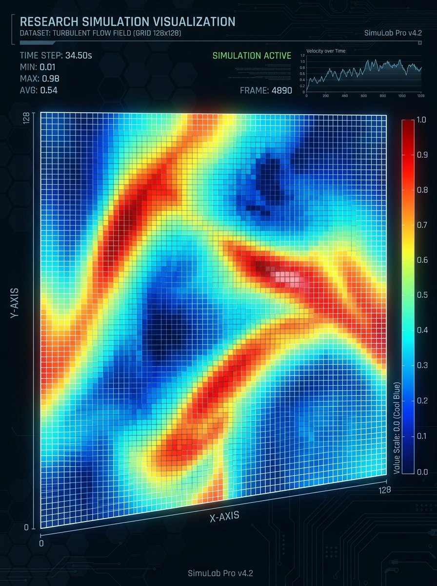

# Kapitel 2: 2D-Visualisierung (WPF/Pixel)

Dieses Kapitel umfasst die folgenden Abschnitte:

- 2.1: Speicherlayout digitaler Rasterbilder
- 2.2: Pixel-Rendering in WPF mit WriteableBitmap
- 2.3: High-Performance Puffer-Zugriff mit Pointern
- 2.4: Farbskalen & Look-Up-Tables (LUT)
- 2.5: Anwendungsbeispiel: 2D-Wärmeleitungssimulation

---

### Showcase & Peer-Challenge: Termin 01

Präsentation der Ergebnisse aus Termin 01 ([Aufgabenblatt 01](../../Uebungen/Termin_01_Kinematik_und_Euler/Aufgabenblatt.md)):

<div class="columns">
<div class="two">

#### Track A: Industrie (Hydraulikzylinder)
- **Modell:** Viskose vs. quadratische Blendenreibung, harter Anschlag mit Federkraft.
- **Numerik:** Euler vs. Heun (RK2). Ab welcher Schrittweite $\Delta t$ explodiert Euler?
- **Stresstest:** $\Delta t$ live verzehnfachen.

</div>
<div class="two">

#### Track B: Game (Artillery Duel)
- **Modell:** Ballistik mit quadratischem Newton-Drag, stochastischem Wind & Terrain.
- **Numerik:** Schnittpunkt-Interpolation bei Kollision, KI-Winkelsuche ($\pm 1{,}5\,\text{m}$).
- **Stresstest:** Gegenwind live auf $+25\,\text{m/s}$ setzen.

</div>
</div>

> **Peer-Challenge (Säule 2b):** Fragen aus dem Plenum zu Stabilitätsgrenzen, Energieerhaltung und linearer Schnittpunkt-Interpolation.

---

## 2.1: Speicherlayout digitaler Rasterbilder

Dieser Abschnitt umfasst die folgenden Inhalte:

- Diskrete Rasterbilder und 2D-Feldsimulationen
- Farbmodelle, Bytereihenfolge und Farbtiefe (Bgra32)
- Zeilenweiser linearer Speicher (Row-Major) und Stride
- Mathematische Adressberechnung und Cache-Lokalität

---

### Was ist ein Rasterbild in der Simulation?

<div class="columns">
<div class="two">

Ein **Rasterbild** ist eine zweidimensionale Matrix aus diskreten Bildpunkten (**Pixeln**):

- Jedes Pixel besitzt ganzzahlige Koordinaten $(x, y)$ mit:
  $$0 \le x < \text{Breite}, \quad 0 \le y < \text{Höhe}$$
- In technischen Simulationen repräsentiert jedes Pixel den lokalen Zustand eines räumlichen Gitters:
  - **2D-Skalarfelder:** Temperatur $T(x,y)$, Druck $p(x,y)$, Konzentration $c(x,y)$
  - **Zelluläre Automaten:** Belegungszustände, Gittergase, Conway's Game of Life
  - **Finite Differenzen:** Diskretisierte partielle Differentialgleichungen (PDEs)

</div>
<div class="one">

| Eigenschaft | Wertbereich |
|---|---|
| Breite $W$ | Pixel (Spalten) |
| Höhe $H$ | Pixel (Zeilen) |
| Farbtiefe | 32 Bit (4 Bytes) |
| Format | `Bgra32` |
| Kanäle | Blue, Green, Red, Alpha |

</div>
</div>

---

### Farbmodelle und 32-Bit Farbtiefe (`Bgra32`)

In modernen Betriebssystemen und Grafiktreibern ist das **32-Bit BGRA-Format** der Standard für maximale Verarbeitungsgeschwindigkeit:

- **B (Blau), G (Grün), R (Rot):** Je 1 Byte ($0 \dots 255$) für die Farbintensität.
- **A (Alpha):** 1 Byte ($0 = \text{voll transparent}, 255 = \text{voll deckend}$).
- **Speicherorganisation im RAM (Little-Endian):**
  - Byte 0: Blau | Byte 1: Grün | Byte 2: Rot | Byte 3: Alpha
  - Bei Interpretation als vorzeichenloser 32-Bit-Integer (`uint`):
    $$\text{Pixel}_{\text{uint}} = (\text{Alpha} \ll 24) \mid (\text{Rot} \ll 16) \mid (\text{Grün} \ll 8) \mid \text{Blau}$$
  - Wert `0xFFFF0000` entspricht z.B. voll deckendem Reinrot.

---

### Das Konzept des Strides

Ein 2D-Rasterbild existiert im Arbeitsspeicher als **kontinuierlicher 1D-Byte-Block**:

- Die Pixelzeilen werden sequentiell hintereinander abgelegt (**Row-Major Order**).
- **`Stride` (Zeilenschrittweite):** Die tatsächliche Anzahl an Bytes von einer Zeile zur nächsten:
  $$\text{Stride} = \text{Breite} \times \text{BytesJePixel} + \text{Padding}$$
- Da moderne Speichercontroller am schnellsten auf Adressen zugreifen, die Vielfache von 4 oder 8 Bytes sind, wird die Zeilenlänge ggf. mit ungenutzten Füll-Bytes (*Padding*) aufgerundet.
- Bei 32-Bit-Pixeln (`Bgra32`) ist die Zeilenbreite $\text{Breite} \times 4$ stets ein Vielfaches von 4.

---

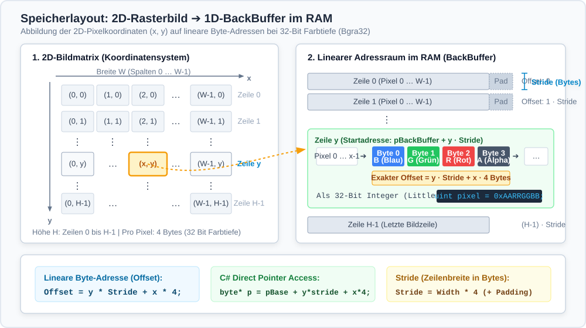

---

### Mathematische Adressberechnung

Für ein Pixel an Koordinate $(x, y)$ errechnet sich die absolute Position im Puffer:

- **Relativer Byte-Offset:**
  $$\text{Offset}(x, y) = y \cdot \text{Stride} + x \cdot 4$$

- **Absolute Speicheradresse (Pointer):**
  $$p(x, y) = p_{\text{BackBuffer}} + y \cdot \text{Stride} + x \cdot 4$$

- **Bedeutung für die Cache-Lokalität:**
  - Zeilenweiser Durchlauf ($y$ in der äußeren Schleife, $x$ in der inneren):
    Sequentieller Speicherzugriff ➔ Optimale Ausnutzung von CPU-L1/L2-Caches und Prefetching.
  - Spaltenweiser Durchlauf ($x$ außen, $y$ innen):
    Stride-Sprünge bei jedem Zugriff ➔ Massenhafte Cache-Misses und drastischer Performanceverlust!

---

## 2.2: Pixel-Rendering in WPF mit WriteableBitmap

Dieser Abschnitt umfasst die folgenden Inhalte:

- Das Problem der WPF Visual-Tree-Skalierung
- Die Architektur der Klasse `WriteableBitmap`
- Deklaration und Einbindung im XAML-Layout
- Schärfe vs. Unschärfe: Skalierungsmodi (`NearestNeighbor` vs. `Linear`)

---

### Grenzen des WPF Visual Tree

<div class="columns">
<div class="two">

Herkömmliche WPF-Visualisierungen basieren auf UI-Elementen (`Shape`, `Rectangle`, `Path` auf einem `Canvas`):

- Jedes einzelne Shape ist ein vollwertiges FrameworkElement:
  - Dependency Properties, Bindings, Style-Auflösung
  - Hit-Testing, Layout-Pass (`Measure`/`Arrange`)
  - Hoher Speicher-Overhead (mehrere hundert Bytes pro Objekt)
- **Skalierungsgrenze:**
  - Bei $\approx 5.000$ Shapes sinkt die Bildrate unter 30 FPS.
  - Bei $512 \times 512 = 262.144$ Partikeln bricht die WPF-UI zusammen.

</div>
<div class="one">

**Lösung:**

Ein einziges XAML-Element:
`<Image Source="{Binding ...}" />`

Kombiniert mit einer einzigen
**`WriteableBitmap`**, in die Millionen Bildpunkte direkt in den Back-Buffer gerendert werden!

</div>
</div>

---

### Architektur von `WriteableBitmap`

`WriteableBitmap` (aus `System.Windows.Media.Imaging`) kapselt zwei Pufferbereiche:

1. **BackBuffer (im RAM):**
   - Ein nativer Speicherbereich, auf den unser Simulationscode direkt über einen Speicherzeiger (`IntPtr` / `byte*`) zugreifen kann.
2. **FrontBuffer (DirectX / GPU):**
   - Der Puffer, der von der MilCore-Render-Engine von WPF zur Darstellung über die Grafikkarte genutzt wird.
3. **Synchronisation:**
   - Der Transfer vom BackBuffer zum FrontBuffer erfolgt nur, wenn Änderungen explizit über `AddDirtyRect()` gemeldet werden.

---

### Einbindung in XAML und Skalierungsmodus

```xml
<Window x:Class="SimulationsApp.MainWindow"
        xmlns="http://schemas.microsoft.com/winfx/2006/xaml/presentation"
        xmlns:x="http://schemas.microsoft.com/winfx/2006/xaml"
        Title="2D-Simulation" Width="800" Height="650">
    <Grid Background="#1e1e1e">
        <!-- Image Control für die direkte Bitmap-Anzeige -->
        <Image x:Name="SimulationImage"
               Stretch="Uniform"
               RenderOptions.BitmapScalingMode="NearestNeighbor" />
    </Grid>
</Window>
```

- **Wichtig:** `BitmapScalingMode="NearestNeighbor"` sorgt dafür, dass Pixel scharf abgegrenzt bleiben (keine bilineare Weichzeichnung / Anti-Aliasing). Dies ist ideal für diskrete Gitterdaten!

---

### Initialisierung im C#-Code-Behind

<div class="columns">
<div class="one">

**Felder und Konstruktor:**
```csharp
public partial class MainWindow : Window
{
    private WriteableBitmap _bitmap;
    private const int Width = 512;
    private const int Height = 512;

    public MainWindow()
    {
        InitializeComponent();
        InitBitmap();
    }
}
```

</div>
<div class="one">

**Bitmap-Setup (`InitBitmap`):**
```csharp
private void InitBitmap()
{
    // WriteableBitmap (32-Bit BGRA, 96 DPI)
    _bitmap = new WriteableBitmap(
        Width, Height, 96.0, 96.0, 
        PixelFormats.Bgra32, null
    );

    // XAML-Image-Control zuweisen
    SimulationImage.Source = _bitmap;
}
```

</div>
</div>

---

## 2.3: High-Performance Puffer-Zugriff

Dieser Abschnitt umfasst die folgenden Inhalte:

- Der threadsichere Aktualisierungszyklus: `Lock()`, `AddDirtyRect()`, `Unlock()`
- Zeigerarithmetik mit C#-Pointern (`unsafe`)
- 8-Bit Byte-Zugriff vs. 32-Bit Integer-Zugriff (`uint*`)
- Ausblick (Kapitel 6): Multithreaded-Rendering mit `Parallel.For`

---

### Der Aktualisierungs-Lebenszyklus

```csharp
// 1. Zugriff sperren (blockiert Render-Thread)
_bitmap.Lock();
try
{
    // 2. Zeiger & Zeilenschrittweite abfragen
    IntPtr pBuffer = _bitmap.BackBuffer;
    int stride = _bitmap.BackBufferStride;
    // 3. Pixel direkt über native Zeiger manipulieren
    UpdatePixelData(pBuffer, stride, Width, Height);
    // 4. Modifizierten Bildbereich als dirty deklarieren
    _bitmap.AddDirtyRect(new Int32Rect(0, 0, Width, Height));
}
finally
{
    _bitmap.Unlock(); // 5. Freigabe an MilCore
}
```

---

### Direkter Zeigerzugriff: Byte- für Byte-Schreiben

```csharp
private unsafe void UpdatePixelData(IntPtr pBuf, int stride, int w, int h)
{
    byte* ptr = (byte*)pBuf.ToPointer();
    for (int y = 0; y < h; y++)
    {
        byte* row = ptr + (y * stride);
        for (int x = 0; x < w; x++)
        {
            int offset = x * 4;
            row[offset + 0] = 255; // Blau  (0..255)
            row[offset + 1] = 128; // Grün  (0..255)
            row[offset + 2] = 0;   // Rot   (0..255)
            row[offset + 3] = 255; // Alpha (deckend)
        }
    }
}
```

---

### Maximale Performance: 32-Bit Integer-Schreiben (`uint*`)

Statt 4 separaten Byte-Schreiboperationen kann ein Pixel als einzelnes 32-Bit-Wort geschrieben werden:

```csharp
private unsafe void UpdatePixelFast(
    IntPtr pBackBuffer, int stride, int w, int h)
{
    uint* ptr = (uint*)pBackBuffer.ToPointer();
    int strideWords = stride / 4; // Schrittweite in 32-Bit

    for (int y = 0; y < h; y++)
    {
        uint* row = ptr + (y * strideWords);
        for (int x = 0; x < w; x++)
        {
            // Format 0xAARRGGBB (Alpha=0xFF, Rot=0xFF, Grün=0x80, Blau=0x00)
            row[x] = 0xFFFF8000; 
        }
    }
}
```

- **Vorteil:** Verdoppelt bis vervierfacht die Speicherbandbreite durch 32-Bit-Wort-Befehle!

---

### Ausblick (Kapitel 6): Paralleles Rendern mit `Parallel.For`

> **Deep Dive / Ausblick auf Kapitel 6 (Multithreading):** Da die Bildzeilen speichertechnisch unabhängig sind, lässt sich die äußere `y`-Schleife ab Kapitel 6 trivial auf alle CPU-Kerne verteilen (in Termin 02 arbeiten wir noch rein sequentiell mit `for`):

```csharp
private unsafe void RenderParallel(IntPtr pBackBuffer, int stride, int w, int h)
{
    uint* ptr = (uint*)pBackBuffer.ToPointer();
    int strideWords = stride / 4;

    Parallel.For(0, h, y =>
    {
        uint* row = ptr + (y * strideWords);
        for (int x = 0; x < w; x++)
        {
            row[x] = CalculateSimulationPixelColor(x, y);
        }
    });
}
```

- Kein Thread-Locking nötig (jede CPU-Core-Instanz schreibt in getrennte Zeilen)!

---

## 2.4: Farbskalen & Look-Up-Tables (LUT)

Dieser Abschnitt umfasst die folgenden Inhalte:

- Transformation von kontinuierlichen Skalaren zu Farbwerten
- Gängige Farbskalen: Cool-Warm, Jet, Viridis
- Performance-Optimierung durch vorberechnete Look-Up-Tables (LUT)
- LUT-Implementierung in C#

---

### Abbildung von Skalaren auf Farben

In der physikalischen Simulation repräsentiert ein Pixel eine Messgröße $v$ (z.B. Temperatur $T \in [T_{\min}, T_{\max}]$):

1. **Normierung auf das Einheitsintervall $[0, 1]$:**
   $$u = \text{clamp}\left(\frac{v - v_{\min}}{v_{\max} - v_{\min}}, \, 0.0, \, 1.0\right)$$

2. **Farbpalette:**
   - **Cool-to-Warm (Divergierend):** Blau ($u=0$) $\to$ Weiß ($u=0.5$) $\to$ Rot ($u=1$).
   - **Jet / Rainbow:** Weit verbreitet, jedoch problematisch bezüglich Farbwahrnehmung.
   - **Viridis:** Perzeptiv gleichförmig (*perceptually uniform*), monoton in Helligkeit und für Farbfehlsichtigkeiten geeignet.

---

### Die Lösung für Echtzeit: Look-Up-Table (LUT)

<div class="columns">
<div class="two">

- **Das Problem:** Farbinterpolationen mit `if/else` oder `Math.Sin()` für jeden einzelnen Pixel pro Frame kosten enorm viel Rechenzeit.
- **Die Lösung:** Einmalige Vorberechnung der Farbpalette in ein Array `uint[256]`.
- **Im inneren Render-Loop ($O(1)$ aus dem L1-Cache):**
  $$\text{Index} = \lfloor u \cdot 255 \rfloor \quad \Longrightarrow \quad \text{PixelFarbe} = \text{LUT}[\text{Index}]$$

</div>
<div class="one">


</div>
</div>

---

### C#-Implementierung einer Farbskalen-LUT: Tabellenaufbau

```csharp
public static class ColorMaps
{
    public static readonly uint[] ViridisLut = GenerateViridis(256);

    private static uint[] GenerateViridis(int steps)
    {
        var lut = new uint[steps];
        for (int i = 0; i < steps; i++)
        {
            double t = (double)i / (steps - 1);
            lut[i] = SampleViridis(t);
        }
        return lut;
    }
}
```

- Vorberechnetes Array für direkten Tabellenzugriff in konstanter Zeit $O(1)$.
- Parameter $t \in [0, 1]$ wird in 256 diskrete Stufen zerlegt.

---

### C#-Implementierung einer Farbskalen-LUT: Farbkanäle

```csharp
private static uint SampleViridis(double t)
{
    // Polynomielle Annäherung an die Viridis-Farbpalette
    byte r = (byte)(255 * Math.Clamp(1.89 * t - 0.70, 0.0, 1.0));
    byte g = (byte)(255 * Math.Clamp(1.39 * t - 0.10, 0.0, 1.0));
    byte b = (byte)(255 * Math.Clamp(
        0.55 + 0.8 * Math.Sin(Math.PI * t), 0.0, 1.0));
    byte a = 255;

    // Als Bgra32 packen: (A << 24) | (R << 16) | (G << 8) | B
    return ((uint)a << 24) | ((uint)r << 16) | ((uint)g << 8) | (uint)b;
}
```

- Farbkanäle werden zu einem 32-Bit-Pixel (`0xAARRGGBB`) bitweise kombiniert.

---

## 2.5: Anwendungsbeispiel: 2D-Wärmeleitung

Dieser Abschnitt führt **ohne thermodynamisches Vorwissen** Schritt für Schritt in die Wärmeleitung ein:

- **Grundbegriffe & Analogie:** Temperatur $T$, Wärmeenergie $E_{\text{th}}$ und Wärmestrom $\dot{Q}$
- **Materialkennwerte:** Wärmeleitfähigkeit $\lambda$, Wärmekapazität $\rho \cdot c_p$ und Temperaturleitfähigkeit $\alpha$
- **Schritt 1 (Fouriersches Gesetz):** Warum ein Temperaturgefälle ($\partial T / \partial x$) einen Wärmestrom antreibt
- **Schritt 2 (Energiebilanz):** Warum die **Krümmung** ($\partial^2 T / \partial x^2$) über Erwärmung oder Abkühlung entscheidet
- **Vom Kontinuum zum Pixelgitter:** 2D-Wärmeleitungsgleichung, 5-Punkt-Stern & Nachbarschafts-Mittelwert
- **Stabilität & Randbedingungen:** Von-Neumann-Grenze ($s \le 0{,}25$), Ping-Pong-Puffer, Dirichlet, Neumann & Robin

---

### Thermodynamik ohne Vorwissen: Die 3 Grundgrößen

Wärmeleitung funktioniert nach **demselben Prinzip** wie ein elektrisches RC-Netzwerk oder verbundene Wassertanks, wenn man drei Größen sauber trennt:

| Größe | Symbol & Einheit | Anschauliche Bedeutung | Elektro- / Hydraulik-Analogie |
| :--- | :---: | :--- | :--- |
| **Temperatur** | $T$ $[\mathrm{K} \text{ / } {}^\circ\mathrm{C}]$ | Lokaler „Wärmedruck“ im Pixel | **Spannung $U$ $[\mathrm{V}]$** / Füllstand $h$ |
| **Wärmeenergie** | $E_{\text{th}}$ $[\mathrm{J} = \mathrm{W\cdot s}]$ | Gespeicherte Energie ($m \cdot c_p \cdot \Delta T$) | **Ladung $Q$ $[\mathrm{C}]$** / Wassermenge |
| **Wärmestrom** | $\dot{Q}$ $[\mathrm{W}]$ / $\dot{q}$ $[\mathrm{W/m^2}]$ | Energiefluss pro Sekunde (und Fläche) | **Stromstärke $I$ $[\mathrm{A}]$** / Stromdichte $J$ |

---

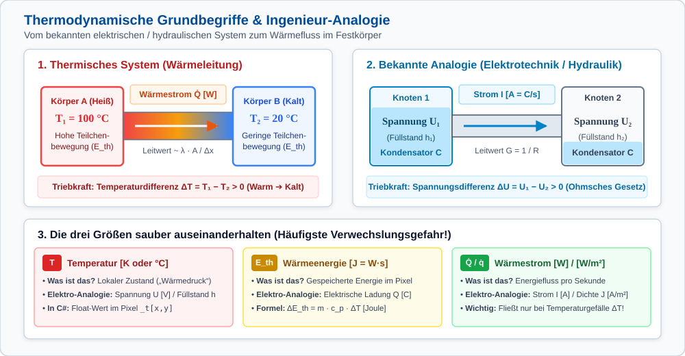

---

### Materialparameter 1: Wärmeleitfähigkeit $\lambda$ (Der Transport)

Warum fühlt sich ein Kupferblock sofort heiß an, während sich Wärmeleitpaste oder Kunststoff nur langsam erwärmen? Der erste Faktor ist das **Transportvermögen**:

- **Wärmeleitfähigkeit $\lambda$ $\left[\frac{\mathrm{W}}{\mathrm{m \cdot K}}\right]$:**
  - Beschreibt, wie gut ein Material Wärmeströme weiterleitet (*„Breite der Wärme-Autobahn“* zwischen zwei Pixeln, analog zum elektrischen Leitwert $G = 1/R$).
  - Gibt an, wie viel Watt Wärmeleistung durch einen $1\,\mathrm{m}$ langen Würfel fließt, wenn zwischen Vorder- und Rückseite $1\,\mathrm{K}$ Temperaturdifferenz herrscht.
- **Typische Größenordnungen in der Technik:**
  - **Sehr gute Leiter (Metalle):** Kupfer $\lambda \approx 398$, Aluminium $\lambda \approx 237$, Silizium $\lambda \approx 148\,\mathrm{W/(m\cdot K)}$
  - **Schwache Leiter / Isolatoren:** Wärmeleitpaste $\lambda \approx 4{,}5$, Glas $\lambda \approx 1{,}0$, ruhende Luft $\lambda \approx 0{,}026\,\mathrm{W/(m\cdot K)}$

---

### Materialparameter 2: Wärmekapazität $\rho \cdot c_p$ (Der Speicher)

Der zweite Faktor ist die **thermische Trägheit** des Materials (*„Wie groß ist der Wärmetank eines Pixels?“*):

- **Spezifische Wärmekapazität $c_p$ $\left[\frac{\mathrm{J}}{\mathrm{kg \cdot K}}\right]$ (bezogen auf die Masse):**
  - Gibt an, wie viele Joule Energie man benötigt, um **$1\,\mathrm{kg}$** des Stoffes um $+1\,\mathrm{K}$ ($+1\,^\circ\mathrm{C}$) zu erwärmen.
- **Volumetrische Wärmekapazität $\rho \cdot c_p$ $\left[\frac{\mathrm{J}}{\mathrm{m^3 \cdot K}}\right]$ (bezogen auf das Gittervolumen):**
  - Da unsere Gitterpixel feste **Volumina** abbilden, multiplizieren wir $c_p$ mit der **Materialdichte $\rho$** $[\mathrm{kg/m^3}]$.
  - Großes $\rho \cdot c_p$ bedeutet: Das Pixel muss sehr viel Wärmeenergie aufnehmen, bevor seine Temperatur $T$ merklich ansteigt (analog zu einem großen Kondensator $C$)!

---

### Materialparameter 3: Temperaturleitfähigkeit $\alpha$

Für die Ausbreitungsgeschwindigkeit einer Temperaturfront entscheidet das **Verhältnis** aus Transport ($\lambda$) und Speicherträgheit ($\rho \cdot c_p$) – die **Temperaturleitfähigkeit $\alpha$** (oft auch $a$ genannt):

$$\alpha = \frac{\lambda}{\rho \cdot c_p} = \frac{\text{Leitvermögen (Transport)}}{\text{Speichervermögen (Trägheit)}} \qquad \left[\frac{\mathrm{W/(m\cdot K)}}{\mathrm{kg/m^3 \cdot J/(kg\cdot K)}} = \frac{\mathrm{m^2}}{\mathrm{s}}\right]$$

- **Merksatz für die Simulation:**
  - **Großes $\alpha$ (z. B. Kupfer $\approx 115\,\mathrm{mm^2/s}$, Alu $\approx 97\,\mathrm{mm^2/s}$):** Hoher Wärmedurchfluss bei moderatem Speicher $\implies$ Temperaturunterschiede gleichen sich im Gitter **rasend schnell** aus!
  - **Kleines $\alpha$ (z. B. Wärmeleitpaste $\approx 2{,}5\,\mathrm{mm^2/s}$):** Geringer Durchfluss $\implies$ Wärme staut sich vor der Schicht!

---

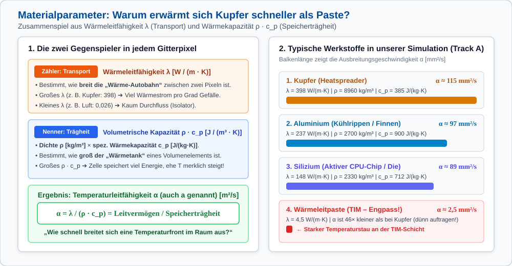

---

### Schritt 1 zur DGL: Das Fouriersche Gesetz (1. Ableitung)

Betrachten wir zwei benachbarte Gitterpunkte $i$ (links, Position $x$) und $i+1$ (rechts, Position $x + \Delta x$):

- **Alltagsbeobachtung:** Wann fließt besonders viel Wärmeleistung pro Fläche ($\dot{q}_x$ in $\mathrm{W/m^2}$) von Zelle $i$ nach Zelle $i+1$?
  1. Je besser das Material Wärme leitet (großes **$\lambda$**),
  2. je größer der Temperaturunterschied **$\Delta T = T_{i+1} - T_i$** zwischen den beiden Zellen ist,
  3. je kürzer der räumliche Abstand **$\Delta x$** ist, über den dieser Temperaturunterschied abfällt!
- Genau diesen Zusammenhang formuliert das **Fouriersche Wärmeleitungsgesetz**:
  $$\dot{q}_x = -\lambda \cdot \frac{\partial T}{\partial x} \approx -\lambda \cdot \frac{T_{i+1} - T_i}{\Delta x} \quad \left[\frac{\mathrm{W}}{\mathrm{m^2}}\right]$$

---

### Schritt 1 zur DGL: Warum steht im Fourierschen Gesetz ein Minuszeichen?

$$\dot{q}_x = -\lambda \cdot \frac{\partial T}{\partial x} \approx -\lambda \cdot \frac{T_{i+1} - T_i}{\Delta x}$$

- **Gedankenexperiment mit konkreten Zahlen:**
  - Links in Zelle $i$ sei es heiß ($T_i = 80\,^\circ\mathrm{C}$), rechts in Zelle $i+1$ sei es kalt ($T_{i+1} = 30\,^\circ\mathrm{C}$).
  - Gehen wir auf der $x$-Achse nach rechts, **fällt** die Temperatur ab ($\Delta T = 30 - 80 = -50\,\mathrm{K} < 0$), die Steigung $\frac{\partial T}{\partial x}$ ist also **negativ**.
  - Physikalisch fließt die Wärme aber von **Warm (links) nach Kalt (rechts)**, also in **positive $x$-Richtung** ($\dot{q}_x > 0$)!
  - **Lösung:** Das Minuszeichen vor $-\lambda$ kehrt das negative Vorzeichen der Steigung um, sodass ein Temperaturabfall nach rechts ($\frac{\partial T}{\partial x} < 0$) einen positiven Wärmestrom nach rechts ($\dot{q}_x > 0$) liefert.

---

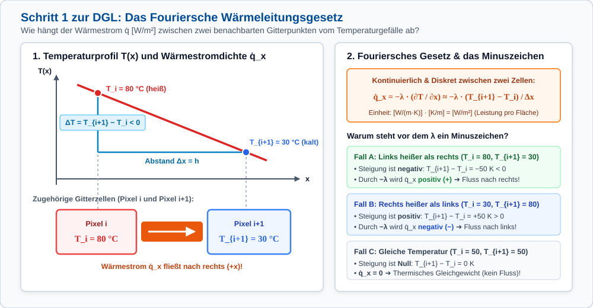

---

### Schritt 2 zur DGL: Wärmestrom-Bilanz an einer Gitterzelle

**Schlüsselfrage:** Wann ändert sich eigentlich die Temperatur $T_i$ einer einzelnen Gitterzelle mit der Zeit ($\frac{\partial T_i}{\partial t} \ne 0$)?

- Fließt von links genauso viel Wärme in die Zelle hinein wie nach rechts wieder herausfließt, bleibt die gespeicherte Energie konstant $\implies$ **Temperatur $T_i$ bleibt unverändert!**
- Die Temperatur $T_i$ ändert sich nur, wenn die **Summe der Zuflüsse** aus der linken Nachbarzelle ($i-1$) und der rechten Nachbarzelle ($i+1$) ungleich Null ist:

$$\dot{q}_{\text{links}\to i} = \lambda \cdot \frac{T_{i-1} - T_i}{\Delta x}, \qquad \qquad \dot{q}_{\text{rechts}\to i} = \lambda \cdot \frac{T_{i+1} - T_i}{\Delta x}$$

---

### Schritt 2 zur DGL: Herleitung der 2. Ableitung (Krümmung)

Addieren wir beide Zuflüsse in Zelle $i$ und teilen durch die Speicherträgheit ($\rho \cdot c_p \cdot \Delta x$), entsteht automatisch die **zweite räumliche Ableitung $\frac{\partial^2 T}{\partial x^2}$**:

$$\frac{\partial T_i}{\partial t} = \frac{\dot{q}_{\text{links}\to i} + \dot{q}_{\text{rechts}\to i}}{\rho \cdot c_p \cdot \Delta x} = \underbrace{\frac{\lambda}{\rho \cdot c_p}}_{\alpha} \cdot \frac{(T_{i-1} - T_i) + (T_{i+1} - T_i)}{\Delta x^2} = \alpha \cdot \frac{T_{i+1} - 2 T_i + T_{i-1}}{\Delta x^2} \approx \alpha \cdot \frac{\partial^2 T}{\partial x^2}$$

- **Wichtige Erkenntnis:**
  - Nicht die Temperatur $T$ selbst und auch nicht das einfache Gefälle $\frac{\partial T}{\partial x}$ bestimmen die Erwärmung einer Zelle, sondern die **Krümmung** $\frac{\partial^2 T}{\partial x^2}$ (der Unterschied zwischen Zufluss und Abfluss)!

---

### Schritt 2 zur DGL: Geometrische Bedeutung der Krümmung

Was bedeutet das Vorzeichen der Krümmung $\frac{\partial^2 T}{\partial x^2} \approx \frac{(T_{i-1} - T_i) + (T_{i+1} - T_i)}{\Delta x^2}$ anschaulich für unsere Zelle $i$?

1. **Lineares Gefälle / Gerade ($\frac{\partial^2 T}{\partial x^2} = 0$, z. B. $100^\circ\mathrm{C} \to 60^\circ\mathrm{C} \to 20^\circ\mathrm{C}$):**
   - Zufluss von links ($+40$) und Abfluss nach rechts ($-40$) heben sich exakt auf $\implies$ **Temperatur bleibt konstant** ($\frac{\partial T_i}{\partial t} = 0$).
2. **Thermisches Tal / Delle ($\frac{\partial^2 T}{\partial x^2} > 0$, z. B. $100^\circ\mathrm{C} \to 40^\circ\mathrm{C} \to 80^\circ\mathrm{C}$):**
   - Zelle $i$ ist kälter als ihre Nachbarn; Wärme strömt von beiden Seiten herein $\implies$ **Zelle erwärmt sich** ($\frac{\partial T_i}{\partial t} > 0$).
3. **Thermischer Berg / Hotspot ($\frac{\partial^2 T}{\partial x^2} < 0$, z. B. $40^\circ\mathrm{C} \to 100^\circ\mathrm{C} \to 40^\circ\mathrm{C}$):**
   - Zelle $i$ ist heißer als ihre Nachbarn; Wärme strömt nach beiden Seiten weg $\implies$ **Zelle kühlt ab** ($\frac{\partial T_i}{\partial t} < 0$).

---

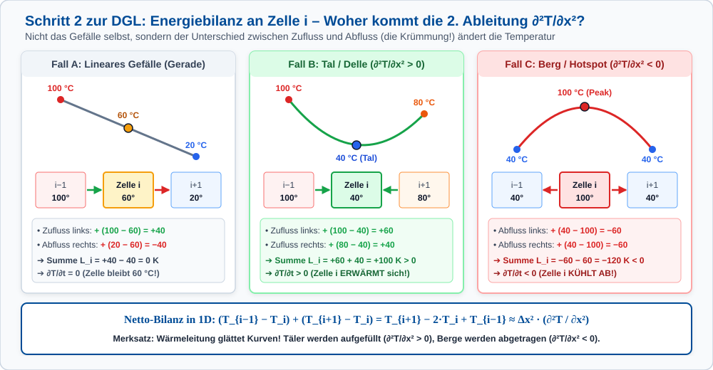

---

### Von 1D zu 2D: Die vollständige 2D-Wärmeleitungsgleichung

Auf unserem 2D-Pixelgitter findet dieser Wärmeaustausch gleichzeitig **horizontal ($x$)** und **vertikal ($y$)** statt – ergänzt um eine optionale **Heizquelle $Q$** (z. B. ein stromdurchflossener Chip):

$$\underbrace{\frac{\partial T}{\partial t}}_{\substack{\text{Zeitliche Änderung} \\ [\mathrm{K/s}]}} = \underbrace{\alpha}_{\substack{\text{Temperatur-} \\ \text{leitfähigkeit } [\mathrm{m^2/s}]}} \cdot \underbrace{\left( \frac{\partial^2 T}{\partial x^2} + \frac{\partial^2 T}{\partial y^2} \right)}_{\substack{\text{2D-Krümmung: Laplace-Operator } \Delta T = \nabla^2 T \\ [\mathrm{K/m^2}]}} + \underbrace{Q(x, y, t)}_{\substack{\text{Externe Heizrate} \\ Q = \dot{q}_V / (\rho c_p) \text{ } [\mathrm{K/s}]}}$$

- **Der Laplace-Operator $\Delta T = \nabla^2 T = \frac{\partial^2 T}{\partial x^2} + \frac{\partial^2 T}{\partial y^2}$** misst in 2D, ob das Pixel $(x,y)$ relativ zu seinen Nachbarn in einem „Temperatur-Tal“ ($\Delta T > 0$) oder auf einem „Temperatur-Berg“ ($\Delta T < 0$) liegt!

---

### Überblick aller Größen & SI-Einheiten der Wärmeleitungs-DGL

<div class="columns top">
<div class="one">

| Symbol | Physikalische Größe | Einheit |
| :--- | :--- | :---: |
| $T(x,y,t)$ | Lokale Pixeltemperatur | $\mathrm{K}$ / ${}^\circ\mathrm{C}$ |
| $\alpha$ (bzw. $a$) | Temperaturleitfähigkeit $\frac{\lambda}{\rho c_p}$ | $\mathrm{m^2/s}$ |
| $\lambda$ | Wärmeleitfähigkeit (Fourier) | $\mathrm{W/(m\cdot K)}$ |
| $\rho$ | Materialdichte | $\mathrm{kg/m^3}$ |

</div>
<div class="one">

| Symbol | Physikalische Größe | Einheit |
| :--- | :--- | :---: |
| $c_p$ | Spezifische Wärmekapazität | $\mathrm{J/(kg\cdot K)}$ |
| $\rho \cdot c_p$ | Volumetrische Wärmekapazität | $\mathrm{J/(m^3\cdot K)}$ |
| $\dot{q}_V$ | Volumetrische Heizleistung | $\mathrm{W/m^3}$ |
| $Q$ | Temperatur-Quellrate $\frac{\dot{q}_V}{\rho c_p}$ | $\mathrm{K/s}$ |

</div>
</div>

---

### Räumliche Diskretisierung in 2D: Der 5-Punkt-Stern

<div class="columns">
<div class="three">

Auf einem quadratischen Pixelgitter ($\Delta x = \Delta y$) addieren wir die 1D-Krümmungen in $x$- und $y$-Richtung auf einem gemeinsamen Nenner $\Delta x^2$:

1. **Summe aus horizontaler und vertikaler Krümmung:**
   $$\frac{\partial^2 T}{\partial x^2} + \frac{\partial^2 T}{\partial y^2} \approx \frac{T_{i+1,j}^n - 2T_{i,j}^n + T_{i-1,j}^n}{\Delta x^2} + \frac{T_{i,j+1}^n - 2T_{i,j}^n + T_{i,j-1}^n}{\Delta x^2}$$
2. **Zusammenfassung im Zähler als 5-Punkt-Stern $L_{i,j}^n$ $[\mathrm{K}]$:**
   $$L_{i,j}^n = T_{i+1,j}^n + T_{i-1,j}^n + T_{i,j+1}^n + T_{i,j-1}^n - 4 \cdot T_{i,j}^n$$
   $$\implies \quad \frac{\partial^2 T}{\partial x^2} + \frac{\partial^2 T}{\partial y^2} \approx \frac{L_{i,j}^n}{\Delta x^2} \quad \left[\frac{\mathrm{K}}{\mathrm{m^2}}\right]$$

</div>
<div class="two">

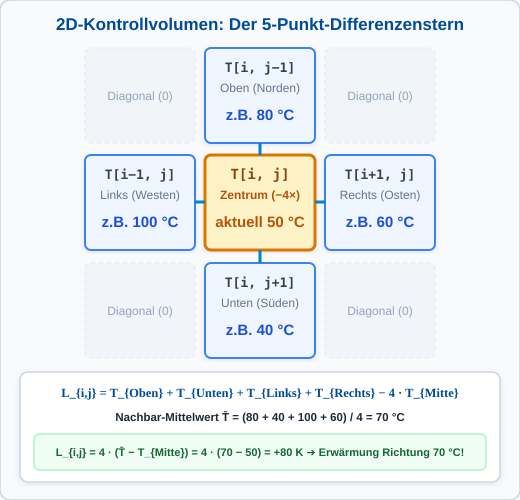

</div>
</div>

---

### Anschauliche Interpretation: Der Nachbarschafts-Mittelwert

Was berechnet der Zähler $L_{i,j}^n = T_{i+1,j}^n + T_{i-1,j}^n + T_{i,j+1}^n + T_{i,j-1}^n - 4 \cdot T_{i,j}^n$ eigentlich geometrisch? Klammern wir den Faktor $4$ aus, erscheint der **Durchschnittswert $\bar{T}_{\text{Nachbarn}}^n$ der 4 Nachbarpixel**:

$$L_{i,j}^n = 4 \cdot \left( \underbrace{\frac{T_{i+1,j}^n + T_{i-1,j}^n + T_{i,j+1}^n + T_{i,j-1}^n}{4}}_{\bar{T}_{\text{Nachbarn}}^n \text{ (Mittelwert der 4 Nachbarn)}} - T_{i,j}^n \right)$$

- **Intuitive Bedeutung:**
  - Ist der Durchschnitt der 4 Nachbarn **wärmer** als das Pixel selbst ($\bar{T}_{\text{Nachbarn}}^n > T_{i,j}^n$), ist $L_{i,j}^n > 0 \implies$ **Pixel erwärmt sich!**
  - Ist der Durchschnitt der 4 Nachbarn **kälter** als das Pixel selbst ($\bar{T}_{\text{Nachbarn}}^n < T_{i,j}^n$), ist $L_{i,j}^n < 0 \implies$ **Pixel kühlt ab!**

---

### Zeitliche Diskretisierung: Expliziter Euler & Herkunft von $s$

Wie gelangen wir nun von der 2D-Differentialgleichung $\frac{\partial T}{\partial t} = \alpha \cdot \left(\frac{\partial^2 T}{\partial x^2} + \frac{\partial^2 T}{\partial y^2}\right) + Q$ zur Berechnungsformel für den nächsten Zeitschritt $t_{n+1} = t_n + \Delta t$?

1. **Zeit-Ableitung links durch Vorwärts-Differenz ersetzen (Expliziter Euler aus Termin 01):**
   $$\frac{\partial T}{\partial t} \approx \frac{T_{i,j}^{n+1} - T_{i,j}^n}{\Delta t} \qquad \Longrightarrow \qquad \frac{T_{i,j}^{n+1} - T_{i,j}^n}{\Delta t} = \alpha \cdot \frac{L_{i,j}^n}{\Delta x^2} + Q_{i,j}^n$$
2. **Beide Seiten mit $\Delta t$ multiplizieren und nach $T_{i,j}^{n+1}$ auflösen:**
   $$T_{i,j}^{n+1} = T_{i,j}^n + \underbrace{\left(\frac{\alpha \cdot \Delta t}{\Delta x^2}\right)}_{=\, s} \cdot L_{i,j}^n + \Delta t \cdot Q_{i,j}^n$$
- Alle drei Konstanten vor $L_{i,j}^n$ ($\alpha$ aus dem Material, $\Delta t$ aus dem Zeitschritt, $\Delta x^2$ aus dem Ortsgitter) fassen wir zum Parameter **$s = \frac{\alpha \cdot \Delta t}{\Delta x^2}$** zusammen!

---

### Physikalische Bedeutung des Parameters $s$ (Diffusionszahl)

Der Parameter $s = \frac{\alpha \cdot \Delta t}{\Delta x^2}$ heißt in der Numerik **dimensionslose Diffusionszahl** (bzw. **Gitter-Fourier-Zahl**):

1. **Einheiten-Check (Dimensionskontrolle):**
   $$[s] = \frac{[\alpha] \cdot [\Delta t]}{[\Delta x^2]} = \frac{(\mathrm{m^2/s}) \cdot \mathrm{s}}{\mathrm{m^2}} = \frac{\mathrm{m^2}}{\mathrm{m^2}} = 1 \quad \text{(dimensionslose Kennzahl!)}$$
2. **Anschauliche Bedeutung (Verhältnis zweier Flächen):**
   - **Zähler ($\alpha \cdot \Delta t$ in $[\mathrm{m^2}]$):** Fläche, über die sich Wärme in **einem Zeitschritt $\Delta t$** ausbreitet.
   - **Nenner ($\Delta x^2$ in $[\mathrm{m^2}]$):** Geometrische **Fläche eines einzelnen Gitterpixels**.
   - **Verhältnis $s$:** Welcher Bruchteil einer Pixelfläche pro Zeitschritt thermisch überbrückt wird (Kopplungsstärke zu jedem einzelnen Nachbarpixel)!
3. **Vorteil im Code:** Einmal vorab als `float s = alpha * dt / (dx * dx);` berechnet (keine Division im Loop).

---

### Der Zeitschritt als gewichtete Mischung

Setzen wir $L_{i,j}^n = 4 \cdot (\bar{T}_{\text{Nachbarn}}^n - T_{i,j}^n)$ in unsere Zeitschritt-Formel $T_{i,j}^{n+1} = T_{i,j}^n + s \cdot L_{i,j}^n$ (ohne Heizquelle) ein und klammern $T_{i,j}^n$ aus:

$$T_{i,j}^{n+1} = T_{i,j}^n + 4s \cdot \left(\bar{T}_{\text{Nachbarn}}^n - T_{i,j}^n\right) \quad \Longleftrightarrow \quad \boxed{T_{i,j}^{n+1} = \underbrace{(1 - 4s)}_{\text{Eigengewicht}} \cdot T_{i,j}^n + \underbrace{4s}_{\text{Nachbargewicht}} \cdot \bar{T}_{\text{Nachbarn}}^n}$$

- **Erkenntnis:**
  - In jedem Zeitschritt bildet die neue Pixeltemperatur einfach eine **gewichtete Mischung** aus dem eigenen alten Wert $T_{i,j}^n$ (Gewicht $1 - 4s$) und dem Durchschnitt $\bar{T}_{\text{Nachbarn}}^n$ seiner 4 Nachbarn (Gewicht $4s$)!
  - Die Summe beider Gewichte ist immer $(1 - 4s) + 4s = 1 = 100\,\%$.

---

### Numerische Stabilität (Von-Neumann): Die 3 Fälle für $s$

Anhand der Mischungsformel $T_{\text{neu}} = (1 - 4s) \cdot T_{\text{alt}} + 4s \cdot \bar{T}_{\text{Nachbarn}}$ verstehen wir sofort, was bei verschiedenen Werten der Diffusionszahl $s = \frac{\alpha \cdot \Delta t}{\Delta x^2}$ passiert:

1. **Stabiler Bereich $s < 0{,}25$ (z. B. $s = 0{,}20 \implies T_{\text{neu}} = 0{,}20 \cdot T_{\text{alt}} + 0{,}80 \cdot \bar{T}_{\text{Nachbarn}}$):**
   - Beide Gewichte sind positiv. $T_{\text{neu}}$ liegt **garantiert** zwischen $T_{\text{alt}}$ und $\bar{T}_{\text{Nachbarn}}$ (*Diskretes Maximumprinzip*).
2. **Stabilitätsgrenze $s = 0{,}25$ ($\implies T_{\text{neu}} = 0 \cdot T_{\text{alt}} + 1{,}00 \cdot \bar{T}_{\text{Nachbarn}}$):**
   - Das Eigengewicht wird exakt Null; das Pixel übernimmt zu $100\,\%$ den Durchschnitt seiner 4 Nachbarn.
3. **Instabiler Bereich $s > 0{,}25$ (z. B. $s = 0{,}35 \implies T_{\text{neu}} = -0{,}40 \cdot T_{\text{alt}} + 1{,}40 \cdot \bar{T}_{\text{Nachbarn}}$):**
   - Das Eigengewicht $(1 - 4s)$ wird **negativ**! Ein $+100\,^\circ\mathrm{C}$ Punkt in $0\,^\circ\mathrm{C}$ Umgebung schießt auf **$-40\,^\circ\mathrm{C}$**, im nächsten Schritt auf **$+96\,^\circ\mathrm{C}$** usw. $\implies$ **Alternierende Gitterexplosion (`NaN`)**!

---

### Berechnung der maximalen Zeitschrittweite $\Delta t_{\max}$

Damit das Eigengewicht $(1 - 4s)$ niemals negativ wird, muss für jedes 2D-Diffusionsgitter zwingend die **Von-Neumann-Stabilitätsbedingung** eingehalten werden:

$$\boxed{1 - 4s \ge 0 \quad \Longleftrightarrow \quad s = \frac{\alpha \cdot \Delta t}{\Delta x^2} \le 0{,}25 \quad \Longleftrightarrow \quad \Delta t_{\max} = \frac{\Delta x^2}{4 \cdot \alpha_{\max}}}$$

- **Konkretes Rechenbeispiel für unser Starter-Projekt (`HeatGrid.cs` im Live-Sprint):**
  - Gegeben: $\alpha = 1{,}0 \times 10^{-4}\,\mathrm{m^2/s}$ und Gitterweite $\Delta x = 1\,\mathrm{mm} = 10^{-3}\,\mathrm{m}$.
  - Kritische Zeitschrittgrenze:
    $$\Delta t_{\max} = \frac{(10^{-3}\,\mathrm{m})^2}{4 \cdot 1{,}0 \times 10^{-4}\,\mathrm{m^2/s}} = \frac{10^{-6}}{4 \times 10^{-4}}\,\mathrm{s} = 0{,}0025\,\mathrm{s} = 2{,}5\,\mathrm{ms}$$
  - **Vorsicht bei feineren Gittern:** Halbiert man den Pixelabstand $\Delta x$, viertelt sich $\Delta t_{\max}$!

---

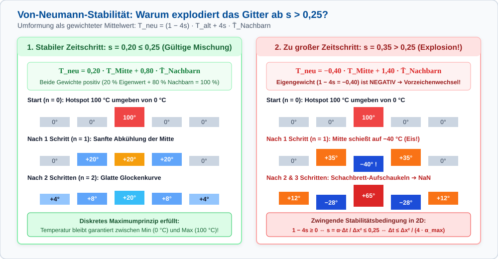

---


---

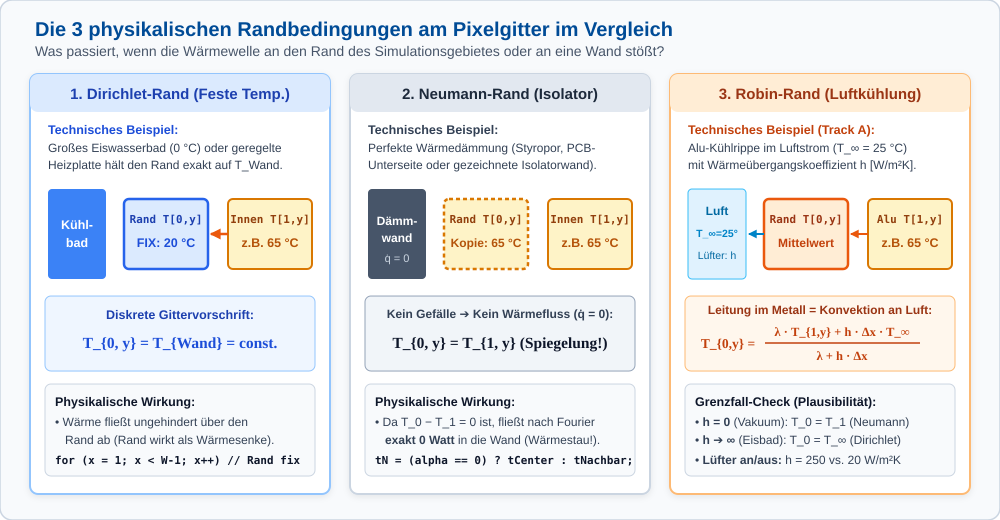

---

### 1. Dirichlet-Rand vs. 2. Neumann-Rand am Außenrand

<div class="columns">
<div class="two">

**1. Dirichlet-Rand (Feste Wandtemperatur):**
- Randtemperatur ist fest vorgegeben ($T_{\text{Rand}} = \text{const.}$).
- **Im Code:** Äußerste Zeilen und Spalten werden in der Schleife ausgelassen (`for (int x = 1; x < Width - 1; x++)`).

**2. Neumann-Rand (Adiabater Isolator, $\dot{q} = 0$):**
- Gedämmte Wand lässt keinen Wärmestrom durch ($\frac{\partial T}{\partial n} = 0$).
- **Im Code:** Randpixel kopiert den inneren Nachbarn (`_t[0, y] = _t[1, y]`), sodass $\Delta T = 0$ und $\dot{q} = 0\,\mathrm{W}$ gilt.

</div>
<div class="one">

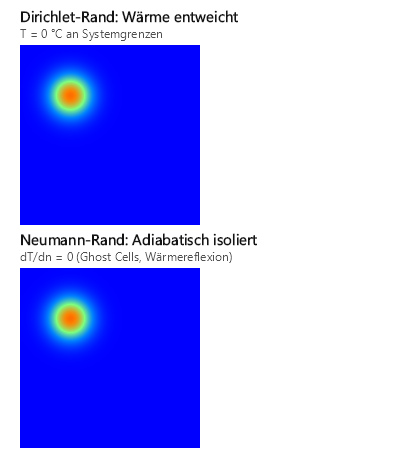

*Oben: Dirichlet. Unten: Neumann.*

</div>
</div>

---

### Innere Isolator-Wände: Die „Kühlakku“-Stolperfalle (Sprint A3)

Im heutigen Live-Sprint zeichnen wir per rechter Maustaste **thermische Isolator-Wände** ($\alpha_{x,y} = 0$) mitten in das Gitter:

- **Was passiert, wenn wir nur `_alphaMap[x, y] = 0` setzen?**
  - Die Wandzelle selbst ändert ihre Temperatur zwar nicht mehr und bleibt dauerhaft auf ihrer Starttemperatur ($20\,^\circ\mathrm{C}$).
  - **Aber:** Das heiße Nachbarpixel *neben* der Wand ($80\,^\circ\mathrm{C}$) liest im 5-Punkt-Stern die $20\,^\circ\mathrm{C}$ kalte Wandzelle als normalen Nachbarn!
  - Dadurch fließt in jedem Zeitschritt Wärme aus dem heißen Pixel in die $20\,^\circ\mathrm{C}$-Wandzelle ab – die Wand wirkt wie ein **Eiswürfel / Kühlakku (Dirichlet-Senke)** statt wie eine Wärmedämmung!

---

### Innere Isolator-Wände: Lokale Neumann-Spiegelung im Code

Damit exakt **null Wärmestrom** in ein benachbartes Isolatorpixel ($\alpha = 0$) fließt, muss die Temperaturdifferenz über diese Zellkante **Null** sein (lokale Neumann-Bedingung $\frac{\partial T}{\partial n} = 0$):

- **Lösung in `HeatGrid.Step()`:** Ist ein Nachbarpixel ein Isolator (`_alphaMap[...] == 0f`), spiegeln wir dort unsere eigene Temperatur `tCenter`:
  ```csharp
  float tRight = _alphaMap[x + 1, y] == 0f ? tCenter : _tCurrent[x + 1, y];
  float tLeft  = _alphaMap[x - 1, y] == 0f ? tCenter : _tCurrent[x - 1, y];
  float tDown  = _alphaMap[x, y + 1] == 0f ? tCenter : _tCurrent[x, y + 1];
  float tUp    = _alphaMap[x, y - 1] == 0f ? tCenter : _tCurrent[x, y - 1];
  ```
- **Physikalischer Effekt:** Für die Wandkante wird `tNeighbor - tCenter == 0` $\implies$ **100 % adiabate Reflexion an der Wand!**

---

### 3. Konvektive Randbedingung (Robin): Physikalische Bilanz

Wie kühlt ein Aluminium-Kühlkörper in der Praxis (Aufgabe Track A)? An seiner Oberfläche (Randknoten $0$) strömt kühle Luft mit Temperatur $T_\infty = 25\,^\circ\mathrm{C}$ vorbei:

- **1. Wärmeleitung aus dem Metallinneren (Knoten $1$) bis zur Oberfläche (Knoten $0$):**
  $$\dot{q}_{\text{Leitung}} = \lambda \cdot \frac{T_{1,y} - T_{0,y}}{\Delta x} \quad \left[\frac{\mathrm{W}}{\mathrm{m^2}}\right]$$
- **2. Konvektiver Wärmeübergang von der Oberfläche (Knoten $0$) an den Luftstrom ($T_\infty$):**
  Mit dem **Wärmeübergangskoeffizienten $h$** $[\mathrm{W/(m^2 \cdot K)}]$ (z. B. $h = 250$ bei aktivem Lüfter, $h = 20$ bei Lüfterausfall):
  $$\dot{q}_{\text{Konvektion}} = h \cdot \left(T_{0,y} - T_\infty\right) \quad \left[\frac{\mathrm{W}}{\mathrm{m^2}}\right]$$

---

### 3. Konvektive Randbedingung (Robin): Aufgelöste Gitterformel

An der Oberfläche muss der aus dem Metall ankommende Wärmestrom gleich dem an die Luft abgegebenen Wärmestrom sein ($\dot{q}_{\text{Leitung}} = \dot{q}_{\text{Konvektion}}$):

$$\lambda \cdot \frac{T_{1,y} - T_{0,y}}{\Delta x} = h \cdot \left(T_{0,y} - T_\infty\right) \quad \Longrightarrow \quad \boxed{T_{0,y} = \frac{\lambda \cdot T_{1,y} + (h \cdot \Delta x) \cdot T_\infty}{\lambda + h \cdot \Delta x}}$$

- **Anschauliche Bedeutung & Grenzfall-Kontrolle:**
  - $T_{0,y}$ ist das **gewichtete Mittel** aus Innentemperatur $T_{1,y}$ (Gewicht $\lambda$) und Lufttemperatur $T_\infty$ (Gewicht $h \cdot \Delta x$).
  - **Perfekte Isolierung ($h \to 0$):** $T_{0,y} = T_{1,y}$ (**Neumann-Fall**).
  - **Unendlich starke Kühlung ($h \to \infty$):** $T_{0,y} = T_\infty$ (**Dirichlet-Fall**).

---

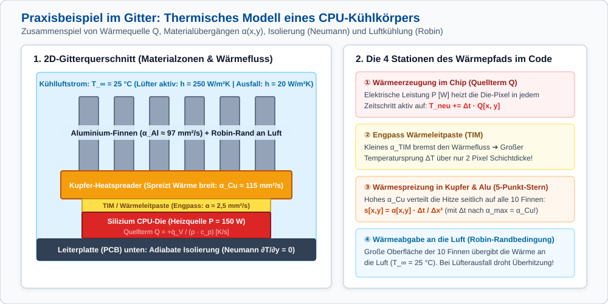

---

### Simulation und Visualisierung im Code

<div class="columns">
<div class="two">

```csharp
// Simulationsschritt (Ping-Pong Double-Buffering)
for (int y = 1; y < Height - 1; y++)
{
    for (int x = 1; x < Width - 1; x++)
    {
        float laplace = _tempPrev[x + 1, y] + _tempPrev[x - 1, y]
                      + _tempPrev[x, y + 1] + _tempPrev[x, y - 1]
                      - 4.0f * _tempPrev[x, y];

        _tempCurr[x, y] = _tempPrev[x, y] + DiffCoeff * laplace;
    }
}

// Wärmequellen fixieren & Puffer-Referenzen tauschen
_tempCurr[100, 100] = 100.0f;
(_tempPrev, _tempCurr) = (_tempCurr, _tempPrev);
```

</div>
<div class="one">

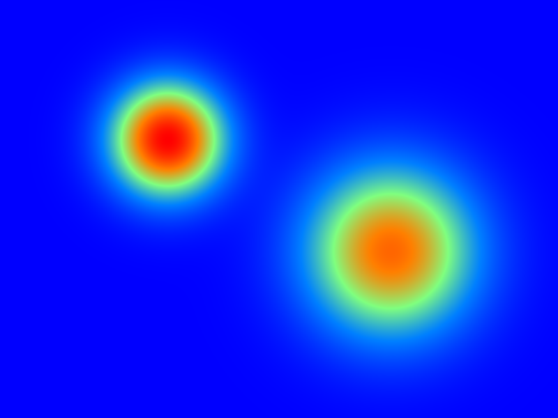

*Simuliertes Temperaturfeld auf WriteableBitmap.*

</div>
</div>

---

### Pufferübertragung in die WriteableBitmap

<div class="columns">
<div class="one">

**Puffer-Verwaltung:**
```csharp
public unsafe void RenderToBitmap(
    WriteableBitmap bmp, float[,] f, uint[] lut)
{
    bmp.Lock();
    try
    {
        uint* pBuf = (uint*)bmp.BackBuffer.ToPointer();
        int stride = bmp.BackBufferStride / 4;

        RenderKernel(pBuf, stride, f, lut);
        bmp.AddDirtyRect(
            new Int32Rect(0, 0, Width, Height));
    }
    finally { bmp.Unlock(); }
}
```

</div>
<div class="one">

**Sequentieller 32-Bit-Kernel:**
```csharp
private unsafe void RenderKernel(
    uint* pBuf, int stride, float[,] f, uint[] lut)
{
    for (int y = 0; y < Height; y++)
    {
        uint* row = pBuf + (y * stride);
        for (int x = 0; x < Width; x++)
        {
            int idx = (int)Math.Clamp(
                f[x, y] * 2.55f, 0f, 255f);
            row[x] = lut[idx];
        }
    }
}
```

</div>
</div>

---

### Zusammenfassung Kapitel 2

- **Speicherlayout:** Rasterbilder liegen als 1D-Arrays im RAM ($\text{Offset} = y \cdot \text{Stride} + x \cdot 4$); zeilenweises Iterieren maximiert die CPU-Cache-Trefferquote.
- **WriteableBitmap:** Umgeht den WPF Visual Tree und rendert Hunderttausende Pixel flüssig bei 60 FPS über ein einziges `Image`-Control.
- **High-Performance & LUT:** Mit `unsafe uint*` Zeigerarithmetik und vorberechneten Look-Up-Tables (`uint[256]`) erfolgt die Farbkodierung in $O(1)$-Zeit ohne Garbage Collection.
- **2D-Wärmeleitung (FDM):** Der 5-Punkt-Stern vergleicht jedes Pixel mit dem Mittelwert seiner 4 Nachbarn; für Stabilität im expliziten Ping-Pong-Verfahren muss $s = \frac{\alpha \Delta t}{\Delta x^2} \le 0{,}25$ gelten.
- **Randbedingungen:** Dirichlet (fester Randwert), Neumann (Spiegelung am Isolator, $\dot{q}=0$) und Robin (gewichtetes Mittel bei Luftkonvektion) bilden reale Bauteilgrenzen exakt ab.

---

### Laborübung Termin 02: Pixelgrafik & FDM

Vertiefende Hausübung (Stufe B, 10 Pkt., Wahlmodell Track A oder B) – Details siehe [Aufgabenblatt 02](../../Uebungen/Termin_02_Pixelgrafik_und_FDM/Aufgabenblatt.md):

<div class="columns">
<div class="two">

#### Track A: CPU-Kühlkörper-Optimizer
- Inhomogenes Gitter ($a_{\text{Si}}, a_{\text{TIM}}, a_{\text{Cu}}, a_{\text{Al}}$)
- 10 Kühlrippen mit Robin-Randbedingung
- Lüfterbetrieb vs. Ausfall ($h = 250 \to 20\,\text{W/m}^2\text{K}$)
- Stabilitätsgrenze $\Delta t \le \frac{\Delta x^2}{4 a_{\max}}$ nachweisen

</div>
<div class="two">

#### Track B: Falling Sand & Lava-Simulator
- Doppellagiges Gitter ($200 \times 200$): FDM + Automat
- Gravitation für Sand- und Lava-Pixel
- Doom-Fire Konvektion & Asche-Zerfall
- Flüssiges Rendering ($\ge 45\,\text{FPS}$) via `BackBuffer`

</div>
</div>

