<!-- _paginate: false -->
<!-- _header: "" -->
<!-- _footer: "" -->


# Kapitel 3: 2D-Visualisierung (WPF/Vektor)

Dieses Kapitel umfasst die folgenden Abschnitte:

- 3.1: Grundlagen der Vektorgrafik und WPF Canvas
- 3.2: Transformation: Welt- zu Bildschirmkoordinaten
- 3.3: Vektordarstellung geometrischer Elemente und Kräfte
- 3.4: Interaktive Steuerung im Canvas (Pan & Zoom)
- 3.5: Performance & Architektur: Shapes vs. DrawingVisual

---

### Showcase & Peer-Challenge: Termin 02

Präsentation der Ergebnisse aus Termin 02 ([Aufgabenblatt 02](../../Uebungen/Termin_02_Pixelgrafik_und_FDM/Aufgabenblatt.md)):

<div class="columns">
<div class="two">

#### Track A: Industrie (CPU-Kühlkörper)
- **FDM-Modell:** Inhomogene Materialien (Si, Cu, Al) & Robin-Randbedingungen an Finnen.
- **Numerik:** Stabilitätsgrenze $\Delta t \le \frac{\Delta x^2}{4 a_{\max}}$ für Kupfer nachweisen.
- **Stresstest:** Lüfterausfall live schalten ($h: 250 \to 20\,\text{W/m}^2\text{K}$) oder $\Delta t$ verdoppeln.

</div>
<div class="two">

#### Track B: Game (Doom Fire & Lava)
- **Hybrid-Gitter:** 5-Punkt-FDM Wärmefeld gekoppelt mit zellulärem Sand-/Lava-Automat.
- **Performance:** Allokationsfreier Render-Loop auf `WriteableBitmap.BackBuffer` ($\ge 45\,\text{FPS}$).
- **Stresstest:** Diffusionsfaktor überkriechen lassen oder Großbrand live auslösen.

</div>
</div>

> **Peer-Challenge (Säule 2b):** Prüfung auf physikalisches Double-Buffering (kein In-Place-Überschreiben) und 0 B GC-Allokationen im Render-Tick.

---

<!-- Platzhalter für Abschnittsbildbeschreibung -->

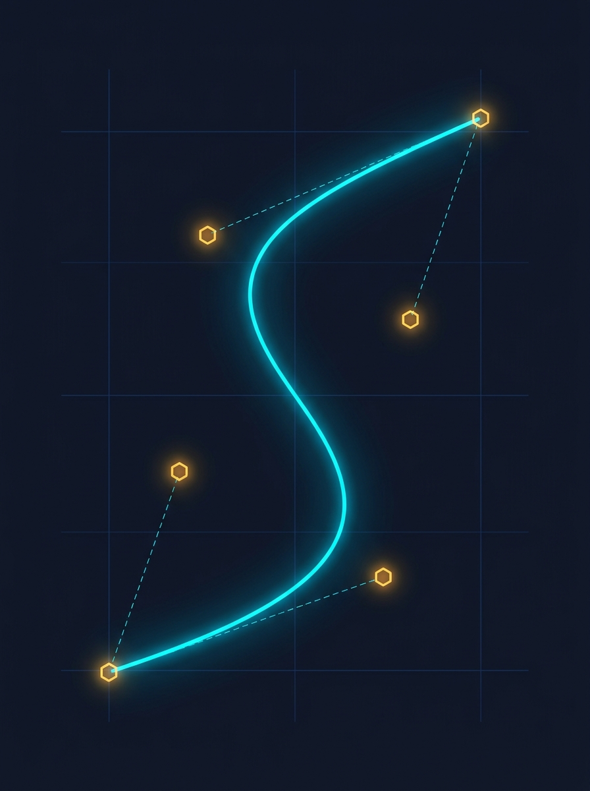

## 3.1: Grundlagen der Vektorgrafik und WPF Canvas

Dieser Abschnitt umfasst die folgenden Inhalte:

- Prinzip der Vektorgrafik im Vergleich zur Rastergrafik
- Retained Mode vs. Immediate Mode in Benutzeroberflächen
- Das `Canvas`-Element in WPF und Attached Properties
- Vektorielle Grundformen (`Line`, `Rectangle`, `Ellipse`, `Polygon`, `Path`)
- Szenengraph und Visual Tree in WPF

---

### Was ist Vektorgrafik?

<div class="columns">
<div class="two">

- **Mathematische Repräsentation**: Bilder bestehen nicht aus Pixeln, sondern aus analytisch definierten Primitiven (Punkte, Linien, Polygone).
- **Auflösungsunabhängigkeit**: Vektoren lassen sich ohne Qualitätsverlust beliebig skalieren – gestochen scharf auf jedem Monitor.
- **Parametrisierbarkeit**: Jede Geometrie besitzt modifizierbare Attribute:
  - Anfangs- und Endkoordinaten $(x_1, y_1) \to (x_2, y_2)$
  - Linienstärke (`StrokeThickness`) und Strichmuster
  - Füllfarbe (`Fill`) und Konturfarbe (`Stroke`)
- **Einsatzbereich**: CAD, Fachwerke, Schemata, Kraftvektoren.

</div>
<div class="one">

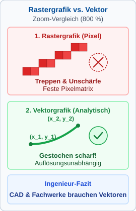

</div>
</div>

---

### Retained Mode vs. Immediate Mode

<div class="columns top">
<div class="two">

**Immediate Mode (Termin 02 – `WriteableBitmap`):**
- Pixel werden direkt in den Bildspeicher geschrieben.
- Die GUI-Bibliothek „vergisst“ gezeichnete Formen sofort.
- Keine UI-Objekte, kein Klick-Handling auf einzelnen Linien.

**Retained Mode (Termin 03 – WPF `Canvas` & `Shapes`):**
- Die GUI verwaltet einen Szenengraph (**Visual Tree**) im RAM.
- Jede Linie und jeder Knoten existiert als C#-Objekt.
- **Automatisches Neuzeichnen** bei Größenänderungen.
- **Ereignisbehandlung**: Native Maus-Events auf jedem Shape.

</div>
<div class="one">

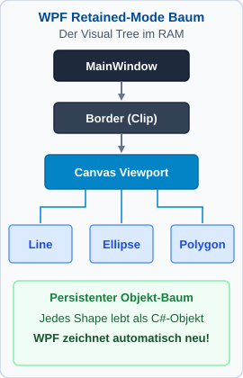

</div>
</div>

---

### Das `Canvas`-Control in WPF

<div class="columns top">
<div class="two">

In WPF bietet das `Canvas`-Control eine 2D-Zeichenfläche mit **absoluter Positionierung**:

- Kindelemente (`el`) werden über angehängte Eigenschaften (**Attached Properties**) an Position $(x, y)$ platziert:
  - In C#: `Canvas.SetLeft(el, x);` und `Canvas.SetTop(el, y);`
  - In XAML: `Canvas.Left="120"` und `Canvas.Top="85"`
- Im Gegensatz zu `Grid` führt der Canvas **keine automatische Layout-Verschachtelung** durch.
- Kindelemente können sich frei überlappen (Z-Index).
- Ideal geeignet für technische 2D-Simulationsmodelle, CAD-Viewer und interaktive Vektorgrafiken.

</div>
<div class="one">

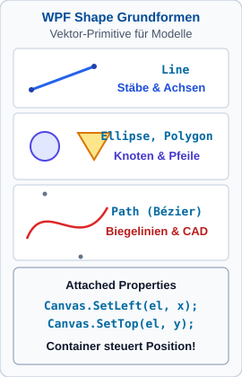

</div>
</div>

---

### WPF Canvas: Instanziierung im Code

Kindelemente (z.B. ein Tragwerksstab `member` als `Line`) lassen sich direkt im Code-Behind erzeugen und zur `Children`-Sammlung des Canvas hinzufügen:

```csharp
// Linie auf einem WPF Canvas im C#-Code erzeugen
var member = new Line
{
    X1 = 50,  Y1 = 50,   // Startpunkt [px]
    X2 = 250, Y2 = 150,  // Endpunkt [px]
    Stroke = Brushes.SteelBlue,
    StrokeThickness = 3.0,
    StrokeEndLineCap = PenLineCap.Round
};

// Zur Zeichenfläche hinzufügen
myCanvas.Children.Add(member);
```

- Das Element `member` wird sofort Bestandteil des WPF Visual Tree.
- Bei Fensteränderungen zeichnet WPF das Element automatisch neu.

---

### WPF Layout-Panels: 4 Strategien

<div class="columns top">
<div class="two">

In WPF positioniert man UI-Elemente nicht pixelgenau per Hand, sondern überlässt dies spezialisierten **Layout-Containern (Panels)**:

- **`Canvas` (Absolut):** Platziert Kindelemente an expliziten Koordinaten $(x, y)$. Ideal für 2D-Simulationen, CAD und Vektorgrafiken.
- **`StackPanel` (Linear):** Stapelt Elemente sequentiell horizontal oder vertikal. Braucht *keine* Koordinaten (Menüs, Toolbars).
- **`Grid` (Tabellarisch):** Teilt Fläche in Zeilen und Spalten (`Row`, `Column`). Passt sich responsiv an Fenstergrößen an (Standard für Masken).
- **`DockPanel` (Andocken):** Heftet Elemente an die Außenkanten (`Top`, `Bottom`, `Left`, `Right`) und füllt das Zentrum.

</div>
<div class="one">

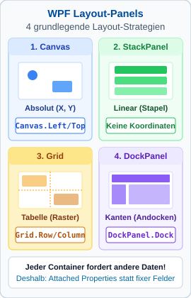

</div>
</div>

---

### Attached Properties: Warum kein `myNode.Left`?

<div class="columns top">
<div class="two">

Warum deklariert die Klasse `Ellipse` nicht einfach `myNode.Left = 100`?

- **Verschiedene Anforderungen:** Jedes Panel benötigt völlig andere Layout-Informationen (`Canvas.Left/Top`, `Grid.Row/Column`, `DockPanel.Dock` oder gar keine beim `StackPanel`).
- **Die Speicherfalle:** Müsste `UIElement` jede Eigenschaft aller Container als C#-Feld besitzen, wäre jedes Objekt speicherintensiv überfrachtet.
- **Open-Closed-Prinzip:** Eigene Custom-Panels könnten keine neuen Eigenschaften definieren, ohne `UIElement` umzuschreiben.
- **Die WPF-Lösung:** Der übergeordnete **Container** definiert die Eigenschaft (`Canvas.Left`), das **Kindelement** (`child`) speichert nur die Position $(x, y)$.

</div>
<div class="one">

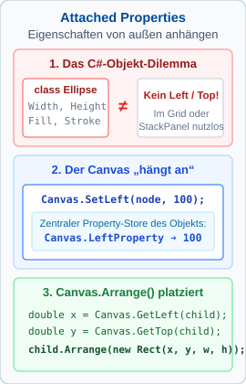

</div>
</div>

---

### Attached Properties: Hinter den Kulissen (C# & XAML)

<div class="columns top">
<div class="one">

**1. Der interne Property-Store:**
Jedes `DependencyObject` besitzt einen internen Schlüssel-Wert-Speicher:
- `Canvas.SetLeft(node, 100.0)` ruft intern auf:
  ```csharp
  node.SetValue(Canvas.LeftProperty, 100.0);
  ```
- Es existiert kein Feld `Left` in `Ellipse` – der Wert ist an `node` assoziiert.

**2. Syntax-Gegenüberstellung:**
- **XAML:** `<Ellipse Canvas.Left="100" Canvas.Top="50"/>`
- **C#:** `Canvas.SetLeft(node, 100.0);`

</div>
<div class="one">

**3. Wie nutzt der Canvas den Wert?**
In Phase 2 des Layout-Cycles (`Arrange`) fragt der `Canvas` die Werte $(x, y)$ jedes Kindes (`child`) ab:

```csharp
foreach (UIElement child in Children)
{
    double x = Canvas.GetLeft(child);
    double y = Canvas.GetTop(child);
    child.Arrange(new Rect(x, y, 
        child.DesiredSize.Width, 
        child.DesiredSize.Height));
}
```

> **Performance-Tipp:**  
> `Canvas.SetLeft()` markiert gezielt nur das Layout des Canvas als verändert (`AffectsArrange`).

</div>
</div>

---

### Positionierungs-Strategien der WPF Shapes

<div class="columns top">
<div class="two">

| Control | Positionierungsmethode |
| :--- | :--- |
| **`Line`** | Eigene Eigenschaften `X1, Y1, X2, Y2` (relativ zu Canvas) |
| **`Ellipse`** | `Canvas.Left`, `Canvas.Top` (linke obere Hüllbox-Ecke!) |
| **`Polygon`** | Interne `Points`-Sammlung absoluter Koordinaten |
| **`Path`** | Koordinaten in der `PathGeometry` (`Figures`) |

<br>

**Zentrierung von Knotenpunkten (Ellipsen):**
Um ein Element `node` (`Ellipse`) mit Radius $r$ exakt auf Punkt $p = (x_s, y_s)$ zu zentrieren:
$$\text{Canvas.Left} = x_s - r, \quad \text{Canvas.Top} = y_s - r$$

</div>
<div class="one">

```csharp
// Knoten als zentrierten Kreis zeichnen
public void AddNode(Canvas canvas, 
                    Point p, double r)
{
    var node = new Ellipse
    {
        Width = 2 * r,
        Height = 2 * r,
        Fill = Brushes.SteelBlue
    };
    Canvas.SetLeft(node, p.X - r);
    Canvas.SetTop(node, p.Y - r);
    canvas.Children.Add(node);
}
```

</div>
</div>

---

### WPF Shape-Elemente (Übersicht)

<div class="columns top">
<div class="one">

**`Line`**
- Verbindet zwei Punkte $(X_1, Y_1)$ und $(X_2, Y_2)$.
- Eigenschaften: `Stroke`, `StrokeThickness`, `StrokeDashArray`.
- Einsatz: Stäbe, Achsen, Maßhilfslinien.

**`Rectangle` / `Ellipse`**
- Bemaßung über `Width` und `Height`.
- Flächenfüllung (`Fill`) und Kontur (`Stroke`).
- Einsatz: Tragwerksknoten, Gelenke, Bauteile.

</div>
<div class="one">

**`Polygon`**
- Geschlossene Kette aus $N$ Punkten (`PointCollection`).
- Automatischer Ringschluss vom letzten zum ersten Punkt.
- Einsatz: Pfeilspitzen, Lager-Dreiecke, Profile.

**`Path`**
- Mächtigstes Vektor-Element in WPF.
- Unterstützt Geraden, Kreisbögen und Bézier-Kurven.
- Einsatz: Biegelinien, Freiform-CAD-Konturen.

</div>
</div>

---

<!-- Platzhalter für Abschnittsbildbeschreibung -->

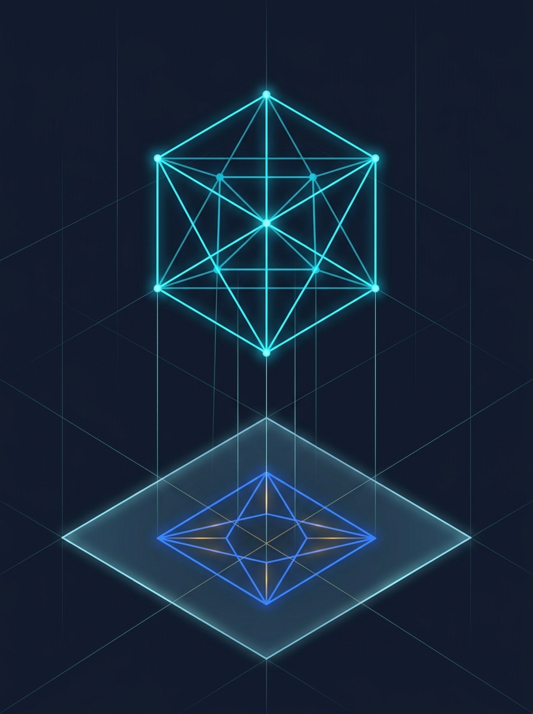

## 3.2: Transformation: Welt- zu Bildschirmkoordinaten

Dieser Abschnitt umfasst die folgenden Inhalte:

- Das Koordinaten-Paradoxon (Physik vs. Monitor)
- Bounding Box, Modellgrenzen und Randabstand
- Die Anisotropie-Falle (Verzerrung vs. Isotropie)
- Isotropes Skalieren und Invertierung der Y-Achse
- C#-Implementierung der Klasse `Transform2D`

---

### Das fundamentale Koordinaten-Paradoxon

<div class="columns top">
<div class="two">

Beim Zeichnen physikalischer Systeme treffen zwei inkompatible Welten aufeinander:

1. **Ingenieurtechnisches Weltsystem (Physik / DIN 1304):**
   - Kontinuierlich: $x_w, y_w \in \mathbb{R}$ in Metern $[\mathrm{m}]$.
   - **$+Y$-Achse zeigt nach OBEN** (Höhe, Gravitation $\vec{g}$).
   - Ursprung beliebig (z.B. Auflagerpunkt).

2. **Bildschirm-Koordinatensystem (WPF Canvas):**
   - Diskret: $x_s, y_s \in \mathbb{N}_0$ in Bildschirmpixeln $[\mathrm{px}]$.
   - **$+Y$-Achse zeigt nach UNTEN** (Scanline-Raster).
   - Ursprung $(0,0)$ starr in der linken oberen Fensterecke.

</div>
<div class="one">

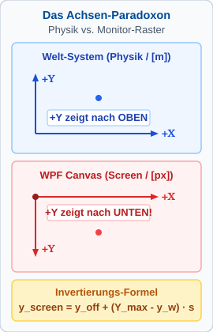

</div>
</div>

---

### Gegenüberstellung: Welt- vs. Bildschirmraum

<div class="columns top">
<div class="one">

### 1. Weltkoordinatensystem (Physik)

- **Modellraum**: Reale physikalische Geometrie
- **Kontinuierlich**: Reelle Koordinaten $x_w, y_w \in \mathbb{R}$
- **Einheit**: Physikalische Größen (z.B. Meter $[\mathrm{m}]$)
- **Orientierung**: Die $+Y$-Achse zeigt nach **oben**!
- **Ursprung $(0,0)$**: Beliebig im Raum platziert (z.B. linker Auflagerpunkt oder Schwerpunkt).

</div>
<div class="one">

### 2. Bildschirmkoordinaten (WPF Canvas)

- **Anzeigeraum**: Viewport auf dem Monitor
- **Diskret**: Pixel bzw. Device Independent Pixels $[\mathrm{px}]$
- **Einheit**: $1/96$ Zoll pro Pixel
- **Orientierung**: Die $+Y$-Achse zeigt nach **unten**!
- **Ursprung $(0,0)$**: Fest in der **linken oberen Ecke** des Steuerelements fixiert.

</div>
</div>

---

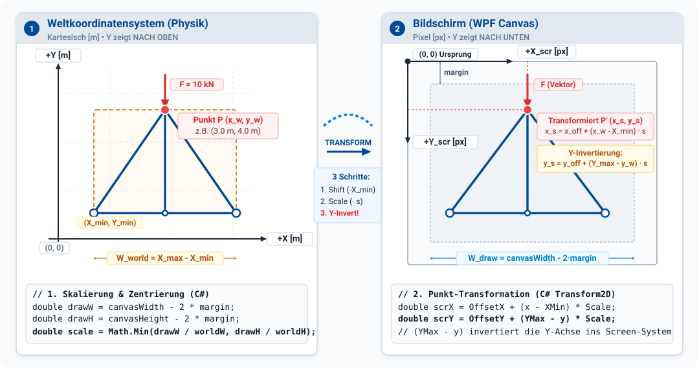

---

### Bounding Box & Bemaßung des Modells

<div class="columns top">
<div class="two">

Vor der Skalierung wird die minimale Hüllbox (**Bounding Box**) der Knotenkoordinaten ermittelt:

**1. Extremwerte aller Knotenpunkte ermitteln:**
$$X_{\min} = \min_{i} (x_i), \quad X_{\max} = \max_{i} (x_i) \quad [\mathrm{m}]$$
$$Y_{\min} = \min_{i} (y_i), \quad Y_{\max} = \max_{i} (y_i) \quad [\mathrm{m}]$$

**2. Physische Ausdehnung des Modells:**
$$W_{\text{world}} = X_{\max} - X_{\min}, \quad H_{\text{world}} = Y_{\max} - Y_{\min} \quad [\mathrm{m}]$$

**3. Nutzbare Zeichenfläche mit Randabstand:**
$$W_{\text{draw}} = W_{\text{canvas}} - 2 \cdot \text{margin} \quad [\mathrm{px}]$$
$$H_{\text{draw}} = H_{\text{canvas}} - 2 \cdot \text{margin} \quad [\mathrm{px}]$$

</div>
<div class="one">

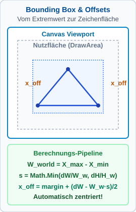

</div>
</div>

---

### Die Anisotropie-Falle (Verzerrung!)

<div class="columns top">
<div class="two">

Was passiert bei **naiver Skalierung** mit getrennten Faktoren für X und Y?

$$s_x = \frac{W_{\text{draw}}}{W_{\text{world}}}, \quad s_y = \frac{H_{\text{draw}}}{H_{\text{world}}} \quad \left[\frac{\mathrm{px}}{\mathrm{m}}\right]$$

- Wenn $s_x \ne s_y$, wird der Raum gestreckt oder gestaucht:
  - Kreise werden zu Ellipsen, Fachwerke rechteckig verzerrt.
  - $45^\circ$-Diagonalen kippen ab, Kraftvektoren zeigen fehl!
- **Ingenieur-Regel:** Anisotrope Skalierung ist in Physikmodellen unzulässig!
- **Die Lösung:** Ein isotroper Maßstab $s = \min(s_x, s_y)$ (nächste Folie).

</div>
<div class="one">

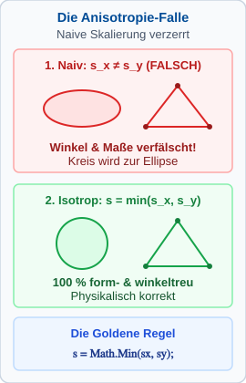

</div>
</div>

---

### Isotropes Uniform Scaling

<div class="columns top">
<div class="two">

Die Lösung: **Isotrope Skalierung** mit einheitlichem Maßstab $s$:

$$s = \min(s_x, s_y) \quad \left[\frac{\mathrm{px}}{\mathrm{m}}\right]$$

- **Bedeutung:** Einheit $[\mathrm{px/m}]$ (Pixel pro Meter).
- Der **kleinere** Faktor garantiert, dass das Modell in beiden Dimensionen vollständig auf die Zeichenfläche passt.
- **Eigenschaften:**
  - Alle geometrischen Proportionen bleiben physikalisch exakt erhalten.
  - Winkel bleiben winkeltreu ($45^\circ$ bleibt exakt $45^\circ$).
  - Modell skaliert responsiv bei Fenstergrößenänderung.

</div>
<div class="one">

| Symbol | Bedeutung | Einheit |
| :--- | :--- | :---: |
| $W_{\text{world}}$ | Modellbreite | $[\mathrm{m}]$ |
| $H_{\text{world}}$ | Modellhöhe | $[\mathrm{m}]$ |
| $W_{\text{draw}}$ | Nutzbare Breite | $[\mathrm{px}]$ |
| $H_{\text{draw}}$ | Nutzbare Höhe | $[\mathrm{px}]$ |
| $s$ | Isotroper Maßstab | $[\mathrm{px/m}]$ |
| $x_{\text{off}}, y_{\text{off}}$ | Zentrierungs-Offsets | $[\mathrm{px}]$ |

</div>
</div>

---

### Zentrierung im Viewport: Problem & 2 Grenzfälle

<div class="columns top">
<div class="two">

Beim isotropen Skalieren $s = \min(s_x, s_y)$ stößt das Modell $(W_{\text{world}}, H_{\text{world}})$ an genau einer Achse von $(W_{\text{draw}}, H_{\text{draw}})$ an:

- **Das Problem ohne Zentrierung:**
  - Bei naivem Platzieren an $(\text{margin}, \text{margin})$ klebt das Modell starr am linken bzw. oberen Rand.
  - Der gesamte ungenutzte Freiraum verbleibt rechts bzw. unten.
- **Die 2 resultierenden Grenzfälle:**
  - **Fall 1: Höhen-limitiert ($s_y \le s_x$):**  
    Modell füllt $H_{\text{draw}}$ aus $\implies$ horizontaler Freiraum $\Delta W$.
  - **Fall 2: Breiten-limitiert ($s_x < s_y$):**  
    Modell füllt $W_{\text{draw}}$ aus $\implies$ vertikaler Freiraum $\Delta H$.
- **Ziel:** Symmetrische Aufteilung mit $x_{\text{off}}$ und $y_{\text{off}}$.

</div>
<div class="one">

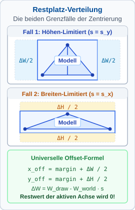

</div>
</div>

---

### Zentrierung Fall 1: Höhen-limitiert (s_y ≤ s_x)

<div class="columns top">
<div class="two">

Ist das Fenster relativ breiter als das Modell, limitiert die Höhe ($s = s_y$):

- **Vertikale Achse (voll belegt):**
  - Modellhöhe füllt $H_{\text{draw}}$ ($H_{\text{world}} \cdot s$). $\Delta H = 0 \implies y_{\text{off}} = \text{margin}$.
- **Horizontale Achse (Freiraum):**
  - Freiraum $\Delta W = W_{\text{draw}} - W_{\text{world}} \cdot s > 0$ wird links/rechts halbiert:
    $$x_{\text{off}} = \text{margin} + \frac{\Delta W}{2} \quad [\mathrm{px}]$$
- **Ergebnis:** Das Modell steht horizontal perfekt zentriert im Viewport.

</div>
<div class="one">

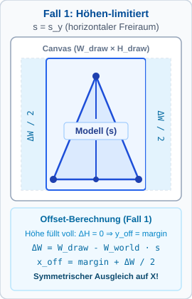

</div>
</div>

---

### Zentrierung Fall 2: Breiten-limitiert (s_x < s_y)

<div class="columns top">
<div class="two">

Ist das Fenster relativ höher als das Modell, limitiert die Breite ($s = s_x$):

- **Horizontale Achse (voll belegt):**
  - Modellbreite füllt $W_{\text{draw}}$ ($W_{\text{world}} \cdot s$). $\Delta W = 0 \implies x_{\text{off}} = \text{margin}$.
- **Vertikale Achse (Freiraum):**
  - Freiraum $\Delta H = H_{\text{draw}} - H_{\text{world}} \cdot s > 0$ wird oben/unten halbiert:
    $$y_{\text{off}} = \text{margin} + \frac{\Delta H}{2} \quad [\mathrm{px}]$$
- **Universelle C#-Formel (ohne `if`/`else`):**
  - Auf der limitierenden Achse gilt $\Delta = 0$. Die Formeln berechnen beide Fälle einheitlich!

</div>
<div class="one">

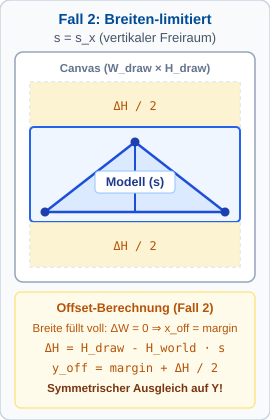

</div>
</div>

---

### Invertierung der Y-Achse (Welt $\to$ Screen)

<div class="columns top">
<div class="two">

Das Koordinaten-Paradoxon erfordert eine **Spiegelung der vertikalen Achse**:

- **Weltraum:** $Y$ wächst nach **oben** (Boden bei $Y=0\,\mathrm{m}$).
- **Screenraum:** $Y$ wächst nach **unten** (Kopfzeile bei $Y=0\,\mathrm{px}$).
- **Die Transformationsgleichung:**
  $y_s = y_{\text{off}} + (Y_{\max} - y_w) \cdot s \quad [\mathrm{px}]$
- **Grenzwerte-Kontrolle:**
  - Höchster Modellpunkt ($y_w = Y_{\max}$):  
    $y_s = y_{\text{off}} + 0 \implies$ **oberer Rand**.
  - Tiefster Modellpunkt ($y_w = Y_{\min}$):  
    $y_s = y_{\text{off}} + H_{\text{world}} \cdot s \implies$ **unterer Rand**.
- **Einheiten:** $[\mathrm{px}] + [\mathrm{m}] \cdot [\mathrm{px/m}] = [\mathrm{px}]$ (dimensionsrein).

</div>
<div class="one">

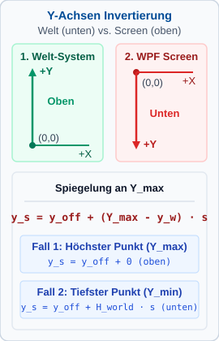

</div>
</div>

---

### C#-Implementierung: `Transform2D` (Setup & Skalierung)

```csharp
public class Transform2D
{
    public double Scale { get; private set; } = 1.0;
    public double OffsetX { get; private set; }
    public double OffsetY { get; private set; }
    public double XMin { get; private set; }
    public double YMax { get; private set; }

    public void Update(double xMin, double xMax, double yMin, double yMax,
                       double canvasWidth, double canvasHeight, double margin = 50.0)
    {
        XMin = xMin;
        YMax = yMax; // Höchster Y-Wert für Invertierung!
        double worldW = Math.Max(xMax - xMin, 1e-4);
        double worldH = Math.Max(yMax - yMin, 1e-4);

        double drawW = Math.Max(canvasWidth - 2.0 * margin, 10.0);
        double drawH = Math.Max(canvasHeight - 2.0 * margin, 10.0);

        Scale = Math.Min(drawW / worldW, drawH / worldH); // Isotrop!
        OffsetX = margin + (drawW - worldW * Scale) / 2.0;
        OffsetY = margin + (drawH - worldH * Scale) / 2.0;
    }
}
```

---

### C#-Implementierung: `Transform2D` (Transformation)

```csharp
public class Transform2D
{
    // ... Bounding-Box & Skalierungszustand aus Update() ...

    // Wandelt Weltpunkt (X_w, Y_w) [m] in Canvas-Pixel (x_s, y_s) [px] um
    public Point WorldToScreen(double xW, double yW) => new(
        OffsetX + (xW - XMin) * Scale,
        OffsetY + (YMax - yW) * Scale // Y-Achsen-Invertierung!
    );

    // Wandelt Canvas-Pixel (x_s, y_s) [px] zurück in Weltkoordinaten [m]
    public (double Xw, double Yw) ScreenToWorld(double xS, double yS) => (
        XMin + (xS - OffsetX) / Scale,
        YMax - (yS - OffsetY) / Scale
    );
}
```

- Entspricht exakt der Vorlagenklasse in [`VectorTrussCanvas/Geometry/Transform2D.cs`](../../Uebungen/Termin_03_Vektorgrafik_Canvas/Vorlage/VectorTrussCanvas/Geometry/Transform2D.cs).

---

<!-- Platzhalter für Abschnittsbildbeschreibung -->

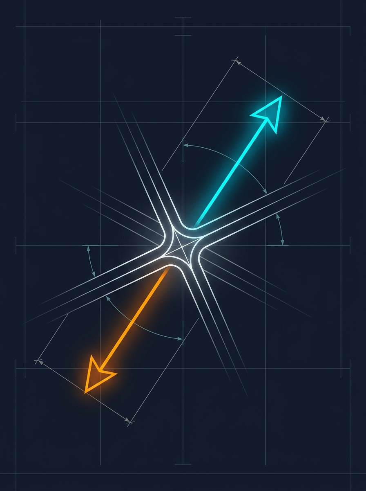

## 3.3: Vektordarstellung geometrischer Elemente und Kräfte

Dieser Abschnitt umfasst die folgenden Inhalte:

- Darstellung gerichteter physikalischer Größen (Kräfte, Geschwindigkeiten)
- Geometriemaßstab vs. Kraftmaßstab ($s_F$ in $[\mathrm{px/N}]$)
- Konstruktion zusammengesetzter Pfeilformen (Schaftlinie + Spitzenpolygon)
- Analytische Berechnung der Pfeilspitze über Orthogonalvektoren (ohne Trigonometrie)
- Normgerechte Bemaßungsketten nach DIN 406 (Maßhilfslinien, Maßlinien, Pfeile)

---

### Geometriemaßstab vs. Kraftmaßstab

<div class="columns top">
<div class="two">

- **Geometrie:** Geometriemaßstab $s$ $[\mathrm{px/m}]$ (z.B. $10\,\mathrm{m}$ Träger $\to 500\,\mathrm{px}$).
- **Physikalische Kräfte:** Dürfen **nicht** mit dem Geometriemaßstab gezeichnet werden!
  - Eine Last von $50\,\mathrm{kN}$ wäre sonst $2.500.000\,\mathrm{px}$ lang.
- **Zwei professionelle Lösungsansätze:**
  1. **Konfigurierbarer Kraftmaßstab $s_F$ $[\mathrm{px/N}]$:**
     $L = s_F \cdot |\vec{F}| \quad [\mathrm{px}]$ (proportional zur Last).
  2. **Feste Pfeillänge mit Beschriftung (Industriestandard):**
     Pfeilschaft ($P_{\text{node}} \to P_{\text{tip}}$) mit Basis $P_{\text{base}}$, Flügeln $P_{\text{wing1,2}}$ und Richtungsvektor $u = e_u$; Betrag als Text (`"25.0 kN"`).

</div>
<div class="two">

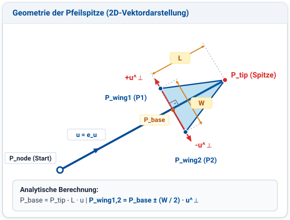

</div>
</div>

---

### Analytische Berechnung der Pfeilspitze

<div class="columns top">
<div class="two">

Gegeben: Knoten $\vec{P}_{\text{node}}$ $[\mathrm{px}]$, Kraftvektor $\vec{F} = (F_x, F_y)^T$, Spitzenmaße $L$ und $W$ $[\mathrm{px}]$.

1. **Pfeilspitze:** $\vec{P}_{\text{tip}} = \vec{P}_{\text{node}} + \text{length} \cdot \vec{e}_u$
2. **Normierter Richtungsvektor:** $\vec{e}_u = \vec{F}_{\text{screen}} / \|\vec{F}_{\text{screen}}\|$ mit Komponenten $(e_x, e_y)$
3. **Orthogonalvektor ($90^\circ$ links):** $\vec{e}_u^\perp = \vec{e}_{\text{perp}} = (-e_y, e_x)^T$
4. **Basispunkt & Flügelpunkte:**
   $\vec{P}_{\text{base}} = \vec{P}_{\text{tip}} - L \cdot \vec{e}_u, \quad \vec{P}_{\text{wing1,2}} = \vec{P}_{\text{base}} \pm \frac{W}{2} \cdot \vec{e}_u^\perp$

</div>
<div class="one">

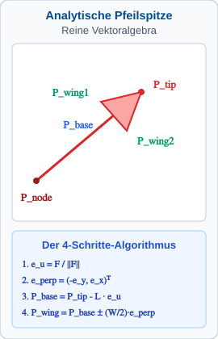

</div>
</div>

---

### Berechnung der Pfeilspitze in C#

```csharp
// Berechnet die Eckpunkte für ein Pfeilspitzen-Dreieck ohne Trigonometrie
public static Point[] GetArrowhead(Point tip, Vector dir, double length, double width)
{
    dir.Normalize(); // Richtungs-Einheitsvektor e_u
    
    // Orthogonalvektor e_u_perp (90° gegen den Uhrzeigersinn gedreht)
    var perp = new Vector(-dir.Y, dir.X);

    Point pBase = tip - (length * dir);             // P_base
    Point pWing1 = pBase + (width / 2.0 * perp);     // P_wing1
    Point pWing2 = pBase - (width / 2.0 * perp);     // P_wing2

    return new Point[] { tip, pWing1, pWing2 };
}
```

- **Vorteil:** Verwendet reine Vektoralgebra ohne teure Aufrufe von `Math.Sin()` oder `Math.Cos()`.
- Liefert die drei Eckpunkte direkt für die `Points`-Collection eines WPF-`Polygon`.

---

### Technische Bemaßung nach DIN 406

<div class="columns top">
<div class="two">

In industriellen CAD-Viewern werden Abmessungen normgerecht nach **DIN 406** dargestellt:

1. **Maßhilfslinien (Extension Lines):**
   - Verlängern Bauteilkanten nach außen.
   - Kurzer Sicherheitsabstand zum Knoten ($3–5\,\mathrm{px}$).
   - Überstand über Maßlinie: ca. $2–3\,\mathrm{mm}$ ($8–12\,\mathrm{px}$).
2. **Maßlinie (Dimension Line):**
   - Steht orthogonal zu den Maßhilfslinien.
   - Begrenzung durch schlanke Maßpfeile (Verhältnis 1:3).
3. **Maßzahl (Dimension Text):**
   - Mittig über der Maßlinie platziert (z.B. `"4.00 m"`).

</div>
<div class="one">

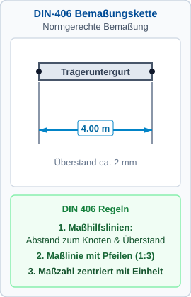

</div>
</div>

---

### DIN 406: Geometrische Konstruktion der Maßkette

<div class="columns top">
<div class="two">

Zerlegung der Maßkette in **5 Konstruktionsschritte**:

1. **Referenzpunkte:** Bauteilknoten $P_1(x_1, y_1)$ und $P_2(x_2, y_2)$ erfassen.
2. **Maßhilfslinien:** Orthogonal von $P_1, P_2$ zu $y_{\text{dim}}$ (`yScreen`) führen.
   - Gap ($\Delta y_{\text{gap}} = 4\,\mathrm{px}$) und Überstand ($\Delta y_{\text{over}} = 8\,\mathrm{px}$).
3. **Maßlinie:** Horizontale Verbindungsstrecke auf Höhe $y_{\text{dim}}$.
4. **Maßpfeile:** Schlanke Spitzen an den Enden der Maßlinie.
5. **Maßzahl:** Zentrierter Text bei $x_{\text{mid}} = \frac{x_1 + x_2}{2}$ über Maßlinie.

</div>
<div class="one">

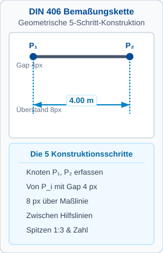

</div>
</div>

---

### C#-Implementierung: DIN-406 Maßkette

```csharp
public static void AddHorizontalDimensionLine(Canvas canvas, Point p1, Point p2, 
                                              double yScreen, string text, Brush stroke)
{
    const double yGap = 4;   // Δy_gap: Abstand zum Bauteil
    const double yOver = 8;  // Δy_over: Überstand über yScreen (y_dim)

    // 1. Maßhilfslinien von (p.Y + yGap) bis (yScreen + yOver)
    canvas.Children.Add(new Line { X1 = p1.X, Y1 = p1.Y + yGap, X2 = p1.X, Y2 = yScreen + yOver, Stroke = stroke });
    canvas.Children.Add(new Line { X1 = p2.X, Y1 = p2.Y + yGap, X2 = p2.X, Y2 = yScreen + yOver, Stroke = stroke });

    // 2. Maßlinie auf yScreen (y_dim)
    canvas.Children.Add(new Line { X1 = p1.X, Y1 = yScreen, X2 = p2.X, Y2 = yScreen, Stroke = stroke });

    // 3. Maßpfeile auf Höhe der Maßlinie
    Point dim1 = new Point(p1.X, yScreen);
    Point dim2 = new Point(p2.X, yScreen);
    canvas.Children.Add(CreateArrowHead(dim1, new Vector(1, 0), stroke));
    canvas.Children.Add(CreateArrowHead(dim2, new Vector(-1, 0), stroke));

    // 4. Maßzahl zentriert bei x_mid = (p1.X + p2.X) / 2
    double xMid = (p1.X + p2.X) / 2.0;
    var label = new TextBlock { Text = text, Foreground = stroke, FontSize = 11 };
    Canvas.SetLeft(label, xMid - 20);
    Canvas.SetTop(label, yScreen - 16);
    canvas.Children.Add(label);
}
```

---

<!-- Platzhalter für Abschnittsbildbeschreibung -->

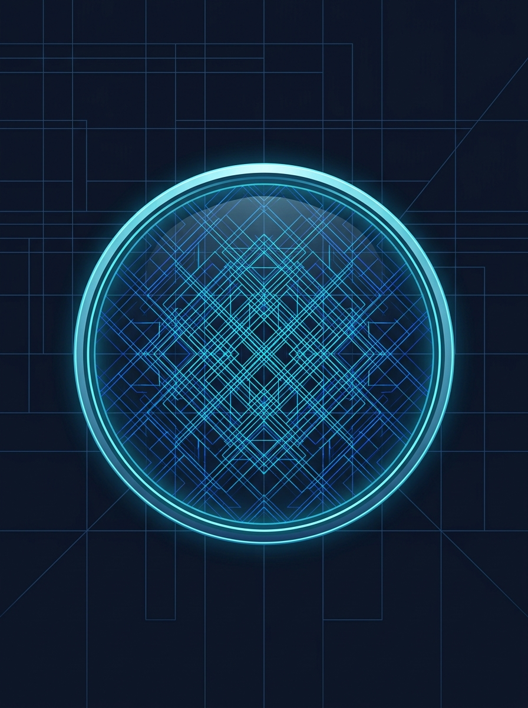

## 3.4: Interaktive Steuerung im Canvas (Pan & Zoom)

Dieser Abschnitt umfasst die folgenden Inhalte:

- Navigation in Simulationsmodellen
- Naives Neuzeichnen vs. GPU-`MatrixTransform`
- Zoom mit Mauszeiger-Fixpunkt (`ScaleAt`)
- Verschieben per Drag & Drop (`Pan`) und `CaptureMouse`
- Der Dragging-Jitter Bugfix & `ScreenToWorld`

---

### Navigationskonzept: Naives CPU-Neuzeichnen

<div class="columns top">
<div class="two">

**Ansatz A: Naives CPU-Neuzeichnen**
- Bei jeder Mausbewegung werden alle Weltkoordinaten neu berechnet.
- Alle WPF-Shapes werden im Canvas verschoben (`Canvas.SetLeft`).
- **Gravierende Nachteile**:
  - $O(N)$ CPU-Rechenaufwand bei jeder Mausbewegung.
  - Extremes Flackern und UI-Lags ab 1.000 Elementen.
  - Koppelt den Navigationszustand unnötig an Modelldaten.
  - Erzeugt unzählige Layout-Passes in WPF.
- **Die saubere Lösung:** GPU-Transformation mit Affiner Matrix $\mathbf{M}$ (folgt).

</div>
<div class="one">

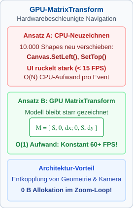

</div>
</div>

---

### Navigationskonzept: GPU-`MatrixTransform`

<div class="columns top">
<div class="two">

**Ansatz B: GPU-`MatrixTransform` (Industriestandard)**
- Das Modell wird **einmalig** auf den Canvas gezeichnet.
- Pan und Zoom verändern ausschließlich eine einzige affine Transformationsmatrix am Canvas.
- **Vorteile**:
  - Hardwarebeschleunigt über DirectX / GPU ($O(1)$ Aufwand).
  - Konstant 60+ FPS selbst bei komplexen Großmodellen.
  - Vollständige Entkopplung von Geometriedaten und Kameraansicht.
  - Keine GC-Allokationen im Navigationstakt!

</div>
<div class="one">

$$\begin{pmatrix} x' \\ y' \\ 1 \end{pmatrix} = \begin{pmatrix} s & 0 & d_x \\ 0 & s & d_y \\ 0 & 0 & 1 \end{pmatrix} \begin{pmatrix} x \\ y \\ 1 \end{pmatrix}$$

> **DirectX Render-Pipeline:**  
> Die GPU schiebt die gezeichnete Textur im Video-RAM – die CPU bleibt völlig unberührt!

</div>
</div>

---

### XAML-Struktur für hardwarebeschleunigtes Pan & Zoom

Ein übergeordneter Container (`Border` oder `Grid`) fängt alle Mausereignisse ab:

```xml
<Border ClipToBounds="True" Background="#F8FAFC"
        MouseWheel="OnMouseWheel" MouseDown="OnMouseDown"
        MouseMove="OnMouseMove" MouseUp="OnMouseUp">
    <Canvas x:Name="SimulationCanvas">
        <Canvas.RenderTransform>
            <MatrixTransform x:Name="CanvasMatrixTransform" />
        </Canvas.RenderTransform>
    </Canvas>
</Border>
```

- **`ClipToBounds="True"`**: Schneidet herausgezoomte Elemente am Fensterrand sauber ab.
- **`CanvasMatrixTransform`**: Steuert Pan (Translation) und Zoom (Skalierung) in einer einzigen affinen $3 \times 3$-Matrix.

---

### Das Fixpunkt-Dilemma beim Zoomen

<div class="columns top">
<div class="two">

Warum versagt naives Skalieren in interaktiven Viewern?

- **Naiver Zoom um den Ursprung $(0,0)$:**
  - Jeder Bildschirmpunkt transformiert sich gemäß:
    $\vec{P}' = s_{\text{zoom}} \cdot \vec{P}$
  - **Beispiel:** Ein Bauteildreieck bei $(800\,\mathrm{px}, 500\,\mathrm{px})$ wandert bei Zoomfaktor $1{,}5$ auf $(1200\,\mathrm{px}, 750\,\mathrm{px})$.
  - **Effekt:** Das anvisierte Detail springt nach rechts unten aus dem Sichtfeld!
- **Das CAD-Ziel: Fixpunkt-Invarianz:**
  - Der Punkt direkt unter dem Cursor $\vec{P}_{\text{cursor}}$ muss vor und nach dem Zoom an **exakt derselben Bildschirmposition** bleiben:
    $\vec{P}_{\text{cursor}}' = \vec{P}_{\text{cursor}}$
  - Die visuelle Welt expandiert radial **um den Mauszeiger**.

</div>
<div class="one">

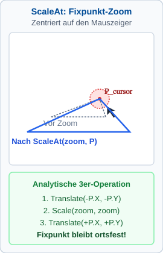

</div>
</div>

---

### Die 3-Schritt-Matrix-Zerlegung (`ScaleAt`)

<div class="columns top">
<div class="two">

Skalierung um ein beliebiges Zentrum $\vec{C} = \vec{P}_{\text{cursor}}$ via Matrix-Kaskade:

$\mathbf{M}_{\text{zoom}} = \mathbf{T}(+\vec{C}) \cdot \mathbf{S}(s, s) \cdot \mathbf{T}(-\vec{C})$

1. **Translation $-\vec{C}$:** Verschiebt Cursor in den Ursprung $(0,0)$.
2. **Skalierung $\mathbf{S}(s)$:** Streckt Raum isotrop um Ursprung $(0,0)$.
3. **Rücktranslation $+\vec{C}$:** Schiebt Zentrum an alte Position zurück.

- **Beweis für $\vec{P} = \vec{C}$:** $s \cdot (\vec{C} - \vec{C}) + \vec{C} = \vec{C} \quad \checkmark$
- **WPF-Befehl:** `matrix.ScaleAt(zoom, zoom, cursor.X, cursor.Y);`

</div>
<div class="one">

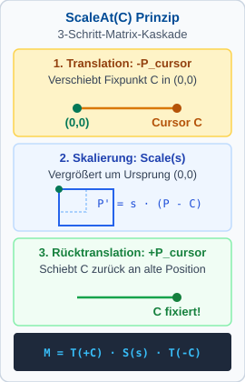

</div>
</div>

---

### C#-Implementierung: Zoom per Mausrad

```csharp
private void OnMouseWheel(object sender, MouseWheelEventArgs e)
{
    // Exakte Position des Mauszeigers im Canvas-Koordinatenraum ermitteln
    Point mousePos = e.GetPosition(SimulationCanvas);
    
    // Zoomfaktor bestimmen: +15 % hineinzoomen, -13 % herauszoomen
    double zoomFactor = e.Delta > 0 ? 1.15 : 1.0 / 1.15;

    // Aktuelle Transformationsmatrix des Canvas auslesen
    Matrix m = CanvasMatrixTransform.Matrix;
    
    // Multipliziert Skalierung mit Fixpunkt-Erhalt unter dem Mauszeiger
    m.ScaleAt(zoomFactor, zoomFactor, mousePos.X, mousePos.Y);
    
    // Neue Matrix an die GPU übergeben
    CanvasMatrixTransform.Matrix = m;
}
```

- Flüssiges, intuitives Zoomen wie in professionellen CAD-Programmen.

---

### Verschieben der Arbeitsfläche per Drag & Drop (`Pan`)

Damit die Maus bei schnellen Wisch-Bewegungen nicht abreißt, wird **`CaptureMouse()`** genutzt:

```csharp
private Point _lastPos;
private bool _isPanning;

private void OnMouseDown(object sender, MouseButtonEventArgs e)
{
    if (e.MiddleButton != MouseButtonState.Pressed && !Keyboard.IsKeyDown(Key.Space)) return;
    _lastPos = e.GetPosition(this);
    _isPanning = true;
    ((IInputElement)sender).CaptureMouse();
    Cursor = Cursors.SizeAll;
}

private void OnMouseUp(object sender, MouseButtonEventArgs e)
{
    _isPanning = false;
    ((IInputElement)sender).ReleaseMouseCapture();
    Cursor = Cursors.Arrow;
}
```

---

### Verschieben: Die `MouseMove`-Logik

In `MouseMove` wird die Differenz $\vec{\Delta} = \vec{P}_{\text{current}} - \vec{P}_{\text{last}}$ (`delta = currentPos - _lastPos`) direkt auf die Matrix translatiert:

```csharp
private void OnMouseMove(object sender, MouseEventArgs e)
{
    if (!_isPanning) return;

    Point currentPos = e.GetPosition(this);
    Vector delta = currentPos - _lastPos;
    _lastPos = currentPos;

    Matrix m = CanvasMatrixTransform.Matrix;
    m.Translate(delta.X, delta.Y); // Hardwarebeschleunigter Pan
    CanvasMatrixTransform.Matrix = m;
}
```

- Funktioniert nahtlos in jeder beliebigen Zoomstufe ohne Neuberechnung der Geometriedaten.

---

### Die Dragging-Jitter-Falle: Das Phänomen

<div class="columns top">
<div class="two">

Beim interaktiven Verschieben von Knotenpunkten tritt in naiven Auto-Fit-Implementierungen ein fataler Abreiß-Effekt auf:

- **1. Maus zieht Knoten nach außen:**
  - Der Anwender greift Knoten $K_3$ und zieht die Maus nach oben.
  - In Weltkoordinaten wächst das Tragwerk: $H_{\text{world}}$ steigt.
- **2. Der Auto-Fit-Fehler:**
  - Naives `Redraw()` ruft unbedacht `_transform.Update()` auf.
  - Der Auto-Fit-Maßstab $s$ schrumpft sofort, um das vergrößerte Modell einzupassen!
- **3. Das Abreißen vom Cursor:**
  - Durch das kleinere $s$ wird das Tragwerk kleiner dargestellt.
  - Knoten $K_3$ hüpft unter dem Mauszeiger nach unten weg!

</div>
<div class="one">

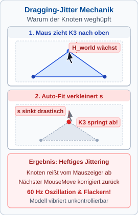

</div>
</div>

---

### Die Dragging-Jitter-Falle: Der Teufelskreis

<div class="columns top">
<div class="two">

Das Wegspringen führt zu einer **destruktiven Rückkopplung** (Feedback-Loop):

- **Der Teufelskreis beim Ziehen:**
  1. Maus zieht Knoten $K_3 \implies$ Modellhöhe $H_{\text{world}}$ steigt.
  2. Bounding-Box wächst $\implies$ Maßstab $s$ schrumpft.
  3. Knoten hüpft nach unten weg $\implies$ Lücke zum Cursor.
  4. Nächster `MouseMove`-Event: Maus korrigiert nach oben.
- **Die 60-Hz-Oszillation:**
  - Da dieser Zyklus bei jeder Mausbewegung abläuft (60–120 FPS), vibriert das Modell chaotisch.
  - Der Knoten zappelt hysterisch um den Cursor (**Jittering**).
- **Architekturfehler:** Unzulässige Kopplung von Objekt-Manipulation und Kamera-Transformation!

</div>
<div class="one">

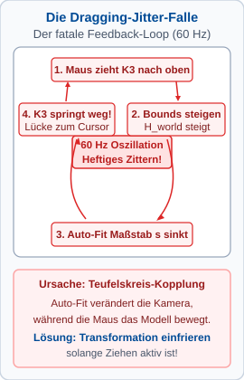

</div>
</div>

---

### Die Lösung des Jittering-Problems: Freeze-Doktrin

<div class="columns top">
<div class="two">

**Kamera-Entkopplung während der Interaktion:**

- **Freeze-Doktrin:** Bounding-Box (`xMin`, `xMax`, `yMin`, `yMax`) und $s$ bleiben bei aktivem Ziehen (`_draggedNode != null`) fixiert $\implies K_3$ folgt dem Cursor $1:1$.
- **C#-Code in `Redraw()`:**

```csharp
if (_draggedNode == null)
{
    var (xMin, xMax, yMin, yMax) = _truss.GetBounds();
    _transform.Update(xMin, xMax, yMin, yMax, 
        TrussCanvas.ActualWidth, TrussCanvas.ActualHeight);
}
DrawTruss();
```

- **Nach Loslassen (`MouseUp`):** Einmaliges ruhiges Einpassen!

</div>
<div class="one">

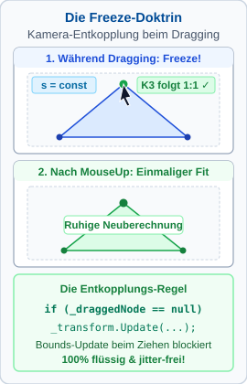

</div>
</div>

---

### Der Dragging-Lebenszyklus im Detail

<div class="columns top">
<div class="one">

#### 1. `MouseDown` auf Knoten
- Knoten per Hit-Testing erfassen:  
  `_draggedNode = hitNode;`
- Auto-Fit Transformation wird **eingefroren**.
- Maus fangen mit `CaptureMouse()`.

#### 2. `MouseMove` (Dragging)
- Bildschirmkoordinaten in Welt $[\mathrm{m}]$ umrechnen (`ScreenToWorld`).
- Knotenkoordinaten in Welt nachführen:  
  `_draggedNode.X = worldX;`
- Canvas zeichnet mit eingefrorenem Maßstab $\implies$ **kein Zittern!**

</div>
<div class="one">

#### 3. `MouseUp` (Abschluss)
- `_draggedNode = null;`
- `ReleaseMouseCapture();`
- Erst jetzt darf `Redraw()` die Bounding Box aktualisieren und das Modell neu einpassen.

> **Sprint-Bezug:**  
> Genau diesen Bugfix setzt ihr in Sprint-Aufgabe 4 live in [`VectorTrussCanvas`](../../Uebungen/Termin_03_Vektorgrafik_Canvas/Vorlage/VectorTrussCanvas/MainWindow.xaml.cs) um!

</div>
</div>

</div>
</div>

---

### Das 2-Schichten-Modell der Koordinaten

<div class="columns top">
<div class="two">

Für interaktive Selektion müssen Klickpixel $\vec{P}_{\text{screen}} = (x_p, y_p)$ in physikalische Meter $\vec{P}_{\text{world}} = (x_w, y_w)$ rückgerechnet werden.

Die Rücktransformation durchläuft **zwei getrennte Schichten**:

1. **Schicht 1: Die GPU-Kameramatrix (Pan & Zoom):**
   - Hebt die interaktive Kamerabewegung auf:
     $\vec{P}_{\text{canvas}} = (x_u, y_u) = \mathbf{M}^{-1} \cdot \vec{P}_{\text{screen}} \quad [\mathrm{px}]$
   - $\mathbf{M}$ enthält alle bisherigen `ScaleAt`- und Pan-Translationen.
2. **Schicht 2: Das Viewport-Modell (`Transform2D`):**
   - Rechnet unzoomed Pixel $(x_u, y_u)$ in physikalische Weltkoordinaten um:
     $x_w = X_{\min} + (x_u - x_{\text{off}}) / s, \quad y_w = Y_{\max} - (y_u - y_{\text{off}}) / s$

</div>
<div class="one">

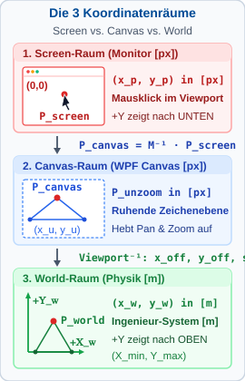

</div>
</div>

---

### Schrittweise analytische Rückrechnung

<div class="columns top">
<div class="two">

Ausgehend vom Klickpunkt $\vec{P}_{\text{screen}}$ heben wir zunächst die Kameramatrix zu $\vec{P}_{\text{unzoom}}$ auf. Anschließend leiten wir die **analytische Umkehrfunktion** zum physikalischen Weltpunkt $\vec{P}_{\text{world}} = (x_w, y_w)$ ab:

- **X-Rückrechnung (Translation & Skalierung):**
  $x_{\text{canvas}} = x_{\text{off}} + (x_w - X_{\min}) \cdot s$
  $\iff x_w = X_{\min} + \frac{x_{\text{canvas}} - x_{\text{off}}}{s} \quad [\mathrm{m}]$
- **Y-Rückrechnung (Invertierung & Skalierung):**
  $y_{\text{canvas}} = y_{\text{off}} + (Y_{\max} - y_w) \cdot s$
  $\iff y_w = Y_{\max} - \frac{y_{\text{canvas}} - y_{\text{off}}}{s} \quad [\mathrm{m}]$

> **Einheitenkontrolle:**  
> $[\mathrm{m}] + \frac{[\mathrm{px}] - [\mathrm{px}]}{[\mathrm{px/m}]} = [\mathrm{m}]$  
> Die Berechnung ist dimensionsrein und exakt!

</div>
<div class="one">

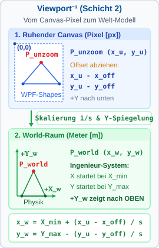

</div>
</div>

---

### C#-Implementierung: `ScreenToWorld`

```csharp
public Point ScreenToWorld(Point screenPixel, Matrix canvasMatrix, Transform2D trans)
{
    // 1. Pan- und Zoom-Matrix invertieren (WPF-Affine Transformation)
    Matrix invMatrix = canvasMatrix;
    invMatrix.Invert();
    Point unzoomed = invMatrix.Transform(screenPixel);

    // 2. Viewport-Projektion analytisch invertieren (Pixel -> Meter):
    var (worldX, worldY) = trans.ScreenToWorld(unzoomed.X, unzoomed.Y);

    return new Point(worldX, worldY);
}
```

- Liefert präzise physikalische Koordinaten $[\mathrm{m}]$ für Raycasting, Picking und Hit-Testing.
- Unabhängig vom aktuellen Zoom-Faktor oder der Pan-Verschiebung mathematisch exakt!

---

<!-- Platzhalter für Abschnittsbildbeschreibung -->

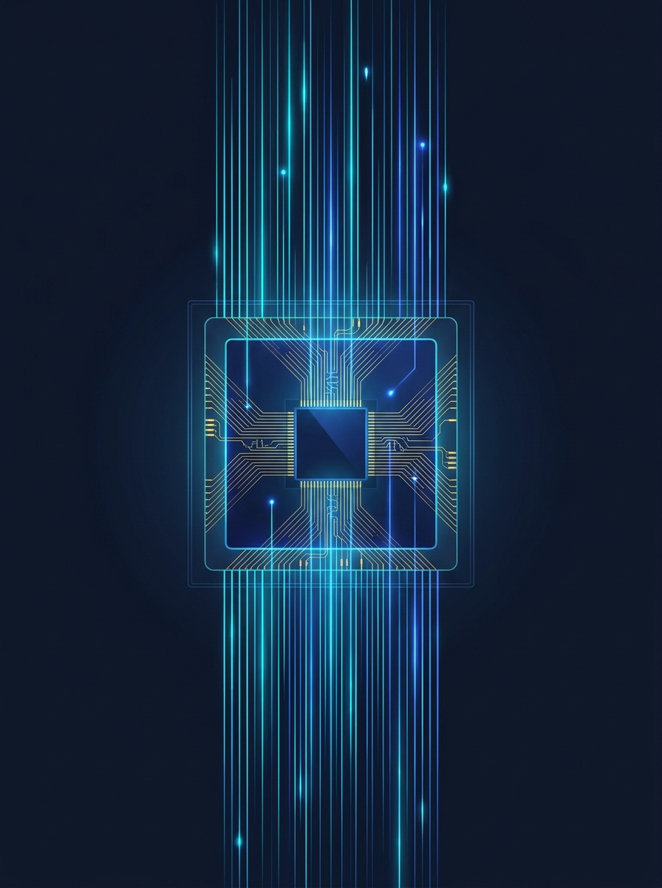

## 3.5: Performance & Architektur: Shapes vs. DrawingVisual

Dieser Abschnitt umfasst die folgenden Inhalte:

- Der `UIElement`-Overhead von WPF `Shape`-Objekten
- Der 2-stufige Layout-Pass (`Measure` / `Arrange`)
- High-Performance Vektorgrafik mit `DrawingVisual`
- Die lebenswichtige `Freeze()`-Doktrin
- Aufbau des `VisualHost`-Controls & Technologievergleich

---

### WPF Shapes: Der UIElement-Overhead

<div class="columns top">
<div class="two">

`Line`, `Rectangle`, `Ellipse` und `Path` sind sehr komfortabel, stoßen bei komplexen Simulationen aber schnell an Grenzen:

- **Der `UIElement`-Overhead:**
  - Jedes `Shape` erbt von:  
    `Visual` $\rightarrow$ `UIElement` $\rightarrow$ `FrameworkElement` $\rightarrow$ `Shape`.
  - Hunderte Dependency Properties, Focus-Handling, Styling, Animations-Slots.
  - Hoher Speicherverbrauch (mehrere KB pro Shape-Instanz).
- **Skalierungs-Grenzen**:
  - Bis 1.000 Shapes: Flüssig (60 FPS).
  - Ab 2.000 Shapes: Spürbare Verzögerungen.
  - Ab 5.000 Shapes: Frame-Einbrüche ($< 10\,\mathrm{FPS}$).

</div>
<div class="one">

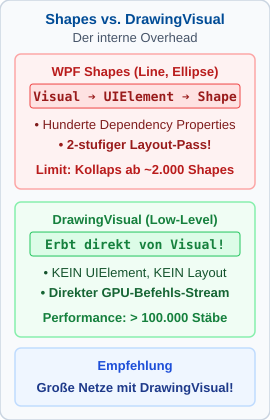

</div>
</div>

---

### Der 2-stufige Layout-Cycle: Warum zwei Phasen?

<div class="columns top">
<div class="two">

Ein Container kann Kindern erst Raum zuweisen, wenn er den Gesamtbedarf aller Kinder kennt:

- **Phase 1: `Measure` (Bedarfsermittlung / Wunschgröße):**
  - Parent ruft `child.Measure(availableSize)` auf.
  - Kind misst seinen Inhalt und meldet `DesiredSize` zurück.
  - Noch keine feste Platzierung im Fenster!
- **Phase 2: `Arrange` (Raumzuweisung / Finaler Platz):**
  - Parent entscheidet und ruft `child.Arrange(finalRect)` auf.
  - Kind erhält finale Position und Größe (`ActualWidth`, `ActualHeight`).

</div>
<div class="one">

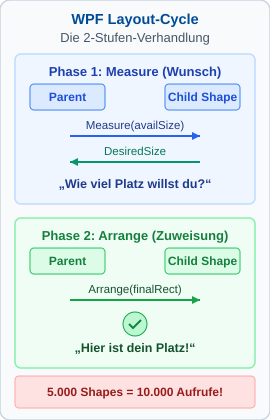

</div>
</div>

---

### Der Layout-Kollaps in Simulationsanwendungen

<div class="columns top">
<div class="two">

In der Simulationsvisualisierung führt der 2-Phasen-Cycle zum **Performance-Kollaps**:

- **Normale Desktop-App (30 Controls):**
  - Layout-Pass benötigt $< 0{,}2\,\mathrm{ms}$ (unmerklich).
- **Simulations-Canvas (5.000 Stäbe & 2.500 Knoten):**
  - Jede Knotenbewegung markiert verbundene Stäbe als „layout-dirty“ (`InvalidateMeasure`).
  - WPF durchläuft den Layout-Cycle **rekursiv über alle Shapes**.
  - **5.000 Shapes $\implies$ 10.000 Methodenaufrufe pro Frame!**
- **Konsequenz:** Die CPU blockiert im UI-Thread, noch bevor die GPU überhaupt rendern darf.

</div>
<div class="one">


</div>
</div>

---

### Die Lösung: `DrawingVisual`

<div class="columns">
<div class="one">

`DrawingVisual` ist ein extrem leichtgewichtiger Visual-Knoten ohne UI-Ballast:

- Erbt direkt von `Visual` (kein `UIElement`, kein `FrameworkElement`).
- **Kein** Layout-Pass, kein Data Binding, keine separaten Event-Handler pro Vektorelement.
- Vektorbefehle werden direkt in einen kompakten **`DrawingContext`** geschrieben.
- Hardwarebeschleunigte Übergabe der Vektor-Streams an die GPU.

</div>
<div class="one">


</div>
</div>

---

### Zeichenwerkzeuge in WPF: Brush vs. Pen

<div class="columns top">
<div class="two">

Im `DrawingContext` steuern zwei Klassen aus `System.Windows.Media` das Rendering:

- **`Brush` (Flächenfüllung – die „Tinte“):**
  - Füllt geschlossene 2D-Flächen (Kreise, Polygone, Texte).
  - `SolidColorBrush`, `LinearGradientBrush` oder gecacht via `Brushes.SteelBlue`, `Brushes.Crimson`.
- **`Pen` (Linien & Kontur – der „Zeichenstift“):**
  - Zeichnet Umrisse, Achsen und Vektorstäbe.
  - Basis ist stets ein `Brush` (Farbe) + Strichattribute: `Thickness`, `DashStyle`, `LineCap`.
- **Merksatz:** *„Der Pen ist der Stift – der Brush liefert die Tinte!“*

</div>
<div class="one">

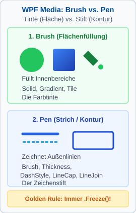

</div>
</div>

---

### Die lebenswichtige `Freeze()`-Doktrin

<div class="columns top">
<div class="two">

In Render-Schleifen von Simulationsanwendungen gilt die **strikte Regel**:

> **Jeder `Pen` und jeder `Brush` muss vor dem Zeichnen mit `.Freeze()` eingefroren werden!**

**Warum ist das so entscheidend?**
1. **Change-Tracking aus:** `Freeze()` schaltet das lauschende Event-Tracking komplett ab.
2. **Thread-Sicherheit:** Nur unveränderliche Ressourcen dürfen an den DirectX-Render-Thread übergeben werden.
3. **Statische Wiederverwendung:** Eingefrorene Pinsel können statisch gecacht werden.
4. **0 Bytes GC-Last:** Verhindert Millionen kurzlebiger Heap-Objekte!

</div>
<div class="one">

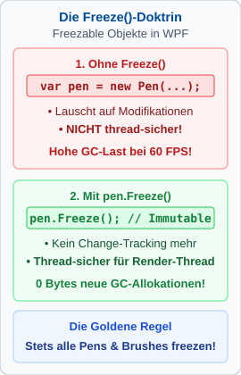

</div>
</div>

---

### Zeichnen im `DrawingContext`

<div class="columns top">
<div class="one">

**1. Setup & Freezing (`visual`, `dc`):**
- Werkzeuge `Pen pen` und `Brush brush` einfrieren (`Freeze()`):

```csharp
var visual = new DrawingVisual();

using (DrawingContext dc = visual.RenderOpen())
{
    // Golden Rule: Pens & Brushes FREEZEN!
    var pen = new Pen(Brushes.SteelBlue, 2.0);
    pen.Freeze();
    
    var brush = Brushes.Crimson;
    brush.Freeze();

    DrawScene(dc, rods, nodes, pen, brush);
}
```

</div>
<div class="one">

**2. Zeichenschleifen (`rods`, `nodes`):**
- Iteration über Sammlungen `rods` und `nodes`:

```csharp
private void DrawScene(
    DrawingContext dc, List<Rod> rods, 
    List<Node> nodes, Pen pen, Brush brush)
{
    // 50.000 Stäbe zeichnen:
    foreach (var rod in rods)
        dc.DrawLine(pen, rod.P1, rod.P2);

    // 50.000 Knoten zeichnen:
    foreach (var node in nodes)
        dc.DrawEllipse(brush, null, 
                       node.Pos, 3.0, 3.0);
}
```

</div>
</div>

---

### Das `VisualHost`-Control

Um `DrawingVisual`-Objekte im WPF-Fenster anzuzeigen, erstellen wir ein schlankes Control:

```csharp
public class FastDrawingCanvas : FrameworkElement
{
    private readonly VisualCollection _children;
    private readonly DrawingVisual _drawingVisual = new();

    public FastDrawingCanvas()
    {
        _children = new VisualCollection(this) { _drawingVisual };
    }

    protected override int VisualChildrenCount => _children.Count;
    protected override Visual GetVisualChild(int index) => _children[index];

    public void Render(Action<DrawingContext> renderAction)
    {
        using DrawingContext dc = _drawingVisual.RenderOpen();
        renderAction(dc);
    }
}
```

---

### Alternative: Direktes Überschreiben von `OnRender`

Wenn kein selektives Hit-Testing oder Multi-Layer-Visuals benötigt werden, kann auch direkt `OnRender` überschrieben werden:

```csharp
public class SimpleRenderCanvas : FrameworkElement
{
    public SimulationData? Data { get; set; }

    protected override void OnRender(DrawingContext dc)
    {
        base.OnRender(dc);
        if (Data == null) return;

        var pen = new Pen(Brushes.Black, 1.0);
        pen.Freeze();
        foreach (var bar in Data.Bars)
            dc.DrawLine(pen, bar.P1, bar.P2);
    }
}
```

- Neuzeichnen wird gezielt über `this.InvalidateVisual()` ausgelöst.

---

### Technologie- und Performancevergleich

| Kriterium | WPF `Shapes` (`Canvas`) | `DrawingVisual` / `OnRender` | `WriteableBitmap` (Pixel) |
| :--- | :--- | :--- | :--- |
| **Grafiktyp** | Vektor (High-Level) | Vektor (Low-Level) | Rastergrafik (Pixel) |
| **Max. Elementanzahl** | $\approx 1.000 - 2.000$ | $\mathbf{> 100.000}$ | Unbegrenzt (pixelweise) |
| **Speicherverbrauch** | Sehr hoch ($\approx$ KB / Shape) | Sehr gering ($\approx$ Bytes) | Fest ($W \times H \times 4$ Bytes) |
| **Zoom-Verhalten** | Stufenlos scharf | **Stufenlos scharf** | Pixelig beim Hineinzoomen |
| **Interaktivität** | Direkt (`Click`, `Hover`) | Hit-Testing (`HitTest()`) | Koordinatenberechnung |
| **Typischer Einsatz** | UI-Icons, kleine Schemata | **Fachwerke, CAD, FE-Netze** | Wärmebilder, Partikelfelder |

---

### Zusammenfassung: Geometrie & Transformation

- **Vektorgrafiken** bieten auflösungsunabhängige, stufenlos skalierbare Darstellungen für technische Simulationsmodelle.
- Die **Koordinatentransformation** bildet kontinuierliche Weltkoordinaten ($+Y$ nach oben, Meter) auf diskrete Canvas-Koordinaten ($+Y$ nach unten, Pixel) ab:
  - **Uniform Scaling** ($s = \min(s_x, s_y)$ in $[\mathrm{px/m}]$) verhindert jede Verzerrung.
  - Zentrierungs-Offsets und `margin` garantieren eine saubere, vollständige Platzierung.
- Mittels **Vektoralgebra** (Orthogonalvektor $\vec{e}_u^\perp$) werden Pfeilschäfte und Spitzen analytisch ohne Winkelfunktionen berechnet.
- Bemaßungsketten nach **DIN 406** verknüpfen Maßhilfslinien, Maßlinien mit Pfeilen und zentrierte Maßzahlen.

---

### Zusammenfassung: Navigation & Performance

- Eine **`MatrixTransform`** am Canvas ermöglicht flüssiges, hardwarebeschleunigtes **Pan & Zoom** mit Zentrierung auf den Mauszeiger (`ScaleAt`).
- Bounding-Box Jittering beim Dragging wird durch **Einfrieren der Transformation** während des aktiven Ziehens vermieden.
- Die **`ScreenToWorld`**-Rücktransformation invertiert erst die Matrix und danach die Viewport-Projektion.
- Bei großen Datenmengen ($> 2.000$ Elemente) bricht der WPF `Shape`-Baum ein. **`DrawingVisual` / `DrawingContext`** bietet professionelle High-Performance-Vektorgrafik für komplexe Netze.
- **Freeze-Doktrin:** Alle `Pen`- und `Brush`-Objekte in Render-Schleifen müssen zwingend eingefroren werden.

---

### Laborübung Termin 03: Vektorgrafik auf Canvas

Vertiefende Hausübung (10 Pkt., Wahlmodell Track A oder B) – Details siehe [Aufgabenblatt 03](../../Uebungen/Termin_03_Vektorgrafik_Canvas/Aufgabenblatt.md):

<div class="columns">
<div class="two">

#### Track A: CAD-Fachwerkträger
- Pratt-/Warren-Träger (min. 8 Knoten, 13 Stäbe)
- Auto-Fit BoundingBox mit isotroper Skalierung
- Normgerechte DIN-406 Bemaßungsketten
- Analytische Pfeilspitzen für Lager- und Lastvektoren
- Drag & Drop der Knoten mit interaktivem Maustracking

</div>
<div class="two">

#### Track B: Radar / Blueprint-Sketcher
- **Option B.1 Space Radar:** Vektorschiff mit Pfeilspitzen für $\vec{v}, \vec{a}$, Distanzringe & Kursprädiktor
- **Option B.2 Blueprint Sketcher:** Interaktiver CAD-Editor mit Grid-Snapping & Stab-Aufspannen
- Stufenloses Pan & Zoom via `MatrixTransform`
- Saubere WPF Canvas / `DrawingVisual`-Architektur

</div>
</div>
