<!-- _paginate: false -->
<!-- _header: "" -->
<!-- _footer: "" -->


# Kapitel 4: 2D-Visualisierung (Diagramme & Graphen)

Dieses Kapitel umfasst die folgenden Abschnitte:

- 4.1: Einführung in 2D-Diagramme und Datenstrukturen
- 4.2: Zeitreihen- und Streudiagramme mit ScottPlot
- 4.3: Statistische Auswertung & Histogramme mit ScottPlot
- 4.4: Live-Streaming & Telemetrie
- 4.5: Topologie- und Netzwerkgraphen mit MSAGL

---

### Live-Showcase & Code-Defense: Termin 03

Präsentation der Hausübung aus Termin 03 (**Stufe 1: Basisaufgabe** + **Stufe 2: Track A oder B**, [Aufgabenblatt 03](../../Uebungen/Termin_03_Vektorgrafik_Canvas/Aufgabenblatt.md)):

<div class="columns">
<div class="two">

#### Stufe 2 – Track A: Industrie (2D-CAD Tragwerks-Inspektor)
- **Geometrie:** Zweistufige DIN-406-Bemaßungsketten, Auto-Fit BoundingBox & $1{,}0\,\text{m}$-Gitter.
- **Interaktion:** Ziehen der Kraftpfeilspitzen $(F_x, F_y)$, Mausrad-Zoom & Kamera-Panning.
- **Stresstest:** Extremes Fensterformat (21:9), Pfeilspitzen-Invarianz & JSON-Export.

</div>
<div class="two">

#### Stufe 2 – Track B: Game (Poly Bridge Blueprint-Baumeister)
- **Vektorgrafik:** Schlucht-Szenerie mit $0{,}5\,\text{m}$-Grid-Snapping, $L_{\max}$-Vorschau & Baubudget.
- **Interaktion:** Knoten setzen, Stäbe spannen ($L \le 4{,}0\,\text{m}$) und Elemente löschen (`Entf`).
- **Stresstest:** Maximallängen-Sperre (rot ab $4{,}0\,\text{m}$), Budget-Limit & JSON-Level-Export.

</div>
</div>

> **Code-Defense (Säule 2b, 20 %):** Prüfung auf exakte Koordinatentransformation (Welt $\leftrightarrow$ Screen), Isotropie und Kausalität (reine Geometrie, keine Statik!).

---

<!-- Platzhalter für Abschnittsbildbeschreibung -->


## 4.1: Einführung in 2D-Diagramme und Datenstrukturen

Dieser Abschnitt umfasst die folgenden Inhalte:

- Brücke zu Termin 02 (Raw Pixels) und Termin 03 (2D-Vektorgrafik)
- Die 3-Schichten-Architektur der 2D-Visualisierung
- Warum Diagramme und Graphen in der Simulationstechnik unverzichtbar sind
- Welche Aufgaben `ScottPlot 5` und `MSAGL` übernehmen
- Blick unter die Haube: Vektor-Primitive vs. Raw-Pixel-Backends

---

### Rückblick & Brücke: Wo stehen wir in der Vorlesung?

In den letzten beiden Terminen haben wir die Fundamente der 2D-Grafik selbst programmiert:

- **Termin 02 – Raw-Pixel-Grafik (`WriteableBitmap`):**
  - Direkte Manipulation von 32-Bit-Farbwerten (`uint[]`) im Arbeitsspeicher.
  - **Stärke:** Extrem schnell für flächige 2D-Rasterfelder (z.B. Wärmebild der FDM-Simulation).
  - **Grenze:** Kennt weder physikalische Einheiten noch Linien, Achsen oder Beschriftungen.
- **Termin 03 – 2D-Vektorgrafik (`WPF Canvas` & `DrawingVisual`):**
  - Eigene Koordinatentransformation (Welt $\leftrightarrow$ Screen) für Stäbe, Knoten und Kraftpfeile.
  - **Stärke:** Maßstabsgetreue Geometriedarstellung von Maschinen, Trägern und Anlagen.
  - **Grenze:** Für ein wissenschaftliches Diagramm müssten wir Achsen, Zahlen-Ticks, Gitterlinien, Legenden und Auto-Scaling komplett von Hand programmieren!

---

### Die 3-Schichten-Architektur der 2D-Visualisierung

Diagramm- und Graph-Bibliotheken bilden die **nächste Abstraktionsschicht** über Termin 02 und 03:

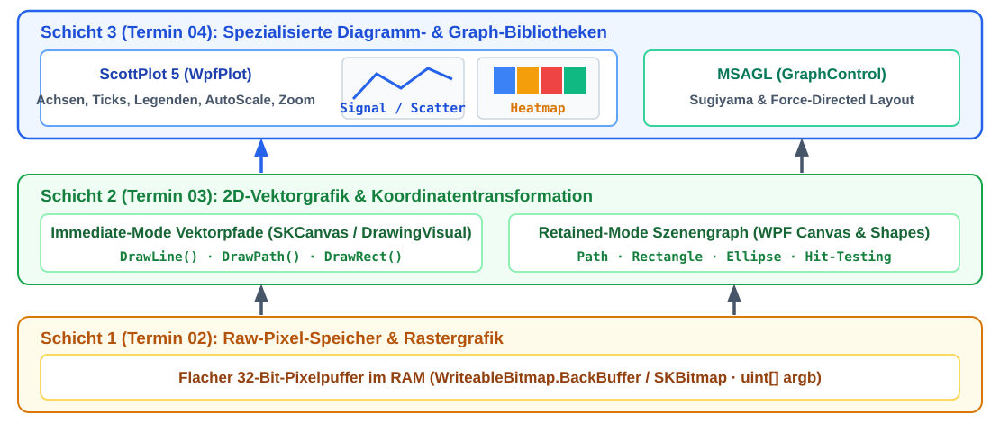

---

### Bezug zur Vorlesung: Warum Diagramme in der Simulation?

<div class="columns">
<div class="two">

Ein numerischer Simulator berechnet zunächst nur rohe Zahlenkolonnen. Erst **Diagramme** beantworten zentrale Ingenieurfragen:

1. **Zeitreihen (`Signal`, `SignalXY`):** Wie schnell schwingt ein Regler ein? Gibt es Überschwingen?
2. **Zustandsraum (`Scatter`, `VectorField`):** Werden Leistungs- oder Haftgrenzen im Betrieb verletzt?
3. **Statistik & Felder (`Bars`, `Box`, `Heatmap`):** Halten Bauteile in $10.000$ Monte-Carlo-Läufen die Toleranz ein?
4. **Systemtopologie (`MSAGL`):** Wie sind Blöcke verschaltet (hierarchisch vs. organisch)?

</div>
<div class="two">

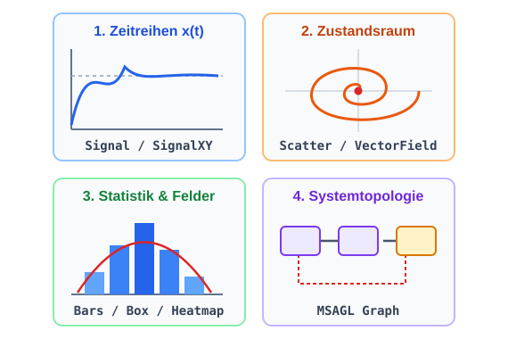

</div>
</div>

---

### Die Render-Engine unter ScottPlot 5: SkiaSharp (`SK...`)

<div class="columns">
<div class="two">

`ScottPlot 5` nutzt intern **SkiaSharp** (Googles 2D-Engine *Skia*):

1. **`SKPath` (Vektorpfad, wie Termin 03):**
   - Punktfolge (`MoveTo`, `LineTo`, `Close`) für Linienzüge (`Scatter`, `Signal`) und Polygone (`FillY`).
2. **`SKBitmap` (Pixel-Puffer, wie Termin 02):**
   - 32-Bit-Pixel-Array (`uint[]`) für Rasterdaten (`Heatmap`) – **1:1 wie `WriteableBitmap`**!
3. **`SKCanvas` (Zeichenfläche in `WpfPlot`):**
   - Rendert `DrawPath(SKPath)` und `DrawBitmap(SKBitmap)` direkt in 1 Bild (0 WPF-`Shape`-Objekte!).

</div>
<div class="two">

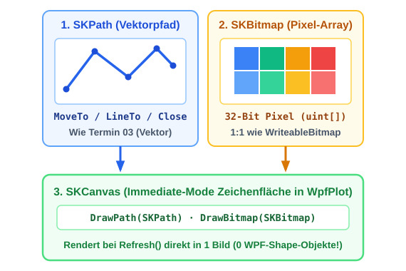

</div>
</div>

---

### Blick unter die Haube: Welche Backends nutzen die Bibliotheken?

`ScottPlot 5` und `MSAGL` nutzen intern genau die Techniken aus Termin 02 und Termin 03:

| Bibliothek & Diagrammtyp | Internes Rendering-Backend | Bezug zu Termin 02 / 03 | Warum genau diese Technik? |
|---|---|---|---|
| **ScottPlot:** `Scatter`, `Signal`, `Bars`, `Box`, `FillY` | **Immediate-Mode Vektorpfade** (`SKCanvas`: `DrawLine`, `DrawPath`) | Wie `DrawingVisual` (Termin 03) | Scharfe Kurven ohne Millionen `Shape`-Objekte im WPF-Baum |
| **ScottPlot:** `Heatmap` & `ColorBar` | **Raw-Pixel-Puffer** (`SKBitmap` / `uint[]` mit Farb-Lookup) | **1:1 wie `WriteableBitmap`** (Termin 02) | $500 \times 500$ Gitter als 1 Textur in $\mathcal{O}(1)$ statt $250.000$ Rechtecke |
| **MSAGL:** `GraphControl` (Netzwerkgraphen) | **Retained-Mode WPF-`Canvas`** (echte `Path`- & `Shape`-Controls) | **1:1 wie `WPF Canvas`** (Termin 03) | Überschaubare Knotenzahl ($10 \dots 500$), dafür Klick- & Drag-Events |

---

<!-- Platzhalter für Abschnittsbildbeschreibung -->


## 4.2: Zeitreihen- und Streudiagramme mit ScottPlot

Dieser Abschnitt umfasst die folgenden Inhalte:

- Grundaufbau & API-Workflow von `ScottPlot 5` in WPF
- Streudiagramme & Phasenraum mit `Scatter` ($\mathcal{O}(N)$)
- Beispiele & Code: Motorkennfeld und Kamm'scher Kreis
- Zeitreihen mit `Signal` ($\mathcal{O}(W)$) & `SignalXY` ($\mathcal{O}(W \log N)$)
- Richtungsfelder (`VectorField`) und Methodenvergleich

---

### ScottPlot 5 in WPF: Grundlegender Workflow

<div class="columns">
<div class="two">

Die zentrale Klasse in `ScottPlot 5` ist `ScottPlot.Plot`. Das WPF-Control `WpfPlot` bettet diese Zeichenfläche direkt ins Fenster ein.

**Der 5-Schritte-Workflow in C#:**
1. **Control einbinden:** `<sp:WpfPlot x:Name="WpfPlot1" />` im XAML platzieren.
2. **Plot-Ebenen hinzufügen:** Daten mit `Plot.Add.Scatter(...)`, `Add.Signal(...)` oder `Add.Bars(...)` übergeben.
3. **Achsen beschriften:** `Plot.Title(...)`, `Plot.XLabel(...)` und `Plot.YLabel(...)`.
4. **Skalieren & Legende:** `Plot.ShowLegend()` und `Plot.Axes.AutoScale()`.
5. **Neuzeichnen anstoßen:** `WpfPlot1.Refresh()` rendert das Bild.

</div>
<div class="one">

```xaml
<!-- XAML-Einbindung -->
<Window ...
  xmlns:sp="clr-namespace:
    ScottPlot.WPF;
    assembly=ScottPlot.WPF">
  <Grid>
    <sp:WpfPlot 
      x:Name="WpfPlot1" />
  </Grid>
</Window>
```

</div>
</div>

---

### Anwendungsbeispiel `Scatter` (1/2): DC-Motor im Phasenraum

<div class="columns">
<div class="two">

Antriebssimulation (Übung 4, Track A) beim Anfahren eines Elektromotors:

- **Zustandsraum $(n, M)$:** Drehmoment $M$ direkt über der Drehzahl $n$ aufgetragen.
- **Warum `Scatter`?** Die Trajektorie läuft im Raum vorwärts und rückwärts (nicht-monoton in $x$).
- **Mehrere Ebenen im Kombi-Plot:**
  - Rote Hyperbel: Leistungsgrenze $P_{\max} = 1{,}2\,\text{kW}$.
  - Drei Kurven (*Hochlauf*, *Solldrehzahl*, *Last*) + `Marker`.

</div>
<div class="three">

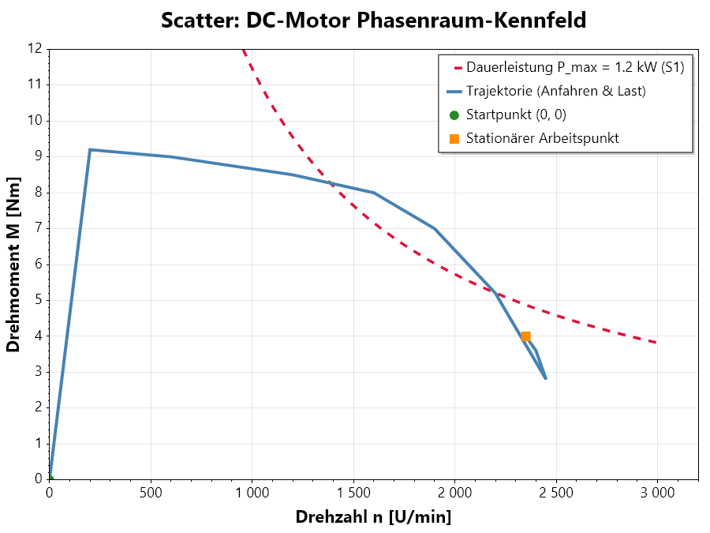

</div>
</div>

---

### Blick unter die Haube: Wie zeichnet `Scatter(xs, ys)`?

<div class="columns">
<div class="two">

- **Keine Sortier-Annahme ($\mathcal{O}(N)$):**
  - Da Punkt `[4]` in $x$ rückwärts laufen darf, kann ScottPlot keine Abkürzung nutzen – es durchläuft bei jedem Frame **alle $N$ Punkte (`i = 0 ... N-1`)**!
- **Zwei Modi desselben Renderers:**
  - **Modus A (`ScatterLine`):** Verbindet Punkte als `SKPath` (`LineWidth > 0`, `MarkerSize = 0`, z.B. Motorkennfeld).
  - **Modus B (Punktwolke):** Schaltet die Linie ab (`LineWidth = 0`, `MarkerSize = 10`, z.B. Kamm'scher Kreis).

</div>
<div class="two">

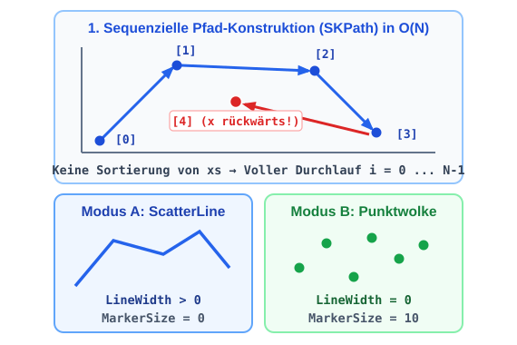

</div>
</div>

---

### Der C#-Code zum Motorkennfeld (`ScatterLine` & `Marker`)

<div class="columns">
<div class="two">

Aufbau des Motorkennfelds mit der ScottPlot-API:

- **1. Grenzhyperbel:** Stützpunkte `nHyp` und `mHyp` gemäß $M = P_{\max} / (2\pi \cdot n / 60)$ berechnen und mit `Add.ScatterLine` als gestrichelte Kurve `hyp` zeichnen (`LinePattern.Dashed`).
- **2. Teil-Trajektorien schichten:** Jeden Betriebsabschnitt (`nPhase1`, `mPhase1`) als eigene `ScatterLine` `traj1` mit eigener Farbe zum selben `plot` hinzufügen.
- **3. Arbeitspunkt markieren:** `plot.Add.Marker(...)` setzt ein hervorgehobenes Symbol an den Punkt $(2350, 4{,}0)$.

</div>
<div class="two">

```csharp
// 1. Dauerleistungsgrenze P_max = 1.2 kW
double[] nHyp = new double[80], mHyp = new double[80];
for (int i = 0; i < 80; i++) {
    nHyp[i] = 955.0 + i * (2045.0 / 79.0);
    mHyp[i] = 1200.0 / (2.0 * Math.PI * (nHyp[i] / 60.0));
}
var hyp = plot.Add.ScatterLine(nHyp, mHyp);
hyp.Color = Colors.Crimson;
hyp.LinePattern = LinePattern.Dashed;

// 2. Trajektorie Phase 1 (Hochlauf & Peak)
double[] nPhase1 = { 0, 200, 600, 1200, 1600, 1900 };
double[] mPhase1 = { 0, 9.2, 9.0,  8.5,  8.0,  7.0 };
var traj1 = plot.Add.ScatterLine(nPhase1, mPhase1);
traj1.Color = Colors.SteelBlue;

// 3. Arbeitspunkt-Marker & Achsenbereich
plot.Add.Marker(2350, 4.0, MarkerShape.FilledSquare, 12);
plot.Axes.SetLimits(0, 3200, 0, 12);
```

</div>
</div>

---

### Anwendungsbeispiel `Scatter` (2/2): G-G-Diagramm (Kamm'scher Kreis)

<div class="columns">
<div class="two">

Fahrzeugsimulation (Übung 4, Track B) zur Überwachung von Längsbeschleunigung $a_x$ und Querbeschleunigung $a_y$:

- **Haftgrenz-Kreise:** Die Gesamtbeschleunigung darf $1{,}0\,g$ (roter Kreis) nicht überschreiten.
- **Reine Punktwolke:** Die Messpunkte $(a_y, a_x)$ werden nach Betrag in drei Farbgruppen (*Grün*, *Orange*, *Rot*) ohne Verbindungslinie geplottet.
- **1:1-Seitenverhältnis (Isotropie):** Damit die Kreise auf einem 16:9-Monitor exakt kreisrund bleiben, koppeln wir die Achsenskalierung.

</div>
<div class="three">

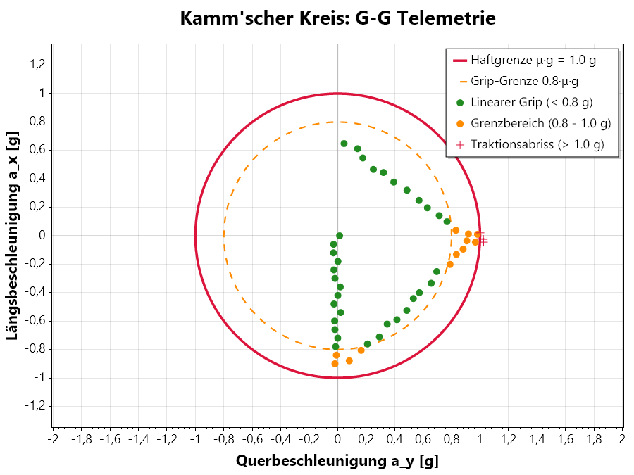

</div>
</div>

---

### Der C#-Code zum G-G-Diagramm (Kreise, Punktwolke & `SquareUnits`)

<div class="columns">
<div class="two">

Drei wichtige ScottPlot-Techniken in diesem Beispiel:

- **1. Parametrischer Kreis:** Über den Winkel `phi` erzeugen `Math.Cos(phi)` und `Math.Sin(phi)` die Kreisarrays `xOuter` und `yOuter` für `outerCircle`.
- **2. Punktwolke (`LineWidth = 0`):** `plot.Add.Scatter` zeichnet standardmäßig Linien und Punkte. Mit `sGreen.LineWidth = 0` werden nur die Marker (`ptsGreenX`, `ptsGreenY`) in $\mathcal{O}(N)$ gezeichnet.
- **3. `plot.Axes.SquareUnits()`:** Erzwingt gleichen Pixelmaßstab für X- und Y-Achse (Isotropie wie in Termin 03!).

</div>
<div class="two">

```csharp
// 1. Parametrischer Hüllkreis (Radius 1.0 g)
double[] xOuter = new double[121], yOuter = new double[121];
for (int i = 0; i <= 120; i++) {
    double phi = i * 2.0 * Math.PI / 120.0;
    xOuter[i] = 1.0 * Math.Cos(phi);
    yOuter[i] = 1.0 * Math.Sin(phi);
}
var outerCircle = plot.Add.ScatterLine(xOuter, yOuter);
outerCircle.Color = Colors.Crimson;

// 2. Telemetrie als reine Punktwolke (ohne Linie!)
var sGreen = plot.Add.Scatter(ptsGreenX, ptsGreenY);
sGreen.LineWidth = 0;       // Linie abschalten
sGreen.MarkerSize = 10;     // Punktgröße
sGreen.Color = Colors.ForestGreen;

// 3. Verzerrungsfreies 1:1-Seitenverhältnis
plot.Axes.SquareUnits();
plot.Axes.SetLimits(-1.35, 1.35, -1.35, 1.35);
```

</div>
</div>

---

### Von `Scatter` zu `Signal`: Das Display-Bottleneck bei Zeitreihen

<div class="columns">
<div class="two">

Was passiert bei einer langen Zeitreihe $x(t)$ mit $N = 10^7$ Punkten ($\Delta t = 1\,\text{ms}$)?

- **Display-Bottleneck:** Ein Monitor hat nur $W \approx 1.920$ Pixelspalten $\implies 5.000$ Werte fallen in **1 Spalte**!
- **`Scatter` kollabiert:** Übermalt dieselbe Pixelspalte $5.000$-mal ($\mathcal{O}(N)$).
- **Aliasing beim Weglassen:** Zeichnet man nur jeden $5.000$-sten Punkt, gehen kurze Peaks verloren!
- **Lösung:** `Plot.Add.Signal(ys)` für festes $\Delta t$.

</div>
<div class="three">

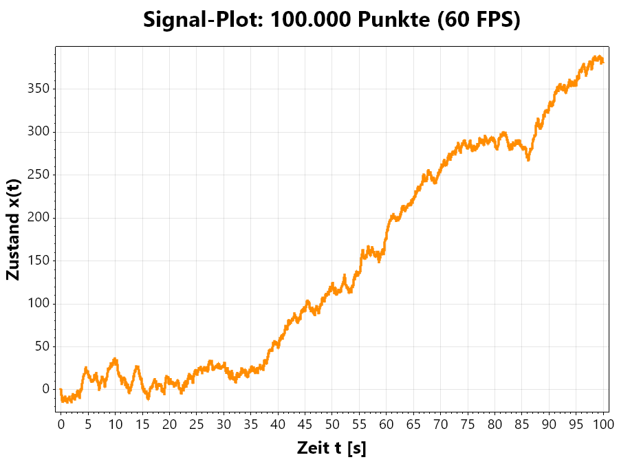

</div>
</div>

---

### Blick unter die Haube (1/3): Wie `Signal` eine Pixelspalte zeichnet

Fallen mehrere Punkte in dieselbe Pixelspalte $p$, reduziert `Signal` sie auf **4 Eckpunkte** (`yEnter`, `yMin`, `yMax`, `yExit`):

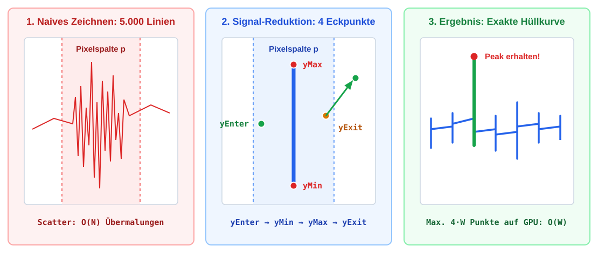

---

### Blick unter die Haube (2/3): 50 % weniger RAM bei `Signal(ys)`

<div class="columns">
<div class="two">

Durch die feste Schrittweite `dt` ($t_i = t_0 + i \cdot \Delta t$) spart `Signal` die Hälfte des Arbeitsspeichers:

- **`Scatter(xs, ys)` speichert 2 Arrays ($2 \times N$):**
  - Bei $N = 10^7$ `double`-Werten (je 8 Byte) belegen `xs` und `ys` zusammen **$160\,\text{MB}$ RAM** und erfordern einen kompletten Schleifendurchlauf ($\mathcal{O}(N)$).
- **`Signal(ys)` speichert nur 1 Array ($1 \times N$):**
  - Das Zeit-Array `xs` entfällt komplett! Es genügt `ys` ($80\,\text{MB}$) plus die beiden Zahlen `Period` (`dt`) und `XOffset` ($t_0$).

</div>
<div class="two">

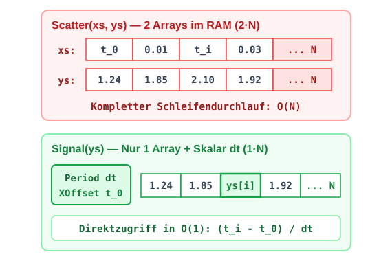

</div>
</div>

---

### Blick unter die Haube (3/3): Sichtbarkeits-Clipping beim Reinzoomen

<div class="columns">
<div class="two">

Reinzoomen bei $N = 10^7$ Punkten ($\mathrm{d}t = 0{,}001\,\text{s}$) auf $t_{\min} = 5{,}000\,\text{s}$ bis $t_{\max} = 5{,}010\,\text{s}$:

- **`Scatter` sucht blind ($\mathcal{O}(N) =$ 10 Mio. Prüfungen):**
  - Prüft in einer Schleife alle $10.000.000$ Punkte einzeln.
- **`Signal` rechnet per Dreisatz ($\mathcal{O}(1) =$ 2 Divisionen!):**
  - Start-Index $i = (5{,}000 - t_0) / 0{,}001 = 5.000$ (Ende $= 5.010$).
  - `Signal` liest im Array `ys` **nur diese 11 Werte** – die übrigen $9.999.989$ Punkte werden ignoriert!

</div>
<div class="two">

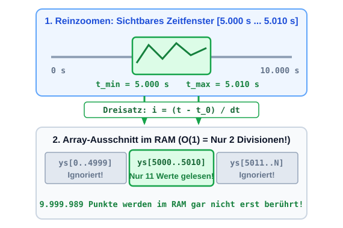

</div>
</div>

---

### Der C#-Code zu `Plot.Add.Signal`

```csharp
// 1. Zeitreihe mit N = 10.000.000 Messpunkten (nur 1 Array ys im RAM!)
double[] ys = Simulation.RunFixedStepEuler(steps: 10_000_000, dt: 0.001);

// 2. Signal-Plot anlegen und konstante Schrittweite dt = 1 ms übergeben
var sig = WpfPlot1.Plot.Add.Signal(ys);
sig.Data.Period  = 0.001; // Abtastperiode dt = 1 ms (1 kHz)
sig.Data.XOffset = 0.0;   // Startzeitpunkt t0 = 0 s
sig.LegendText   = "Hochfrequentes Sensorsignal (10 Mio. Punkte)";

WpfPlot1.Plot.ShowLegend();
WpfPlot1.Plot.Axes.AutoScale();
WpfPlot1.Refresh();
```

- Da nur das Werte-Array `ys` an `sig` übergeben wird (`Period`, `XOffset`), belegt das Signal bei $10^7$ Punkten nur $80\,\text{MB}$ statt $160\,\text{MB}$ RAM und zoomt verzögerungsfrei in $\mathcal{O}(1)$.

---

### Anwendungsbeispiel `SignalXY`: Adaptive Schrittweiten (RK45)

<div class="columns">
<div class="two">

Adaptive DGL-Solver (wie Runge-Kutta RK45) passen ihre Schrittweite $\Delta t$ während der Simulation laufend an:

- **Variabler Punktabstand:** Kleine Schritte ($\Delta t = 0{,}006\,\text{s}$) beim steilen Einschwingen, große Schritte ($\Delta t = 0{,}04\,\text{s}$) im Gleichgewicht.
- **Grenze von `Signal`:** Da $\Delta t$ variiert, gilt die Dreisatz-Formel $i = (t - t_0) / \Delta t$ nicht mehr.
- **Lösung `Plot.Add.SignalXY(xs, ys)`:** Kombiniert variable Zeitstempel `xs` mit schneller Pixelspalten-Reduktion!

</div>
<div class="three">

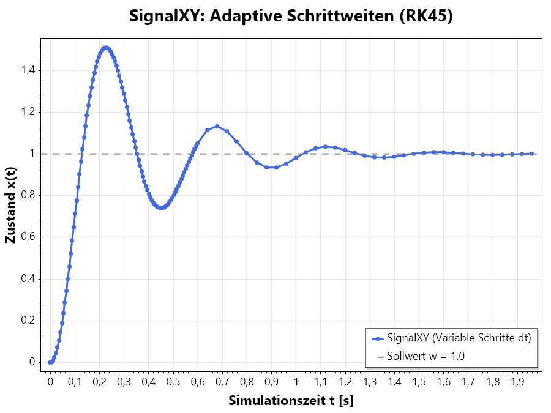

</div>
</div>

---

### Blick unter die Haube (1/2): Halbierungssuche bei `SignalXY`

<div class="columns">
<div class="two">

Beispiel: Gesucht ist die Zoom-Grenze $t_{\min} = 0{,}20\,\text{s}$ im variabel abgetasteten Zeit-Array `xs[0..7]`:

- **1. Schritt (Mitte `[3]`):** `xs[3] = 0.08 < 0.20` (zu klein $\implies$ linke Hälfte `[0..3]` fällt sofort weg!).
- **2. Schritt (Neue Mitte `[5]`):** `xs[5] = 0.42 > 0.20` (zu groß $\implies$ rechte Seite `[5..7]` fällt weg!).
- **3. Schritt (Treffer `[4]`):** `xs[4] = 0.20 s` gefunden in **3 Vergleichen** (bei $10^6$ Punkten max. 20 Schritte, $\mathcal{O}(\log N)$).

</div>
<div class="two">

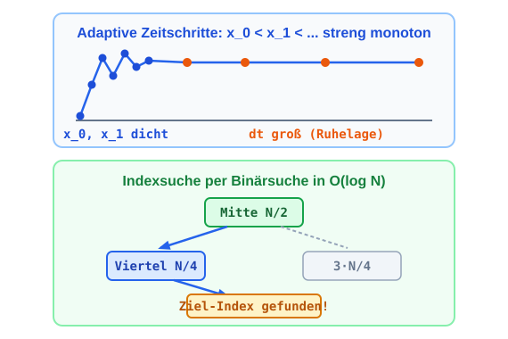

</div>
</div>

---

### Blick unter die Haube (2/2): Adaptives Bucketing bei `SignalXY`

<div class="columns">
<div class="two">

Nach der Indexsuche zeichnet `SignalXY` die Kurve flexibel je nach lokaler Punktdichte:

- **Zone A – Dichte Schritte (`dt` klein, Einschwingen):**
  - Fallen mehrere Punkte in dieselbe Pixelspalte $p$ (einen **Bucket**), fasst `SignalXY` sie wie bei `Signal` zu einem vertikalen **4-Punkt Min/Max-Strich** zusammen.
- **Zone B – Weite Schritte (`dt` groß, Ruhelage):**
  - Liegen die Punkte weiter als 1 Pixelspalte auseinander (*leere Spalten* dazwischen), verbindet `SignalXY` sie direkt mit einer **Linie** (wie `ScatterLine`).

</div>
<div class="two">

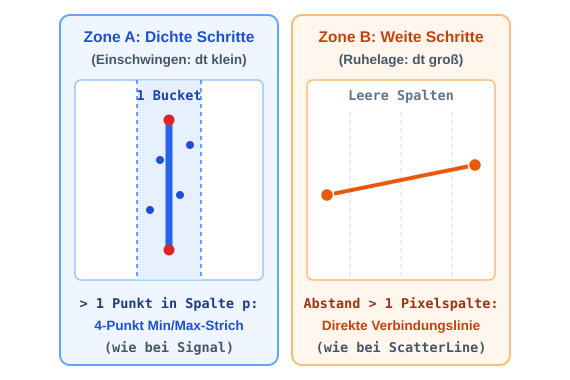

</div>
</div>

---

### Der C#-Code zu `Plot.Add.SignalXY`

```csharp
// 1. Zeitarray xs (variabel, aber streng monoton steigend!) und Zustandsarray ys
var (xs, ys) = Simulation.RunAdaptiveRk45(tEnd: 2.0);

// 2. SignalXY nutzt Binärsuche in O(log N) + Pixelspalten-Reduktion
var sig = plot.Add.SignalXY(xs, ys);
sig.Color      = Colors.RoyalBlue;
sig.LineWidth  = 3.0f;
sig.MarkerSize = 7.0f; // Zeigt die variablen Stützstellen des Solvers
sig.LegendText = "SignalXY (Variable Schritte dt)";

// 3. Gestrichelte Sollwert-Linie bei w = 1.0 überlagern
var target = plot.Add.HorizontalLine(1.0);
target.Color       = Colors.Gray;
target.LinePattern = LinePattern.Dashed;
target.LegendText  = "Sollwert w = 1.0";
```

- Das Kurvenobjekt `sig` verbindet die adaptiven Stützstellen `(xs, ys)` und wird durch die Referenzlinie `target` ergänzt.

---

### Anwendungsbeispiel `VectorField`: Richtungsfeld & Spirale

<div class="columns">
<div class="two">

Zustandsraum-Analyse eines gedämpften Schwingers (Federbein mit Auslenkung $x_1$ und Geschwindigkeit $x_2$):

- **Ebene 1 (`VectorField` im Hintergrund):** An einem Gitter von Punkten $(x_1, x_2)$ zeigt jeder Pfeil die lokale Bewegungsrichtung des Systems.
- **Ebene 2 (`ScatterLine` im Vordergrund):** Die simulierte Trajektorie startet bei $(2{,}5, 0)$ und folgt den Pfeilen spiralförmig in die stabile Ruhelage $(0, 0)$.

</div>
<div class="three">

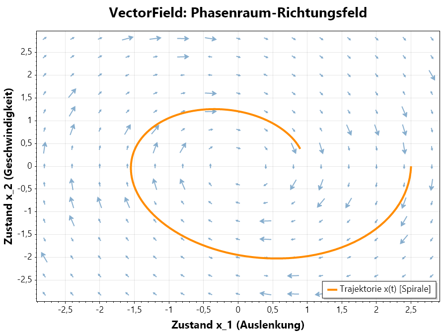

</div>
</div>

---

### Blick unter die Haube: Gitter-Komplexität $\mathcal{O}(G_x \cdot G_y)$ & Layering

<div class="columns">
<div class="two">

Wie arbeitet `Plot.Add.VectorField` im Hintergrund?

- **Quadratische Zeichenlast $\mathcal{O}(G_x \cdot G_y)$:**
  - Pro Gitterpunkt zeichnet ScottPlot 3 Vektorlinien (Pfeilschaft + 2 Pfeilflügel).
  - Da die Pfeilanzahl quadratisch mit der Gitterauflösung wächst, wählt man bewusst ein grobes Gitter (z.B. $15 \times 15 = 225$ Pfeile).
- **Kombi-Chart (Painter's Algorithm):**
  - Zuerst wird `VectorField` als Hintergrundebene gerendert, danach `ScatterLine` als Spirale darübergelegt.

</div>
<div class="two">

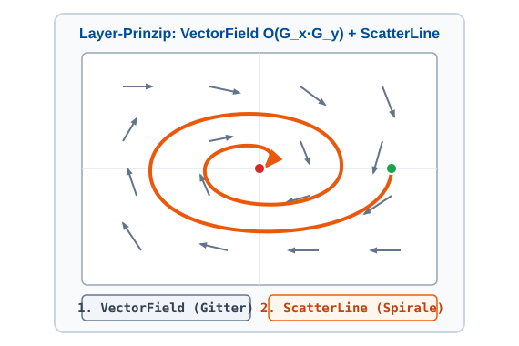

</div>
</div>

---

### Der C#-Code zu `Plot.Add.VectorField`

```csharp
var vectors = new List<RootedCoordinateVector>(); // Gitter G_x * G_y = 15 * 15
for (double x1 = -2.8; x1 <= 2.8; x1 += 0.4) {
    for (double x2 = -2.8; x2 <= 2.8; x2 += 0.4) {
        double dx1 = x2, dx2 = -x1 - 0.3 * x2;
        double len = Math.Sqrt(dx1 * dx1 + dx2 * dx2);
        if (len > 1e-6) {
            double scale = 0.22 / len;
            var coord = new Coordinates(x1, x2);
            var dir   = new Vector2((float)(dx1 * scale), (float)(-dx2 * scale));
            vectors.Add(new RootedCoordinateVector(coord, dir));
        }
    }
}
plot.Add.VectorField(vectors, Colors.SteelBlue);
var traj = plot.Add.ScatterLine(trX, trY);
```

- Für jeden Gitterpunkt `(x1, x2)` wird aus `(dx1, dx2)` über `len` und `scale` ein normierter Vektor `(coord, dir)` in `vectors` abgelegt und mit der Trajektorie `traj` (`trX`, `trY`) kombiniert.

---

### Methodenvergleich der Plot-Typen in Abschnitt 4.2

| Merkmal | `Scatter(xs, ys)` | `Signal(ys)` | `SignalXY(xs, ys)` | `VectorField(vectors)` |
|---|---|---|---|---|
| **Datenstruktur** | Beliebige $(x_i, y_i)$ | **Äquidistant** ($\Delta t$) | **$x_i$ streng monoton** | 2D-Gitter $(G_x \times G_y)$ |
| **Speicher (RAM)** | $2 \times N$ (`xs`, `ys`) | **$1 \times N$** (nur `ys`) | $2 \times N$ (`xs`, `ys`) | $4 \times (G_x \cdot G_y)$ |
| **Index-Suche** | Voller Durchlauf | **$\mathcal{O}(1)$** (Formel) | **$\mathcal{O}(\log N)$** (Binärsuche) | Voller Durchlauf |
| **Zeichenlast** | $\mathcal{O}(N)$ Segmente | **$\mathcal{O}(W)$** (4 Pkt./Spalte) | **$\mathcal{O}(W)$** (Bucketing) | $\mathcal{O}(G_x \cdot G_y)$ (3 Linien) |
| **Einsatzgebiet** | Kennfeld ($\le 10^4$) | Feste $\Delta t$ ($> 10^7$) | RK45-Solver ($\approx 10^6$) | Richtungsfeld ($30 \times 30$) |

---

<!-- Platzhalter für Abschnittsbildbeschreibung -->

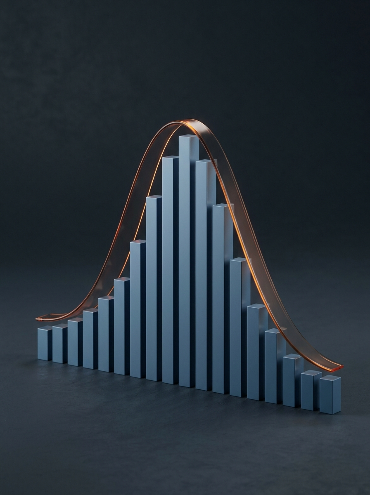

## 4.3: Statistische Auswertung & Histogramme mit ScottPlot

Dieser Abschnitt umfasst die folgenden Inhalte:

- Statistische Diagramme in der Simulation (Monte-Carlo, Rauschen, Varianten)
- Anwendungsbeispiel Histogramm: Binning ($\mathcal{O}(N) \to \mathcal{O}(k)$) & Gauß-Skalierung
- Verteilungsvergleiche mit Box-Plots ($\mathcal{O}(N \log N)$ Sortierung $\to \mathcal{O}(1)$ Box)
- Gruppierte Balken (`Bars`): Positions-Arithmetik & Render-Komplexität $\mathcal{O}(G \cdot M)$
- 2D-Zustandsfelder (`Heatmap` & `ColorBar`): Raw-Pixel-Backend & C#-Code

---

### Warum statistische Diagramme in der Simulation?

Wenn Zufallsprozesse (Rauschen, Toleranzen) oder mehrere Systemvarianten untersucht werden, reichen einzelne Zeitkurven nicht aus:

1. **Monte-Carlo-Toleranzstudien (`Histogram` + Gauß-Kurve):**
   - Ein Prozess wird $N = 10.000$-mal mit streuenden Parametern simuliert. *Frage:* Folgen die Ergebnisse der erwarteten Normalverteilung $\mathcal{N}(\mu, \sigma^2)$?
2. **Robuste Gütevergleiche bei Störungen (`Boxes` / Box-Plot):**
   - Drei Reglerentwürfe (P, PI, PID) werden unter zufälligen Laststößen getestet. *Frage:* Welcher Regler hat im Median die kürzeste Einschwingzeit und die geringste Streuung?
3. **Parameter- & Variantenstudien (`Bars` / Gruppierte Balken):**
   - Gegenüberstellung des Energiebedarfs zweier Modellkonfigurationen über mehrere Laststufen.
4. **Ortsdiskrete 2D-Zustandsfelder (`Heatmap` & `ColorBar`):**
   - Darstellung einer berechneten 2D-Temperaturmatrix $T[i,j]$ inklusive Farbskala.

---

### Anwendungsbeispiel: Histogramm & Normalverteilung

<div class="columns">
<div class="two">

Monte-Carlo-Toleranzanalyse ($N = 10.000$ Läufe) einer gefertigten Bauteillänge ($\mu = 100\,\text{mm}$, $\sigma = 4{,}5\,\text{mm}$):

- **Blaue Balken (`Add.Bars`):** Gezählte Stückzahlen in $k = 24$ Klassen (bis ca. $1.150$ Bauteile pro Klasse).
- **Rote Kurve (`Add.ScatterLine`):** Überlagerte analytische Gauß-Glockenkurve $\mathcal{N}(100, 4{,}5^2)$ zur Modellvalidierung.
- **Grüne Linie (`Add.VerticalLine`):** Markiert den Soll-Mittelwert $\mu = 100\,\text{mm}$.

</div>
<div class="three">

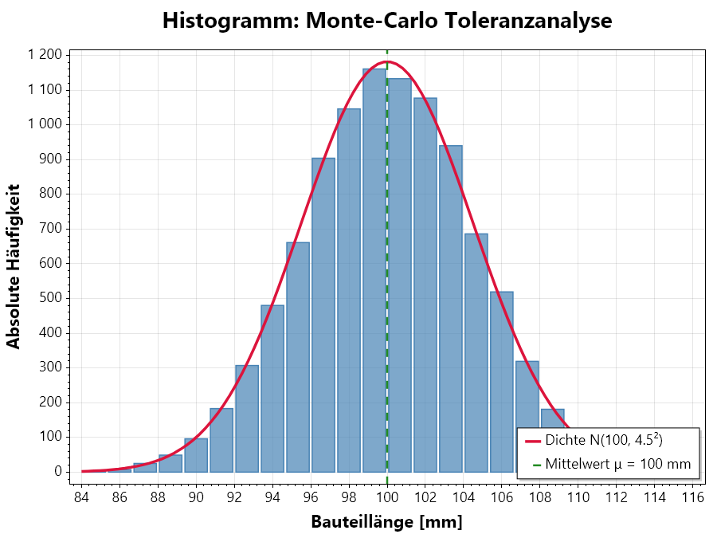

</div>
</div>

---

### Blick unter die Haube (1/2): Binning & Render-Komplexität

<div class="columns">
<div class="two">

Ein Histogramm teilt den Wertebereich in $k$ Intervalle (**Bins**) der Breite $h$ ein:

- **Wahl der Klassenbreite $h$:**
  - *Freedman-Diaconis-Regel:* Nutzt den robusten Interquartilsabstand $\text{IQR} = Q_3 - Q_1$ der mittleren 50 %: $h = 2 \cdot \text{IQR} / \sqrt[3]{N}$.
- **Zweistufige Pipeline in ScottPlot:**
  1. **Zählen in $\mathcal{O}(N)$:** `hist.AddRange(samples)` sortiert alle $N = 10.000$ Werte *einmalig* in $k = 24$ Zähler ein.
  2. **Zeichnen in $\mathcal{O}(k)$:** Die GPU zeichnet bei jedem Frame nur noch **$k = 24$ Rechtecke** (`Add.Bars`)!

</div>
<div class="two">

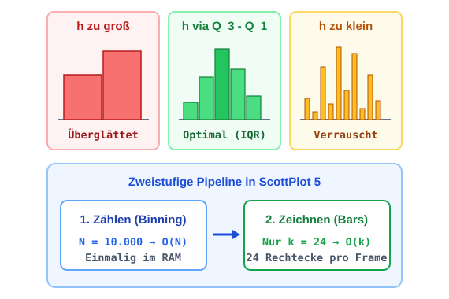

</div>
</div>

---

### Blick unter die Haube (2/2): Warum wir die Gauß-Kurve skalieren

<div class="columns">
<div class="two">

Beim Überlagern von Histogramm und Gauß-Kurve entsteht ein **Skalierungsproblem der Y-Achse**:

- **Y-Skala der Balken (Stückzahl):**
  - `Counts[i]` zählt absolute Häufigkeiten (bis $\approx 1.150$).
  - Gesamtfläche aller Balken: $A_{\text{Balken}} = n \cdot \text{binWidth}$.
- **Y-Skala der Gauß-Dichte `pdf`:**
  - Die Dichte $f(x)$ hat immer **Fläche $1$** (Maximalwert $\approx 0{,}088$).
- **Lösung im Code:** Wir multiplizieren `pdf` mit der Balkenfläche `n * binWidth`: `cy[i] = pdf * n * binWidth`.

</div>
<div class="two">

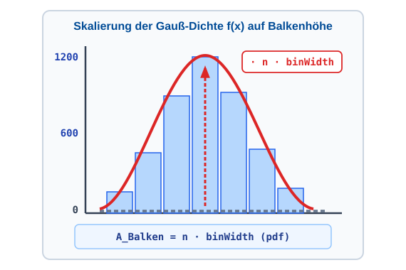

</div>
</div>

---

### Der C#-Code zum Histogramm mit überlagerter Gauß-Kurve

```csharp
// 1. Histogramm mit k = 24 Klassen in [84..116 mm] aus N = 10.000 Werten zählen: O(N)
var hist = ScottPlot.Statistics.Histogram.WithBinCount(24, 84, 116);
hist.AddRange(samples);
double binWidth = hist.FirstBinSize;
// 2. Ebene 1: Gezählte Klassen als Balken (Bars) plotten: O(k) beim Zeichnen
var bars = new List<Bar>();
for (int i = 0; i < hist.Counts.Length; i++)
    bars.Add(new Bar { Position = hist.Bins[i] + binWidth * 0.5, Value = hist.Counts[i],
        Size = binWidth * 0.88, FillColor = Colors.SteelBlue.WithAlpha(0.7f), LineColor = Colors.SteelBlue });
plot.Add.Bars(bars);
// 3. Ebene 2: Gauß-Dichte berechnen und mit (n * binWidth) auf Balkenhöhe skalieren
double[] cx = new double[100], cy = new double[100];
for (int i = 0; i < 100; i++) {
    cx[i] = 84.0 + i * (32.0 / 99.0);
    double pdf = (1.0 / (sigma * Math.Sqrt(2.0 * Math.PI))) * Math.Exp(-0.5 * Math.Pow((cx[i] - mu) / sigma, 2));
    cy[i] = pdf * samples.Length * binWidth; // Skalierung auf Histogramm-Fläche!
}
var curve = plot.Add.ScatterLine(cx, cy); curve.Color = Colors.Crimson;
```

- Die Objekte `hist`, `binWidth`, `bars`, `cx`, `cy`, `pdf` und `curve` kombinieren Balken und Gauß-Kurve im selben Diagramm.

---

### Anwendungsbeispiel `Boxes`: Gütevergleich mit Box-Plots

<div class="columns">
<div class="two">

Für den Verteilungsvergleich **mehrerer Varianten** nutzen wir **Box-Plots**:

- **Szenario:** Einschwingzeit $t_s$ von P-, PI- und PID-Regler unter Laststörungen.
- **Aussage auf einen Blick:**
  - **Mittellinie (`BoxMiddle`, Median $Q_2$):** Der PID-Regler schwingt viermal schneller ein als der P-Regler.
  - **Box (`BoxMin` $Q_1$ bis `BoxMax` $Q_3$) & Whisker:** Belegen die deutlich geringere Streuung des PID-Reglers.

</div>
<div class="three">

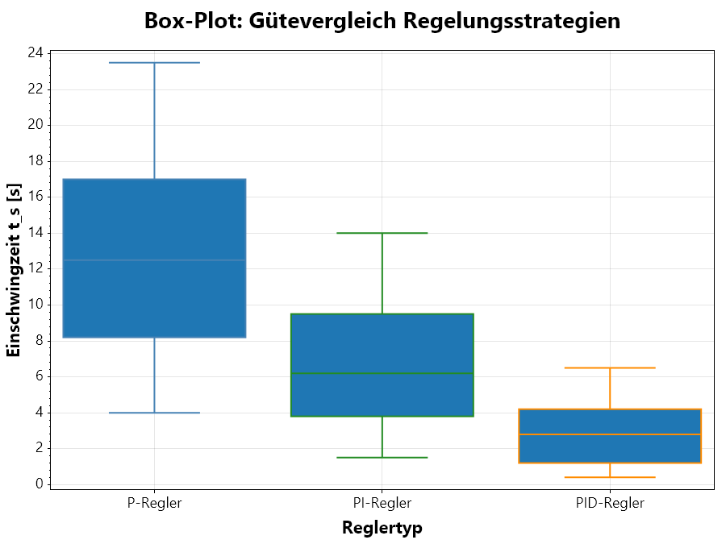

</div>
</div>

---

### Blick unter die Haube: Box-Plot-Anatomie & $\mathcal{O}(1)$-Geometrie

<div class="columns">
<div class="two">

- **5 Kennwerte repräsentieren Millionen Punkte:**
  - `BoxMin` ($Q_1$) und `BoxMax` ($Q_3$) umrahmen die zentralen 50 % der Messwerte ($\text{IQR}$).
  - `BoxMiddle` ($Q_2$, Median) teilt den Datensatz in zwei Hälften und ist robust gegen Ausreißer.
  - `WhiskerMin` und `WhiskerMax` zeigen die Streugrenzen.
- **Komplexität ($\mathcal{O}(N \log N) \to \mathcal{O}(1)$):**
  - Einmaliges Sortieren der Stichprobe kostet $\mathcal{O}(N \log N)$.
  - Das **Zeichnen im Plot ist $\mathcal{O}(1)$ pro Box**: Die GPU zeichnet pro Box nur **1 Rechteck und 5 Linien**!

</div>
<div class="two">

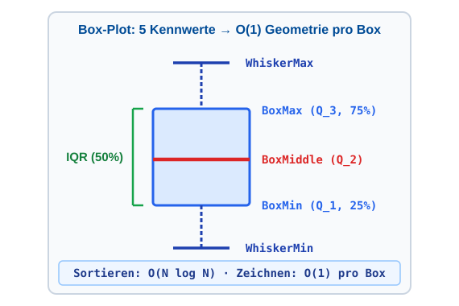

</div>
</div>

---

### Der C#-Code zu Box-Plots (`Plot.Add.Boxes`)

```csharp
var b1 = new Box {
    Position = 1, BoxMin = 8.2, BoxMiddle = 12.5, BoxMax = 17.0, WhiskerMin = 4.0, WhiskerMax = 23.5,
    FillColor = Colors.SteelBlue.WithAlpha(0.6f), LineColor = Colors.SteelBlue, LineWidth = 2.0f
};
var b2 = new Box {
    Position = 2, BoxMin = 3.8, BoxMiddle = 6.2,  BoxMax = 9.5,  WhiskerMin = 1.5, WhiskerMax = 14.0,
    FillColor = Colors.ForestGreen.WithAlpha(0.6f), LineColor = Colors.ForestGreen, LineWidth = 2.0f
};
var b3 = new Box {
    Position = 3, BoxMin = 1.2, BoxMiddle = 2.8,  BoxMax = 4.2,  WhiskerMin = 0.4, WhiskerMax = 6.5,
    FillColor = Colors.DarkOrange.WithAlpha(0.6f), LineColor = Colors.DarkOrange, LineWidth = 2.0f
};
plot.Add.Boxes(new[] { b1, b2, b3 });

// Benutzerdefinierte Text-Labels auf der X-Achse an Position 1.0, 2.0 und 3.0
Tick[] ticks = { new(1.0, "P-Regler"), new(2.0, "PI-Regler"), new(3.0, "PID-Regler") };
plot.Axes.Bottom.TickGenerator = new ScottPlot.TickGenerators.NumericManual(ticks);
```

- Die drei Box-Objekte `b1`, `b2` und `b3` werden übergeben und durch `ticks` (`NumericManual`) auf der X-Achse beschriftet.

---

### Anwendungsbeispiel `Bars`: Gruppierte Balkendiagramme

<div class="columns">
<div class="two">

Gegenüberstellung mehrerer Modellvarianten über diskrete Betriebspunkte:

- **Simulationsszenario:** Leistungsaufnahme $[\text{kW}]$ von `Modell A (Baseline)` und `Modell B (Optimiert, -23 %)` in vier Laststufen.
- **Gruppierung per Positions-Offset:**
  - Am Gruppenort `positions[i]` wird der linke Balken um `- width / 2.0` und der rechte um `+ width / 2.0` verschoben.

</div>
<div class="three">

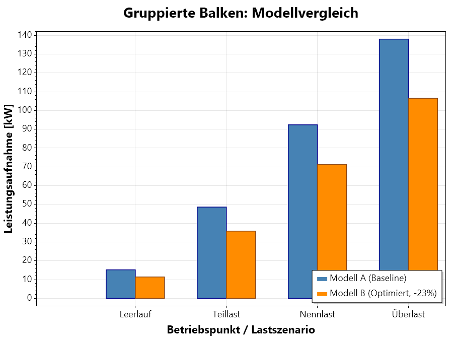

</div>
</div>

---

### Blick unter die Haube: Positions-Arithmetik & $\mathcal{O}(G \cdot M)$

<div class="columns">
<div class="two">

Wie werden gruppierte Balken in `ScottPlot` positioniert und gezeichnet?

- **Explizite X-Koordinaten pro Balken:**
  - Jede Gruppe $i$ liegt bei einer Basisposition `positions[i]` (z.B. $1{,}0, 2{,}0, \dots$).
  - Bei Balkenbreite `width = 0.32` wird `barsA` um `- width / 2` nach links und `barsB` um `+ width / 2` nach rechts versetzt, sodass sie exakt aneinanderstoßen.
- **Render-Komplexität $\mathcal{O}(G \cdot M)$:**
  - Für $G$ Gruppen und $M$ Modellreihen zeichnet die GPU exakt $G \cdot M$ Vektor-Rechtecke (`DrawRect`).

</div>
<div class="two">

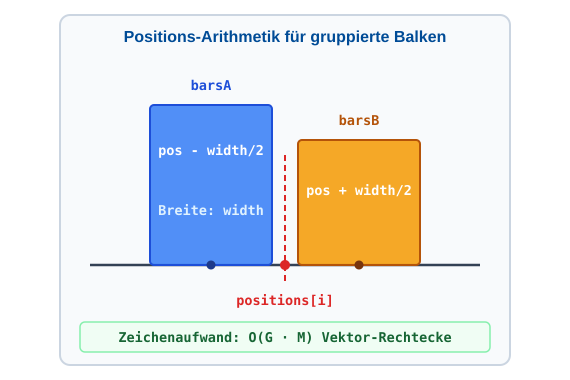

</div>
</div>

---

### Der C#-Code zu gruppierten Balken (`Plot.Add.Bars`)

```csharp
double[] positions = { 1.0, 2.0, 3.0, 4.0 };
double[] valuesA   = { 15.2, 48.6, 92.4, 138.0 };
double[] valuesB   = { 11.4, 35.8, 71.2, 106.5 };
double width       = 0.32;

var barsA = new List<Bar>();
var barsB = new List<Bar>();
for (int i = 0; i < positions.Length; i++) {
    barsA.Add(new Bar { Position = positions[i] - width / 2.0, Value = valuesA[i], Size = width, FillColor = Colors.SteelBlue });
    barsB.Add(new Bar { Position = positions[i] + width / 2.0, Value = valuesB[i], Size = width, FillColor = Colors.DarkOrange });
}
plot.Add.Bars(barsA);
plot.Add.Bars(barsB);
```

- Aus den Stützstellen `positions` sowie `valuesA` und `valuesB` entstehen mit Balkenbreite `width` die beiden Serien `barsA` und `barsB`.

---

### Anwendungsbeispiel `Heatmap` & `ColorBar`: 2D-Temperaturfeld

<div class="columns">
<div class="two">

Darstellung des 2D-Temperaturfelds $T[i,j]$ aus der FDM-Simulation (Brücke zu Termin 02):

- **Simulationsdaten:** 2D-Array `double[,] intensities` ($50 \times 50$) mit den Knotentemperaturen des Gitters.
- **`Plot.Add.Heatmap(intensities)`:** Übersetzt die Matrix über eine Farbpalette (`Turbo`) in ein 2D-Farbfeld.
- **`Plot.Add.ColorBar(hm)`:** Fügt rechts automatisch die Temperaturskala in $[^\circ\text{C}]$ an.

</div>
<div class="three">

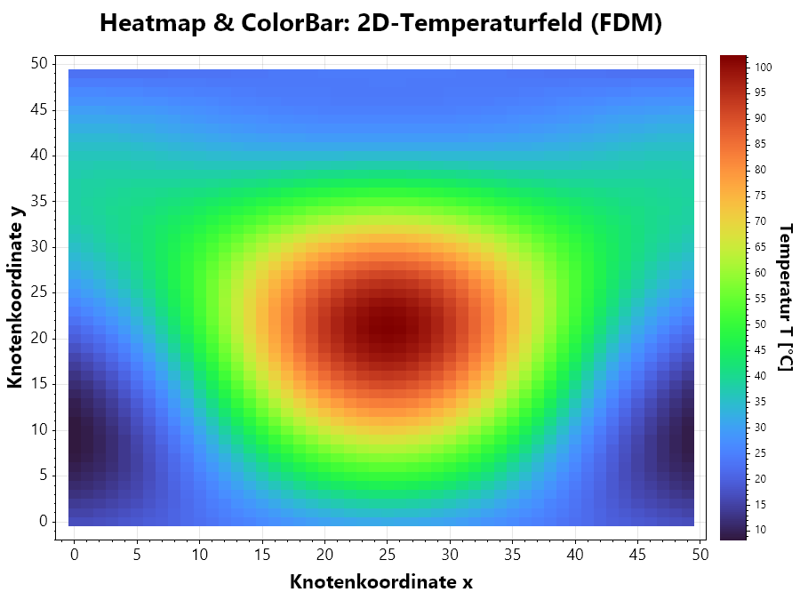

</div>
</div>

---

### Blick unter die Haube: Das Raw-Pixel-Backend von `Heatmap`

<div class="columns">
<div class="two">

Warum nutzt `Heatmap` ein anderes Backend als `Scatter`, `Signal` oder `Bars`?

- **Kein Vektor-Rechteck pro Gitterzelle:**
  - Ein $500 \times 500$ Gitter hätte $250.000$ Einzel-Rechtecke – als Vektorpfade würde das die Zeichenpipeline ausbremsen.
- **Raw-Pixel-Puffer (`SKBitmap`) in $\mathcal{O}(N_x \cdot N_y)$:**
  - Genau wie bei `WriteableBitmap` in **Termin 02** rechnet `Heatmap` die Werte `intensities[i, j]` über die `Colormap` direkt in 32-Bit-Pixel (`uint[]`) um und zeichnet nur **1 Bitmap-Textur**!

</div>
<div class="two">

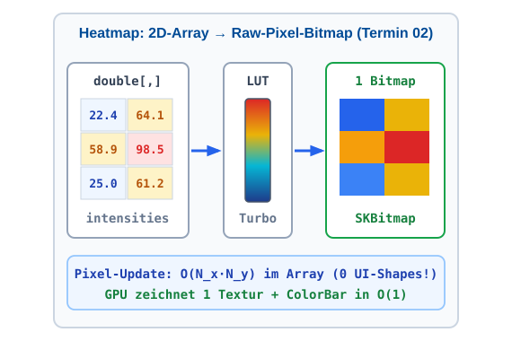

</div>
</div>

---

### Der C#-Code zu `Heatmap` & `ColorBar`

```csharp
// 1. 2D-Temperaturmatrix der Größe N_x * N_y = 50 * 50 berechnen
int size = 50;
double[,] intensities = new double[size, size];
for (int i = 0; i < size; i++)
    for (int j = 0; j < size; j++)
        intensities[i, j] = ComputeFdmTemp(i, j);

// 2. Heatmap als schnelle Bitmap-Textur mit Turbo-Farbpalette anlegen
var hm = plot.Add.Heatmap(intensities);
hm.Colormap = new ScottPlot.Colormaps.Turbo();

// 3. Farbskala (ColorBar) rechts neben dem Plot verankern
var cb = plot.Add.ColorBar(hm);
cb.Label = "Temperatur T [°C]";
plot.Axes.SetLimits(0, size, 0, size);
```

- Das 2D-Array `intensities` der Größe `size` wird als `hm` übergeben und mit der Farblegende `cb` gekoppelt.

---

<!-- Platzhalter für Abschnittsbildbeschreibung -->


## 4.4: Live-Streaming & Telemetrie

Dieser Abschnitt umfasst die folgenden Inhalte:

- Von der Offline-Auswertung zur Echtzeit-Telemetrie im Digitalen Zwilling
- Warum wachsende Listen (`List.Add`) im Dauerbetrieb scheitern
- Das Ringpuffer-Prinzip (Circular Buffer) & `Plot.Add.DataStreamer`
- Taktentkopplung im C#-Code: 1.000 Hz Simulation vs. 50 Hz `DispatcherTimer`
- Laufende Online-Statistik (Welford) für dynamische Toleranzlinien (`HorizontalLine`)
- Mitwandernde Toleranzkorridore mit `FillY`: Polygon-Rendering & C#-Code

---

### Offline-Analyse vs. Echtzeit-Telemetrie in der Simulation

In Abschnitt 4.2 und 4.3 lief die Simulation zuerst komplett durch (*Offline-Plot*). Bei einem **Digitalen Zwilling oder Prüfstand** läuft die Berechnung jedoch **endlos live weiter**, während wir zuschauen:

1. **Problem 1 – Speicherüberlauf bei wachsenden Listen (`List<double>.Add`):**
   - Kommt jede Millisekunde ($1.000\,\text{Hz}$) ein neuer Messwert hinzu und hängen wir ihn mit `List.Add()` an, wächst das Array unbegrenzt, bis der Arbeitsspeicher überläuft.
   - **Lösung:** Wir speichern im Plot nur ein festes Zeitfenster der jüngsten $K$ Werte in einem **Ringpuffer fester Größe** (in ScottPlot: `DataStreamer`).
2. **Problem 2 – Blockade durch zu häufiges Neuzeichnen (`Refresh()`):**
   - Die Simulation rechnet mit $1.000\,\text{Hz}$ ($\Delta t = 1\,\text{ms}$), aber ein Monitor zeigt nur $50\text{–}60\,\text{Bilder/s}$ (FPS). Ein `WpfPlot1.Refresh()` in jedem Simulationsschritt würde die Oberfläche sofort einfrieren!
   - **Lösung:** **Taktentkopplung** zwischen schnellem Simulations-Task und langsamem UI-Timer (`DispatcherTimer`).

---

### Funktionsweise des Ringpuffers & `DataStreamer`

Ein Ringpuffer nutzt ein **festes Array der Länge `cap`** und springt am Ende per Modulo `(head + 1) % cap` auf `[0]` zurück:

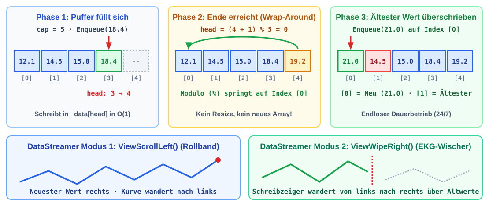

---

### Eigener Ringpuffer in C# (`SimulationRingBuffer`)

```csharp
public class SimulationRingBuffer(int cap)
{
    private readonly double[] _data = new double[cap]; // Einmalig fest im Speicher angelegt!
    private int _head;                                 // Aktueller Schreibindex
    private readonly object _lock = new();

    // Wird vom schnellen Simulations-Task (1.000 Hz) aufgerufen: O(1) Zeit, 0 Byte neuer Speicher
    public void Enqueue(double val)
    {
        lock (_lock) { _data[_head] = val; _head = (_head + 1) % _data.Length; }
    }

    // Wird vom langsamen UI-Timer (50 Hz) für das Zeichnen aufgerufen
    public void CopyTo(double[] dest)
    {
        lock (_lock) { Array.Copy(_data, dest, _data.Length); }
    }
}
```

- Das feste Array mit Kapazität `cap` überschreibt beim Einfügen von `val` automatisch den ältesten Wert und kopiert bei Bedarf in `dest`.

---

### Taktentkopplung: 1.000 Hz Simulation vs. 50 Hz UI-Timer

<div class="columns">
<div class="two">

- **1. Schneller Simulations-Task ($1.000\,\text{Hz}$, $1\,\text{ms}$):**
  - Berechnet in jedem Schritt `y` und schiebt ihn mit `_streamer.Add(y)` in den Ringpuffer ($\mathcal{O}(1)$).
  - **Wichtig:** Ruft **niemals** `WpfPlot1.Refresh()` auf!
- **2. Langsamer UI-Timer (`DispatcherTimer`, $50\,\text{Hz}$):**
  - Feuert im UI-Thread 50-mal/s (`OnUiTimerTick`).
  - Ruft `WpfPlot1.Refresh()` auf und zeichnet die 20 neuen Punkte in einem Rutsch!

</div>
<div class="two">

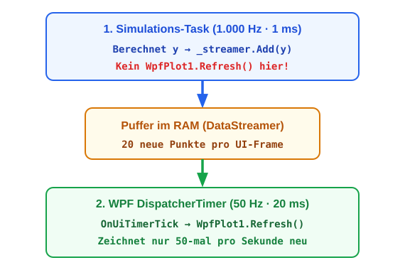

</div>
</div>

---

### Der C#-Code zur Taktentkopplung (`DataStreamer` & `DispatcherTimer`)

```csharp
private ScottPlot.Plottables.DataStreamer _streamer;
private DispatcherTimer _uiTimer;

private void InitLiveTelemetry() {
    _streamer = WpfPlot1.Plot.Add.DataStreamer(500); // Ringpuffer für 500 Punkte
    _streamer.Period = 0.001;                        // Schrittweite dt = 1 ms
    _streamer.ViewScrollLeft();                      // Rollband-Modus

    _uiTimer = new DispatcherTimer { Interval = TimeSpan.FromMilliseconds(20) }; // 50 Hz
    _uiTimer.Tick += OnUiTimerTick;
    _uiTimer.Start();
}
// TEIL A: Schneller Simulations-Task (1.000 Hz) -> Nur Daten in den Puffer schreiben!
private void OnSimulationStep(double y) => _streamer.Add(y);
// TEIL B: Langsamer UI-Timer (50 Hz) -> Diagramm entspannt auf dem Monitor neu zeichnen!
private void OnUiTimerTick(object? s, EventArgs e) => WpfPlot1.Refresh();
```

- Der Simulationsschritt übergibt `y` an `_streamer`, während `_uiTimer` (`s`, `e`) entkoppelt mit 50 Hz das Bild aktualisiert.

---

### Von der nackten Kurve zu Grenzwert-Linien (`HorizontalLine`)

<div class="columns">
<div class="two">

Woran erkennt der Bediener in der rollenden `DataStreamer`-Kurve einen **Alarm**? Wir legen optische Leitplanken (`HorizontalLine`) darüber:

- **Fall 1 – Starre Grenze aus dem Datenblatt:**
  - Z. B. max. Drehzahl $7.200\,\text{U/min}$ $\implies$ einmalig `Add.HorizontalLine(7200)` setzen.
- **Fall 2 – Prozessabhängige Grenze (`Mean ± 3·StdDev`):**
  - Bei **Predictive Maintenance** (Lagerschwingung) oder **SPC-Qualitätsregelkarten** müssen wir `Mean` und `StdDev` **live aus dem Strom berechnen**, um die Linien bei `Mean ± 3·StdDev` zu platzieren!

</div>
<div class="two">

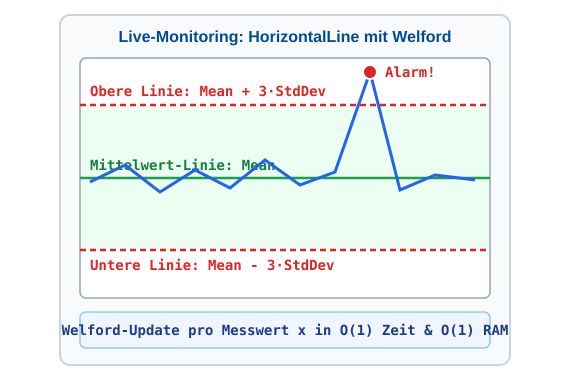

</div>
</div>

---

### Das Ringpuffer-Problem beim Mitrechnen lösen: Welford

<div class="columns">
<div class="two">

- **Das Problem bei Fall 2 (`Mean ± 3·StdDev` live berechnen):**
  - Für stabile `HorizontalLine`-Grenzen brauchen wir Mittelwert und Streuung über **alle bisherigen Millionen Messwerte**.
  - Aber: Unser `DataStreamer`-Ringpuffer überschreibt alles, was älter als $0{,}5\,\text{s}$ (500 Punkte) ist!
- **Die Lösung (Zwei-Gedächtnis-Architektur):**
  - Jeder neue Wert `x` geht an den **Ringpuffer** (Kurzzeit-Kurve) UND an die **Welford-Rekursion** (`Count`, `Mean`, `M2` = nur 3 Zahlen / 24 Byte RAM)!

</div>
<div class="two">

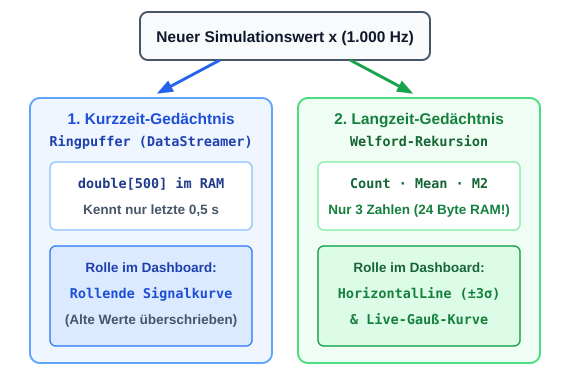

</div>
</div>

---

### Der C#-Code: `WelfordStatistics` & dynamische `HorizontalLine`

<div class="columns">
<div class="two">

- **1. Laufende Statistik (`WelfordStatistics`):**
  - Bei jedem neuen Messwert `x` wird `Count` erhöht, über `delta = x - Mean` der Mittelwert `Mean` angepasst und mit `deltaStar = x - Mean` die Streuungssumme `M2` für `Variance` und `StdDev` aktualisiert ($\mathcal{O}(1)$).
- **2. Linien nachführen (`HorizontalLine`):**
  - Im 50-Hz-UI-Timer setzen wir `.Y` von `_meanLine` und `_upperLine` einfach auf die aktuellen Welford-Werte!

</div>
<div class="two">

```csharp
public class WelfordStatistics {
    public long Count { get; private set; }
    public double Mean { get; private set; }
    public double M2 { get; private set; }
    public double Variance => Count > 1 ? M2 / (Count - 1) : 0.0;
    public double StdDev => Math.Sqrt(Variance);

    public void Add(double x) {
        Count++;
        double delta = x - Mean;
        Mean += delta / Count;
        double deltaStar = x - Mean;
        M2 += delta * deltaStar;
    }
}

// Im 50-Hz-UI-Timer: HorizontalLine-Positionen aktualisieren
_meanLine.Y  = _welford.Mean;
_upperLine.Y = _welford.Mean + 3.0 * _welford.StdDev;
WpfPlot1.Refresh();
```

</div>
</div>

---

### Anwendungsbeispiel `FillY`: Mitwandernder Toleranzkorridor

<div class="columns">
<div class="two">

Wenn der Sollwert $\mu(t)$ in der Simulation einer **zeitabhängigen Kurve** folgt (z.B. periodischer Zylinderdruck), reichen starre horizontale Linien nicht aus:

- **Mitwandernder Gutbereich:** Untere Grenze $y_{\text{lower}}(t)$ und obere Grenze $y_{\text{upper}}(t)$ spannen einen Schlauch $\mu(t) \pm 3\sigma$ um das Nennsignal auf.
- **Flächen-Plot `Plot.Add.FillY`:** Hebt den Toleranzkorridor halbtransparent hervor, sodass der Ausreißer des roten Sensorsignals $y(t)$ bei $t \approx 1{,}38\,\text{s}$ sofort sichtbar wird.

</div>
<div class="three">

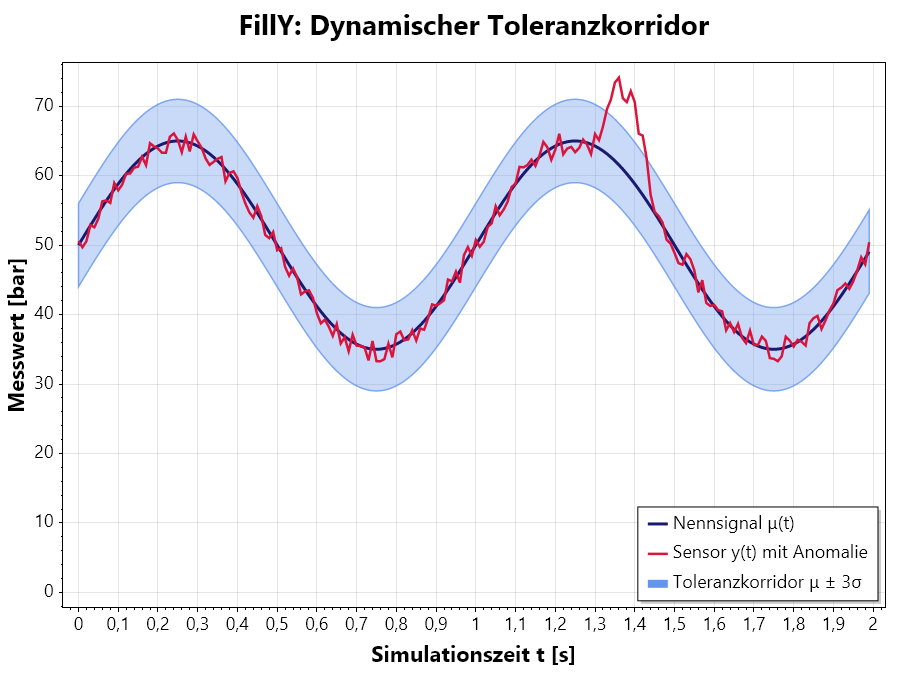

</div>
</div>

---

### Blick unter die Haube: Polygon-Rendering bei `FillY`

<div class="columns">
<div class="two">

Wie zeichnet `Plot.Add.FillY(xs, yLower, yUpper)` eine schattierte Fläche?

- **Ein geschlossener Polygonpfad (`SKPath`):**
  - **1. Hinweg:** Läuft vorwärts über die obere Hüllkurve `yUpper[0 ... N-1]`.
  - **2. Rückweg:** Läuft rückwärts über die untere Grenze `yLower[N-1 ... 0]` zurück zum Startpunkt.
- **Render-Komplexität $\mathcal{O}(N)$:**
  - Die GPU füllt dieses Polygon mit $2N$ Eckpunkten halbtransparent in einem Durchgang.

</div>
<div class="two">

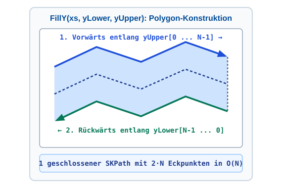

</div>
</div>

---

### Der C#-Code zu `Plot.Add.FillY`

```csharp
// 1. Ebene 1 (Hintergrund): Halbtransparenter Toleranzkorridor mit FillY
var fill = plot.Add.FillY(xs, yLower, yUpper);
fill.FillColor = Colors.CornflowerBlue.WithAlpha(0.35f);
fill.LineColor = Colors.CornflowerBlue.WithAlpha(0.8f);

// 2. Ebene 2 (Mitte): Zeitvariables Nennsignal mu(t) darüberlegen
var meanLine = plot.Add.ScatterLine(xs, mu);
meanLine.Color      = Colors.MidnightBlue;
meanLine.LineWidth  = 3.0f;
meanLine.LegendText = "Nennsignal μ(t)";

// 3. Ebene 3 (Vordergrund): Reales Sensorsignal y(t) mit Ausreißer
var sensLine = plot.Add.ScatterLine(xs, sensor);
sensLine.Color      = Colors.Crimson;
sensLine.LegendText = "Sensor y(t) mit Anomalie";
```

- Der Korridor `fill` (`xs`, `yLower`, `yUpper`) bildet den Hintergrund für das Nennsignal `meanLine` (`mu`) und die Messung `sensLine` (`sensor`).

---

<!-- Platzhalter für Abschnittsbildbeschreibung -->


## 4.5: Topologie- und Netzwerkgraphen mit MSAGL

Dieser Abschnitt umfasst die folgenden Inhalte:

- Systemtopologien und Blockschaltbilder als gerichtete Graphen $G = (V, E)$
- Das Microsoft Automatic Graph Layout (`MSAGL`) & sein WPF-Canvas-Backend
- Hierarchisches Sugiyama-Layout für kausale Regelkreise (Beispieldiagramm & Phasen)
- Organisches Force-Directed Layout für Komponentennetzwerke (Beispieldiagramm & Code)
- Gegenüberstellung: Automatisches Layout (`MSAGL`) vs. Node-Editor (`Nodify`)

---

### Mathematische Modellierung von Modelltopologien

In Blockdiagramm-Simulatoren (Simulink, Modelica) wird die Systemstruktur als gerichteter Graph $G = (V, E)$ beschrieben:

- **Knotenmenge $V = \{v_1, \dots, v_n\}$:** Funktionsblöcke (Regler, Integrator, Summierer) oder Komponenten (SPS, Sensor).
  - Eingangsgrad $\deg^-(v_i)$: Anzahl eingehender Signale; Ausgangsgrad $\deg^+(v_i)$: Anzahl ausgehender Signale.
- **Kantenmenge $E \subseteq V \times V$:** Gerichtete Signal- und Leistungsflüsse $e = (v_i, v_j)$.
- **Warum automatisches Layout mit `MSAGL`?**
  - Aus Code oder Konfigurationsdateien geladene Modelle besitzen zunächst **keine $(x, y)$-Koordinaten**!
  - `MSAGL` berechnet vollautomatisch überschneidungsarme Knotenpositionen und Spline-Kanten und stellt sie im `AutomaticGraphLayoutControl` auf einem **echten WPF-`Canvas` (wie in Termin 03)** dar.

---

### MSAGL: Einbindung in WPF & Grund-API

<div class="columns">
<div class="one">

**XAML-Deklaration:**
```xaml
<Window ...
  xmlns:msagl="clr-namespace:
    Microsoft.Msagl.WpfGraphControl;
    assembly=
    Microsoft.Msagl.WpfGraphControl">
  <Grid>
    <msagl:AutomaticGraphLayoutControl 
      x:Name="GraphControl" />
  </Grid>
</Window>
```

</div>
<div class="two">

**C#-Code-Behind:**
```csharp
// 1. Graph-Objekt erstellen
var graph = new Microsoft.Msagl.Drawing.Graph("Sim");

// 2. Knoten (Blöcke) hinzufügen
graph.AddNode("Integrator").LabelText = "Integrator";
graph.AddNode("Gain").LabelText = "Gain [k=2.5]";
graph.AddNode("Sum").LabelText = "Sum [+ -]";

// 3. Gerichtete Kanten (Signale) definieren
graph.AddEdge("Sum", "e(t)", "Integrator");
graph.AddEdge("Integrator", "x(t)", "Gain");
graph.AddEdge("Gain", "Feedback", "Sum");

// 4. Dem WPF-Control übergeben (Layout startet automatisch)
GraphControl.Graph = graph;
```

</div>
</div>

- Die Instanz `graph` beschreibt nur die logische Verschaltung – die 2D-Koordinaten berechnet `GraphControl` automatisch.

---

### Zwei Layout-Strategien in MSAGL: Hierarchisch vs. Kräfteorientiert

<div class="columns">
<div class="two">

Nach welchem Kriterium ordnet `MSAGL` die Knoten im 2D-Raum an? Es gibt **zwei Hauptverfahren**:

1. **Hierarchisches Schicht-Layout (`SugiyamaLayoutSettings`, Standard):**
   - Für **kausale Signalflüsse** (`Sum` $\to$ `Regler` $\to$ `Strecke`) mit Rückführschleifen wie in *Simulink*-Blockschaltbildern.
2. **Organisches Kräfte-Layout (`MdsLayoutSettings`, Force-Directed):**
   - Für **vermaschte Komponentennetze** (`GW-A`, `GW-B` mit Sensoren `S1`, `S2`, `R1`, `R2`), bei denen Nachbarschafts-Cluster sichtbar werden sollen.

</div>
<div class="two">

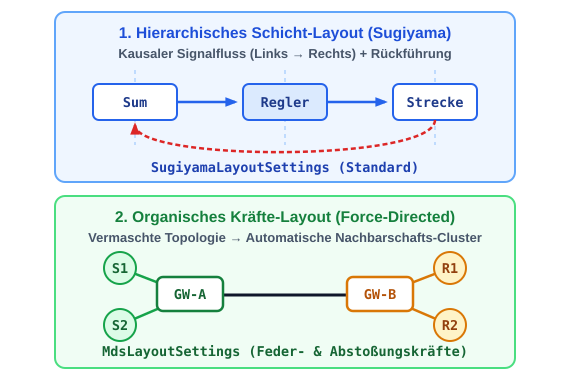

</div>
</div>

---

### Anwendungsbeispiel MSAGL: Hierarchisches Sugiyama-Layout

<div class="columns">
<div class="two">

Standardmäßig nutzt `MSAGL` den **Sugiyama-Algorithmus** für kausale Signalflüsse und Regelkreise:

- **Vorwärtspfad:** Vom `Sollwert w(t)` über `Summierer`, `PID-Regler` und `Leistungsaktor` zur `Regelstrecke`.
- **Rückführpfad:** Vom Ausgang über den `Sensor` zurück zum `Summierer`.
- **Automatisches Routing:** Ordnet Blöcke in Schichten an und führt Feedback-Schleifen als Bezier-Kurven kollisionsfrei um die Blöcke herum.

</div>
<div class="three">

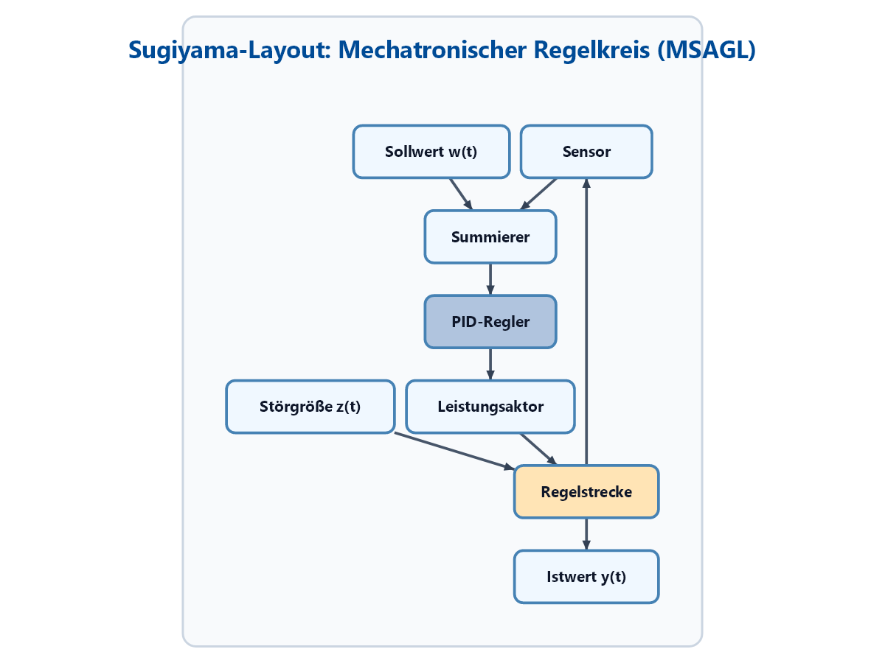

</div>
</div>

---

### Blick unter die Haube: Die 4 Phasen des Sugiyama-Algorithmus

<div class="columns">
<div class="two">

Wie berechnet `MSAGL` aus Knoten und Kanten ein sauberes Blockschaltbild?

1. **Cycle Removal:** Feedback-Kanten werden intern kurzzeitig umgedreht, sodass ein zyklenfreier Graph (DAG) entsteht.
2. **Layering:** Knoten werden in aufeinanderfolgende Schichten $L_1, L_2, L_3$ eingeteilt.
3. **Crossing Minimization:** Vertauschen von Knoten innerhalb der Schichten minimiert Kantenkreuzungen.
4. **Spline Routing:** Berechnung der finalen Box-Koordinaten und Bezier-Kurven.

</div>
<div class="two">

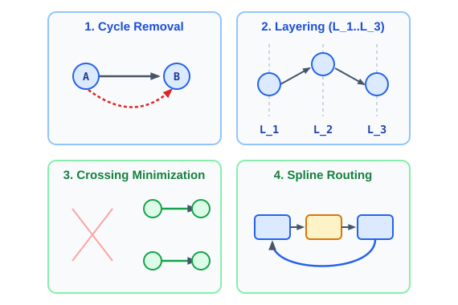

</div>
</div>

---

### Anwendungsbeispiel MSAGL: Organisches IoT-Netzwerk-Layout

<div class="columns">
<div class="two">

Für ungerichtete Sensor- oder Kommunikationsnetze einer Industrie-4.0-Fertigungszelle liefert ein kräfteorientiertes Layout (`MdsLayoutSettings`) eine organische Anordnung:

- **Automatische Cluster-Bildung:** Die CNC-Sensoren (blau) gruppieren sich automatisch um `Gateway-A` und die Roboter-Sensoren (orange) um `Gateway-B`.
- **Zentrale Brückenknoten:** `Gateway-A`, `Gateway-B` und `Edge-Cloud` richten sich im Zentrum zwischen den Teilnetzen aus.

</div>
<div class="three">

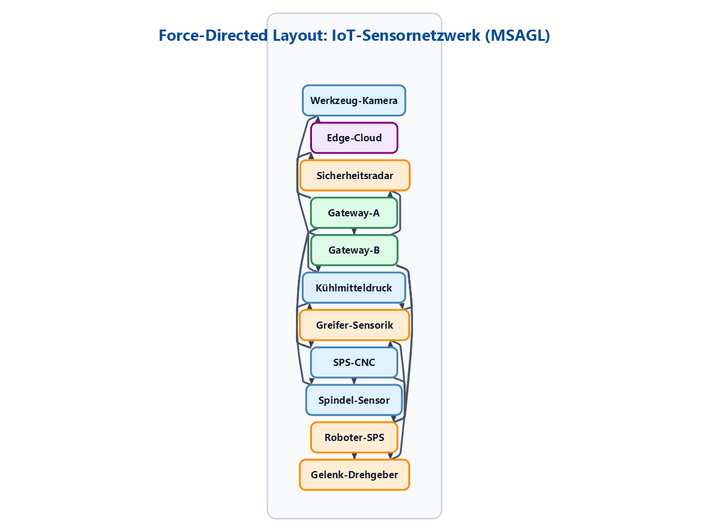

</div>
</div>

---

### Blick unter die Haube: Force-Directed Layout (Physik-Simulation!)

<div class="columns">
<div class="two">

Wie entsteht dieses organische Layout? `MSAGL` berechnet intern **selbst eine kleine physikalische Simulation**:

- **1. Kanten als Zugfedern (Hooke):**
  - Verbundene Knoten $v_1, v_2$ ziehen sich an, bis sie den Sollabstand $d_0$ erreichen ($\mathcal{O}(|E|)$).
- **2. Knoten als gleiche Ladungen (Coulomb):**
  - Alle Knotenpaare stoßen sich gegenseitig ab, um Überlappungen zu verhindern ($\mathcal{O}(|V|^2)$).
- **Iterative Ruhelage:** Knoten wandern entlang der Gesamtkraft ins Gleichgewicht.

</div>
<div class="two">

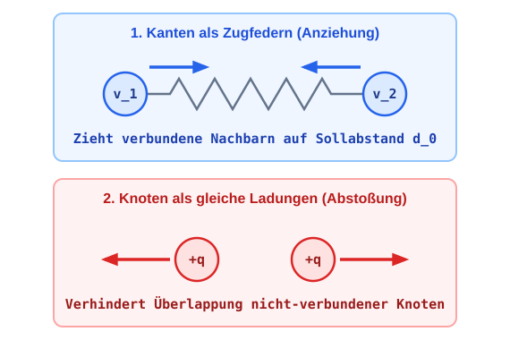

</div>
</div>

---

### Force-Directed Layout: Konvergenzverlauf der Partikelsimulation

Evolution der Knotenpositionen und der Kräftesumme $\sum \|\vec{F}_{\text{net}}\|$ von Iteration 0 bis zum Gleichgewicht (Iteration 50):

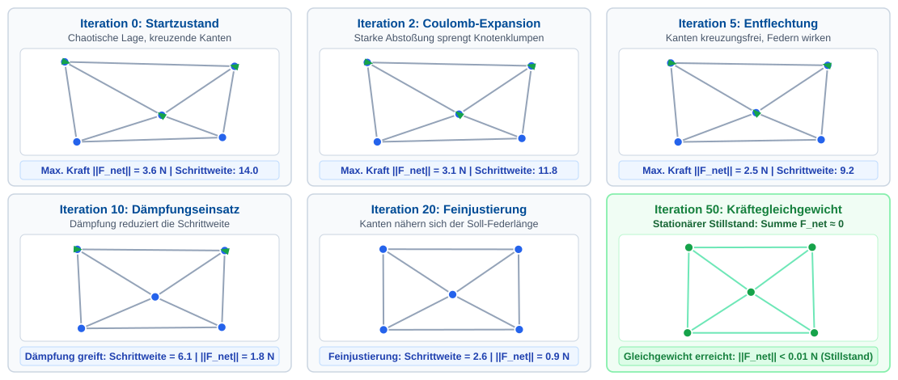

---

### Der C#-Code zum Netzwerk-Layout & Knoten-Styling in MSAGL

```csharp
var graph = new Microsoft.Msagl.Drawing.Graph("Fertigungszelle");

// 1. Organisches Kräfte-Layout statt hierarchischem Sugiyama-Layout aktivieren
graph.LayoutAlgorithmSettings = new Microsoft.Msagl.Layout.MDS.MdsLayoutSettings();

// 2. Kanten definieren (erzeugt die zugehörigen Knoten automatisch mit)
graph.AddEdge("Gateway-A", "SPS-CNC");
graph.AddEdge("Gateway-A", "Spindel-Sensor");
graph.AddEdge("Gateway-A", "Gateway-B");

// 3. Einzelne Knoten und Kanten farblich/geometrisch gestalten & im Control rendern
var spsNode = graph.FindNode("SPS-CNC");
spsNode.Attr.FillColor = Microsoft.Msagl.Drawing.Color.LightSkyBlue;
spsNode.Attr.Shape     = Microsoft.Msagl.Drawing.Shape.Box;
var linkEdge = graph.AddEdge("Gateway-A", "Edge-Cloud");
linkEdge.Attr.Color    = Microsoft.Msagl.Drawing.Color.Purple;
GraphControl.Graph     = graph;
```

- Über `LayoutAlgorithmSettings` wird das Verfahren gewählt und `spsNode` sowie `linkEdge` in `graph` farblich hervorgehoben.

---

### Ausblick: Automatisches Layout (`MSAGL`) vs. Node-Editor (`Nodify`)

<div class="columns">
<div class="two">

- **Wann nutzt man `MSAGL`?**
  - Wenn die Topologie **aus Daten oder Code generiert** wird (z.B. Modell-Inspektor, Diagnose von Zyklen).
  - Der Algorithmus berechnet alle Positionen vollautomatisch.
- **Wann nutzt man Node-Editoren (`Nodify`)?**
  - Wenn der Nutzer das Modell wie in *Simulink* **interaktiv mit der Maus zusammenbauen** soll.

</div>
<div class="two">

| Kriterium | `MSAGL` | `Nodify` (Editor) |
|---|---|---|
| **Zweck** | Topologie-Anzeige | Interaktiver Editor |
| **Positionen** | Vollautomatisch | Manuell (Drag & Drop) |
| **Anschlüsse** | Knoten als Ganzes | Input-/Output-Pins |
| **Kanten** | C#-Code (`AddEdge`) | Interaktiv per Maus |

</div>
</div>

---

### Zusammenfassung: Kapitel 4 auf einen Blick

<div class="columns">
<div class="two">

- **1. Schichtenarchitektur & Backends (4.1):**
  - Diagramm-Bibliotheken bauen direkt auf Raw Pixels (`Heatmap` $\to$ Termin 02) und Vektorgrafik (`Scatter`/`Signal`/`MSAGL` $\to$ Termin 03) auf.
- **2. Zeitreihen & Zustandsraum (4.2):**
  - `Scatter` ($\mathcal{O}(N)$) für beliebige 2D-Trajektorien (Motorkennfeld, Kamm'scher Kreis mit `SquareUnits()`).
  - `Signal` ($\mathcal{O}(W)$) für äquidistante Zeitreihen (4 Eckpunkte/Pixelspalte, -50 % RAM), `SignalXY` ($\mathcal{O}(W \log N)$) für adaptive Solver, `VectorField` ($\mathcal{O}(G_x \cdot G_y)$).

</div>
<div class="two">

- **3. Statistik & 2D-Felder (4.3):**
  - `Histogram` + `Bars` reduziert $\mathcal{O}(N)$ Werte auf $\mathcal{O}(k)$ Rechtecke; Gauß-Overlay mit `n * binWidth` skalieren.
  - `Boxes` komprimieren Verteilungen auf $\mathcal{O}(1)$ Geometrie; `Heatmap` rendert 2D-Arrays als Bitmap-Textur.
- **4. Live-Streaming & Topologie (4.4 & 4.5):**
  - Fester **Ringpuffer (`DataStreamer`)** + **Taktentkopplung** (1.000 Hz Sim vs. 50 Hz `DispatcherTimer`).
  - **Welford** liefert $\mathcal{O}(1)$ Online-Statistik für `HorizontalLine`, `FillY` zeichnet Toleranzkorridore, `MSAGL` layoutet Graphen.

</div>
</div>

---

### Hausübung Termin 04: Echtzeit-Telemetrie & ScottPlot 5

**Stufe 1 (Basisaufgabe `1.1`–`1.3` für alle Teams auf `ScottPlotTelemetry.sln`):** GC-Leak-Fix (`Freeze`), Ringpuffer-Fenster & Welford-Toleranzbänder ([Aufgabenblatt 04](../../Uebungen/Termin_04_Telemetrie_und_ScottPlot/Aufgabenblatt.md)) $\to$ **Stufe 2 (Vertiefung – Wahl: Track A ODER Track B, 10 Pkt.):**

<div class="columns">
<div class="two">

#### Stufe 2 – Track A: Industrie-4.0 Schwingungs-Leitstand
- 1-kHz-Vibrationsmonitoring mit `DataStreamer` & Zwei-Y-Achsen ($n, M$)
- Welford $\pm 3\sigma$-Toleranzbänder & Kavitations-/Schlupf-Alarmlogik
- Phasenraum-Kennfeld ($M$ vs. $n$) & Live-Vibrations-Histogramm (20 Bins)
- MSAGL-Antriebsstrang-Topologie mit dynamischer Knoten-Alarmfärbung

</div>
<div class="two">

#### Stufe 2 – Track B: Retro Arcade Racing Telemetry
- Live Speed- & RPM-Streamer mit Welford-Schaltpunkt & Shift-Flash
- G-Kräfte-Phasenplot (Kamm'scher Kreis $a_{\text{res}} \le \mu g$) mit Grip-Farben
- Bremsverzögerungs-Histogramm mit überlagerter Gauß-Glockenkurve
- MSAGL-Streckentopologie mit Live-Sektor-Tracking des Boliden

</div>
</div>
