<!-- _paginate: false -->
<!-- _header: "" -->
<!-- _footer: "" -->


# Kapitel 5: 3D-Visualisierung mit OpenGL

Dieses Kapitel umfasst die folgenden Abschnitte:

- 5.1: Grundlagen der 3D-Visualisierung mit OpenGL
- 5.2: Strukturierung mit einem Szenengraphen
- 5.3: Mechatronische Anwendung: Kinematische Ketten & Robotik
- 5.4: Interaktive Kameraführung

---

### Moodle-Quiz 2 & Live-Showcase: Termin 04

Zu Beginn (15 Min.): **Moodle-Test 2** (Kapitel 03 & 04) – danach **Live-Showcase & Code-Defense** der Hausübung aus Termin 04 (**Stufe 1** + **Stufe 2: Track A oder B**, [Aufgabenblatt 04](../../Uebungen/Termin_04_Telemetrie_und_ScottPlot/Aufgabenblatt.md)):

<div class="columns">
<div class="two">

#### Stufe 2 – Track A: Industrie (Antriebsprüfstand)
- **Signal-Streaming:** Drehzahl $n(t)$ & Moment $M(t)$ mit dynamischen $\pm 3\sigma$-Toleranzbändern.
- **Topologie:** MSAGL-Antriebsstrang mit visueller Kavitations-/Alarmanzeige.
- **Stresstest:** Abtastfrequenz drastisch erhöhen & Welford-Hüllkurven im Betrieb prüfen.

</div>
<div class="two">

#### Stufe 2 – Track B: Game (Racing HUD)
- **Cockpit-Telemetrie:** Speed/RPM mit Shift-Flash & G-Kräfte (Kamm'scher Kreis).
- **Statistik:** Rundenzeiten-Histogramm & Streckenabschnitts-Topologie (MSAGL).
- **Stresstest:** Grenzbereich-Fahrt mit Haftungsabriss ($a_{\text{res}} > \mu \cdot g$) provozieren.

</div>
</div>

> **Code-Defense (Säule 2b, 20 %):** Prüfung auf allokationsfreies Streaming (keine GC-Spikes im Diagnostic Tool), Single-Pass-Welford und UI-Entkopplung.

---

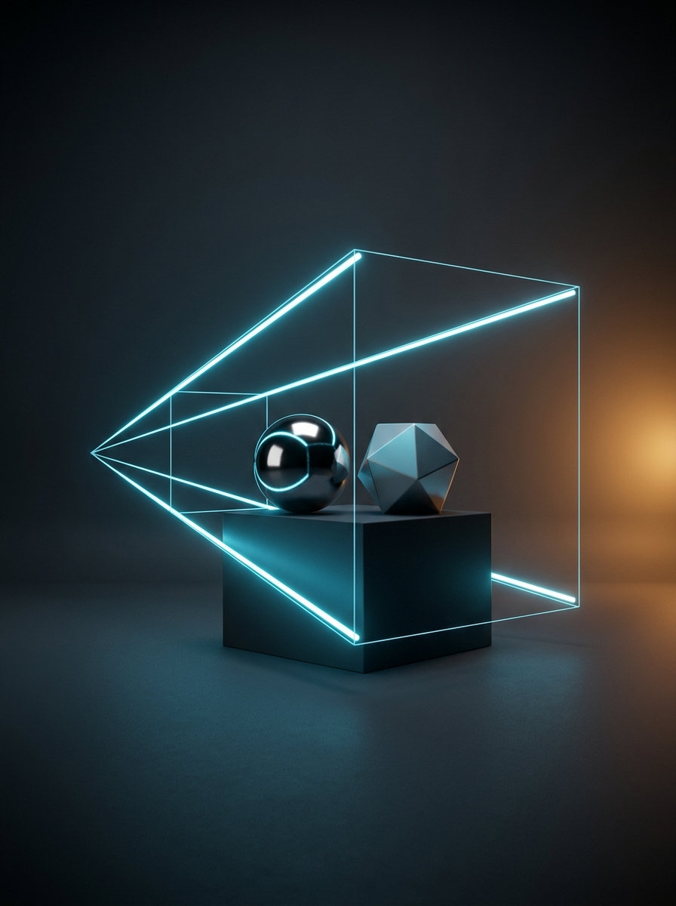

## 5.1: Grundlagen der 3D-Visualisierung mit OpenGL

Dieser Abschnitt umfasst die folgenden Inhalte:

- Rückblick & Brücke zu Termin 02–04 und Abschluss des Visualisierungs-Blocks
- Grundkonzepte von OpenGL (Zustandsmaschine, Grafik-Pipeline)
- Verwendung von Buffern (Farbpuffer & Z-Buffer-Tiefenprüfung)
- Phong-Beleuchtungsmodell und Schattierungsarten (Flat vs. Smooth)
- Transformations-Pipeline und Projektionsarten (`glOrtho` vs. `gluPerspective`)

---

### Rückblick & Brücke: Wo stehen wir in der Vorlesung?

In **Termin 02 bis 04** haben wir die 2D-Welt gemeistert (Pixelraster, 2D-Vektor-Canvas, Echtzeit-Diagramme mit `ScottPlot 5`) – wo stoßen 2D-Ansichten an ihre Grenzen?

- **Rückblick auf Termin 03 & 04 (2D-Projektion & Telemetrie):**
  - In Termin 03 haben wir Weltkoordinaten $(x_w, y_w)$ auf den flachen Bildschirm abgebildet; in Termin 04 haben wir Zeitreihen und Topologie-Graphen (`MSAGL`) ergänzt.
- **Der Engpass heute (Räumliche Kinematik & Verdeckung):**
  - Ein mehrachsiger Industrieroboter (SCARA / Knickarm) oder ein Greifautomat bewegt sich im **dreidimensionalen Raum $(x, y, z)$**: Bauteile verdecken sich gegenseitig, Perspektive verkürzt Längen und Gelenke rotieren um beliebige Raumachsen.
  - Eine flache 2D-Zeichenfläche kennt weder Tiefenprüfung (**Z-Buffer**) noch Hardware-Beleuchtung oder hierarchische $4\times 4$-Transformationsketten auf der GPU.
- **Einordnung ins große Ganze (4. Visualisierungs-Säule: 3D-OpenGL):**
  - Mit `SharpGL` und hierarchischen **3D-Szenengraphen** komplettieren wir heute unseren Visualisierungs-Werkzeugkasten (T02–T05).

---

### Was ist OpenGL?

<div class="columns">
<div class="two">

- **Open Graphics Library:**
  - Plattform- und sprachübergreifende Standard-API zur hardwarebeschleunigten 2D- und 3D-Computergrafik.
- **Direkter Draht zur GPU:**
  - Statt wie in Termin 02 Pixel einzeln auf der CPU zu berechnen, übergeben wir der Grafikkarte 3D-Eckpunkte (*Vertices*), Normalenvektoren und Transformationsmatrizen.
- **Zustandsmaschine (State Machine):**
  - Einmal gesetzte Einstellungen (Licht, Farbe, Matrix-Modus) bleiben so lange aktiv, bis sie explizit geändert werden.
- **Fokus im Kurs (`SharpGL` Fixed-Function):**
  - Unmittelbar transparenter Matrix-Stack (`glPushMatrix` / `glPopMatrix`) ohne Shader-Boilerplate – ideal für kinematische Ketten!

</div>
<div class="one">


</div>
</div>

---

### Einbindung in WPF mit `SharpGL.WPF`

Die Bibliothek `SharpGL.WPF` stellt das Steuerelement `OpenGLControl` bereit, das einen Hardware-OpenGL-Kontext nahtlos in unser WPF-Fenster einbettet:

- **Zwei zentrale Lebenszyklus-Ereignisse:**
  1. `OpenGLInitialized`: Wird **einmalig** beim Start aufgerufen (globale Grundeinstellungen wie Tiefentest, Lichtquellen und Hintergrundfarbe).
  2. `OpenGLDraw`: Wird **in jedem Frame** (oder bei `DoRender()`) aufgerufen, um die 3D-Szene neu zu zeichnen.

```xml
<Window xmlns:sharpGL="clr-namespace:SharpGL.WPF;assembly=SharpGL.WPF">
    <Grid>
        <sharpGL:OpenGLControl x:Name="OpenGlView"
            OpenGLInitialized="OpenGlView_OpenGLInitialized"
            OpenGLDraw="OpenGlView_OpenGLDraw"
            Resized="OpenGlView_Resized" />
    </Grid>
</Window>
```

---

### Initialisierung der Szene: `OpenGLInitialized`

In der Ereignisroutine `OpenGlView_OpenGLInitialized` konfigurieren wir einmalig die Zustandsmaschine der Grafikkarte über das Objekt `gl` (`args.OpenGL`):

```csharp
private void OpenGlView_OpenGLInitialized(object sender, OpenGLRoutedEventArgs args)
{
    OpenGL gl = args.OpenGL;

    // 1. Hintergrundfarbe festlegen (Clear Color: Dunkles Anthrazit)
    gl.ClearColor(0.08f, 0.08f, 0.08f, 1.0f);

    // 2. Tiefenpuffer (Z-Buffer) für korrekte 3D-Verdeckung aktivieren
    gl.Enable(OpenGL.GL_DEPTH_TEST);

    // 3. Phong-Beleuchtungsmodell und Hauptlichtquelle GL_LIGHT0 einschalten
    gl.Enable(OpenGL.GL_LIGHTING);
    gl.Enable(OpenGL.GL_LIGHT0);

    // 4. Weiche Farbinterpolation (Gouraud Shading) aktivieren
    gl.ShadeModel(OpenGL.GL_SMOOTH);
}
```

---

### Hintergrundfarbe festlegen: `gl.ClearColor`

<div class="columns">
<div class="two">

Die Methode `gl.ClearColor` definiert die RGBA-Farbe, mit der der Bildschirmpuffer zu Beginn jedes neuen Frames geleert wird:

- **Normierter Wertebereich $[0{,}0 \dots 1{,}0]$:**
  - Anders als beim 8-Bit-Byte (`0..255`) in `WriteableBitmap` arbeitet OpenGL mit `float`-Werten von `0.0f` bis `1.0f`.
  - `(0, 0, 0, 1)` entspricht Schwarz, `(1, 1, 1, 1)` entspricht Weiß.
- **Konfiguration im Code:**
  - `gl.ClearColor(0.1f, 0.2f, 0.3f, 1.0f)` setzt den Hintergrund auf ein ruhiges, kontrastreiches Dunkelblau (bzw. `(0.08f, 0.08f, 0.08f, 1.0f)` für dunkles CAD-Grau in unserer Laborvorlage).

</div>
<div class="one">

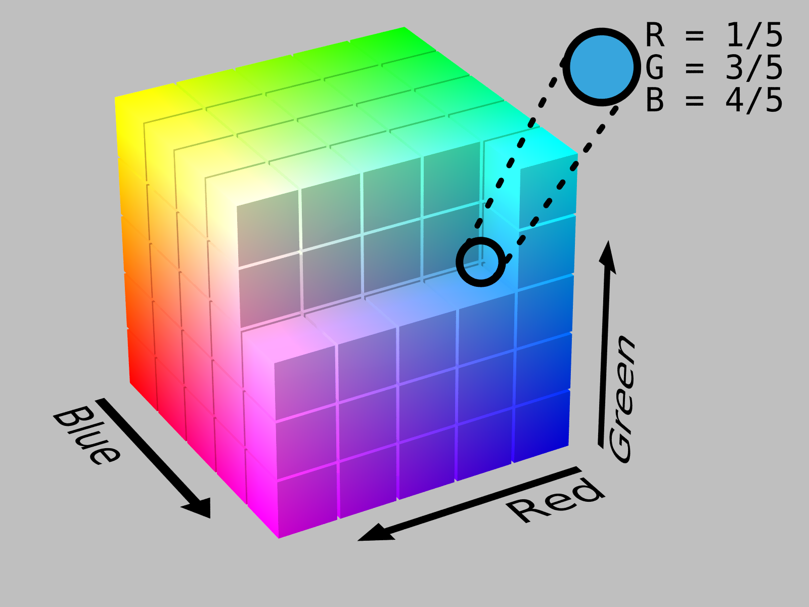

</div>
</div>

---

### Warum reicht der 2D-Painter's-Algorithmus in 3D nicht?

<div class="columns">
<div class="two">

In 2D übermalt das zuletzt gezeichnete Objekt alles Vorherige (**Maler-Prinzip**). Im 3D-Raum führt das ohne Tiefenprüfung zu Fehlern:

- **Das Verdeckungsproblem:**
  - Zeichnet man erst einen nahen Würfel (`z = 2 m`) und danach einen fernen (`z = 5 m`), übermalt der ferne Körper den nahen!
- **Der Tiefenpuffer (`GL_DEPTH_TEST`):**
  - Die GPU speichert im **Z-Buffer** den Abstand `z_buf` jedes Pixels zur Kamera.
  - Ein neues Pixel (`z_neu`) wird nur gezeichnet, wenn `z_neu < z_buf` gilt!

</div>
<div class="two">

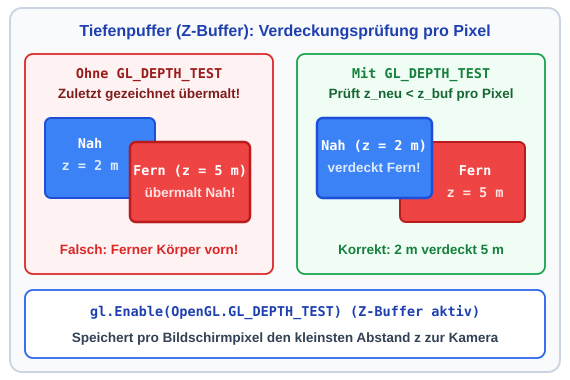

</div>
</div>

---

### Beleuchtung aktivieren: Warum brauchen wir Licht in 3D?

<div class="columns">
<div class="two">

Ohne Beleuchtungsrechnung erscheint ein einfarbiger 3D-Körper als völlig flache 2D-Silhouette – Kanten, Krümmungen und Raumtiefe sind unsichtbar:

- **`gl.Enable(OpenGL.GL_LIGHTING)`:**
  - Schaltet die hardwareseitige Licht- und Schattierungsberechnung der OpenGL-Pipeline ein.
- **Plastische Raumwahrnehmung:**
  - Erst durch den Helligkeitsverlauf zwischen beleuchteter Vorderseite, mattem Übergang und glänzendem Lichtreflex erkennt das menschliche Auge die 3D-Form von Roboterarmen, Zylindern und Gelenkkugeln.

</div>
<div class="two">

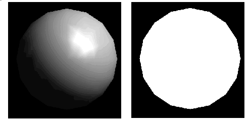

</div>
</div>

---

### Das Phong-Beleuchtungsmodell im Überblick

<div class="columns">
<div class="two">

Das klassische **Phong-Beleuchtungsmodell** (`GL_LIGHTING`) berechnet die sichtbare Helligkeit $I_f$ eines Oberflächenpunktes als Summe von drei physikalisch motivierten Anteilen:

$$I_f = I_a + I_d + I_s$$

1. **Ambient ($I_a$):** Richtungsunabhängige Grundhelligkeit durch indirektes Streulicht im Raum.
2. **Diffuse ($I_d$):** Matte Streureflexion abhängig vom Lichteinfallswinkel (Lambert-Gesetz).
3. **Specular ($I_s$):** Blickwinkelabhängiger Glanzpunkt auf glatten oder metallischen Oberflächen.

</div>
<div class="two">

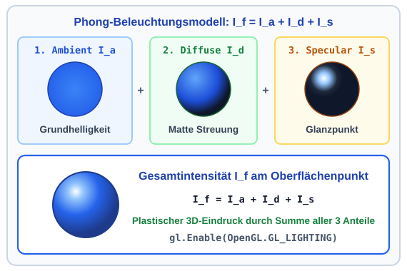

</div>
</div>

---

### Vektoren für die Beleuchtungsrechnung (Normiert)

<div class="columns">
<div class="two">

An jedem Oberflächenpunkt $\vec{p}$ nutzt das Phong-Modell vier auf Länge $1$ **normierte Einheitsvektoren** ($\|\vec{n}\| = 1$):

- **$\vec{n}$ (Normalenvektor):** Steht exakt senkrecht auf der Tangentialebene des Körpers im Punkt $\vec{p}$.
- **$\vec{l}$ (Lichtvektor):** Zeigt vom Punkt $\vec{p}$ zur Lichtquelle $\vec{p}_{\text{light}}$.
- **$\vec{v}$ (Betrachtungsvektor):** Zeigt vom Punkt $\vec{p}$ zum Kameraauge $\vec{p}_{\text{cam}}$.
- **$\vec{r}$ (Reflexionsvektor):** Der an der Normalen $\vec{n}$ unter dem Einfallswinkel $\delta$ gespiegelte Lichtstrahl:
  $$\vec{r} = 2(\vec{n} \cdot \vec{l})\vec{n} - \vec{l}$$

</div>
<div class="two">

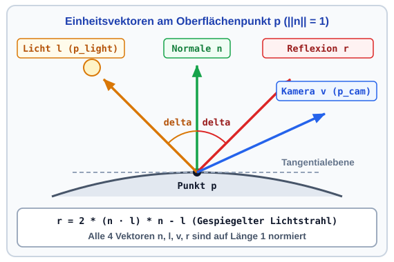

</div>
</div>

---

### 1. Ambient- & 2. Diffuse-Komponente (Lambert-Gesetz)

<div class="columns">
<div class="two">

- **1. Ambient ($I_a = k_a \cdot I_{La}$):**
  - Grundhelligkeit gegen schwarze Schatten ($k_a =$ Material, $I_{La} =$ Raumlicht).
- **2. Diffuse ($I_d = k_d \cdot I_{Ld} \cdot \max(0, \vec{n} \cdot \vec{l})$):**
  - Mit $\|\vec{n}\| = \|\vec{l}\| = 1$ liefert $\vec{n} \cdot \vec{l} = \cos(\delta)$ den Einfallswinkel $\delta$:
  - **Zahlenbeispiel:**
    - Senkrecht ($\delta = 0^\circ$): $\cos(0^\circ) = 1{,}00$ ($100\,\%$).
    - Flach ($\delta = 60^\circ$): $\cos(60^\circ) = 0{,}50$ ($50\,\%$).
    - Rückseite ($\delta > 90^\circ$): $\max(0, \dots) \implies I_d = 0$.

</div>
<div class="two">

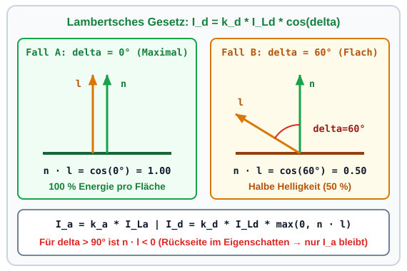

</div>
</div>

---

### 3. Specular-Komponente (Glanzpunkt & Shininess)

<div class="columns">
<div class="two">

Glatte Oberflächen reflektieren Licht gebündelt um die Ausfallsrichtung $\vec{r}$:

$$I_s = k_s \cdot I_{Ls} \cdot \left(\max(0, \vec{r} \cdot \vec{v})\right)^{\alpha_{\text{shiny}}}$$

- **Blickrichtung $\vec{r} \cdot \vec{v}$:** Maximal ($1{,}0$), wenn die Kamera $\vec{v}$ direkt in $\vec{r}$ blickt.
- **Exponent $\alpha_{\text{shiny}} \in [1, 128]$ ($k_s, I_{Ls}$):**
  - **Zahlenbeispiel bei $\vec{r} \cdot \vec{v} = 0{,}90$ ($\approx 25^\circ$):**
    - Plastik ($\alpha_{\text{shiny}} = 8$): $0{,}90^8 = 0{,}43$ (breit).
    - Metall ($\alpha_{\text{shiny}} = 64$): $0{,}90^{64} = 0{,}001$ (scharf!).

</div>
<div class="two">

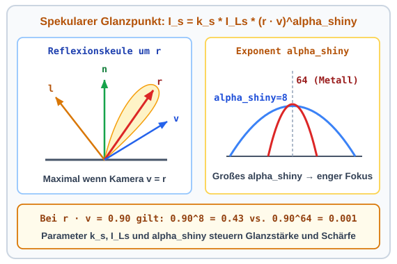

</div>
</div>

---

### Kombination mehrerer Lichtquellen & C#-Konfiguration

<div class="columns">
<div class="two">

Bei $n$ aktiven Lichtquellen (`GL_LIGHT0`, `GL_LIGHT1` bis `GL_LIGHT7`) addiert OpenGL die Beiträge $I_d$ und $I_s$ ($I_{d,i}$ und $I_{s,i}$) automatisch auf:

$$I_f = I_a + \sum_{i=1}^{n} \left(I_{d,i} + I_{s,i}\right)$$

- **C#-Setup in unserer Laborvorlage (`MainWindow.xaml.cs`):**
  - Wir positionieren `GL_LIGHT0` schräg oberhalb des Roboters bei `(10, 20, 15)` (`w = 1` für Punktlichtquelle).
  - Über `GL_COLOR_MATERIAL` koppeln wir die Materialfarbe ($k_a, k_d$) bequem direkt an `gl.Color(r, g, b)`!

</div>
<div class="two">

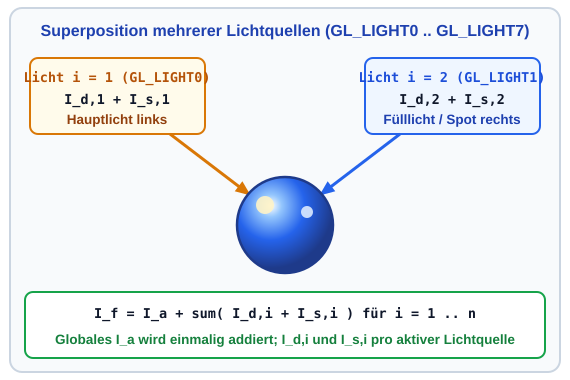

</div>
</div>

---

### Der C#-Code zur Phong-Beleuchtung (`OpenGLInitialized`)

```csharp
// 1. Phong-Beleuchtungsmodell und erste Lichtquelle GL_LIGHT0 aktivieren
gl.Enable(OpenGL.GL_LIGHTING);
gl.Enable(OpenGL.GL_LIGHT0);

// 2. Position (x=10, y=20, z=15, w=1) und Lichtintensitäten (I_La, I_Ld, I_Ls) definieren
float[] lightPos      = [10.0f, 20.0f, 15.0f, 1.0f];
float[] lightAmbient  = [0.25f, 0.25f, 0.25f, 1.0f]; // Grundhelligkeit I_La
float[] lightDiffuse  = [0.85f, 0.85f, 0.85f, 1.0f]; // Streulicht I_Ld
float[] lightSpecular = [1.00f, 1.00f, 1.00f, 1.0f]; // Weißes Glanzlicht I_Ls

gl.Light(OpenGL.GL_LIGHT0, OpenGL.GL_POSITION, lightPos);
gl.Light(OpenGL.GL_LIGHT0, OpenGL.GL_AMBIENT,  lightAmbient);
gl.Light(OpenGL.GL_LIGHT0, OpenGL.GL_DIFFUSE,  lightDiffuse);
gl.Light(OpenGL.GL_LIGHT0, OpenGL.GL_SPECULAR, lightSpecular);

// 3. Color-Tracking: gl.Color(r,g,b) steuert direkt die Materialkoeffizienten k_a und k_d!
gl.Enable(OpenGL.GL_COLOR_MATERIAL);
gl.ColorMaterial(OpenGL.GL_FRONT_AND_BACK, OpenGL.GL_AMBIENT_AND_DIFFUSE);
```

- Die Arrays `lightPos`, `lightAmbient`, `lightDiffuse` und `lightSpecular` parametrieren `GL_LIGHT0`.

---

### Schattierungsmodus: Flat Shading (`GL_FLAT`)

<div class="columns">
<div class="two">

Wie werden die berechneten Phong-Farben über ein Polygon gefüllt?

- **Modus 1 – `gl.ShadeModel(OpenGL.GL_FLAT)`:**
  - OpenGL berechnet die Beleuchtung **nur einmal pro Polygon** mit einer Flächennormalen ($\vec{n}_1, \vec{n}_2, \vec{n}_3, \vec{n}_4$).
  - Jede Facette erhält eine konstante Farbe.
- **Visueller Effekt:**
  - Sichtbare Farbsprünge an den Kanten – ideal für scharfkantige Quader (`DrawCube`).

</div>
<div class="two">

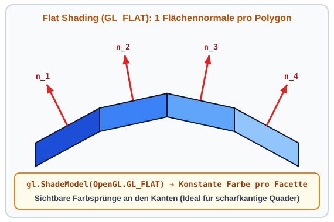

</div>
</div>

---

### Schattierungsmodus: Smooth Shading (`GL_SMOOTH`)

<div class="columns">
<div class="two">

Für gekrümmte Körper (`DrawSphere`, `DrawCylinder`) nutzen wir **Gouraud Shading**:

- **Modus 2 – `gl.ShadeModel(OpenGL.GL_SMOOTH)`:**
  - Jeder Eckpunkt (Vertex) erhält seine eigene **Vertex-Normale** ($\vec{n}_{v1}, \vec{n}_{v2}, \vec{n}_{v3}$).
  - OpenGL berechnet die Farbe an den Ecken und **interpoliert bilinear** über die Fläche.
- **Visueller Effekt:**
  - Schon bei `slices = 24` wirken Zylinder und Kugeln perfekt glatt gerundet!

</div>
<div class="two">

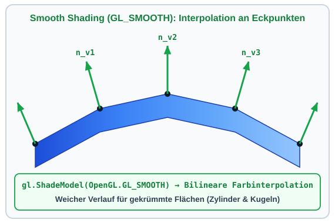

</div>
</div>

---

### Der Render-Loop in jedem Frame: `OpenGLDraw`

Während `OpenGLInitialized` einmalig beim Programmstart läuft, wird `OpenGlView_OpenGLDraw` bei jedem Bildaufbau ausgeführt:

```csharp
private void OpenGlView_OpenGLDraw(object sender, OpenGLRoutedEventArgs args)
{
    OpenGL gl = args.OpenGL;

    // 1. Farb- UND Tiefenpuffer (Z-Buffer) für den neuen Frame leeren
    gl.Clear(OpenGL.GL_COLOR_BUFFER_BIT | OpenGL.GL_DEPTH_BUFFER_BIT);

    // 2. ModelView-Matrix auf die Einheitsmatrix I zurücksetzen
    gl.MatrixMode(OpenGL.GL_MODELVIEW);
    gl.LoadIdentity();

    // 3. Kamera-Sichtmatrix setzen (Blick von Eye (5,5,5) auf Ursprung (0,0,0), Up = +Y)
    gl.LookAt(5.0, 5.0, 5.0,  0.0, 0.0, 0.0,  0.0, 1.0, 0.0);

    // 4. Koordinatenachsen, Bodengitter und 3D-Objekte zeichnen ...
}
```

---

### Zeichnen von Primitiven: `gl.Begin(...)` & `gl.End()`

Zwischen `gl.Begin(mode)` und `gl.End()` übergeben wir Vertices (`gl.Vertex`), Normalen (`gl.Normal`) und Farbe (`gl.Color`):

| OpenGL-Modus | Geometrische Bedeutung | Einsatz in `SceneGraph3D.sln` |
| :--- | :--- | :--- |
| **`GL_LINES`** | Je 2 Vertices = 1 Strecke (`1-2`, `3-4`) | **Achsen (`DrawAxes`) & Bodengitter (`DrawFloorGrid`)** |
| **`GL_LINE_STRIP`** | Durchgehender Linienzug (`1-2-3-4`) | Werkzeugbahnen (TCP-Trajektorie) |
| **`GL_TRIANGLES`** | Je 3 Vertices = 1 Dreieck (`1-2-3`) | Allgemeine 3D-CAD-Meshes (STL) |
| **`GL_TRIANGLE_FAN`** | Dreiecksfächer um Zentrum `1` | Stirndeckel von Zylindern (`DrawCylinder`) |
| **`GL_QUADS`** | Je 4 Vertices = 1 Viereck (`1-2-3-4`) | **Quader-Seitenflächen (`DrawCube`)** |
| **`GL_QUAD_STRIP`** | Verbundenes Vierecksband | **Zylindermäntel & Kugeln (`DrawSphere`)** |

---

### Visuelle Referenz der OpenGL-Primitive *(Deep Dive)*

<div class="columns">
<div class="two">

- **Linien (`GL_LINES` vs. `GL_LINE_STRIP`):**
  - `DrawFloorGrid` zeichnet das Bodenraster im Modus `GL_LINES` (ohne Licht).
- **Vierecke (`GL_QUADS` & `GL_QUAD_STRIP`):**
  - `DrawCube` besteht aus $6 \times 4 = 24$ Vertices im Modus `GL_QUADS` mit je 1 Flächennormalen.
  - `DrawCylinder` nutzt `GL_QUAD_STRIP`: Mit `slices = 24` entsteht ein geschlossener Zylindermantel.

</div>
<div class="one">

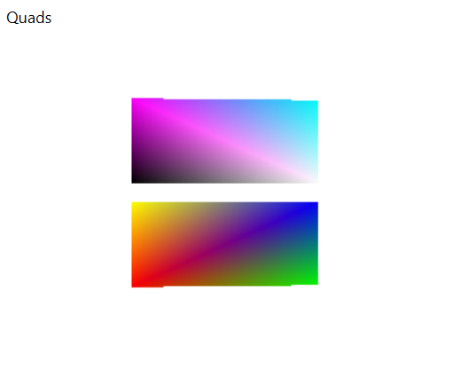

</div>
</div>

---

### Die Transformations-Pipeline in OpenGL

Wie wird aus einem lokalen 3D-Bauteilpunkt $\vec{v}_{\text{obj}} = (x, y, z, 1)^\top$ ein 2D-Bildschirmpixel? OpenGL durchläuft 4 Stufen:

$$\vec{v}_{\text{world}} = \mathbf{M}_{\text{model}} \cdot \vec{v}_{\text{obj}} \;\longrightarrow\; \vec{v}_{\text{eye}} = \mathbf{M}_{\text{view}} \cdot \vec{v}_{\text{world}} \;\longrightarrow\; \vec{v}_{\text{clip}} = \mathbf{M}_{\text{proj}} \cdot \vec{v}_{\text{eye}}$$

1. **Model-Matrix ($\mathbf{M}_{\text{model}}$):** Platziert das Bauteil (Translation, Rotation, Skalierung) in der 3D-Welt.
2. **View-Matrix ($\mathbf{M}_{\text{view}}$):** Transformiert die Welt in das Koordinatensystem der Kamera (`gl.LookAt`). In OpenGL sind beide kombiniert als **`GL_MODELVIEW`**.
3. **Projection-Matrix ($\mathbf{M}_{\text{proj}}$, `GL_PROJECTION`):** Bestimmt das Sichtvolumen (`gl.Ortho` oder `gl.Perspective`) und projiziert auf Clipping-Koordinaten.
4. **Viewport-Transformation (`gl.Viewport`):** Rechnet die normierten Koordinaten $[-1, 1]^3$ auf die Fensterpixel $(0 \dots w, 0 \dots h)$ um.

---

### Projektionsarten: Orthogonal (`glOrtho`) vs. Perspektivisch (`gluPerspective`)

Die Projektionsmatrix bestimmt die Form des Sichtvolumens (*View Volume*) und ob ferne Objekte kleiner erscheinen:

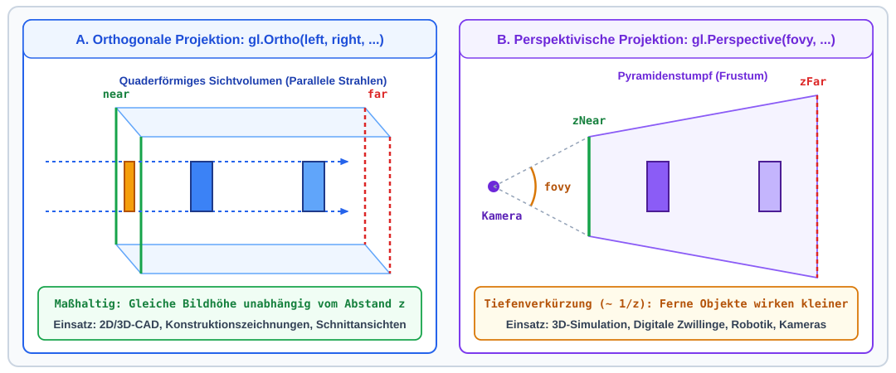

---

### Orthogonale Projektion (`gl.Ortho`) vs. Perspektive (`gl.Perspective`)

<div class="columns">
<div class="two">

#### 1. Orthogonale Projektion (`gl.Ortho`)
- **Sichtvolumen:** Achsenparalleler Quader $[left, right] \times [bottom, top] \times [near, far]$.
- **Keine Tiefendivision:** Parallele Kanten bleiben im Bild exakt parallel ($x_{\text{ndc}} \propto x$).
- **Einsatz:** Maßhaltige 2D/3D-CAD-Ansichten (Aufriss, Grundriss, Seitenansicht).

</div>
<div class="two">

#### 2. Perspektivische Projektion (`gl.Perspective`)
- **Sichtvolumen:** Pyramidenstumpf (**Frustum**) mit Öffnungswinkel `fovy` (z. B. $45^\circ$), Seitenverhältnis `aspect` $= w/h$ und Clipping-Ebenen `zNear` bis `zFar`.
- **Strahlensatz-Division durch $-z$:**
  $$x_{\text{proj}} = x \cdot \frac{z_{\text{near}}}{-z}, \quad y_{\text{proj}} = y \cdot \frac{z_{\text{near}}}{-z}$$
- **Zahlenbeispiel:** Ein Würfel in doppelter Entfernung ($z = -4\,\text{m}$ statt $-2\,\text{m}$) erscheint auf dem Bildschirm **exakt halb so groß**!

</div>
</div>

---

### Projektion im Resize-Handler (`OpenGlView_Resized`)

Ändert sich die Fenstergröße, muss das Seitenverhältnis `aspect` aktualisiert werden (sonst werden Kugeln zu Ellipsen verzerrt – analog zu Termin 03!):

```csharp
private void OpenGlView_Resized(object sender, OpenGLRoutedEventArgs args)
{
    OpenGL gl = args.OpenGL;
    gl.MatrixMode(OpenGL.GL_PROJECTION);
    gl.LoadIdentity();

    // Seitenverhältnis aspect = Breite / Höhe berechnen (Schutz gegen Division durch 0)
    double aspect = OpenGlView.ActualWidth / Math.Max(OpenGlView.ActualHeight, 1.0);
    gl.Perspective(45.0, aspect, 0.1, 100.0); // Frustum: fovy=45°, zNear=0.1m, zFar=100m

    gl.MatrixMode(OpenGL.GL_MODELVIEW);       // Zurück in den ModelView-Modus!
}
```

---

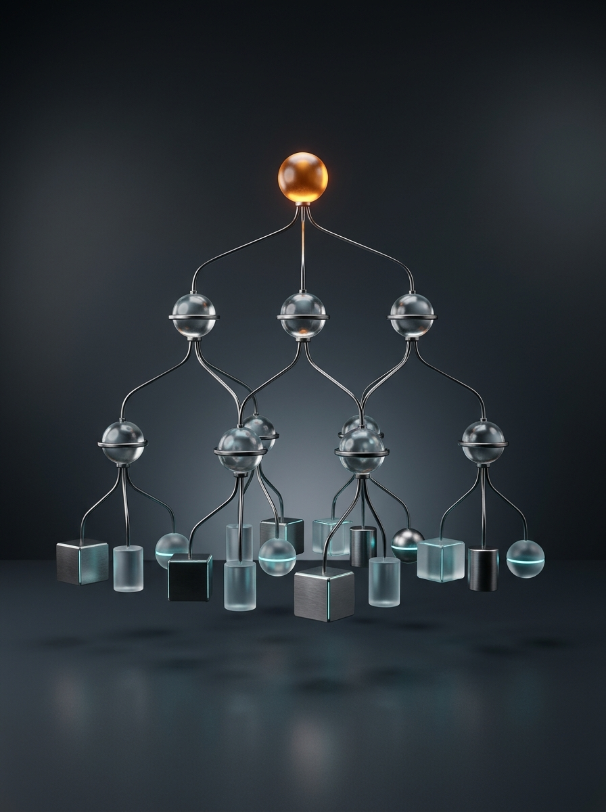

## 5.2: Strukturierung mit einem Szenengraphen

Dieser Abschnitt umfasst die folgenden Inhalte:

- Vom flachen Zeichencode zur hierarchischen Baumstruktur (Szenengraph)
- Der OpenGL-Matrix-Stack (`gl.PushMatrix` & `gl.PopMatrix`) und die Skalierungs-Falle
- Architektur der Klasse `SceneNode` in unserer Laborvorlage (`SceneGraph3D.sln`)
- Lokale vs. globale Transformationsmatrizen (`GetLocalMatrix` & `GetWorldMatrix`)
- Grundkörper-Rendering mit korrekten Normalen (`DrawCube`, `DrawCylinder`, `DrawSphere`)

---

### Die Herausforderung: Warum ein Szenengraph?

<div class="columns">
<div class="two">

Stellen wir uns den SCARA-Roboter aus der Hausübung vor:

- **Problem bei Einzelberechnung:**
  - Dreht sich die Schulter (`UpperArm`) um $\theta_1$, schwenken Unterarm (`ForeArm`), `Pinole` und Greifer (`TCP`) auf einer Kreisbahn mit!
- **Lösung – Szenengraph (`SceneNode`):**
  - Jeder Knoten beschreibt seine Lage **nur relativ zum direkten Elternknoten** (Schulter $\theta_1$, Ellenbogen $\theta_2$ bei `L1`, Vertikalhub $d_3$).

</div>
<div class="two">

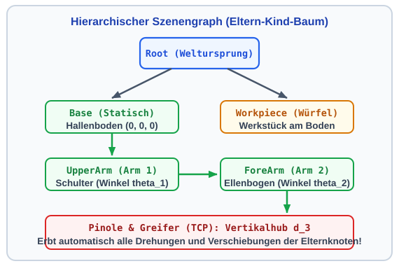

</div>
</div>

---

### Der Matrix-Stack: `PushMatrix` & `PopMatrix`

<div class="columns">
<div class="two">

Wie vererbt OpenGL Transformationen an Kinder, ohne Geschwister (`Workpiece`) zu verschieben?

- **`gl.PushMatrix()`:** Sichert die Eltern-Matrix $\mathbf{M}_0$ oben auf dem GPU-Stack.
- **Lokale Transformation (`T_1, R_1` & `T_2, R_2`):**
  - Kind: $\mathbf{M}_1 = \mathbf{M}_0 \cdot \mathbf{T}_1 \cdot \mathbf{R}_1$; Enkel: $\mathbf{M}_2 = \mathbf{M}_1 \cdot \mathbf{T}_2 \cdot \mathbf{R}_2$.
- **`gl.PopMatrix()`:** Stellt nach dem Teilbaum exakt $\mathbf{M}_0$ wieder her!
- **Skalierungs-Falle (Aufgabe 1.1):** `gl.Scale(L1, ...)` immer lokal in `PushMatrix`/`PopMatrix` kapseln!

</div>
<div class="two">

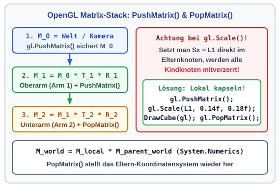

</div>
</div>

---

### Architektur in unserer Vorlage: Die Klasse `SceneNode`

In `Scene/SceneNode.cs` kapselt eine einzige Klasse Baumstruktur, Transformation und Rendering:

| Eigenschaft / Methode | Typ | Aufgabe im Szenengraphen (`SceneGraph3D.sln`) |
| :--- | :--- | :--- |
| **`Name` / `Children`** | `List<SceneNode>` | Verwaltet die Eltern-Kind-Hierarchie via `AddChild(child)`. |
| **`Tx, Ty, Tz`** | `float` $[\text{m}]$ | Lokale Translation relativ zum Elternknoten. |
| **`Rx, Ry, Rz`** | `float` $[^\circ]$ | Lokale Euler-Winkel in Grad um X-, Y- und Z-Achse. |
| **`Sx, Sy, Sz`** | `float` | Lokale Skalierungsfaktoren (Standard $= 1{,}0$). |
| **`RenderCustomGeometry`** | `Action<OpenGL>?` | **C#-Delegate:** Zeichnet die lokale Bauteil-Geometrie (Aufgabe 1.1). |
| **`Render(OpenGL gl)`** | `void` | Traversiert den Baum rekursiv mit `PushMatrix` / `PopMatrix`. |
| **`GetWorldMatrix()`** | `Matrix4x4` | Berechnet die $4\times 4$-Weltmatrix für den TCP-Deckungstest! |

---

### Rekursive Traversierung: `SceneNode.Render(OpenGL gl)`

So traversiert `Render(OpenGL gl)` in `Scene/SceneNode.cs` den gesamten Baum ab `_rootNode`:

```csharp
public virtual void Render(OpenGL gl)
{
    gl.PushMatrix(); // 1. Eltern-Koordinatensystem auf dem GPU-Stack sichern

    // 2. Lokale Transformation anwenden: Translation (Tx,Ty,Tz) -> Rotation (Ry,Rx,Rz) -> Scale (Sx,Sy,Sz)
    gl.Translate(Tx, Ty, Tz);
    if (MathF.Abs(Ry) > 1e-4f) gl.Rotate(Ry, 0.0f, 1.0f, 0.0f);
    if (MathF.Abs(Rx) > 1e-4f) gl.Rotate(Rx, 1.0f, 0.0f, 0.0f);
    if (MathF.Abs(Rz) > 1e-4f) gl.Rotate(Rz, 0.0f, 0.0f, 1.0f);
    if (MathF.Abs(Sx - 1.0f) > 1e-4f || MathF.Abs(Sy - 1.0f) > 1e-4f || MathF.Abs(Sz - 1.0f) > 1e-4f)
        gl.Scale(Sx, Sy, Sz);

    RenderCustomGeometry?.Invoke(gl);          // 3. Eigene Geometrie zeichnen
    foreach (var child in Children)            // 4. Rekursiver Abstieg für alle Kinder (child)
        child.Render(gl);

    gl.PopMatrix();  // 5. Eltern-Koordinatensystem wiederherstellen
}
```

---

### Grundkörper mit Normalen (`DrawCube` & `DrawCylinder`)

<div class="columns">
<div class="two">

In `MainWindow.xaml.cs` zeichnen drei Hilfsmethoden Grundkörper mit **exakten Normalen** (`gl.Normal`):

- **`DrawCube(OpenGL gl)`:**
  - Einheitswürfel ($[-0{,}5, +0{,}5]^3$) via `GL_QUADS` mit 6 festen Flächennormalen.
- **`DrawCylinder(gl, radius, height, slices)`:**
  - Zylindermantel entlang $+Y$ als `GL_QUAD_STRIP`.
  - Für jeden Winkel `theta` zeigt die Einheitsnormale radial nach außen: `nx = cos(theta)`, `nz = sin(theta)`!

</div>
<div class="two">

```csharp
private static void DrawCylinder(
    OpenGL gl, float radius, float height, int slices = 16)
{
    gl.Begin(OpenGL.GL_QUAD_STRIP);
    for (int i = 0; i <= slices; i++)
    {
        float theta = 2.0f * MathF.PI * i / slices;
        float nx = MathF.Cos(theta);
        float nz = MathF.Sin(theta);

        gl.Normal(nx, 0.0f, nz);
        gl.Vertex(radius * nx, 0.0f,   radius * nz);
        gl.Vertex(radius * nx, height, radius * nz);
    }
    gl.End();
}
```

</div>
</div>

---

### Kugel-Approximation (`DrawSphere`) & Anhang

<div class="columns">
<div class="two">

Für Gelenke (`DrawSphere`) wird eine Kugel ($r$) in Breitengrade (`stacks`, $\phi$) und Längengrade (`slices`, $\theta$) zerlegt:

- **Normalenformel der Kugel:**
  - Auf einer zentrierten Kugel steht der Ortsvektor jedes Punktes senkrecht auf der Oberfläche ($r = 1$):
    $$\vec{n}_{\phi,\theta} = \begin{pmatrix} \cos(\phi)\cos(\theta) \\ \sin(\phi) \\ \cos(\phi)\sin(\theta) \end{pmatrix}$$
- *Herleitung für Kegelstümpfe:* siehe [`Folien_Anhang_3D_Normalen.md`](./Folien_Anhang_3D_Normalen.md).

</div>
<div class="one">

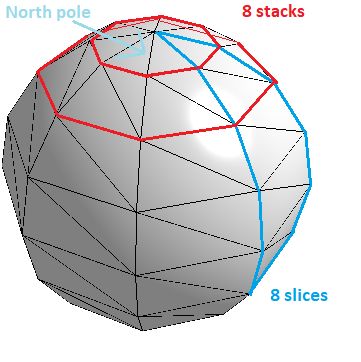

</div>
</div>

---


## 5.3: Mechatronische Anwendung: Kinematische Ketten & Robotik

Dieser Abschnitt umfasst die folgenden Inhalte:

- Serielle Roboterkinematik (SCARA & Knickarm) als hierarchischer Szenengraph
- Vorwärtskinematik: Analytische Trigonometrie vs. $4\times 4$-Matrix-Verkettung
- Konkretes Zahlenbeispiel & Echtzeit-Deckungstest ($\Delta = 0{,}000\,\text{mm}$)
- C#-Implementierung in `SceneGraph3D.sln` (Basisaufgabe 1.1 & 1.3)

---

### Serielle Kinematik im Szenengraphen: Der SCARA-Roboter

In der Automatisierungstechnik (z. B. Montagezellen, Pick-and-Place, Leiterplattenbestückung) sind **SCARA-Roboter** (*Selective Compliance Assembly Robot Arm*) der Industriestandard für schnelle Handhabungsaufgaben:

- **Aufbau der kinematischen Kette in unserer Laborvorlage (`SceneGraph3D.sln`):**
  1. **Basis (`_baseNode`):** Steht fest im Ursprung $(0, 0, 0)$ auf dem Hallenboden (Höhe `HBase = 0.50 m`).
  2. **Schulter & Oberarm (`_arm1Node`, Länge `L1 = 1.00 m`):** Sitzt auf der Basis (`Ty = HBase`) und rotiert mit $\mathbf{R}_y(\theta_1)$ horizontal um die vertikale Y-Achse um den Gelenkwinkel $\theta_1$.
  3. **Ellenbogen & Unterarm (`_arm2Node`, Länge `L2 = 0.80 m`):** Sitzt am Ende von Arm 1 (`Tx = L1`) und rotiert mit $\mathbf{R}_y(\theta_2)$ relativ zu Arm 1 um den Winkel $\theta_2$ um die Y-Achse.
  4. **Pinole & Greifer (`_pinoleNode`, Weltmatrix $\mathbf{M}_{\text{TCP}}$):** Sitzt am Ende von Arm 2 (`Tx = L2`) und fährt vertikal um den Hub $-d_3$ entlang der Y-Achse nach unten.

---

### Blick unter die Haube: Vorwärtskinematik & Deckungstest

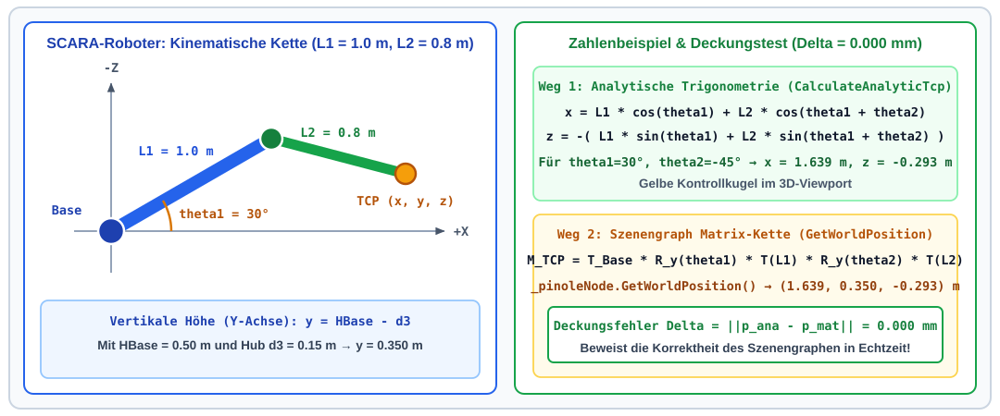

---

### Der C#-Code: Aufbau des Roboter-Szenengraphen (Aufgabe 1.1)

In **Stufe 1 (Aufgabe 1.1)** weisen wir jedem Knoten (`_baseNode`, `_arm1Node`, `_arm2Node`, `_pinoleNode`) unter `_rootNode` seine lokale Geometrie via `RenderCustomGeometry` zu:

```csharp
private void BuildSceneGraph()
{
    _rootNode.AddChild(_baseNode);  _baseNode.AddChild(_arm1Node);
    _arm1Node.AddChild(_arm2Node);  _arm2Node.AddChild(_pinoleNode);

    _baseNode.RenderCustomGeometry = gl => {
        gl.Color(0.4f, 0.45f, 0.5f); DrawCylinder(gl, 0.22f, HBase, 24);
    };
    _arm1Node.RenderCustomGeometry = gl => {
        gl.Color(0.2f, 0.6f, 0.9f); DrawSphere(gl, 0.18f);
        gl.PushMatrix(); // Wichtig: Skalierung L1 lokal kapseln, damit Arm2 unverzerrt bleibt!
        gl.Translate(L1 / 2.0f, 0.0f, 0.0f); gl.Scale(L1, 0.14f, 0.18f); DrawCube(gl);
        gl.PopMatrix();
    };
    // ... analog für _arm2Node (L2) und _pinoleNode -> danach in RenderRobot: _rootNode.Render(gl);
}
```

---

### Der C#-Code: Gelenk-Update & TCP-Deckungsprüfung

Bewegt man einen Slider (`_theta1Deg`, `_theta2Deg`, `_d3`), aktualisiert `UpdateJointTransforms()` den Baum und vergleicht `CalculateAnalyticTcp()` (`t1`, `t12`) mit `_pinoleNode.GetWorldPosition()`:

```csharp
private void UpdateJointTransforms()
{
    _arm1Node.Ty = HBase;  _arm1Node.Ry = _theta1Deg; // Schulter auf Höhe HBase, Drehung theta1
    _arm2Node.Tx = L1;     _arm2Node.Ry = _theta2Deg; // Ellenbogen bei L1, Relativwinkel theta2
    _pinoleNode.Tx = L2;   _pinoleNode.Ty = -_d3;     // Pinole bei L2, Vertikalhub -d3
}

private (float X, float Y, float Z) CalculateAnalyticTcp()
{
    float t1  = _theta1Deg * MathF.PI / 180.0f;
    float t12 = (_theta1Deg + _theta2Deg) * MathF.PI / 180.0f;
    return (L1 * MathF.Cos(t1) + L2 * MathF.Cos(t12), HBase - _d3, -(L1 * MathF.Sin(t1) + L2 * MathF.Sin(t12)));
}
```

---

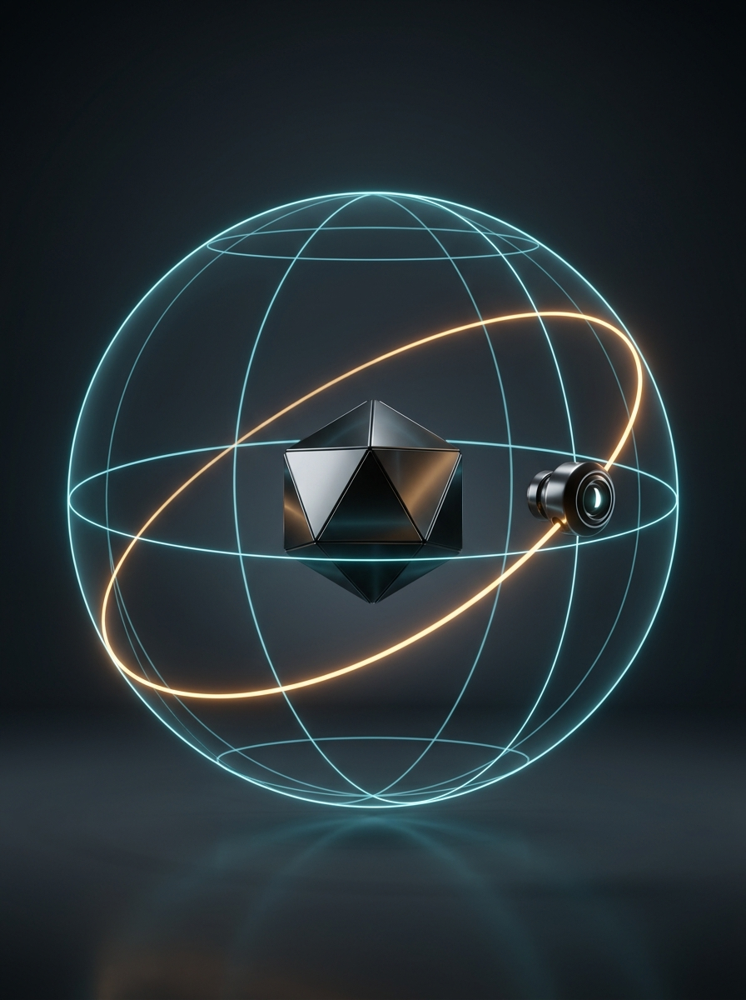

## 5.4: Interaktive Kameraführung

Dieser Abschnitt umfasst die folgenden Inhalte:

- Anforderungen an eine 3D-Inspektionskamera im Digitalen Zwilling
- Das Kameramodell `gl.LookAt` und die Orbit-Kugelkoordinaten ($r, \theta, \phi$)
- Vermeidung von Singularitäten (Gimbal Lock) durch Winkel-Clamping
- Herleitung von Kamera-Orbit, Zoom und Zielpunkt-Panning (Aufgabe 1.2)
- C#-Implementierung der Klasse `OrbitCamera` und WPF-Maus-Events

---

### Bedarf an interaktiver Kamerasteuerung & `gl.LookAt`

<div class="columns">
<div class="two">

In einem 3D-Leitstand muss man die Anlage frei aus jedem Blickwinkel inspizieren können:

- **Die Sichtmatrix `gl.LookAt`:**
  1. **Augpunkt $\vec{p}_{\text{eye}} = (\text{eyeX}, \text{eyeY}, \text{eyeZ})$:** Kameraposition im Raum.
  2. **Zielpunkt $\vec{p}_{\text{look}} = (\text{LookAtX}, \text{LookAtY}, \text{LookAtZ})$:** Fokuspunkt der Kamera.
  3. **Up-Vektor $\vec{e}_{\text{up}} = (0, 1, 0)$:** $+Y$-Achse zeigt nach oben.
- **Lösung:** Statt `eyeX, eyeY, eyeZ` einzutippen, führen wir die Kamera auf einer Kugelschale!

</div>
<div class="two">

```csharp
// Aufruf in OpenGlView_OpenGLDraw
// direkt nach gl.LoadIdentity():

gl.LookAt(
    eyeX, eyeY, eyeZ,          // Kameraposition
    LookAtX, LookAtY, LookAtZ, // Fokuspunkt
    0.0, 1.0, 0.0              // Up-Vektor (+Y)
);
```

</div>
</div>

---

### Orbit-Kamera in Kugelkoordinaten ($r, \theta, \phi$)

<div class="columns">
<div class="two">

`OrbitCamera` beschreibt $\vec{p}_{\text{eye}}$ relativ zum Ziel $\vec{p}_{\text{look}} = (x_{\text{look}}, y_{\text{look}}, z_{\text{look}})$:

1. **Azimut $\theta$ (`AzimuthDeg` $\in [0^\circ, 360^\circ)$):**
   - Horizontaler Umlaufwinkel um die $+Y$-Achse.
2. **Elevation $\phi$ (`ElevationDeg` $\in [-85^\circ, +85^\circ]$):**
   - Vertikaler Neigungswinkel zur XZ-Ebene.
3. **Distanz $r$ (`Distance` $> 0$):**
   - Mit Horizontalradius $r_{xz} = r \cdot \cos(\phi)$ folgt die Höhe zu $y_{\text{eye}} = y_{\text{look}} + r \cdot \sin(\phi)$.

</div>
<div class="two">

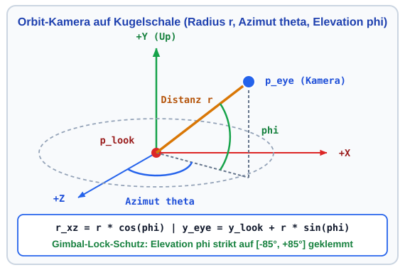

</div>
</div>

---

### Gimbal-Lock-Schutz & Kartesische Umrechnung

<div class="columns">
<div class="two">

- **Warum klemmen wir $\phi$ auf $[-85^\circ, +85^\circ]$?**
  - Bei $\phi = \pm 90^\circ$ liegt der Blickvektor parallel zum Up-Vektor $(0, 1, 0)$ $\implies$ das Bild kippt um (**Gimbal Lock**)!
- **Umrechnung in `OrbitCamera.cs`:**
  - Aus `_azimuthDeg` (`thetaRad`), `_elevationDeg` (`phiRad`) und `_distance` wird `(eyeX, eyeY, eyeZ)` relativ zu `(LookAtX, LookAtY, LookAtZ)` berechnet.

</div>
<div class="two">

```csharp
public double ElevationDeg
{
    get => _elevationDeg;
    set => _elevationDeg = Math.Clamp(value, -85.0, 85.0);
}

public (double EyeX, double EyeY, double EyeZ) GetEyePosition()
{
    double thetaRad = _azimuthDeg * Math.PI / 180.0;
    double phiRad   = _elevationDeg * Math.PI / 180.0;

    double eyeX = LookAtX + _distance * Math.Cos(phiRad) * Math.Sin(thetaRad);
    double eyeY = LookAtY + _distance * Math.Sin(phiRad);
    double eyeZ = LookAtZ + _distance * Math.Cos(phiRad) * Math.Cos(thetaRad);
    return (eyeX, eyeY, eyeZ);
}
```

</div>
</div>

---

### Maussteuerung & Kamera-Panning (Aufgabe 1.2)

Wie steuert man die Kamera per Maus – und wie funktioniert **Panning (Aufgabe 1.2)**?

| Mausaktion | Methode | Mathematische Wirkung |
| :--- | :--- | :--- |
| **Links ziehen** ($\Delta x, \Delta y$) | `_camera.Rotate(dAz, dEl)` | Dreht Azimut $\theta \mathrel{+}= 0{,}4 \Delta x$ und Elevation $\phi \mathrel{-}= 0{,}4 \Delta y$. |
| **Mausrad** (`e.Delta`) | `_camera.Zoom(delta)` | Ändert den Kugelradius $r \in [1{,}0, 100{,}0]$. |
| **Rechts ziehen** *(Aufg. 1.2)* | `_camera.Pan(dRight, dUp)` | Verschiebt `(LookAtX, LookAtY, LookAtZ)` quer zur Blickrichtung $\theta$! |

- **Herleitung für `Pan(double deltaRight, double deltaUp)` (Aufgabe 1.2):**
  $$\Delta x_{\text{look}} = -\Delta_{\text{right}} \cdot \cos(\theta), \quad \Delta z_{\text{look}} = +\Delta_{\text{right}} \cdot \sin(\theta), \quad \Delta y_{\text{look}} = \Delta_{\text{up}}$$

---

### Der C#-Code zur Maus-Interaktion (`MainWindow.xaml.cs`)

Über `_isDragging`, `_lastMousePos`, `currentPos`, `dx` und `dy` werden Orbit und Panning gesteuert:

```csharp
private void OpenGlView_MouseDown(object sender, MouseButtonEventArgs e)
{
    if (e.LeftButton == MouseButtonState.Pressed || e.RightButton == MouseButtonState.Pressed)
    {
        _isDragging = true;  _lastMousePos = e.GetPosition(OpenGlView);
        OpenGlView.CaptureMouse(); // Mausfang auch über den Fensterrand hinaus!
    }
}

private void OpenGlView_MouseMove(object sender, MouseEventArgs e)
{
    if (!_isDragging) return;
    Point currentPos = e.GetPosition(OpenGlView);
    double dx = currentPos.X - _lastMousePos.X, dy = currentPos.Y - _lastMousePos.Y;

    if (e.LeftButton == MouseButtonState.Pressed)       _camera.Rotate(dx * 0.4, -dy * 0.4);
    else if (e.RightButton == MouseButtonState.Pressed) _camera.Pan(dx * 0.01, dy * 0.01);
    _lastMousePos = currentPos;
}
```

---

# Zusammenfassung Kapitel 5

- **3D-Grafik-Pipeline & Z-Buffer:** OpenGL transformiert 3D-Körper über `GL_MODELVIEW` und `GL_PROJECTION` auf den Bildschirm; `GL_DEPTH_TEST` löst Verdeckungen pixelgenau über den Tiefenpuffer auf.
- **Phong-Beleuchtung & Shading:** Die Überlagerung aus Ambient ($I_a$), Diffuse ($I_d \propto \vec{n}\cdot\vec{l}$) und Specular ($I_s \propto (\vec{r}\cdot\vec{v})^{\alpha_{\text{shiny}}}$) erzeugt mit `GL_SMOOTH` und sauberen Normalenvektoren plastische 3D-Oberflächen.
- **Hierarchischer Szenengraph (`SceneNode`):** Kaskadiert lokale Bauteil-Transformationen automatisch über `gl.PushMatrix()` und `gl.PopMatrix()` – verifiziert durch den Echtzeit-Deckungstest ($\Delta = 0{,}000\,\text{mm}$) zwischen analytischer Vorwärtskinematik und `GetWorldPosition()`.
- **Interaktive `OrbitCamera`:** Ermöglicht über Kugelkoordinaten ($r, \theta, \phi$), Gimbal-Lock-Clamping ($[-85^\circ, +85^\circ]$) und Zielpunkt-Panning eine natürliche 3D-Navigation wie im industriellen CAD/CAM-Leitstand.

---

### Hausübung Termin 05: 3D-OpenGL & Szenengraph

**Stufe 1 (Basisaufgabe `1.1`–`1.3` für alle Teams auf `SceneGraph3D.sln`):** `_rootNode.Render`, Kamera-Panning & 3D-Werkstück ([Aufgabenblatt 05](../../Uebungen/Termin_05_3D_OpenGL_Szenengraph/Aufgabenblatt.md)) $\to$ **Stufe 2 (Vertiefung – Wahl: Track A ODER Track B, 10 Pkt.):**

<div class="columns">
<div class="two">

#### Stufe 2 – Track A: 4-Achs-SCARA mit Parallelgreifer
- Ausbau auf 4 Achsen: $\theta_1, \theta_2, d_3$ + Handgelenk $\theta_4$ & Parallelgreifer ($g_{\text{width}}$)
- Einheitliches Szenengraph-Rendering (`_rootNode.Render`)
- Animiertes Teach-In (`DispatcherTimer`) zwischen Pose A, Pose B & Home
- Interaktives Pick-and-Place von 3D-Werkstücken

</div>
<div class="two">

#### Stufe 2 – Track B: 3D Arcade Claw Crane (Greifarm)
- 3D-Gehäuse mit Preisen & Auswurfschacht
- 3-Achs-Portalbrücke & Seilwinde im Szenengraphen
- Schließender 3-Finger-Greifmechanismus
- Tastatursteuerung, 3D-Kollisionsprüfung & physikalisches Ablegen

</div>
</div>
