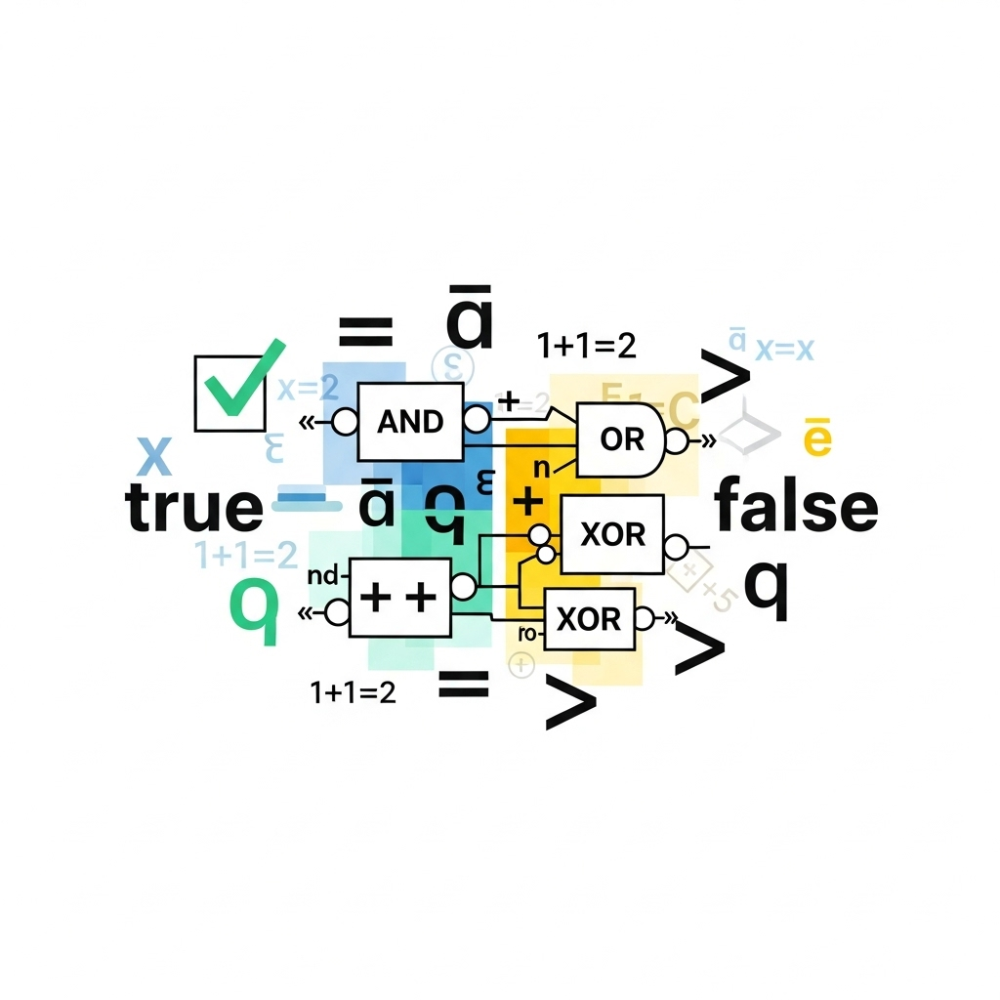
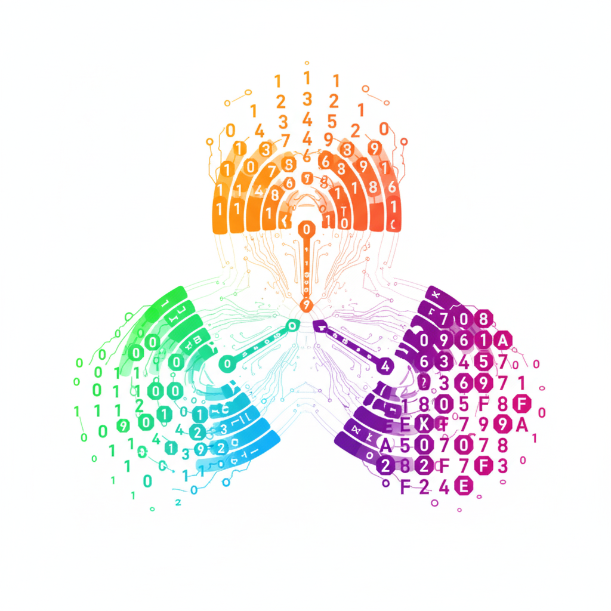
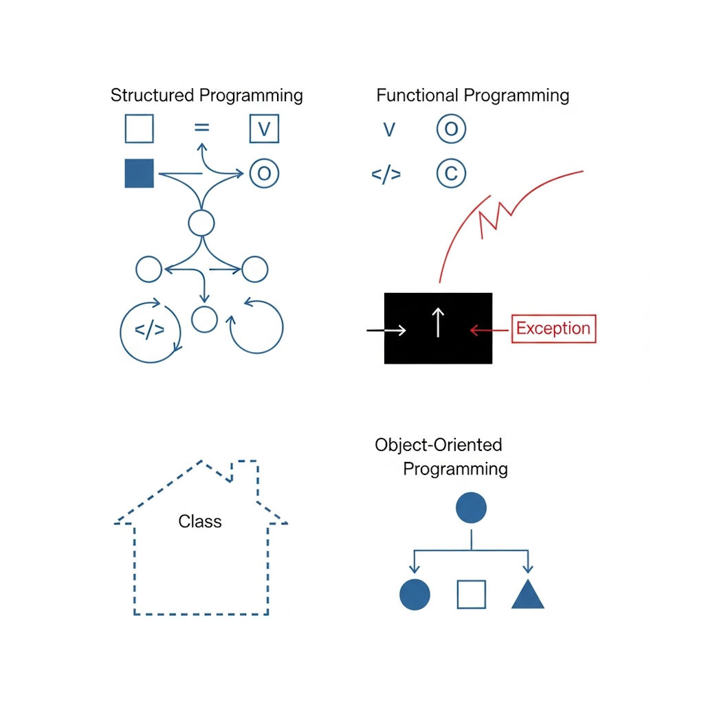
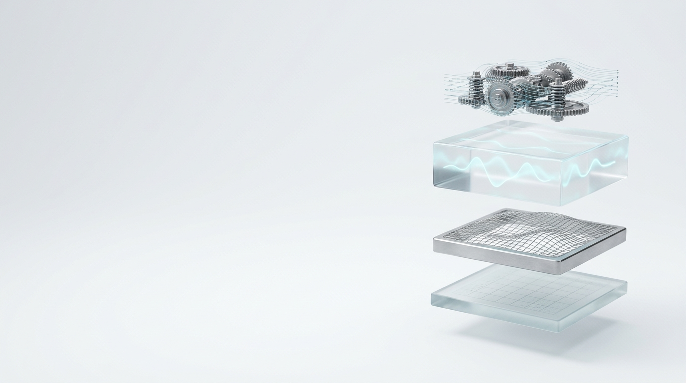
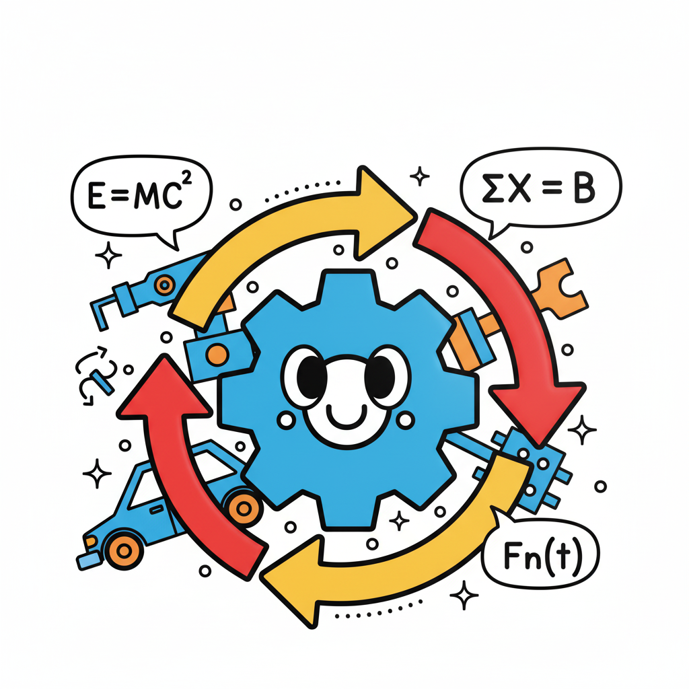
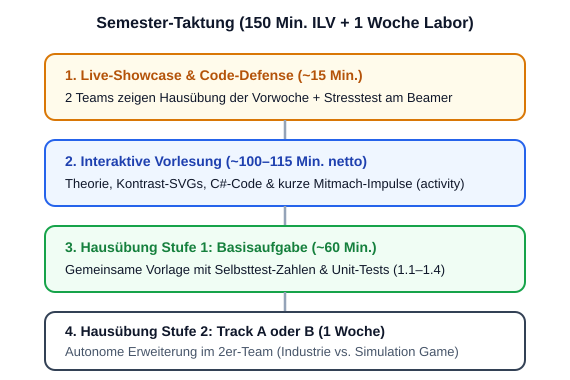
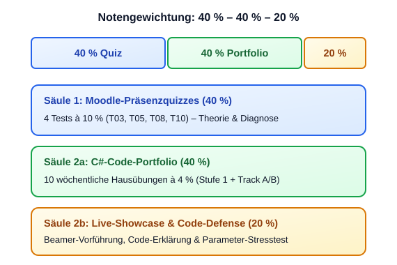

<!-- _class: title -->
<!-- _paginate: false -->
<!-- _header: "" -->
<!-- _footer: "" -->

# Prolog

Dieser erste Foliensatz umfasst die folgenden Inhalte:

1. Voraussetzungen
1. Lernziele
1. Kursinhalte
1. Kursstruktur & Notenmodell
1. Lektorenprofil

---

## Voraussetzungen

Für diesen Kurs in Computer-Simulation sollten Sie ausreichende Kenntnisse in den folgenden Themenbereichen mitbringen:

- **Mathematik** (Logik, Mengenlehre, Algebra, Analysis, Geometrie, Numerik, Stochastik)
- **Informatik** (Zahlensysteme, Zeichenkodierungen, Rechnerarchitekturen, Programmierparadigmen, Entwicklungsmethoden)

---

### Logik

Formalisierung der Prinzipien mathematischer Beweisführung:

- **Wahrheitswerte:** $\mathrm{true}$ ($t$, wahr, $1$) und $\mathrm{false}$ ($f$, falsch, $0$)
- **Negation (unär):** $\neg A$ (Nicht-Operator)
- **Junktoren:** $A \wedge B$ (Und), $A \vee B$ (Oder)
- **Konditional (Implikation):** $A \Rightarrow B$ (Wenn $A$, dann $B$)
- **Bikonditional (Äquivalenz):** $A \Leftrightarrow B$ (Genau dann, wenn)

> **Relevanz:** Jede `if`-Abfrage und Konvergenzbedingung basiert auf sauberer Aussagenlogik.

---

### Mengenlehre

Untersuchung von Mengen als Sammlungen von Objekten:

- **Grundmengen:** Leere Menge $\emptyset$, Potenzmenge $\mathcal{P}(M) = \{U \mid U \subseteq M\}$
- **Elementrelation:** $x \in M$ (Element von), $x \notin M$ (kein Element von)
- **Prädikatenquantoren:** $\forall$ (Allquantor: „für alle“), $\exists$ (Existenzquantor: „es existiert“), $\nexists$ („existiert nicht“)
- **Mengenoperationen:** Vereinigung $A \cup B$, Schnitt $A \cap B$, Differenz $A \setminus B$, kartesisches Produkt $A \times B$
- **Mengenrelationen:** Teilmenge $A \subseteq B$, echte Teilmenge $A \subset B$
- **Geordnetes Tupel:** $(a, b) \in A \times B$

---

### Zahlensysteme & Zeichenkodierungen

Darstellung von Zahlen ($b \in \{2, 10, 16\}$) und Text im Arbeitsspeicher:

- **Binär ($b = 2$) & Hex ($b = 16$):** $1010_2 = \mathrm{0x0A} = 10_{10}$ (Bitmasken, Register & 32-Bit-BGRA-Pixel `0xFF004B96`)
- **ASCII (7 Bit) vs. ANSI (8 Bit):** Basiszeichen (`'A'` = `0x41`) vs. fehleranfällige regionale Codepages
- **UTF-8 (1–4 Byte):** Rückwärtskompatibel zu ASCII (`'ä'` = `0xC3 0xA4`), Standard für `.cs`, `.md` und `.xml`

> **Praxis:** In `WriteableBitmap` (Kap. 2) kodieren wir Pixel als `int`; alle Kursdateien nutzen UTF-8.

---

### Rechnerarchitekturen & Flynn-Klassifikation

Wie moderne Hardware Speicherzugriffe und parallele Rechenoperationen organisiert:

#### Architektur & Speicherhierarchie
- **Von-Neumann:** Gemeinsamer Speicher & Bus für Daten und Befehle (CPU, RAM, I/O).
- **Harvard:** Getrennte Speicher für parallelen Zugriff (DSPs, Mikrocontroller).
- **Hierarchie:** Register → L1–L3-Cache → RAM → Massenspeicher.
- **Cache-Line:** 64 Byte pro Transfer-Einheit zwischen RAM und CPU-Cache.

#### Klassifikation nach Flynn (1966)
- **SISD:** Einkern-CPU mit sequenzieller Befehls- und Datenabarbeitung.
- **SIMD:** Vektorregister (AVX/SSE) verarbeiten 4–16 Werte pro Takt parallel.
- **MIMD:** Multi-Core-CPUs (`Parallel.For` in Kap. 6) mit unabhängigen Threads.
- **Skalierung:** Speicherbandbreite begrenzt oft vor der reinen Rechenleistung.

> **Leitlinie:** Der *Von-Neumann-Flaschenhals* macht Cache-Lokalität oft wichtiger als Taktfrequenz.

---

### Programmierparadigmen

- **Strukturierte Programmierung:** Schleifen und cache-freundliche Array-Iteration für Rechenkerne
- **Funktionale Programmierung:** Zustandsfreie Ableitungen $\dot{\mathbf{x}} = \mathbf{f}(t, \mathbf{x})$ ohne Seiteneffekte
- **Objektorientierte Programmierung:** Schnittstellen (`ISFunction`), Klassen und Polymorphismus

> **Architektur-Regel:** Wir trennen in C# konsequent zwischen reinem **Simulationsmodell** (ohne UI-Abhängigkeit) und **WPF-Visualisierung** – so bleiben alle Modelle per Unit-Test prüfbar.

---

## Lernziele

Dieser Abschnitt umfasst die vier übergeordneten Kompetenzen des Kurses:

- **Modellbildung:** Technische Systeme in mathematische Gleichungen übersetzen
- **Numerik:** Geeignete Lösungsverfahren parametrieren und validieren
- **Software-Architektur:** Sauber entkoppelte C#-Programme entwickeln
- **Visualisierung:** 2D-, 3D- und Multi-Core-Echtzeitdarstellung umsetzen

---

### Lernziele 1 & 2: Modellbildung & Numerik

#### 1. Mathematische Modellierung
- Ableitung statischer, kontinuierlicher, diskreter und hybrider Modelle aus realen Systemen.
- Identifikation von Zustandsgrößen, Parametern und Randbedingungen.
- Klare Trennung zwischen physikalischem Kernmodell und grafischer UI.
- *Beispiele:* Feder-Dämpfer-Systeme, Wärmeleitung, Warteschlangen, Kontaktmechanik.

#### 2. Numerische Validierung
- Gezielte Wahl von Schrittweite $\Delta t$, Diskretisierung und Lösungsverfahren (Euler, RK4, Cholesky).
- Prüfung von Stabilität (CFL-Bedingung), Konditionierung und Erhaltungssätzen.
- Erkennen von Artefakten wie numerischer Dissipation, Steifigkeit oder False Sharing.
- Analytische Referenzlösungen als 5-Sekunden-Selbsttest gegen Programmierfehler.

> **Kernkompetenz:** Ein Simulator ist nur so vertrauenswürdig wie seine mathematische und numerische Verifikation.

---

### Lernziele 3 & 4: C#-Architektur & Visualisierung

Umsetzung von Modell und Numerik in wartbare Echtzeitanwendungen:

- **Entkoppelte Architektur:** Trennung von testbarem Rechenkern (`Simulationsmodell`) und WPF-UI (`MainWindow`)
- **Allokationsfreie Grafik:** `WriteableBitmap`, `Canvas`, `ScottPlot 5` und `SharpGL` (3D)
- **Multi-Core-Skalierung:** Parallelisierung mit `Parallel.For`, `IProgress<T>` & `CancellationToken`

> **Ziel:** Flüssige $\ge 30\,\text{FPS}$-Simulationen ohne UI-Freeze.

---

<!-- _class: activity -->

### Kurze Reflexion: Ihr eigenes Lernziel (2 Min.)

Überlegen Sie kurz für sich (oder im kurzen Austausch mit Ihrem Nachbarn), welche Schwerpunkte Sie setzen möchten:

1. **Stärke:** Welcher der vier Lernbereiche (*Modellierung*, *Numerik*, *C#-Architektur*, *Visualisierung*) liegt Ihnen heute schon am meisten?
2. **Wachstumsfeld:** In welchem Bereich möchten Sie bis Termin 10 den größten Sprung machen?
3. **Anwendung:** Welches System aus Ihrer Praxis oder aus dem Alltag würden Sie gern als interaktives Modell umsetzen?
4. **Qualitätsmaßstab:** Woran erkennen Sie selbst, ob eine Simulation *physikalisch stimmt* und nicht nur „gut aussieht“?

> **Tipp:** Gerade die Verknüpfung aus sauberer Numerik (5-Sekunden-Selbsttest), entkoppelter C#-Architektur und flüssiger Live-Visualisierung zahlt sich im Showcase doppelt aus. Melden Sie sich gern mit einem kurzen Handzeichen!

---

## Kursinhalte

Dieser Abschnitt gibt den Überblick über die 10 Termine des Semesters:

- **Teil 1 (T01–T06):** Kinematik, 2D-/3D-Visualisierung & Multithreading
- **Teil 2 (T07–T10):** Statische, kontinuierliche, diskrete & hybride Modelle (inkl. Epilog)

---

### Kursinhalte (1/2): Grundlagen & Visualisierung (T01–T06)

Die ersten sechs Termine bauen Ihren C#- und Visualisierungs-Werkzeugkasten Schritt für Schritt auf:

#### Einführung & 2D-Grafik
- **T01:** [Kinematik & Euler-Integration](../../01_Kinematik_und_Euler/Folien/) – *Grundgerüst, Zeitschritte, Euler/Heun-Integration & Unit-Tests (Konsole).*
- **T02:** [2D-Pixelgrafik & FDM](../../02_Pixelgrafik_und_FDM/Folien/) – *Wärmeleitung & Felder allokationsfrei im `WriteableBitmap`.*
- **T03:** [2D-Vektorgrafik & Canvas](../../03_Vektorgrafik_und_Canvas/Folien/) – *Geometrie, Kamera-Mapping & Quiz 1.*

#### Telemetrie, 3D & Parallelität
- **T04:** [Telemetrie & ScottPlot 5](../../04_Telemetrie_und_ScottPlot/Folien/) – *Live-Kurven, Phasenportraits & Signal-Analyse.*
- **T05:** [3D-OpenGL & Szenengraph](../../05_3D_OpenGL_Szenengraph/Folien/) – *Hierarchische Transformationen (`SharpGL`) & Quiz 2.*
- **T06:** [Multithreading & TPL](../../06_Multithreading_und_TPL/Folien/) – *`Parallel.For`, `Task.Run` & UI-Entkopplung.*

> **Roter Faden:** Jeder der ersten 6 Termine liefert ein konkretes Architektur- und Visualisierungswerkzeug für die anschließenden Modelltypen.

---

### Kursinhalte (2/2): Simulationsmodelle & Synthese (T07–T10)

Aufbauend auf den Werkzeugen aus T01–T06 modellieren wir vier Systemklassen:

- **T07 – Statische Modelle:** [FEM & Cholesky-Zerlegung](../../07_Statik_FEM_Cholesky/Folien/) *(Gleichgewichtsprobleme)*
- **T08 – Kontinuierliche Dynamik:** [DGL-Systeme & S-Functions](../../08_DGL_und_SFunctions/Folien/) *(+ Quiz 3)*
- **T09 – Diskrete Dynamik:** [Discrete-Event Simulation (DES)](../../09_Diskrete_Systeme_DES/Folien/) *(Ereigniswarteschlangen)*
- **T10 – Hybride Dynamik & Epilog:** [Zero-Crossing](../../10_Hybride_Dynamik_Synthese/Folien/) & [Modellwahl-Leitfaden](../../11_Epilog/Folien/) *(+ Quiz 4)*

> **Roter Faden:** Vom Gleichgewicht (T07) über Dynamik (T08–T09) zum hybriden Zwilling (T10).

---

### Semester-Architektur: Vom Werkzeug zum Digitalen Zwilling

Wie die beiden Semesterhälften nahtlos ineinandergreifen:

#### Phase 1: Werkzeugkasten (T01–T06)
- Schnelle 2D-/3D-Ausgabe ohne GC-Ruckler (`WriteableBitmap` & OpenGL)
- Live-Telemetrie & sichere UI-Entkopplung
- Saubere Trennung zwischen Modell und View
- Unit-Tests & analytische Kontrollrechnungen
- Multi-Core-Parallelisierung mit `Parallel.For`

#### Phase 2: Modellierung (T07–T10)
- Statik, ODEs, ereignisdiskrete & hybride Systeme
- Kombination aller Verfahren im Digitalen Zwilling
- Bewusste Wahl von Modellart und Löser
- Kalibrierung mit realen Mess- und Sensordaten
- Reflexion im abschließenden Modellwahl-Leitfaden

> **Synthese-Prinzip:** Ab Termin 7 greift jedes neue Modell direkt auf Ihre Grafik- und Parallelisierungs-Bausteine aus T01–T06 zurück – ohne Boilerplate neu zu schreiben.

---

## Kursstruktur & Notenmodell

Dieser Block umfasst die Organisation und Beurteilung der Lehrveranstaltung:

- Taktung einer 150-Minuten-ILV und zweistufige Hausübung (Stufe 1 + Stufe 2)
- Freie Track-Wahl: Industrie & Mechatronik (Track A) vs. Simulation Game (Track B)
- Das 2-Säulen-Notenmodell (40 % Quizzes, 40 % Portfolio, 20 % Live-Showcase)

---

### Kursstruktur & Arbeitsweise

Die Lehrveranstaltung ist eine **Integrierte Lehrveranstaltung (ILV)** mit 3 ECTS (75 h Workload):

- **Interaktive Vorlesung (100–115 Min.):** Grundlagen, C#-Code & Impulse *(T01: 130 Min.; Quiz-Termine: 100 Min.)*.
- **Hausübung Stufe 1 (~60 min):** Gemeinsames Fundament mit automatisierten Unit-Tests (`1.1`–`1.4`).
- **Hausübung Stufe 2 (1 Woche):** Autonome Erweiterung im 2er-Team (`Track A` vs. `Track B`).
- **Live-Showcase (15 Min.):** Beamer-Vorführung, Code-Inspection und Stresstest.

> **Rhythmus:** Jede Woche verzahnt Vorlesung, Übung und Live-Showcase direkt miteinander.

---

### Freie Track-Wahl: Industrie vs. Simulation Game

Für die vertiefenden Laboraufgaben (Stufe 2) wählen Sie im 2er-Team frei zwischen zwei gleichwertigen Pfaden:

#### Track A: Industrie & Mechatronik
- Reale Sondermaschinen, Prüfstände und Digitale Zwillinge aus der Automatisierung.
- Fokus auf physikalische Kennzahlen, Toleranzen und technische Diagnostik.
- *Beispiele:* Hydraulikzylinder, CPU-Kühler, CAD-Fachwerke, SCARA-Roboter.

#### Track B: Simulation Game
- Interaktive Physik-Spiele, Arcade-Klassiker und prozedurale Echtzeit-Effekte.
- Fokus auf Spielmechanik, Kollisionen und flüssige 60-FPS-Rückmeldung.
- *Beispiele:* Retro Artillery Duel, Doom Fire & Lava, Poly Bridge, Claw Crane.

> **Fairness-Garantie:** Beide Tracks basieren auf identischen mathematisch-numerischen Prinzipien und zählen jeweils 10 Punkte.

---

<!-- _class: activity -->

### Kurzer Check-In: Ihr Wunsch-Track (2 Min.)

Bevor wir auf das Notenmodell blicken, eine kurze Einschätzung für Sie selbst (gern im kurzen Austausch mit dem Nachbarn):

1. **Track-Tendenz:** Reizt Sie spontan eher **Track A (Industrie & Mechatronik)** oder **Track B (Simulation Game)**?
2. **Vorwissen-Check:** In welchem Themenfeld vom Prolog-Start (*Analysis/DGL*, *Lineare Algebra*, *C#/WPF*) fühlen Sie sich schon sicher – und wo möchten Sie auffrischen?
3. **Wunsch-System:** Welches technische System oder Spiel würden Sie am Ende des Semesters gern als eigene Simulation laufen sehen?
4. **Team-Finding:** Wer sitzt neben Ihnen und teilt dieselbe Track-Vorliebe für die wöchentlichen 2er-Teams?

> **Hinweis:** Sie können den Track auch zwischen einzelnen Terminen noch flexibel wechseln – Hauptsache, pro Termin wird genau ein Track vollständig und nachvollziehbar im eigenen C#-Code umgesetzt. Melden Sie gerne ein kurzes Handzeichen!

---

### Das 2-Säulen-Notenmodell (40 – 40 – 20)

Transparente Beurteilung von Theorie, Code-Praxis und Live-Verteidigung:

- **Säule 1 (40 %):** 4 Moodle-Präsenzquizzes à 10 % in den Terminen T03, T05, T08 und T10 (Fehlerdiagnose, CFL-Stabilität, Code-Mutationen).
- **Säule 2a (40 %):** 10 wöchentliche Hausübungen à 4 % (Stufe 1 + gewählter Track A oder B).
- **Säule 2b (20 %):** Rotierende Live-Vorführung, Code-Erklärung & Parameter-Stresstest am Beamer.

> **Bestehenskriterium:** Gesamtnote $\ge 50\,\%$ **und** mind. $50\,\%$ in allen 3 Teilbereichen (1, 2a, 2b).

> **Transparenz:** Alle Teilpunkte werden laufend nach jedem Termin in Moodle veröffentlicht.

---

<!-- _class: showcase -->

### Live-Showcase & Code-Defense (Säule 2b)

Zu Beginn jedes Folgetermins demonstrieren zwei zufällig ausgewählte Teams ihre Lösung live am Beamer:

#### Live-Demonstration & Stresstest
- **Live-Demonstration:** Flüssig laufende Simulation ($\ge 30\,\text{FPS}$) im Hörsaal.
- **Code-Inspection:** Exakte Begründung jeder Codezeile (kein blindes „Vibe Coding“!).
- **Live-Parameter-Stresstest:** Ad-hoc-Modifikation (z. B. Schrittweite verzehnfachen).

#### Code-Defense („Warum genau diese Zeile?“)
- **Gezielte Code-Inspection:** Jedes Teammitglied erklärt den eingereichten Code im Detail.
- **Enttarnung von Schein-Animationen:** Echte Physik-DGL statt reiner UI-Animation!
- **Schutz gegen blindes „Vibe Coding“:** KI-Tools sind erlaubt, aber unverstandener Code kostet Punkte.

> **Ziel:** Nicht das bloße „Es bewegt sich“, sondern nachweisbares Verständnis von Modell, Numerik und C#-Code.

---

### Lektorenprofil

**Dr. Georg Hackenberg**, *Professor für Informatik und Industriesysteme*

Fakultät für Technik und angewandte Naturwissenschaften, Fachhochschule Oberösterreich, Campus Wels

- **Lehr- & Forschungsschwerpunkte:** Systemsimulation, Digitale Zwillinge, Echtzeit-Visualisierung & Softwarearchitektur
- **Büro:** A | O2 - 030 (Campus Wels)
- **E-Mail:** georg.hackenberg@fh-wels.at
- **Sprechstunde:** Nach Vereinbarung per E-Mail oder direkt nach dem Termin