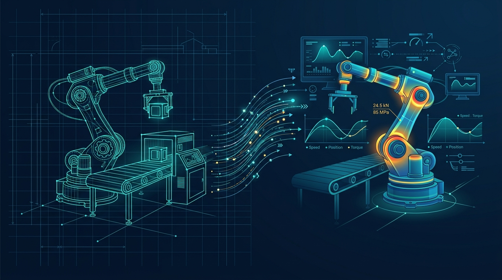

### Allgemeiner Kurs-Kopfbereich (Willkommen & Organisation)

*(Hinweis für Kurs-Einstellungen: Das Kachel-Vorschaubild für das Moodle-Dashboard liegt unter `./Dashboard_Vorschau.jpg`)*

**Herzlich willkommen zu Systemsimulation / Digitaler Zwilling!**

In dieser Lehrveranstaltung erlernen Sie das mechatronische Modellieren, numerische Simulieren und performante Visualisieren dynamischer und statischer Systeme mit **C# und .NET 8**. Wir schlagen den Bogen vom mathematischen Differentialgleichungssystem bis zum interaktiven Digitalen Zwilling.

**Leistungsbeurteilung (2-Säulen-Modell: 40 % Theorie / 60 % Praxis & Live-Showcase):**
* **Säule 1 (40 %):** 4 kurze Moodle-Quizzes zu je 10 % (in Termin 03, 05, 08 und 10) zur Überprüfung des theoretisch-numerischen Grundlagenwissens.
* **Säule 2 (60 %):** Kontinuierlicher Übungsbetrieb im 2er-Team mit **40 % C#-Code-Portfolio** (10 wöchentliche Übungsabgaben à 4 %) und **20 % Live-Showcase & Code-Defense** (Live-Vorführung am Beamer im Rotationsverfahren mit Code-Erklärung und Parameter-Stresstest).

**Wöchentlicher Ablauf ab Termin 02:**
* Zu Beginn jeder Einheit stellen zwei ausgewählte Teams (je 1x Track A und 1x Track B) ihre Lösungen der Vorwoche live am Beamer vor und erläutern ihre Implementierung im Rahmen einer kurzen Code-Defense.
* An vier Terminen (T03, T05, T08, T10) findet vor der Vorlesung zusätzlich ein kurzes 15-minütiges Moodle-Quiz statt.
* Im Anschluss folgt die interaktive Vorlesung (mathematische Modellierung, numerische Lösungsverfahren und detaillierte Besprechung der C#-Implementierung anhand der Vorlesungsfolien). Die praktische Programmierübung (Stufe 1 Basisaufgabe und Stufe 2 Vertiefungsaufgabe) wird als wöchentliche Hausübung im 2er-Team bearbeitet.

**Wahlmodell (Pick your Track):**
Pro Termin wählt Ihr 2er-Team verbindlich **GENAU EINEN** Track – keine Doppelbelastung!
* 🏭 **Track A (Industrieller Zwilling):** Mechatronische Anlagen, reale Antriebe, Fördertechnik und Prüfstände.
* 🎮 **Track B (Simulationsspiel):** Echtzeitfähige Game- und Arcade-Physik auf Basis exakter physikalischer Modelle.

*Hinweis zum Vibe Coding:* Der reflektierte Einsatz von KI-Tools (GitHub Copilot, Claude, ChatGPT) ist ausdrücklich erlaubt! Bewertet wird nicht das generative Erzeugen von Code, sondern das physikalische Verständnis, die numerische Stabilität, die Recherchekompetenz und die mündliche Auskunftsfähigkeit („Warum genau diese Zeile?“).
