<!-- _class: title -->
<!-- _paginate: false -->
<!-- _header: "" -->
<!-- _footer: "" -->


# Kapitel 1: Systemsimulation und der Digitale Zwilling

Dieses Kapitel umfasst die folgenden Abschnitte:

- 1.1: Motivation
- 1.2: Arten von Modellen
- 1.3: Lösungsmethoden
- 1.4: Visualisierung von Simulationsdaten
- 1.5: Der Digitale Zwilling
- 1.6: Simulation & Digitaler Zwilling

---

<!-- _class: recap -->

### Rückblick & Brücke: Wo stehen wir in der Vorlesung?

<div class="columns top">
<div class="three">

Nach dem organisatorischen **Prolog (Kapitel 00)** legen wir heute in **Termin 01** das Fundament:

- **Ausgangspunkt:** Reale Anlagen (Roboter, Hydraulik) sind für direkte Regler-Tests oft zu teuer, langsam oder gefährlich.
- **Heute in T01:** Die **4 Modellarten**, die **4 Grafik-Säulen** sowie Ihr erster **Euler-/Heun-Integrator** inkl. Stabilitätsgrenze.
- **Semester-Bogen:** **T02–T05** 2D-/3D-Visualisierung $\to$ **T06** Multithreading $\to$ **T07–T10** Solver.

> **Lernziel heute:** Verstehen, warum gekoppelte DGLs numerisch Schritt für Schritt gelöst werden müssen.

</div>
<div class="two">

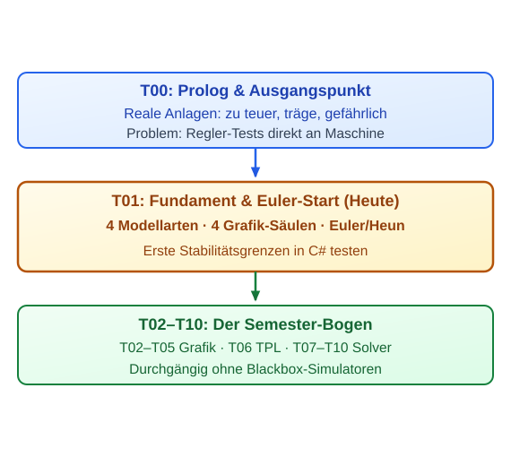

</div>
</div>

---


## 1.1: Motivation

Dieser Abschnitt umfasst die folgenden Inhalte:

- Brücke zum Prolog und Einordnung in die Semester-Architektur
- Definition von Modell und Simulation
- Praktische Anwendungsbeispiele aus verschiedenen Ingenieursdisziplinen
- Nutzen der Simulation zur Kostenreduktion, Risikominimierung und Optimierung

---

### Was ist ein Modell?

<div class="columns">
<div>

Ein **Modell** ist eine vereinfachte, abstrakte Darstellung eines realen Systems oder Prozesses.

> "All models are wrong, but some are useful."
> -- George E. P. Box

Es erfasst die wesentlichen Aspekte, die für eine bestimmte Fragestellung relevant sind, und vernachlässigt unwesentliche Details:

- **Abstraktion:** Reduktion auf die steuernden physikalischen Größen.
- **Zweckbindung:** Jedes Modell gilt nur für seinen definierten Gültigkeitsbereich.
- **Überprüfbarkeit:** Vorhersagen müssen sich an Messdaten testen lassen.

</div>
<div>

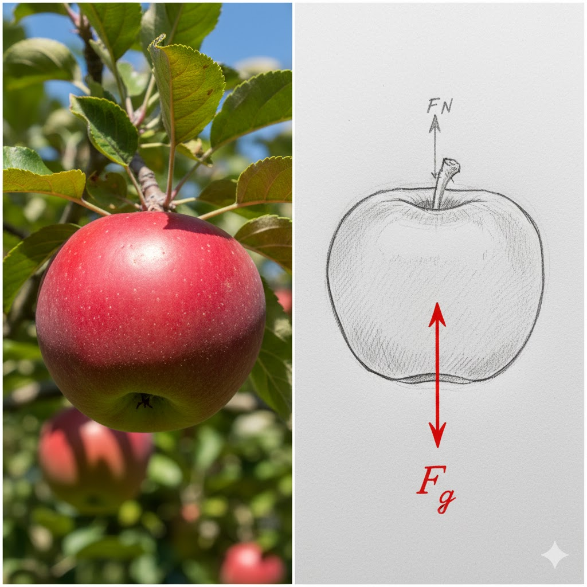

</div>
</div>

---

### Was ist eine Simulation?

<div class="columns">
<div class="two">

Eine **Simulation** ist das systematische Durchführen von Experimenten mit einem mathematischen Modell:

- Das Modell wird mit konkreten Anfangszuständen und Parametern (z. B. Masse, Dämpfung, Zeitschritt $\Delta t$) initialisiert.
- Das Verhalten des Modells über die Zeit oder unter bestimmten Randbedingungen wird schrittweise berechnet.
- Die Ergebnisse werden gegen reale Messdaten oder analytische Referenzwerte validiert.

> **Nutzen & Merksatz:** Simulation ermöglicht gefahrlose „Was-wäre-wenn“-Szenarien vor dem ersten physischen Prototyp – das Modell ist die *Struktur*, die Simulation ist das *Experiment* damit über die Zeit.

</div>
<div>

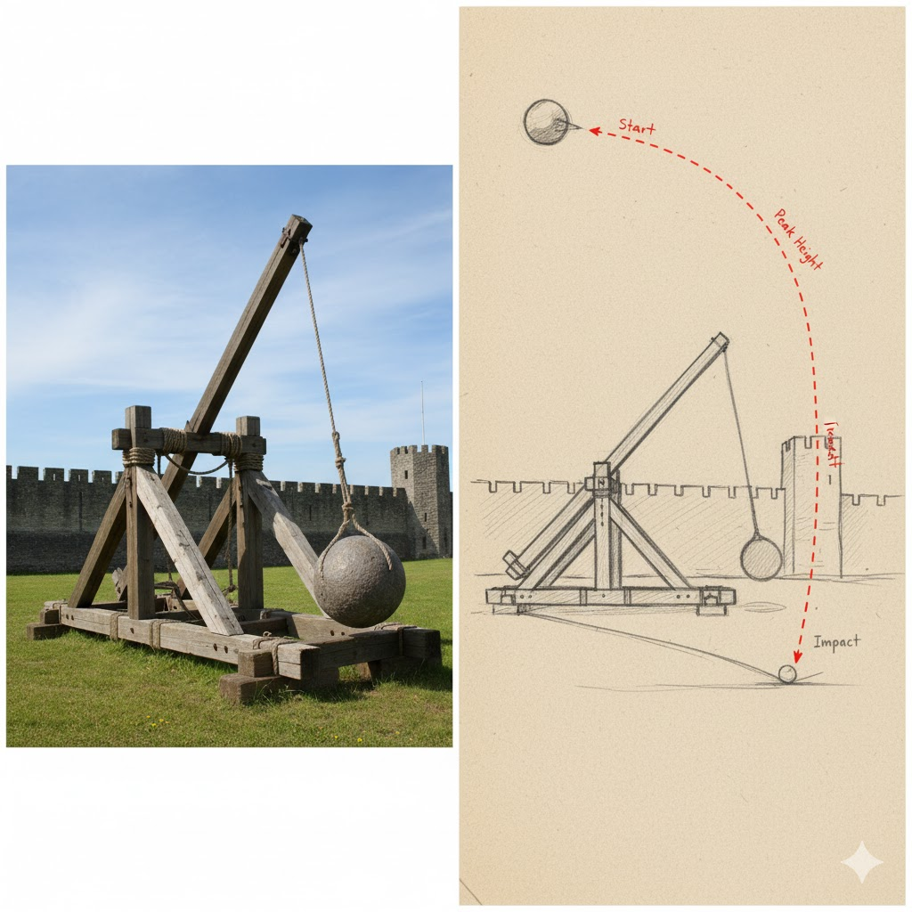

</div>
</div>

---

### Praktische Fragestellungen

Mithilfe von Modellen und Simulationen können wir komplexe Fragen beantworten, bevor wir reale Systeme bauen oder verändern.

<div class="columns top">
<div class="one">


**Maschinenbau**
- Wie verhält sich eine Brücke unter dynamischer Windlast?
- Wie lässt sich der Energieverbrauch eines Roboters optimieren?
- Wie müssen Antriebe dimensioniert sein?

</div>
<div class="one">


**Produktion & Logistik**
- Was ist der optimale Materialfluss in einer Fabrik?
- Wie viele AGVs werden für den Takt benötigt?
- Wie wirkt sich ein Ausfall auf den Durchsatz aus?

</div>
</div>

> **Gemeinsamkeit:** In allen Branchen klären wir Auslegungsfragen vor dem Aufbau.

---

### Praktische Fragestellungen

<div class="columns top">
<div class="one">

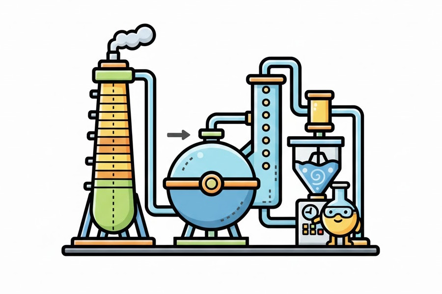

**Verfahrenstechnik**
- Wie verteilt sich die Temperatur in einem Reaktor?
- Wie kann der Schadstoffausstoß eines Kraftwerks minimiert werden?

</div>
<div class="one">


**Elektrotechnik**
- Wie verhält sich eine Schaltung bei Spannungsschwankungen?
- Wie ist das Abstrahlverhalten einer Antenne?

</div>
<div class="one">


**Informatik**
- Wie ist die Antwortzeit eines Servers unter Last?
- Wie trainiert man ein autonomes Fahrzeug sicher?

</div>
</div>

> **Transfer:** Unabhängig von der Disziplin stehen immer Kostenreduktion, Sicherheit und Parameter-Optimierung im Mittelpunkt.

---


### Nutzen der Simulation

- **Kostenreduktion**: Virtuelle Tests sind günstiger als reale Prototypen.
- **Risikominimierung**: Gefährliche Szenarien können sicher getestet werden.
- **Machbarkeitsanalyse**: Ideen können frühzeitig auf ihre Umsetzbarkeit geprüft werden.
- **Optimierung**: Bestehende Systeme können verbessert werden (z.B. Durchsatz, Energieeffizienz).
- **Verständnisgewinn**: Komplexe Zusammenhänge werden sichtbar und verständlich.
- **Training**: Bediener oder KI-Systeme können in einer sicheren Umgebung trainiert werden.

---


## 1.2: Arten von Modellen

Dieser Abschnitt umfasst die folgenden Inhalte:

- Klassifikation nach Zeitabhängigkeit (statisch vs. dynamisch)
- Klassifikation nach Zustandsänderung (kontinuierlich vs. diskret)
- Klassifikation nach Zufälligkeit (deterministisch vs. stochastisch)

---

### Klassifikation von Modellen

<div class="columns">
<div class="two">

Modelle können nach verschiedenen Kriterien klassifiziert werden:

- Statisch
- Dynamisch
  - Kontinuierlich
  - Diskret
    - Zeit
    - Ereignis
  - Hybrid

Die Wahl des Modelltyps hängt von der Problemstellung und dem zu untersuchenden System ab.

</div>
<div class="three">


</div>
</div>

---

### Statische vs. Dynamische Modelle

<div class="columns top">
<div class="one">

**Statische Modelle**
- Beschreiben den Zustand eines Systems in einem einzigen Augenblick (im Gleichgewicht).
- Sind zeitunabhängig ($\frac{d}{dt} = 0$).
- Typische Fragestellung: Wie verformt sich ein Bauteil unter einer konstanten Last?
- Mathematisch: Algebraische Gleichungen (z. B. lineares Gleichungssystem $K \cdot u = F$).
- **Beispiel**: Statik eines Fachwerks (Kap. 7).

</div>
<div class="one">

**Dynamische Modelle**
- Beschreiben die zeitliche Entwicklung eines Systems über eine Zeitspanne $[t_0, t_{\text{end}}]$.
- Sind zeitabhängig (Zustandsänderung über $\Delta t$ oder Ereignisse).
- Typische Fragestellung: Wie schwingt ein Pendel nach dem Anstoßen?
- Mathematisch: Differentialgleichungen (kontinuierlich) oder Zustandsautomaten (diskret).
- **Beispiel**: Flugbahn eines Balls (Kap. 1 & 8).

</div>
</div>

> **Kursfokus:** Heute starten wir mit dynamischen Systemen; statische Gleichgewichtssysteme folgen in Kapitel 7.

---

### Kontinuierliche vs. Diskrete Modelle (Visualisierung)

<div class="columns top">
<div class="one">

**Kontinuierliche Modelle**

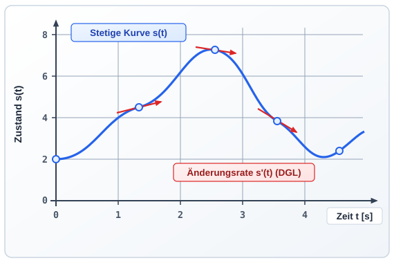

</div>
<div class="one">

**Diskrete Modelle**

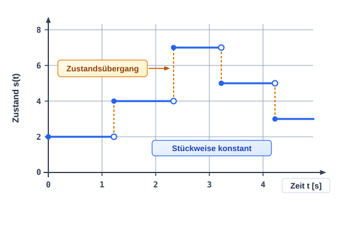

</div>
</div>

---

### Kontinuierliche vs. Diskrete Modelle

Diese Unterscheidung ist vor allem bei **dynamischen Modellen** relevant:

<div class="columns top">
<div class="one">

**Kontinuierliche Modelle**
- Die Zustandsgrößen (z. B. Position, Temperatur) können sich zu jedem beliebigen Zeitpunkt ändern.
- Die Zustandsgrößen nehmen Werte aus einem kontinuierlichen Bereich ($\mathbb{R}$) an.
- Mathematisch: Differentialgleichungen (ODEs/PDEs).
- **Beispiel**: Füllstand eines Wassertanks, Schwingung eines Federpendels.

</div>
<div class="one">

**Diskrete Modelle**
- Die Zustandsgrößen ändern sich nur zu bestimmten, einzelnen Zeitpunkten.
- Die Zustandsgrößen nehmen oft abzählbare oder stückweise konstante Werte an.
- Mathematisch: Differenzengleichungen, Ereignislisten.
- **Beispiel**: Warteschlange an einer Kasse, Produktionsablauf.

</div>
</div>

> **Praxis-Brücke:** Kontinuierliche Modelle müssen für den Digitalrechner immer zeitlich diskretisiert werden.

---

<!-- _class: activity -->

### Mitmach-Impuls (3 Min.): Welcher Modelltyp passt?

Ordnen Sie diese drei technischen Systeme gemeinsam (oder kurz für sich) den Modellkategorien zu (*statisch/dynamisch*, *kontinuierlich/diskret*, *deterministisch/stochastisch*):

1. **Durchbiegung eines Stahlträgers** unter konstanter Kranlast ($5\,\mathrm{t}$) im Stillstand (*keine Bewegung über die Zeit*).
2. **Aufheizung eines CPU-Kühlers** über die Zeit bei eingeschaltetem Prozessor (*Wärmeleitung im Festkörper*).
3. **Materialpuffer einer Fertigungsstraße** mit zufälligen Störungen und schwankenden Taktzeiten (*Warteschlange*).
4. **Begründung:** Welches der drei Systeme wird im C#-Programm später mit festem Zeitschritt $\Delta t$ angenähert – und welches springt direkt von Event zu Event?

> **Leitfrage:** Diskutieren Sie kurz mit Ihrem Nachbarn, welche Zustandsgrößen ($u$, $T$, Pufferfüllstand) sich jeweils ändern.

---

<!-- _class: solution -->

### Auflösung: Einordnung der drei Systeme

1. **Stahlträger im Stillstand:** **Statisch** & **deterministisch** – reines Gleichgewichtssystem ($K \cdot u = F$) ohne Zeitabhängigkeit (Kap. 7).
2. **Aufheizung eines CPU-Kühlers:** **Dynamisch, kontinuierlich** (physikalische Wärmeleitungs-DGL) & **deterministisch** – im C#-Code später *zeitdiskret* mit $\Delta t$ angenähert (Kap. 2).
3. **Materialpuffer mit Störungen:** **Dynamisch, ereignisdiskret (DES)** & **stochastisch** – die Simulationsuhr springt direkt von Ankunfts-/Störungs-Event zu Event (Kap. 9).
4. **Diskretisierungs-Unterschied:** Kontinuierliche Physik braucht $\Delta t$ zur Approximation; Warteschlangen besitzen von Natur aus diskrete Ereigniszeitpunkte.
5. **Übergang zu Hybriden Modellen:** Kombiniert ein System kontinuierliche DGLs *und* diskrete Schaltereignisse (z. B. Thermostate oder Aufprall), spricht man von **hybriden Modellen** (Kap. 10).

> **Merksatz:** Ein physikalisch kontinuierliches Modell wird auf dem Computer durch $\Delta t$ *zeitdiskret* gelöst; echte Warteschlangen bleiben *ereignisdiskret*.

---

### Zeitdiskrete vs. Ereignisdiskrete Modelle (Visualisierung)

<div class="columns">
<div class="one">

**Zeitdiskret (konstanter Zeitschritt $\Delta t$)**

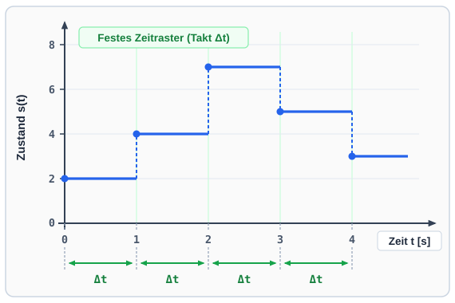

</div>
<div class="one">

**Ereignisdiskret (asynchrone Events)**

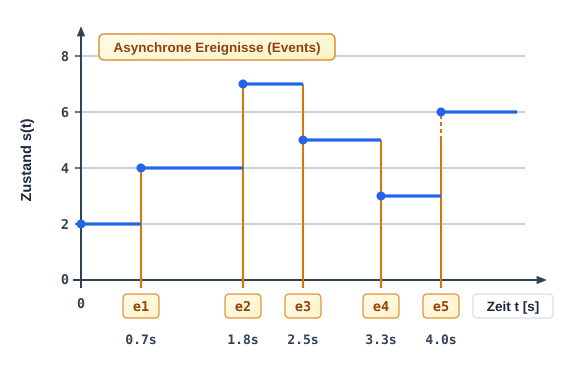

</div>
</div>

---

### Deterministische vs. Stochastische Modelle

<div class="columns top">
<div class="one">

**Deterministische Modelle**

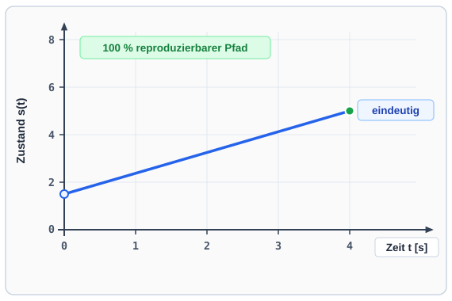

</div>
<div class="one">

**Stochastische Modelle**

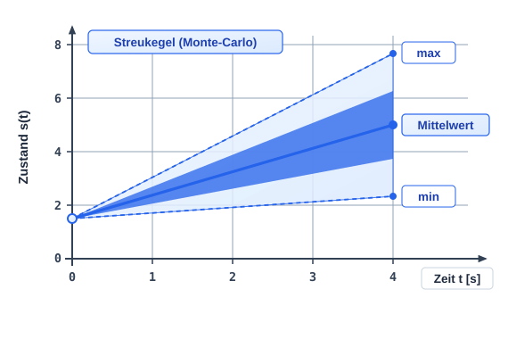

</div>
</div>

> **Abgrenzung:** **Deterministisch** = identischer Ablauf ohne Zufall (Planetenbahn, Federpendel); **Stochastisch** = Zufallseinflüsse mit Monte-Carlo-Läufen (Warteschlangen, ab T09).

---


## 1.3: Lösungsmethoden

Dieser Abschnitt umfasst die folgenden Inhalte:

- Unterschied zwischen analytischen (exakten) und numerischen (approximativen) Lösungen
- Schiefer Wurf mit Luftwiderstand als gekoppeltes nichtlineares DGL-System
- Präzisionssteigerung durch Heun (RK2) und lineare Schnittpunkt-Interpolation

---


### Wie lösen wir die Modellgleichungen?

Sobald das mathematische Modell aufgestellt ist, muss es gelöst werden, um das Systemverhalten zu berechnen:

- **1. Analytische Lösung:** Exakte, geschlossene Formel für einfache, meist lineare Modelle.
- **2. Numerische Lösung:** Schrittweise Approximation auf einem diskreten Zeitgitter ($t_k = t_0 + k \cdot \Delta t$) für nichtlineare Systeme.

> **Grundregel:** Analytische Lösungen sind in der Praxis selten – dienen aber als *5-Sekunden-Selbsttest* für den Code.

---

### **Analytische** vs. **Numerische** Lösung: Einordnung

<div class="columns">
<div class="two">

#### Analytische Lösung (Beispiel Freier Fall)
$$y(t) = y_0 + v_0 \cdot t - \frac{1}{2} g \cdot t^2$$
- $y(t)$: Höhe $[\mathrm{m}]$, $t$: Zeit $[\mathrm{s}]$
- $y_0$: Anfangshöhe $[\mathrm{m}]$, $v_0$: Startgeschwindigkeit $[\mathrm{m/s}]$
- $g \approx 9{,}81\,\mathrm{m/s^2}$: Erdbeschleunigung
- **Vorteil:** Exakt und zeitlich unendlich fein auflösbar.

</div>
<div class="two">

#### Numerische Lösung (Expliziter Euler)
$$y_{k+1} = y_k + \Delta t \cdot f(t_k, y_k), \quad t_{k+1} = t_k + \Delta t$$
- $k \in \{0, 1, 2, \dots\}$: Diskreter Zeitschrittindex
- $\Delta t$: Zeitschrittweite $[\mathrm{s}]$, $y_k \approx y(t_k)$: Näherungswert
- **Vorteil:** Universell für nichtlineare & gekoppelte DGLs.
- **Risiko:** Fehler und Instabilität bei zu großem $\Delta t$.

</div>
</div>

> **Merksatz:** Sobald Luftwiderstand, Reibung oder Kollisionen hinzukommen, bleibt nur die numerische Integration – analytische Formeln bleiben aber der schnellste Unit-Test.

---

<!-- _class: activity -->

### Mitmach-Impuls (3 Min.): Einen Euler-Schritt von Hand rechnen

Gegeben sei das lineare Abkling-Modell $\dot{y}(t) = -2\,y(t)$ mit Startwert $y_0 = 10$ (analytische Referenz: $y(t) = 10\,e^{-2t}$):

1. **Stabiler Zeitschritt ($\Delta t = 0{,}25\,\mathrm{s}$):** Berechnen Sie die ersten beiden Euler-Schritte $y_1$ und $y_2$ mit $y_{k+1} = y_k + \Delta t \cdot (-2\,y_k)$.
2. **Zu großer Zeitschritt ($\Delta t = 1{,}2\,\mathrm{s}$):** Berechnen Sie ebenfalls $y_1$ und $y_2$. Welches numerische Problem tritt hier sofort auf?
3. **Grenze:** Ab welchem $\Delta t$ kippt das Vorzeichen von $y_1$ erstmals ins Negative – und ab wann wächst $|y_k|$ unbeschränkt?
4. **Vergleich:** Wie groß ist $y(0{,}5)$ analytisch im Vergleich zu $y_2$ bei $\Delta t = 0{,}25\,\mathrm{s}$?

> **Hinweis:** Überlegen Sie kurz für sich oder mit Ihrem Nachbarn – ein schnelles Kopfrechnen über zwei Schritte genügt völlig. Achten Sie besonders darauf, ob das Vorzeichen zwischen $y_0, y_1, y_2$ wechselt und ob der Betrag $|y_k|$ kleiner oder größer wird.

---

<!-- _class: solution -->

### Auflösung: Euler-Schrittweite & Stabilitätsgrenze

1. **Bei $\Delta t = 0{,}25\,\mathrm{s}$ (stabil & monoton):**
   - $y_1 = 10 + 0{,}25 \cdot (-20) = \mathbf{5{,}0}$
   - $y_2 = 5{,}0 + 0{,}25 \cdot (-10) = \mathbf{2{,}5}$ *(physikalisch plausibel, nahe an $y(0{,}5) = 10\,e^{-1} \approx 3{,}68$)*
2. **Bei $\Delta t = 1{,}2\,\mathrm{s}$ (instabil & oszillierend):**
   - $y_1 = 10 + 1{,}2 \cdot (-20) = \mathbf{-14{,}0}$ *(Vorzeichenwechsel – physikalisch unmöglich!)*
   - $y_2 = -14{,}0 + 1{,}2 \cdot 28 = \mathbf{+19{,}6}$ *(aufklingende Oszillation – **numerische Instabilität**!)*
3. **Kipp-Punkt (Stabilitätsgrenze):**
   - Ab $\Delta t > 0{,}5\,\mathrm{s}$ gilt $1 - 2\,\Delta t < 0$ (alternierendes Vorzeichen).
   - Ab $\Delta t > 1{,}0\,\mathrm{s}$ gilt $|1 - 2\,\Delta t| > 1$ und die Lösung explodiert ($|y_k| \to \infty$).
4. **C#-Konsequenz:** In der Hausübung testen wir genau diesen Effekt mit kleinem vs. großem $\Delta t$.

> **Merksatz:** Ein zu großes $\Delta t$ macht selbst ein stabiles physikalisches System im expliziten Euler instabil. Halbiert man $\Delta t$, halbiert sich der Euler-Fehler ($\mathcal{O}(\Delta t)$).

---

### Kräftebilanz: Schiefer Wurf mit Luftwiderstand

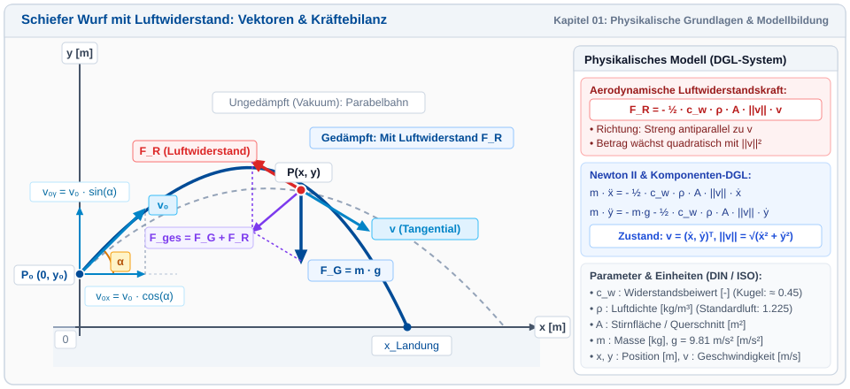

---

### Numerische Modellierung: Schiefer Wurf mit Luftwiderstand

<div class="columns top">
<div class="one">

**Einfluss des Strömungswiderstands:**
In realen Medien bremst die turbulente Reibungskraft $\vec{F}_R$ $[\mathrm{N}]$ antiparallel zum Geschwindigkeitsvektor $\vec{v}$:

$$\vec{F}_R = -\frac{1}{2} c_w \rho A \|\vec{v}\| \vec{v}$$

- $c_w$: Strömungswiderstandsbeiwert $[-]$
- $\rho$: Fluiddichte (Luft: $\rho \approx 1{,}2\,\mathrm{kg/m^3}$)
- $A$: Stirn- bzw. Querschnittsfläche $[\mathrm{m^2}]$
- $\vec{v} = (v_x, v_y)^T$: Momentangeschwindigkeit $[\mathrm{m/s}]$
- $\|\vec{v}\| = \sqrt{v_x^2 + v_y^2}$: Geschwindigkeitsbetrag $[\mathrm{m/s}]$

</div>
<div class="one">

**Kräftebilanz ($\vec{F}_{\text{ges}} = \vec{F}_G + \vec{F}_R$) & DGL-System:**
Mit der Gewichtskraft $\vec{F}_G = (0, -mg)^T$ folgt nach Newton II:
$$m \ddot{x} = F_{Rx} = -\frac{1}{2} c_w \rho A \sqrt{v_x^2 + v_y^2} \cdot v_x$$
$$m \ddot{y} = -m g + F_{Ry} = -m g - \frac{1}{2} c_w \rho A \sqrt{v_x^2 + v_y^2} \cdot v_y$$

- **Nichtlineare Kopplung:** $v_x$ und $v_y$ koppeln im Term $\sqrt{v_x^2+v_y^2}$ untrennbar miteinander.
- **Folge:** Keine geschlossene Stammfunktion für Bahnkurve und Landeweite $x_{\text{Landung}}$ $\implies$ **Numerik (Euler / Heun)**!

</div>
</div>

---

### Zustandsraum & Prädiktor-Korrektor nach Heun (RK2)

Um DGLs 2. Ordnung im Code einheitlich zu lösen, überführen wir sie in ein System 1. Ordnung:

<div class="columns top">
<div class="one">

**1. Zustandsraum-Transformation:**
Ort und Geschwindigkeit bilden zusammen den **Zustandsvektor $\mathbf{x}$** und seine Ableitung `dx`:
$$\mathbf{x} = \begin{pmatrix} x \\ y \\ v_x \\ v_y \end{pmatrix} \implies \dot{\mathbf{x}} = \mathbf{f}(t, \mathbf{x}) = \begin{pmatrix} v_x \\ v_y \\ F_{Rx}/m \\ -g + F_{Ry}/m \end{pmatrix}$$
```csharp
var dx = new KinematicState(v_x, v_y, F_Rx / m, -g + F_Ry / m);
```

</div>
<div class="one">

**2. Heun-Verfahren (RK2, Ordnung $\mathcal{O}(\Delta t^2)$):**
Mittelt Anfangssteigung $\mathbf{k}_1 = \mathbf{f}(t_k, \mathbf{x}_k)$ und Endsteigung $\mathbf{k}_2$:
1. *Prädiktor:* $\tilde{\mathbf{x}}_{k+1} = \mathbf{x}_k + \Delta t \cdot \mathbf{k}_1$
2. *Steigung am Ziel:* $\mathbf{k}_2 = \mathbf{f}(t_k + \Delta t, \tilde{\mathbf{x}}_{k+1})$
3. *Korrektor:* $\mathbf{x}_{k+1} = \mathbf{x}_k + \frac{\Delta t}{2}\left(\mathbf{k}_1 + \mathbf{k}_2\right)$

```csharp
var x = x + 0.5 * dt * (k1 + k2);
```

</div>
</div>

> **Konkreter Genauigkeitsgewinn (Vakuumwurf, $\Delta t = 0{,}10\,\mathrm{s}$):** Expliziter Euler weicht um **`+10,60 m`** ab – Heun (RK2) reduziert den Wurfweitenfehler auf **`-0,009 m`** bei gleichem $\Delta t$!

---

### Ereignis-Interpolation ($y = 0$) & C#-Umsetzung

<div class="columns top">
<div class="one">

**Lineare Schnittpunkt-Interpolation ($y = 0$):**
Fällt $y_{k+1} < 0$ unter den Boden, liefert $\tau \in [0, 1]$ den exakten Auftreffpunkt ohne „Tunneling“:
$$\tau = \frac{0 - y_k}{y_{k+1} - y_k}, \qquad t_{\text{impact}} = t_k + \tau \Delta t$$
$$x_{\text{impact}} = x_k + \tau (x_{k+1} - x_k)$$

- **`StepHeun`:** Berechnet Anfangssteigung `k1`, Prädiktor `pred` sowie Endsteigung `k2` und mittelt beide.

</div>
<div class="one">

```csharp
public static KinematicState StepHeun(
    KinematicState state, double dt)
{
    var k1 = ComputeDerivative(state);
    var pred = state + dt * k1;
    var k2 = ComputeDerivative(pred);
    return state + 0.5 * dt * (k1 + k2);
}

// Aufprall bei y_next < 0 (Boden y = 0):
double tau = -y_k / (y_next - y_k);
double tImpact = t_k + tau * dt;
double xImpact = x_k + tau * (x_next - x_k);
```

</div>
</div>

> **Architektur-Vorteil:** Euler und Heun teilen sich exakt dieselbe Physik-Funktion `ComputeDerivative(state)` – sauber entkoppelt vom Zeitschritt-Löser!

---


## 1.4: Visualisierung von Simulationsdaten

Dieser Abschnitt umfasst die folgenden Inhalte:

- Rolle der Visualisierung zum Verstehen, Validieren und Kommunizieren von Ergebnissen
- Darstellungsstufen von einfachen 2D-Plots bis zu interaktiven 2D- und 3D-Szenen
- Die vier komplementären Dimensionen der Visualisierung im Überblick

---

### Von einfachen Diagrammen zu komplexen Szenen

<div class="columns top">
<div class="one">


**1. Einfache Diagramme (Plots)**
- Größe über Zeit (`ScottPlot 5`).
- z.B. Temperaturverlauf, Phasenportrait.
- Ideal für Konvergenz- & Energie-Checks.

</div>
<div class="one">


**2. 2D-Visualisierungen**
- `WriteableBitmap` (Pixel, Kap. 2) & `WPF Canvas` (Vektoren, Kap. 3).
- z.B. Wärmefeld, 2D-Fachwerk.
- Echtzeit-Feedback bei $\ge 60\,\text{FPS}$.

</div>
<div class="one">

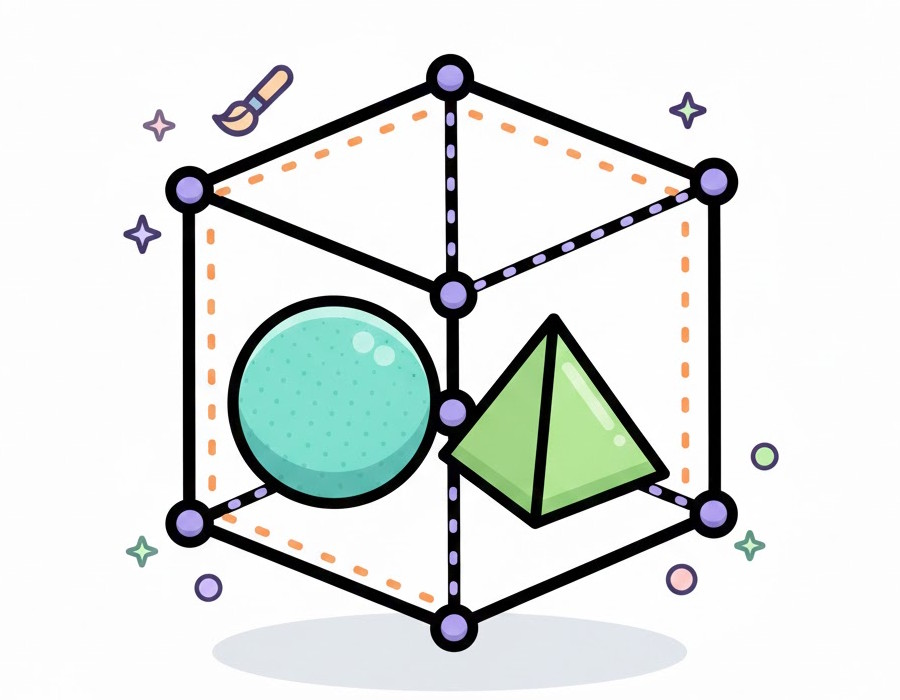

**3. 3D-Visualisierungen**
- Räumliche Szenen (`SharpGL`, Kap. 5).
- z.B. Roboterzelle, Gebäudemodell.
- Hierarchische Gelenk-Kinematik.

</div>
</div>

> **Leitlinie:** Eine gute Visualisierung dient in der Technik der **Fehlerdiagnose und Validierung** – vom 1D-Plot bis zur 3D-Szene.

---

### Formen der Visualisierung im Überblick

In diesem Kurs lernen wir die Visualisierung entlang von vier komplementären Dimensionen kennen:


---

### Auswahl-Leitfaden: Welche Visualisierung wofür?

<div class="columns">
<div class="two">

#### 2D-Felder, Vektoren & Plots
- **2D-Pixel (`WriteableBitmap`, Kap. 2):** Kontinuierliche Felder (Wärmeverteilung, Wellen, Rauch) mit $\ge 60\,\text{FPS}$.
- **2D-Vektor (`Canvas`, Kap. 3):** Geometrische Objekte, Gelenkarme, Radar und skalierbare Skizzen.
- **Plots (`ScottPlot 5`, Kap. 4):** Zeitreihen, Phasenportraits und Energie-Checks.

</div>
<div class="two">

#### 3D-Szenen & Architektur
- **3D-Szenen (`SharpGL`, Kap. 5):** Räumliche Kinematik, Roboterzellen und Kamerasteuerung.
- **Trennungs-Prinzip:** Die Grafikschicht liest nur Zustandsdaten – sie berechnet niemals selbst Physik-Gleichungen!
- **Performance-Regel:** Bei $> 10\,000$ Elementen pro Frame immer Pixel-Puffer oder GPU-Meshes statt Einzel-Controls wählen.

</div>
</div>

> **Merksatz:** Wählen Sie immer die *einfachste* Darstellung, die den gesuchten physikalischen Fehler sofort sichtbar macht.

---


### Typische Visualisierungsfehler in der Praxis

Vermeiden Sie diese Stolpersteine in Ihren C#-Simulatoren:

- **Seitenverhältnis:** Ungleiche $x/y$-Skalierung verzerrt Kreise zu Ellipsen.
- **Fehlende Einheiten:** Plots ohne `[m]` oder `[s]` verhindern Fehlerdiagnose.
- **Schein-Animation:** Timer bewegt Pixel statt echter DGL.
- **Allokation pro Frame:** `new SolidColorBrush(...)` erzeugt Garbage-Collector-(GC)-Ruckler.

> **Qualitätsregel:** Visualisierung arbeitet allokationsfrei und mit SI-Einheiten.

---


## 1.5: Der Digitale Zwilling

Dieser Abschnitt umfasst die folgenden Inhalte:

- Das Konzept des Digitalen Zwillings nach Michael Grieves
- Die drei Kernkomponenten: physisches Produkt, virtuelles Produkt und Datenverbindung
- Die Abgrenzung von reinen 3D-Modellen

---

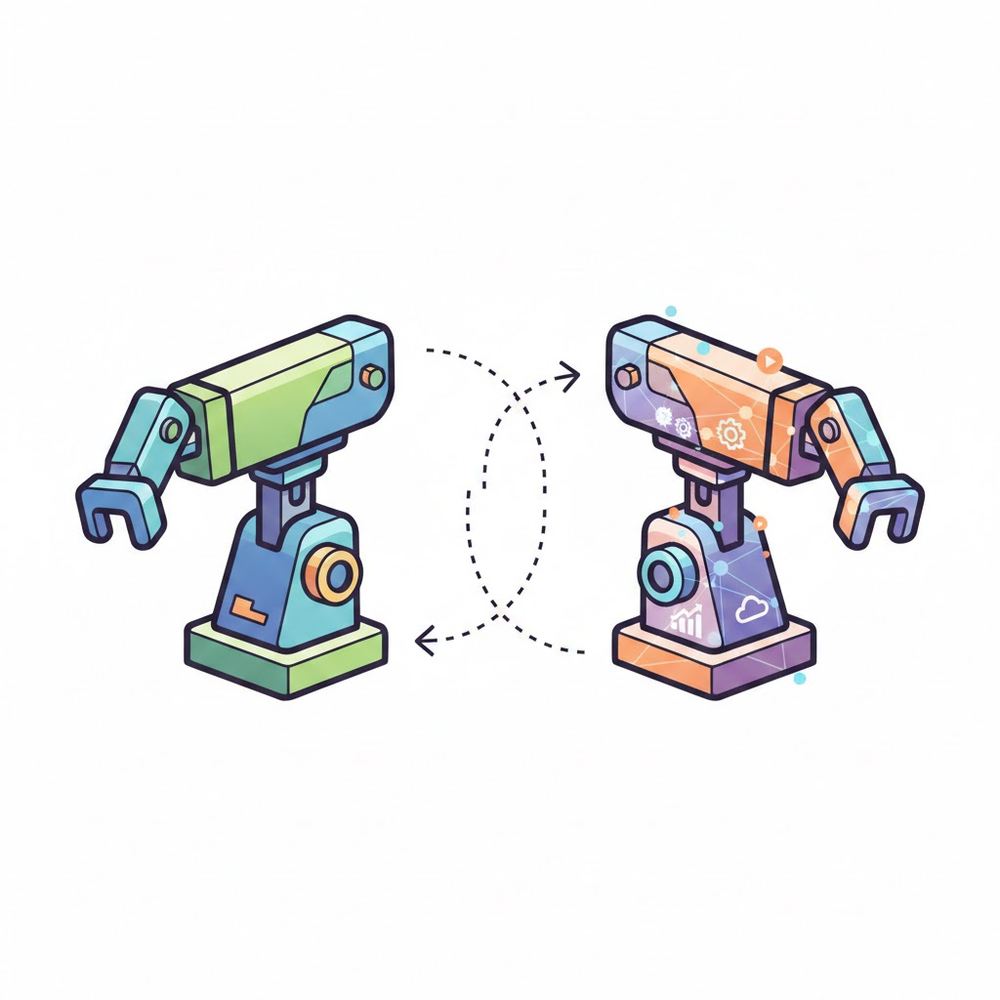

### Was ist ein Digitaler Zwilling?

Der Begriff wurde maßgeblich von **Dr. Michael Grieves** (University of Michigan) geprägt. Ein Digitaler Zwilling ist ein virtuelles Modell, das als digitales Gegenstück zu einem physischen System dient:

1. Ein **physisches Produkt** in der realen Welt (Anlage, Roboter, Fahrzeug).
2. Ein **virtuelles Produkt** im digitalen Raum (Geometrie, Physik & Logik).
3. Eine bidirektionale **Datenverbindung** zwischen realer und virtueller Welt.

> **Abgrenzung:** Ohne Austausch bleibt es ein *Digital Model*; bei reinem Live-Zufluss (Physisch $\to$ Virtuell) ein *Digital Shadow* – erst der Rückkanal macht es zum **Digitalen Zwilling**.

---

<!-- _class: activity -->

### Mitmach-Impuls (3 Min.): CAD-Modell vs. Digitaler Zwilling

Ein Sondermaschinenbauer besitzt ein detailliertes 3D-CAD-Modell einer Förderanlage auf dem Server, während die echte Anlage in der Halle läuft. Diskutieren Sie kurz zu zweit (oder für sich):

1. **Abgrenzung:** Warum ist dieses 3D-CAD-Modell *noch kein* Digitaler Zwilling? Welche zwei Bestandteile fehlen konkret?
2. **Mehrwert:** Welchen praktischen Nutzen gewinnt der Betreiber erst dann, wenn beide Lücken geschlossen sind?
3. **Praxis-Beispiel:** Welche konkrete Sensorgröße der Förderanlage (z. B. Antriebsstrom, Temperatur, Drehzahl) würden Sie zuerst zurückführen – und warum?

> **Hinweis:** Denken Sie an die drei Säulen von Michael Grieves (*physisch, virtuell, Datenverbindung*) und daran, welche Aufgaben erst im laufenden Betrieb möglich werden. Überlegen Sie sich für Ihre Antwort auch ein konkretes Beispiel für ein *What-if*-Szenario und welches Risiko bei veralteten Sensordaten für die Prognose entsteht!

---

<!-- _class: solution -->

### Auflösung: Was dem CAD-Modell noch fehlt

1. **Zwei fehlende Komponenten:**
   - **Verhaltensmodell (Physik & Logik):** Das CAD-Modell kennt nur die Geometrie, aber keine Dynamik, Reibung oder SPS-Steuerungslogik.
   - **Bidirektionale Datenverbindung:** Es fehlt der kontinuierliche Live-Datenfluss (Sensoren $\to$ Modell $\to$ Rückmeldung an die Anlage).
2. **Entstehender Mehrwert:** Erst durch Simulation + Live-Daten werden **Zustandsüberwachung, Prognose (*What-if*) und vorausschauende Wartung** möglich.
3. **Erster Sensor-Anker:** Motorstrom und Drehzahl erlauben sofort einen Soll-Ist-Abgleich gegen Reibungs- oder Verschleißmodelle – steigt der Strom bei gleicher Last, meldet der Zwilling frühzeitig Lagerverschleiß.

> **Merksatz:** **3D-Geometrie + Verhaltensmodell + Live-Datenverbindung = Digitaler Zwilling.** Entscheidend ist nicht die 3D-Optik, sondern die Kopplung aus Modell und Live-Daten.

---

### Das Konzept von Grieves

<div class="columns">
<div class="two">

- **Physischer Raum**: Hier existiert das reale Objekt (z.B. eine Windkraftanlage, ein Auto, eine Fertigungsstraße). Sensoren erfassen kontinuierlich Daten über seinen Zustand (z.B. Temperatur, Drehzahl, Position).

- **Virtueller Raum**: Hier existiert das digitale Modell. Es ist eine hochgenaue, multidisziplinäre Repräsentation des physischen Objekts.

- **Datenverbindung**: Der entscheidende Link.
    - Daten fließen vom physischen zum virtuellen Objekt ("Digital Twin Instance").
    - Erkenntnisse, Befehle oder Updates fließen vom virtuellen zum physischen Objekt.

</div>
<div class="one">


</div>
</div>

---

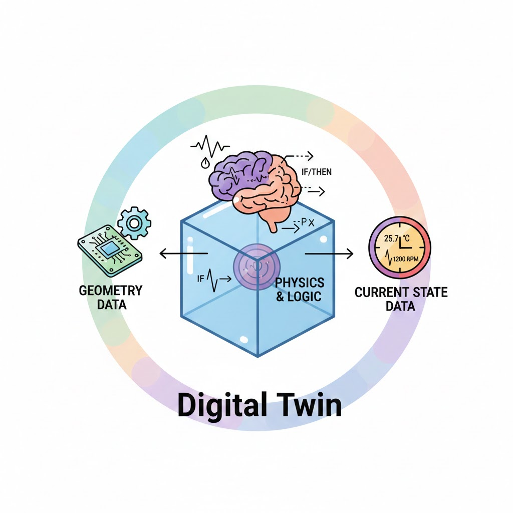

### Mehr als nur ein 3D-Modell

Ein Digitaler Zwilling ist **nicht nur** ein CAD-Modell oder eine 3D-Visualisierung:

- **Geometrie**: 3D-Struktur.
- **Physik**: Verhalten unter Last, thermische Eigenschaften, etc. (-> **Simulationsmodelle!**)
- **Daten**: Live-Daten von Sensoren, historische Daten, Wartungsprotokolle.
- **Logik**: Steuerungssoftware, Produktionsregeln.

Ein Digitaler Zwilling "lebt" und entwickelt sich mit seinem physischen Gegenstück über dessen gesamten Lebenszyklus.

---

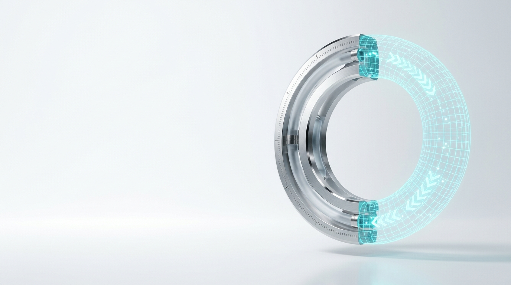

## 1.6: Simulation & Digitaler Zwilling

Dieser Abschnitt umfasst die folgenden Inhalte:

- Die Rolle der Simulation als Kerntechnologie des Digitalen Zwillings
- Die Anwendung über den gesamten Produktlebenszyklus
- Das Praxisbeispiel der virtuellen Inbetriebnahme

---

### Wo passt die Simulation hinein?

<div class="columns">
<div class="three">

**Simulation ist die Kerntechnologie, die den Digitalen Zwilling zum Leben erweckt.**

- Das **Verhaltensmodell** im virtuellen Raum *ist* ein Simulationsmodell.
- Es ermöglicht dem Digitalen Zwilling, nicht nur den **aktuellen Zustand** darzustellen, sondern auch:
    - das **zukünftige Verhalten** vorherzusagen ("Was passiert, wenn die Last um 10% steigt?").
    - **optimale Betriebsparameter** zu finden ("Was ist die energieeffizienteste Geschwindigkeit?").
    - **Fehler zu diagnostizieren** und deren Ursachen zu finden.
    - **Wartungsbedarf** vorausschauend zu planen (Predictive Maintenance).

</div>
<div>

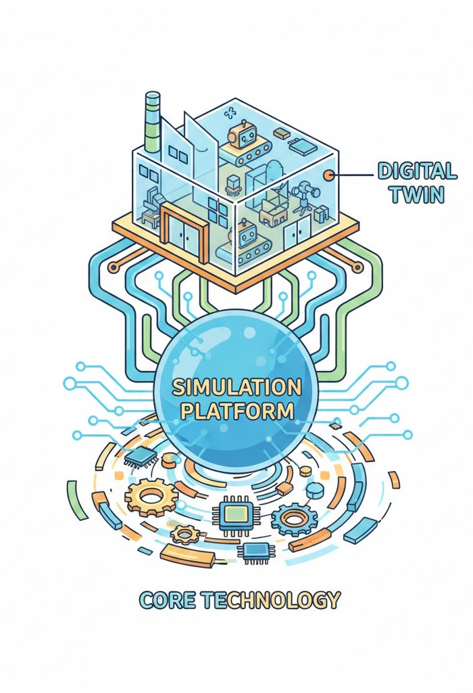

</div>
</div>

---

### Der Lebenszyklus

Der Digitale Zwilling verbindet die Simulation nahtlos über alle drei Lebenszyklusphasen:

<div class="columns top">
<div class="one">


**1. Design & Entwicklung**
- Auslegung und Validierung des Produkts.
- Ergebnis: *Digital Twin Prototype*.

</div>
<div class="one">


**2. Produktion & Inbetriebnahme**
- Fertigungsplanung und **Virtuelle Inbetriebnahme** vor Aufbau der realen Anlage.

</div>
<div class="one">


**3. Betrieb & Wartung**
- *Digital Twin Instance* mit Live-Sensordaten für Prognose und Optimierung.

</div>
</div>

> **Durchgängigkeit:** Dasselbe Verhaltensmodell wächst von der frühen Auslegung bis in den laufenden Anlagenbetrieb mit.

---

### Beispiel: Virtuelle Inbetriebnahme

<div class="columns top">
<div class="one">

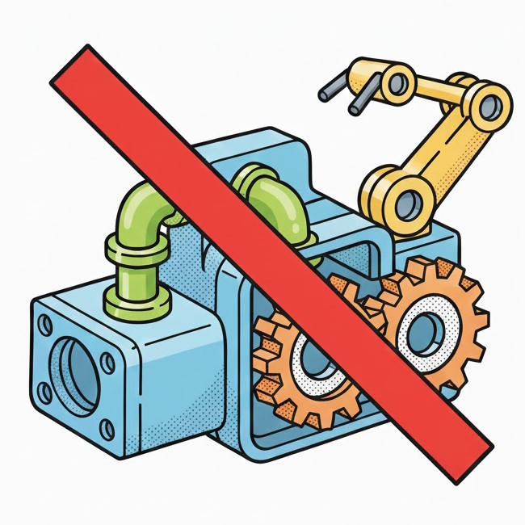

**Traditioneller Ansatz**
1. Mechanik und Elektrik komplett in der Werkshalle aufbauen.
2. Software-Entwickler kommen zur Baustelle.
3. Software wird an der realen, teuren und potenziell gefährlichen Anlage getestet und in Betrieb genommen.
4. Fehlerbehebung ist zeitaufwändig und teuer.

</div>
<div class="one">

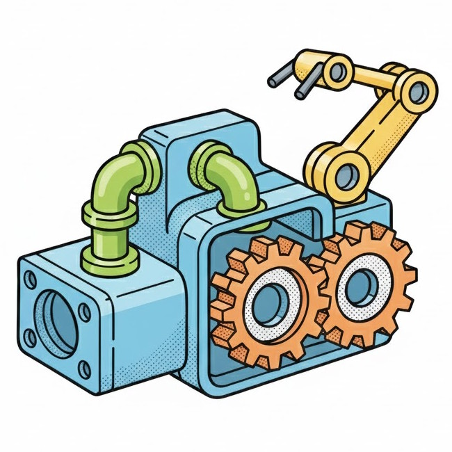

**Ansatz mit Digitalem Zwilling**
1. Parallel zum Aufbau der Mechanik wird ein kinematisches Simulationsmodell (Digitaler Zwilling) erstellt.
2. Software-Entwickler testen die SPS- oder Roboter-Software im Büro gegen das Modell.
3. 90% der Logikfehler werden gefunden, bevor die reale Anlage überhaupt existiert.
4. Deutlich kürzere und sicherere Inbetriebnahmezeit vor Ort.

</div>
</div>

---

### Grenzen & Risiken: Wann führt ein Zwilling in die Irre?

Ein Digitaler Zwilling ist kein Selbstläufer – drei typische Fehlerquellen entscheiden über seinen Nutzen:

<div class="columns">
<div class="two">

#### Modell- & Numerikfehler
- **Falsche Annahmen:** Vernachlässigte Reibung oder unkalibrierte Parameter verfälschen jede Prognose.
- **Zu großes $\Delta t$:** Numerische Instabilität täuscht Schwingungen vor, die real gar nicht existieren.
- **Fehlende Validierung:** Kein Vergleich gegen analytische Grenzwerte oder reale Messdaten.

</div>
<div class="two">

#### Daten- & Architekturfehler
- **Veraltete Sensordaten:** Ohne Zeitsynchronisation driftet der Zwilling vom realen Zustand ab.
- **Schein-Visualisierung:** Schöne 3D-Animation ohne validierte Physik-Gleichungen dahinter.
- **UI-Kopplung:** Rechenkern direkt im UI-Thread verhindert reproduzierbare Tests.

</div>
</div>

> **Kurs-Versprechen:** Genau gegen diese sechs Fallen wappnen wir uns in den nächsten neun Terminen mit Unit-Tests und 5-Sekunden-Selbsttests.

---

### Vom Prototyp zum Regelkreis: Ausblick in die Praxis

<div class="columns">
<div class="three">

Wie sich der Digitale Zwilling von der frühen Konzeptphase bis in den laufenden Betrieb entwickelt:

- **Offline (Engineering):** Antriebe, Federn und Kühler virtuell auslegen; SPS-Logik gefahrlos testen; Grenzlasten durchspielen.
- **Online (Betrieb):** Nicht messbare Innentemperaturen live schätzen; Restlebensdauer prognostizieren; Parameter zurückführen.

> **Schlüsselprinzip:** Je sauberer Modell, Numerik und Visualisierung getrennt sind, desto leichter wächst der Prototyp zum produktiven Zwilling.

</div>
<div class="two">


</div>
</div>

---

<!-- _class: summary -->

# Zusammenfassung Kapitel 1

- **Modelle** sind vereinfachte Abbilder der Realität für einen bestimmten Zweck.
- **Simulation** ist das Experimentieren mit diesen Modellen.
- Modelle können **statisch/dynamisch**, **kontinuierlich/diskret** und **deterministisch/stochastisch** sein.
- **Numerische Methoden** sind der Schlüssel zur Lösung komplexer, realitätsnaher Modelle.
- **Visualisierung** ist entscheidend, um Simulationsergebnisse zu verstehen und zu kommunizieren.
- Ein **Digitaler Zwilling** ist ein virtuelles Abbild eines physischen Objekts, das über dessen Lebenszyklus durch Daten mit ihm verbunden ist.
- **Simulation** ist die treibende Kraft, die es dem Digitalen Zwilling ermöglicht, Verhalten zu analysieren und vorherzusagen.

---

<!-- _class: outlook -->

### Ausblick auf die Kursinhalte

<div class="columns">
<div class="three">

In den folgenden Kapiteln erarbeiten wir zunächst die Werkzeuge und vertiefen anschließend die Modellarten:

- **Teil 1 – Visualisierung & Performance (Kap. 2–6):** `WriteableBitmap`, `WPF Canvas`, `ScottPlot 5`, `SharpGL` 3D & Multithreading (`Parallel.For`).
- **Teil 2 – Simulationsmodelle (Kap. 7–10):** Statische Fachwerke (FEM), kontinuierliche DGLs, ereignisdiskrete DES & hybride Synthese.
- **Nächster Termin (T02):** Wir starten mit 2D-Pixelgrafik (`WriteableBitmap`) und lösen Wärmeleitung sowie Wellen allokationsfrei auf dem Gitter.

> **Brücke:** Das Grundgerüst aus Euler-Zeitschritt und sauberer Modell-View-Trennung nehmen wir direkt in Termin 2 mit.

</div>
<div class="two">


</div>
</div>

---

<!-- _class: homework -->

### Hausübung Termin 01: Kinematik & Expliziter Euler

**Stufe 1 (Basisaufgabe `1.1`–`1.4` für alle Teams auf `KinematikEuler.sln`):** `StepEuler`, Boden-Interpolation, `StepHeun` & `dotnet test` ([Aufgabenblatt 01](../Uebung/Aufgabenblatt.md)) $\to$ **Stufe 2 (Vertiefung – Wahl: Track A ODER Track B, 10 Pkt.):**

<div class="columns">
<div class="two">

#### Stufe 2 – Track A: Industrie & Mechatronik
**Hydraulikzylinder-Endlagendämpfung (`A.1`–`A.4`)**
- $m \ddot{x} = F_{\text{vor}} - F_{\text{dämpf}}(x,v) - F_{\text{anschlag}}(x)$
- Nichtlineare viskose & Blendenreibung
- Fester Anschlag mit Kontaktfederkraft
- **Euler vs. Heun (RK2):** Stabilitätsanalyse & Schrittweitenstudie ($10\,\mu\text{s} \dots 2\,\text{ms}$)
- Trajektorien-Export als CSV & Konsole

</div>
<div class="two">

#### Stufe 2 – Track B: Simulation Game
**Retro Artillery Duel mit Newton-Drag (`B.1`–`B.4`)**
- $\ddot{\mathbf{r}} = \mathbf{g} - \frac{\rho c_{\text{w}} A}{2m} \|\mathbf{v}_{\text{rel}}\| \mathbf{v}_{\text{rel}}$
- Stochastischer Wind $\vec{w} = [w_x, 0]^\top$
- Nichtlineares Terrain $y_{\text{terrain}}(x)$
- **Bodenkollision:** Schnittpunkt-Interpolation
- **KI-Zielrechner:** Schusswinkel-Finder & ASCII-Plot

</div>
</div>

> Reine C#-Konsolenapplikation (.NET 8/10, `Vector2`) – Keine GUI! Beide Stufen als Hausübung im 2er-Team.

