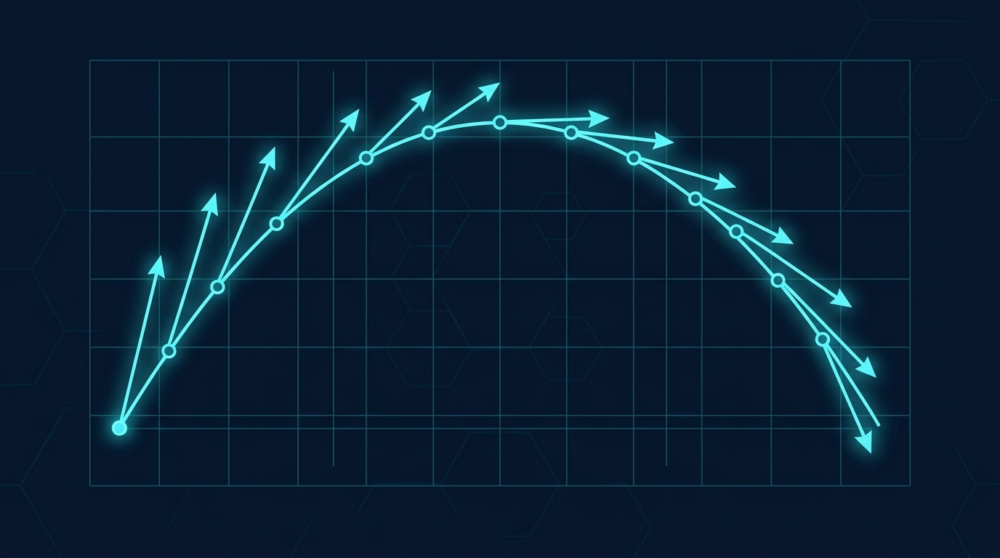

### Termin 01: Modellbegriff, Kinematik & Expliziter Euler
*(Vorlesungskapitel: 00 Prolog & 01 Einführung)*

Zum Auftakt klären wir die Taxonomie technischer Modelle, das Konzept des Digitalen Zwillings nach Michael Grieves sowie die Grundlagen der numerischen Zeitdiskretisierung. Wir überführen kontinuierliche Bewegungsgleichungen zweiter Ordnung unter Erdbeschleunigung in Zustandsraumdarstellungen erster Ordnung und implementieren den expliziten Euler-Integrator in C#.

**Übungsaufgaben für diesen Termin:**
* **Stufe 1 (Basisaufgabe):** C#-Konsolenmodell für den schiefen Wurf im Vakuum mit explizitem Euler-Verfahren, Prädiktor-Korrektor-Verfahren nach Heun (RK2), linearer Auftreff-Interpolation und automatisierter Unit-Test-Prüfung gegen die analytische Referenzlösung.
* 🏭 **Stufe 2 – Track A (Industrie):** *Hydraulikzylinder-Endlagendämpfung* – Modellierung nichtlinearer Blendenreibung und Kontaktanschlagfeder, Schrittweiten-Stabilitätsstudie und Vergleich von Euler mit Heun (Runge-Kutta 2. Ordnung).
* 🎮 **Stufe 2 – Track B (Game):** *„Artillery Strike / Retro Tanks“* – 2D-Ballistik mit quadratischem Luftwiderstand, stochastischen Windböen, automatischem Zielwinkelsucher und exakter Geländekollisions-Interpolation.
* *(Hinweis: Wählen Sie für Stufe 2 genau einen Track – Track A ODER Track B!)*
