<!-- _class: title -->
<!-- _paginate: false -->
<!-- _header: "" -->
<!-- _footer: "" -->


# Kapitel 2: 2D-Visualisierung (WPF/Pixel)

Dieses Kapitel umfasst die folgenden Abschnitte:

- 2.1: Speicherlayout digitaler Rasterbilder
- 2.2: Pixel-Rendering in WPF mit WriteableBitmap
- 2.3: High-Performance Puffer-Zugriff mit Pointern
- 2.4: Farbskalen & Look-Up-Tables (LUT)
- 2.5: Anwendungsbeispiel: 2D-Wärmeleitungssimulation

---

<!-- _class: showcase -->

### Live-Showcase & Code-Defense: Termin 01

Präsentation der Hausübung aus Termin 01 (**Stufe 1: Basisaufgabe** + **Stufe 2: Track A oder B**, [Aufgabenblatt 01](../../01_Kinematik_und_Euler/Uebung/Aufgabenblatt.md)):

<div class="columns">
<div class="two">

#### Stufe 2 – Track A: Industrie (Hydraulikzylinder)
- **Modell:** Viskose vs. quadratische Blendenreibung, harter Anschlag mit Federkraft.
- **Numerik:** Euler vs. Heun (RK2). Ab welcher Schrittweite $\Delta t$ explodiert Euler?
- **Stresstest:** $\Delta t$ live verzehnfachen.

</div>
<div class="two">

#### Stufe 2 – Track B: Game (Artillery Duel)
- **Modell:** Ballistik mit quadratischem Newton-Drag, stochastischem Wind & Terrain.
- **Numerik:** Schnittpunkt-Interpolation bei Kollision, KI-Winkelsuche ($\pm 1{,}5\,\text{m}$).
- **Stresstest:** Gegenwind live auf $w_x = -25\,\text{m/s}$ setzen.

</div>
</div>

> **Code-Defense (Säule 2b, 20 %):** Prüfung auf Stabilitätsgrenzen, Energieerhaltung und lineare Schnittpunkt-Interpolation.

---

<!-- _class: recap -->

### Rückblick & Brücke: Wo stehen wir in der Vorlesung?

<div class="columns top">
<div class="three">

In **Termin 01** genügten skalare Zustände ($x(t), T(t)$) – warum reicht das für reale Bauteile oft nicht?

- **Rückblick T01:** Konzentrierte Parameter genügen nur, solange ein Bauteil überall denselben Zustand hat.
- **Engpass heute:** Ein $500 \times 500$-Kühlkörper hat **$250\,000$ gekoppelte Temperaturen** $T(x, y, t)$ pro Zeitschritt.
- **Lösung (1. Grafik-Säule):** Hardwarenaher Zugriff auf 32-Bit-Pixelraster (`WriteableBitmap`) mit $\ge 60\,\text{FPS}$ für 2D-FDM-Felder.

> **Lernziel heute:** Verstehen, wie 2D-Felder im RAM liegen, über `uint*` allokationsfrei gezeichnet werden und warum $s \le 0{,}25$ gilt.

</div>
<div class="two">

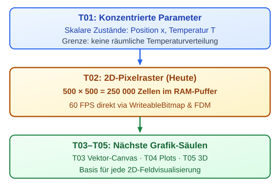

</div>
</div>

---


## 2.1: Speicherlayout digitaler Rasterbilder

Dieser Abschnitt umfasst die folgenden Inhalte:

- Brücke zu Termin 01 (1D-Kinematik) und Auftakt des Visualisierungs-Blocks
- Diskrete Rasterbilder und 2D-Feldsimulationen
- Farbmodelle, Bytereihenfolge und Farbtiefe (`Bgra32`)
- Zeilenweiser linearer Speicher (Row-Major) und `Stride`
- Mathematische Adressberechnung und Cache-Lokalität

---

### Was ist ein Rasterbild in der Simulation?

<div class="columns">
<div class="two">

Ein **Rasterbild** ist eine zweidimensionale Matrix aus diskreten Bildpunkten (**Pixeln**):

- Jedes Pixel besitzt ganzzahlige Koordinaten $(x, y)$ mit:
  $$0 \le x < \text{Breite}, \quad 0 \le y < \text{Höhe}$$
- In technischen Simulationen repräsentiert jedes Pixel den lokalen Zustand eines räumlichen Gitters:
  - **2D-Skalarfelder:** Temperatur $T(x,y)$, Druck $p(x,y)$, Konzentration $c(x,y)$
  - **Zelluläre Automaten:** Belegungszustände, Gittergase, Conway's Game of Life
  - **Finite Differenzen:** Diskretisierte partielle Differentialgleichungen (PDEs)

</div>
<div class="one">

| Eigenschaft | Wertbereich |
|---|---|
| Breite $W$ | Pixel (Spalten) |
| Höhe $H$ | Pixel (Zeilen) |
| Farbtiefe | 32 Bit (4 Bytes) |
| Format | `Bgra32` |
| Kanäle | Blue, Green, Red, Alpha |

</div>
</div>

---

### Farbmodelle und 32-Bit Farbtiefe (`Bgra32`)

<div class="columns">
<div class="three">

In modernen Grafiktreibern ist das **32-Bit BGRA-Format** der Standard für maximale Geschwindigkeit:

- **B (Blau), G (Grün), R (Rot):** Je 1 Byte ($0 \dots 255$) für die Farbintensität.
- **A (Alpha):** 1 Byte ($0 = \text{transparent}, 255 = \text{deckend}$).
- **Speicherorganisation im RAM (Little-Endian):**
  - Byte 0: Blau | Byte 1: Grün | Byte 2: Rot | Byte 3: Alpha
  - Als vorzeichenloser 32-Bit-Integer (`uint`):
    $$\text{Pixel}_{\text{uint}} = (\text{A} \ll 24) \mid (\text{R} \ll 16) \mid (\text{G} \ll 8) \mid \text{B}$$
  - Wert `0xFFFF0000` entspricht voll deckendem Reinrot.

</div>
<div class="one">

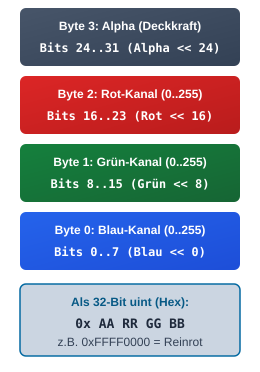

</div>
</div>

---

### Das Konzept des Strides

<div class="columns">
<div class="one">

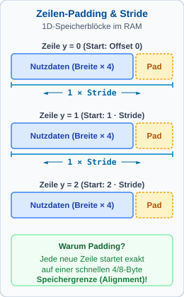

</div>
<div class="three">

Ein 2D-Rasterbild existiert im Arbeitsspeicher als **kontinuierlicher 1D-Byte-Block**:

- Die Pixelzeilen ($y = 0 \dots H - 1$) werden sequentiell hintereinander abgelegt (**Row-Major Order**).
- **`Stride` (Zeilenschrittweite):** Die tatsächliche Anzahl an Bytes von einer Zeile zur nächsten:
  $$\text{Stride} = \text{Breite} \times \text{BytesJePixel} + \text{Padding}$$
- Da Speichercontroller am schnellsten auf Adressen zugreifen, die Vielfache von 4 oder 8 Bytes sind, wird die Zeilenlänge ggf. mit Füll-Bytes (*Padding*) aufgerundet.
- Bei 32-Bit-Pixeln (`Bgra32`) ist $\text{Breite} \times 4$ stets ein Vielfaches von 4.

</div>
</div>

---


---

### Mathematische Adressberechnung

<div class="columns">
<div class="two">

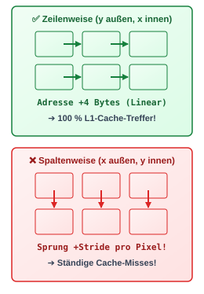

</div>
<div class="two">

Für ein Pixel an Koordinate $(x, y)$ errechnet sich die absolute Position im Puffer:

- **Relativer Byte-Offset:**
  $$\text{Offset}(x, y) = y \cdot \text{Stride} + x \cdot 4$$
- **Absolute Speicheradresse:**
  $$p(x, y) = p_{\text{BackBuffer}} + y \cdot \text{Stride} + x \cdot 4$$
- **Cache-Lokalität:**
  - **Zeilenweise (`y` außen):** Sequentiell ➔ L1/L2-Cache-Hits.
  - **Spaltenweise (`x` außen):** Stride-Sprünge ➔ Cache-Misses!

</div>
</div>

---


## 2.2: Pixel-Rendering in WPF mit WriteableBitmap

Dieser Abschnitt umfasst die folgenden Inhalte:

- Das Problem der WPF Visual-Tree-Skalierung
- Die Architektur der Klasse `WriteableBitmap`
- Deklaration und Einbindung im XAML-Layout
- Skalierungsmodi (`NearestNeighbor` vs. `Linear`)

---

### Grenzen des WPF Visual Tree

<div class="columns">
<div class="two">

Herkömmliche WPF-Visualisierungen basieren auf UI-Elementen (`Shape`, `Rectangle`, `Path` auf einem `Canvas`):

- Jedes einzelne Shape ist ein vollwertiges FrameworkElement:
  - Dependency Properties, Bindings, Style-Auflösung
  - Hit-Testing, Layout-Pass (`Measure`/`Arrange`)
  - Hoher Speicher-Overhead (mehrere hundert Bytes pro Objekt)
- **Skalierungsgrenze:**
  - Bei $\approx 5.000$ Shapes sinkt die Bildrate unter 30 FPS.
  - Bei $512 \times 512 = 262.144$ Partikeln bricht die WPF-UI zusammen.

</div>
<div class="one">

**Lösung:**

Ein einziges XAML-Element:
`<Image Source="{Binding ...}" />`

Kombiniert mit einer einzigen
**`WriteableBitmap`**, in die Millionen Bildpunkte direkt in den Back-Buffer gerendert werden!

</div>
</div>

---

### Architektur von `WriteableBitmap`

<div class="columns">
<div class="three">

`WriteableBitmap` (aus `System.Windows.Media.Imaging`) kapselt zwei Pufferbereiche:

1. **BackBuffer (im RAM):**
   - Ein nativer Speicherbereich, auf den unser Simulationscode direkt über einen Speicherzeiger (`IntPtr` / `byte*`) zugreifen kann.
2. **FrontBuffer (DirectX / GPU):**
   - Der Puffer, der von der MilCore-Render-Engine von WPF zur Darstellung über die Grafikkarte genutzt wird.
3. **Synchronisation:**
   - Der Transfer vom BackBuffer zum FrontBuffer erfolgt nur, wenn Änderungen explizit über `AddDirtyRect()` gemeldet werden.

</div>
<div class="one">

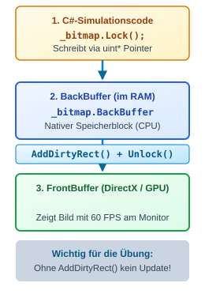

</div>
</div>

---

### Einbindung in XAML & Initialisierung im Code-Behind

Die `WriteableBitmap` wird **einmalig beim Start** angelegt und an ein einziges `<Image>`-Element gebunden; im Render-Loop wird nur noch ihr Speicherpuffer aktualisiert:

<div class="columns">
<div class="one">

**1. XAML (`NearestNeighbor`):**
```xml
<Image x:Name="SimulationImage"
       Stretch="Uniform"
       RenderOptions.BitmapScalingMode="NearestNeighbor" />
```
- `NearestNeighbor` verhindert weichgezeichnete Pixelgrenzen bei diskreten Gittern.
- `Stretch="Uniform"` skaliert das Gitter verzerrungsfrei in das Fenster.

</div>
<div class="one">

**2. C#-Setup (`InitBitmap`):**
```csharp
_bitmap = new WriteableBitmap(
    Width, Height, 96.0, 96.0,
    PixelFormats.Bgra32, null);
SimulationImage.Source = _bitmap;
```
- `96.0, 96.0` setzt die Standard-WPF-DPI; `null` bedeutet keine Farbpalette nötig (`Bgra32`).
- Einmalig beim Start allokieren – danach nur noch den `BackBuffer` überschreiben!

</div>
</div>

> **Praxis-Tipp:** Für das periodische Neuzeichnen koppeln wir den Simulations- und Render-Loop per `CompositionTarget.Rendering` oder `DispatcherTimer` an den UI-Thread.

---

<!-- _class: activity -->

### Mitmach-Impuls (3 Min.): Byte-Offset & Cache-Lokalität

Gegeben sei eine `WriteableBitmap` im Format `Bgra32` mit folgenden Speicher-Parametern:

| Breite $W$ | Höhe $H$ | Bytes pro Pixel | $\text{Stride}$ |
| :--- | :--- | :--- | :--- |
| $500\,\text{px}$ | $500\,\text{px}$ | $4\,\text{Bytes}$ (`B, G, R, A`) | $2000\,\text{Bytes}$ |

Bearbeite die folgenden drei Aufgaben kurz zu zweit:

1. **Adressrechnung:** An welchem relativen Byte-Offset liegt das Pixel $(x = 10, y = 2)$?
2. **Schleifenreihenfolge:** Warum ist `for (y) for (x)` auf diesem Puffer um Größenordnungen schneller als `for (x) for (y)`?
3. **Bitpacking:** Welcher `uint`-Hexwert (`0xAARRGGBB`) erzeugt voll deckendes Reinblau?

> **Hinweis:** Nutzen Sie $\text{Offset}(x, y) = y \cdot \text{Stride} + x \cdot 4$ und denken Sie an die Little-Endian-Byte-Reihenfolge `[B, G, R, A]` im Arbeitsspeicher.

---

<!-- _class: solution -->

### Auflösung: Byte-Offset, Cache & Reinblau

1. **Byte-Offset für $(10, 2)$:**
   $$\text{Offset}(10, 2) = 2 \cdot 2000 + 10 \cdot 4 = 4000 + 40 = \mathbf{4040\,\text{Bytes}}$$
2. **Schleifenreihenfolge (`for (y)` außen, `for (x)` innen):**
   - **Zeilenweise:** Greift sequentiell auf benachbarte Bytes zu (**L1-Cache-Hit**, eine 64-Byte-Cacheline lädt 16 Pixel auf einmal voraus).
   - **Spaltenweise:** Springt pro Schritt um $2000\,\text{Bytes}$ (**Cache-Miss** bei fast jedem Pixel).
3. **Reinblau (`Bgra32`):**
   - Im Speicher liegen die Bytes `[0xFF, 0x00, 0x00, 0xFF]` (`B=255, G=0, R=0, A=255`).
   - Als 32-Bit-Little-Endian-`uint` (`0xAARRGGBB`) entspricht dies **`0xFF0000FF`**:
     `row[x] = 0xFF0000FF;`

> **Merksatz:** Zeilenweise Iteration (`y` außen, `x` innen) und `uint*`-Zugriff sind der Schlüssel zu $\ge 60\,\text{FPS}$.

---


## 2.3: High-Performance Puffer-Zugriff

Dieser Abschnitt umfasst die folgenden Inhalte:

- Aktualisierungszyklus: `Lock()`, `AddDirtyRect()`, `Unlock()`
- Zeigerarithmetik mit C#-Pointern (`unsafe`)
- 8-Bit Byte-Zugriff vs. 32-Bit Integer-Zugriff (`uint*`)
- Ausblick: Multithreaded-Rendering mit `Parallel.For`

---

### Der Aktualisierungs-Lebenszyklus

```csharp
// 1. Zugriff sperren (blockiert Render-Thread)
_bitmap.Lock();
try
{
    // 2. Zeiger & Zeilenschrittweite abfragen
    IntPtr pBuffer = _bitmap.BackBuffer;
    int stride = _bitmap.BackBufferStride;
    // 3. Pixel direkt über native Zeiger manipulieren
    UpdatePixelData(pBuffer, stride, Width, Height);
    // 4. Modifizierten Bildbereich als dirty deklarieren
    _bitmap.AddDirtyRect(new Int32Rect(0, 0, Width, Height));
}
finally
{
    _bitmap.Unlock(); // 5. Freigabe an MilCore
}
```

> **Wichtig:** `try / finally` stellt sicher, dass `Unlock()` auch bei Fehlern immer ausgeführt wird.

---

### Direkter Zeigerzugriff: Byte- für Byte-Schreiben

<div class="columns">
<div class="three">

```csharp
private unsafe void UpdatePixelData(IntPtr pBuf, int stride, int w, int h)
{
    byte* ptr = (byte*)pBuf.ToPointer();
    for (int y = 0; y < h; y++)
    {
        byte* row = ptr + (y * stride);
        for (int x = 0; x < w; x++)
        {
            int offset = x * 4;
            row[offset + 0] = 255; // Blau  (0..255)
            row[offset + 1] = 128; // Grün  (0..255)
            row[offset + 2] = 0;   // Rot   (0..255)
            row[offset + 3] = 255; // Alpha (deckend)
        }
    }
}
```

</div>
<div class="one">


</div>
</div>

> **Parameter:** `pBuf` = BackBuffer-Adresse, `stride` = Zeilenbreite in Bytes, `w`/`h` = Bildgröße in Pixeln.

---

### Maximale Performance: 32-Bit Integer-Schreiben (`uint*`)

Statt 4 separaten Byte-Schreiboperationen kann ein Pixel als einzelnes 32-Bit-Wort geschrieben werden:

```csharp
private unsafe void UpdatePixelFast(
    IntPtr pBackBuffer, int stride, int w, int h)
{
    uint* ptr = (uint*)pBackBuffer.ToPointer();
    int strideWords = stride / 4; // Schrittweite in 32-Bit

    for (int y = 0; y < h; y++)
    {
        uint* row = ptr + (y * strideWords);
        for (int x = 0; x < w; x++)
        {
            // Format 0xAARRGGBB (Alpha=0xFF, Rot=0xFF, Grün=0x80, Blau=0x00)
            row[x] = 0xFFFF8000; 
        }
    }
}
```

- **Vorteil:** Verdoppelt bis vervierfacht die Speicherbandbreite durch 32-Bit-Wort-Befehle!

---

### Paralleles Rendern mit `Parallel.For` (Vorschau Kapitel 6)

<div class="columns">
<div class="two">

```csharp
private unsafe void RenderParallel(IntPtr pBackBuffer, int stride, int w, int h)
{
    uint* ptr = (uint*)pBackBuffer.ToPointer();
    int strideWords = stride / 4;

    Parallel.For(0, h, y =>
    {
        uint* row = ptr + (y * strideWords);
        for (int x = 0; x < w; x++)
        {
            row[x] = CalculateSimulationPixelColor(x, y);
        }
    });
}
```

</div>
<div class="one">

- **Vorschau Kapitel 6 (Multithreading):** Jede der `h` Bildzeilen besitzt ihren eigenen Bereich `row` ab `pBackBuffer + y * stride`; `x` läuft von `0` bis `w - 1`.
- **Kein Thread-Locking nötig:** Alle CPU-Kerne schreiben parallel in getrennte Zeilen (in T02 arbeiten wir noch rein sequentiell mit `for`).

</div>
</div>

> **Merksatz:** Zeilenweise Unabhängigkeit macht Pixel-Rendering *embarrassingly parallel* (ab Kapitel 6).

---

### Vergleich: Managed Array vs. `unsafe uint*`

| Methode | Speicher-Overhead | Typische Renderzeit ($1000 \times 1000$) | Bewertung |
| :--- | :--- | :--- | :--- |
| `WritePixels(byte[])` | Kopie + GC-Druck bei Neuallokation | ca. $4\text{--}8\,\text{ms}$ | Sicher, aber kopierintensiv |
| `unsafe byte*` (4 Writes) | $0\,\text{Bytes}$ (Zero-Allocation) | ca. $1{,}5\text{--}2{,}5\,\text{ms}$ | Schnell, 4 Schreibbefehle/Pixel |
| `unsafe uint*` (1 Write) | $0\,\text{Bytes}$ (Zero-Allocation) | ca. $0{,}4\text{--}0{,}8\,\text{ms}$ | **Optimal für 60+ FPS** |

- **Garbage Collector (GC):** Ohne Zwischenarray entstehen **0 Bytes Allokation pro Frame** – keine Mikroruckler durch GC-Pausen.

> **Faustregel:** In C# erfordert `unsafe` das Flag `<AllowUnsafeBlocks>true</AllowUnsafeBlocks>` in der `.csproj`-Datei – ab Termin 02 unser Standard für Pixel-Kernels.

---


## 2.4: Farbskalen & Look-Up-Tables (LUT)

Dieser Abschnitt umfasst die folgenden Inhalte:

- Transformation von kontinuierlichen Skalaren zu Farbwerten
- Gängige Farbskalen: Cool-Warm, Jet, Viridis
- Performance-Optimierung durch Look-Up-Tables (LUT)
- LUT-Implementierung in C#

---

### Abbildung von Skalaren auf Farben

<div class="columns">
<div class="three">

In der physikalischen Simulation repräsentiert ein Pixel eine Messgröße $v$ (z.B. Temperatur $T \in [T_{\min}, T_{\max}]$):

1. **Normierung auf das Einheitsintervall $[0, 1]$:**
   $$u = \text{clamp}\left(\frac{v - v_{\min}}{v_{\max} - v_{\min}}, \, 0.0, \, 1.0\right)$$
2. **Farbpalette:**
   - **Cool-to-Warm (Divergierend):** Blau ($u=0$) $\to$ Weiß ($u=0.5$) $\to$ Rot ($u=1$).
   - **Jet / Rainbow:** Weit verbreitet, jedoch problematisch bezüglich Farbwahrnehmung.
   - **Viridis:** Perzeptiv gleichförmig (*perceptually uniform*), monoton in Helligkeit und für Farbfehlsichtigkeiten geeignet.

</div>
<div class="one">

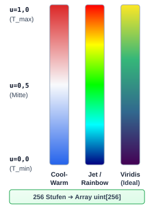

</div>
</div>

---

### Die Lösung für Echtzeit: Look-Up-Table (LUT)

<div class="columns">
<div class="two">

- **Das Problem:** Farbinterpolationen mit `if/else` oder `Math.Sin()` für jeden einzelnen Pixel pro Frame kosten enorm viel Rechenzeit.
- **Die Lösung:** Einmalige Vorberechnung der Farbpalette in ein Array `uint[256]`.
- **Im inneren Render-Loop ($O(1)$ aus dem L1-Cache):**
  $$\text{Index} = \lfloor u \cdot 255 \rfloor \quad \Longrightarrow \quad \text{PixelFarbe} = \text{LUT}[\text{Index}]$$

</div>
<div class="one">

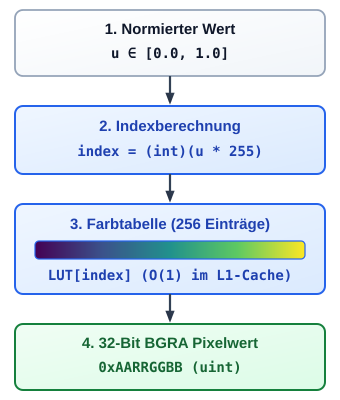

</div>
</div>

---

### C#-Implementierung einer Farbskalen-LUT (`ColorMaps`)

<div class="columns">
<div class="one">

**1. Tabellenaufbau (`uint[256]`):**
```csharp
public static readonly uint[] ViridisLut
    = GenerateViridis(256);

private static uint[] GenerateViridis(int steps)
{
    var lut = new uint[steps];
    for (int i = 0; i < steps; i++)
    {
        double t = (double)i / (steps - 1);
        lut[i] = SampleViridis(t);
    }
    return lut;
}
```

</div>
<div class="one">

**2. Farbkanäle packen (`Bgra32`):**
```csharp
private static uint SampleViridis(double t)
{
    byte r = (byte)(255 * Math.Clamp(1.89 * t - 0.70, 0, 1));
    byte g = (byte)(255 * Math.Clamp(1.39 * t - 0.10, 0, 1));
    byte b = (byte)(255 * Math.Clamp(
        0.55 + 0.8 * Math.Sin(Math.PI * t), 0, 1));
    return ((uint)255 << 24) | ((uint)r << 16)
         | ((uint)g << 8) | b;
}
```

</div>
</div>

> **Effekt:** Einmalige Vorberechnung beim Start $\implies$ konstanter $O(1)$-Tabellenzugriff im Render-Loop.

---

<!-- _class: activity -->

### Mitmach-Impuls (3 Min.): Normierung & LUT-Index berechnen

Ein Temperaturfeld nutzt unsere 256-stufige Look-Up-Table `lut[0..255]` mit linearer Normierung:

| Minimalwert $T_{\min}$ | Maximalwert $T_{\max}$ | Tabellen-Größe | Normierung $u$ & Index |
| :--- | :--- | :--- | :--- |
| $20\,^\circ\mathrm{C}$ | $100\,^\circ\mathrm{C}$ | $256$ (`0..255`) | $u = \frac{T - T_{\min}}{T_{\max} - T_{\min}}, \quad \text{Index} = \lfloor u \cdot 255 \rfloor$ |

Bearbeite die folgenden drei Aufgaben kurz zu zweit:

1. **Normierung:** Welcher normierte Wert $u \in [0, 1]$ und welcher Tabellen-Index ergeben sich für $T = 60\,^\circ\mathrm{C}$?
2. **Schutz vor Ausreißern:** Was passiert ohne `Math.Clamp`, wenn durch ein zu großes $\Delta t$ kurzzeitig $T = 120\,^\circ\mathrm{C}$ oder $T = -5\,^\circ\mathrm{C}$ auftritt?
3. **Farbwahl:** Warum eignet sich *Viridis* für wissenschaftliche Heatmaps besser als *Rainbow / Jet*?

> **Hinweis:** Diskutieren Sie kurz zu zweit – achten Sie besonders auf die `IndexOutOfRangeException` bei Über- oder Unterschreitungen im Render-Loop!

---

<!-- _class: solution -->

### Auflösung: Normierung, Clamping & Viridis

1. **Bei $T = 60\,^\circ\mathrm{C}$:**
   $$u = \frac{60 - 20}{100 - 20} = \mathbf{0{,}5} \quad \Longrightarrow \quad \text{Index} = \lfloor 0{,}5 \cdot 255 \rfloor = \mathbf{127}$$
2. **Ohne Clamping (Über- und Unterschreitungen):**
   - Bei $T = 120\,^\circ\mathrm{C}$ wird $u = 1{,}25$ ($\text{Index} = 318 > 255$), bei $T = -5\,^\circ\mathrm{C}$ wird $u = -0{,}3125$ ($\text{Index} = -79 < 0$) $\implies$ sofortige **`IndexOutOfRangeException`**!
   ```csharp
   int idx = Math.Clamp((int)(u * 255.0f), 0, 255);
   row[x] = _viridisLut[idx];
   ```
3. **Viridis vs. Jet:** Viridis steigt **monoton in der Helligkeit** (keine künstlichen Farbsprünge / *Mach Bands*) und bleibt auch in Graustufen sowie bei Rot-Grün-Schwäche eindeutig ablesbar.

> **Merksatz:** `Math.Clamp(idx, 0, 255)` im Render-Loop verhindert jeden Absturz bei Grenzwert-Überschreitungen.

---


## 2.5: Anwendungsbeispiel: 2D-Wärmeleitung

Dieser Abschnitt umfasst die folgenden Inhalte:

- Thermische Grundbegriffe ($T, E_{\text{th}}, \dot{Q}$) & Analogie
- Materialkennwerte ($\lambda$, $\rho \cdot c_p$) & Diffusivität $\alpha$
- Fouriersches Gesetz ($\partial T/\partial x$) & Krümmung ($\partial^2 T/\partial x^2$)
- 5-Punkt-Stern, Nachbar-Mittelwert & Kennzahl $s$
- Stabilitätsgrenze ($s \le 0{,}25$) & Randbedingungen

---

### Materialparameter & Temperaturleitfähigkeit $\alpha$

<div class="columns">
<div class="three">

Wie schnell wandert eine Wärmewelle in der Zeitspanne Δt? Entscheidend ist das Verhältnis aus **Transport** ($\lambda$) und **Speicherträgheit** ($\rho \cdot c_p$):

$$\alpha = \frac{\lambda}{\rho \cdot c_p} \quad \left[\frac{\mathrm{m^2}}{\mathrm{s}}\right]$$

- **Großes $\alpha$ (Kupfer $\approx 115$, Alu $\approx 97\,\mathrm{mm^2/s}$):** Wärmewelle breitet sich nach einem Zeitschritt Δt rasend schnell aus.
- **Kleines $\alpha$ (Wärmeleitpaste $\approx 2{,}5\,\mathrm{mm^2/s}$):** Wärme staut sich vor der Isolationsschicht.

> **Anhang:** Detaillierte Analogien ($T, E_{\text{th}}, \dot{Q}$) & Materialwerte siehe [Folien_Anhang_Waermeleitung_FDM.md](./Folien_Anhang_Waermeleitung_FDM.md).

</div>
<div class="one">

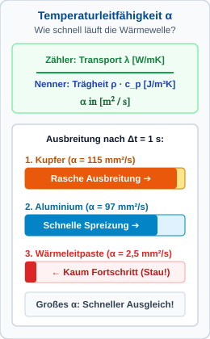

</div>
</div>

---

### 2D-Wärmeleitungsgleichung & 5-Punkt-Stern

<div class="columns">
<div class="three">

Aus dem Fourierschen Gesetz ($\dot{q} = -\lambda \nabla T$) und der Zellbilanz folgt die **2D-Wärmeleitungsgleichung** mit Heizrate $Q$:

$$\frac{\partial T}{\partial t} = \alpha \left( \frac{\partial^2 T}{\partial x^2} + \frac{\partial^2 T}{\partial y^2} \right) + Q \approx \alpha \cdot \frac{L_{i,j}^n}{\Delta x^2} + Q_{i,j}^n$$

- **5-Punkt-Stern $L_{i,j}^n$ (auf quadratischem Gitter $\Delta x = \Delta y$):**
  $$L_{i,j}^n = T_{i+1,j}^n + T_{i-1,j}^n + T_{i,j+1}^n + T_{i,j-1}^n - 4 \cdot T_{i,j}^n$$
- **Bedeutung:** Pixel erwärmt sich, wenn der Mittelwert der 4 Nachbarn wärmer ist als $T_{i,j}^n$!

</div>
<div class="two">


</div>
</div>

---

### Expliziter Euler, Diffusionszahl $s$ & Stabilität

<div class="columns">
<div class="three">

Mit dem expliziten Euler-Verfahren folgt die neue Temperatur $T_{\text{neu}} = T_{i,j}^{n+1}$ über die dimensionslose **Diffusionszahl $s = \frac{\alpha \cdot \Delta t}{\Delta x^2}$**:

$$T_{\text{neu}} = T_{i,j}^{n+1} = T_{i,j}^n + s \cdot L_{i,j}^n + \Delta t \cdot Q_{i,j}^n = (1 - 4s) T_{i,j}^n + 4s\,\bar{T}_{\text{Nachbarn}}^n$$

- **Von-Neumann-Stabilitätsgrenze:** Eigengewicht $(1 - 4s)$ darf niemals negativ werden:
  $$\boxed{s = \frac{\alpha \cdot \Delta t}{\Delta x^2} \le 0{,}25 \quad \Longleftrightarrow \quad \Delta t_{\max} = \frac{\Delta x^2}{4 \cdot \alpha_{\max}}}$$
- **Bei $s > 0{,}25$:** Vorzeichenwechsel & aufklingendes Schachbrett-Muster bis **`NaN`-Explosion**!

</div>
<div class="one">

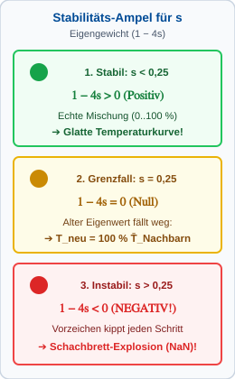

</div>
</div>

---

<!-- _class: activity -->

### Mitmach-Impuls (3 Min.): Zeitschritt $\Delta t_{\max}$ & Gitterverfeinerung

Gegeben sei ein inhomogenes 2D-Kupfergitter mit diesen Kennwerten ($s = \frac{\alpha \cdot \Delta t}{\Delta x^2} \le 0{,}25$):

| $\alpha_{\max}$ (Kupfer) | $\alpha_{\text{Paste}}$ | Basisauflösung $\Delta x$ | Stabilitätsgrenze $s_{\max}$ |
| :--- | :--- | :--- | :--- |
| $1{,}0 \times 10^{-4}\,\mathrm{m^2/s}$ | $2{,}5 \times 10^{-6}\,\mathrm{m^2/s}$ | $1\,\mathrm{mm} = 10^{-3}\,\mathrm{m}$ | $0{,}25$ |

Bearbeite die folgenden drei Fragen kurz mit deinem Nachbarn:

1. **Stabilitätsgrenze:** Berechnen Sie die maximal erlaubte Zeitschrittweite $\Delta t_{\max} = \frac{\Delta x^2}{4 \cdot \alpha_{\max}}$!
2. **Gitterverfeinerung:** Sie verdoppeln die Auflösung in $x$ und $y$ ($\Delta x_{\text{neu}} = 0{,}5\,\mathrm{mm}$). Um welchen Faktor sinkt $\Delta t_{\max}$?
3. **Inhomogenes Material:** Welches $\alpha$ bestimmt den globalen Zeitschritt $\Delta t_{\max}$ für das gesamte Gitter?

> **Hinweis:** Achten Sie auf das Quadrat $\Delta x^2$ im Zähler – und überlegen Sie, was mit dem gesamten Rechenaufwand passiert, wenn gleichzeitig 4-mal mehr Pixel berechnet werden müssen!

---

<!-- _class: solution -->

### Auflösung: $\Delta t_{\max}$, Verfeinerung & $\alpha_{\max}$

1. **Maximale Zeitschrittweite ($\Delta x = 10^{-3}\,\mathrm{m}$):**
   $$\Delta t_{\max} = \frac{(10^{-3}\,\mathrm{m})^2}{4 \cdot 1{,}0 \times 10^{-4}\,\mathrm{m^2/s}} = \mathbf{0{,}0025\,\mathrm{s} = 2{,}5\,\mathrm{ms}}$$
2. **Gitterverfeinerung & Gesamtaufwand ($\Delta x_{\text{neu}} = 0{,}5\,\mathrm{mm}$):**

| Gitter | Pixelzahl | $\Delta t_{\max}$ | Schritte pro Sekunde | Gesamtaufwand |
| :--- | :--- | :--- | :--- | :--- |
| $\Delta x = 1{,}0\,\mathrm{mm}$ | $1\times$ | $2{,}5\,\mathrm{ms}$ | $400$ | $1\times$ |
| $\Delta x = 0{,}5\,\mathrm{mm}$ | $4\times$ | **$0{,}625\,\mathrm{ms}$** ($1/4$) | $1600$ ($4\times$) | **$16\times$** |

3. **Inhomogenes Gitter:** Immer das **schnellste Material ($\alpha_{\max}$)** gibt den globalen Zeitschritt vor – sonst explodiert die Kupfer-Zone.

> **Merksatz:** Halbiert man $\Delta x$, viertelt sich $\Delta t_{\max}$!

---

### Randbedingungen & die „Kühlakku“-Stolperfalle

<div class="columns">
<div class="three">

- **1. Dirichlet (Feste Wand):** $T_{\text{Rand}} = \text{const.}$ (äußere Pixel in Schleife auslassen).
- **2. Neumann (Isolator, $\dot{q}=0$):** Rand kopiert Nachbar (`tNeighbor = tCenter`).
- **3. Robin (Konvektion):** Gewichtetes Mittel aus Metall ($\lambda$) & Luft ($h \cdot \Delta x$, Details im Anhang).
- **Innere Isolator-Wände (`_alphaMap == 0f`):** Ohne Spiegelung fließt eine falsche Temperaturdifferenz ΔT in die kalte Wandzelle (**Kühlakku-Falle**)!
  ```csharp
  float tRight = _alphaMap[x + 1, y] == 0f ? tCenter : _tCurrent[x + 1, y];
  float tLeft  = _alphaMap[x - 1, y] == 0f ? tCenter : _tCurrent[x - 1, y];
  ```

</div>
<div class="one">

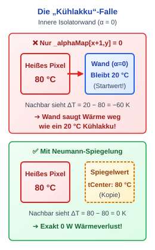

</div>
</div>

---

### Simulation (`Ping-Pong`) und `WriteableBitmap`-Rendering

<div class="columns">
<div class="two">

```csharp
// 1. FDM-Schritt (Ping-Pong Double-Buffering)
for (int y = 1; y < Height - 1; y++)
  for (int x = 1; x < Width - 1; x++)
  {
    float laplace = _tCurrent[x+1,y] + _tCurrent[x-1,y]
                  + _tCurrent[x,y+1] + _tCurrent[x,y-1]
                  - 4.0f * _tCurrent[x, y];
    _tNext[x, y] = _tCurrent[x, y] + s * laplace;
  }
(_tCurrent, _tNext) = (_tNext, _tCurrent);
// 2. RenderKernel (Lock -> uint* -> AddDirtyRect -> Unlock)
float u = (_tCurrent[x, y] - minTemp) / range;
int idx = Math.Clamp((int)(u * 255.0f), 0, 255);
row[x] = lut[idx];
```

- **Ping-Pong:** Lesen aus `_tCurrent`, Schreiben in `_tNext`, danach Referenzen tauschen!

</div>
<div class="one">

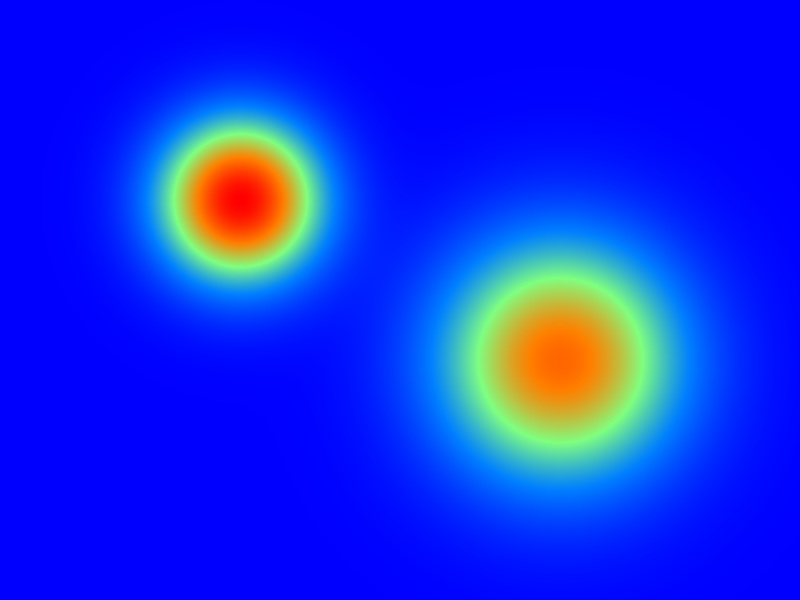

*Simuliertes Temperaturfeld auf `WriteableBitmap` (`Lock` $\to$ `AddDirtyRect` $\to$ `Unlock`).*

</div>
</div>

---

<!-- _class: summary -->

### Zusammenfassung Kapitel 2

- **Speicherlayout:** Rasterbilder liegen als 1D-Arrays im RAM ($\text{Offset} = y \cdot \text{Stride} + x \cdot 4$); zeilenweises Iterieren maximiert die CPU-Cache-Trefferquote.
- **WriteableBitmap:** Umgeht den WPF Visual Tree und rendert Hunderttausende Pixel flüssig bei $\ge 60\,\text{FPS}$ über ein einziges `Image`-Control.
- **High-Performance & LUT:** Mit `unsafe uint*` Zeigerarithmetik und vorberechneten Look-Up-Tables (`uint[256]`) erfolgt die Farbkodierung in $O(1)$-Zeit ohne Garbage Collection.
- **2D-Wärmeleitung (FDM):** Der 5-Punkt-Stern vergleicht jedes Pixel mit dem Mittelwert seiner 4 Nachbarn; für Stabilität im expliziten Ping-Pong-Verfahren muss $s = \frac{\alpha \Delta t}{\Delta x^2} \le 0{,}25$ gelten.
- **Randbedingungen:** Dirichlet (fester Randwert), Neumann (Spiegelung am Isolator, $\dot{q}=0$) und Robin (gewichtetes Mittel bei Luftkonvektion) bilden reale Bauteilgrenzen exakt ab.

> **Anhang:** Alle ausführlichen physikalischen Herleitungen & Robin-Formeln stehen im [Anhang Wärmeleitung & FDM](./Folien_Anhang_Waermeleitung_FDM.md).

---

<!-- _class: outlook -->

### Ausblick: Von Pixelrastern zu skalierbaren Vektoren (T03)

<div class="columns">
<div class="three">

In **Termin 02** haben wir kontinuierliche 2D-Felder auf einem festen Pixelgitter mit `WriteableBitmap` gelöst:

- **Grenze von Pixelrastern:** Bei mechanischen Gelenkarmen, Fahrzeugen oder Partikeln verpixelt das Gitter beim Hineinzoomen und erfordert unnötig viel Speicher.
- **Nächster Termin (T03):** Wir wechseln zur **2. Grafik-Säule** – **2D-Vektorgrafik** (`WPF Canvas`, `DrawingVisual` & Welt-zu-Bildschirm-Kameramatrizen).
- **Lernfortschritt:** Zu Beginn von Termin 03 findet das **Moodle-Quiz 1** (Stoff: Termin 01 & Termin 02) statt.

> **Vorausblick:** Wie bildet man eine Weltkoordinate $(x_{\text{Welt}}, y_{\text{Welt}})$ in Metern auf Bildschirm-Pixel ab? Das lösen wir in T03 mit affinen Transformationsmatrizen!

</div>
<div class="two">


</div>
</div>

---

<!-- _class: homework -->

### Hausübung Termin 02: Pixelgrafik & FDM

**Stufe 1 (Basisaufgabe `1.1`–`1.4` für alle Teams auf `PixelHeatFDM.sln`):** Von-Neumann-Stabilitätstest ($s \le 0{,}25$), 256-Farben-LUT (`uint[]`), interaktives Maus-Zeichnen mit lokaler Neumann-Spiegelung & Unit-Tests ([Aufgabenblatt 02](../Uebung/Aufgabenblatt.md)) $\to$ **Stufe 2 (Vertiefung – Wahl: Track A ODER Track B, 10 Pkt.):**

<div class="columns">
<div class="two">

#### Stufe 2 – Track A: CPU-Kühlkörper-Optimizer
- Inhomogenes Gitter ($\alpha_{\text{Si}}, \alpha_{\text{TIM}}, \alpha_{\text{Cu}}, \alpha_{\text{Al}}$)
- 10 Kühlrippen mit Robin-Konvektionsrand
- Lüfterbetrieb vs. Ausfall ($h = 250 \to 20\,\text{W/m}^2\text{K}$)
- Stabilitätsgrenze $\Delta t \le \frac{\Delta x^2}{4 \alpha_{\max}}$ nachweisen

</div>
<div class="two">

#### Stufe 2 – Track B: Falling Sand & Lava-Simulator
- Doppellagiges Gitter ($200 \times 200$): FDM + Automat
- Gravitation für Sand- und Lava-Pixel
- Doom-Fire Konvektion & Asche-Zerfall
- Flüssiges Rendering ($\ge 45\,\text{FPS}$) via `BackBuffer`

</div>
</div>

> **Abgabe & Showcase:** Commit im Git-Repo vor Beginn von Termin 03 – zwei Teams präsentieren ihren Track im Live-Showcase + Parameter-Stresstest!

