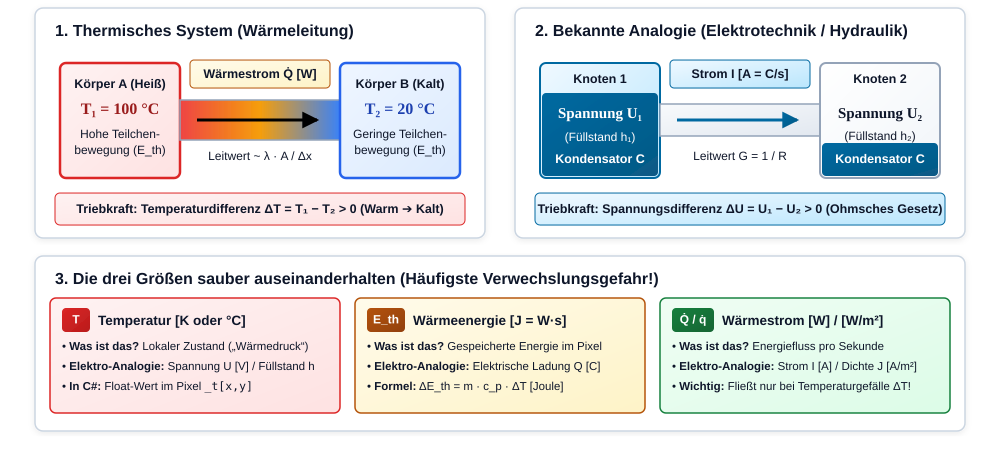
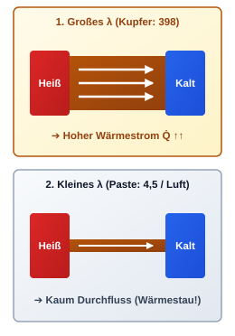
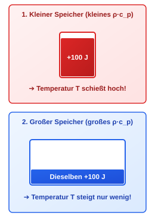
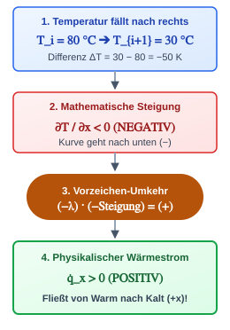
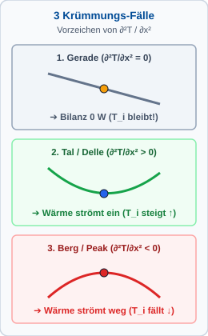
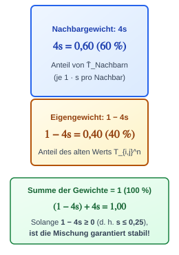
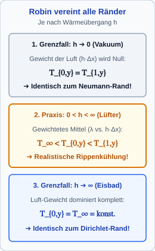
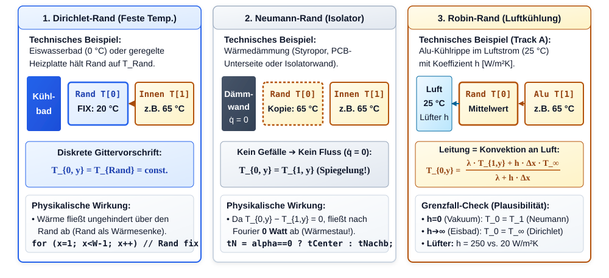

<!-- _class: title -->
<!-- _paginate: false -->
<!-- _header: "" -->
<!-- _footer: "" -->

# Kapitel 2 (Anhang A): Herleitungen zur 2D-Wärmeleitung

Vertiefende physikalische Herleitungen, Dimensionskontrollen und Randbedingungs-Algebra zum Selbststudium:

- Thermische Grundgrößen ($T, E_{\text{th}}, \dot{Q}$) & Materialkennwerte ($\lambda, \rho c_p, \alpha$)
- Fouriersches Gesetz, Zellbilanz & 2. räumliche Ableitung
- Diffusionszahl $s$ als gewichtete Mischung & Konvektion (Robin-Randbedingung)

---

### Thermodynamik ohne Vorwissen: Die 3 Grundgrößen

Wärmeleitung funktioniert nach **demselben Prinzip** wie ein elektrisches RC-Netzwerk oder verbundene Wassertanks, wenn man drei Größen sauber trennt:

| Größe | Symbol & Einheit | Anschauliche Bedeutung | Elektro- / Hydraulik-Analogie |
| :--- | :---: | :--- | :--- |
| **Temperatur** | $T$ $[\mathrm{K} \text{ / } {}^\circ\mathrm{C}]$ | Lokaler „Wärmedruck“ ($T_1, T_2$, Gefälle $ΔT = T_1 - T_2$) | **Spannung $U$** ($U_1, U_2, ΔU$) / Füllstand $h_1, h_2$ |
| **Wärmeenergie** | $E_{\text{th}}$ $[\mathrm{J} = \mathrm{W\cdot s}]$ | Gespeicherte Energie ($ΔE_{\text{th}} = m \cdot c_p \cdot ΔT$) | **Ladung $Q$ $[\mathrm{C}]$** / Wassermenge |
| **Wärmestrom** | $\dot{Q}$ $[\mathrm{W}]$ / $\dot{q}$ $[\mathrm{W/m^2}]$ | Energiefluss über Abstand $Δx$ ($\dot{Q} \propto \lambda \cdot A / Δx$) | **Stromstärke $I$ $[\mathrm{A}]$** / Stromdichte $J$ |

---

---

### Materialparameter 1: Wärmeleitfähigkeit $\lambda$ (Der Transport)

Warum fühlt sich Kupfer sofort heiß an, während sich Paste langsam erwärmt? Der erste Faktor ist das **Transportvermögen**:

- **Wärmeleitfähigkeit $\lambda$ $\left[\frac{\mathrm{W}}{\mathrm{m \cdot K}}\right]$:**
  - Beschreibt, wie gut ein Material Wärmeströme weiterleitet (*„Breite der Wärme-Autobahn“* zwischen zwei Pixeln, analog zum Leitwert $G = 1/R$).
  - Gibt an, wie viel Watt durch einen $1\,\mathrm{m}$-Würfel bei $1\,\mathrm{K}$ Gefälle fließt.
- **Typische Größenordnungen $\left[\mathrm{W/(m\cdot K)}\right]$:**
  - **Gute Leiter:** Kupfer $\lambda \approx 398$, Alu $\lambda \approx 237$, Silizium $\lambda \approx 148$
  - **Isolatoren:** Wärmeleitpaste $\lambda \approx 4{,}5$, Glas $\lambda \approx 1{,}0$, Luft $\lambda \approx 0{,}026$

---

### Materialparameter 2: Wärmekapazität $\rho \cdot c_p$ (Der Speicher)

Der zweite Faktor ist die **thermische Trägheit** des Materials (*„Wie groß ist der Wärmetank eines Pixels?“*):

- **Spezifische Wärmekapazität $c_p$ $\left[\frac{\mathrm{J}}{\mathrm{kg \cdot K}}\right]$:**
  - Gibt an, wie viele Joule Energie man benötigt, um **$1\,\mathrm{kg}$** des Stoffes um $+1\,\mathrm{K}$ zu erwärmen.
- **Volumetrische Wärmekapazität $\rho \cdot c_p$ $\left[\frac{\mathrm{J}}{\mathrm{m^3 \cdot K}}\right]$:**
  - Da unsere Gitterpixel feste **Volumina** abbilden, multiplizieren wir $c_p$ mit der **Materialdichte $\rho$** $[\mathrm{kg/m^3}]$.
  - Großes $\rho \cdot c_p$ bedeutet: Das Pixel schluckt viel Energie, bevor $T$ merklich ansteigt (analog zum Kondensator $C$).

---

### Schritt 1 zur DGL: Fouriersches Gesetz & Minuszeichen

$$\dot{q}_x = -\lambda \cdot \frac{\partial T}{\partial x} \approx -\lambda \cdot \frac{T_{i+1} - T_i}{\Delta x} \quad \left[\frac{\mathrm{W}}{\mathrm{m^2}}\right]$$

- **Gedankenexperiment:** Links in Zelle $i$ sei es heiß ($T_i = 80\,^\circ\mathrm{C}$), rechts kalt ($T_{i+1} = 30\,^\circ\mathrm{C}$).
- Auf der $x$-Achse nach rechts **fällt** die Temperatur ($ΔT = -50\,\mathrm{K} < 0$), die Steigung $\frac{\partial T}{\partial x}$ ist also **negativ**.
- Physikalisch fließt die Wärme von **Warm nach Kalt** ($\dot{q}_x > 0$): Das Minuszeichen kehrt das Vorzeichen um.

---

### Schritt 2 zur DGL: Zellbilanz & 2. Ableitung (Krümmung)

$$\frac{\partial T_i}{\partial t} = \underbrace{\frac{\lambda}{\rho \cdot c_p}}_{\alpha} \cdot \frac{(T_{i-1} - T_i) + (T_{i+1} - T_i)}{\Delta x^2} = \alpha \cdot \frac{T_{i+1} - 2 T_i + T_{i-1}}{\Delta x^2} \approx \alpha \cdot \frac{\partial^2 T}{\partial x^2}$$

1. **Lineares Gefälle ($\frac{\partial^2 T}{\partial x^2} = 0$):** Zufluss und Abfluss heben sich auf $\implies T_i$ bleibt konstant.
2. **Thermisches Tal ($\frac{\partial^2 T}{\partial x^2} > 0$):** Zelle $i$ ist kälter als Nachbarn $\implies T_i$ erwärmt sich.
3. **Thermischer Berg ($\frac{\partial^2 T}{\partial x^2} < 0$):** Zelle $i$ ist heißer als Nachbarn $\implies T_i$ kühlt ab.

---

### Überblick aller Größen & SI-Einheiten der Wärmeleitungs-DGL

| Symbol | Physikalische Größe | Einheit |
| :--- | :--- | :---: |
| $T(x,y,t)$ | Lokale Pixeltemperatur | $\mathrm{K}$ / ${}^\circ\mathrm{C}$ |
| $\alpha$ (bzw. $a$) | Temperaturleitfähigkeit $\frac{\lambda}{\rho c_p}$ | $\mathrm{m^2/s}$ |
| $\lambda$ | Wärmeleitfähigkeit (Fourier) | $\mathrm{W/(m\cdot K)}$ |
| $\rho$ | Materialdichte | $\mathrm{kg/m^3}$ |

| Symbol | Physikalische Größe | Einheit |
| :--- | :--- | :---: |
| $c_p$ | Spezifische Wärmekapazität | $\mathrm{J/(kg\cdot K)}$ |
| $\rho \cdot c_p$ | Volumetrische Wärmekapazität | $\mathrm{J/(m^3\cdot K)}$ |
| $\dot{q}_V$ | Volumetrische Heizleistung ($P / V$) | $\mathrm{W/m^3}$ |
| $Q$ | Temperatur-Quellrate $\frac{\dot{q}_V}{\rho c_p}$ | $\mathrm{K/s}$ |

---

### Der Zeitschritt als gewichtete Mischung

Setzen wir $L_{i,j}^n = 4 \cdot (\bar{T}_{\text{Nachbarn}}^n - T_{i,j}^n)$ in $T_{i,j}^{n+1} = T_{i,j}^n + s \cdot L_{i,j}^n$ ein:

$$\boxed{T_{i,j}^{n+1} = \underbrace{(1 - 4s)}_{\text{Eigengewicht}} \cdot T_{i,j}^n + \underbrace{4s}_{\text{Nachbargewicht}} \cdot \bar{T}_{\text{Nachbarn}}^n}$$

- Die Summe beider Gewichte ist immer $(1 - 4s) + 4s = 1 = 100\,\%$.
- Für $s \le 0{,}25$ bleiben beide Gewichte nichtnegativ (*Maximumprinzip*: keine künstlichen Überschwinger).

---

### Konvektive Randbedingung (Robin): Bilanz & Gitterformel

An der Kühlkörper-Oberfläche (Knoten $0$, Lufttemperatur $T_\infty$, Wärmeübergang $h$) gilt $\dot{q}_{\text{Leitung}} = \dot{q}_{\text{Konvektion}}$:

$$\lambda \cdot \frac{T_{1,y} - T_{0,y}}{\Delta x} = h \cdot \left(T_{0,y} - T_\infty\right) \implies \boxed{T_{0,y} = \frac{\lambda \cdot T_{1,y} + (h \cdot \Delta x) \cdot T_\infty}{\lambda + h \cdot \Delta x}}$$

- **Perfekte Isolierung ($h \to 0$):** $T_{0,y} = T_{1,y}$ (**Neumann-Fall**).
- **Unendlich starke Kühlung ($h \to \infty$):** $T_{0,y} = T_\infty$ (**Dirichlet-Fall**).

---

### Übersicht: Thermische Randbedingungen am 2D-Gitter

Bei Gitterweite $\Delta x$ bestimmen die drei Randtypen den Geister-Nachbarn `tN` (Neumann-Isolator: `tN = tCenter`, kein Wärmestrom), feste Wandwerte (Dirichlet) bzw. konvektiven Übergang (Robin):

