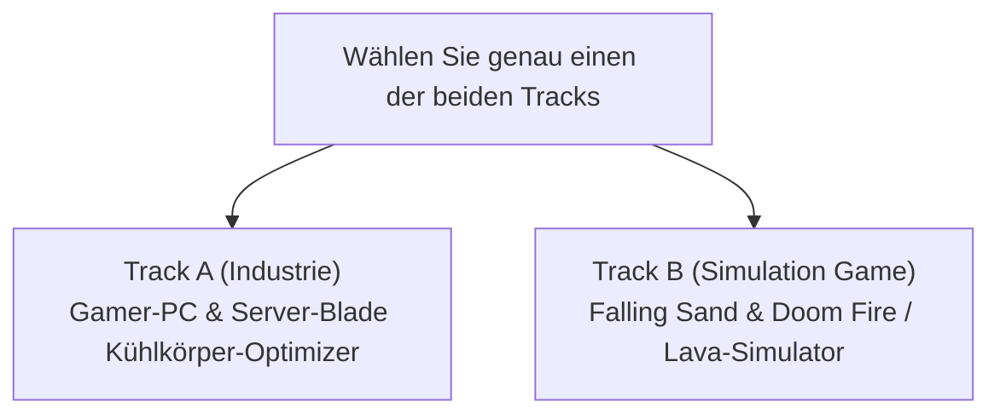

# Aufgabenblatt 02: Pixelgrafik, WriteableBitmap & Finite Differenzen (FDM)

**Lehrveranstaltung:** Systemsimulation / Digitaler Zwilling  
**Studiengang:** B.Sc. Automatisierungstechnik, 5. Semester  
**Institution:** Fachhochschule Oberösterreich – Campus Wels  
**Bearbeitungsform:** Zweistufige Hausübung im 2er-Team (1 Woche)

| Stufe | Richtwert | Thema / Inhalt |
| :--- | :--- | :--- |
| **Stufe 1 (Basisaufgabe)** | ca. 60 Min. | Von-Neumann-Stresstest, `uint[256]`-LUT & `AlphaMap` auf `PixelHeatFDM.sln` (`1.1`–`1.4`) |
| **Stufe 2 – Track A (Industrie)** | ca. 3–4 h *(Wahl)* | Gamer-PC & Server-Blade Kühlkörper-Optimizer |
| **Stufe 2 – Track B (Simulation Game)** | ca. 3–4 h *(Wahl)* | Falling Sand & Doom Fire / Lava-Simulator |

> [!IMPORTANT]
> **Technische Rahmenbedingungen**
> - **Plattform & Projekt:** C# 12 / .NET 8 oder .NET 10, bereitgestellte WPF-Projektmappe (ohne zusätzliche NuGet-Pakete)
> - **Zugelassene APIs:** `System.Windows.Media.Imaging.WriteableBitmap` (`byte[]`/`uint[]`-BackBuffer), `Image`-Control
> - **Abgrenzung:** Single-threaded im Timer-Takt; keine Vektor-Shapes (`Canvas`/`Line`/`Path`) und keine Parallelisierung


## 1. Lernziele (Intended Learning Outcomes - ILOs)

Nach erfolgreicher Bearbeitung dieses Aufgabenblattes können Sie:
1. **FDM-Raum- und Zeitdiskretisierung:** Die kontinuierliche zweidimensionale Wärmeleitungs-DGL (parabolische partielle DGL) mittels 5-Punkt-Differenzenstern im Ortsraum und explizitem Euler im Zeitbereich diskretisieren.
2. **Von-Neumann-Stabilitätskriterium:** Die physikalische und numerische Stabilitätsgrenze $s = \frac{a \cdot \Delta t}{\Delta x^2} \le 0{,}25$ rechnerisch dimensionieren und das Phänomen der numerischen Gitterexplosion im Experiment nachweisen.
3. **High-Performance Bitmap-Rendering:** Große zweidimensionale Datengitter ohne GC-Overhead über `WriteableBitmap.Lock()`, unmanaged Speicherzeiger oder `Marshal.Copy` mit 30–60 FPS flüssig auf den Bildschirm bringen.
4. **Physikalische Randbedingungen:** Dirichlet- (feste Temperatur), Neumann- (adiabater Rand / Wärmestrom) und Robin-Randbedingungen (konvektiver Wärmeübergang an Luft) auf einem diskreten Gitter korrekt abbilden.
5. **Materialübergänge modellieren:** Lokale Inhomogenitäten von Wärmeleitfähigkeit und Wärmekapazität über gemittelte Gitterkoeffizienten sauber formulieren.


## 2. Mathematische Grundlagen

### 2.1 Die 2D-Wärmeleitungsgleichung
Die instationäre Temperaturverteilung $T(x,y,t)$ in einem zweidimensionalen Kontinuum mit Wärmeleitfähigkeit $\lambda$, Dichte $\rho$, spezifischer Wärmekapazität $c_{\text{p}}$ und innerer Wärmequelle $\dot{q}_{\text{v}}$ gehorcht der partiellen Differentialgleichung:
$$\rho c_{\text{p}} \frac{\partial T}{\partial t} = \nabla \cdot (\lambda \nabla T) + \dot{q}_{\text{v}}$$
Für homogene, isotrope Materialien vereinfacht sich dies mit der Temperaturleitfähigkeit $a = \frac{\lambda}{\rho c_{\text{p}}} \left[\frac{\text{m}^2}{\text{s}}\right]$ zu:
$$\frac{\partial T}{\partial t} = a \left( \frac{\partial^2 T}{\partial x^2} + \frac{\partial^2 T}{\partial y^2} \right) + \frac{\dot{q}_{\text{v}}}{\rho c_{\text{p}}}$$

### 2.2 FDM-Diskretisierung (5-Punkt-Stern)
Auf einem äquidistanten Gitter mit Gitterweite $\Delta x = \Delta y$ wird der Laplace-Operator $\Delta T = \frac{\partial^2 T}{\partial x^2} + \frac{\partial^2 T}{\partial y^2}$ durch zentrale Differenzen 2. Ordnung angenähert:
$$\Delta T_{i,j} \approx \frac{T_{i+1,j} + T_{i-1,j} + T_{i,j+1} + T_{i,j-1} - 4 T_{i,j}}{\Delta x^2}$$
Mit dem expliziten Zeitschrittverfahren ergibt sich für jeden inneren Gitterpunkt:
$$T_{i,j}^{k+1} = T_{i,j}^k + \Delta t \left[ a_{i,j} \frac{T_{i+1,j}^k + T_{i-1,j}^k + T_{i,j+1}^k + T_{i,j-1}^k - 4 T_{i,j}^k}{\Delta x^2} + \frac{\dot{q}_{i,j}^k}{\rho c_{\text{p}}} \right]$$

### 2.3 Stabilitätsgrenze (CFL- / Von-Neumann-Bedingung)
Definieren wir die dimensionslose Diffusionszahl $s$:
$$s = \frac{a \cdot \Delta t}{\Delta x^2}$$
Das explizite Verfahren ist im 2D-Fall **nur dann numerisch stabil**, wenn gilt:
$$s \le \frac{1}{4} = 0{,}25 \quad \implies \quad \Delta t \le \frac{\Delta x^2}{4 \, a_{\max}}$$
Wird diese Zeitschrittgrenze auch nur minimal überschritten, kommt es zu einem lawinenartigen oszillierenden Anwachsen der Knotentemperaturen gegen $\pm \infty$ (Gitterexplosion).

### 2.4 Randbedingungen auf dem Gitter
1. **Dirichlet-Rand:** Temperatur ist exakt vorgeschrieben: $T_{0,j} = T_{\text{Rand}}$.
2. **Neumann-Rand (adiabat / isoliert, $\frac{\partial T}{\partial n} = 0$):** Der Rand spiegelt den benachbarten Innenknoten: $T_{0,j} = T_{1,j}$.
3. **Robin-Rand (konvektiver Wärmeübergang an Kühlfluid mit Wärmeübergangskoeffizient $h$ und Umgebungstemperatur $T_\infty$):**
   $$-\lambda \frac{\partial T}{\partial n} = h (T_{\text{Oberfläche}} - T_\infty) \implies T_{0,j} = \frac{\lambda \cdot T_{1,j} + h \Delta x \cdot T_\infty}{\lambda + h \Delta x}$$


## 3. Stufe 1: Basisaufgabe (Gemeinsames Fundament auf der C#-Vorlage, Richtwert ca. 60 Min.)

**Basis-Projekt:** Öffnen Sie die bereitgestellte Projektvorlage `Vorlage/PixelHeatFDM.sln` (`HeatGrid.cs`, `BitmapHeatRenderer.cs`, `MainWindow.xaml.cs`).  
Die Vorlage enthält bereits ein lauffähiges $128 \times 128$ Basis-Gitter (`float[,] _tCurrent`, `_tNext`) im Format `PixelFormats.Bgra32` auf dem Image-Control `HeatImage`.  
**Ziel der Basisaufgabe (Stufe 1):** Analysieren Sie das Stabilitätsverhalten und erweitern Sie die Basis-Vorlage um eine vorberechnete **256-Stufen-Look-Up-Table (LUT)** sowie **interaktives Maus-Zeichnen von Wärmequellen und Isolator-Wänden** (als direktes Fundament für Stufe 2 Track A und Track B!).

### Aufgabenstellung (auf Basis von `Vorlage/PixelHeatFDM.sln`):
**Vorbereitung – Starter-Kit untersuchen (`Vorlage/PixelHeatFDM.sln`):**
- Öffnen Sie die Solution `Vorlage/PixelHeatFDM.sln` und verschaffen Sie sich einen Überblick über das Wärmegitter (`HeatGrid.cs`), den `WriteableBitmap`-Renderer (`BitmapHeatRenderer.cs`) und die UI-Schleife (`MainWindow.xaml.cs`).

1. **Aufgabe 1.1 – Code-Walkthrough & Experimenteller Von-Neumann-Stresstest ($s > 0{,}25$):**
   - Starten Sie `PixelHeatFDM` und führen Sie die bestehenden Unit-Tests (`dotnet test`) aus.
   - Prüfen Sie die Parameter in `HeatGrid.cs`: $\alpha = 1{,}0 \times 10^{-4}\,\text{m}^2/\text{s}$, $\Delta x = 1\,\text{mm} = 0{,}001\,\text{m} \implies \Delta t_{\text{krit}} = \frac{\Delta x^2}{4\alpha} = 0{,}00250\,\text{s}$ (bei $\Delta t = 0{,}0020\,\text{s}$ gilt $s = 0{,}2000 \le 0{,}25$).
   - *Selbsttest-Referenzwert (5-Sekunden-Selbstkontrolle):* Setzt man auf einem $0\,^\circ\text{C}$-Gitter einen einzelnen Hotspot $T_{8,8}^0 = 100\,^\circ\text{C}$, liefert exakt **ein** Zeitschritt (`Step()`) bei $s = 0{,}20$ im Zentrum $T_{8,8}^1 = 100 + 0{,}20 \cdot (0 + 0 + 0 + 0 - 400) = 20{,}0\,^\circ\text{C}$ sowie auf jedem der 4 direkten Nachbarn exakt $20{,}0\,^\circ\text{C}$ (Energiesumme bleibt exakt $5 \times 20{,}0 = 100{,}0\,^\circ\text{C}$). Bei instabilem $\Delta t = 0{,}0035\,\text{s}$ ($s = 0{,}35 > 0{,}25$) kippt das Zentrum schon nach dem 1. Schritt auf $T_{8,8}^1 = 100 + 0{,}35 \cdot (-400) = -40{,}0\,^\circ\text{C}$!
   - Erhöhen Sie $\Delta t$ über den Slider schrittweise von $0{,}0020\,\text{s}$ ($s = 0{,}20$) auf $> 0{,}0026\,\text{s}$ ($s > 0{,}26$). Beobachten und erklären Sie das entstehende Schachbrett-Oszillationsmuster bis zum Magenta-Überlauf (`float.IsNaN` / `float.IsInfinity`).
   - Schalten Sie zwischen **Dirichlet-Rand** (feste $20\,^\circ\text{C}$) und **Neumann-Rand** (adiabat isoliert) um und beobachten Sie den Wärmestau am Rand.
2. **Aufgabe 1.2 – Performance-Upgrade: $O(1)$ Look-Up-Table (`uint[256]`) in `BitmapHeatRenderer.cs`:**
   - Aktuell berechnet `BitmapHeatRenderer.MapTemperatureToColor(...)` für jedes der $16\,384$ Pixel pro Frame mehrfach `if/else`-Verzweigungen und Gleitkomma-Divisionen.
   - Legen Sie in `BitmapHeatRenderer` ein Array `private readonly uint[] _colorLut = new uint[256];` an und befüllen Sie dieses **einmalig im Konstruktor** für die 256 normierten Temperaturstufen ($0 \dots 255$, z. B. via `MapTemperatureToColor(i / 255.0f, 0.0f, 1.0f)`).
   - Ersetzen Sie den Aufruf in der `Render`-Schleife durch einen direkten $O(1)$-Tabellenzugriff:
     ```csharp
     int lutIndex = (int)Math.Clamp((t - minTemp) / range * 255.0f, 0.0f, 255.0f);
     _pixelBuffer[index++] = float.IsNaN(t) || float.IsInfinity(t) ? 0xFFFF00FFu : _colorLut[lutIndex];
     ```
   - *Selbsttest-Referenzwerte (`minTemp = 20`, `maxTemp = 100`, `range = 80`):* `_colorLut[0] == 0xFF0000FFu` (Reinblau bei $20\,^\circ\text{C}$), `MapTemperatureToColor(60f, 20f, 80f) == 0xFF00FF00u` (Reingrün bei $60\,^\circ\text{C}$), `_colorLut[255] == 0xFFFF0000u` (Reinrot bei $100\,^\circ\text{C}$) sowie `0xFFFF00FFu` (Magenta) bei `float.NaN`.
3. **Aufgabe 1.3 – Ortsabhängiges Materialgitter (`AlphaMap`) & Interaktives Maus-Zeichnen:**
   - Erweitern Sie `HeatGrid` um ein 2D-Array `private readonly float[,] _alphaMap;` (inkl. Zugriffsmethoden `GetAlpha(int x, int y)` und `SetAlpha(int x, int y, float value)` sowie Zurücksetzen auf `Alpha` in `Reset()`), sodass in `Step()` lokal mit $s_{x,y} = \frac{\alpha_{x,y} \cdot \Delta t}{\Delta x^2}$ gerechnet wird (für Isolatorzellen mit $\alpha_{x,y} = 0$ bleibt `_tNext[x, y] = _tCurrent[x, y]`). Aktualisieren Sie außerdem beim Ändern der Property `Alpha` (`set`-Accessor) alle Nicht-Wand-Zellen (`_alphaMap[x, y] > 0f`) auf den neuen `Alpha`-Wert, damit der Schieberegler `SliderAlpha` auch im Live-Betrieb wirksam bleibt!
   - **Wichtige Physik-Regel für echte adiabate Isolator-Wände ($\alpha_{x,y} = 0$):** Wenn eine Nachbarzelle ein Isolator ist (`_alphaMap[nx, ny] == 0f`), darf kein Wärmestrom in diese Wandzelle abfließen (sonst würde eine auf $20\,^\circ\text{C}$ gehaltene Wandzelle als *Kühlrippe / Wärmesenke* wirken!). Spiegeln Sie daher an Isolator-Nachbarn die eigene Temperatur `tCenter` (lokale Neumann-Bedingung $\frac{\partial T}{\partial n} = 0$):
     ```csharp
     float tRight = _alphaMap[x + 1, y] == 0f ? tCenter : _tCurrent[x + 1, y]; // analog für Left, Up, Down
     ```
   - *Selbsttest-Referenzwert (Neumann-Spiegelung):* Sitzt rechts neben einem Einzel-Hotspot $T_{8,8}^0 = 100\,^\circ\text{C}$ (übriges Gitter $0\,^\circ\text{C}$, $s = 0{,}20$) eine Isolator-Zelle (`SetAlpha(9, 8, 0.0f)`), ergibt `Step()` wegen `tRight = 100` exakt $L_{8,8} = 100 + 0 + 0 + 0 - 400 = -300$ und damit $T_{8,8}^1 = 100 + 0{,}20 \cdot (-300) = 40{,}0\,^\circ\text{C}$ (während die Wandzelle $(9,8)$ exakt auf $0{,}0\,^\circ\text{C}$ bleibt!).
   - Abonnieren Sie auf `HeatImage` (in `MainWindow.xaml` / `MainWindow.xaml.cs`) die Events `MouseDown` und `MouseMove`. Rechnen Sie `Point pos = e.GetPosition(HeatImage)` über `HeatImage.ActualWidth` und `ActualHeight` in Gitterkoordinaten `(int gx, int gy)` um und begrenzen Sie innerhalb der Pinselschleife (`dx, dy` $\in \{-2 \dots +2\}$) jede Zielzelle `(px, py) = (gx + dx, gy + dy)` per `Math.Clamp` auf `[1, Width - 2]` bzw. `[1, Height - 2]`, damit der Pinsel am Bildrand keine `IndexOutOfRangeException` auslöst:
     - **Linke Maustaste (`e.LeftButton == MouseButtonState.Pressed`):** Zeichnen Sie mit einem Pinselradius von 2 Pixeln heiße Quellen ($T = 100\,^\circ\text{C}$) direkt in das laufende Gitter.
     - **Rechte Maustaste (`e.RightButton == MouseButtonState.Pressed`):** Zeichnen Sie thermische Isolator-Wände (`SetAlpha(..., 0f)`) ins Gitter und stellen Sie diese in `BitmapHeatRenderer.Render(...)` dunkelgrau (`0xFF404040u`) dar.
4. **Aufgabe 1.4 – Automatisierte Verifikation mit Unit-Tests (`PixelHeatFDM.Tests` / `dotnet test`):**
   - Öffnen Sie `PixelHeatFDM.Tests/HeatGridTests.cs`, kommentieren Sie in der Testmethode `Test_GoldenReference_SingleStepAndColorMapping_Stage1()` den vorbereiteten `TODO [Stufe 1 - Aufgabe 1.4]`-Prüfblock für die adiabate Isolator-Wand ($T_{8,8}^1 = 40{,}0\,^\circ\text{C}$ vor `SetAlpha(9, 8, 0.0f)`) ein und führen Sie `dotnet test` aus, bis alle **4 Unit-Tests** in `PixelHeatFDM.Tests` fehlerfrei auf Grün stehen.
- **Erwartetes Ergebnis nach Stufe 1:** Die Wärmewolke strömt in Echtzeit adiabat (ohne Wärmeverlust an den Wänden) um Ihre per Maus gezeichneten Isolator-Labyrinthe herum und alle Unit-Tests bestehen!


## 4. Stufe 2: Vertiefungsaufgabe / Track-Ausbau (Wahlmodell: Track A ODER Track B)

> [!IMPORTANT]
> **Wahlmodell – GENAU EINE Aufgabe (keine Doppelbelastung!):**  
> Wählen Sie als 2er-Team für die Hausübung **entweder Track A (Industrie)** ODER **Track B (Simulation Game)**.  
> Beide Tracks basieren auf der 2D-Gitterdiskretisierung und performantem Pixel-Rendering mit `WriteableBitmap` und führen zur Höchstpunktzahl (10 Punkte).




### Track A (Industrie): Gamer-PC & Server-Blade Kühlkörper-Optimizer

#### Mechatronisches Szenario:
In Hochleistungs-Servern oder Gaming-PCs führt die Abwärme moderner Multi-Core-CPUs ($120\text{--}250\,\text{W}$) auf engstem Raum zu extremen thermischen Hotspots. Sie modellieren den Querschnitt eines CPU-Packages mit Kühleraufbau ($200 \times 200$ Pixel, Gitterweite $\Delta x = 0{,}2\,\text{mm} \implies 40 \times 40\,\text{mm}$ Simulationsfläche).

#### Geometrie- & Materialzonen:
1. **CPU-Die (Zentrum unten, $40 \times 10$ Pixel):**
   - Silizium: $\lambda_{\text{Si}} = 148\,\text{W/m}\cdot\text{K}$, $\rho = 2330\,\text{kg/m}^3$, $c_{\text{p}} = 712\,\text{J/kg}\cdot\text{K} \implies a_{\text{Si}} \approx 8{,}9 \times 10^{-5}\,\text{m}^2/\text{s}$.
   - Verlustleistung: $P_{\text{loss}} = 150\,\text{W}$ gleichmäßig im Die verteilt als Quellterm $\dot{q}_{\text{v}} = P_{\text{loss}} / V_{\text{Die}}$ bei einer Bauteiltiefe senkrecht zur Ebene von $L_z = 40\,\text{mm}$ ($V_{\text{Die}} = 8\,\text{mm} \times 2\,\text{mm} \times 40\,\text{mm} = 6{,}4 \times 10^{-7}\,\text{m}^3$).
2. **Wärmeleitpaste (TIM - Thermal Interface Material, Schichtdicke 2 Pixel direkt über Die):**
   - Dünne Schicht: $\lambda_{\text{TIM}} = 4{,}5\,\text{W/m}\cdot\text{K}$, $a_{\text{TIM}} \approx 2{,}5 \times 10^{-6}\,\text{m}^2/\text{s}$.
3. **Kupfer-Heatspreader (über Die und TIM, $120 \times 20$ Pixel):**
   - Kupfer: $\lambda_{\text{Cu}} = 398\,\text{W/m}\cdot\text{K}$, $\rho = 8960\,\text{kg/m}^3$, $c_{\text{p}} = 385\,\text{J/kg}\cdot\text{K} \implies a_{\text{Cu}} \approx 1{,}15 \times 10^{-4}\,\text{m}^2/\text{s}$.
4. **Aluminium-Kühlrippen mit Luftkanälen (oberer Bereich):**
   - 10 vertikale Finnen aus Aluminium ($\lambda_{\text{Al}} = 237\,\text{W/m}\cdot\text{K}, a_{\text{Al}} \approx 9{,}7 \times 10^{-5}\,\text{m}^2/\text{s}$), unterbrochen von Luftkanälen.

#### Randbedingungen & Kühlung:
- **Unterseite (PCB):** Ideale Isolierung (adiabat, Neumann $\frac{\partial T}{\partial y} = 0$).
- **Kühlrippen-Oberfläche (Robin-Randbedingung an Umgebungsluft $T_\infty = 25\,^\circ\text{C}$):**
  $$-\lambda \frac{\partial T}{\partial n} = h \cdot (T - T_\infty)$$
- **Interaktiver Lüfterausfall-Modus:**
  - *Normalbetrieb (Lüfter aktiv):* Forcierte Konvektion mit $h = 250\,\text{W/m}^2\text{K}$.
  - *Lüfterausfall (Notbetrieb):* Reiner freier Wärmeübergang mit $h = 20\,\text{W/m}^2\text{K}$.

#### Aufgabenstellung Track A:
1. **Arbeitspaket A.1 – Inhomogenes Gitter:** Implementieren Sie die FDM-Engine mit inhomogenem Gitter ($a_{i,j}$ und $\dot{q}_{i,j}$ matrixbasiert).
2. **Arbeitspaket A.2 – Wärmequelle & Robin-Randbedingungen:** Setzen Sie den volumetrischen Quellterm $\dot{q}_{\text{v}} = P_{\text{loss}} / V_{\text{Die}}$ für $P_{\text{loss}} = 150\,\text{W}$ mit Bauteiltiefe $L_z = 40\,\text{mm}$ ($V_{\text{Die}} = 8\,\text{mm} \times 2\,\text{mm} \times 40\,\text{mm} = 6{,}4 \times 10^{-7}\,\text{m}^3$) sowie die Robin-Randbedingungen an allen Grenzflächen zwischen Kühlfinne und Luft exakt um.
3. **Arbeitspaket A.3 – Interaktive Lüftersteuerung:** Fügen Sie der GUI Umschaltknöpfe oder Slider hinzu:
   - Umschaltung: Lüfter Normal ($h=250$) vs. Lüfterausfall ($h=20$).
   - Live-Anzeige der CPU-Maximaltemperatur $T_{\max}(t)$ als Text.
4. **Arbeitspaket A.4 – Experimentelle Stabilitätsstudie:**
   - Ermitteln Sie analytisch $\Delta t_{\text{krit}} = \frac{\Delta x^2}{4 a_{\max}}$ für Kupfer ($a_{\max} \approx 1{,}15 \times 10^{-4}\,\text{m}^2/\text{s}$).
   - Verdoppeln Sie im Test $\Delta t$ schrittweise und dokumentieren Sie den exakten Punkt, an dem das Gitter numerisch explodiert.


### Track B (Simulation Game): Falling Sand & Doom Fire / Lava-Simulator

#### Gaming-Szenario:
Klassische zelluläre Physik-Spiele (*Powder Toy*, *Noita*, *Doom Fire*) faszinieren durch die Wechselwirkung elementarer Partikel und realistischer Hitzediffusion. Sie entwickeln einen interaktiven 2D-Partikel- und Wärmediffusions-Simulator auf einem $200 \times 200$ Pixel-Canvas mit direkter Mausinteraktion.

#### Systemmechanik & Gitter-Physik:
1. **Doppellagiges Gitter ($200 \times 200$):**
   - *Layer 1 (Temperaturfeld $T_{i,j}$):* Kontinuierliche Wärmediffusion nach dem FDM-5-Punkt-Stern mit Kühlung an die Umgebung:
     $$T_{i,j}^{k+1} = T_{i,j}^k + \Delta t \cdot a \Delta T_{i,j} - \gamma_{\text{abkühlung}} \cdot (T_{i,j}^k - T_{\text{Luft}})$$
   - *Layer 2 (Materiezustand):* Jedes Pixel ist entweder `Luft`, `Sand`, `Lava/Glut`, `Stein` (unbrennbar) oder `Holz` (brennbar).
2. **Doom Fire / Aufsteigende Glut-Dynamik:**
   - Glut- und Feuerpartikel steigen mit stochastischem horizontalem Windversatz nach oben:
     $$T_{i, j-1}^{k+1} = T_{i, j}^k - \text{Decay}(\text{Zufall}), \quad \text{wobei } i \to i \pm \Delta x_{\text{wind}}$$
   - Brennendes Holz verbraucht sich nach 5 Sekunden und hinterlässt unbrennbare Asche.
3. **Falling Sand / Lava-Physik (Zellulärer Automat):**
   - Sand-/Lava-Pixel unterliegen der Schwerkraft:
     - Fällt gerade nach unten, wenn Zelle $(i, j+1)$ leer (`Luft`) ist.
     - Rutscht schräg nach unten links $(i-1, j+1)$ oder rechts $(i+1, j+1)$, wenn die Zelle darunter blockiert ist.
   - Trifft heiße flüssige Lava ($T > 800\,^\circ\text{C}$) auf Wasser/Luft, kühlt sie ab und erstarrt zu solidem Stein.
4. **Interaktive Werkzeuge per Mausklick:**
   - Linke Maustaste: Sand oder Lava mit der Maus ins Gitter „schütten“.
   - Rechte Maustaste: Hindernisse aus Stein (`Stein`) einzeichnen.
   - Mittlere Maustaste / Tastenkürzel: Lokaler Hitzebrenner ($T = 1200\,^\circ\text{C}$).

#### Aufgabenstellung Track B:
1. **Arbeitspaket B.1 – FDM- & Zellulärer-Automat-Loop:** Implementieren Sie die FDM-Diffusionsschleife kombiniert mit dem zellulären Partikel-Update.
2. **Arbeitspaket B.2 – Black-Body-Color-Mapping:** Bauen Sie ein atmosphärisches Color-Mapping (Black-Body-Radiation: Schwarz $\to$ Dunkelrot $\to$ Orange $\to$ Gelb $\to$ Weiß).
3. **Arbeitspaket B.3 – Pointer-Performance & Maus-Werkzeuge:** Gewährleisten Sie eine butterweiche Bildrate ($\ge 45\,\text{FPS}$) bei voll interagierendem Gitter über direkten Pointer-Zugriff auf `WriteableBitmap.BackBuffer`.
4. **Arbeitspaket B.4 – Stabilitätsanalyse:** Zeigen Sie, was geschieht, wenn der Diffusionskoeffizient der Hitze über das Stabilitätslimit getrieben wird (Artefakte, Streifenbildung).


## 5. Akzeptanzkriterien & Bewertungsrubrik (10 Punkte)

| Kriterium | Punkte | Beschreibung |
| :--- | :---: | :--- |
| **2D-FDM-Gleichung & Unit-Tests (`1.1`, `1.3`, `1.4`, `A.1`/`B.1`)** | 3 P. | Mathematisch einwandfreier 5-Punkt-Differenzenstern mit Double-Buffering, adiabater Neumann-Spiegelung und grünen Unit-Tests (`dotnet test`). |
| **WriteableBitmap-Pipeline & LUT (`1.2`, `B.2`–`B.3`)** | 3 P. | Null Speicherallokationen im Render-Loop (0 B GC Alloc), vorberechnete $O(1)$-Farbtabelle (`uint[256]`) und schneller Puffer-Transfer (`Lock`, `BackBuffer`, `AddDirtyRect`). |
| **Randbedingungen & Interaktivität (`1.3`, `A.2`–`A.3` / `B.1`–`B.3`)** | 2 P. | Interaktives Maus-Zeichnen in Stufe 1 sowie **Track A:** exakte Robin-Konvektion & Lüfterumschaltung bzw. **Track B:** flüssiges Partikelgießen & Phasenwechsel. |
| **Experimenteller Stabilitätsnachweis (`1.1`, `A.4` / `B.4`)** | 1 P. | Präzise Dokumentation des Übergangs in numerische Instabilität bei $\Delta t > \Delta t_{\text{krit}}$ ($s > 0{,}25$) mit Screenshot. |
| **Dokumentation & Code-Qualität** | 1 P. | Saubere Struktur, übersichtliche `README.md` mit Erklärung der Materialkennwerte bzw. Automatenregeln. |
| **Gesamt** | **10 P.** | **100 % der Übungseinheit** |


## 6. Online-Recherche-Box

- **Offizielle Dokumentation:**
  - [Microsoft Learn: WriteableBitmap Class](https://learn.microsoft.com/de-de/dotnet/api/system.windows.media.imaging.writeablebitmap) – Schnelle Pixelaktualisierung in WPF.
  - [Wikipedia: Von Neumann Stability Analysis](https://en.wikipedia.org/wiki/Von_Neumann_stability_analysis) – Stabilitätsnachweis für Finite-Differenzen-Verfahren.
  - [Fabien Sanglard: How DOOM Fire Was Done](https://fabiensanglard.net/doom_fire_psx/) – Legendäre Architektur des Doom-Fire-Algorithmus.
- **Gezielte englische Suchbegriffe:**
  - `WriteableBitmap Lock BackBuffer unsafe performance C#`
  - `2D heat equation finite difference Robin boundary condition`
  - `cellular automata falling sand algorithm grid implementation`


## 7. Vibe-Coding Prompting-Tipps

> [!WARNING]
> **Typischer KI-Fehler bei Termin 02:**
> - KIs schlagen häufig langsame Methoden wie `System.Drawing.Bitmap.SetPixel` oder WPF-Shapes (`Rectangle`, `Canvas`) für jedes Pixel vor. Bei $200 \times 200 = 40\,000$ Elementen bricht die Bildrate auf unter 1 FPS ein!
> - KIs vergessen oft das Double-Buffering und überschreiben das Gitter in-place, wodurch die Wärmewelle unphysikalisch nach rechts unten „weht“.

### Empfohlener Prompt für LLMs:
```text
Erweitere die bestehende WPF-C#-Vorlage PixelHeatFDM (HeatGrid.cs und BitmapHeatRenderer.cs) zur Lösung der 2D-Wärmeleitungsgleichung mit dem 5-Punkt-Differenzenstern.
Behalte das Double-Buffering mit zwei separaten Arrays float[,] _tCurrent und float[,] _tNext sowie das direkte Schreiben in den WriteableBitmap.BackBuffer (PixelFormats.Bgra32, unsafe uint* Zeigerarithmetik + 256-Farben-LUT uint[256]) bei.
Verwende KEIN SetPixel, KEIN Canvas und KEIN Multithreading (Single-Threaded DispatcherTimer).
Implementiere ein ortsabhängiges Materialgitter float[,] _alphaMap sowie für Track A die konvektive Robin-Randbedingung mit Wärmeübergangskoeffizient h bzw. für Track B den zellulären Partikelautomaten.
```


## 8. 🔍 Leitfragen für den Live-Showcase & Code-Defense (Säule 2b)

1. **Stabilitätstest am Beamer:**  
   *„Erhöhen Sie den Zeitschritt $\Delta t$ oder die Wärmeleitfähigkeit live am Schieberegler um 25 %. Zeigt das Gitter sofort das charakteristische alternierende Schachbrettmuster der Instabilität, oder wurde das Problem durch künstliches `Math.Clamp()` verschleiert?“*
2. **Double-Buffering-Check:**  
   *„Wird die Berechnung strikt von `T_old` nach `T_new` ausgeführt, oder wird das Array während der Iteration überschrieben? (Test: Breitet sich ein zentraler kreisrunder Hitzepunkt exakt rotationssymmetrisch aus?)“*
3. **GC- und Performance-Audit:**  
   *„Verursacht der Rendervorgang im Visual Studio Diagnostic Tools Profiler ständige Garbage Collections, oder bleibt der Speicherverbrauch konstant bei 0 B Allokation pro Frame?“*
4. **Physikalische Plausibilität der Ränder:**  
   *„Kühlt das Werkstück bei Lüfterstillstand physikalisch korrekt langsamer ab, und isolieren die adiabaten Wände den Wärmestrom vollständig?“*
