<!-- _paginate: false -->
<!-- _header: "" -->
<!-- _footer: "" -->
<!-- _class: title -->


# Kapitel 3: 2D-Visualisierung (WPF/Vektor)

Dieses Kapitel umfasst die folgenden Abschnitte:

- 3.1: Grundlagen der Vektorgrafik und WPF Canvas
- 3.2: Transformation: Welt- zu Bildschirmkoordinaten
- 3.3: Vektordarstellung geometrischer Elemente und Kräfte
- 3.4: Interaktive Steuerung im Canvas (Pan & Zoom)
- 3.5: Performance & Architektur: Shapes vs. DrawingVisual

---

<!-- _class: showcase -->

### Moodle-Quiz 1 & Live-Showcase: Termin 02

Zu Beginn (15 Min.): **Moodle-Quiz 1** (Kapitel 00–02) – danach **Live-Showcase & Code-Defense** der Hausübung aus Termin 02 (**Stufe 1** + **Stufe 2: Track A oder B**, [Aufgabenblatt 02](../../02_Pixelgrafik_und_FDM/Uebung/Aufgabenblatt.md)):

<div class="columns">
<div class="two">

#### Stufe 2 – Track A: Industrie (CPU-Kühlkörper)
- **FDM-Modell:** Inhomogene Materialien (Si, Cu, Al) & Robin-Randbedingungen an Finnen.
- **Numerik:** Stabilitätsgrenze $\Delta t \le \frac{\Delta x^2}{4 \alpha_{\max}}$ für Kupfer nachweisen.
- **Stresstest:** Lüfterausfall live schalten ($h: 250 \to 20\,\text{W/m}^2\text{K}$) oder $\Delta t$ verdoppeln und Instabilität prüfen.

</div>
<div class="two">

#### Stufe 2 – Track B: Game (Falling Sand & Lava-Simulator)
- **Hybrid-Gitter:** 5-Punkt-FDM Wärmefeld gekoppelt mit zellulärem Sand-/Lava-Automat.
- **Performance:** Allokationsfreier Render-Loop auf `WriteableBitmap.BackBuffer` ($\ge 45\,\text{FPS}$).
- **Stresstest:** Diffusionsfaktor überkriechen lassen oder Großbrand live auslösen.

</div>
</div>

> **Code-Defense (Säule 2b, 20 %):** Prüfung auf physikalisches Double-Buffering (kein In-Place-Überschreiben) und 0 B GC-Allokationen im Render-Tick.

---

<!-- _class: recap -->

### Kontext & Einordnung: Vom Pixelpuffer zur skalierbaren CAD-Vektorgrafik

<div class="columns top">
<div class="two">

In **Termin 02** schrieben wir 2D-Felder in `WriteableBitmap` – warum nun **2D-Vektorgrafik**?

- **Stärke T02:** Flächenhafte 2D-Gitter ($500 \times 500$ Zellen) mit Millionen Farbwerten pro Sekunde.
- **Grenze des Rasters:** Keine Objekt-Identität (Stäbe verschmelzen) & Pixel-Treppen beim Zoom.
- **Heute (2. Säule):** CAD-Tragwerke (**FEM-Vorarbeit T07**) und Kraftpfeile im `WPF Canvas`.

> **Ziel heute:** Verzerrungsfreie Koordinatentransformation und Pan/Zoom bei $\ge 60\,\text{FPS}$.

</div>
<div class="two">

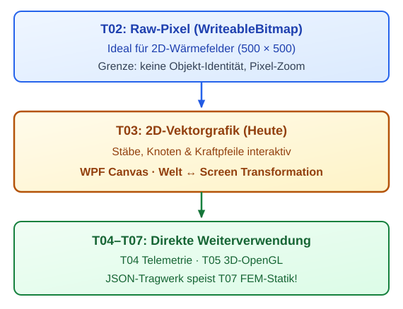

</div>
</div>

---


## 3.1: Grundlagen der Vektorgrafik und WPF Canvas

Dieser Abschnitt umfasst die folgenden Inhalte:

- Brücke zu Termin 02 (Raw Pixels) und Einordnung in die Kurs-Architektur
- Prinzip der Vektorgrafik im Vergleich zur Rastergrafik
- Retained Mode vs. Immediate Mode in Benutzeroberflächen
- Das `Canvas`-Element in WPF, Attached Properties & Shapes

---

### Was ist Vektorgrafik?

<div class="columns">
<div class="two">

- **Mathematische Repräsentation**: Bilder bestehen nicht aus Pixeln, sondern aus analytisch definierten Primitiven (Punkte, Linien, Polygone).
- **Auflösungsunabhängigkeit**: Vektoren lassen sich ohne Qualitätsverlust beliebig skalieren – gestochen scharf auf jedem Monitor.
- **Parametrisierbarkeit**: Jede Geometrie besitzt modifizierbare Attribute:
  - Anfangs- und Endkoordinaten $(x_1, y_1) \to (x_2, y_2)$
  - Linienstärke (`StrokeThickness`) und Strichmuster
  - Füllfarbe (`Fill`) und Konturfarbe (`Stroke`)
- **Einsatzbereich**: CAD, Fachwerke, Schemata, Kraftvektoren.

</div>
<div class="one">

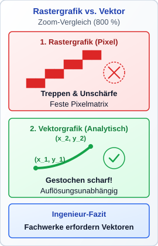

</div>
</div>

---

### Retained Mode vs. Immediate Mode

<div class="columns top">
<div class="one">

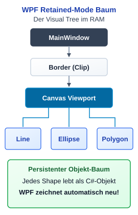

</div>
<div class="two">

**Immediate Mode (Termin 02 – `WriteableBitmap`):**
- Pixel werden direkt in den Bildspeicher geschrieben.
- Die GUI-Bibliothek „vergisst“ gezeichnete Formen sofort.
- Keine UI-Objekte, kein Klick-Handling auf einzelnen Linien.

**Retained Mode (Termin 03 – WPF `Canvas` & `Shapes`):**
- Die GUI verwaltet einen Szenengraph (**Visual Tree**) im RAM.
- Jede Linie und jeder Knoten existiert als C#-Objekt.
- **Automatisches Neuzeichnen** bei Größenänderungen + native Maus-Events.

> **Faustregel:** Pixelgitter $\to$ Immediate Mode; interaktive Vektor-Objekte $\to$ Retained Mode.

</div>
</div>

---

### Das `Canvas`-Control & Attached Properties

<div class="columns top">
<div class="two">

In WPF bietet das `Canvas`-Control eine 2D-Zeichenfläche mit **absoluter Positionierung**:

- Kindelemente (`el`) werden über **Attached Properties** platziert:
  - C#: `Canvas.SetLeft(el, x);` und `Canvas.SetTop(el, y);`
  - XAML: `Canvas.Left="120" Canvas.Top="85"`
- **Warum kein `myNode.Left`?** Jedes Panel (`Grid`, `StackPanel`, `Canvas`) braucht andere Layout-Daten – der Container definiert die Property, das Kind speichert nur seinen Wert.
- **Zentrierung von Ellipsen (Radius $r$):** $\text{Left} = x - r,\; \text{Top} = y - r$.

> **Anhang:** Details zu 4 WPF-Layout-Panels & `DependencyObject`-Store siehe [Anhang A: Vektorgrafik-Details](./Folien_Anhang_A_Vektorgrafik_Details.md).

</div>
<div class="one">

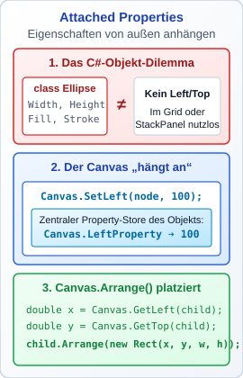

</div>
</div>

---

### WPF Canvas: Instanziierung im Code & Shapes

<div class="columns top">
<div class="one">

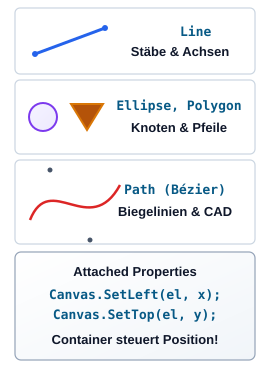

</div>
<div class="two">

```csharp
// Stab als Line auf einem WPF Canvas erzeugen
var member = new Line
{
    X1 = 50, Y1 = 50, X2 = 250, Y2 = 150,
    Stroke = Brushes.SteelBlue,
    StrokeThickness = 3.0,
    StrokeEndLineCap = PenLineCap.Round
};
myCanvas.Children.Add(member);
```

- **`Line` (`member`):** Verbindet Start/Endpunkt $(x, y)$ (`X1, Y1, X2, Y2`) für Stäbe & Achsen.
- **`Ellipse` / `Rectangle`:** `Width`, `Height` + `Canvas.Left/Top` für Knoten bei $(x, y)$.
- **`Polygon` / `Path`:** Punktlisten & Bézier-Kurven (Pfeilspitzen, CAD-Konturen).

</div>
</div>

---

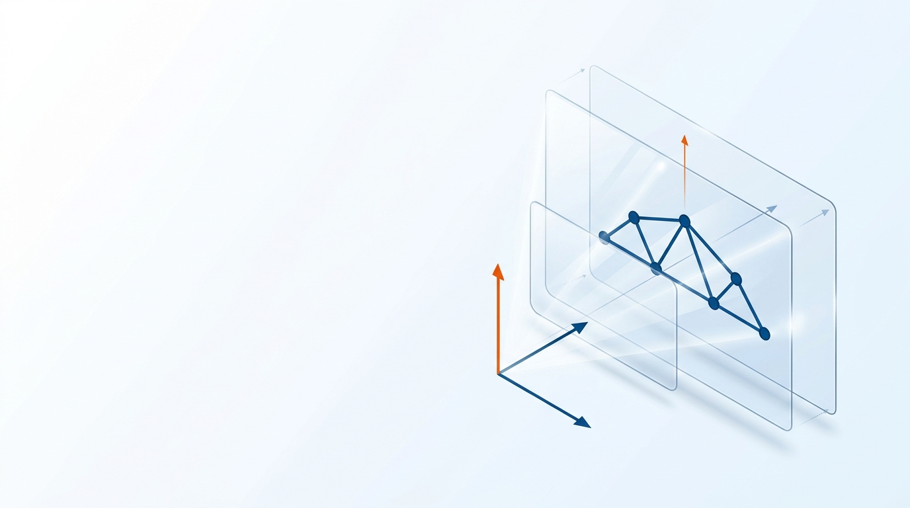

## 3.2: Transformation: Welt- zu Bildschirmkoordinaten

Dieser Abschnitt umfasst die folgenden Inhalte:

- Das Koordinaten-Paradoxon (Physik vs. Monitor)
- Bounding Box, Modellgrenzen und Randabstand
- Die Anisotropie-Falle (Verzerrung vs. Isotropie)
- Isotropes Skalieren und Invertierung der Y-Achse
- C#-Implementierung der Klasse `Transform2D`

---

### Das fundamentale Koordinaten-Paradoxon

<div class="columns top">
<div class="two">

Beim Zeichnen physikalischer Systeme treffen zwei inkompatible Welten aufeinander:

1. **Ingenieurtechnisches Weltsystem (Physik / DIN 1304):**
   - Kontinuierlich: $x_w, y_w \in \mathbb{R}$ in Metern $[\mathrm{m}]$.
   - **$+Y$-Achse zeigt nach OBEN** (Höhe, Gravitation $\vec{g}$).
   - Ursprung beliebig (z.B. Auflagerpunkt).

2. **Bildschirm-Koordinatensystem (WPF Canvas):**
   - Diskret: $x_s, y_s \in \mathbb{N}_0$ in Bildschirmpixeln $[\mathrm{px}]$.
   - **$+Y$-Achse zeigt nach UNTEN** (Scanline-Raster).
   - Ursprung $(0,0)$ starr in der linken oberen Fensterecke.

</div>
<div class="one">

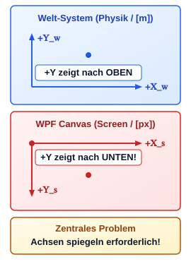

</div>
</div>

---

### Bounding Box & die Anisotropie-Falle

<div class="columns top">
<div class="one">

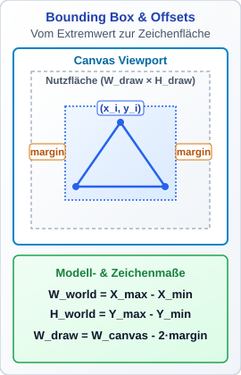

</div>
<div class="two">

1. **Minimale Hüllbox aus Knotenkoordinaten $(x_i, y_i)$:**
   $$W_{\text{world}} = X_{\max} - X_{\min}, \quad H_{\text{world}} = Y_{\max} - Y_{\min} \quad [\mathrm{m}]$$
   $$W_{\text{draw}} = W_{\text{canvas}} - 2 \cdot \text{margin}, \quad H_{\text{draw}} = H_{\text{canvas}} - 2 \cdot \text{margin} \quad [\mathrm{px}]$$
2. **Anisotropie-Falle bei getrennten Maßstäben ($s_x \ne s_y$):**
   ```csharp
   double s_x = W_draw / W_world, s_y = H_draw / H_world; // Kreise -> Ellipsen!
   ```
   - $45^\circ$-Diagonalen kippen ab! Lösung: Isotropie $s = \min(s_x, s_y)$ als einheitlicher Maßstab für beide Achsen ohne Verzerrung.

> **Merksatz:** Ein gemeinsamer Maßstab $s$ erhält Winkel, Kreise und Seitenverhältnisse exakt.

</div>
</div>

---

### Isotropes Scaling, Zentrierung & Y-Achsen-Invertierung

<div class="columns top">
<div class="two">

- **Isotroper Maßstab:** $s = \min(s_x, s_y)\;[\mathrm{px/m}]$ erhält Winkel und Proportionen exakt:
  ```csharp
  double s = Math.Min(s_x, s_y);
  ```
- **Zentrierungs-Offsets ($x_{\text{off}}, y_{\text{off}}$):** Teilen verbleibenden Freiraum symmetrisch auf ([Anhang A: 2 Grenzfälle](./Folien_Anhang_A_Vektorgrafik_Details.md)).
- **Y-Achsen-Invertierung ($+Y$ oben $\to$ $+Y$ unten, $Y_{\min}$ bis $Y_{\max}$, Höhe $H_{\text{world}}$):**
  $$x_s = x_{\text{off}} + (x_w - X_{\min}) \cdot s, \qquad y_s = y_{\text{off}} + (Y_{\max} - y_w) \cdot s \quad [\mathrm{px}]$$
- **Grenzwerte:** $y_w = Y_{\max} \implies y_s = y_{\text{off}}$; $y_w = Y_{\min} \implies y_s = y_{\text{off}} + H_{\text{world}} \cdot s$.

</div>
<div class="one">

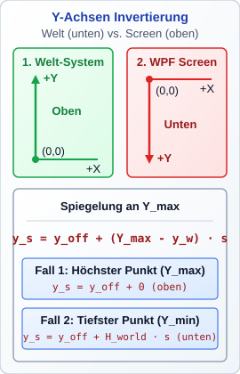

</div>
</div>

---

### C#-Implementierung: `Transform2D` (`Update` & `WorldToScreen`)

<div class="columns top">
<div class="one">

```csharp
public void Update(
    double xMin, double xMax, double yMin, double yMax,
    double canvasWidth, double canvasHeight,
    double margin = 50.0)
{
    XMin = xMin;
    YMax = yMax;
    double worldW = Math.Max(xMax - xMin, 1e-4);
    double worldH = Math.Max(yMax - yMin, 1e-4);
    double drawW = Math.Max(canvasWidth - 2 * margin, 10);
    double drawH = Math.Max(canvasHeight - 2 * margin, 10);

    Scale = Math.Min(drawW / worldW, drawH / worldH);
    OffsetX = margin + (drawW - worldW * Scale) / 2.0;
    OffsetY = margin + (drawH - worldH * Scale) / 2.0;
}
```

> **Schutz:** `Math.Max(..., 1e-4)` verhindert Division durch Null bei entarteten Modellen.

</div>
<div class="one">

```csharp
// Weltpunkt (xW, yW) [m] -> Canvas-Pixel (x_s, y_s) [px]
public Point WorldToScreen(double xW, double yW) => new(
    OffsetX + (xW - XMin) * Scale,
    OffsetY + (YMax - yW) * Scale
);

// Rücktransformation [px] -> [m]
public (double Xw, double Yw) ScreenToWorld(
    double xS, double yS) => (
    XMin + (xS - OffsetX) / Scale,
    YMax - (yS - OffsetY) / Scale
);
```

- **Parameter:** Weltgrenzen `xMin`, `xMax`, `yMin`, `yMax` (`worldW`, `worldH`), Viewport `canvasWidth`/`canvasHeight`, Rand `margin` (`drawW`, `drawH`) sowie Punkt `(xW, yW)` (`Transform2D.cs`).

</div>
</div>

---

<!-- _class: activity -->

### Aufgabe: Isotropes Scaling & `WorldToScreen` berechnen

Ein Fachwerk erstreckt sich über $X \in [0, 10]\,\mathrm{m}$ und $Y \in [0, 4]\,\mathrm{m}$ auf einem Canvas mit $W_{\text{canvas}} = 900\,\mathrm{px}$, $H_{\text{canvas}} = 500\,\mathrm{px}$ und $\text{margin} = 50\,\mathrm{px}$:

| $W_{\text{world}} \times H_{\text{world}}$ | $W_{\text{draw}} \times H_{\text{draw}}$ | $s_x$ | $s_y$ |
| :--- | :--- | :--- | :--- |
| $10\,\mathrm{m} \times 4\,\mathrm{m}$ | $800\,\mathrm{px} \times 400\,\mathrm{px}$ | $80\,\mathrm{px/m}$ | $100\,\mathrm{px/m}$ |

Bearbeite diese drei Fragen kurz mit deinem Nachbarn:

1. **Maßstab:** Welcher isotrope Maßstab $s = \min(s_x, s_y)$ gilt, und was würde bei $s_x \ne s_y$ passieren?
2. **Zentrierung:** Berechnen Sie die Offsets $x_{\text{off}}$ und $y_{\text{off}}$!
3. **Punkt-Mapping:** Auf welche Bildschirmkoordinate $(x_s, y_s)$ fällt der oberste linke Punkt $(x_w = 0, y_w = 4)$?

> **Hinweis:** Prüfen Sie kurz zu zweit: $x_{\text{off}} = \text{margin} + \frac{W_{\text{draw}} - W_{\text{world}} \cdot s}{2}$ und $y_s = y_{\text{off}} + (Y_{\max} - y_w) \cdot s$.

---

<!-- _class: solution -->

### Auflösung: Isotropes Scaling & `WorldToScreen`

1. **Isotroper Maßstab:**
   $$s = \min(80, 100) = \mathbf{80\,\mathrm{px/m}}$$
   *(Ohne $\min$ würde das Fachwerk vertikal um $+25\,\%$ gestreckt und $45^\circ$-Diagonalen verfälscht!)*
2. **Zentrierungs-Offsets:**
   - **Horizontal (voll belegt):** $x_{\text{off}} = 50 + \frac{800 - 10 \cdot 80}{2} = \mathbf{50\,\mathrm{px}}$
   - **Vertikal (Freiraum $400 - 320 = 80\,\mathrm{px}$):** $y_{\text{off}} = 50 + \frac{400 - 4 \cdot 80}{2} = \mathbf{90\,\mathrm{px}}$
3. **Oberer linker Punkt $(0, 4)$ ($X_{\min} = 0$, $Y_{\max} = 4$):**
   $$x_s = 50 + (0 - 0) \cdot 80 = \mathbf{50\,\mathrm{px}}, \qquad y_s = 90 + (4 - 4) \cdot 80 = \mathbf{90\,\mathrm{px}}$$

- **Gegenprobe unterer rechter Punkt $(10, 0)$:** $x_s = 50 + 800 = 850\,\mathrm{px}$, $y_s = 90 + 320 = 410\,\mathrm{px}$ (exakt $50\,\text{px}$ bzw. $90\,\text{px}$ Rand).

> **Merksatz:** `YMax` landet immer auf `OffsetY` (oberer Rand des zentrierten Modells)!

---


## 3.3: Vektordarstellung geometrischer Elemente und Kräfte

Dieser Abschnitt umfasst die folgenden Inhalte:

- Darstellung gerichteter physikalischer Größen (Kräfte, Geschwindigkeiten)
- Geometriemaßstab vs. Kraftmaßstab ($s_F$ in $[\mathrm{px/N}]$)
- Konstruktion zusammengesetzter Pfeilformen (Schaftlinie + Spitzenpolygon)
- Analytische Berechnung der Pfeilspitze über Orthogonalvektoren (ohne Trigonometrie)
- Normgerechte Bemaßungsketten nach DIN 406 (Maßhilfslinien, Maßlinien, Pfeile)

---

### Geometriemaßstab vs. Kraftmaßstab

<div class="columns top">
<div class="two">

- **Geometrie:** Geometriemaßstab $s$ $[\mathrm{px/m}]$ (z.B. $10\,\mathrm{m}$ Träger $\to 500\,\mathrm{px}$).
- **Physikalische Kräfte:** Dürfen **nicht** mit dem Geometriemaßstab gezeichnet werden!
  - Eine Last von $50\,\mathrm{kN}$ wäre sonst $2.500.000\,\mathrm{px}$ lang.
- **Zwei professionelle Lösungsansätze:**
  1. **Konfigurierbarer Kraftmaßstab $s_F$ $[\mathrm{px/N}]$:**
     $L = s_F \cdot |\vec{F}| \quad [\mathrm{px}]$ (proportional zur Last).
  2. **Feste Pfeillänge (Industriestandard):**
     Schaft $P_{\text{node}} \to P_{\text{tip}}$ mit $P_{\text{base}}, P_{\text{wing1,2}}$, Richtung $u = e_u$ und Text (`"25.0 kN"`).

</div>
<div class="two">

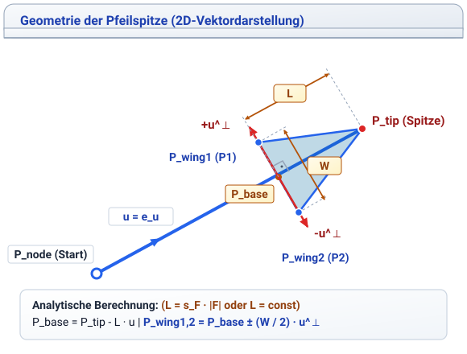

</div>
</div>

---

### Analytische Berechnung der Pfeilspitze & C#-Code

<div class="columns top">
<div class="two">

Gegeben: Knoten $\vec{P}_{\text{node}}$ $[\mathrm{px}]$, Kraft $\vec{F}$, Spitzenmaße $L$ und $W$ $[\mathrm{px}]$, Richtung $\vec{e}_u = \vec{F}_{\text{screen}} / \|\vec{F}_{\text{screen}}\|$ (`dir`):

1. **Orthogonalvektor ($90^\circ$ links):** $\vec{e}_u^\perp = \vec{e}_{\text{perp}} = (-e_y, e_x)^T$
2. **Basispunkt & Flügel:** $\vec{P}_{\text{base}} = \vec{P}_{\text{tip}} - L \cdot \vec{e}_u$, $\vec{P}_{\text{wing1,2}} = \vec{P}_{\text{base}} \pm \frac{W}{2} \cdot \vec{e}_u^\perp$

```csharp
public static Point[] GetArrowhead(Point tip, Vector dir, double length, double width)
{
    dir.Normalize();
    var perp = new Vector(-dir.Y, dir.X); // 90° Orthogonalvektor
    Point pBase = tip - (length * dir);
    return new[] { tip, pBase + (width / 2.0 * perp), pBase - (width / 2.0 * perp) };
}
```

- **Ergebnis:** Liefert 3 Eckpunkte direkt für das `Polygon`.

</div>
<div class="one">

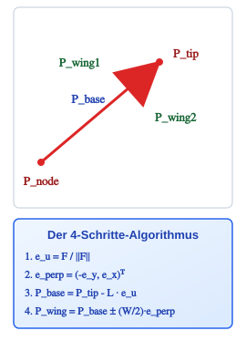

</div>
</div>

> **Vorteil:** Vektoralgebra ohne `Sin`/`Cos` (Vorlage `VectorArrow.cs` nutzt alternativ `Atan2` mit $\beta = 15^\circ$).

---

### Technische Bemaßung nach DIN 406

<div class="columns top">
<div class="two">

In industriellen CAD-Viewern werden Abmessungen normgerecht nach **DIN 406** dargestellt:

1. **Maßhilfslinien (Extension Lines):** Verlängern Bauteilkanten mit Gap ($3\text{--}5\,\mathrm{px}$) und Überstand ($8\text{--}12\,\mathrm{px}$).
2. **Maßlinie (Dimension Line):** Steht orthogonal zu den Maßhilfslinien, begrenzt durch schlanke Maßpfeile (1:3).
3. **Maßzahl (Dimension Text):** Mittig über der Maßlinie platziert (z. B. `"4.00 m"` in konstanter Pixel-Schriftgröße bei jedem Zoom).
4. **Einheitenkonsistenz:** Maße direkt aus den Weltkoordinaten in $[\mathrm{m}]$ berechnen.

> **Praxis:** Konstante Pixelgrößen für Pfeile und Text halten Maßketten in jeder Zoomstufe lesbar.

</div>
<div class="one">

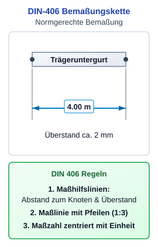

</div>
</div>

---

### C#-Implementierung: DIN-406 Maßkette

```csharp
public static void AddHorizontalDimensionLine(Canvas canvas, Point p1, Point p2, 
                                              double yScreen, string text, Brush stroke)
{
    const double yGap = 4, yOver = 8; // Abstand & Überstand
    canvas.Children.Add(new Line { X1 = p1.X, Y1 = p1.Y + yGap, X2 = p1.X, Y2 = yScreen + yOver, Stroke = stroke });
    canvas.Children.Add(new Line { X1 = p2.X, Y1 = p2.Y + yGap, X2 = p2.X, Y2 = yScreen + yOver, Stroke = stroke });
    canvas.Children.Add(new Line { X1 = p1.X, Y1 = yScreen, X2 = p2.X, Y2 = yScreen, Stroke = stroke });
    canvas.Children.Add(new Polygon { Points = new PointCollection(GetArrowhead(new Point(p1.X, yScreen), new Vector(1, 0), 8, 5)), Fill = stroke });
    canvas.Children.Add(new Polygon { Points = new PointCollection(GetArrowhead(new Point(p2.X, yScreen), new Vector(-1, 0), 8, 5)), Fill = stroke });
    var label = new TextBlock { Text = text, Foreground = stroke, FontSize = 11 };
    Canvas.SetLeft(label, (p1.X + p2.X) / 2.0 - 20);
    Canvas.SetTop(label, yScreen - 16);
    canvas.Children.Add(label);
}
```

- **Maßhilfslinien (`yGap = 4`, `yOver = 8`):** Starten mit Gap zu `p1`/`p2` und ragen über `yScreen` hinaus.
- **Maßpfeile & Text:** Nutzen `GetArrowhead(...)`; der `TextBlock` sitzt zentriert über der Maßlinie.

> **Übung 1.3:** Sie implementieren die vertikale Variante `AddVerticalDimensionLine(...)` für die Gesamthöhe samt Maßpfeilen.

---


## 3.4: Interaktive Steuerung im Canvas (Pan & Zoom)

Dieser Abschnitt umfasst die folgenden Inhalte:

- Navigation in Simulationsmodellen
- Naives Neuzeichnen vs. GPU-`MatrixTransform`
- Zoom mit Mauszeiger-Fixpunkt (`ScaleAt`)
- Verschieben per Drag & Drop (`Pan`), Jitter-Fix & `ScreenToWorld`

---

### Naives CPU-Neuzeichnen vs. GPU-`MatrixTransform`

<div class="columns top">
<div class="two">

- **Naives CPU-Neuzeichnen (Ansatz A):** Jede Mausbewegung berechnet alle Weltkoordinaten neu ($O(N)$) $\implies$ Lags und Layout-Passes ab 1.000 Elementen.
- **GPU-`MatrixTransform` (Ansatz B – Standard):** Das Modell wird **einmalig** gezeichnet; Pan & Zoom verändern nur eine einzige affine $3 \times 3$-Matrix ($\mathbf{M}$).
- **Vorteil:** Hardwarebeschleunigt über DirectX ($O(1)$), 60+ FPS, 0 Bytes GC-Allokation!
- **Skalierung:** Bleibt auch bei $> 10.000$ Elementen im Viewport interaktiv bedienbar.

> **Merksatz:** Geometrie nur bei Modelländerung neu aufbauen – Kamera bewegt nur `MatrixTransform` ohne Layout-Pass!

</div>
<div class="one">

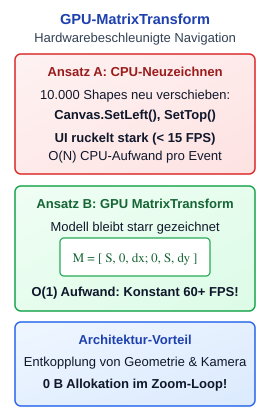

</div>
</div>

---

### Fixpunkt-Zoom (`ScaleAt`) & Mausrad-Code

<div class="columns top">
<div class="one">

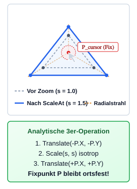

</div>
<div class="two">

```csharp
private void OnMouseWheel(object sender, MouseWheelEventArgs e)
{
    Point mousePos = e.GetPosition(SimulationCanvas);
    double zoomFactor = e.Delta > 0 ? 1.15 : 1.0 / 1.15;

    Matrix m = CanvasMatrixTransform.Matrix;
    m.ScaleAt(zoomFactor, zoomFactor, mousePos.X, mousePos.Y);
    CanvasMatrixTransform.Matrix = m;
}
```

- **Fixpunkt-Invarianz:** $\mathbf{M}_{\text{zoom}} = \mathbf{T}(+\vec{C}) \cdot \mathbf{S}(s, s) \cdot \mathbf{T}(-\vec{C})$ hält den Punkt unter dem Cursor $\vec{C}$ ortsfest.
- `ClipToBounds="True"` am äußeren `Border` schneidet Ränder ab ([Anhang A](./Folien_Anhang_A_Vektorgrafik_Details.md)).
- **Zoom-Faktor:** $1{,}15\times$ pro Mausrad-Rastung sorgt für gleichmäßige, feinfühlige Navigation.

</div>
</div>

---

### Pan (`CaptureMouse`) & die Dragging-Jitter-Falle

<div class="columns top">
<div class="two">

- **Hardwarebeschleunigtes Panning (`MouseMove`):** Berechnet den Mausversatz `delta` aus `currentPos - _lastPos` und verschiebt per `Translate`:
  ```csharp
  Point currentPos = e.GetPosition(this);
  Vector delta = currentPos - _lastPos;
  _lastPos = currentPos;
  Matrix m = CanvasMatrixTransform.Matrix;
  m.Translate(delta.X, delta.Y);
  CanvasMatrixTransform.Matrix = m;
  ```
- **Die Dragging-Jitter-Falle:** Ruft `Redraw()` beim Ziehen von $K_3$ naiv `_transform.Update()` auf, wächst $H_{\text{world}}$ und $s$ schrumpft $\implies$ **60-Hz-Oszillation**!
- **`CaptureMouse()`:** Hält das Ziehen auch beim schnellen Überfahren von Elementgrenzen stabil.

</div>
<div class="one">

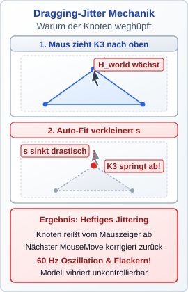

</div>
</div>

---

### Lösung des Jitterings: Freeze-Doktrin

<div class="columns top">
<div class="one">

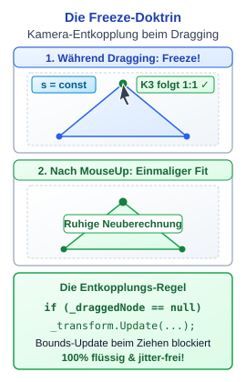

</div>
<div class="two">

**Kamera-Entkopplung während der Interaktion:**
Bounding-Box (`xMin`, `xMax`, `yMin`, `yMax`) und Maßstab $s$ bleiben bei aktivem Ziehen (`_draggedNode != null`) eingefroren $\implies$ Knoten folgt dem Cursor $1:1$:

```csharp
if (_draggedNode == null)
{
    var (xMin, xMax, yMin, yMax) = _truss.GetBounds();
    _transform.Update(xMin, xMax, yMin, yMax,
        TrussCanvas.ActualWidth, TrussCanvas.ActualHeight);
}
DrawTruss();
```

- Erst beim Loslassen (`MouseUp`, `ReleaseMouseCapture()`) passt sich die Bounding Box ruhig neu ein!

</div>
</div>

---

### Analytische Viewport-Inversion & `ScreenToWorld`

<div class="columns top">
<div class="two">

Für Mausklicks wird $\vec{P}_{\text{screen}} = (x_p, y_p)$ über $\vec{P}_{\text{unzoom}} = (x_u, y_u) = \mathbf{M}^{-1}\vec{P}_{\text{screen}}$ und $X_{\min}, Y_{\max}, x_{\text{off}}, y_{\text{off}}$ zurück in $(x_w, y_w)$ gerechnet:

```csharp
public Point ScreenToWorld(
    Point screenPixel, Matrix canvasMatrix, Transform2D trans)
{
    Matrix invMatrix = canvasMatrix;
    invMatrix.Invert(); // 1. Kamera-Unzoom
    Point unzoomed = invMatrix.Transform(screenPixel);

    // 2. Viewport-Inversion (Pixel -> Meter)
    var (worldX, worldY) = trans.ScreenToWorld(unzoomed.X, unzoomed.Y);
    return new Point(worldX, worldY);
}
```

- **Anwendung:** Exaktes Knoten-Picking trotz aktivem Pan & Zoom.

</div>
<div class="one">

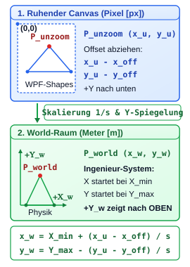

</div>
</div>

---

<!-- _class: activity -->

### Aufgabe: `ScaleAt`, Jitter & `ScreenToWorld` berechnen

| Szenario | Kernfrage | Relevante Methode |
| :--- | :--- | :--- |
| 1. Zoom-Reihenfolge | Was passiert ohne `T(+C)`? | `m.ScaleAt(...)` |
| 2. Knoten-Ziehen | Warum 60-Hz-Jittering? | `_transform.Update(...)` |
| 3. Picking nach Pan | Inversionsreihenfolge? | `ScreenToWorld(...)` |

1. **Matrix-Reihenfolge (`ScaleAt`):** Warum liefert `S(s) · T(-C)` ohne anschließendes `T(+C)` beim Mausrad-Zoom einen Sprung der Zeichnung?
2. **Dragging-Jitter:** Ein Student zieht einen Fachwerkknoten nach oben und der Knoten vibriert mit 60 Hz unter dem Cursor. Welche eine Abfrage fehlt in seinem `Redraw()`?
3. **Picking nach Pan & Zoom:** In welcher Reihenfolge müssen `canvasMatrix.Invert()` und `trans.ScreenToWorld(...)` aufgerufen werden?

> **Hinweis:** Diskutieren Sie kurz zu zweit (`Screen` $\to$ `Canvas` $\to$ `World`)!

---

<!-- _class: solution -->

### Auflösung: `ScaleAt`, Jitter & `ScreenToWorld`

1. **Ohne Rücktranslation `T(+C)`:** Der anvisierte Punkt unter dem Cursor $\vec{C}$ wurde in den Ursprung $(0, 0)$ verschoben und bleibt dort kleben, statt an der Mausposition $\vec{C}$ stehen zu bleiben.
2. **Jitter-Fix (`Freeze-Doktrin`):** Es fehlt die Abfrage `if (_draggedNode == null)` um `_transform.Update(...)`, damit der Maßstab $s$ während `MouseMove` konstant bleibt.
3. **Inversionsreihenfolge (`Screen -> Canvas -> World`):**
   - Zuerst **`invMatrix.Transform(screenPixel)`** (hebt GPU-Pan/Zoom $\mathbf{M}$ auf).
   - Danach **`trans.ScreenToWorld(unzoomed.X, unzoomed.Y)`** (rechnet Pixel in Meter $[\mathrm{m}]$ um).

```csharp
var unzoomed = invMatrix.Transform(screenPixel); // 1. Kamera-Unzoom
var world = trans.ScreenToWorld(unzoomed.X, unzoomed.Y); // 2. Pixel -> Meter
```

> **Merksatz:** Rückwärts wird immer in exakt umgekehrter Reihenfolge zur Vorwärts-Pipeline invertiert – erst Kamera-Matrix $\mathbf{M}^{-1}$, dann Viewport-Skalierung $1/s$!

---


## 3.5: Performance & Architektur: Shapes vs. DrawingVisual

Dieser Abschnitt umfasst die folgenden Inhalte:

- Der `UIElement`-Overhead von WPF `Shape`-Objekten & Layout-Kollaps
- High-Performance Vektorgrafik mit `DrawingVisual`
- Die lebenswichtige `Freeze()`-Doktrin & Technologievergleich

---

### WPF Shapes: UIElement-Overhead & Layout-Kollaps

<div class="columns top">
<div class="two">

`Line`, `Ellipse` und `Path` erben von `Visual -> UIElement -> FrameworkElement -> Shape` (hunderte Dependency Properties, mehrere KB pro Objekt):

- **2-Phasen-Layout-Cycle (`Measure` / `Arrange`):** Jede Knotenbewegung markiert verbundene Stäbe als *layout-dirty*.
- **5.000 Shapes $\implies$ 10.000 Layout-Methodenaufrufe in jedem einzelnen Frame!**
- **Skalierungsgrenze:** Ab 2.000 Shapes starke Lags, ab 5.000 Shapes Einbruch auf $< 10\,\mathrm{FPS}$.

> **Anhang:** Detailablauf von `Measure` & `Arrange` siehe [Anhang A: Vektorgrafik-Details](./Folien_Anhang_A_Vektorgrafik_Details.md).

</div>
<div class="one">

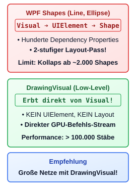

</div>
</div>

---

### Die Lösung: `DrawingVisual`, `Brush` & `Pen`

<div class="columns top">
<div class="one">


</div>
<div class="two">

`DrawingVisual` erbt direkt von `Visual` (kein `UIElement`-Ballast, kein Layout-Cycle):

- **Vektor-Stream:** Zeichenbefehle werden direkt in einen **`DrawingContext`** geschrieben und von der GPU gerendert ($> 100.000$ Elemente flüssig).
- **`Brush` (Tinte):** Flächenfüllung (`Brushes.SteelBlue`, `SolidColorBrush`).
- **`Pen` (Stift):** Kontur aus `Brush` + `Thickness` / `DashStyle` für gestochen scharfe Vektorlinien.

> **Praxis:** Ein einziges `DrawingVisual` ersetzt tausende `Shape`-Controls auf dem `Canvas`.

</div>
</div>

---

### Die `Freeze()`-Doktrin & `DrawingContext`

<div class="columns top">
<div class="two">

> **Goldene Regel:** Jeder `Pen` und jeder `Brush` in einer Render-Schleife muss mit `.Freeze()` eingefroren werden!

- **Ohne `Freeze()`:** WPF hält Event-Listener aktiv (Cross-Thread-Fehler & Millionen Heap-Objekte / GC-Ruckler).
- **Mit `Freeze()`:** Unveränderlich, thread-sicher & **0 Bytes GC-Last**:
  ```csharp
  using DrawingContext dc = visual.RenderOpen();
  var pen = new Pen(Brushes.SteelBlue, 2.0);
  pen.Freeze();
  foreach (var rod in rods) dc.DrawLine(pen, rod.P1, rod.P2);
  ```

- **Thread-Sicherheit:** Eingefrorene `Pen`-/`Brush`-Instanzen werden direkt von der GPU gecacht.

</div>
<div class="one">

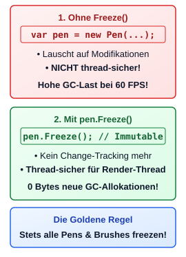

</div>
</div>

---

<!-- _class: activity -->

### Aufgabe: Architektur- & `Freeze()`-Diagnose

Ein Simulations-Viewer zeichnet $10.000$ Fachwerkstäbe pro Frame bei $60\,\text{FPS}$ ($16{,}6\,\text{ms}$ Budget). Vergleichen Sie beide Implementierungen kurz zu zweit:

| Variante | Speicher / Objekt | CPU-Aufwand pro Frame | Problem? |
| :--- | :--- | :--- | :--- |
| `new Line()` (`Shapes`) | $\approx 2\text{--}4\,\text{KB}$ (`UIElement`) | $20.000$ Layout-Calls | Frame-Einbruch! |
| `DrawingVisual` ohne `Freeze()` | Heap-Allokation | Change-Tracking-Listener | GC-Mikroruckler! |

1. **Performance-Einbruch:** Warum blockiert `new Line()` den UI-Thread schon *vor* dem GPU-Rendering?
2. **`DrawingVisual`-Bug:** Nach Umstellung auf `DrawingVisual` erzeugt ein `new Pen(new SolidColorBrush(Colors.Blue), 2.0)` in der Zeichenschleife alle 2 Sekunden Mikroruckler. Was fehlt?
3. **Einsatzgrenze:** Wann bleibt `WriteableBitmap` (T02) trotz `DrawingVisual` überlegen?

> **Hinweis:** Prüfen Sie kurz zu zweit: Layout-Pass (`Measure`/`Arrange`) vs. Change-Tracking vs. Rasterfelder!

---

<!-- _class: solution -->

### Auflösung: Architektur- & `Freeze()`-Diagnose

1. **5 FPS bei `Shapes`:** Jedes `Line`-Objekt erbt von `UIElement` und löst im 2-Phasen-Layout-Cycle (`Measure`/`Arrange`) **20.000 Methodenaufrufe pro Frame** auf der CPU aus – der UI-Thread ist blockiert, bevor die GPU startet.
2. **Mikroruckler im `DrawingContext`:** Ohne **`pen.Freeze()`** und statisches Cachen bleiben Change-Tracking-Listener aktiv und erzeugen Millionen kurzlebiger Heap-Objekte für den **Garbage Collector (GC)**:
   ```csharp
   private static readonly Pen RodPen = CreateFrozenPen(); // 0 Bytes GC pro Frame!
   ```
3. **Wann `WriteableBitmap`?** Bei flächenhaften, pixelweisen Feldern (z. B. $500 \times 500$ Temperaturzellen aus Termin 02), die sich in jedem Zeitschritt an jedem Pixel ändern.

> **Merksatz:** `Shapes` für UI-Interaktion ($\le 1.000$), `DrawingVisual` + `Freeze()` für große Netze ($> 100.000$), `WriteableBitmap` für kontinuierliche Rasterfelder – ohne `.Freeze()` drohen GC-Pausen, Speicherlecks und Cross-Thread-Fehler!

---

<!-- _class: summary -->

### Zusammenfassung Kapitel 3

- **WPF `Canvas` & `Transform2D`:** Bildet Weltkoordinaten ($+Y$ oben, $[\mathrm{m}]$) mittels **isotroper Skalierung** ($s = \min(s_x, s_y)$) und Zentrierungs-Offsets verzerrungsfrei auf Canvas-Pixel ($+Y$ unten) ab.
- **Vektorgeometrie & DIN 406:** Pfeilspitzen über Orthogonalvektoren $\vec{e}_u^\perp$ ohne Trigonometrie; Maßketten aus Hilfslinien, Maßlinie, Pfeilen und Text.
- **Interaktion (`Pan & Zoom`):** Hardwarebeschleunigte `MatrixTransform` (`ScaleAt` am Cursor, `Translate`), **Freeze-Doktrin** gegen Dragging-Jittering (`_draggedNode == null`) und `ScreenToWorld`-Inversion.
- **Architektur-Entkopplung:** Saubere Trennung von Geometrie-/Transformationskern (`Transform2D`) und View (`Canvas` / `DrawingVisual`).
- **Performance:** `DrawingVisual` mit `.Freeze()` umgeht den `Shape`-Layout-Cycle für $> 100.000$ Vektoren ([Anhang A](./Folien_Anhang_A_Vektorgrafik_Details.md)):
  ```csharp
  double s = Math.Min(s_x, s_y); // Isotrope Skalierung ohne Verzerrung
  pen.Freeze();                  // 0 Bytes GC-Last im DrawingContext
  ```

---

<!-- _class: appendix -->

### Vertiefung im Selbststudium: Anhang A (WPF-Interna & Beweise)

<div class="columns">
<div class="three">

Für alle, die **WPF-Layout-Interna** und die mathematischen Beweise im Detail nachlesen möchten:

- **WPF-Layout & Panels:** Wie `Grid`, `StackPanel` und `Canvas` messen, positionieren und `Attached Properties` verwalten.
- **Koordinatenräume & `ScaleAt`-Beweis:** Vollständige Matrix-Herleitung zwischen Screen, Canvas und World inkl. höhen- und breitenlimitierter Zentrierung.
- **2-Phasen-Layout-Cycle:** Warum `Measure` & `Arrange` bei tausenden Shapes bremsen und wie `VisualHost` / `OnRender` arbeitet.
- **Architektur-Einordnung:** Wann sich eigene `FrameworkElement`-Controls gegenüber `DrawingVisual` lohnen.

</div>
<div class="one">

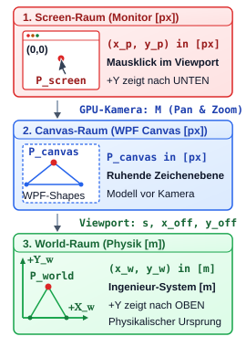

</div>
</div>

> **Hinweis:** Optional fürs Selbststudium – für Übung 03 und Quiz 2 genügt der Stoff dieses Hauptdecks ([Anhang A](./Folien_Anhang_A_Vektorgrafik_Details.md)).

---

<!-- _class: outlook -->

### Ausblick: Echtzeit-Telemetrie & FEM-Kopplung (Termin 04 & 07)

<div class="columns">
<div class="two">

Unsere 2D-Vektorgeometrie steht – wie nutzen wir diese Bausteine im weiteren Semester?

- **Direkt nächste Woche (T04):** Hochfrequente Zeitreihen (1 kHz) mit `ScottPlot 5` und Ringpuffern.
- **Fern-Brücke (T07):** Unsere per JSON exportierten Knoten, Stäbe und Lastpfeile werden in **T07** mit Elastostatik ($\mathbf{K}\mathbf{u} = \mathbf{f}$) gelöst!
- **Lernfortschritt:** In **T05** folgt das **Moodle-Quiz 2** (Stoff: Kap. 03 & 04).

> **Showcase-Fokus (T04):** Zwei Teams zeigen Track A/B beim 32:9-Seitenverhältnis-Stresstest!

</div>
<div class="two">


</div>
</div>

---

<!-- _class: homework -->

### Hausübung Termin 03: Vektorgrafik auf Canvas

**Stufe 1 (Basisaufgabe `1.1`–`1.4` für alle Teams auf `VectorTrussCanvas.sln`):** Stablängen, vertikale DIN-406-Maßkette & Jittering-Fix ([Aufgabenblatt 03](../Uebung/Aufgabenblatt.md)) $\to$ **Stufe 2 (Vertiefung – Wahl: Track A ODER Track B, 10 Pkt.):**

<div class="columns">
<div class="two">

#### Stufe 2 – Track A: 2D-CAD Tragwerks-Inspektor
- Drittes Industriemodell ($\ge 10$ Knoten) & $1{,}0\,\text{m}$-Gitter
- Zweistufige horizontale DIN-406-Bemaßungsketten
- Interaktives Ziehen/Drehen der Kraftpfeilspitzen $(F_x, F_y)$
- Stufenloser Mausrad-Zoom, Kamera-Pan & JSON-Export

</div>
<div class="two">

#### Stufe 2 – Track B: Poly Bridge Blueprint-Baumeister
- Schlucht-Szenerie mit $0{,}5\,\text{m}$-Grid-Snapping
- Knoten setzen, Stäbe spannen ($L \le 4{,}0\,\text{m}$) & löschen (`Entf`)
- Gestrichelte Stab-Vorschau (grün/rot) & Live-Baubudget-Balken
- JSON-Level-Export/Import für den LKW-Stresstest in Termin 07

</div>
</div>

> **Abgabe & Showcase (Säule 2a/2b):** Commit im Git-Repo vor Beginn von Termin 04 – zwei Teams präsentieren ihren Track im Live-Showcase + 32:9-Seitenverhältnis-Stresstest!
