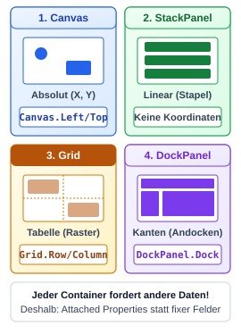
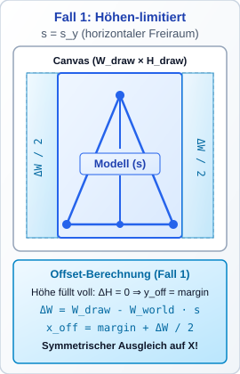
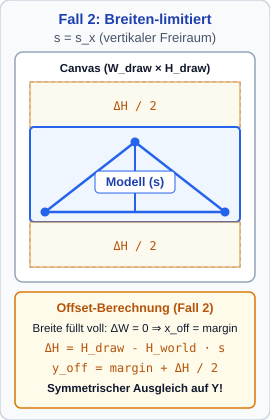
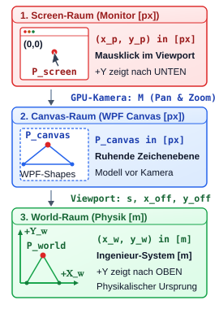
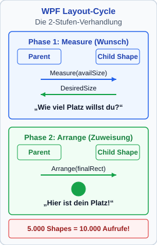

<!-- _paginate: false -->
<!-- _header: "" -->
<!-- _footer: "" -->
<!-- _class: title -->


# Kapitel 3 (Anhang A): 2D-Vektorgrafik & WPF-Interna

Vertiefende Herleitungen & Architektur-Details zum Selbststudium:

- WPF Layout-Panels, Attached Properties & Shape-Positionierung
- Zentrierungs-Grenzfälle ($s_y \le s_x$ vs. $s_x < s_y$) & `ScaleAt`-Beweis
- Koordinatenschichten (`World` / `Canvas` / `Screen`) & 2-Phasen-Layout-Cycle
- `VisualHost`-Control & `OnRender`-Alternative für `DrawingVisual`

---

### WPF Layout-Panels: 4 Strategien

<div class="columns top">
<div class="two">

In WPF positioniert man UI-Elemente nicht pixelgenau per Hand, sondern überlässt dies spezialisierten **Layout-Containern (Panels)**:

- **`Canvas` (Absolut):** Platziert Kindelemente an expliziten Koordinaten $(x, y)$. Ideal für 2D-Simulationen, CAD und Vektorgrafiken.
- **`StackPanel` (Linear):** Stapelt Elemente sequentiell horizontal oder vertikal (Menüs, Toolbars).
- **`Grid` (Tabellarisch):** Teilt Fläche in Zeilen und Spalten (`Row`, `Column`) – Standard für responsive Masken.
- **`DockPanel` (Andocken):** Heftet Elemente an Außenkanten (`Top`, `Bottom`, `Left`, `Right`) und füllt das Zentrum.

</div>
<div class="one">



</div>
</div>

---

### Attached Properties: Hinter den Kulissen (C# & XAML)

<div class="columns top">
<div class="one">

**1. Interner Property-Store (`DependencyObject`):**
`node.SetValue(Canvas.LeftProperty, 100.0);` (kein Feld `Left` in `Ellipse`).

**2. Syntax-Gegenüberstellung:**
- **XAML:** `<Ellipse Canvas.Left="100" Canvas.Top="50"/>`
- **C#:** `Canvas.SetLeft(node, 100.0);`

</div>
<div class="one">

**3. Wie nutzt der `Canvas` den Wert?**
In Phase 2 (`Arrange`) fragt der `Canvas` jedes `child` ab:

```csharp
foreach (UIElement child in Children)
    child.Arrange(new Rect(Canvas.GetLeft(child), Canvas.GetTop(child),
        child.DesiredSize.Width, child.DesiredSize.Height));
```

> **Tipp:** `Canvas.SetLeft()` markiert nur das Canvas-Layout (`AffectsArrange`).

</div>
</div>

---

### Positionierungs-Strategien der WPF Shapes

<div class="columns top">
<div class="two">

| Control | Positionierungsmethode |
| :--- | :--- |
| **`Line`** | Eigene Eigenschaften `X1, Y1, X2, Y2` (relativ zu Canvas) |
| **`Ellipse`** | `Canvas.Left`, `Canvas.Top` (linke obere Hüllbox-Ecke!) |
| **`Polygon`** | Interne `Points`-Sammlung absoluter Koordinaten |
| **`Path`** | Koordinaten in der `PathGeometry` (`Figures`) |

**Zentrierung von Knotenpunkten (`Ellipse`):**
Um `node` mit Radius $r$ auf Punkt $p = (x_s, y_s)$ zu zentrieren:
$$\text{Canvas.Left} = x_s - r, \quad \text{Canvas.Top} = y_s - r$$

</div>
<div class="one">

```csharp
// Knoten als zentrierten Kreis zeichnen
public void AddNode(Canvas canvas,
                    Point p, double r)
{
    var node = new Ellipse
    {
        Width = 2 * r,
        Height = 2 * r,
        Fill = Brushes.SteelBlue
    };
    Canvas.SetLeft(node, p.X - r);
    Canvas.SetTop(node, p.Y - r);
    canvas.Children.Add(node);
}
```

</div>
</div>

---

### Zentrierung Fall 1: Höhen-limitiert

<div class="columns top">
<div class="two">

Ist das Fenster relativ breiter als das Modell, limitiert die Höhe ($s = s_y$):

- **Vertikale Achse (voll belegt):**
  Modellhöhe füllt $H_{\text{draw}}$ ($H_{\text{world}} \cdot s$). $\Delta H = 0 \implies y_{\text{off}} = \text{margin}$.
- **Horizontale Achse (Freiraum):**
  Freiraum $\Delta W = W_{\text{draw}} - W_{\text{world}} \cdot s > 0$ wird links/rechts halbiert:
  $$x_{\text{off}} = \text{margin} + \frac{\Delta W}{2} \quad [\mathrm{px}]$$
- **Ergebnis:** Das Modell steht horizontal perfekt zentriert im Viewport.

</div>
<div class="one">



</div>
</div>

---

### Zentrierung Fall 2: Breiten-limitiert

<div class="columns top">
<div class="two">

Ist das Fenster relativ höher als das Modell, limitiert die Breite ($s = s_x$):

- **Horizontale Achse (voll belegt):**
  Modellbreite füllt $W_{\text{draw}}$ ($W_{\text{world}} \cdot s$). $\Delta W = 0 \implies x_{\text{off}} = \text{margin}$.
- **Vertikale Achse (Freiraum):**
  Freiraum $\Delta H = H_{\text{draw}} - H_{\text{world}} \cdot s > 0$ wird oben/unten halbiert:
  $$y_{\text{off}} = \text{margin} + \frac{\Delta H}{2} \quad [\mathrm{px}]$$
- **Universelle C#-Formel (ohne `if`/`else`):** Auf der limitierenden Achse gilt $\Delta = 0$.

</div>
<div class="one">



</div>
</div>

---

### Mathematischer Beweis der `ScaleAt`-Transformation

<div class="columns top">
<div class="one">

**1. Vektorielle Kaskade & Fixpunkt:**
Ein Punkt $\vec{P}$ durchläuft die drei Einzelschritte um Zentrum $\vec{C}$:
- **Schritt 1:** $\vec{P}_1 = \vec{P} - \vec{C}$ (in Ursprung)
- **Schritt 2:** $\vec{P}_2 = s \cdot (\vec{P} - \vec{C})$ (Skalierung)
- **Schritt 3:** $\vec{P}' = s \cdot (\vec{P} - \vec{C}) + \vec{C} = s \cdot \vec{P} + (1 - s) \cdot \vec{C}$

**Fixpunkt ($\vec{P} = \vec{C}$):** $\vec{C}' = s \cdot \vec{C} + (1 - s) \cdot \vec{C} = \vec{C} \quad \checkmark$

</div>
<div class="one">

**2. Homogene $3 \times 3$-Transformationsmatrix:**
$$\begin{aligned}
\mathbf{M}_{\text{zoom}} &= \begin{pmatrix} 1 & 0 & C_x \\ 0 & 1 & C_y \\ 0 & 0 & 1 \end{pmatrix} \begin{pmatrix} s & 0 & -s\,C_x \\ 0 & s & -s\,C_y \\ 0 & 0 & 1 \end{pmatrix} \\
&= \begin{pmatrix} s & 0 & (1 - s)\,C_x \\ 0 & s & (1 - s)\,C_y \\ 0 & 0 & 1 \end{pmatrix}
\end{aligned}$$

- **Radialer Zoom ($\vec{P} = \vec{C} + \vec{r}$):** $\vec{P}' - \vec{C} = s \cdot \vec{r}$.

</div>
</div>

---

### Die drei Koordinatenräume: Screen, Canvas und World

<div class="columns top">
<div class="two">

Beim interaktiven Arbeiten existieren drei Bezugssysteme (Vorwärts-Pipeline: $\text{World} \xrightarrow{s, x_{\text{off}}, y_{\text{off}}} \text{Canvas} \xrightarrow{\mathbf{M}} \text{Screen}$):

- **Screen-Raum (Viewport $[\mathrm{px}]$):** Diskrete Fenster-Pixel $\vec{P}_{\text{screen}} = (x_p, y_p)$; $+Y$ nach unten.
- **Canvas-Raum (Zeichenebene $[\mathrm{px}]$):** Ruhende Ebene der WPF-Shapes $\vec{P}_{\text{canvas}}$; GPU-Kameramatrix $\mathbf{M}$ verschiebt/skaliert sie dynamisch.
- **World-Raum (Physikmodell $[\mathrm{m}]$):** Ingenieur-Koordinaten $\vec{P}_{\text{world}} = (x_w, y_w)$; $+Y$ nach oben.

</div>
<div class="one">



</div>
</div>

---

### Der 2-stufige Layout-Cycle: Warum zwei Phasen?

<div class="columns top">
<div class="two">

Ein Container kann Kindern erst Raum zuweisen, wenn er den Gesamtbedarf aller Kinder kennt:

- **Phase 1: `Measure` (Bedarfsermittlung):**
  Parent ruft `child.Measure(availableSize)` auf; Kind meldet `DesiredSize` zurück.
- **Phase 2: `Arrange` (Raumzuweisung):**
  Parent ruft `child.Arrange(finalRect)` auf; Kind erhält finale Position und Größe (`ActualWidth`, `ActualHeight`).

</div>
<div class="one">



</div>
</div>

---

### Das `VisualHost`-Control & `OnRender`-Alternative

<div class="columns top">
<div class="one">

**Variante A: `VisualHost` (`FastDrawingCanvas`):**
```csharp
public class FastDrawingCanvas : FrameworkElement
{
    private readonly VisualCollection _children;
    private readonly DrawingVisual _dv = new();

    public FastDrawingCanvas() =>
        _children = new VisualCollection(this) { _dv };

    protected override int VisualChildrenCount => _children.Count;
    protected override Visual GetVisualChild(int i) => _children[i];

    public void Render(Action<DrawingContext> draw)
    {
        using DrawingContext dc = _dv.RenderOpen();
        draw(dc);
    }
}
```

</div>
<div class="one">

**Variante B: `OnRender` überschreiben:**
```csharp
public class SimpleRenderCanvas : FrameworkElement
{
    private static readonly Pen LinePen = CreatePen();
    public SimulationData? Data { get; set; }
    private static Pen CreatePen() { var p = new Pen(Brushes.Black, 1); p.Freeze(); return p; }

    protected override void OnRender(DrawingContext dc)
    {
        base.OnRender(dc);
        if (Data == null) return;
        foreach (var bar in Data.Bars) dc.DrawLine(LinePen, bar.P1, bar.P2);
    }
}
```
- Neuzeichnen per `InvalidateVisual()`; Variante A nutzt `draw(dc)`, Variante B überschreibt `OnRender(dc)`.

</div>
</div>
