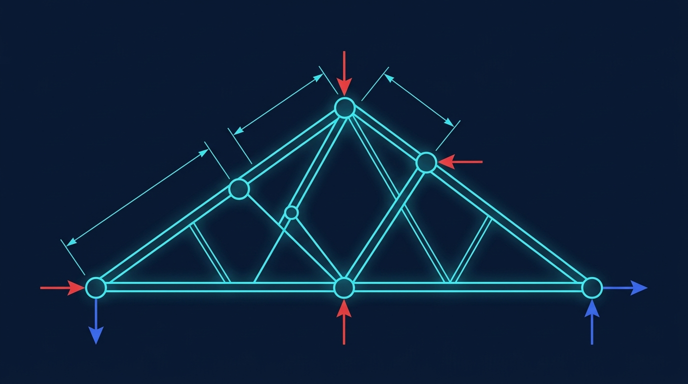

### Termin 03: 2D-Vektorgrafik, Koordinatentransformation & Canvas
*(Vorlesungskapitel: 03 Visualisierung 2D Vektor)*

In dieser Einheit widmen uns der mechatronischen 2D-Vektorgrafik auf dem WPF Canvas. Wir leiten die exakte affine Koordinatentransformation zwischen metrischen Weltkoordinaten in Metern und pixelbasierten Bildschirmkoordinaten her (isotrope Skalierung, Inversion der Y-Achse, Randabstand). Zudem zeichnen wir analytisch rotierte Kraftpfeile und normgerechte DIN-Bemaßungsketten. *(Kausalitätshinweis: In dieser Einheit geht es rein um die geometrische und visuelle Darstellung – die FEM-Statikberechnung folgt in Termin 07!)*

**Ablauf & Übungsaufgaben:**
* 🎤 **Showcase T02:** Zwei ausgewählte Teams präsentieren ihre FDM-Wärmeleitungs- und Pixelsimulationen am Beamer.
* 📝 **Moodle-Quiz 1 (15 min):** Erstes summatives Quiz zu den Grundlagen, Pixelgrafik und der CFL-Stabilitätsgrenze (Kapitel 00 bis 02).
* **Stufe 1 (Basisaufgabe):** Reversible Koordinatentransformation Transform2D, Live-Stablängen, vertikale DIN-406-Bemaßung und Behebung des Bounding-Box-Jitterings beim Ziehen.
* 🏭 **Stufe 2 – Track A (Industrie):** *2D-CAD Tragwerks-Inspektor & Last-Editor* – Zweistufige DIN-406-Bemaßungsketten, interaktives Ziehen und Drehen der Kraftpfeilspitzen, Mausrad-Zoom/Pan und JSON-Export.
* 🎮 **Stufe 2 – Track B (Game):** *„Poly Bridge“ Blueprint-Baumeister* – Interaktives Brückenbau-Zeichenbrett über einer Schlucht mit 0,5-m-Grid-Snapping, Maximallängen-Vorschau (bis 4,0 m), Live-Baubudget und JSON-Level-Export.
