<!-- _paginate: false -->
<!-- _header: "" -->
<!-- _footer: "" -->
<!-- _class: title -->


# Kapitel 4: 2D-Visualisierung (Diagramme & Graphen)

Dieses Kapitel umfasst die folgenden Abschnitte:

- 4.1: Einführung in 2D-Diagramme und Datenstrukturen
- 4.2: Zeitreihen- und Streudiagramme mit ScottPlot
- 4.3: Statistische Auswertung & Histogramme mit ScottPlot
- 4.4: Live-Streaming & Telemetrie
- 4.5: Topologie- und Netzwerkgraphen mit MSAGL

---

<!-- _class: showcase -->

### Live-Showcase & Code-Defense: Termin 03

Präsentation der Hausübung aus Termin 03 (**Stufe 1: Basisaufgabe** + **Stufe 2: Track A oder B**, [Aufgabenblatt 03](../../03_Vektorgrafik_und_Canvas/Uebung/Aufgabenblatt.md)):

<div class="columns">
<div class="two">

#### Stufe 2 – Track A: Industrie (2D-CAD Tragwerks-Inspektor)
- **Geometrie:** Zweistufige DIN-406-Bemaßungsketten, Auto-Fit BoundingBox & $1{,}0\,\text{m}$-Gitter.
- **Interaktion:** Ziehen der Kraftpfeilspitzen $(F_x, F_y)$, Mausrad-Zoom & Kamera-Panning.
- **Stresstest:** Extremes Fensterformat (32:9), Pfeilspitzen-Invarianz & JSON-Export.

</div>
<div class="two">

#### Stufe 2 – Track B: Game (Poly Bridge Blueprint-Baumeister)
- **Vektorgrafik:** Schlucht-Szenerie mit $0{,}5\,\text{m}$-Grid-Snapping, $L_{\max}$-Vorschau & Baubudget.
- **Interaktion:** Knoten setzen, Stäbe spannen ($L \le 4{,}0\,\text{m}$) und Elemente löschen (`Entf`).
- **Stresstest:** Maximallängen-Sperre (rot ab $4{,}0\,\text{m}$), Budget-Limit überschreiten & JSON-Level-Export.

</div>
</div>

> **Code-Defense (Säule 2b, 20 %):** Prüfung auf exakte Koordinatentransformation (Welt $\leftrightarrow$ Screen), Isotropie und Kausalität (reine Geometrie, keine Statik!).

---

<!-- _class: recap -->

### Rückblick & Brücke: Wo stehen wir in der Vorlesung?

<div class="columns top">
<div class="two">

In **T02 & T03** entstanden unsere 2D-Grundlagen – was fehlt noch?

- **T02 (`WriteableBitmap`):** Schnelle 2D-Rasterfelder (`uint[]`), ohne Achsen oder Einheiten.
- **T03 (`WPF Canvas`):** Maßstabsgetreue CAD-Geometrie, ohne Ticks oder Auto-Scaling.
- **Heute (3. Säule):** Telemetrie (`ScottPlot 5`), `CircularBuffer<T>`, Welford & `MSAGL`.

> **Ziel heute:** 1-kHz-Signale bei 60 FPS mit **0 Byte GC-Allokation** pro Tick!

</div>
<div class="two">

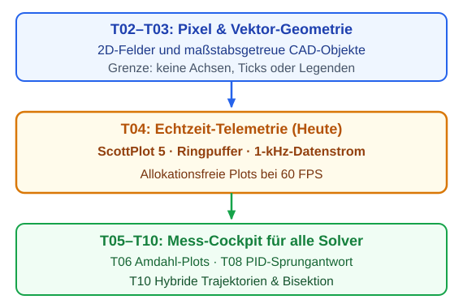

</div>
</div>

---


## 4.1: Einführung in 2D-Diagramme und Datenstrukturen

Dieser Abschnitt umfasst die folgenden Inhalte:

- Brücke zu Termin 02 (Raw Pixels) und Termin 03 (2D-Vektorgrafik)
- Die 3-Schichten-Architektur der 2D-Visualisierung
- Warum Diagramme und Graphen in der Simulationstechnik unverzichtbar sind
- Welche Aufgaben `ScottPlot 5` und `MSAGL` übernehmen
- Blick unter die Haube: Vektor-Primitive vs. Raw-Pixel-Backends

---

### Die 3-Schichten-Architektur der 2D-Visualisierung

Diagramm- und Graph-Bibliotheken bilden die **nächste Abstraktionsschicht** über Termin 02 und 03:

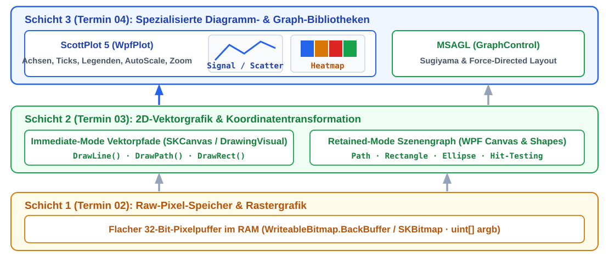

---

### Warum Diagramme in der Simulation?

<div class="columns">
<div class="two">

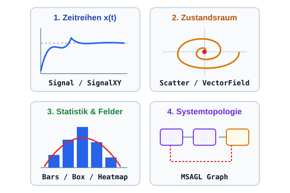

</div>
<div class="two">

Ein numerischer Simulator berechnet rohe Zahlenkolonnen. Erst **Diagramme** beantworten zentrale Ingenieurfragen:

1. **Zeitreihen (`Signal`, `SignalXY`):** Wie schnell schwingt ein Regler ein? Gibt es Überschwingen?
2. **Zustandsraum (`Scatter`, `VectorField`):** Werden Leistungs- oder Haftgrenzen verletzt?
3. **Statistik & Felder (`Bars`, `Box`, `Heatmap`):** Halten Bauteile in $10.000$ Läufen die Toleranz ein?
4. **Systemtopologie (`MSAGL`):** Wie sind Blöcke verschaltet?

</div>
</div>

---

### Die Render-Engine unter ScottPlot 5: SkiaSharp (`SK...`)

<div class="columns">
<div class="two">

`ScottPlot 5` nutzt intern **SkiaSharp** (Googles 2D-Engine *Skia*):

1. **`SKPath` (Vektorpfad, wie Termin 03):**
   - Punktfolge (`MoveTo`, `LineTo`, `Close`) für Linienzüge (`Scatter`, `Signal`) und Polygone (`FillY`).
2. **`SKBitmap` (Pixel-Puffer, wie Termin 02):**
   - 32-Bit-Pixel-Array (`uint[]`) für Rasterdaten (`Heatmap`) – **1:1 wie `WriteableBitmap`**!
3. **`SKCanvas` (Zeichenfläche in `WpfPlot`):**
   - Rendert `DrawPath(SKPath)` und `DrawBitmap(SKBitmap)` direkt in 1 Bild (0 WPF-`Shape`-Objekte!).

</div>
<div class="two">

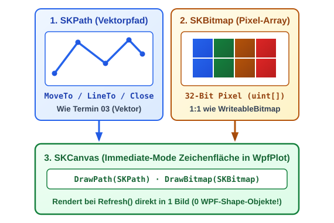

</div>
</div>

---

### Blick unter die Haube: Welche Backends nutzen die Bibliotheken?

`ScottPlot 5` und `MSAGL` nutzen intern genau die Techniken aus Termin 02 und Termin 03:

| Bibliothek & Diagrammtyp | Internes Rendering-Backend | Bezug zu Termin 02 / 03 | Warum genau diese Technik? |
|---|---|---|---|
| **ScottPlot:** `Scatter`, `Signal`, `Bars`, `Box`, `FillY` | **Immediate-Mode Vektorpfade** (`SKCanvas`: `DrawLine`, `DrawPath`) | Wie `DrawingVisual` (Termin 03) | Scharfe Kurven ohne Millionen `Shape`-Objekte im WPF-Baum |
| **ScottPlot:** `Heatmap` & `ColorBar` | **Raw-Pixel-Puffer** (`SKBitmap` / `uint[]` mit Farb-Lookup) | **1:1 wie `WriteableBitmap`** (Termin 02) | $500 \times 500$ Gitter als 1 Textur in $\mathcal{O}(1)$ statt $250.000$ Rechtecke |
| **MSAGL:** `GraphControl` (Netzwerkgraphen) | **Retained-Mode WPF-`Canvas`** (echte `Path`- & `Shape`-Controls) | **1:1 wie `WPF Canvas`** (Termin 03) | Überschaubare Knotenzahl ($10 \dots 500$), dafür Klick- & Drag-Events |

---


## 4.2: Zeitreihen- und Streudiagramme mit ScottPlot

Dieser Abschnitt umfasst die folgenden Inhalte:

- Grundaufbau & API-Workflow von `ScottPlot 5` in WPF
- Streudiagramme & Phasenraum mit `Scatter` ($\mathcal{O}(N)$) & `SquareUnits()`
- Zeitreihen mit `Signal` ($\mathcal{O}(W)$, 50 % weniger RAM) & Methodenvergleich

---

### ScottPlot 5 in WPF: Grundlegender Workflow

<div class="columns">
<div class="two">

Die zentrale Klasse in `ScottPlot 5` ist `ScottPlot.Plot`. Das WPF-Control `WpfPlot` bettet diese Zeichenfläche direkt ins Fenster ein.

**Der 5-Schritte-Workflow in C#:**
1. **Control einbinden:** `<sp:WpfPlot x:Name="WpfPlot1" />` im XAML platzieren.
2. **Plot-Ebenen hinzufügen:** Daten mit `Plot.Add.Scatter(...)`, `Add.Signal(...)` oder `Add.Bars(...)` übergeben.
3. **Achsen beschriften:** `Plot.Title(...)`, `Plot.XLabel(...)` und `Plot.YLabel(...)`.
4. **Skalieren & Legende:** `Plot.ShowLegend()` und `Plot.Axes.AutoScale()`.
5. **Neuzeichnen anstoßen:** `WpfPlot1.Refresh()` rendert das Bild.

</div>
<div class="one">

```xaml
<!-- XAML-Einbindung -->
<Window ...
  xmlns:sp="clr-namespace:
    ScottPlot.WPF;
    assembly=ScottPlot.WPF">
  <Grid>
    <sp:WpfPlot 
      x:Name="WpfPlot1" />
  </Grid>
</Window>
```

**Code-Behind (C#):**
```csharp
// C#-Aufruf (Code-Behind)
WpfPlot1.Plot.Add.Signal(ys);
WpfPlot1.Plot.Axes.AutoScale();
WpfPlot1.Refresh();
```

</div>
</div>

---

### Anwendungsbeispiel `Scatter`: DC-Motor & Kamm'scher Kreis

<div class="columns">
<div class="two">

- **Zustandsraum $(n, M)$ (Track A):** Drehmoment $M$ über Drehzahl $n$ + rote Leistungsgrenze $P_{\max} = 1{,}2\,\text{kW}$.
- **G-G-Diagramm (Track B):** Quer-/Längsbeschleunigung $(a_y, a_x)$ im $1{,}0\,g$-Kreis.
- **Warum `Scatter` ($\mathcal{O}(N)$)?** Trajektorien laufen vorwärts und rückwärts (nicht-monoton in $x$); `plot.Axes.SquareUnits()` sichert **1:1-Isotropie**.
- **Praxis-Tipp:** `MarkerSize` hält auch dichte Wolken lesbar.

</div>
<div class="three">

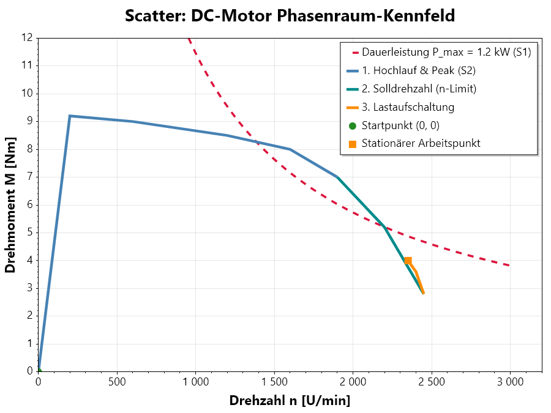

</div>
</div>

---

### Der C#-Code zu `ScatterLine`, Punktwolke & `SquareUnits()`

<div class="columns">
<div class="two">

```csharp
// 1. Leistungshyperbel (ScatterLine)
var hyp = plot.Add.ScatterLine(nHyp, mHyp);
hyp.Color = Colors.Crimson;
hyp.LinePattern = LinePattern.Dashed;
// 2. Punktwolke ohne Linie (Kamm'scher Kreis)
var sGreen = plot.Add.Scatter(ptsGreenX, ptsGreenY);
sGreen.LineWidth = 0;
sGreen.MarkerSize = 10;
plot.Axes.SquareUnits(); // Verzerrungsfreies 1:1-Seitenverhältnis (Isotropie)
```

- `ScatterLine` (`hyp`, `nHyp`, `mHyp`) verbindet Punkte `i = 0..N-1` als `SKPath`; `LineWidth = 0` (`sGreen`, `ptsGreenX`, `ptsGreenY`) zeichnet Marker.

> **Merksatz:** `Scatter` eignet sich für Kennfelder und Phasenportraits ($\le 10^4$ Punkte) mit beliebigen Trajektorien!

</div>
<div class="two">

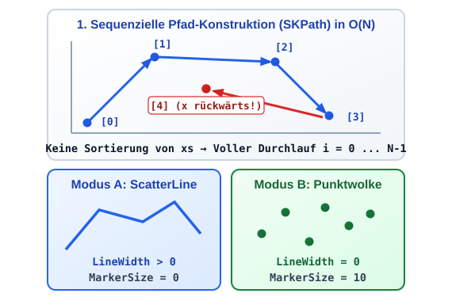

</div>
</div>

---

### Von `Scatter` zu `Signal`: Display-Bottleneck & 50 % weniger RAM

<div class="columns">
<div class="two">

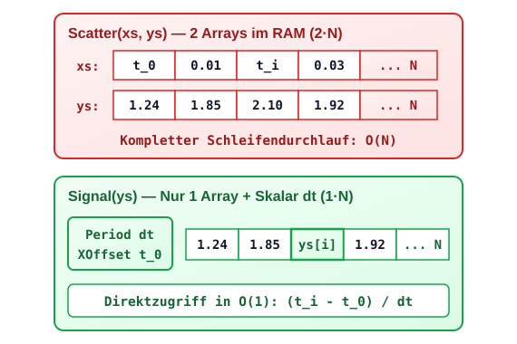

</div>
<div class="two">

Bei $N = 10^7$ äquidistanten Punkten ($t_i = t_0 + i \cdot \Delta t$, $\Delta t = 1\,\text{ms}$) kollabiert `Scatter`:

- **Display-Bottleneck:** Bei $W \approx 1.920$ Pixelspalten fallen $5.000$ Werte in **1 Spalte** (`Signal`: **4 Eckpunkte/Spalte**, $\mathcal{O}(W)$).
- **50 % weniger RAM:** `Scatter(xs, ys)` braucht $160\,\text{MB}$; `Signal(ys)` speichert nur `ys` ($80\,\text{MB}$) + `Period` & `XOffset`.
- **$\mathcal{O}(1)$-Zoom-Clipping:** Start-Index per Dreisatz $i = (t_{\min} - t_0) / \Delta t$.

> **Effekt:** Peaks bleiben exakt erhalten und Zoomen läuft verzögerungsfrei!

</div>
</div>

---

<!-- _class: activity -->

### Mitmach-Impuls (3 Min.): `Scatter`, `Signal` & `SignalXY`

Eine 1-kHz-Simulation läuft $10.000\,\text{s}$ lang ($N = 10^7$ `double`-Werte à $8\,\text{Bytes}$):

| Plot-Typ | Arrays im RAM | Index-Suche | Typischer Einsatz |
| :--- | :--- | :--- | :--- |
| `Scatter(xs, ys)` | `xs` + `ys` ($2 \times N$) | $\mathcal{O}(N)$ | Nicht-monotone 2D-Kurven |
| `Signal(ys)` | Nur `ys` ($1 \times N$) | $\mathcal{O}(1)$ | Feste Schrittweite $\Delta t$ |

1. **Speicherbedarf:** Wie viel MB RAM sparen wir, wenn wir `Plot.Add.Signal(ys)` statt `Plot.Add.Scatter(xs, ys)` verwenden?
2. **Adaptive Schrittweite:** Ein RK45-Solver ändert $\Delta t$ laufend. Warum scheitert `Signal(ys)` hier, und welcher Plot-Typ löst das in $\mathcal{O}(\log N)$?
3. **Kreis-Geometrie:** Warum wird der Kamm'sche Kreis ohne `plot.Axes.SquareUnits()` auf einem 16:9-Monitor zur Ellipse?

> **Hinweis:** Diskutieren Sie kurz zu zweit – denken Sie an `xs`-Arrays, binäre Suche und Seitenverhältnisse!

---

<!-- _class: solution -->

### Auflösung: `Scatter`, `Signal` & `SignalXY`

1. **RAM-Ersparnis:** `Scatter` belegt $2 \times 10^7 \times 8\,\text{B} = 160\,\text{MB}$; `Signal` spart das `xs`-Array komplett ein $\implies$ **$80\,\text{MB}$ Ersparnis (50 %)**.
2. **RK45 mit variablem $\Delta t$:** `Signal` setzt konstantes `Period` für den $\mathcal{O}(1)$-Dreisatz voraus; **`Plot.Add.SignalXY(xs, ys)`** nutzt Binärsuche in $\mathcal{O}(\log N)$ + adaptives Bucketing.
3. **1:1-Isotropie:** Ohne `SquareUnits()` nutzt ScottPlot getrennte Pixel-pro-Einheit-Maßstäbe auf X- und Y-Achse (Anisotropie-Falle aus Termin 03):
   ```csharp
   var sig = plot.Add.Signal(ys);
   sig.Data.Period = 0.001; // Feste Schrittweite dt
   plot.Axes.SquareUnits(); // Erzwingt identischen Pixel-pro-Einheit-Maßstab
   ```
   - `sig` und `ys` decken feste Zeitraster ab; `SquareUnits()` verhindert gestauchte Kreise auf 16:9-Monitoren.

> **Merksatz:** Feste Schrittweite $\to$ `Signal` ($\mathcal{O}(1)$), variables $\Delta t$ $\to$ `SignalXY` ($\mathcal{O}(\log N)$), beliebige 2D-Kurven $\to$ `Scatter`!

---

### Der C#-Code zu `Plot.Add.Signal` & Methodenvergleich

<div class="columns">
<div class="two">

```csharp
// N = 10.000.000 Punkte (nur 1 Array ys im RAM!)
double[] ys = Simulation.RunFixedStepEuler(
    steps: 10_000_000, dt: 0.001);

var sig = WpfPlot1.Plot.Add.Signal(ys);
sig.Data.Period  = 0.001; // dt = 1 ms (1 kHz)
sig.Data.XOffset = 0.0;   // Startzeitpunkt t0 = 0 s
WpfPlot1.Refresh();
```

- `ys` wird an `sig` übergeben (`Period`, `XOffset`); `SignalXY` & `VectorField` siehe [Anhang A](./Folien_Anhang_A_ScottPlot_Details.md).

</div>
<div class="two">

| Typ | RAM | Suche | Einsatz |
|---|---|---|---|
| `Scatter` | $2\times N$ | $\mathcal{O}(N)$ | Kennfeld ($\le 10^4$) |
| `Signal` | **$1\times N$** | **$\mathcal{O}(1)$** | Feste $\Delta t$ ($> 10^7$) |
| `SignalXY` | $2\times N$ | $\mathcal{O}(\log N)$ | RK45 ($\approx 10^6$) |
| `VectorField` | $4\cdot N_{\text{Gitter}}$ | $\mathcal{O}(N_{\text{Gitter}})$ | Richtungsfeld |

</div>
</div>

> **Praxis-Regel:** Für klassische Zeitsignale mit fester Schrittweite `dt` immer `Add.Signal` bevorzugen – halber RAM und sofortiges Zoom-Clipping!

---


## 4.3: Statistische Auswertung & Histogramme mit ScottPlot

Dieser Abschnitt umfasst die folgenden Inhalte:

- Statistische Diagramme in der Simulation (Monte-Carlo, Rauschen, Varianten)
- Anwendungsbeispiel Histogramm: Binning ($\mathcal{O}(N) \to \mathcal{O}(k)$) & Gauß-Skalierung
- C#-Code zum Histogramm + Überblick über `Boxes`, `Bars` & `Heatmap`

---

### Anwendungsbeispiel: Histogramm & Normalverteilung

<div class="columns">
<div class="two">

Monte-Carlo-Toleranzanalyse ($N = 10.000$ Läufe) einer Bauteillänge ($\mu = 100\,\text{mm}$, $\sigma = 4{,}5\,\text{mm}$):

- **Blaue Balken (`Add.Bars`):** Gezählte Stückzahlen in $k = 24$ Klassen (bis ca. $1.150$ Bauteile pro Klasse).
- **Rote Kurve (`Add.ScatterLine`):** Überlagerte analytische Gauß-Glockenkurve $\mathcal{N}(100, 4{,}5^2)$.
- **Grüne Linie (`Add.VerticalLine`):** Markiert den Soll-Mittelwert $\mu = 100\,\text{mm}$.

</div>
<div class="three">

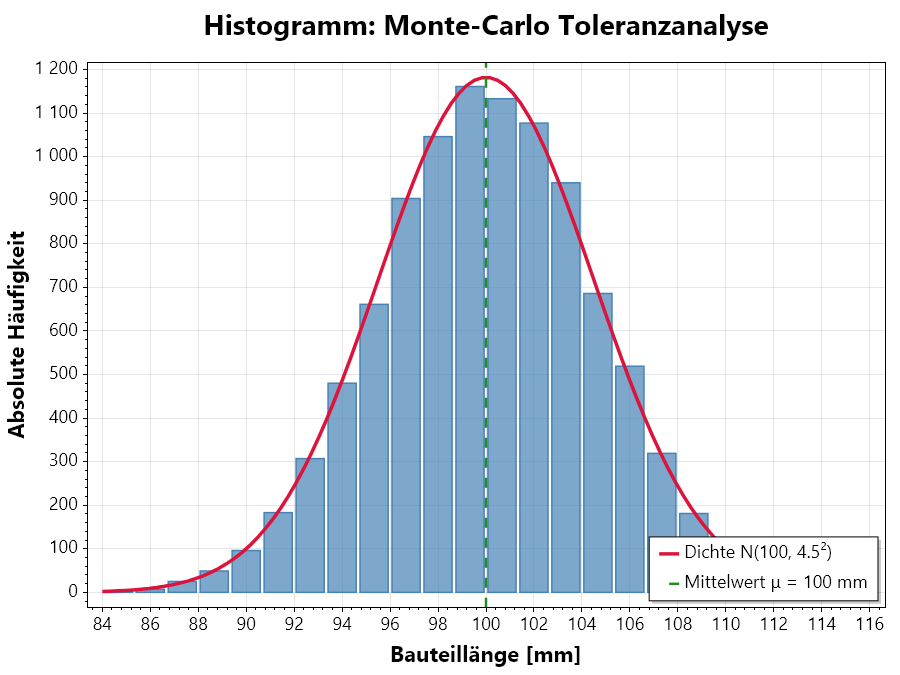

</div>
</div>

---

### Blick unter die Haube: Binning & Gauß-Skalierung

<div class="columns">
<div class="two">

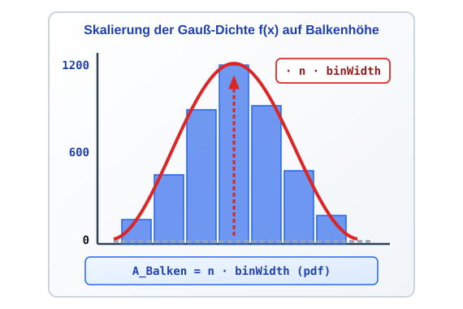

</div>
<div class="two">

- **Zweistufiges Binning ($\mathcal{O}(N) \to \mathcal{O}(k)$):** `hist.AddRange(samples)` zählt $10.000$ Werte einmalig in $k = 24$ Bins ein; die GPU zeichnet nur $24$ Rechtecke!
- **Y-Skalierungsproblem:** Balken zählen Häufigkeiten (Fläche $A_{\text{Balken}} = n \cdot \text{binWidth}$), die Gauß-Dichte `pdf` hat Fläche $1$ ($\max \approx 0{,}088$).
- **Lösung:** `cy[i] = pdf * n * binWidth`.

> **Merksatz:** Ohne Multiplikation mit `n * binWidth` bleibt die Gauß-Kurve bei $\approx 0{,}088$ unsichtbar am unteren Rand kleben!

</div>
</div>

---

### Der C#-Code zum Histogramm mit überlagerter Gauß-Kurve

```csharp
// 1. Histogramm mit k = 24 Klassen in [84..116 mm] aus N = 10.000 Werten zählen: O(N)
var hist = ScottPlot.Statistics.Histogram.WithBinCount(24, 84, 116);
hist.AddRange(samples);
double binWidth = hist.FirstBinSize;
var bars = new List<Bar>(); // Ebene 1: Gezählte Klassen als Balken, O(k) beim Zeichnen
for (int i = 0; i < hist.Counts.Length; i++)
    bars.Add(new Bar { Position = hist.Bins[i] + binWidth * 0.5, Value = hist.Counts[i],
        Size = binWidth * 0.88, FillColor = Colors.SteelBlue.WithAlpha(0.7f), LineColor = Colors.SteelBlue });
plot.Add.Bars(bars);
// 3. Ebene 2: Gauß-Dichte berechnen und mit (n * binWidth) auf Balkenhöhe skalieren
double[] cx = new double[100], cy = new double[100];
for (int i = 0; i < 100; i++) {
    cx[i] = 84.0 + i * (32.0 / 99.0);
    double pdf = (1.0 / (sigma * Math.Sqrt(2.0 * Math.PI))) * Math.Exp(-0.5 * Math.Pow((cx[i] - mu) / sigma, 2));
    cy[i] = pdf * samples.Length * binWidth; // Skalierung auf Histogramm-Fläche!
}
var curve = plot.Add.ScatterLine(cx, cy);
curve.Color = Colors.Crimson;
```

- `hist`, `binWidth`, `bars`, `cx`, `cy`, `pdf` und `curve` kombinieren Balken und Gauß-Kurve im selben Diagramm.

---

### Weitere Statistik-Plottypen: `Boxes`, `Bars` & `Heatmap`

Für Variantenvergleiche und 2D-Felder bietet ScottPlot spezialisierte Plot-Typen:

| Plot-Typ | Einsatzgebiet | Komplexität | Besonderheit |
|---|---|---|---|
| **`Plot.Add.Boxes`** | Gütevergleich (P/PI/PID-Regler) | $\mathcal{O}(N \log N) \to \mathcal{O}(1)$ | 5 Kennwerte ($Q_1, Q_2, Q_3$, Whisker) |
| **`Plot.Add.Bars`** | Gruppenvergleich ($G \times M$) | $\mathcal{O}(G \cdot M)$ | Offset $\pm\,\text{width}/2$ pro Serie |
| **`Plot.Add.Heatmap`** | 2D-Zustandsfelder ($T[i,j]$) | $\mathcal{O}(N_x \cdot N_y)$ | `SKBitmap`-Backend + `ColorBar` |

- **Vorteil:** `Boxes` & `Bars` zeichnen wenige Vektoren, `Heatmap` nutzt **1 Bitmap-Textur**.
- **Praxis:** Ideal für Parameter-Sweeps, Regler-Benchmarks und 2D-Wärmefelder (Termin 02).

> **Anhang:** C#-Codebeispiele zu `Boxes`, `Bars` & `Heatmap` siehe [Anhang A: ScottPlot-Details](./Folien_Anhang_A_ScottPlot_Details.md).

---


## 4.4: Live-Streaming & Telemetrie

Dieser Abschnitt umfasst die folgenden Inhalte:

- Echtzeit-Telemetrie vs. Offline-Analyse & Ringpuffer (`DataStreamer`)
- Taktentkopplung: 1.000 Hz Simulation vs. 50 Hz `DispatcherTimer`
- Online-Statistik (`WelfordStatistics`) & dynamische `HorizontalLine`

---

### Offline-Analyse vs. Echtzeit-Telemetrie & Ringpuffer

<div class="columns">
<div class="two">

Im Dauerbetrieb eines **Digitalen Zwillings** ($1.000\,\text{Hz}$) scheitern naive Ansätze:

1. **`List<double>.Add()` $\implies$ Speicherüberlauf:** Wächst unbegrenzt. **Lösung:** Fester **Ringpuffer** der Länge `cap` (`(head + 1) % cap` überschreibt ältesten Wert in $\mathcal{O}(1)$).
2. **`Refresh()` in jedem Schritt $\implies$ UI-Freeze:** Monitor zeigt nur 50–60 FPS. **Lösung:** **Taktentkopplung** über `DispatcherTimer` (50 Hz).

> **Merksatz:** Ein Ringpuffer hält Speicherverbrauch und Schreibzeit ($\mathcal{O}(1)$) auch nach Stunden Dauerbetrieb konstant!

</div>
<div class="two">

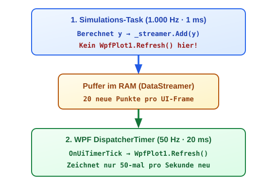

</div>
</div>

---

### Eigener Ringpuffer (`SimulationRingBuffer`) & Taktentkopplung

<div class="columns">
<div class="one">

```csharp
public class SimulationRingBuffer(int cap)
{
    private readonly double[] _data = new double[cap];
    private int _head;
    private readonly object _lock = new();

    public void Enqueue(double val)
    {
        lock (_lock) {
            _data[_head] = val;
            _head = (_head + 1) % _data.Length;
        }
    }
    public void CopyTo(double[] dest)
    {
        lock (_lock) { Array.Copy(_data, dest, _data.Length); }
    }
}
```

</div>
<div class="one">

```csharp
_streamer = WpfPlot1.Plot.Add.DataStreamer(500);
_streamer.Period = 0.001; // 1 ms (1 kHz)
_uiTimer = new DispatcherTimer {
    Interval = TimeSpan.FromMilliseconds(20) // 50 Hz
};
_uiTimer.Tick += OnUiTimerTick;

// 1000 Hz: Nur schreiben (0 Byte GC!)
private void OnSimulationStep(double y) => _streamer.Add(y);
// 50 Hz: Entspannt neuzeichnen
private void OnUiTimerTick(object? s, EventArgs e)
    => WpfPlot1.Refresh();
```

- Ringpuffer (`cap`, `val`, `dest`) + `_streamer`/`_uiTimer` (`y`, `s`, `e`) entkoppeln Takt & Speicher.

</div>
</div>

> **Praxis-Tipp:** Für gleitende Fenster-Statistiken kopiert `CopyTo(dest)` in ein **vorallokiertes** Array (0 Bytes Heap-Allokation pro Tick).

---

### Das Ringpuffer-Problem lösen: Welford-Online-Statistik

<div class="columns">
<div class="two">

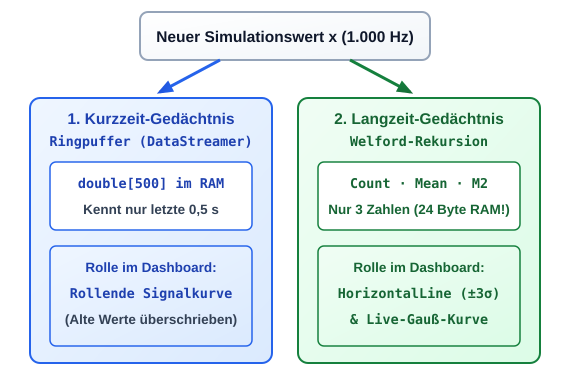

</div>
<div class="two">

- **Das Problem:** Für stabile `Mean ± 3·StdDev`-Grenzen (`HorizontalLine`) brauchen wir den globalen Mittelwert über Millionen Punkte – der `DataStreamer`-Ringpuffer behält aber nur die letzten 500 Werte ($0{,}5\,\text{s}$)!
- **Zwei-Gedächtnis-Architektur:** Jeder Messwert `x` geht an den **Ringpuffer** (Kurzzeit-Kurve) UND an die **Welford-Rekursion** (`Count`, `Mean`, `M2` = 24 Byte RAM, ohne numerische Auslöschung!).

</div>
</div>

> **Vorteil:** Auch bei $10^9$ Messwerten benötigt `WelfordStatistics` exakt **24 Bytes**!

---

### Der C#-Code: `WelfordStatistics` & dynamische `HorizontalLine`

<div class="columns">
<div class="two">

- **1. Laufende Statistik (`WelfordStatistics`):** Bei jedem neuen Wert `x` werden `Count`, `delta = x - Mean`, `Mean`, `deltaStar = x - Mean` und `M2` für `Variance` / `StdDev` aktualisiert ($\mathcal{O}(1)$).
- **2. Leitplanken nachführen:** Im 50-Hz-Timer setzen wir `.Y` von `_meanLine` und `_upperLine` (`_welford.Mean + 3.0 * _welford.StdDev`).
- **3. Kein Array-Speicher:** Nur 24 Bytes (`Count`, `Mean`, `M2`) statt Millionen Rohwerten.
- **Toleranzschlauch `FillY`:** Siehe [Anhang A](./Folien_Anhang_A_ScottPlot_Details.md).

> **Übung 1.1–1.3:** Genau diese Zwei-Gedächtnis-Architektur (plus `.Freeze()`-Fix & entprellter $3\sigma$-Alarm) setzen Sie in Stufe 1 um!

</div>
<div class="two">

```csharp
public class WelfordStatistics {
    public long Count { get; private set; }
    public double Mean { get; private set; }
    public double M2 { get; private set; }
    public double Variance => Count > 1 ? M2 / (Count - 1) : 0.0;
    public double StdDev => Math.Sqrt(Variance);

    public void Add(double x) {
        Count++;
        double delta = x - Mean;
        Mean += delta / Count;
        double deltaStar = x - Mean;
        M2 += delta * deltaStar;
    }
}
_meanLine.Y  = _welford.Mean;
_upperLine.Y = _welford.Mean + 3.0 * _welford.StdDev;
```

- **Numerik-Vorteil:** Kein Auslöschungsfehler wie bei der naiven Varianzformel $\sum x^2 - (\sum x)^2/N$!

</div>
</div>

---

<!-- _class: activity -->

### Mitmach-Impuls (3 Min.): Ringpuffer, Taktentkopplung & Welford

Ein 1-kHz-Prüfstand streamt Messwerte an ein WPF-Dashboard mit `DataStreamer(cap = 500)`:

| Komponente | Takt / Kapazität | Aufgabe im Live-Betrieb |
| :--- | :--- | :--- |
| `SimulationRingBuffer` | `cap = 500` ($0{,}5\,\text{s}$) | Kurzzeit-Fenster für Kurve & `CopyTo` |
| `WelfordStatistics` | $24\,\text{Bytes}$ (`Count`, `Mean`, `M2`) | Globales $\pm 3\sigma$-Langzeitgedächtnis |

1. **Ringpuffer-Index:** Der Schreibzeiger steht auf `_head = 499`. Auf welchen Index springt `(_head + 1) % cap` beim nächsten Wert, und was passiert mit dem ältesten Wert?
2. **UI-Freeze-Diagnose:** Ein Team ruft `WpfPlot1.Refresh()` direkt am Ende von `OnSimulationStep` (1.000 Hz) auf. Warum friert das Fenster ein?
3. **Welford vs. Summenformel:** Warum dürfen wir die Varianz nicht aus $\frac{1}{N}\sum x_i^2 - \bar{x}^2$ berechnen?

> **Hinweis:** Diskutieren Sie kurz zu zweit – denken Sie an Modulo, 20-ms-Timer und numerische Auslöschung!

---

<!-- _class: solution -->

### Auflösung: Ringpuffer, Taktentkopplung & Welford

1. **Ringpuffer-Wrap (`(499 + 1) % 500 = 0`):** Der Zeiger springt auf Index **`0`** zurück und überschreibt dort den ältesten Messwert in $\mathcal{O}(1)$ bei **0 Byte neuer Heap-Allokation**.
2. **UI-Freeze:** `Refresh()` rendert per SkiaSharp ein komplettes Bild – 1.000-mal/s überlastet den UI-Thread. Nur der **`DispatcherTimer` (50 Hz)** darf `Refresh()` aufrufen!
3. **Numerische Auslöschung:** Bei großen Offset-Werten (z. B. $10^6 + \epsilon$) löscht die Summenformel $\sum x^2 - N\bar{x}^2$ die Nachkommastellen aus (bis hin zu negativer Varianz!):
   ```csharp
   double delta = x - Mean;
   Mean += delta / Count;
   M2 += delta * (x - Mean); // Immer >= 0, keine Auslöschung!
   ```
   - **Speicher:** Nur 3 `double`/`long`-Felder (`Count`, `Mean`, `M2`) für unbegrenzt lange Läufe.

> **Merksatz:** Ringpuffer (Kurzzeit-Fenster) + Welford (24-Byte-Langzeitgedächtnis) + 50-Hz-Timer = flüssige Live-Telemetrie!

---


## 4.5: Topologie- und Netzwerkgraphen mit MSAGL

Dieser Abschnitt umfasst die folgenden Inhalte:

- Systemtopologien und Blockschaltbilder als gerichtete Graphen $G = (V, E)$
- `MSAGL` (`GraphControl`) in WPF & C#-API (`AddNode`, `AddEdge`)
- Layout-Strategien: Hierarchisches Sugiyama vs. Force-Directed (`MdsLayoutSettings`)

---

### Mathematische Modellierung & `MSAGL` in WPF

<div class="columns">
<div class="two">

In Blockdiagramm-Simulatoren wird die Systemstruktur als gerichteter Graph $G = (V, E)$ beschrieben (Knoten $V$, Kanten $E \subseteq V \times V$):

- **Warum `MSAGL`?** Aus Code geladene Modelle haben zunächst **keine $(x, y)$-Koordinaten**. `MSAGL` berechnet das Layout automatisch und rendert auf einem **echten WPF-`Canvas`** (wie in T03!).

```csharp
var graph = new Microsoft.Msagl.Drawing.Graph("Sim");
graph.AddNode("Sum").LabelText = "Sum [+ -]";
graph.AddEdge("Sum", "e(t)", "Integrator");
graph.AddEdge("Integrator", "x(t)", "Gain");
GraphControl.Graph = graph;
```

</div>
<div class="two">

```xaml
<Window ...
  xmlns:msagl="clr-namespace:
    Microsoft.Msagl.WpfGraphControl;
    assembly=
    Microsoft.Msagl.WpfGraphControl">
  <Grid>
    <msagl:AutomaticGraphLayoutControl
      x:Name="GraphControl" />
  </Grid>
</Window>
```

- **T08-Brücke:** Ab Termin 08 rendert dieses Control direkt Ihre S-Function-Blockdiagramme!

- Das Objekt `graph` definiert nur die logische Verschaltung – `GraphControl` berechnet alle Positionen vollautomatisch.

</div>
</div>

---

### Zwei Layout-Strategien: Sugiyama vs. Force-Directed

<div class="columns">
<div class="two">

Nach welchem Kriterium ordnet `MSAGL` die Knoten im 2D-Raum an?

1. **Hierarchisches Schicht-Layout (`SugiyamaLayoutSettings`, Standard):**
   - Für **kausale Signalflüsse** (`Sum` $\to$ `Regler` $\to$ `Strecke`) mit Rückführschleifen.
2. **Organisches Kräfte-Layout (`MdsLayoutSettings`, Force-Directed):**
   - Für **vermaschte Komponentennetze** (`GW-A`, `GW-B`, `S1`, `S2`, `R1`, `R2`), um Cluster sichtbar zu machen.
- **Praxis-Regel:** `Sugiyama` zeigt *Signalfluss*, `MdsLayoutSettings` zeigt *Topologie-Cluster*.

</div>
<div class="two">

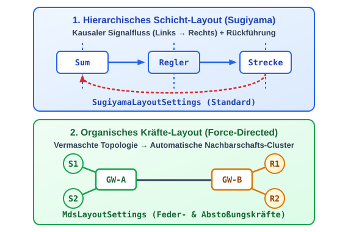

</div>
</div>

---

### Blick unter die Haube: Sugiyama-Phasen & Force-Directed

<div class="columns">
<div class="two">

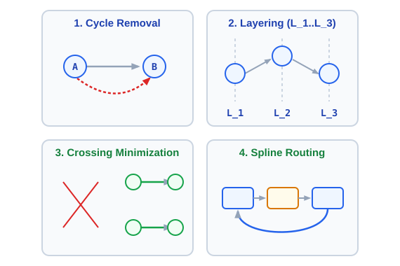

</div>
<div class="two">

- **Sugiyama-Algorithmus (4 Phasen):**
  1. *Cycle Removal* (Feedback-Kanten kurz umdrehen $\to$ DAG),
  2. *Layering* ($L_1, L_2, L_3$),
  3. *Crossing Minimization* (Kreuzungszahl minimieren),
  4. *Spline Routing* (kollisionsfreie Bezier-Kurven).
- **Force-Directed (`MdsLayoutSettings`):** Kanten wirken als **Zugfedern (Hooke, $\mathcal{O}(|E|)$)**, Knoten als **abstoßende Ladungen (Coulomb, $\mathcal{O}(|V|^2)$)**.
- **Vertiefung:** [Anhang A: Konvergenz & `Nodify`-Vergleich](./Folien_Anhang_A_ScottPlot_Details.md).

</div>
</div>

---

<!-- _class: activity -->

### Mitmach-Impuls (3 Min.): `MSAGL`-Topologie & Layout-Wahl

Sie modellieren zwei unterschiedliche Systeme in `MSAGL` als gerichteten Graphen $G = (V, E)$ ohne manuelle Pixelkoordinaten:

| Frage | Fokus | Leitgedanke |
| :--- | :--- | :--- |
| **1. Verfahren wählen** | PID-Regelkreis vs. vermaschtes IoT-Sensornetz (3 Gateways) | `Sugiyama` vs. `MdsLayoutSettings` |
| **2. Knoten-Koordinaten** | Warum übergeben wir `graph.AddEdge("Gateway-A", "SPS-CNC")` ohne $(x, y)$? | Topologie vs. Geometrie |
| **3. Interaktionsgrenze** | Wann wechseln Sie von `MSAGL` zu einem Editor wie `Nodify`? | Anzeige vs. Verdrahtung |

- **Ziel:** Entscheiden Sie anhand von Signalfluss-Richtung vs. Cluster-Dichte, welches Layout passt.

> **Hinweis:** Diskutieren Sie kurz zu zweit – denken Sie an Kausalität vs. Cluster-Struktur!

---

<!-- _class: solution -->

### Auflösung: `MSAGL`-Topologie & Layout-Wahl

1. **Layout-Wahl:**
   - **PID-Regelkreis:** **`SugiyamaLayoutSettings`** (kausaler Signalfluss in hierarchischen Schichten, saubere Feedback-Splines).
   - **IoT-Sensornetz:** **`MdsLayoutSettings`** (Force-Directed, bildet automatisch Gateway-Cluster durch Zug- und Abstoßungskräfte).
2. **Keine Koordinaten nötig:** `MSAGL` berechnet die $(x, y)$-Positionen automatisch aus der Kantenliste $E$ von `g`:
   ```csharp
   var g = new Graph();
   g.AddEdge("Gateway-A", "SPS-CNC");
   g.LayoutAlgorithmSettings = new SugiyamaLayoutSettings();
   ```
3. **`MSAGL` vs. `Nodify`:** `MSAGL` für **automatische Anzeige** aus Code; `Nodify` für interaktives Verdrahten.

> **Merksatz:** Signalfluss $\to$ `Sugiyama`; vermaschtes Netz $\to$ `MdsLayoutSettings`; interaktive Verdrahtung $\to$ `Nodify`.

---

<!-- _class: summary -->

### Zusammenfassung: Kapitel 4 auf einen Blick

<div class="columns">
<div class="two">

- **1. Architektur & Plot-Typen (4.1–4.3):**
  - `ScottPlot 5` (`SkiaSharp`) baut auf `WriteableBitmap` (`Heatmap`) und Vektorpfaden (`Scatter`, `Signal`) auf.
  - `Scatter` ($\mathcal{O}(N)$) + `SquareUnits()` für Kennfelder; `Signal` ($\mathcal{O}(W)$, -50 % RAM) für feste $\Delta t$; `Histogram` + `Bars` ($\mathcal{O}(k)$) mit `n * binWidth`-Skalierung.

</div>
<div class="two">

- **2. Live-Streaming & MSAGL (4.4–4.5):**
  - **Ringpuffer (`DataStreamer`, `streamer`)** + **Taktentkopplung** (1.000 Hz Sim vs. 50 Hz `DispatcherTimer`) verhindern RAM-Überlauf & UI-Freeze.
  - **Welford** liefert $\mathcal{O}(1)$ Online-Statistik (`Mean ± 3·StdDev`); **`MSAGL`** layoutet Topologien (`Sugiyama` vs. `Force-Directed`).

</div>
</div>

```csharp
var streamer = plot.Add.DataStreamer(capacity: 2000); // O(1) Ringpuffer, 0 Heap-Allokationen
```

> **Kernregel:** Fixe Abtastrate $\to$ `Signal` / `DataStreamer`; freie Kurven $\to$ `Scatter` + `SquareUnits()`; Struktur $\to$ `MSAGL`.

---

<!-- _class: appendix -->

### Vertiefung im Selbststudium: Anhang A (`ScottPlot 5` & `MSAGL`)

<div class="columns">
<div class="two">

Für weitere **Plot-Typen und Graph-Layouts** in eigenen Dashboards:

- **Weitere Plot-Typen:** `SignalXY` ($\mathcal{O}(\log N)$), `VectorField`, `Boxes`, `Bars`, `Heatmap` & `FillY`.
- **Interna & Architektur:** Vom Skalarfeld über die Farbtabelle zur `SKBitmap`-Pipeline.
- **Graph-Layouts:** `MSAGL` Force-Directed-Konvergenz und Vergleich mit `Nodify`.
- **Praxis-Nutzen:** Direkt nutzbar für eigene Analyse- und Monitoring-Dashboards.

</div>
<div class="two">

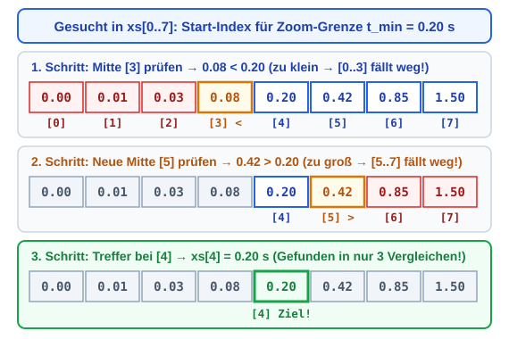

</div>
</div>

> **Hinweis:** Optional fürs Selbststudium – Pflichtaufgaben und Quiz 2 deckt das Hauptdeck ab ([Anhang A](./Folien_Anhang_A_ScottPlot_Details.md)).

---

<!-- _class: outlook -->

### Ausblick: Von 2D-Telemetrie zu 3D-Szenengraphen & Quiz 2 (T05)

<div class="columns">
<div class="two">

Unsere 2D-Säulen (**Pixel**, **Vektor**, **Telemetrie/Graphen**) sind komplett:

- **Nächster Termin (T05):** Einstieg in **3D mit OpenGL (`SharpGL`)** – $4 \times 4$-Matrizen und 3D-Szenengraphen.
- **Lernfortschritt:** Zu Beginn von T05 findet das **Moodle-Quiz 2** (Stoff: **Kapitel 03 & 04**) statt!
- **Vorbereitung:** Nutzen Sie die Checklisten und Selbsttests aus Kapitel 03 und 04 zur Wiederholung.

> **Showcase-Fokus (T05):** Der 2D-Szenengraph wird im nächsten Schritt in echte 3D-Hierarchien überführt.

</div>
<div class="two">


</div>
</div>

---

<!-- _class: homework -->

### Hausübung Termin 04: Echtzeit-Telemetrie & ScottPlot 5

**Stufe 1 (Basisaufgabe `1.1`–`1.4` auf `ScottPlotTelemetry.sln`):** GC-Leak-Fix (`Freeze`), 10-s-Ringpuffer-Fenster, 2. Referenzkanal & Unit-Tests ([Aufgabenblatt 04](../Uebung/Aufgabenblatt.md)) $\to$ **Stufe 2 (Vertiefung – Wahl: Track A ODER Track B, 10 Pkt.):**

<div class="columns">
<div class="two">

#### Stufe 2 – Track A: Industrieller Antriebsprüfstand
- **A.1:** Zweikanal-Telemetrie ($n, M$) mit Welford-$\pm 3\sigma$-Band & Alarm
- **A.2:** Phasenraum-Betriebskennfeld ($M$ vs. $n$) mit Leistungsgrenze
- **A.3:** Echtzeit-Schwingungs-Histogramm (20 Bins + Gauß-Kurve)
- **A.4:** MSAGL-Antriebsstrang-Topologie mit Knoten-Alarmfärbung

</div>
<div class="two">

#### Stufe 2 – Track B: Retro Arcade Racing HUD
- **B.1:** Speed- & RPM-Streamer mit Welford-Schaltpunkt & Shift-Flash
- **B.2:** G-Kräfte-Phasenplot (Kamm'scher Kreis $a_{\text{res}} \le \mu g$) mit Grip-Farben
- **B.3:** Bremsverzögerungs-Histogramm mit Gauß-Glockenkurve
- **B.4:** MSAGL-Streckentopologie mit aktivem Sektor-Tracking

</div>
</div>
