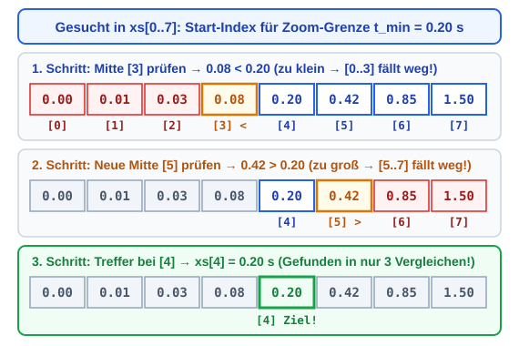
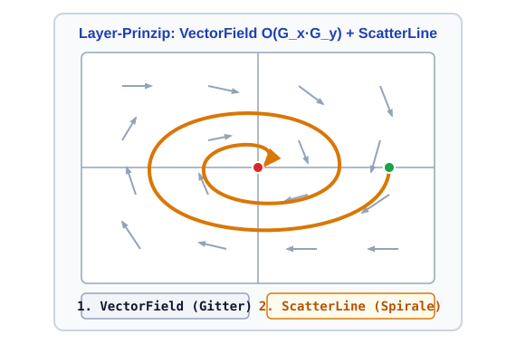
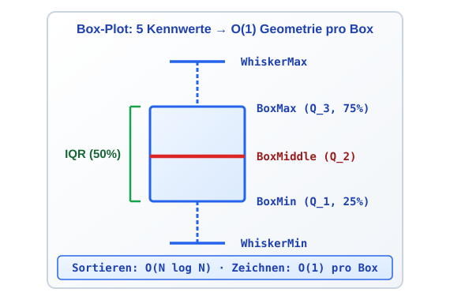
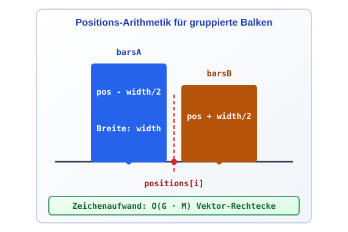
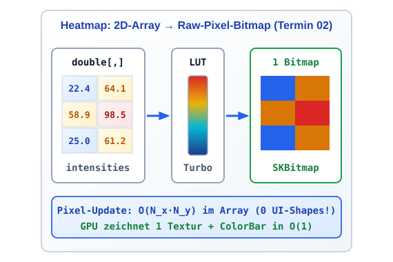
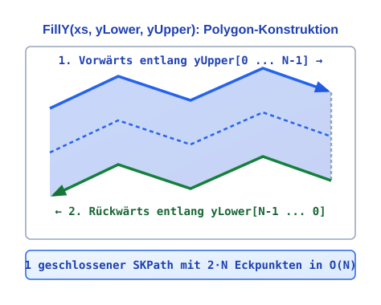
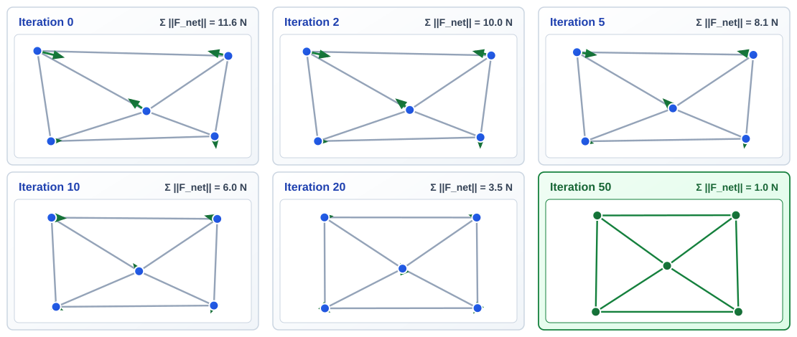

<!-- _paginate: false -->
<!-- _header: "" -->
<!-- _footer: "" -->
<!-- _class: title -->


# Kapitel 4 (Anhang A): ScottPlot 5 & MSAGL-Details

Vertiefende Plot-Typen, Komplexitätsanalysen & C#-Rezepte zum Selbststudium:

- `SignalXY` (Binärsuche $\mathcal{O}(\log N)$ & adaptives Bucketing) & `VectorField`
- `Boxes` (Box-Plots), `Bars` (gruppierte Balken) & `Heatmap` + `ColorBar`
- `FillY` (Toleranzkorridor-Polygon) & `MSAGL` Force-Directed Konvergenz
- Gegenüberstellung: Automatisches Layout (`MSAGL`) vs. Node-Editor (`Nodify`)

---

### `SignalXY`: Halbierungssuche ($\mathcal{O}(\log N)$) & Bucketing

<div class="columns">
<div class="two">

Adaptive DGL-Solver (RK45) erzeugen variable Schrittweiten $\Delta t$ (`xs` streng monoton):

- **Binärsuche:** Findet Zoom-Grenze $t_{\min} = 0{,}20\,\text{s}$ in $\mathcal{O}(\log N)$ (bei $10^6$ Punkten max. 20 Vergleiche).
- **Adaptives Bucketing (`sig`):** Dichte Schritte wie `Signal` (4-Punkt-Spalten), weite direkt verbunden.

```csharp
var sig = plot.Add.SignalXY(xs, ys);
sig.LineWidth = 3.0f;
```

</div>
<div class="two">



</div>
</div>

---

### `VectorField`: Richtungsfeld & Gitter-Komplexität

<div class="columns">
<div class="two">

Zustandsraum-Analyse (`x1`, `x2`, `dx1`, normiert über `len` & `scale` in `vectors`) mit quadratischer Zeichenlast $\mathcal{O}(G_x \cdot G_y)$:

```csharp
var vectors = new List<RootedCoordinateVector>();
for (double x1 = -2.8; x1 <= 2.8; x1 += 0.4)
  for (double x2 = -2.8; x2 <= 2.8; x2 += 0.4) {
    double dx1 = x2, dx2 = -x1 - 0.3 * x2;
    double len = Math.Sqrt(dx1 * dx1 + dx2 * dx2);
    if (len > 1e-6) {
      double scale = 0.22 / len;
      // ScottPlot-5-Konvention: Vector2-Y nach unten (-dx2)
      vectors.Add(new RootedCoordinateVector(
        new Coordinates(x1, x2),
        new Vector2((float)(dx1 * scale), (float)(-dx2 * scale))));
    }
  }
plot.Add.VectorField(vectors, Colors.SteelBlue);
```

</div>
<div class="two">



</div>
</div>

---

### `Boxes`: Box-Plot-Anatomie & $\mathcal{O}(1)$-Geometrie

<div class="columns">
<div class="two">

- **5 Kennwerte pro Box (`b1`):** `BoxMin` ($Q_1$), `BoxMiddle` (Median $Q_2$), `BoxMax` ($Q_3$), `WhiskerMin`, `WhiskerMax`.
- **Komplexität:** Sortieren $\mathcal{O}(N \log N)$, Zeichnen pro Box $\mathcal{O}(1)$ (1 Rechteck + 5 Linien).

```csharp
var b1 = new Box { Position = 1, BoxMin = 8.2, BoxMiddle = 12.5, BoxMax = 17.0, WhiskerMin = 4.0, WhiskerMax = 23.5 };
plot.Add.Boxes(new[] { b1, b2, b3 });
plot.Axes.Bottom.TickGenerator = new ScottPlot.TickGenerators.NumericManual(
    new Tick[] { new(1.0, "P"), new(2.0, "PI"), new(3.0, "PID") });
```

</div>
<div class="two">



</div>
</div>

---

### `Bars`: Gruppierte Balken & Positions-Arithmetik

<div class="columns">
<div class="two">

Für $G$ Gruppen und $M$ Modellreihen (`barsA`, `barsB` mit Breite `width`) zeichnet die GPU $G \cdot M$ Rechtecke ($\mathcal{O}(G \cdot M)$):

```csharp
double[] positions = { 1.0, 2.0, 3.0, 4.0 };
double width = 0.32;
var barsA = new List<Bar>();
var barsB = new List<Bar>();
for (int i = 0; i < positions.Length; i++) {
    barsA.Add(new Bar { Position = positions[i] - width / 2.0, Value = valuesA[i], Size = width, FillColor = Colors.SteelBlue });
    barsB.Add(new Bar { Position = positions[i] + width / 2.0, Value = valuesB[i], Size = width, FillColor = Colors.DarkOrange });
}
plot.Add.Bars(barsA);
plot.Add.Bars(barsB);
```

</div>
<div class="two">



</div>
</div>

---

### `Heatmap` & `ColorBar`: Raw-Pixel-Backend (`SKBitmap`)

<div class="columns">
<div class="two">

Wie `WriteableBitmap` (T02) übersetzt `Heatmap` (`hm` + Farbskala `cb`) `intensities[i, j]` direkt in **1 Bitmap-Textur** ($\mathcal{O}(N_x \cdot N_y)$):

```csharp
double[,] intensities = new double[size, size];
for (int i = 0; i < size; i++)
    for (int j = 0; j < size; j++)
        intensities[i, j] = ComputeFdmTemp(i, j);

var hm = plot.Add.Heatmap(intensities);
hm.Colormap = new ScottPlot.Colormaps.Turbo();
var cb = plot.Add.ColorBar(hm);
cb.Label = "Temperatur T [°C]";
```

</div>
<div class="two">



</div>
</div>

---

### `FillY`: Mitwandernder Toleranzkorridor ($\mu(t) \pm 3\sigma$)

<div class="columns">
<div class="two">

Ein geschlossener Polygonpfad (`fill` via `SKPath`, $\mathcal{O}(N)$) läuft über `yUpper`/`yLower`, ergänzt um `meanLine` und `sensLine`:

```csharp
var fill = plot.Add.FillY(xs, yLower, yUpper);
fill.FillColor = Colors.CornflowerBlue.WithAlpha(0.35f);
var meanLine = plot.Add.ScatterLine(xs, mu);
meanLine.Color = Colors.MidnightBlue;
var sensLine = plot.Add.ScatterLine(xs, sensor);
sensLine.Color = Colors.Crimson;
```

</div>
<div class="two">



</div>
</div>

---

### `MSAGL` Force-Directed Layout: Konvergenz

Evolution der Knotenpositionen von Iteration 0 bis zum Gleichgewicht ($\sum \|\vec{F}_{\text{net}}\| \to 0$) mit `MdsLayoutSettings`:



---

### Automatisches Layout (`MSAGL`) vs. Node-Editor (`Nodify`)

<div class="columns">
<div class="two">

- **Wann `MSAGL`?** Wenn die Topologie **aus Daten oder Code generiert** wird (Modell-Inspektor, Zyklus-Diagnose).
- **Wann `Nodify`?** Wenn der Nutzer das Modell wie in *Simulink* **interaktiv per Maus verdrahten** soll.

```csharp
graph.LayoutAlgorithmSettings =
    new Microsoft.Msagl.Layout.MDS.MdsLayoutSettings();
graph.AddEdge("Gateway-A", "SPS-CNC");
graph.FindNode("SPS-CNC").Attr.FillColor =
    Microsoft.Msagl.Drawing.Color.LightSkyBlue;
```

</div>
<div class="two">

| Kriterium | `MSAGL` | `Nodify` (Editor) |
|---|---|---|
| **Zweck** | Topologie-Anzeige | Interaktiver Editor |
| **Positionen** | Vollautomatisch | Manuell (Drag & Drop) |
| **Anschlüsse** | Knoten als Ganzes | Input-/Output-Pins |
| **Kanten** | C#-Code (`AddEdge`) | Interaktiv per Maus |

</div>
</div>
