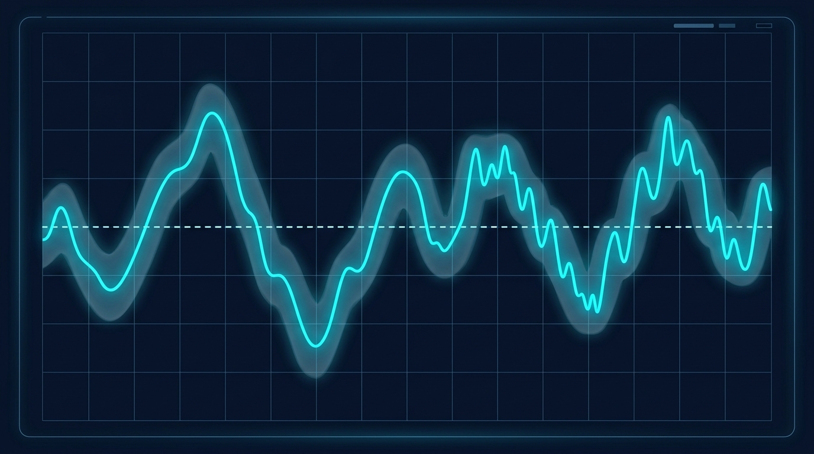

### Termin 04: Echtzeit-Telemetrie, Diagramme & ScottPlot 5
*(Vorlesungskapitel: 04 Visualisierung 2D Diagramme)*

Simulationen erfordern den kontinuierlichen Einblick in Zustandsverläufe. In dieser Einheit integrieren wir die moderne Bibliothek ScottPlot 5 sowie MSAGL in WPF. Wir lernen allokationsfreie Ringpuffer kennen, um den Garbage Collector bei 50 bis 100 Hz Streaming-Frequenz zu entlasten, und nutzen den numerisch stabilen Online-Algorithmus nach Welford zur Berechnung von laufendem Mittelwert, Varianz und dynamischen 3-Sigma-Toleranzbändern ohne Auslöschungsfehler.

**Ablauf & Übungsaufgaben:**
* 🎤 **Showcase T03:** Zwei ausgewählte Teams präsentieren ihre 2D-CAD-Tragwerks-Inspektoren und Brücken-Editoren am Beamer.
* **Stufe 1 (Basisaufgabe):** GC-Leak-Behebung im 50-Hz-Streaming-Loop auf der Vorlage, gleitende 10-Sekunden-Ringpuffer-Auswertung, entprellte 3-Sigma-Anomalie-Anzeige mit zweitem Referenzkanal und Unit-Test-Verifikation.
* 🏭 **Stufe 2 – Track A (Industrie):** *Industrieller Antriebsprüfstand & Schwingungs-Leitstand* – Zweikanal-Telemetrie mit 3-Sigma-Toleranzband, Phasenraum-Betriebskennfeld, Echtzeit-Vibrations-Histogramm und MSAGL-Anlagentopologie.
* 🎮 **Stufe 2 – Track B (Game):** *„Retro Arcade Racing HUD“* – Live-Geschwindigkeits- und Drehzahl-Streaming mit Shift-Flash, G-Kräfte-Phasenplot im Kammschen Kreis, Brems-Histogramm und MSAGL-Streckentopologie.
