<!-- _paginate: false -->
<!-- _header: "" -->
<!-- _footer: "" -->
<!-- _class: title -->

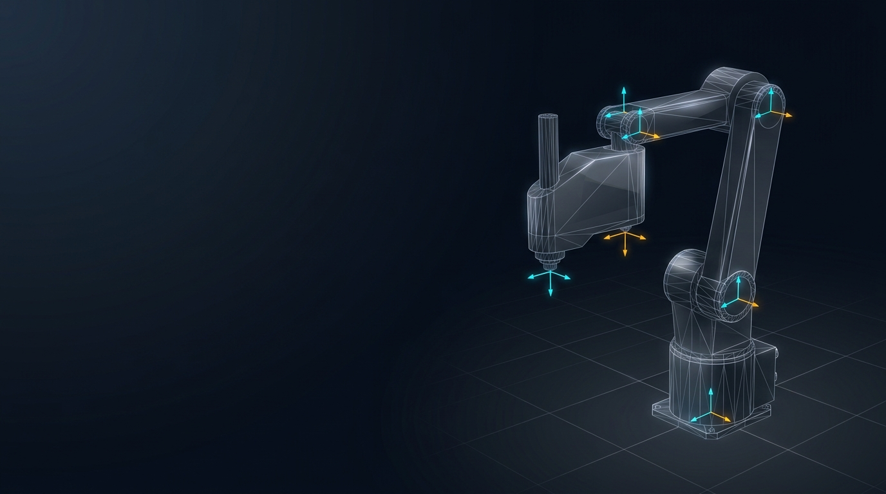

# Kapitel 5: 3D-Visualisierung mit OpenGL

Dieses Kapitel umfasst die folgenden Abschnitte:

- 5.1: Grundlagen der 3D-Visualisierung mit OpenGL
- 5.2: Strukturierung mit einem Szenengraphen
- 5.3: Mechatronische Anwendung: Kinematische Ketten & Robotik
- 5.4: Interaktive Kameraführung

---

<!-- _class: showcase -->

### Moodle-Quiz 2 & Live-Showcase: Termin 04

Zu Beginn (15 Min.): **Moodle-Test 2** (Kapitel 03 & 04) – danach **Live-Showcase & Code-Defense** der Hausübung aus Termin 04 (**Stufe 1** + **Stufe 2: Track A oder B**, [Aufgabenblatt 04](../../04_Telemetrie_und_ScottPlot/Uebung/Aufgabenblatt.md)):

<div class="columns">
<div class="two">

#### Stufe 2 – Track A: Industrie (Antriebsprüfstand)
- **Signal-Streaming:** Drehzahl $n(t)$ & Moment $M(t)$ mit dynamischen $\pm 3\sigma$-Toleranzbändern.
- **Topologie:** MSAGL-Antriebsstrang mit visueller Kavitations-/Alarmanzeige.
- **Stresstest:** Abtastfrequenz drastisch erhöhen & Welford-Hüllkurven im Betrieb prüfen.

</div>
<div class="two">

#### Stufe 2 – Track B: Game (Racing HUD)
- **Cockpit-Telemetrie:** Speed/RPM mit Shift-Flash & G-Kräfte (Kamm'scher Kreis).
- **Statistik:** Bremsverzögerungs-Histogramm & Streckenabschnitts-Topologie (MSAGL).
- **Stresstest:** Grenzbereich-Fahrt mit Haftungsabriss ($a_{\text{res}} > \mu \cdot g$) live provozieren & im Plot prüfen.

</div>
</div>

> **Code-Defense (Säule 2b, 20 %):** Prüfung auf allokationsfreies Streaming (keine GC-Spikes im Diagnostic Tool), Single-Pass-Welford und UI-Entkopplung.

---

<!-- _class: recap -->

### Rückblick & Brücke: Wo stehen wir in der Vorlesung?

<div class="columns top">
<div class="two">

In **T02 bis T04** haben wir die 2D-Welt gemeistert – wo stoßen 2D-Ansichten an Grenzen?

- **Brücke T03 $\leftrightarrow$ T05:** Statt 2D (`+Y` unten) gilt OpenGL-3D (`+X` rechts, `+Y` oben, `+Z` vor).
- **Engpass heute:** Roboter in 3D brauchen Verdeckung (Z-Buffer), Licht und $4\times 4$-Matrix-Stacks.
- **Halbzeit:** `SharpGL` schließt Block 1 (T02–T05) vor T06 (TPL) und T07–T10 (Solver) ab.

> **Brücke zu T04:** Die `MSAGL`-Baumtopologie wird zum **3D-Szenengraphen (`SceneNode`)**!

</div>
<div class="two">

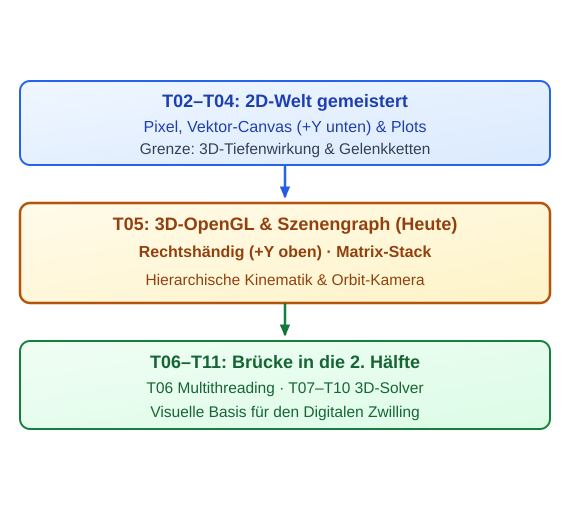

</div>
</div>

---

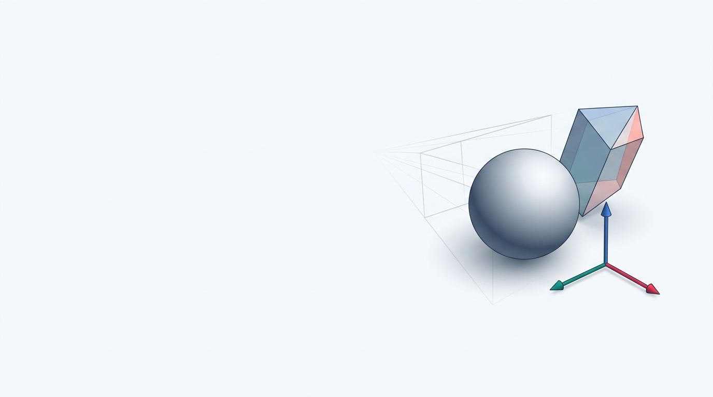

## 5.1: Grundlagen der 3D-Visualisierung mit OpenGL

Dieser Abschnitt umfasst die folgenden Inhalte:

- Rückblick & Brücke zu Termin 02–04 und Abschluss des Visualisierungs-Blocks
- Grundkonzepte von OpenGL (Zustandsmaschine, Color & Depth Buffer)
- Phong-Beleuchtungsmodell (`GL_LIGHTING`), Render-Loop (`OpenGLDraw`) und Primitive
- ModelView-Matrix ($\mathbf{T} \cdot \mathbf{R} \neq \mathbf{R} \cdot \mathbf{T}$) & Projektionsmatrix (`OpenGlView_Resized`)

---


### Was ist OpenGL & Einbindung in WPF (`SharpGL.WPF`)?

- **OpenGL & `SharpGL`:** Hardwarebeschleunigte 3D-API (Vertices, Normalen, Matrizen) als **Zustandsmaschine** ohne Shader-Boilerplate.
- **`SharpGL.WPF` (`OpenGLControl`):**
  1. `OpenGLInitialized`: Einmalig beim Start (`GL_DEPTH_TEST`, Licht & Material).
  2. `OpenGLDraw`: In jedem Frame für das 3D-Rendering.

```xml
<sharpGL:OpenGLControl x:Name="OpenGlView"
    OpenGLInitialized="OpenGlView_OpenGLInitialized"
    OpenGLDraw="OpenGlView_OpenGLDraw"
    Resized="OpenGlView_Resized" />
```

> **Merksatz:** Einmal gesetzte OpenGL-Zustände (z. B. Licht, Farbe) bleiben bis zur Änderung aktiv.

---

### Framebuffer im GPU-Speicher: Color Buffer & Depth Buffer

<div class="columns">
<div class="two">

Für jedes Pixel `(x, y)` verwaltet OpenGL im GPU-Speicher zwei gleich große 2D-Raster:

- **1. Color Buffer (`GL_COLOR_BUFFER_BIT`):**
  - Sichtbare RGBA-Farbe pro Pixel (wie `WriteableBitmap` in T02; Startwert `ClearColor` = `BG`).
- **2. Depth Buffer / Z-Buffer (`GL_DEPTH_BUFFER_BIT`):**
  - Kleinster Kameraabstand `z_buf` pro Pixel (Startwert `zFar`).

</div>
<div class="two">

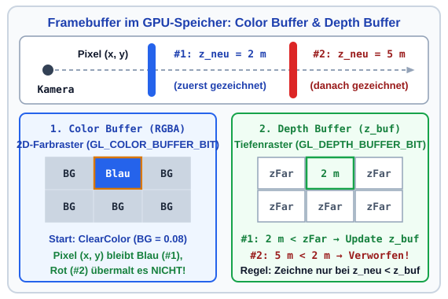

</div>
</div>

> **Tiefentest (`GL_DEPTH_TEST`):** Überschreibe Farbe & `z_buf` nur bei `z_neu < z_buf`!

---

### Das Phong-Beleuchtungsmodell im Überblick (`GL_LIGHTING`)

<div class="columns">
<div class="two">

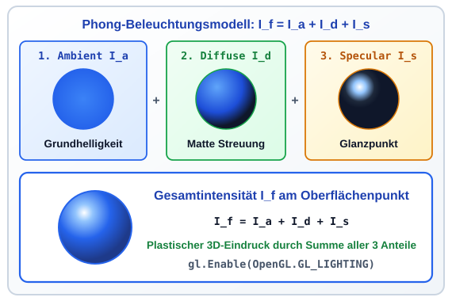

</div>
<div class="two">

Das **Phong-Modell** (`GL_LIGHTING`) berechnet die Helligkeit $I_f$ als Summe dreier Anteile:

$$I_f = I_a + I_d + I_s$$

1. **Ambient ($I_a$):** Grundhelligkeit gegen schwarze Schatten ($I_{La}$).
2. **Diffuse ($I_d$):** Matte Streuung nach Lambert ($\vec{n} \cdot \vec{l}$).
3. **Specular ($I_s$):** Blickwinkelabhängiger Glanzpunkt ($\vec{r} \cdot \vec{v}$).

</div>
</div>

> **Details & Shading (`GL_FLAT` / `GL_SMOOTH`):** Siehe [Anhang A: OpenGL-Details](./Folien_Anhang_A_OpenGL_Details.md).

---

### Initialisierung & Phong-Beleuchtung (`OpenGLInitialized`)

Einmalige Z-Buffer- & Lichtkonfiguration (`globalAmbient`, `lightPos`, `lightDiffuse`, `lightSpecular`, `matSpecular`):

```csharp
gl.ClearColor(0.08f, 0.08f, 0.08f, 1.0f);
gl.Enable(OpenGL.GL_DEPTH_TEST);
gl.Enable(OpenGL.GL_NORMALIZE);
gl.Enable(OpenGL.GL_LIGHTING);
gl.Enable(OpenGL.GL_LIGHT0);
gl.ShadeModel(OpenGL.GL_SMOOTH);
float[] globalAmbient = [0.25f, 0.25f, 0.25f, 1.0f];
gl.LightModel(OpenGL.GL_LIGHT_MODEL_AMBIENT, globalAmbient);
float[] lightPos      = [10.0f, 20.0f, 15.0f, 1.0f];
float[] lightDiffuse  = [0.85f, 0.85f, 0.85f, 1.0f];
float[] lightSpecular = [1.00f, 1.00f, 1.00f, 1.0f];
gl.Light(OpenGL.GL_LIGHT0, OpenGL.GL_POSITION, lightPos);
gl.Light(OpenGL.GL_LIGHT0, OpenGL.GL_DIFFUSE,  lightDiffuse);
gl.Light(OpenGL.GL_LIGHT0, OpenGL.GL_SPECULAR, lightSpecular);
gl.Enable(OpenGL.GL_COLOR_MATERIAL);
float[] matSpecular = [0.60f, 0.60f, 0.60f, 1.0f];
gl.Material(OpenGL.GL_FRONT_AND_BACK, OpenGL.GL_SPECULAR, matSpecular);
gl.Material(OpenGL.GL_FRONT_AND_BACK, OpenGL.GL_SHININESS, 64.0f);
```

---

<!-- _class: activity -->

### Mitmach-Impuls (3 Min.): Z-Buffer, $\mathbf{T}\cdot\mathbf{R}$ & Projektion

Sie richten eine neue `SharpGL`-Szene für einen 3D-Roboter ein und testen drei Effekte:

| Fall | Beobachtung / Code | Zu klärende Frage |
| :--- | :--- | :--- |
| **1. Tiefenpuffer** | `gl.Clear(GL_COLOR_BUFFER_BIT)` ohne `DEPTH_BUFFER_BIT` | Warum verschwindet der Roboter ab Frame 2? |
| **2. Matrizenfolge** | `gl.Rotate(45, ...)` vor `gl.Translate(2, 0, 0)` | Wo landet der Würfel gegenüber `Translate` vor `Rotate`? |
| **3. Fenster-Resize** | Fenster wird doppelt so breit gezogen | Warum wird eine Kugel ohne `aspect`-Update zum Ei? |

- **Ziel:** Prüfen Sie, wie Tiefentest, Matrixmultiplikation und NDC-Würfel zusammenwirken.

> **Hinweis:** Diskutieren Sie kurz zu zweit – achten Sie auf `z_buf`, Gelenkpunkt vs. Orbit und `aspect`!

---

<!-- _class: solution -->

### Auflösung: Z-Buffer, $\mathbf{T}\cdot\mathbf{R}$ & Projektion

1. **Ohne `GL_DEPTH_BUFFER_BIT`:** In Frame 1 werden alle Pixel mit den alten Tiefenwerten `z_buf` belegt; ab Frame 2 scheitert `z_neu < z_buf` fast überall $\implies$ das Bild friert ein oder flackert!
2. **`Rotate` vor `Translate` ($\mathbf{R} \cdot \mathbf{T}$):** Das Bauteil kreist auf dem Radius $2\,\text{m}$ um den Ursprung statt sich an $(2, 0, 0)$ um sich selbst zu drehen.
3. **Fehlendes `aspect`:** `GL_PROJECTION` projiziert in den quadratischen NDC-Würfel $[-1, +1]^3$; ohne angepasstes `aspect = w / h` dehnt der Viewport die Kugel horizontal:
   ```csharp
   gl.MatrixMode(OpenGL.GL_PROJECTION);
   gl.LoadIdentity();
   double aspect = OpenGlView.ActualWidth / Math.Max(OpenGlView.ActualHeight, 1.0);
   gl.Perspective(45.0, aspect, 0.1, 100.0);
   ```
   - **Tipp:** In `OpenGLDraw` immer `GL_MODELVIEW` aktiv halten und vor `gl.LookAt(...)` per `gl.LoadIdentity()` zurücksetzen.

> **Merksatz:** Erst `Clear(COLOR | DEPTH)`, lokal immer `Translate` vor `Rotate`, und beim Resize `aspect` nachführen!

---

### Der Render-Loop in jedem Frame: `OpenGLDraw`

Während `OpenGLInitialized` einmalig beim Start läuft, baut `OpenGlView_OpenGLDraw` jedes Einzelbild neu auf (Primitive wie `GL_LINES`, `GL_QUADS`, `GL_QUAD_STRIP` siehe [Anhang A](./Folien_Anhang_A_OpenGL_Details.md)):

```csharp
private void OpenGlView_OpenGLDraw(object sender, OpenGLRoutedEventArgs args)
{
    OpenGL gl = args.OpenGL;

    // 1. Farb- UND Tiefenpuffer (Z-Buffer) für den neuen Frame leeren
    gl.Clear(OpenGL.GL_COLOR_BUFFER_BIT | OpenGL.GL_DEPTH_BUFFER_BIT);

    // 2. ModelView-Matrix auf die Einheitsmatrix I zurücksetzen
    gl.MatrixMode(OpenGL.GL_MODELVIEW);
    gl.LoadIdentity();

    // 3. Kamera-Sichtmatrix setzen (in der Vorlage via _camera.Apply(gl))
    gl.LookAt(5.0, 5.0, 5.0,  0.0, 0.0, 0.0,  0.0, 1.0, 0.0);

    // 4. Achsen/Gitter (kurz GL_LIGHTING aus!) + 3D-Szenengraph zeichnen ...
}
```

---

### Reihenfolge in $\mathbf{M}_{\text{model}}$: Warum gilt $\mathbf{T} \cdot \mathbf{R} \neq \mathbf{R} \cdot \mathbf{T}$?

<div class="columns">
<div class="two">

Homogene $4\times 4$-Matrizen mit $\vec{v} = (x, y, z, 1)^\top$ vereinen Verschiebung $\mathbf{T}$ und Drehung $\mathbf{R}$ in $\mathbf{M}_{\text{modelview}} = \mathbf{M}_{\text{view}} \cdot \mathbf{M}_{\text{model}}$:

- **Warum $4\times 4$?** Eine $3\times 3$-Matrix bildet $\vec{0} \mapsto \vec{0}$ ab (keine Translation!).
- **Reihenfolge ($\mathbf{T}\cdot\mathbf{R} \neq \mathbf{R}\cdot\mathbf{T}$):**
  1. **`T(L1) · R`:** Verschiebt zum Gelenkpunkt `(L1, 0)` und dreht dort vor Ort $\checkmark$
  2. **`R · T(L1)`:** Dreht erst die Achse $\implies$ das Bauteil schwenkt auf einer Kreisbahn!

</div>
<div class="two">

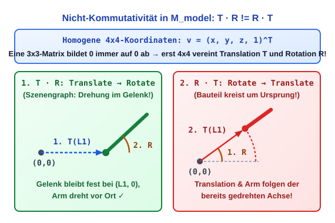

</div>
</div>

> **Merksatz:** In OpenGL wirkt der **letzte** Aufruf vor dem Zeichnen zuerst auf den Punkt!

---

### Projektionsmatrix (`GL_PROJECTION`) & `OpenGlView_Resized`

<div class="columns">
<div class="two">

`GL_PROJECTION` staucht das Sichtvolumen zwischen `zNear` und `zFar` in den Einheitswürfel **NDC** $[-1, +1]^3$:

- **Orthogonal (`gl.Ortho`):** Parallele Kanten bleiben parallel (CAD-Aufriss).
- **Perspektive (`gl.Perspective`):** Division durch $-z$ für Tiefenwirkung (`fovy = 45°`, `aspect = w / h`).
- **Clipping (`zNear` / `zFar`):** Alles außerhalb `[0.1, 100.0]` wird abgeschnitten.
- **Resize-Handler (`args`):** Aktualisiert `aspect` beim Resize ([Anhang A](./Folien_Anhang_A_OpenGL_Details.md)).

</div>
<div class="two">

```csharp
private void OpenGlView_Resized(
    object sender, OpenGLRoutedEventArgs args)
{
    OpenGL gl = args.OpenGL;
    gl.MatrixMode(OpenGL.GL_PROJECTION);
    gl.LoadIdentity();
    // Aktuelles Seitenverhältnis w / h
    double aspect = OpenGlView.ActualWidth
        / Math.Max(OpenGlView.ActualHeight, 1.0);
    gl.Perspective(45.0, aspect, 0.1, 100.0);
    gl.MatrixMode(OpenGL.GL_MODELVIEW);
}
```

> **Wichtig:** Nach der Projektion sofort zurück auf `GL_MODELVIEW` schalten – sonst landen Modell-Transformationen in der Projektionsmatrix!

</div>
</div>

---

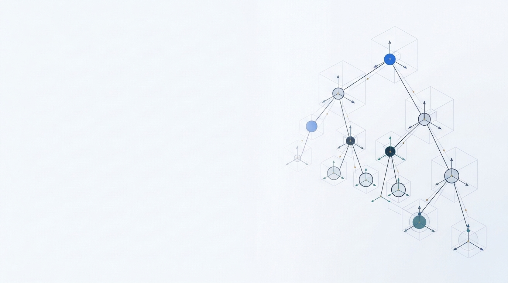

## 5.2: Strukturierung mit einem Szenengraphen

Dieser Abschnitt umfasst die folgenden Inhalte:

- Vom flachen Zeichencode zur hierarchischen Baumstruktur (Szenengraph)
- Der OpenGL-Matrix-Stack (`gl.PushMatrix` & `gl.PopMatrix`) und die Skalierungs-Falle
- Klasse `SceneNode` und Euler-Winkel (`Rx, Ry, Rz`)
- Lokale vs. globale Transformationsmatrizen (`GetLocalMatrix` & `GetWorldMatrix`)
- Grundkörper-Rendering mit korrekten Normalen (`DrawCube`, `DrawCylinder`, `DrawSphere`)

---

### Die Herausforderung: Warum ein Szenengraph?

<div class="columns">
<div class="two">

Stellen wir uns den SCARA-Roboter vor:

- **Problem bei Einzelberechnung:**
  - Dreht sich `UpperArm` um $\theta_1$, schwenken `ForeArm`, `Pinole` und `TCP` auf einer Kreisbahn mit!
- **Lösung – Szenengraph (`SceneNode`):**
  - Wie beim `MSAGL`-Graphen in **T04** bilden `Root`, `Base`, `Workpiece` und die Armglieder einen **Baum**:
  - Jeder Knoten transformiert **nur relativ zum Elternknoten** (Schulter $\theta_1$, Ellenbogen $\theta_2$ bei `L1`, Hub $d_3$).

</div>
<div class="two">

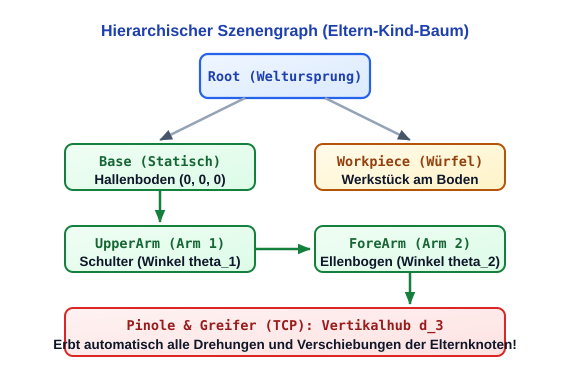

</div>
</div>

---

### Der Matrix-Stack: `PushMatrix` & `PopMatrix`

<div class="columns">
<div class="two">

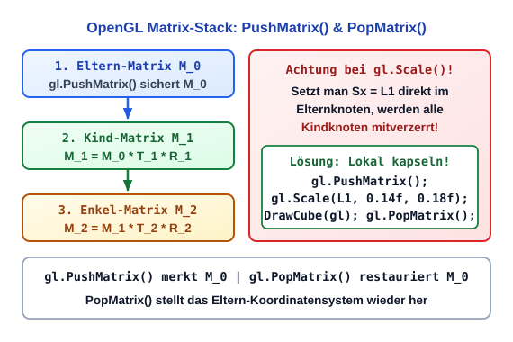

</div>
<div class="two">

Wie vererbt OpenGL Transformationen an Kinder, ohne Geschwister (`Workpiece`) zu verschieben?

- **`gl.PushMatrix()`:** Sichert die Eltern-Matrix $\mathbf{M}_0$ oben auf dem GPU-Stack.
- **Lokale Transformation (`T_1, R_1` & `T_2, R_2`):**
  - Kind: $\mathbf{M}_1 = \mathbf{M}_0 \cdot \mathbf{T}_1 \cdot \mathbf{R}_1$; Enkel: $\mathbf{M}_2 = \mathbf{M}_1 \cdot \mathbf{T}_2 \cdot \mathbf{R}_2$.
- **`gl.PopMatrix()`:** Stellt nach dem Teilbaum exakt $\mathbf{M}_0$ wieder her!

</div>
</div>

> **Skalierungs-Falle (Aufgabe 1.1):** `gl.Scale(L1, ...)` immer lokal in `PushMatrix`/`PopMatrix` kapseln!

---

### Architektur in unserer Vorlage: Die Klasse `SceneNode`

`Scene/SceneNode.cs` kapselt Baum, Transformation ([Anhang A: Euler-Winkel](./Folien_Anhang_A_OpenGL_Details.md)) & Rendering:

| Eigenschaft / Methode | Typ | Aufgabe im Szenengraphen (`SceneGraph3D.sln`) |
| :--- | :--- | :--- |
| **`Name` / `Children`** | `List<SceneNode>` | Verwaltet die Eltern-Kind-Hierarchie via `AddChild(child)`. |
| **`Tx, Ty, Tz`** | `float` $[\text{m}]$ | Lokale Translation relativ zum Elternknoten. |
| **`Rx, Ry, Rz`** | `float` $[^\circ]$ | Lokale Euler-Winkel in Grad um X-, Y- und Z-Achse. |
| **`Sx, Sy, Sz`** | `float` | Lokale Skalierungsfaktoren (Standard $= 1{,}0$). |
| **`RenderCustomGeometry`** | `Action<OpenGL>?` | **C#-Delegate:** Zeichnet die lokale Bauteil-Geometrie (Aufgabe 1.1). |
| **`Render(OpenGL gl)`** | `void` | Traversiert den Baum rekursiv mit `PushMatrix` / `PopMatrix`. |
| **`GetWorldMatrix()`** | `Matrix4x4` | Berechnet die $4\times 4$-Weltmatrix für den TCP-Deckungstest! |

---

### Rekursive Traversierung: `SceneNode.Render(OpenGL gl)`

So traversiert `Render(OpenGL gl)` in `Scene/SceneNode.cs` den gesamten Baum ab `_rootNode`:

```csharp
public virtual void Render(OpenGL gl)
{
    gl.PushMatrix(); // 1. Eltern-Koordinatensystem sichern
    gl.Translate(Tx, Ty, Tz);
    if (MathF.Abs(Ry) > 1e-4f) gl.Rotate(Ry, 0.0f, 1.0f, 0.0f);
    if (MathF.Abs(Rx) > 1e-4f) gl.Rotate(Rx, 1.0f, 0.0f, 0.0f);
    if (MathF.Abs(Rz) > 1e-4f) gl.Rotate(Rz, 0.0f, 0.0f, 1.0f);
    if (MathF.Abs(Sx - 1.0f) > 1e-4f || MathF.Abs(Sy - 1.0f) > 1e-4f || MathF.Abs(Sz - 1.0f) > 1e-4f)
        gl.Scale(Sx, Sy, Sz);
    RenderCustomGeometry?.Invoke(gl);          // 3. Eigene Geometrie zeichnen
    foreach (var child in Children)            // 4. Rekursiver Abstieg für alle Kinder (child)
        child.Render(gl);
    gl.PopMatrix();  // 5. Eltern-Koordinatensystem wiederherstellen
}
```

> **CPU-Weltmatrix:** `GetLocalMatrix()` & `GetWorldMatrix()` siehe [Anhang A: OpenGL-Details](./Folien_Anhang_A_OpenGL_Details.md).

---

### Grundkörper mit Normalen (`DrawCube`, `DrawCylinder` & `DrawSphere`)

<div class="columns">
<div class="two">

In `MainWindow.xaml.cs` zeichnen drei Hilfsmethoden Grundkörper mit **exakten Normalen** (`gl.Normal`):

- **`DrawCube(OpenGL gl)`:** Einheitswürfel ($[-0{,}5, +0{,}5]^3$, Ursprung **im Zentrum** $\implies$ erklärt `Translate(L1/2)` & `Ty = 0.06f`!) via `GL_QUADS`.
- **`DrawCylinder(gl, radius, height, slices)`:** Mantel entlang $+Y$ bis `height` (`nx = cos(theta)`, `nz = sin(theta)`).
- **`DrawSphere`:** Zerlegung in `stacks` & `slices` ([Anhang B: Kegelstümpfe & Kugelnormalen](./Folien_Anhang_B_3D_Normalen.md)).
- **Normalen-Effekt:** Ohne `gl.Normal` bleiben Körper unter Licht flach.

</div>
<div class="two">

```csharp
private static void DrawCylinder(
    OpenGL gl, float radius, float height, int slices = 16)
{
    gl.Begin(OpenGL.GL_QUAD_STRIP);
    for (int i = 0; i <= slices; i++)
    {
        float theta = 2.0f * MathF.PI * i / slices;
        float nx = MathF.Cos(theta);
        float nz = MathF.Sin(theta);

        gl.Normal(nx, 0.0f, nz);
        gl.Vertex(radius * nx, 0.0f,   radius * nz);
        gl.Vertex(radius * nx, height, radius * nz);
    }
    gl.End();
}
```

> **Regel:** `gl.Normal(...)` stets *vor* den zugehörigen `gl.Vertex(...)`-Aufrufen setzen.

</div>
</div>

---

<!-- _class: activity -->

### Mitmach-Impuls (3 Min.): Matrix-Stack & Skalierungs-Falle

Im Roboter-Szenengraph hängt `_arm2Node` als Kind unter `_arm1Node`:

| Szenario | Problem / Code | Zu klärende Frage |
| :--- | :--- | :--- |
| **1. `PopMatrix` fehlt** | `_arm1Node` vergisst `gl.PopMatrix()` | Was passiert mit dem Geschwisterknoten `_workpieceNode`? |
| **2. Skalierungs-Falle** | `_arm1Node.Sx = L1` direkt auf dem Gelenk statt lokal | Warum wird `_arm2Node` plötzlich mit `L1` mitgestreckt? |
| **3. Würfel-Ursprung** | `DrawCube` ist in $[-0{,}5, +0{,}5]^3$ zentriert | Warum schieben wir `gl.Translate(L1 / 2, 0, 0)` vor `DrawCube`? |

- **Ziel:** Verstehen Sie, wie `PushMatrix`/`PopMatrix` Teilbäume und Skalierungen sauber voneinander isoliert.

> **Hinweis:** Diskutieren Sie kurz zu zweit – denken Sie an Matrix-Vererbung auf dem GPU-Stack!

---

<!-- _class: solution -->

### Auflösung: Matrix-Stack & Skalierungs-Falle

1. **Fehlendes `PopMatrix()`:** Die Matrix von `_arm1Node` bleibt oben auf dem GPU-Stack liegen $\implies$ der Geschwisterknoten `_workpieceNode` übernimmt fälschlich die Position und Drehung des Roboterarms!
2. **Skalierungs-Falle (`Sx`):** `SceneNode.Render` vererbt `gl.Scale(Sx, Sy, Sz)` an alle `Children`. Deshalb kapseln wir Arm-Balken lokal in `RenderCustomGeometry`:
   ```csharp
   gl.PushMatrix();
   gl.Translate(L1 / 2.0f, 0.0f, 0.0f);
   gl.Scale(L1, 0.14f, 0.18f);
   DrawCube(gl);
   gl.PopMatrix();
   ```
3. **Zentrierter Würfel:** Durch `Translate(L1 / 2, 0, 0)` beginnt der gestreckte Balken exakt im Gelenkdrehpunkt `(0, 0, 0)` und endet bei `x = L1`.

> **Merksatz:** Skalierungen (`gl.Scale`) gehören immer in ein eigenes `PushMatrix()` / `PopMatrix()`-Paar im Blatt-Rendering!

---

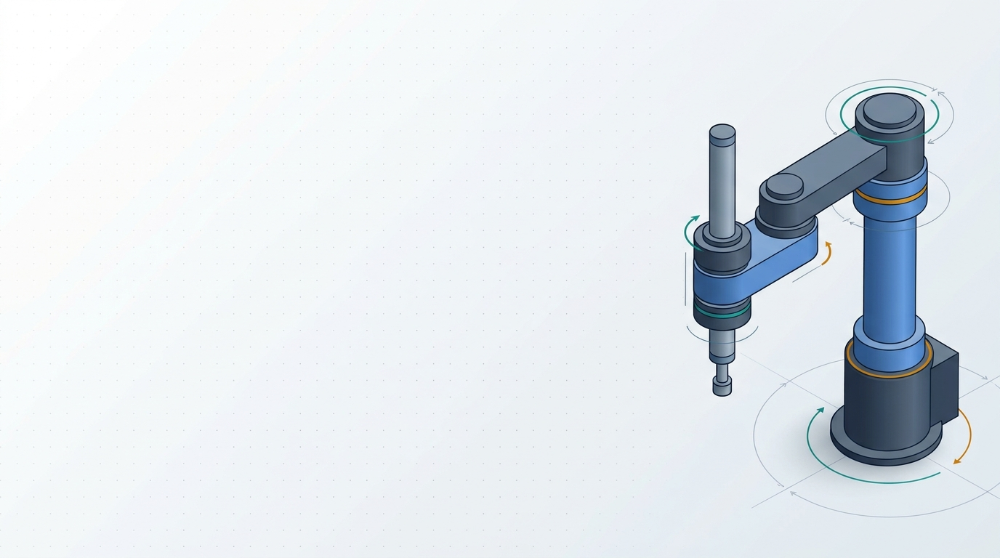

## 5.3: Mechatronische Anwendung: Kinematische Ketten & Robotik

Dieser Abschnitt umfasst die folgenden Inhalte:

- Serielle Roboterkinematik (SCARA & Knickarm) als hierarchischer Szenengraph
- Vorwärtskinematik: Analytische Trigonometrie vs. $4\times 4$-Matrix-Verkettung
- Konkretes Zahlenbeispiel & Echtzeit-Deckungstest ($\Delta = 0{,}000\,\text{mm}$)
- C#-Implementierung in `SceneGraph3D.sln` (Basisaufgabe 1.1 & 1.3)

---

### Kinematische Kette des SCARA-Roboters im Szenengraphen

<div class="columns">
<div class="two">

Der **SCARA** verkettet ab `_baseNode` lokale Versätze ($\mathbf{T}_x, \mathbf{T}_y$) und Drehungen ($\mathbf{R}_y$):

1. **`_arm1Node`:** Versatz $\mathbf{T}_y(\text{HBase})$ (`0.50 m`) nach oben + Schulterdrehung $\mathbf{R}_y(\theta_1)$.
2. **`_arm2Node`:** Versatz $\mathbf{T}_x(\text{L1})$ (`1.00 m`) entlang Arm 1 + Relativdrehung $\mathbf{R}_y(\theta_2)$.
3. **`_pinoleNode`:** Versatz $\mathbf{T}_x(\text{L2})$ (`0.80 m`) + Hub $\mathbf{T}_y(-d_3)$ zum **TCP**:

$$\mathbf{M}_{\text{TCP}} = \mathbf{T}_y(\text{HBase})\,\mathbf{R}_y(\theta_1)\,\mathbf{T}_x(\text{L1})\,\mathbf{R}_y(\theta_2)\,\mathbf{T}_x(\text{L2})\,\mathbf{T}_y(-d_3)$$

</div>
<div class="two">

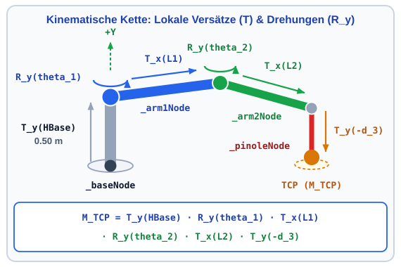

</div>
</div>

> **Hinweis:** Jeder Knoten speichert lokale Gelenkwerte; die Gesamtmatrix folgt beim Traversieren.

---

### Blick unter die Haube: Analytische Lösung & Deckungstest

<div class="columns">
<div class="two">

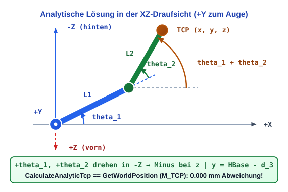

</div>
<div class="two">

Zur Validierung von $\mathbf{M}_{\text{TCP}}$ (`GetWorldPosition`) zeichnet `CalculateAnalyticTcp` eine **gelbe Kontrollkugel** ($\Delta = 0{,}000\,\text{mm}$; Startpose `30°`, `-45°`, `0.15 m` $\to (1{,}639;\; 0{,}350;\; -0{,}293)\,\text{m}$):

$$x = \text{L1}\cos\theta_1 + \text{L2}\cos(\theta_1+\theta_2), \quad y = \text{HBase} - d_3$$
$$z = -\big(\text{L1}\sin\theta_1 + \text{L2}\sin(\theta_1+\theta_2)\big)$$

- **Winkel & Minuszeichen:** `L2` schließt zur $+X$-Parallele den Gesamtwinkel $\theta_1 + \theta_2$ ein; von oben (`+Y` zum Auge) dreht $+\theta_1$ nach hinten in **$-Z$**!

</div>
</div>

> **Ausblick T07:** Genau diese Vorwärtskinematik invertieren wir in **Termin 07** per Jacobi-Matrix!

---

### Der C#-Code: Aufbau des Roboter-Szenengraphen (Aufgabe 1.1)

In **Stufe 1 (Aufgabe 1.1)** weisen wir jedem Knoten (`_baseNode`, `_arm1Node`, `_arm2Node`, `_pinoleNode`) unter `_rootNode` seine Geometrie zu (Update & Analytik: [Anhang A](./Folien_Anhang_A_OpenGL_Details.md)):

```csharp
private void BuildSceneGraph()
{
    _rootNode.AddChild(_baseNode);
    _baseNode.AddChild(_arm1Node);
    _arm1Node.AddChild(_arm2Node);
    _arm2Node.AddChild(_pinoleNode);

    _arm1Node.RenderCustomGeometry = gl => {
        gl.Color(0.2f, 0.6f, 0.9f);
        DrawSphere(gl, 0.18f);
        gl.PushMatrix(); // Wichtig: Skalierung L1 lokal kapseln, damit Arm2 unverzerrt bleibt!
        gl.Translate(L1 / 2.0f, 0.0f, 0.0f);
        gl.Scale(L1, 0.14f, 0.18f);
        DrawCube(gl);
        gl.PopMatrix();
    }; // ... analog für _baseNode (HBase), _arm2Node (L2) und _pinoleNode -> _rootNode.Render(gl);
}
```

---

### Werkstück-Knoten & 3D-Greifabstand (Aufgabe 1.3)

<div class="columns">
<div class="two">

Warum hängt `_workpieceNode` als **Geschwisterknoten** direkt unter `_rootNode`?

- **Statische Weltlage:** Am Boden bei $(1{,}10;\; 0{,}06;\; -0{,}40)\,\text{m}$ darf es sich vor dem Greifen **nicht** mit dem Roboter mitdrehen!
- **3D-Abstand (`UpdateTcpCalculations`):** `Vector3.Distance(tcpPos, boxPos)` prüft `dist < 0.12f` (`canGrab` – *Tipp:* `62°`, `-100°`, `0.44 m`).
- **Farbsignal:** Sobald `canGrab` wahr ist, wechselt die Würfelfarbe von Orange auf Grün.

</div>
<div class="two">

```csharp
// 1. Werkstück (0.12m) unter _rootNode
_workpieceNode.Tx = 1.10f;
_workpieceNode.Ty = 0.06f; // Boden y=0
_workpieceNode.Tz = -0.40f;
_rootNode.AddChild(_workpieceNode);

// 2. Euklidischer Greifabstand dist
Vector3 tcpPos = _pinoleNode.GetWorldPosition();
Vector3 boxPos = _workpieceNode.GetWorldPosition();
float dist = Vector3.Distance(tcpPos, boxPos);
bool canGrab = dist < 0.12f; // Orange -> Grün
```

- **Tipp:** `GetWorldPosition()` liest die 4. Spalte der aktuellen `ModelMatrix` im Weltkoordinatensystem aus.

</div>
</div>

> **Merksatz:** Freie Werkstücke hängen unter `_rootNode` – erst beim Greifen erfolgt das Re-Parenting an den Greifer!

---

### Ausbau in Stufe 2: Parallelgreifer & Pick-and-Place

<div class="columns">
<div class="two">

In **Stufe 2 (Track A & B)** wird aus der Kette ein **verzweigter Szenengraph**:

- **1. Baum-Verzweigung am Greifer:**
  - Unter der Pinole hängt `_wristNode` (`Ry = _theta4Deg`).
  - Daran hängen `_leftFingerNode` (`Tz = -_gripWidth / 2`) und `_rightFingerNode` (`Tz = +_gripWidth / 2`).
- **Symmetrie:** Beide Finger fahren gegenläufig zur Greifermitte auf und zu.

</div>
<div class="two">

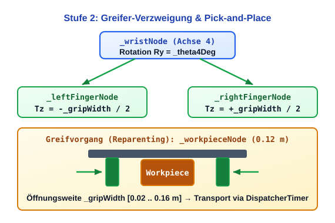

</div>
</div>

> **2. Greifen (`Reparenting`):** Schließt der Greifer (`0.12 m`), wird `_workpieceNode` lokal `(0,0,0)` an `_wristNode` gekoppelt.

---

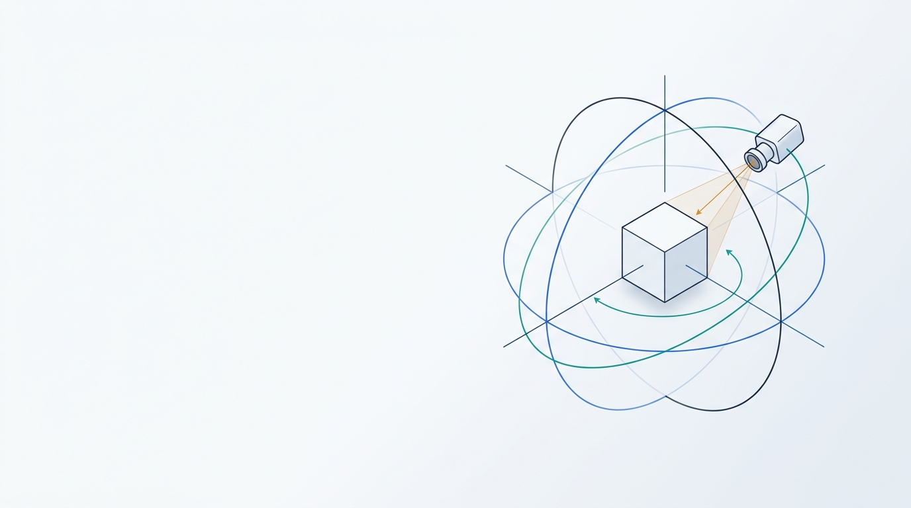

## 5.4: Interaktive Kameraführung

Dieser Abschnitt umfasst die folgenden Inhalte:

- Anforderungen an eine 3D-Inspektionskamera im Digitalen Zwilling
- Das Kameramodell `gl.LookAt` und die Orbit-Kugelkoordinaten ($r, \theta, \phi$)
- Vermeidung von Singularitäten (Gimbal Lock) durch Winkel-Clamping
- Herleitung von Kamera-Orbit, Zoom und Zielpunkt-Panning (Aufgabe 1.2)
- C#-Implementierung der Klasse `OrbitCamera` und WPF-Maus-Events

---

### Orbit-Kamera in Kugelkoordinaten ($r, \theta, \phi$) & `gl.LookAt`

<div class="columns">
<div class="two">

`OrbitCamera` führt $\vec{p}_{\text{eye}}$ auf einer Kugelschale um das Ziel $\vec{p}_{\text{look}}$ (`gl.LookAt(eye, look, (0,1,0))`):

1. **Azimut $\theta$ (`AzimuthDeg` $\in [0^\circ, 360^\circ)$):** Horizontaler Winkel ab $+Z$ ($x \propto \sin\theta, z \propto \cos\theta$).
2. **Elevation $\phi$ (`ElevationDeg` $\in [-85^\circ, +85^\circ]$):** Vertikale Neigung zur XZ-Ebene.
3. **Distanz $r$ (`Distance` $> 0$):** $r_{xz} = r\cos\phi$, $y_{\text{eye}} = y_{\text{look}} + r\sin\phi$ (Mausrad-Zoom).

</div>
<div class="two">

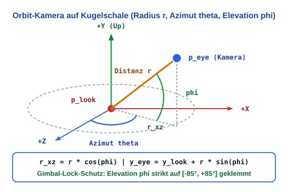

</div>
</div>

> **Merksatz:** Der Nutzer steuert intuitiv $(r, \theta, \phi)$ um den Fokus $\vec{p}_{\text{look}}$ statt 3D-Koordinaten!

---

### Warum klemmen wir $\phi$ auf $[-85^\circ, +85^\circ]$? Pol-Singularität

<div class="columns">
<div class="two">

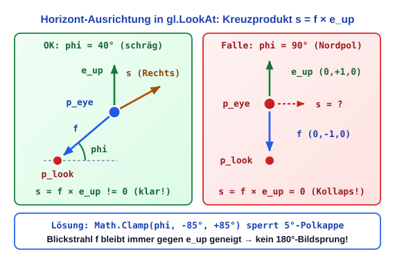

</div>
<div class="two">

Der Sehstrahl $\vec{f}$ von $\vec{p}_{\text{eye}}$ nach $\vec{p}_{\text{look}}$ legt die Blickachse fest – `gl.LookAt` berechnet für eine waagerechte Kamera $\vec{s} = \vec{f} \times \vec{e}_{\text{up}}$:

- **Schräger Blick ($|\phi| \le 85^\circ$):** $\vec{f}$ und $\vec{e}_{\text{up}}$ spannen eine Ebene auf $\implies \vec{s} \neq \vec{0}$ eindeutig.
- **Nord-/Südpol ($\phi = \pm 90^\circ$):** $\vec{f} \parallel \vec{e}_{\text{up}} \implies \vec{f} \times \vec{e}_{\text{up}} = \vec{0}$ (*„Wo ist rechts?“* unbestimmt $\to 180^\circ$-Bildsprung, `Math.Clamp` schützt!).

</div>
</div>

> **5°-Polkappe:** In der Praxis bleibt die Szene bis $85^\circ$ bequem von oben einsehbar.

---

### Maussteuerung & Kamera-Panning (Aufgabe 1.2)

<div class="columns">
<div class="two">

- **Links ziehen:** `_camera.Rotate` ($\theta, \phi$).
- **Mausrad:** `_camera.Zoom` (Radius $r$).
- **Rechts ziehen (Aufg. 1.2 – `Pan(dRight, dUp)`):**
  - Auf dem Strahl von $\vec{p}_{\text{look}}$ zu $\vec{p}_{\text{eye}}$ steht der Kamera-Rechtsvektor $\vec{e}_{\text{right}} = (\cos\theta, 0, -\sin\theta)^\top$ senkrecht.
  - **„Greife-die-Welt“-Prinzip:** Rechtsziehen (`dRight` $> 0$) schiebt $\vec{p}_{\text{look}}$ um $-\text{dRight}\cdot\vec{e}_{\text{right}}$ (`dX_look`, `dZ_look`, `dUp`):
    $$\text{dX\_look} = -\text{dRight} \cdot \cos\theta, \quad \text{dZ\_look} = +\text{dRight} \cdot \sin\theta$$

</div>
<div class="two">

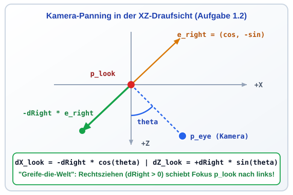

</div>
</div>

> **Höhe:** `LookAtY += dUp` verschiebt die Blickhöhe entlang Welt-$Y$.

---

<!-- _class: activity -->

### Mitmach-Impuls (3 Min.): Orbit-Kamera, Pol-Schutz & Panning

Sie steuern die 3D-Szene über `OrbitCamera` (`r`, `theta`, `phi`, `LookAtX/Y/Z`):

| Frage | Gegeben | Gesucht |
| :--- | :--- | :--- |
| **1. Pol-Singularität** | Warum schlägt `gl.LookAt(..., 0, 1, 0)` bei $\phi = +90^\circ$ fehl? | Richtung von $\vec{f} \times \vec{e}_{\text{up}}$ |
| **2. Panning-Vektor** | Kamera schaut bei $\theta = 90^\circ$ von $+X$ auf `(0,0,0)` | Wohin zeigt $\vec{e}_{\text{right}} = (\cos\theta, 0, -\sin\theta)^\top$? |
| **3. Werkstück-Knoten** | Warum hängt `_workpieceNode` vor dem Greifen unter `_rootNode`? | Statische Weltlage vs. Mitdrehen |

- **Ziel:** Prüfen Sie Kreuzprodukt am Pol und lokales Kamera-Panning bei $\theta = 90^\circ$.

> **Hinweis:** Diskutieren Sie kurz zu zweit – achten Sie auf Vorzeichen und Achsen!

---

<!-- _class: solution -->

### Auflösung: Orbit-Kamera, Pol-Schutz & Panning

1. **Pol-Singularität ($\phi = \pm 90^\circ$):** Sehstrahl $\vec{f}$ und Up-Vektor $\vec{e}_{\text{up}} = (0, 1, 0)$ sind kollinear $\implies \vec{f} \times \vec{e}_{\text{up}} = \vec{0}$. `Math.Clamp(phi, -85, 85)` hält die Orientierung stabil.
2. **Panning bei $\theta = 90^\circ$:** $\vec{e}_{\text{right}} = (\cos 90^\circ, 0, -\sin 90^\circ)^\top = (0, 0, -1)^\top$ zeigt exakt nach **$-Z$** (im Kamerabild nach rechts!):
   ```csharp
   LookAtX -= dRight * Math.Cos(thetaRad);
   LookAtY += dUp;
   LookAtZ += dRight * Math.Sin(thetaRad);
   ```
   - **Maus-Events (`MainWindow.xaml.cs`):** Bindung von `MouseDown` / `MouseMove` siehe [Anhang A: OpenGL-Details](./Folien_Anhang_A_OpenGL_Details.md).
3. **`_workpieceNode` unter `_rootNode`:** Als Geschwisterknoten von `_baseNode` bleibt das Werkstück auf dem Boden liegen, bis es in Stufe 2 per Re-Parenting gegriffen wird.

> **Merksatz:** `ElevationDeg` immer auf $[-85^\circ, +85^\circ]$ klemmen und Panning entlang $\vec{e}_{\text{right}}$ ausführen!

---

### Der C#-Code: Pol-Schutz & Umrechnung (`OrbitCamera.cs`)

In `OrbitCamera.cs` klemmt `ElevationDeg` (`_elevationDeg`) via `Math.Clamp` die Pole ab; `GetEyePosition()` rechnet `_azimuthDeg` (`thetaRad`), `phiRad` und `_distance` relativ zu `(LookAtX, LookAtY, LookAtZ)` in `(eyeX, eyeY, eyeZ)` um:

```csharp
public double ElevationDeg
{
    get => _elevationDeg;
    set => _elevationDeg = Math.Clamp(value, -85.0, 85.0); // 5°-Polkappe gegen f || e_up
}

public (double EyeX, double EyeY, double EyeZ) GetEyePosition()
{
    double thetaRad = _azimuthDeg * Math.PI / 180.0;
    double phiRad   = _elevationDeg * Math.PI / 180.0;

    double eyeX = LookAtX + _distance * Math.Cos(phiRad) * Math.Sin(thetaRad);
    double eyeY = LookAtY + _distance * Math.Sin(phiRad);
    double eyeZ = LookAtZ + _distance * Math.Cos(phiRad) * Math.Cos(thetaRad);
    return (eyeX, eyeY, eyeZ);
}
```

---

<!-- _class: summary -->

# Zusammenfassung Kapitel 5

- **3D-Pipeline & Z-Buffer:** OpenGL projiziert 3D-Körper über `GL_MODELVIEW` / `GL_PROJECTION`; `GL_DEPTH_TEST` löst Verdeckungen pixelgenau auf.
- **Phong-Beleuchtung & Shading:** Ambient-, Diffuse- und Specular-Anteil erzeugen mit `GL_SMOOTH` und Normalen plastische 3D-Oberflächen.
- **Szenengraph (`SceneNode`):** Kaskadiert Transformationen per `PushMatrix`/`PopMatrix` – Deckungstest ($\Delta = 0{,}000\,\text{mm}$) gegen `GetWorldPosition()`.
- **Interaktive `OrbitCamera`:** Kugelkoordinaten ($r, \theta, \phi$), Gimbal-Lock-Clamping ($[-85^\circ, +85^\circ]$) und Zielpunkt-Panning.

```csharp
gl.PushMatrix();
gl.Translate(Tx, Ty, Tz);
gl.Rotate(Ry, 0, 1, 0);
gl.PopMatrix();
```

> **Kernregel:** Immer `PushMatrix` vor lokaler Transformation (`Tx, Ty, Tz`, `Ry`) und `PopMatrix` danach!

---

<!-- _class: appendix -->

### Vertiefung im Selbststudium: Anhänge A & B (OpenGL & 3D-Normalen)

<div class="columns">
<div class="two">

Für alle, die tiefer in **3D-Beleuchtung, Projektion und Netzgeometrie** einsteigen möchten:

- **[Anhang A (OpenGL & Phong)](./Folien_Anhang_A_OpenGL_Details.md):** Formeln zu $I_a, I_d, I_s$, `GL_FLAT`/`GL_SMOOTH`, OpenGL-Primitive, `gl.Ortho`/`gl.Perspective`-Matrizen & Euler-Winkel.
- **[Anhang B (3D-Normalen)](./Folien_Anhang_B_3D_Normalen.md):** Analytische Herleitung von Kugel- und Zylinder-Normalen samt Quad-Strip- und Triangle-Fan-Triangulation.

</div>
<div class="two">

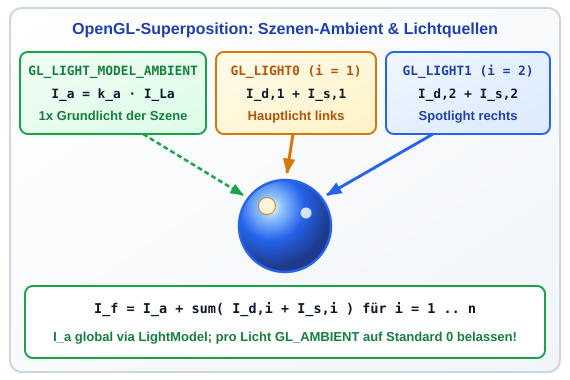

</div>
</div>

> **Hinweis:** Optional fürs Selbststudium – Hauptdeck, Übung 05 & Quiz 3 sind in sich geschlossen.

---

<!-- _class: outlook -->

### Ausblick: Vom UI-Thread auf alle CPU-Kerne (Termin 06)

<div class="columns">
<div class="three">

Unser 4-teiliger Visualisierungsblock (**T02–T05**: Pixel, Vektor, Telemetrie, 3D-OpenGL) ist abgeschlossen – bevor wir ab Termin 07 Gleichungslöser starten, lösen wir einen Engpass:

- **Das $16{,}6\,\text{ms}$-Problem:** Laufen Berechnung und Rendering gemeinsam im UI-Thread, friert das Fenster ein und 15 Kerne bleiben ungenutzt.
- **Nächster Schritt (Termin 06):** **Multithreading (`Parallel.For`, `Task.Run`, `IProgress<T>`)** trennt Rechenlast und UI sauber.

> **Showcase-Fokus (T06):** SCARA / Claw Crane (`PushMatrix`/`PopMatrix`, `OrbitCamera.Pan` & Pol-Schutz).

</div>
<div class="two">

```csharp
// Ausblick T06: Parallelisierung
Parallel.For(0, nParticles, i =>
{
    StepPhysics(i, dt);
});
```

- **Block 2 (T06–T10):** Parallel Computing, Cholesky/Jacobi-IK (T07), DGLs (T08), Optimierung (T09) & Virtuelle Inbetriebnahme (T10).

- **Ziel (T06):** Die UI bleibt bei $\ge 60\,\text{FPS}$ flüssig, während alle CPU-Kerne parallel die Physik berechnen.

</div>
</div>

---

<!-- _class: homework -->

### Hausübung Termin 05: 3D-OpenGL & Szenengraph

**Stufe 1 (Basisaufgabe `1.1`–`1.4` auf `SceneGraph3D.sln`):** `_rootNode.Render`, Kamera-Panning, 3D-Werkstück & Unit-Tests ([Aufgabenblatt 05](../Uebung/Aufgabenblatt.md)) $\to$ **Stufe 2 (Vertiefung – Wahl: Track A ODER Track B, 10 Pkt.):**

<div class="columns">
<div class="two">

#### Stufe 2 – Track A: 4-Achs-SCARA mit Parallelgreifer
- **A.1:** 4 Achsen ($\theta_1, \theta_2, d_3, \theta_4$) & Parallelgreifer ($g_{\text{width}}$)
- **A.2:** Animiertes Teach-In (`DispatcherTimer`) für Posen A, B & Home
- **A.3:** Interaktives Pick-and-Place von 3D-Werkstücken
- **A.4:** Arbeitszellen-Spotlight (`GL_LIGHT1`) & Status-Anzeige

</div>
<div class="two">

#### Stufe 2 – Track B: 3D Arcade Claw Crane (Greifarm)
- **B.1:** 3-Achs-Portalbrücke, Seilwinde & 3-Finger-Greifklaue
- **B.2:** Interaktive Tastatursteuerung & automatischer Greifzyklus
- **B.3:** 3D-Kollisionsprüfung (`Reparenting`) & Schacht-Abwurf
- **B.4:** Atmosphärisches Automaten-Spotlight (`GL_LIGHT1`)

</div>
</div>
