<!-- _paginate: false -->
<!-- _header: "" -->
<!-- _footer: "" -->


# Kapitel 5: 3D-Visualisierung mit OpenGL

Dieses Kapitel umfasst die folgenden Abschnitte:

- 5.1: Grundlagen der 3D-Visualisierung mit OpenGL
- 5.2: Strukturierung mit einem Szenengraphen
- 5.3: Mechatronische Anwendung: Kinematische Ketten & Robotik
- 5.4: Interaktive Kameraführung

---

### Moodle-Quiz 2 & Live-Showcase: Termin 04

Zu Beginn (15 Min.): **Moodle-Test 2** (Kapitel 03 & 04) – danach **Live-Showcase & Code-Defense** der Hausübung aus Termin 04 (**Stufe 1** + **Stufe 2: Track A oder B**, [Aufgabenblatt 04](../../04_Telemetrie_und_ScottPlot/Uebung/Aufgabenblatt.md)):

<div class="columns">
<div class="two">

#### Stufe 2 – Track A: Industrie (Antriebsprüfstand)
- **Signal-Streaming:** Drehzahl $n(t)$ & Moment $M(t)$ mit dynamischen $\pm 3\sigma$-Toleranzbändern.
- **Topologie:** MSAGL-Antriebsstrang mit visueller Kavitations-/Alarmanzeige.
- **Stresstest:** Abtastfrequenz drastisch erhöhen & Welford-Hüllkurven im Betrieb prüfen.

</div>
<div class="two">

#### Stufe 2 – Track B: Game (Racing HUD)
- **Cockpit-Telemetrie:** Speed/RPM mit Shift-Flash & G-Kräfte (Kamm'scher Kreis).
- **Statistik:** Rundenzeiten-Histogramm & Streckenabschnitts-Topologie (MSAGL).
- **Stresstest:** Grenzbereich-Fahrt mit Haftungsabriss ($a_{\text{res}} > \mu \cdot g$) provozieren.

</div>
</div>

> **Code-Defense (Säule 2b, 20 %):** Prüfung auf allokationsfreies Streaming (keine GC-Spikes im Diagnostic Tool), Single-Pass-Welford und UI-Entkopplung.

---

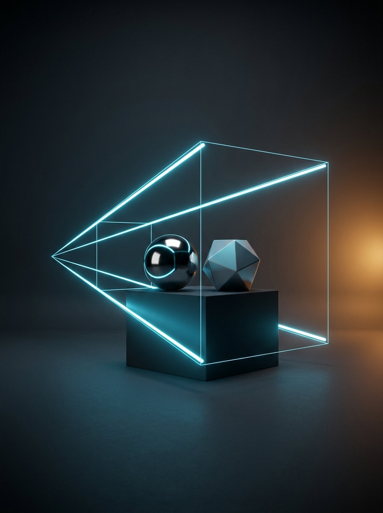

## 5.1: Grundlagen der 3D-Visualisierung mit OpenGL

Dieser Abschnitt umfasst die folgenden Inhalte:

- Rückblick & Brücke zu Termin 02–04 und Abschluss des Visualisierungs-Blocks
- Grundkonzepte von OpenGL (Zustandsmaschine, Grafik-Pipeline)
- Verwendung von Buffern (Farbpuffer & Z-Buffer-Tiefenprüfung)
- Phong-Beleuchtungsmodell und Schattierungsarten (Flat vs. Smooth)
- Transformations-Pipeline und Projektionsarten (`glOrtho` vs. `gluPerspective`)

---

### Rückblick & Brücke: Wo stehen wir in der Vorlesung?

In **Termin 02 bis 04** haben wir die 2D-Welt gemeistert (Pixelraster, 2D-Vektor-Canvas, Echtzeit-Diagramme mit `ScottPlot 5`) – wo stoßen 2D-Ansichten an ihre Grenzen?

- **Rückblick auf Termin 03 & 04 (2D-Projektion & Telemetrie):**
  - Weltkoordinaten $(x_w, y_w)$ auf dem 2D-Bildschirm sowie Zeitreihen und Topologie-Graphen (`MSAGL`).
- **Der Engpass heute (Räumliche Kinematik & Verdeckung):**
  - Ein mehrachsiger Industrieroboter bewegt sich im **3D-Raum $(x, y, z)$**: Bauteile verdecken sich gegenseitig, Perspektive verkürzt Längen und Gelenke rotieren um Raumachsen.
  - Ein flaches 2D-Canvas kennt weder Tiefenprüfung (**Z-Buffer**) noch Hardware-Beleuchtung oder $4\times 4$-Matrix-Stacks.
- **Halbzeit-Meilenstein (Abschluss des Visualisierungs-Blocks T02–T05):**
  - Mit `SharpGL` komplettieren wir heute unsere 4 Visualisierungs-Säulen, bevor ab Termin 06 (Multithreading) und Termin 07–10 die Systemmodellierung & Gleichungslöser starten.

---

### Was ist OpenGL?

<div class="columns">
<div class="two">

- **Open Graphics Library:**
  - Plattform- und sprachübergreifende Standard-API zur hardwarebeschleunigten 2D- und 3D-Computergrafik.
- **Direkter Draht zur GPU:**
  - Statt wie in Termin 02 Pixel einzeln auf der CPU zu berechnen, übergeben wir der Grafikkarte 3D-Eckpunkte (*Vertices*), Normalenvektoren und Transformationsmatrizen.
- **Zustandsmaschine (State Machine):**
  - Einmal gesetzte Einstellungen (Licht, Farbe, Matrix-Modus) bleiben so lange aktiv, bis sie explizit geändert werden.
- **Fokus im Kurs (`SharpGL` Fixed-Function):**
  - Unmittelbar transparenter Matrix-Stack (`glPushMatrix` / `glPopMatrix`) ohne Shader-Boilerplate – ideal für kinematische Ketten!

</div>
<div class="one">


</div>
</div>

---

### Einbindung in WPF mit `SharpGL.WPF`

Die Bibliothek `SharpGL.WPF` stellt das Steuerelement `OpenGLControl` bereit, das einen Hardware-OpenGL-Kontext nahtlos in unser WPF-Fenster einbettet:

- **Zwei zentrale Lebenszyklus-Ereignisse:**
  1. `OpenGLInitialized`: Wird **einmalig** beim Start aufgerufen (globale Grundeinstellungen wie Tiefentest, Lichtquellen und Hintergrundfarbe).
  2. `OpenGLDraw`: Wird **in jedem Frame** (oder bei `DoRender()`) aufgerufen, um die 3D-Szene neu zu zeichnen.

```xml
<Window xmlns:sharpGL="clr-namespace:SharpGL.WPF;assembly=SharpGL.WPF">
    <Grid>
        <sharpGL:OpenGLControl x:Name="OpenGlView"
            OpenGLInitialized="OpenGlView_OpenGLInitialized"
            OpenGLDraw="OpenGlView_OpenGLDraw"
            Resized="OpenGlView_Resized" />
    </Grid>
</Window>
```

---

### Initialisierung der Szene: `OpenGLInitialized`

In `OpenGlView_OpenGLInitialized` konfigurieren wir einmalig die Zustandsmaschine über `gl` (`args.OpenGL` – Farben in OpenGL sind auf $[0{,}0 \dots 1{,}0]$ normiert statt `0..255`):

```csharp
private void OpenGlView_OpenGLInitialized(object sender, OpenGLRoutedEventArgs args)
{
    OpenGL gl = args.OpenGL;

    // 1. Hintergrundfarbe festlegen (Clear Color: normiertes RGBA [0..1], dunkles CAD-Anthrazit)
    gl.ClearColor(0.08f, 0.08f, 0.08f, 1.0f);

    // 2. Tiefenpuffer (Z-Buffer) für korrekte 3D-Verdeckung aktivieren
    gl.Enable(OpenGL.GL_DEPTH_TEST);

    // 3. Phong-Beleuchtungsmodell und Hauptlichtquelle GL_LIGHT0 einschalten
    gl.Enable(OpenGL.GL_LIGHTING);
    gl.Enable(OpenGL.GL_LIGHT0);

    // 4. Weiche Farbinterpolation (Gouraud Shading) aktivieren
    gl.ShadeModel(OpenGL.GL_SMOOTH);
}
```

---

### Framebuffer im GPU-Speicher: Color Buffer & Depth Buffer

<div class="columns">
<div class="two">

Für jedes Pixel `(x, y)` verwaltet OpenGL im GPU-Speicher zwei gleich große 2D-Raster:

- **1. Color Buffer (`GL_COLOR_BUFFER_BIT`):**
  - Sichtbare RGBA-Farbe pro Pixel (wie `WriteableBitmap` in T02; Startwert `ClearColor` = `BG`).
- **2. Depth Buffer / Z-Buffer (`GL_DEPTH_BUFFER_BIT`):**
  - Kleinster Kameraabstand `z_buf` pro Pixel (Startwert `zFar`).
  - **Tiefentest (`GL_DEPTH_TEST`):** Überschreibe Farbe und `z_buf` nur, wenn `z_neu < z_buf` gilt!

</div>
<div class="two">

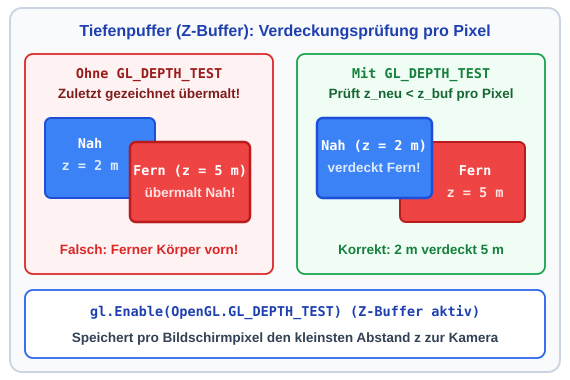

</div>
</div>

---

### Das Phong-Beleuchtungsmodell im Überblick (`GL_LIGHTING`)

<div class="columns">
<div class="two">

Ohne Beleuchtung wirkt ein 3D-Körper wie eine flache 2D-Silhouette. Das **Phong-Modell** (`GL_LIGHTING`) berechnet die Helligkeit $I_f$ als Summe von drei Anteilen:

$$I_f = I_a + I_d + I_s$$

1. **Ambient ($I_a$):** Richtungsunabhängige Grundhelligkeit durch indirektes Streulicht im Raum.
2. **Diffuse ($I_d$):** Matte Streureflexion abhängig vom Lichteinfallswinkel (Lambert-Gesetz).
3. **Specular ($I_s$):** Blickwinkelabhängiger Glanzpunkt auf glatten oder metallischen Oberflächen.

</div>
<div class="two">

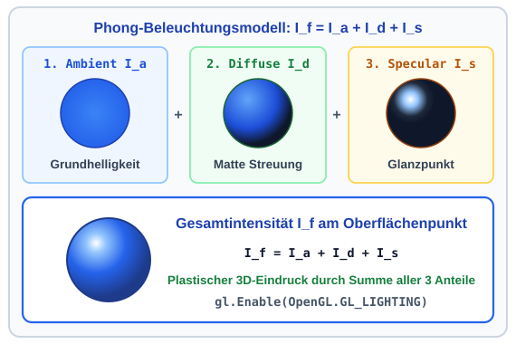

</div>
</div>

---

### Vektoren für die Beleuchtungsrechnung (Normiert)

<div class="columns">
<div class="two">

An jedem Oberflächenpunkt $\vec{p}$ nutzt das Phong-Modell vier auf Länge $1$ **normierte Einheitsvektoren** ($\|\vec{n}\| = 1$):

- **$\vec{n}$ (Normalenvektor):** Steht exakt senkrecht auf der Tangentialebene des Körpers im Punkt $\vec{p}$.
- **$\vec{l}$ (Lichtvektor):** Zeigt vom Punkt $\vec{p}$ zur Lichtquelle $\vec{p}_{\text{light}}$.
- **$\vec{v}$ (Betrachtungsvektor):** Zeigt vom Punkt $\vec{p}$ zum Kameraauge $\vec{p}_{\text{cam}}$.
- **$\vec{r}$ (Reflexionsvektor):** Der an der Normalen $\vec{n}$ unter dem Einfallswinkel $\delta$ gespiegelte Lichtstrahl:
  $$\vec{r} = 2(\vec{n} \cdot \vec{l})\vec{n} - \vec{l}$$

</div>
<div class="two">

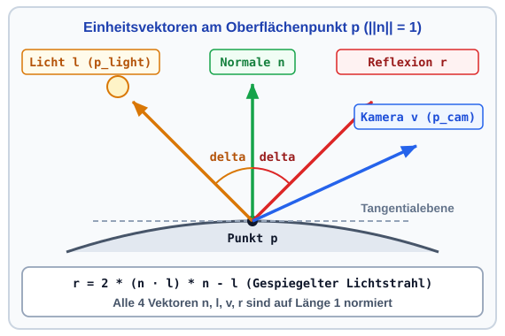

</div>
</div>

---

### 1. Ambient- & 2. Diffuse-Komponente (Lambert-Gesetz)

<div class="columns">
<div class="two">

- **1. Ambient ($I_a = k_a \cdot I_{La}$):**
  - Grundhelligkeit gegen schwarze Schatten ($k_a =$ Material, $I_{La} =$ Raumlicht).
- **2. Diffuse ($I_d = k_d \cdot I_{Ld} \cdot \max(0, \vec{n} \cdot \vec{l})$):**
  - Mit $\|\vec{n}\| = \|\vec{l}\| = 1$ liefert $\vec{n} \cdot \vec{l} = \cos(\delta)$ den Einfallswinkel $\delta$:
  - **Zahlenbeispiel:**
    - Senkrecht ($\delta = 0^\circ$): $\cos(0^\circ) = 1{,}00$ ($100\,\%$).
    - Flach ($\delta = 60^\circ$): $\cos(60^\circ) = 0{,}50$ ($50\,\%$).
    - Rückseite ($\delta > 90^\circ$): $\max(0, \dots) \implies I_d = 0$.

</div>
<div class="two">

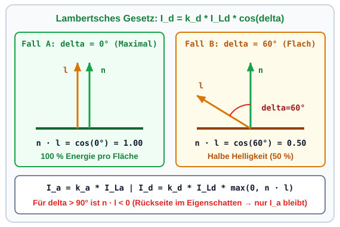

</div>
</div>

---

### 3. Specular-Komponente (Glanzpunkt & Shininess)

<div class="columns">
<div class="two">

Glatte Oberflächen reflektieren Licht gebündelt um die Ausfallsrichtung $\vec{r}$:

$$I_s = k_s \cdot I_{Ls} \cdot \left(\max(0, \vec{r} \cdot \vec{v})\right)^{\alpha_{\text{shiny}}}$$

- **Blickrichtung $\vec{r} \cdot \vec{v}$:** Maximal ($1{,}0$), wenn die Kamera $\vec{v}$ direkt in $\vec{r}$ blickt.
- **Exponent $\alpha_{\text{shiny}} \in [1, 128]$ ($k_s, I_{Ls}$):**
  - **Zahlenbeispiel bei $\vec{r} \cdot \vec{v} = 0{,}90$ ($\approx 25^\circ$):**
    - Plastik ($\alpha_{\text{shiny}} = 8$): $0{,}90^8 = 0{,}43$ (breit).
    - Metall ($\alpha_{\text{shiny}} = 64$): $0{,}90^{64} = 0{,}001$ (scharf!).

</div>
<div class="two">

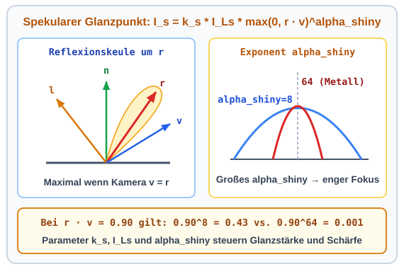

</div>
</div>

---

### Kombination mehrerer Lichtquellen & C#-Konfiguration

<div class="columns">
<div class="two">

Bei $n$ Lichtern (`GL_LIGHT0`, `GL_LIGHT1`..`GL_LIGHT7`) addiert OpenGL $I_d, I_s$ ($I_{d,i}, I_{s,i}$) auf das Raumlicht $I_a = k_a \cdot I_{La}$:

$$I_f = I_a + \sum_{i=1}^{n} \left(I_{d,i} + I_{s,i}\right)$$

- **Globales vs. lokales Ambient:**
  - **`GL_LIGHT_MODEL_AMBIENT`** (`gl.LightModel`) setzt $I_{La}$ einmalig für die gesamte Szene.
  - Pro-Licht `GL_AMBIENT` bleibt auf Standard `0` (sonst verwaschen Schatten bei Spotlights!).
  - `GL_COLOR_MATERIAL` koppelt `gl.Color` an $k_a, k_d$.

</div>
<div class="two">

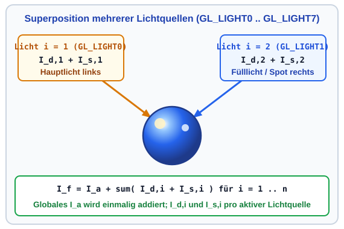

</div>
</div>

---

### Der C#-Code zur Phong-Beleuchtung (`OpenGLInitialized`)

```csharp
// 1. Phong-Beleuchtung aktivieren & globales Raumlicht I_La einmalig für die Szene setzen
gl.Enable(OpenGL.GL_LIGHTING);
float[] globalAmbient = [0.25f, 0.25f, 0.25f, 1.0f]; // Globales Raumlicht I_La
gl.LightModel(OpenGL.GL_LIGHT_MODEL_AMBIENT, globalAmbient);

// 2. Punktlicht GL_LIGHT0 (x=10, y=20, z=15, w=1 -> Punktlicht; w=0 wäre Richtungslicht)
gl.Enable(OpenGL.GL_LIGHT0);
float[] lightPos      = [10.0f, 20.0f, 15.0f, 1.0f];
float[] lightDiffuse  = [0.85f, 0.85f, 0.85f, 1.0f]; // Streulicht I_Ld,1
float[] lightSpecular = [1.00f, 1.00f, 1.00f, 1.0f]; // Weißes Glanzlicht I_Ls,1

gl.Light(OpenGL.GL_LIGHT0, OpenGL.GL_POSITION, lightPos);
gl.Light(OpenGL.GL_LIGHT0, OpenGL.GL_DIFFUSE,  lightDiffuse);
gl.Light(OpenGL.GL_LIGHT0, OpenGL.GL_SPECULAR, lightSpecular);

// 3. Color-Tracking: gl.Color(r,g,b) steuert direkt die Materialkoeffizienten k_a und k_d!
gl.Enable(OpenGL.GL_COLOR_MATERIAL);
gl.ColorMaterial(OpenGL.GL_FRONT_AND_BACK, OpenGL.GL_AMBIENT_AND_DIFFUSE);
```

- `globalAmbient` parametriert das Szenen-Grundlicht; `lightPos`, `lightDiffuse` und `lightSpecular` steuern `GL_LIGHT0`.

---

### Schattierungsmodus: Flat Shading (`GL_FLAT`)

<div class="columns">
<div class="two">

Wie werden die berechneten Phong-Farben über ein Polygon gefüllt?

- **Modus 1 – `gl.ShadeModel(OpenGL.GL_FLAT)`:**
  - OpenGL berechnet die Beleuchtung **nur einmal pro Polygon** mit einer Flächennormalen ($\vec{n}_1, \vec{n}_2, \vec{n}_3, \vec{n}_4$).
  - Jede Facette erhält eine konstante Farbe.
- **Visueller Effekt:**
  - Sichtbare Farbsprünge an den Kanten – ideal für scharfkantige Quader (`DrawCube`).

</div>
<div class="two">

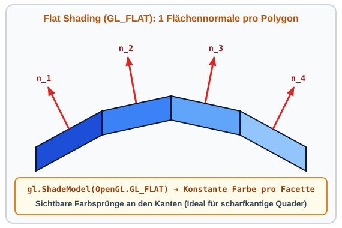

</div>
</div>

---

### Schattierungsmodus: Smooth Shading (`GL_SMOOTH`)

<div class="columns">
<div class="two">

Für gekrümmte Körper (`DrawSphere`, `DrawCylinder`) nutzen wir **Gouraud Shading**:

- **Modus 2 – `gl.ShadeModel(OpenGL.GL_SMOOTH)`:**
  - Jeder Eckpunkt (Vertex) erhält seine eigene **Vertex-Normale** ($\vec{n}_{v1}, \vec{n}_{v2}, \vec{n}_{v3}$).
  - OpenGL berechnet die Farbe an den Ecken und **interpoliert bilinear** über die Fläche.
- **Visueller Effekt:**
  - Schon bei `slices = 24` wirken Zylinder und Kugeln perfekt glatt gerundet!

</div>
<div class="two">

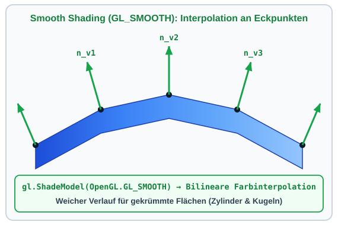

</div>
</div>

---

### Der Render-Loop in jedem Frame: `OpenGLDraw`

Während `OpenGLInitialized` einmalig beim Programmstart läuft, wird `OpenGlView_OpenGLDraw` bei jedem Bildaufbau ausgeführt:

```csharp
private void OpenGlView_OpenGLDraw(object sender, OpenGLRoutedEventArgs args)
{
    OpenGL gl = args.OpenGL;

    // 1. Farb- UND Tiefenpuffer (Z-Buffer) für den neuen Frame leeren
    gl.Clear(OpenGL.GL_COLOR_BUFFER_BIT | OpenGL.GL_DEPTH_BUFFER_BIT);

    // 2. ModelView-Matrix auf die Einheitsmatrix I zurücksetzen
    gl.MatrixMode(OpenGL.GL_MODELVIEW);
    gl.LoadIdentity();

    // 3. Kamera-Sichtmatrix setzen (statisch (5,5,5) -> in der Vorlage via _camera.Apply(gl))
    gl.LookAt(5.0, 5.0, 5.0,  0.0, 0.0, 0.0,  0.0, 1.0, 0.0);

    // 4. Achsen & Gitter (kurz gl.Disable(GL_LIGHTING), da Linien keine Normalen haben!) + 3D-Objekte ...
}
```

---

### Zeichnen von Primitiven: `gl.Begin(...)` & `gl.End()`

Zwischen `gl.Begin(mode)` und `gl.End()` übergeben wir Vertices (`gl.Vertex`), Normalen (`gl.Normal`) und Farbe (`gl.Color`):

| OpenGL-Modus | Geometrische Bedeutung | Einsatz in `SceneGraph3D.sln` |
| :--- | :--- | :--- |
| **`GL_LINES`** | Je 2 Vertices = 1 Strecke (`1-2`, `3-4`) | **Achsen (`DrawAxes`) & Bodengitter (`DrawFloorGrid`)** |
| **`GL_LINE_STRIP`** | Durchgehender Linienzug (`1-2-3-4`) | Werkzeugbahnen (TCP-Trajektorie) |
| **`GL_TRIANGLES`** | Je 3 Vertices = 1 Dreieck (`1-2-3`) | Allgemeine 3D-CAD-Meshes (STL) |
| **`GL_TRIANGLE_FAN`** | Dreiecksfächer um Zentrum `1` | Stirndeckel von Zylindern (`DrawCylinder`) |
| **`GL_QUADS`** | Je 4 Vertices = 1 Viereck (`1-2-3-4`) | **Quader-Seitenflächen (`DrawCube`)** |
| **`GL_QUAD_STRIP`** | Verbundenes Vierecksband | **Zylindermäntel & Kugeln (`DrawSphere`)** |

---

### Visuelle Referenz der OpenGL-Primitive *(Deep Dive)*

<div class="columns">
<div class="two">

- **Linien (`GL_LINES` vs. `GL_LINE_STRIP`):**
  - `DrawFloorGrid` zeichnet Einzelstrecken (`v1`-`v2`, `v3`-`v4`) im Modus `GL_LINES` (ohne Licht).
  - `GL_LINE_STRIP` verbindet `v1`-`v2`-`v3`-`v4` durchgehend.
- **Vierecke (`GL_QUADS` & `GL_QUAD_STRIP`):**
  - `DrawCube` nutzt $6 \times 4 = 24$ Vertices (`GL_QUADS`) mit je 1 Flächennormalen $\vec{n}$.
  - `DrawCylinder` verbindet `v1`..`v6` als `GL_QUAD_STRIP` (`slices = 24`).

</div>
<div class="two">

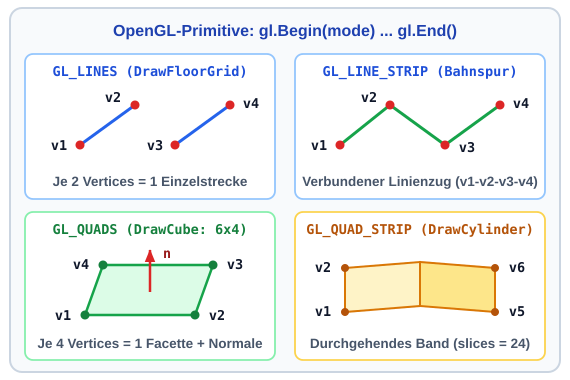

</div>
</div>

---

### Die ModelView-Matrix (`GL_MODELVIEW`): Vom Bauteil zur Kamera

<div class="columns">
<div class="two">

OpenGL überführt lokale Bauteilpunkte $\vec{v}_{\text{obj}}$ über $\mathbf{M}_{\text{modelview}} = \mathbf{M}_{\text{view}} \cdot \mathbf{M}_{\text{model}}$ in den **Kamera-Raum** ($\vec{v}_{\text{eye}}$):

1. **Model ($\mathbf{M}_{\text{model}}$):** Platziert das Bauteil aus seinem lokalen Ursprung `(0,0,0)` an seine Weltposition $\vec{v}_{\text{world}}$.
2. **View ($\mathbf{M}_{\text{view}}$, `gl.LookAt`):** OpenGL bewegt keine Kamera $\vec{p}_{\text{eye}}$, sondern schiebt die **gesamte Welt gegenläufig** so, dass die Kamera fest in `(0,0,0)` sitzt und entlang $-Z_{\text{eye}}$ blickt ($z_{\text{eye}} < 0$)!
- **Warum verschmolzen?** Kamera zurückziehen $\equiv$ Welt wegschieben!

</div>
<div class="two">

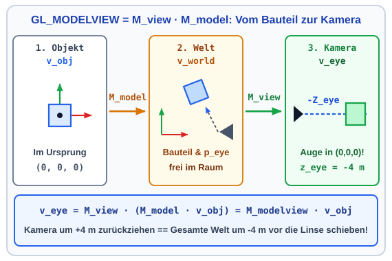

</div>
</div>

---

### Reihenfolge in $\mathbf{M}_{\text{model}}$: Warum gilt $\mathbf{T} \cdot \mathbf{R} \neq \mathbf{R} \cdot \mathbf{T}$?

<div class="columns">
<div class="two">

Erst homogene $4\times 4$-Matrizen mit $\vec{v} = (x, y, z, 1)^\top$ vereinen Verschiebung $\mathbf{T}$ und Drehung $\mathbf{R}$ in $\mathbf{M}_{\text{model}}$:

- **Warum reicht $3\times 3$ nicht?** Jede $3\times 3$-Matrix bildet $\vec{0} \mapsto \vec{0}$ ab (keine Translation möglich!).
- **Reihenfolge entscheidet ($\mathbf{T}\cdot\mathbf{R} \neq \mathbf{R}\cdot\mathbf{T}$):**
  1. **`T(L1) · R`:** Verschiebt erst zum Gelenkpunkt `(L1, 0)` und dreht den Arm dort vor Ort $\checkmark$
  2. **`R · T(L1)`:** Dreht erst die Achse $\implies$ das Bauteil schwenkt auf einer Kreisbahn um `(0,0)`!

</div>
<div class="two">

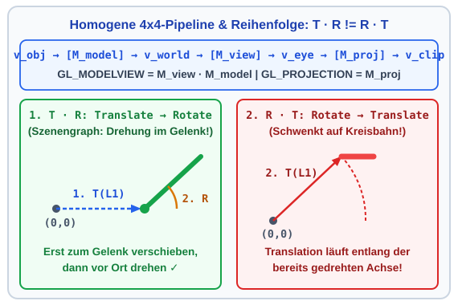

</div>
</div>

---

### Projektionsmatrix (`GL_PROJECTION`): Sichtvolumen $\to$ NDC-Würfel

`GL_PROJECTION` staucht das 3D-Sichtvolumen zwischen `near`/`zNear` und `far`/`zFar` abhängig vom Kameraabstand $z$ in den Einheitswürfel **NDC** $[-1, +1]^3$ (`h1`, `h2`):

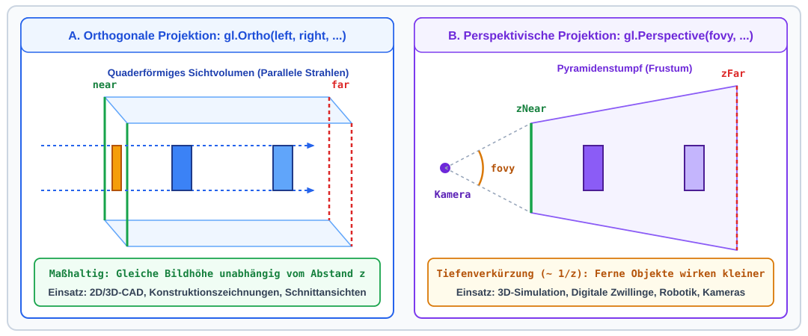

---

### Orthogonale Projektion vs. Perspektive *(Mathematischer Deep Dive)*

<div class="columns">
<div class="two">

#### 1. Orthogonale Projektion (`gl.Ortho`)
- **Sichtvolumen:** Achsenparalleler Quader $[left, right] \times [bottom, top] \times [near, far]$.
- **Keine Tiefendivision:** Parallele Kanten bleiben im Bild exakt parallel ($x_{\text{ndc}} \propto x$).
- **Einsatz:** Maßhaltige 2D/3D-CAD-Ansichten (Aufriss, Grundriss, Seitenansicht).

</div>
<div class="two">

#### 2. Perspektivische Projektion (`gl.Perspective`)
- **Sichtvolumen:** Pyramidenstumpf (**Frustum**) mit Öffnungswinkel `fovy` (z. B. $45^\circ$), Seitenverhältnis `aspect` $= w/h$ und Clipping-Ebenen `zNear` bis `zFar`.
- **Strahlensatz-Division durch $-z$ (Blick entlang $-Z \implies -z > 0$):**
  $$x_{\text{proj}} = x \cdot \frac{z_{\text{near}}}{-z}, \quad y_{\text{proj}} = y \cdot \frac{z_{\text{near}}}{-z}$$
- **Zahlenbeispiel:** Ein Würfel in doppelter Entfernung ($z = -4\,\text{m}$ statt $-2\,\text{m}$) erscheint auf dem Bildschirm **exakt halb so groß**!

</div>
</div>

---

### Projektion im Resize-Handler (`OpenGlView_Resized`)

Ändert sich die Fenstergröße, muss das Seitenverhältnis `aspect` aktualisiert werden (sonst werden Kugeln zu Ellipsen verzerrt – analog zu Termin 03!):

```csharp
private void OpenGlView_Resized(object sender, OpenGLRoutedEventArgs args)
{
    OpenGL gl = args.OpenGL;
    gl.MatrixMode(OpenGL.GL_PROJECTION);
    gl.LoadIdentity();

    // Seitenverhältnis aspect = Breite / Höhe berechnen (Schutz gegen Division durch 0)
    double aspect = OpenGlView.ActualWidth / Math.Max(OpenGlView.ActualHeight, 1.0);
    gl.Perspective(45.0, aspect, 0.1, 100.0); // Frustum: fovy=45°, zNear=0.1m, zFar=100m

    gl.MatrixMode(OpenGL.GL_MODELVIEW);       // Zurück in den ModelView-Modus!
}
```

---

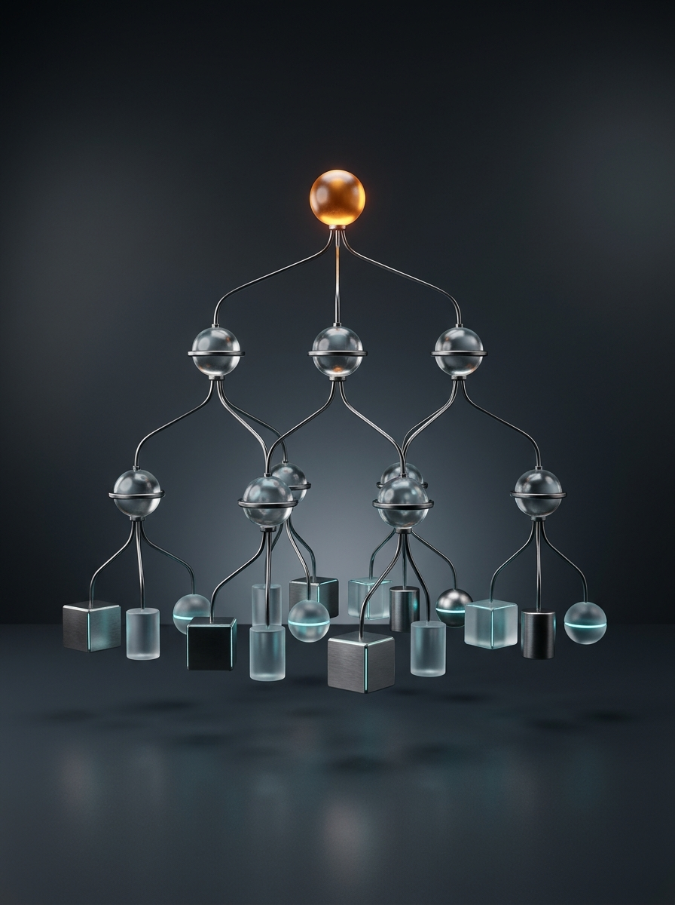

## 5.2: Strukturierung mit einem Szenengraphen

Dieser Abschnitt umfasst die folgenden Inhalte:

- Vom flachen Zeichencode zur hierarchischen Baumstruktur (Szenengraph)
- Der OpenGL-Matrix-Stack (`gl.PushMatrix` & `gl.PopMatrix`) und die Skalierungs-Falle
- Klasse `SceneNode` und Euler-Winkel (`Rx, Ry, Rz`)
- Lokale vs. globale Transformationsmatrizen (`GetLocalMatrix` & `GetWorldMatrix`)
- Grundkörper-Rendering mit korrekten Normalen (`DrawCube`, `DrawCylinder`, `DrawSphere`)

---

### Die Herausforderung: Warum ein Szenengraph?

<div class="columns">
<div class="two">

Stellen wir uns den SCARA-Roboter aus der Hausübung vor:

- **Problem bei Einzelberechnung:**
  - Dreht sich die Schulter (`UpperArm`) um $\theta_1$, schwenken Unterarm (`ForeArm`), `Pinole` und Greifer (`TCP`) auf einer Kreisbahn mit!
- **Lösung – Szenengraph (`SceneNode`):**
  - Jeder Knoten beschreibt seine Lage **nur relativ zum direkten Elternknoten** (Schulter $\theta_1$, Ellenbogen $\theta_2$ bei `L1`, Vertikalhub $d_3$).

</div>
<div class="two">

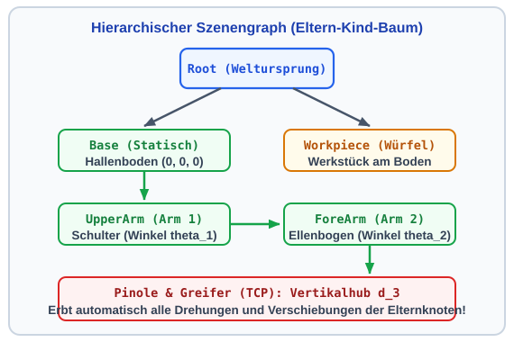

</div>
</div>

---

### Der Matrix-Stack: `PushMatrix` & `PopMatrix`

<div class="columns">
<div class="two">

Wie vererbt OpenGL Transformationen an Kinder, ohne Geschwister (`Workpiece`) zu verschieben?

- **`gl.PushMatrix()`:** Sichert die Eltern-Matrix $\mathbf{M}_0$ oben auf dem GPU-Stack.
- **Lokale Transformation (`T_1, R_1` & `T_2, R_2`):**
  - Kind: $\mathbf{M}_1 = \mathbf{M}_0 \cdot \mathbf{T}_1 \cdot \mathbf{R}_1$; Enkel: $\mathbf{M}_2 = \mathbf{M}_1 \cdot \mathbf{T}_2 \cdot \mathbf{R}_2$.
- **`gl.PopMatrix()`:** Stellt nach dem Teilbaum exakt $\mathbf{M}_0$ wieder her!
- **Skalierungs-Falle (Aufgabe 1.1):** `gl.Scale(L1, ...)` immer lokal in `PushMatrix`/`PopMatrix` kapseln!

</div>
<div class="two">

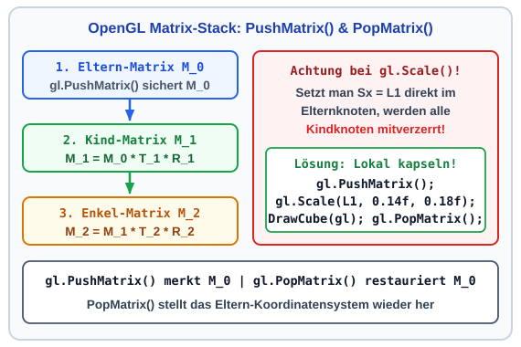

</div>
</div>

---

### Architektur in unserer Vorlage: Die Klasse `SceneNode`

In `Scene/SceneNode.cs` kapselt eine einzige Klasse Baumstruktur, Transformation und Rendering:

| Eigenschaft / Methode | Typ | Aufgabe im Szenengraphen (`SceneGraph3D.sln`) |
| :--- | :--- | :--- |
| **`Name` / `Children`** | `List<SceneNode>` | Verwaltet die Eltern-Kind-Hierarchie via `AddChild(child)`. |
| **`Tx, Ty, Tz`** | `float` $[\text{m}]$ | Lokale Translation relativ zum Elternknoten. |
| **`Rx, Ry, Rz`** | `float` $[^\circ]$ | Lokale Euler-Winkel in Grad um X-, Y- und Z-Achse. |
| **`Sx, Sy, Sz`** | `float` | Lokale Skalierungsfaktoren (Standard $= 1{,}0$). |
| **`RenderCustomGeometry`** | `Action<OpenGL>?` | **C#-Delegate:** Zeichnet die lokale Bauteil-Geometrie (Aufgabe 1.1). |
| **`Render(OpenGL gl)`** | `void` | Traversiert den Baum rekursiv mit `PushMatrix` / `PopMatrix`. |
| **`GetWorldMatrix()`** | `Matrix4x4` | Berechnet die $4\times 4$-Weltmatrix für den TCP-Deckungstest! |

---

### Räumliche Orientierung: Euler-Winkel (`Rx`, `Ry`, `Rz`)

<div class="columns">
<div class="two">

`SceneNode` zerlegt 3D-Drehungen $\mathbf{R} = \mathbf{R}_y(\text{Ry}) \cdot \mathbf{R}_x(\text{Rx}) \cdot \mathbf{R}_z(\text{Rz})$ nach der **Rechte-Hand-Regel** (Daumen in $+$-Achse):

1. **`Ry` (Yaw / Gieren um $+Y$):** Horizontal links/rechts schwenken.
2. **`Rx` (Pitch / Nicken um $+X$):** Heben und Senken.
3. **`Rz` (Roll / Rollen um $+Z$):** Seitlich kippen.
- **Verkettung (`Y → X → Z`):** Folgeachsen drehen mit – bei `Rx = ±90°` fluchten $Y$ und $Z$ (**Gimbal Lock**)!

</div>
<div class="two">

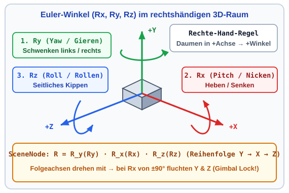

</div>
</div>

---

### Rekursive Traversierung: `SceneNode.Render(OpenGL gl)`

So traversiert `Render(OpenGL gl)` in `Scene/SceneNode.cs` den gesamten Baum ab `_rootNode`:

```csharp
public virtual void Render(OpenGL gl)
{
    gl.PushMatrix(); // 1. Eltern-Koordinatensystem auf dem GPU-Stack sichern

    // 2. Lokale Transformation anwenden: Translation (Tx,Ty,Tz) -> Rotation (Ry,Rx,Rz) -> Scale (Sx,Sy,Sz)
    gl.Translate(Tx, Ty, Tz);
    if (MathF.Abs(Ry) > 1e-4f) gl.Rotate(Ry, 0.0f, 1.0f, 0.0f);
    if (MathF.Abs(Rx) > 1e-4f) gl.Rotate(Rx, 1.0f, 0.0f, 0.0f);
    if (MathF.Abs(Rz) > 1e-4f) gl.Rotate(Rz, 0.0f, 0.0f, 1.0f);
    if (MathF.Abs(Sx - 1.0f) > 1e-4f || MathF.Abs(Sy - 1.0f) > 1e-4f || MathF.Abs(Sz - 1.0f) > 1e-4f)
        gl.Scale(Sx, Sy, Sz);

    RenderCustomGeometry?.Invoke(gl);          // 3. Eigene Geometrie zeichnen
    foreach (var child in Children)            // 4. Rekursiver Abstieg für alle Kinder (child)
        child.Render(gl);

    gl.PopMatrix();  // 5. Eltern-Koordinatensystem wiederherstellen
}
```

---

### `GetLocalMatrix` & `GetWorldMatrix` *(Deep Dive – fertig in der Vorlage)*

Für `GetWorldPosition()` berechnet `SceneNode` seine $4\times 4$-Weltmatrix auf der CPU (bereits fertig in `SceneNode.cs` implementiert):

```csharp
public Matrix4x4 GetLocalMatrix()
{
    var t  = Matrix4x4.CreateTranslation(Tx, Ty, Tz);
    var rx = Matrix4x4.CreateRotationX(Rx * MathF.PI / 180.0f);
    var ry = Matrix4x4.CreateRotationY(Ry * MathF.PI / 180.0f);
    var rz = Matrix4x4.CreateRotationZ(Rz * MathF.PI / 180.0f);
    var s  = Matrix4x4.CreateScale(Sx, Sy, Sz);
    return s * (rz * rx * ry) * t; // Zeilenvektor-Konvention: Scale -> Rotate -> Translate
}

public Matrix4x4 GetWorldMatrix()
    => Parent == null ? GetLocalMatrix() : GetLocalMatrix() * Parent.GetWorldMatrix();
```

- **Wichtiger Praxis-Fallstrick (Spalten- vs. Zeilenvektoren):** OpenGL multipliziert Spaltenvektoren von rechts ($\mathbf{M}_{\text{parent}} \cdot \mathbf{M}_{\text{local}} \cdot \vec{v}$); `.NET System.Numerics` (`t`, `rx`, `ry`, `rz`, `s`) nutzt **Zeilenvektoren** ($\vec{v}^\top \cdot \mathbf{M}_{\text{local}} \cdot \mathbf{M}_{\text{parent}}$) $\implies$ umgekehrte Reihenfolge `GetLocalMatrix() * Parent.GetWorldMatrix()`!

---

### Grundkörper mit Normalen (`DrawCube` & `DrawCylinder`)

<div class="columns">
<div class="two">

In `MainWindow.xaml.cs` zeichnen drei Hilfsmethoden Grundkörper mit **exakten Normalen** (`gl.Normal`):

- **`DrawCube(OpenGL gl)`:**
  - Einheitswürfel ($[-0{,}5, +0{,}5]^3$, Ursprung `(0,0,0)` **im Zentrum** $\implies$ erklärt `Translate(L1/2)` & `Ty = 0.06f`!) via `GL_QUADS`.
- **`DrawCylinder(gl, radius, height, slices)`:**
  - Zylindermantel entlang $+Y$ von $y = 0$ (Fußpunkt) bis `height` als `GL_QUAD_STRIP`.
  - Für jeden Winkel `theta` zeigt die Einheitsnormale radial nach außen: `nx = cos(theta)`, `nz = sin(theta)`!

</div>
<div class="two">

```csharp
private static void DrawCylinder(
    OpenGL gl, float radius, float height, int slices = 16)
{
    gl.Begin(OpenGL.GL_QUAD_STRIP);
    for (int i = 0; i <= slices; i++)
    {
        float theta = 2.0f * MathF.PI * i / slices;
        float nx = MathF.Cos(theta);
        float nz = MathF.Sin(theta);

        gl.Normal(nx, 0.0f, nz);
        gl.Vertex(radius * nx, 0.0f,   radius * nz);
        gl.Vertex(radius * nx, height, radius * nz);
    }
    gl.End();
}
```

</div>
</div>

---

### Kugel-Approximation (`DrawSphere`) & Anhang

<div class="columns">
<div class="two">

Für Gelenke (`DrawSphere`) wird eine Kugel ($r$) in Breitengrade (`stacks`, Elevation $\phi \in [-90^\circ, +90^\circ]$ ab Äquator) und Längengrade (`slices`, $\theta$) zerlegt:

- **Normalenformel der Kugel:**
  - Auf einer zentrierten Kugel steht der Ortsvektor jedes Punktes senkrecht auf der Oberfläche ($r = 1$):
    $$\vec{n}_{\phi,\theta} = \begin{pmatrix} \cos(\phi)\cos(\theta) \\ \sin(\phi) \\ \cos(\phi)\sin(\theta) \end{pmatrix}$$
- *Herleitung für Kegelstümpfe:* siehe [`Folien_Anhang_3D_Normalen.md`](./Folien_Anhang_3D_Normalen.md).

</div>
<div class="one">

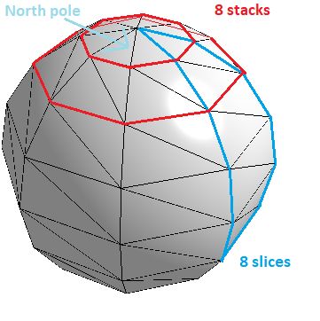

</div>
</div>

---


## 5.3: Mechatronische Anwendung: Kinematische Ketten & Robotik

Dieser Abschnitt umfasst die folgenden Inhalte:

- Serielle Roboterkinematik (SCARA & Knickarm) als hierarchischer Szenengraph
- Vorwärtskinematik: Analytische Trigonometrie vs. $4\times 4$-Matrix-Verkettung
- Konkretes Zahlenbeispiel & Echtzeit-Deckungstest ($\Delta = 0{,}000\,\text{mm}$)
- C#-Implementierung in `SceneGraph3D.sln` (Basisaufgabe 1.1 & 1.3)

---

### Kinematische Kette des SCARA-Roboters im Szenengraphen

<div class="columns">
<div class="two">

Ein **SCARA-Roboter** verkettet ab `_baseNode` `(0,0,0)` lokale Versätze ($\mathbf{T}_x, \mathbf{T}_y$) und Drehungen ($\mathbf{R}_y$ um `+Y`):

1. **`_arm1Node`:** Versatz $\mathbf{T}_y(\text{HBase})$ (`0.50 m`) nach oben + Schulterdrehung $\mathbf{R}_y(\theta_1)$.
2. **`_arm2Node`:** Versatz $\mathbf{T}_x(\text{L1})$ (`1.00 m`) entlang Arm 1 + Relativdrehung $\mathbf{R}_y(\theta_2)$.
3. **`_pinoleNode`:** Versatz $\mathbf{T}_x(\text{L2})$ (`0.80 m`) + Hub $\mathbf{T}_y(-d_3)$ zum **TCP**:

$$\mathbf{M}_{\text{TCP}} = \mathbf{T}_y(\text{HBase})\,\mathbf{R}_y(\theta_1)\,\mathbf{T}_x(\text{L1})\,\mathbf{R}_y(\theta_2)\,\mathbf{T}_x(\text{L2})\,\mathbf{T}_y(-d_3)$$

</div>
<div class="two">

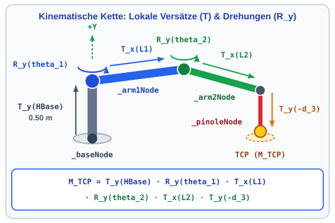

</div>
</div>

---

### Blick unter die Haube: Analytische Lösung & Deckungstest

<div class="columns">
<div class="two">

Zur Validierung von $\mathbf{M}_{\text{TCP}}$ (`GetWorldPosition`) zeichnet `CalculateAnalyticTcp` eine **gelbe Kontrollkugel** ($\Delta = 0{,}000\,\text{mm}$; Startpose `30°`, `-45°`, `0.15 m` $\to (1{,}639;\; 0{,}350;\; -0{,}293)\,\text{m}$):

$$x = \text{L1}\cos\theta_1 + \text{L2}\cos(\theta_1+\theta_2), \quad y = \text{HBase} - d_3$$
$$z = -\big(\text{L1}\sin\theta_1 + \text{L2}\sin(\theta_1+\theta_2)\big)$$

- **Winkel & Minuszeichen:** `L2` schließt zur $+X$-Parallele den Gesamtwinkel $\theta_1 + \theta_2$ ein; von oben (`+Y` zum Auge) dreht $+\theta_1$ nach hinten in **$-Z$**!

</div>
<div class="two">

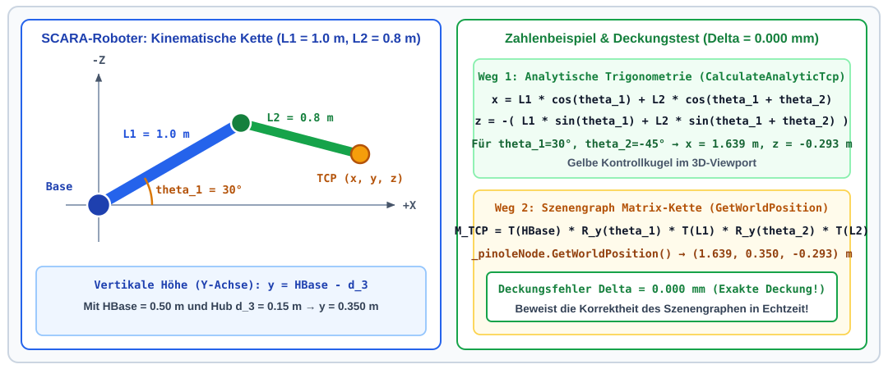

</div>
</div>

---

### Der C#-Code: Aufbau des Roboter-Szenengraphen (Aufgabe 1.1)

In **Stufe 1 (Aufgabe 1.1)** weisen wir jedem Knoten (`_baseNode`, `_arm1Node`, `_arm2Node`, `_pinoleNode`) unter `_rootNode` seine lokale Geometrie via `RenderCustomGeometry` zu:

```csharp
private void BuildSceneGraph()
{
    _rootNode.AddChild(_baseNode);
    _baseNode.AddChild(_arm1Node);
    _arm1Node.AddChild(_arm2Node);
    _arm2Node.AddChild(_pinoleNode);

    _arm1Node.RenderCustomGeometry = gl => {
        gl.Color(0.2f, 0.6f, 0.9f);
        DrawSphere(gl, 0.18f);
        gl.PushMatrix(); // Wichtig: Skalierung L1 lokal kapseln, damit Arm2 unverzerrt bleibt!
        gl.Translate(L1 / 2.0f, 0.0f, 0.0f);
        gl.Scale(L1, 0.14f, 0.18f);
        DrawCube(gl);
        gl.PopMatrix();
    }; // ... analog für _baseNode (HBase), _arm2Node (L2) und _pinoleNode -> _rootNode.Render(gl);
}
```

---

### Der C#-Code: Gelenk-Update & TCP-Deckungsprüfung

Bewegt man einen Slider (`_theta1Deg`, `_theta2Deg`, `_d3`), aktualisiert `UpdateJointTransforms()` den Baum und vergleicht `CalculateAnalyticTcp()` (`t1`, `t12`) mit `_pinoleNode.GetWorldPosition()`:

```csharp
private void UpdateJointTransforms()
{
    _arm1Node.Ty = HBase;
    _arm1Node.Ry = _theta1Deg; // Schulter auf Höhe HBase, Drehung theta1
    _arm2Node.Tx = L1;
    _arm2Node.Ry = _theta2Deg; // Ellenbogen bei L1, Relativwinkel theta2
    _pinoleNode.Tx = L2;
    _pinoleNode.Ty = -_d3;     // Pinole bei L2, Vertikalhub -d3
}

private (float X, float Y, float Z) CalculateAnalyticTcp()
{
    float t1  = _theta1Deg * MathF.PI / 180.0f;
    float t12 = (_theta1Deg + _theta2Deg) * MathF.PI / 180.0f;
    return (L1 * MathF.Cos(t1) + L2 * MathF.Cos(t12), HBase - _d3, -(L1 * MathF.Sin(t1) + L2 * MathF.Sin(t12)));
}
```

---

### Werkstück-Knoten & 3D-Greifabstand (Aufgabe 1.3)

Warum hängt das 3D-Werkstück (`_workpieceNode`) in **Aufgabe 1.3** als **Geschwisterknoten** direkt unter `_rootNode` (statt unter `_baseNode`)?

- **Statische Weltlage:** Am Boden bei $(1{,}10;\; 0{,}06;\; -0{,}40)\,\text{m}$ darf es sich vor dem Greifen **nicht** mit dem Roboter mitdrehen!
- **3D-Abstand (`UpdateTcpCalculations`):** `Vector3.Distance(tcpPos, boxPos)` prüft `dist < 0.12f` (`canGrab` – *Tipp:* `62°`, `-100°`, `0.44 m`):

```csharp
// 1. In BuildSceneGraph(): Werkstück (0.12m via gl.Scale(0.12f,...)) direkt unter _rootNode
_workpieceNode.Tx = 1.10f;
_workpieceNode.Ty = 0.06f; // Halbe Kantenlänge 0.06m -> steht exakt auf dem Boden y = 0!
_workpieceNode.Tz = -0.40f;
_rootNode.AddChild(_workpieceNode);

// 2. In UpdateTcpCalculations(): Euklidischer 3D-Abstand dist = ||tcpPos - boxPos||_2 prüfen
Vector3 tcpPos = _pinoleNode.GetWorldPosition();
Vector3 boxPos = _workpieceNode.GetWorldPosition();
float dist = Vector3.Distance(tcpPos, boxPos);
bool canGrab = dist < 0.12f; // Bei dist < 0.12 m färbt sich der Würfel von Orange auf Grün!
```

---

### Ausbau in Stufe 2: Parallelgreifer & Pick-and-Place

<div class="columns">
<div class="two">

In **Stufe 2 (Track A & B)** wird aus der Kette ein **verzweigter Szenengraph**:

- **1. Baum-Verzweigung am Greifer:**
  - Unter der Pinole hängt `_wristNode` (`Ry = _theta4Deg`).
  - Daran hängen zwei symmetrische Geschwisterknoten `_leftFingerNode` (`Tz = -_gripWidth / 2`) und `_rightFingerNode` (`Tz = +_gripWidth / 2`).
- **2. Greifen (`Reparenting`):**
  - Schließt der Greifer am Werkstück (`0.12 m`), wird `_workpieceNode` lokal `(0,0,0)` an `_wristNode` gekoppelt (`DispatcherTimer`).

</div>
<div class="two">

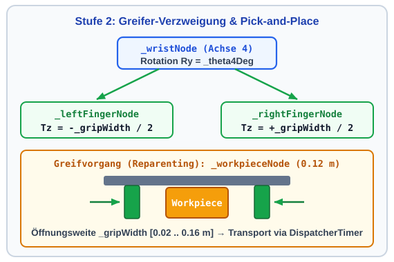

</div>
</div>

---

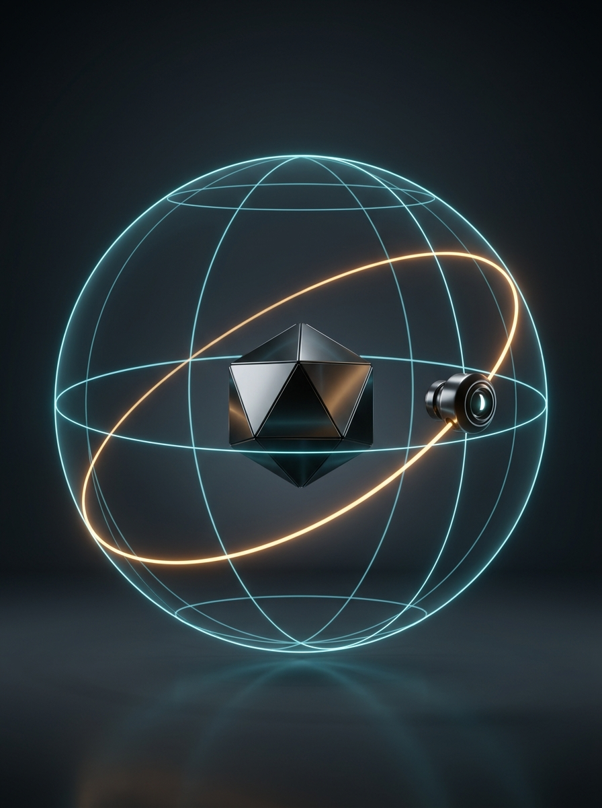

## 5.4: Interaktive Kameraführung

Dieser Abschnitt umfasst die folgenden Inhalte:

- Anforderungen an eine 3D-Inspektionskamera im Digitalen Zwilling
- Das Kameramodell `gl.LookAt` und die Orbit-Kugelkoordinaten ($r, \theta, \phi$)
- Vermeidung von Singularitäten (Gimbal Lock) durch Winkel-Clamping
- Herleitung von Kamera-Orbit, Zoom und Zielpunkt-Panning (Aufgabe 1.2)
- C#-Implementierung der Klasse `OrbitCamera` und WPF-Maus-Events

---

### Bedarf an interaktiver Kamerasteuerung & `gl.LookAt`

<div class="columns">
<div class="two">

In einem 3D-Leitstand muss man die Anlage frei aus jedem Blickwinkel inspizieren können:

- **Die Sichtmatrix `gl.LookAt`:**
  1. **Augpunkt $\vec{p}_{\text{eye}} = (\text{eyeX}, \text{eyeY}, \text{eyeZ})$:** Kameraposition im Raum.
  2. **Zielpunkt $\vec{p}_{\text{look}} = (\text{LookAtX}, \text{LookAtY}, \text{LookAtZ})$:** Fokuspunkt der Kamera.
  3. **Up-Vektor $\vec{e}_{\text{up}} = (0, 1, 0)$:** $+Y$-Achse zeigt nach oben.
- **Lösung:** Statt `eyeX, eyeY, eyeZ` einzutippen, führen wir die Kamera auf einer Kugelschale!

</div>
<div class="two">

```csharp
// Aufruf in OpenGlView_OpenGLDraw
// direkt nach gl.LoadIdentity():

gl.LookAt(
    eyeX, eyeY, eyeZ,          // Kameraposition
    LookAtX, LookAtY, LookAtZ, // Fokuspunkt
    0.0, 1.0, 0.0              // Up-Vektor (+Y)
);
```

</div>
</div>

---

### Orbit-Kamera in Kugelkoordinaten ($r, \theta, \phi$)

<div class="columns">
<div class="two">

`OrbitCamera` beschreibt $\vec{p}_{\text{eye}}$ relativ zum Ziel $\vec{p}_{\text{look}} = (x_{\text{look}}, y_{\text{look}}, z_{\text{look}})$:

1. **Azimut $\theta$ (`AzimuthDeg` $\in [0^\circ, 360^\circ)$):**
   - Horizontaler Winkel ab $+Z$ (Blick von vorne bei $\theta = 0^\circ \implies x_{\text{eye}} \propto \sin\theta, z_{\text{eye}} \propto \cos\theta$).
2. **Elevation $\phi$ (`ElevationDeg` $\in [-85^\circ, +85^\circ]$):**
   - Vertikaler Neigungswinkel zur XZ-Ebene.
3. **Distanz $r$ (`Distance` $> 0$):**
   - Mit Horizontalradius $r_{xz} = r \cdot \cos(\phi)$ folgt die Höhe zu $y_{\text{eye}} = y_{\text{look}} + r \cdot \sin(\phi)$.

</div>
<div class="two">

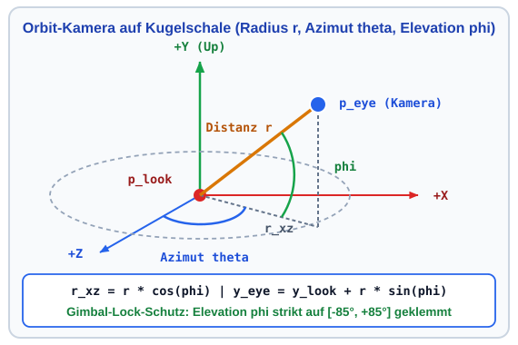

</div>
</div>

---

### Warum klemmen wir $\phi$ auf $[-85^\circ, +85^\circ]$? Pol-Singularität

<div class="columns">
<div class="two">

Der Sehstrahl $\vec{f}$ von $\vec{p}_{\text{eye}}$ nach $\vec{p}_{\text{look}}$ legt nur die Blickachse fest – um die Kamera **waagerecht** zu halten, berechnet `gl.LookAt` den Bild-Rechtsvektor per Kreuzprodukt $\vec{s} = \vec{f} \times \vec{e}_{\text{up}}$:

- **Schräger Blick ($|\phi| \le 85^\circ$):** $\vec{f}$ und $\vec{e}_{\text{up}}$ spannen eine Ebene auf $\implies \vec{s} \neq \vec{0}$ ist eindeutig.
- **Nord-/Südpol ($\phi = \pm 90^\circ$, Blick senkrecht nach unten):** $\vec{f}$ und $\vec{e}_{\text{up}}$ liegen auf **einer Linie** $\implies \vec{f} \times \vec{e}_{\text{up}} = \vec{0}$ (*„Wo ist im Bild rechts?“* unbestimmt $\to 180^\circ$-Bildsprung, `Math.Clamp` schützt!).

</div>
<div class="two">

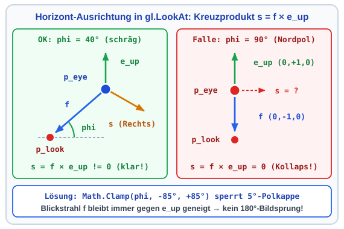

</div>
</div>

---

### Der C#-Code: Pol-Schutz & Umrechnung (`OrbitCamera.cs`)

In `OrbitCamera.cs` klemmt `ElevationDeg` (`_elevationDeg`) via `Math.Clamp` die Pole ab; `GetEyePosition()` rechnet `_azimuthDeg` (`thetaRad`), `phiRad` und `_distance` relativ zu `(LookAtX, LookAtY, LookAtZ)` in `(eyeX, eyeY, eyeZ)` um:

```csharp
public double ElevationDeg
{
    get => _elevationDeg;
    set => _elevationDeg = Math.Clamp(value, -85.0, 85.0); // 5°-Polkappe gegen f || e_up
}

public (double EyeX, double EyeY, double EyeZ) GetEyePosition()
{
    double thetaRad = _azimuthDeg * Math.PI / 180.0;
    double phiRad   = _elevationDeg * Math.PI / 180.0;

    double eyeX = LookAtX + _distance * Math.Cos(phiRad) * Math.Sin(thetaRad);
    double eyeY = LookAtY + _distance * Math.Sin(phiRad);
    double eyeZ = LookAtZ + _distance * Math.Cos(phiRad) * Math.Cos(thetaRad);
    return (eyeX, eyeY, eyeZ);
}
```

---

### Maussteuerung & Kamera-Panning (Aufgabe 1.2)

<div class="columns">
<div class="two">

- **Links ziehen:** `_camera.Rotate` ($\theta, \phi$).
- **Mausrad:** `_camera.Zoom` (Radius $r$).
- **Rechts ziehen (Aufg. 1.2 – `Pan(dRight, dUp)`):**
  - Auf dem Strahl von $\vec{p}_{\text{look}}$ zu $\vec{p}_{\text{eye}}$ steht der Kamera-Rechtsvektor $\vec{e}_{\text{right}} = (\cos\theta, 0, -\sin\theta)^\top$ senkrecht.
  - **„Greife-die-Welt“-Prinzip:** Rechtsziehen (`dRight` $> 0$) schiebt $\vec{p}_{\text{look}}$ um $-\text{dRight}\cdot\vec{e}_{\text{right}}$ (`dX_look`, `dZ_look`, `dUp`):
    $$\text{dX\_look} = -\text{dRight} \cdot \cos\theta, \quad \text{dZ\_look} = +\text{dRight} \cdot \sin\theta$$

</div>
<div class="two">

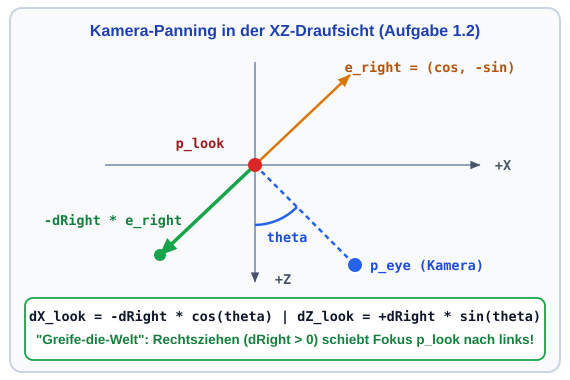

</div>
</div>

---

### Der C#-Code zur Maus-Interaktion (`MainWindow.xaml.cs`)

Über `_isDragging`, `_lastMousePos`, `currentPos`, `dx` und `dy` werden Orbit und Panning gesteuert:

```csharp
private void OpenGlView_MouseDown(object sender, MouseButtonEventArgs e)
{
    if (e.LeftButton == MouseButtonState.Pressed || e.RightButton == MouseButtonState.Pressed)
    {
        _isDragging = true;
        _lastMousePos = e.GetPosition(OpenGlView);
        OpenGlView.CaptureMouse(); // Mausfang auch über den Fensterrand hinaus!
    }
}
private void OpenGlView_MouseMove(object sender, MouseEventArgs e)
{
    if (!_isDragging) return;
    Point currentPos = e.GetPosition(OpenGlView);
    double dx = currentPos.X - _lastMousePos.X;
    double dy = currentPos.Y - _lastMousePos.Y;
    if (e.LeftButton == MouseButtonState.Pressed)       _camera.Rotate(-dx * 0.4, dy * 0.4);
    else if (e.RightButton == MouseButtonState.Pressed) _camera.Pan(dx * 0.01, dy * 0.01);
    _lastMousePos = currentPos;
}
```

---

# Zusammenfassung Kapitel 5

- **3D-Pipeline & Z-Buffer:** OpenGL projiziert 3D-Körper über `GL_MODELVIEW` und `GL_PROJECTION`; `GL_DEPTH_TEST` löst Verdeckungen pixelgenau über den Tiefenpuffer auf.
- **Phong-Beleuchtung & Shading:** Ambient ($I_a$), Diffuse ($I_d \propto \vec{n}\cdot\vec{l}$) und Specular ($I_s \propto (\vec{r}\cdot\vec{v})^{\alpha_{\text{shiny}}}$) erzeugen mit `GL_SMOOTH` und Normalenvektoren plastische 3D-Oberflächen.
- **Hierarchischer Szenengraph (`SceneNode`):** Kaskadiert Transformationen über `PushMatrix`/`PopMatrix` – verifiziert durch den Deckungstest ($\Delta = 0{,}000\,\text{mm}$) zwischen Analytik und `GetWorldPosition()`.
- **Interaktive `OrbitCamera`:** Kugelkoordinaten ($r, \theta, \phi$), Gimbal-Lock-Clamping ($[-85^\circ, +85^\circ]$) und Zielpunkt-Panning für natürliche CAD-Navigation.
- **Ausblick auf Block 2 (T06–T10 – Modellierung & Gleichungslöser):** Nach der *Vorwärtskinematik* $(\theta_1, \theta_2) \mapsto (x, y, z)$ folgen ab T06/T07 Multithreading, Gleichungssysteme ($\mathbf{K}\cdot\mathbf{u}=\mathbf{f}$), *Inverse Kinematik* (Newton-Raphson) und Dynamik (ODEs)!

---

### Hausübung Termin 05: 3D-OpenGL & Szenengraph

**Stufe 1 (Basisaufgabe `1.1`–`1.4` auf `SceneGraph3D.sln`):** `_rootNode.Render`, Kamera-Panning, 3D-Werkstück & Unit-Tests ([Aufgabenblatt 05](../Uebung/Aufgabenblatt.md)) $\to$ **Stufe 2 (Vertiefung – Wahl: Track A ODER Track B, 10 Pkt.):**

<div class="columns">
<div class="two">

#### Stufe 2 – Track A: 4-Achs-SCARA mit Parallelgreifer
- **A.1:** 4 Achsen ($\theta_1, \theta_2, d_3, \theta_4$) & Parallelgreifer ($g_{\text{width}}$)
- **A.2:** Animiertes Teach-In (`DispatcherTimer`) für Posen A, B & Home
- **A.3:** Interaktives Pick-and-Place von 3D-Werkstücken
- **A.4:** Arbeitszellen-Spotlight (`GL_LIGHT1`) & Status-Anzeige

</div>
<div class="two">

#### Stufe 2 – Track B: 3D Arcade Claw Crane (Greifarm)
- **B.1:** 3-Achs-Portalbrücke, Seilwinde & 3-Finger-Greifklaue
- **B.2:** Interaktive Tastatursteuerung & automatischer Greifzyklus
- **B.3:** 3D-Kollisionsprüfung (`Reparenting`) & Schacht-Abwurf
- **B.4:** Atmosphärisches Automaten-Spotlight (`GL_LIGHT1`)

</div>
</div>
