<!-- _paginate: false -->
<!-- _header: "" -->
<!-- _footer: "" -->

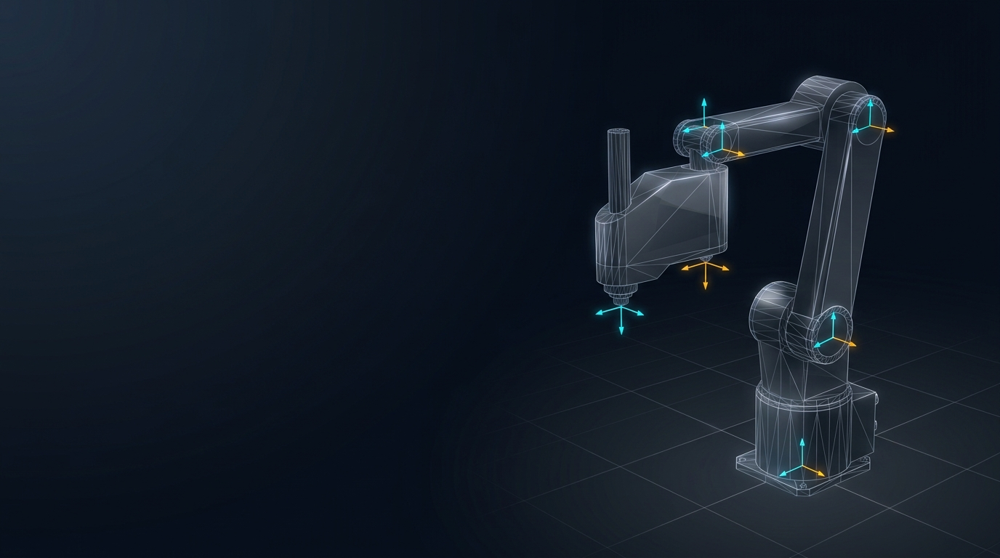

<!-- _class: title -->

# Kapitel 5 (Anhang A): OpenGL-Details & Phong-Mathematik

Ergänzende Herleitungen und Referenzen zu [Kapitel 5: 3D-Visualisierung mit OpenGL](./Folien.md):

- Phong-Vektoren ($\vec{n}, \vec{l}, \vec{v}, \vec{r}$), Lambert- & Specular-Formeln und Mehrlicht-Kombination
- Schattierungsmodi (`GL_FLAT` vs. `GL_SMOOTH`) und OpenGL-Primitive (`GL_LINES` bis `GL_QUAD_STRIP`)
- Projektionsmathematik (`gl.Ortho` vs. `gl.Perspective`) und `SceneNode.GetLocalMatrix` / `GetWorldMatrix`

---

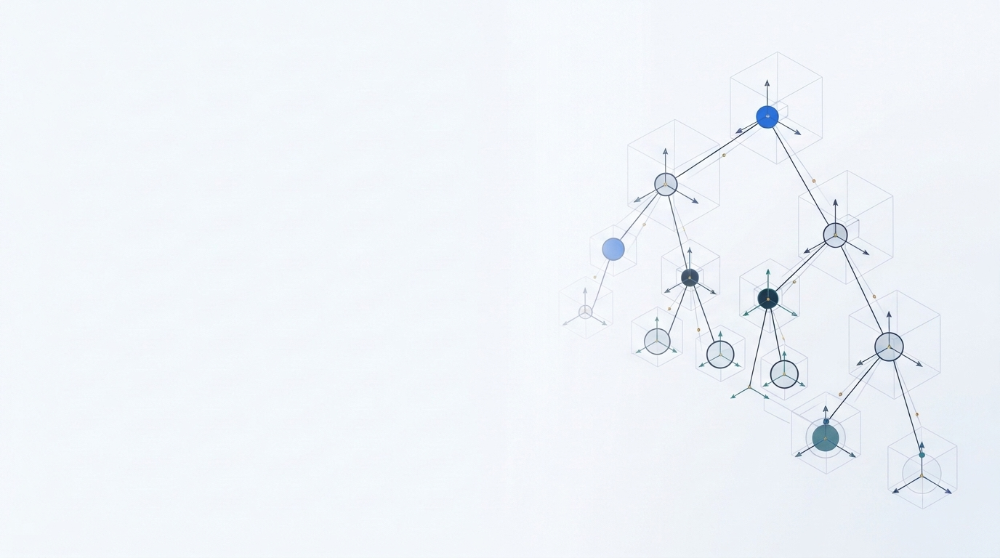

## A.1: Phong-Beleuchtung, Schattierung & Primitive

Dieser Abschnitt umfasst die folgenden Inhalte:

- Normierte Beleuchtungsvektoren, Ambient-/Diffuse-/Specular-Terme & Mehrlichtquellen
- `GL_FLAT` vs. `GL_SMOOTH` und visuelle Referenz der OpenGL-Primitive

---

### Vektoren für die Beleuchtungsrechnung (Normiert)

<div class="columns">
<div class="two">

An jedem Oberflächenpunkt $\vec{p}$ nutzt das Phong-Modell vier auf Länge $1$ **normierte Einheitsvektoren** ($\|\vec{n}\| = 1$):

- **$\vec{n}$ (Normalenvektor):** Steht exakt senkrecht auf der Tangentialebene des Körpers im Punkt $\vec{p}$.
- **$\vec{l}$ (Lichtvektor):** Zeigt vom Punkt $\vec{p}$ zur Lichtquelle $\vec{p}_{\text{light}}$.
- **$\vec{v}$ (Betrachtungsvektor):** Zeigt vom Punkt $\vec{p}$ zum Kameraauge $\vec{p}_{\text{cam}}$.
- **$\vec{r}$ (Reflexionsvektor):** Der an der Normalen $\vec{n}$ unter dem Einfallswinkel $\delta$ gespiegelte Lichtstrahl:
  $$\vec{r} = 2(\vec{n} \cdot \vec{l})\vec{n} - \vec{l}$$

</div>
<div class="two">

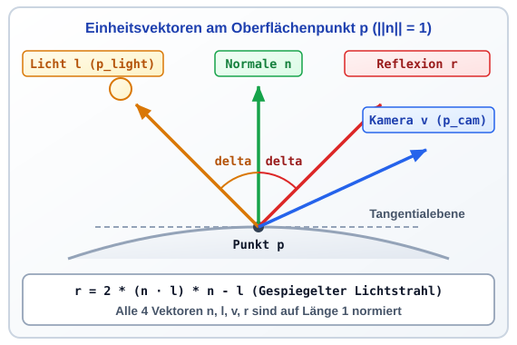

</div>
</div>

---

### 1. Ambient- & 2. Diffuse-Komponente (Lambert-Gesetz)

<div class="columns">
<div class="two">

- **1. Ambient ($I_a = k_a \cdot I_{La}$):**
  - Grundhelligkeit gegen schwarze Schatten ($k_a =$ Material, $I_{La} =$ Raumlicht).
- **2. Diffuse ($I_d = k_d \cdot I_{Ld} \cdot \max(0, \vec{n} \cdot \vec{l})$):**
  - Mit $\|\vec{n}\| = \|\vec{l}\| = 1$ liefert $\vec{n} \cdot \vec{l} = \cos(\delta)$ den Einfallswinkel $\delta$:
  - **Zahlenbeispiel:**
    - Senkrecht ($\delta = 0^\circ$): $\cos(0^\circ) = 1{,}00$ ($100\,\%$).
    - Flach ($\delta = 60^\circ$): $\cos(60^\circ) = 0{,}50$ ($50\,\%$).
    - Rückseite ($\delta > 90^\circ$): $\max(0, \dots) \implies I_d = 0$.

</div>
<div class="two">

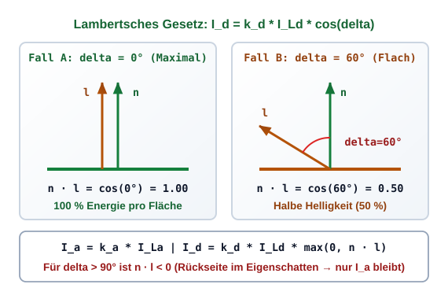

</div>
</div>

---

### 3. Specular-Komponente (Glanzpunkt & Shininess)

<div class="columns">
<div class="two">

Glatte Oberflächen reflektieren Licht gebündelt um die Ausfallsrichtung $\vec{r}$:

$$I_s = k_s \cdot I_{Ls} \cdot \left(\max(0, \vec{r} \cdot \vec{v})\right)^{\alpha_{\text{shiny}}}$$

- **Blickrichtung $\vec{r} \cdot \vec{v}$:** Maximal ($1{,}0$), wenn die Kamera $\vec{v}$ direkt in $\vec{r}$ blickt.
- **Exponent $\alpha_{\text{shiny}} \in [1, 128]$ ($k_s, I_{Ls}$):**
  - **Zahlenbeispiel bei $\vec{r} \cdot \vec{v} = 0{,}90$ ($\approx 25^\circ$):**
    - Plastik ($\alpha_{\text{shiny}} = 8$): $0{,}90^8 = 0{,}43$ (breit).
    - Metall ($\alpha_{\text{shiny}} = 64$): $0{,}90^{64} = 0{,}001$ (scharf!).

</div>
<div class="two">

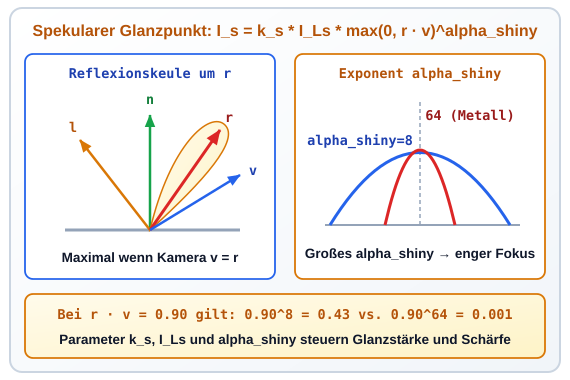

</div>
</div>

---

### Kombination mehrerer Lichtquellen & C#-Konfiguration

<div class="columns">
<div class="two">

Bei $n$ Lichtern (`GL_LIGHT0`, `GL_LIGHT1`..`GL_LIGHT7`) addiert OpenGL $I_d, I_s$ ($I_{d,i}, I_{s,i}$) auf das Raumlicht $I_a = k_a \cdot I_{La}$:

$$I_f = I_a + \sum_{i=1}^{n} \left(I_{d,i} + I_{s,i}\right)$$

- **Globales vs. lokales Ambient:**
  - **`GL_LIGHT_MODEL_AMBIENT`** (`gl.LightModel`) setzt $I_{La}$ einmalig für die gesamte Szene.
  - Pro-Licht `GL_AMBIENT` bleibt auf `0` (sonst verwaschen Schatten!).
  - `GL_COLOR_MATERIAL` koppelt `gl.Color` an $k_a, k_d$ (`gl.Material` für $k_s$).

</div>
<div class="two">

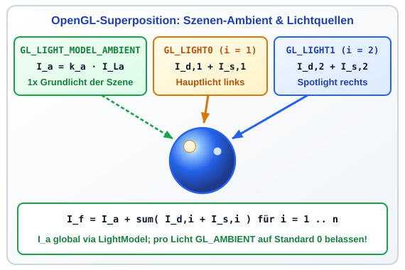

</div>
</div>

---

### Schattierungsmodus: Flat Shading (`GL_FLAT`)

<div class="columns">
<div class="two">

Wie werden die berechneten Phong-Farben über ein Polygon gefüllt?

- **Modus 1 – `gl.ShadeModel(OpenGL.GL_FLAT)`:**
  - OpenGL berechnet die Beleuchtung **nur einmal pro Polygon** mit einer Flächennormalen ($\vec{n}_1, \vec{n}_2, \vec{n}_3, \vec{n}_4$).
  - Jede Facette erhält eine konstante Farbe.
- **Visueller Effekt:**
  - Sichtbare Farbsprünge an den Kanten – ideal für scharfkantige Quader (`DrawCube`).

</div>
<div class="two">

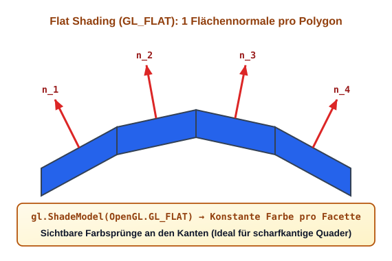

</div>
</div>

---

### Schattierungsmodus: Smooth Shading (`GL_SMOOTH`)

<div class="columns">
<div class="two">

Für gekrümmte Körper (`DrawSphere`, `DrawCylinder`) nutzen wir **Gouraud Shading**:

- **Modus 2 – `gl.ShadeModel(OpenGL.GL_SMOOTH)`:**
  - Jeder Eckpunkt (Vertex) erhält seine eigene **Vertex-Normale** ($\vec{n}_{v1}, \vec{n}_{v2}, \vec{n}_{v3}$).
  - OpenGL berechnet die Farbe an den Ecken und **interpoliert bilinear** über die Fläche.
- **Visueller Effekt:**
  - Schon bei `slices = 24` wirken Zylinder und Kugeln perfekt glatt gerundet!

</div>
<div class="two">

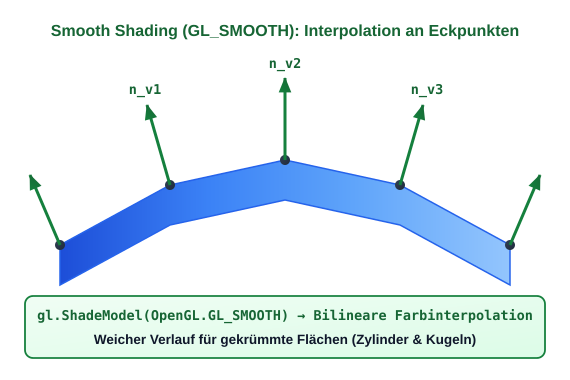

</div>
</div>

---

### Visuelle Referenz der OpenGL-Primitive *(Deep Dive)*

<div class="columns">
<div class="two">

Zwischen `gl.Begin(mode)` und `gl.End()` übergeben wir Vertices (`gl.Vertex`), Normalen (`gl.Normal`) und Farbe (`gl.Color`):

- **`GL_LINES` / `GL_LINE_STRIP`:** `DrawFloorGrid` & `DrawAxes` nutzen `GL_LINES`; Werkzeugbahnen nutzen `GL_LINE_STRIP`.
- **`GL_QUADS` / `GL_QUAD_STRIP`:** `DrawCube` nutzt `GL_QUADS` ($6 \times 4 = 24$ Vertices); `DrawCylinder` nutzt `GL_QUAD_STRIP` (`slices = 24`) + `GL_TRIANGLE_FAN`.

</div>
<div class="two">

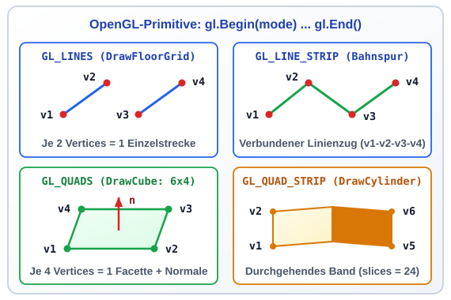

</div>
</div>

---


## A.2: Projektionsmatrizen, Szenegraph & Interaktion

Dieser Abschnitt umfasst die folgenden Inhalte:

- Projektionsmatrix (`gl.Ortho` vs. `gl.Perspective`) in den NDC-Würfel
- `GetLocalMatrix` / `GetWorldMatrix`, Euler-Winkel und Maus-Interaktion

---

### Projektionsmatrix (`GL_PROJECTION`): Sichtvolumen $\to$ NDC-Würfel

`GL_PROJECTION` staucht das 3D-Sichtvolumen zwischen `near`/`zNear` und `far`/`zFar` abhängig vom Kameraabstand $z$ in den Einheitswürfel **NDC** $[-1, +1]^3$ (`h1`, `h2`):

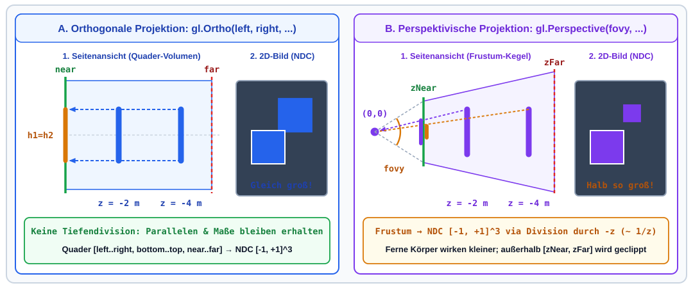

---

### Orthogonale Projektion vs. Perspektive *(Mathematischer Deep Dive)*

<div class="columns">
<div class="two">

#### 1. Orthogonale Projektion (`gl.Ortho`)
- **Sichtvolumen:** Achsenparalleler Quader $[left, right] \times [bottom, top] \times [near, far]$.
- **Keine Tiefendivision:** Parallele Kanten bleiben im Bild exakt parallel ($x_{\text{ndc}} \propto x$).
- **Einsatz:** Maßhaltige 2D/3D-CAD-Ansichten (Aufriss, Grundriss, Seitenansicht).

</div>
<div class="two">

#### 2. Perspektivische Projektion (`gl.Perspective`)
- **Sichtvolumen:** Pyramidenstumpf (**Frustum**) mit Öffnungswinkel `fovy` (z. B. $45^\circ$), Seitenverhältnis `aspect` $= w/h$ und Clipping-Ebenen `zNear` bis `zFar`.
- **Strahlensatz-Division durch $-z$ (Blick entlang $-Z \implies -z > 0$):**
  $$x_{\text{proj}} = x \cdot \frac{z_{\text{near}}}{-z}, \quad y_{\text{proj}} = y \cdot \frac{z_{\text{near}}}{-z}$$
- **Zahlenbeispiel:** Ein Würfel in doppelter Entfernung ($z = -4\,\text{m}$ statt $-2\,\text{m}$) erscheint auf dem Bildschirm **exakt halb so groß**!

</div>
</div>

---

### `GetLocalMatrix` & `GetWorldMatrix` *(Deep Dive – fertig in der Vorlage)*

Für `GetWorldPosition()` berechnet `SceneNode` seine $4\times 4$-Weltmatrix auf der CPU (bereits fertig in `SceneNode.cs` implementiert):

```csharp
public Matrix4x4 GetLocalMatrix()
{
    var t  = Matrix4x4.CreateTranslation(Tx, Ty, Tz);
    var rx = Matrix4x4.CreateRotationX(Rx * MathF.PI / 180.0f);
    var ry = Matrix4x4.CreateRotationY(Ry * MathF.PI / 180.0f);
    var rz = Matrix4x4.CreateRotationZ(Rz * MathF.PI / 180.0f);
    var s  = Matrix4x4.CreateScale(Sx, Sy, Sz);
    return s * (rz * rx * ry) * t; // Zeilenvektor-Konvention: Scale -> Rotate -> Translate
}

public Matrix4x4 GetWorldMatrix()
    => Parent == null ? GetLocalMatrix() : GetLocalMatrix() * Parent.GetWorldMatrix();
```

- **Wichtiger Praxis-Fallstrick (Spalten- vs. Zeilenvektoren):** OpenGL multipliziert Spaltenvektoren von rechts ($\mathbf{M}_{\text{parent}} \cdot \mathbf{M}_{\text{local}} \cdot \vec{v}$); `.NET System.Numerics` (`t`, `rx`, `ry`, `rz`, `s`) nutzt **Zeilenvektoren** ($\vec{v}^\top \cdot \mathbf{M}_{\text{local}} \cdot \mathbf{M}_{\text{parent}}$) $\implies$ umgekehrte Reihenfolge `GetLocalMatrix() * Parent.GetWorldMatrix()`!

---

### Räumliche Orientierung: Euler-Winkel (`Rx`, `Ry`, `Rz`)

<div class="columns">
<div class="two">

`SceneNode` zerlegt 3D-Drehungen $\mathbf{R} = \mathbf{R}_y(\text{Ry}) \cdot \mathbf{R}_x(\text{Rx}) \cdot \mathbf{R}_z(\text{Rz})$ nach der **Rechte-Hand-Regel** (Daumen in $+$-Achse):

1. **`Ry` (Yaw / Gieren um $+Y$):** Horizontal links/rechts schwenken.
2. **`Rx` (Pitch / Nicken um $+X$):** Heben und Senken.
3. **`Rz` (Roll / Rollen um $+Z$):** Seitlich kippen.
- **Verkettung (`Y → X → Z`):** Folgeachsen drehen mit – bei `Rx = ±90°` fluchten $Y$ und $Z$ (**Gimbal Lock**)!

</div>
<div class="two">

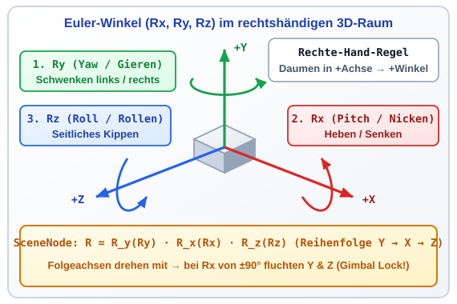

</div>
</div>

---

### Der C#-Code: Gelenk-Update & TCP-Deckungsprüfung

Bewegt man einen Slider (`_theta1Deg`, `_theta2Deg`, `_d3`), aktualisiert `UpdateJointTransforms()` die lokalen Knoten-Properties und `CalculateAnalyticTcp()` rechnet über `t1` und `t12` die analytische Sollposition aus:

```csharp
private void UpdateJointTransforms()
{
    _arm1Node.Ty   = HBase;
    _arm1Node.Ry   = _theta1Deg;
    _arm2Node.Tx   = L1;
    _arm2Node.Ry   = _theta2Deg;
    _pinoleNode.Tx = L2;
    _pinoleNode.Ty = -_d3;
}

private (float X, float Y, float Z) CalculateAnalyticTcp()
{
    float t1  = _theta1Deg * MathF.PI / 180.0f;
    float t12 = (_theta1Deg + _theta2Deg) * MathF.PI / 180.0f;
    return (L1 * MathF.Cos(t1) + L2 * MathF.Cos(t12), HBase - _d3, -(L1 * MathF.Sin(t1) + L2 * MathF.Sin(t12)));
}
```

---

### Der C#-Code zur Maus-Interaktion (`MainWindow.xaml.cs`)

Über `_isDragging`, `_lastMousePos`, `currentPos`, `dx` und `dy` werden Orbit und Panning gesteuert:

```csharp
private void OpenGlView_MouseDown(object sender, MouseButtonEventArgs e)
{
    if (e.LeftButton == MouseButtonState.Pressed || e.RightButton == MouseButtonState.Pressed)
    {
        _isDragging = true;
        _lastMousePos = e.GetPosition(OpenGlView);
        OpenGlView.CaptureMouse(); // Mausfang auch über den Fensterrand hinaus!
    }
}
private void OpenGlView_MouseMove(object sender, MouseButtonEventArgs e)
{
    if (!_isDragging) return;
    Point currentPos = e.GetPosition(OpenGlView);
    double dx = currentPos.X - _lastMousePos.X;
    double dy = currentPos.Y - _lastMousePos.Y;
    if (e.LeftButton == MouseButtonState.Pressed)       _camera.Rotate(-dx * 0.4, dy * 0.4);
    else if (e.RightButton == MouseButtonState.Pressed) _camera.Pan(dx * 0.01, dy * 0.01);
    _lastMousePos = currentPos;
}
```
