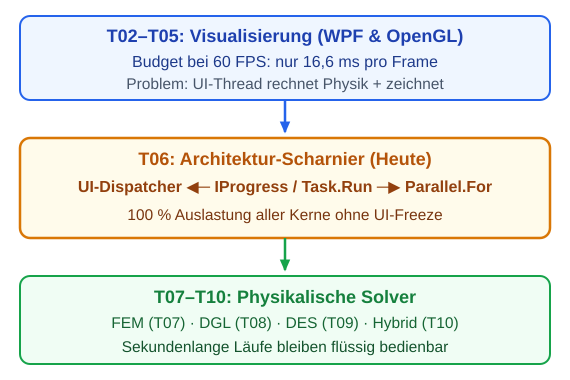
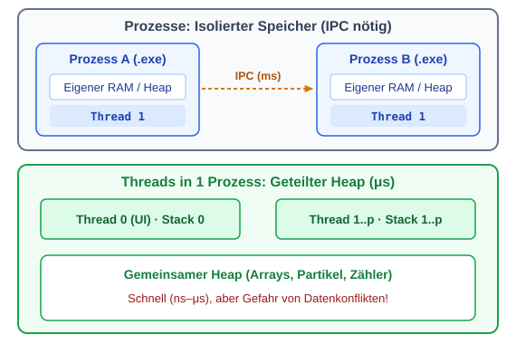
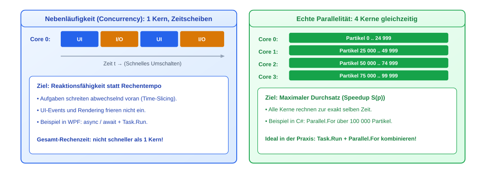
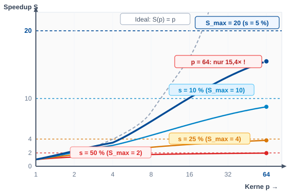
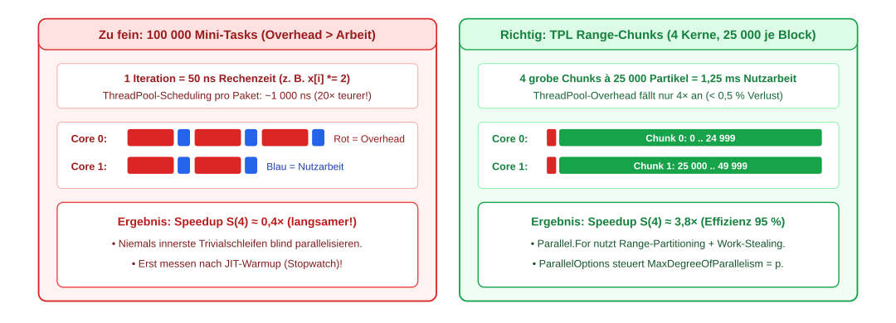
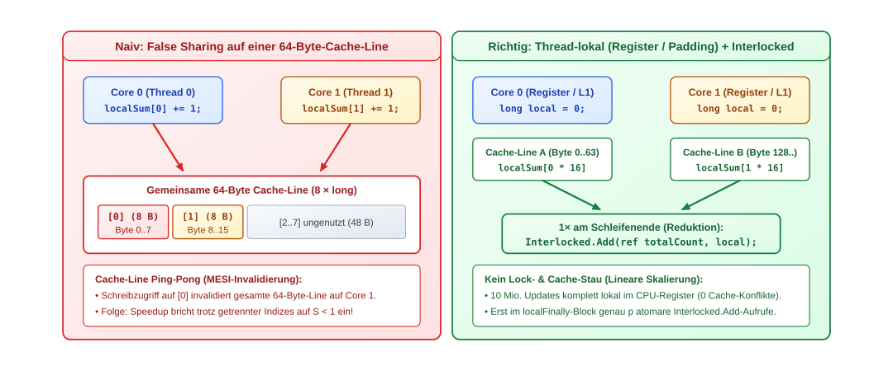
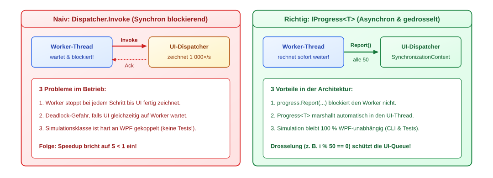
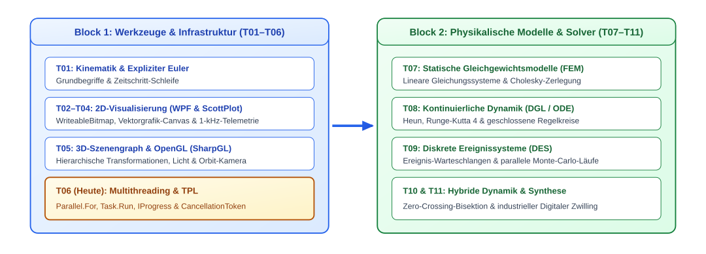

<!-- _class: title -->
<!-- _paginate: false -->
<!-- _header: "" -->
<!-- _footer: "" -->


# Kapitel 6: Multithreading & Parallele Simulation

Dieses Kapitel umfasst die folgenden Abschnitte:

- 6.1: Grundlagen: Prozesse, Threads & Skalierung
- 6.2: Task Parallel Library (`Parallel.For` & `ConcurrentBag<T>`)
- 6.3: Synchronisation, Cache-Effizienz & Zufallszahlen
- 6.4: Asynchrone WPF-Entkopplung (`Task.Run` & Architektur)
- 6.5: Fortschritt & Abbruch (`IProgress<T>` & `CancellationToken`)

---

<!-- _class: showcase -->

### Live-Showcase & Code-Defense: Termin 05

Präsentation der Hausübung aus Termin 05 (**Stufe 1: Basisaufgabe** + **Stufe 2: Track A oder B**, [Aufgabenblatt 05](../../05_3D_OpenGL_Szenengraph/Uebung/Aufgabenblatt.md)):

<div class="columns">
<div class="two">

#### Stufe 2 – Track A: SCARA-Roboterarm (Industrie)
- **Szenengraph:** Vorwärtskinematik mit 4 Achsen & Parallelgreifer (`_rootNode.Render`).
- **Interaktion:** Kardanfehlerfreie Orbit-Kamera inkl. Panning & animiertes Teach-In.
- **Stresstest:** Lokaler Matrix-Stack (`glPushMatrix`) & TCP-Greifdistanz prüfen.

</div>
<div class="two">

#### Stufe 2 – Track B: Arcade Claw Machine (Game)
- **Szenengraph:** Jahrmarkt-Greifautomat mit Portalbrücke, Seilwinde & 3-Finger-Greifer.
- **Interaktion:** Tastatursteuerung, Orbit-Kamera inkl. Panning & 3D-Kollisionsprüfung.
- **Stresstest:** Physikalischer Kollisions-Snap & Achs-Hierarchie beim Ablegen prüfen.

</div>
</div>

> **Code-Defense (Säule 2b, 20 %):** Live-Demonstration am Beamer mit Prüfung von Gelenkhierarchien, lokalem Matrix-Stack und Kardanfehler-Schutz.

---

<!-- _class: recap -->

### Rückblick & Brücke: Wo stehen wir in der Vorlesung?

<div class="columns top">
<div class="three">

In **Termin 02 bis 05** haben wir leistungsfähige 2D- und 3D-Oberflächen gebaut – warum bildet **Termin 06** heute das architektonische Scharnier zur zweiten Semesterhälfte?

- **Bisheriges Budget (T02–T05):** Solange Physik und Rendering gemeinsam im **WPF UI-Thread** laufen, bleiben bei $60\,\text{FPS}$ nur **$16{,}6\,\text{ms}$ pro Frame**.
- **Engpass ab T07–T10:** Große Gleichungssysteme (Finite-Elemente-Statik, FEM), Differentialgleichungen (DGL) oder diskrete Ereignis-Läufe (Discrete Event Simulation, DES) dauern Sekunden $\implies$ **UI friert ein**, 15 von 16 Kernen langweilen sich!
- **Lösung heute:** Saubere Trennung von **UI-Dispatcher** und **Worker-Threads** (`Task.Run`, `IProgress`, `Parallel.For`).

</div>
<div class="two">



</div>
</div>

---

## 6.1: Grundlagen: Prozesse, Threads & Skalierung


Dieser Abschnitt umfasst die folgenden Inhalte:

- Motivation: Auslastung moderner Mehrkern-Prozessoren
- Unterschied: Prozess vs. Thread
- Nebenläufigkeit (Concurrency) vs. echte Parallelität
- Theoretische Grenzen: Speedup, Effizienz & Amdahlsches Gesetz

---

### Warum Multithreading in der Simulation?

- **Physical Scaling Wall:** Die Taktfrequenzen einzelner CPU-Kerne stagnieren seit Jahren bei $\approx 3\text{–}5\,\text{GHz}$; Leistungszuwachs erfolgt primär über **mehr Kerne** (8 bis 64+ Cores).
- **Sequentieller Leerlauf:** Ein Single-Thread-Programm nutzt auf einer 16-Core-CPU nur $\frac{1}{16} = 6{,}25\,\%$ der verfügbaren Rechenleistung – $93{,}75\,\%$ der Hardware liegen brach.
- **Konkretes Zahlenbeispiel:** $10^7$ Monte-Carlo-Stichproben à $1\,\mu\text{s}$ dauern seriell **$10{,}0\,\text{s}$**, auf 16 Kernen parallel dagegen nur **$\approx 0{,}7\,\text{s}$**.
- **„Embarrassingly Parallel“:** Unabhängige Läufe (Parameterstudien, Partikel, Replikationen) lassen sich ohne gegenseitige Abhängigkeit direkt auf alle Kerne verteilen.
- **Energie & Durchsatz:** Parallele Nutzung senkt nicht nur die Wartezeit im Labor, sondern verbessert auch die Energieeffizienz pro Berechnung erheblich.

> **Wann lohnt sich Multithreading?** Immer dann, wenn viele gleichartige Teilaufgaben unabhängig berechenbar sind – nicht aber bei streng sequentiellen Schrittketten ($x_{k+1} = f(x_k)$).

---

### Prozess vs. Thread

<div class="columns top">
<div class="two">

- **Prozess (.exe):** Isolierte Instanz mit eigenem **RAM / Heap**. Austausch per **Inter-Process Communication (IPC)** kostet **ms**.
- **Thread:** Ausführungseinheit im Prozess (eigener **Stack**, gemeinsamer **Heap**).
- **Wechselkosten:** Context-Switch in **$\mu\text{s}$**, Datenaustausch direkt im Speicher (**ns–$\mu\text{s}$**).
- **Konsequenz für C#:** **1 Prozess** mit vielen **Threads** – maximal schnell, aber ungeschützt beim Schreiben!

</div>
<div class="two">



</div>
</div>

> **Merksatz:** In C# arbeiten alle Hintergrund-Threads im selben Prozess-Heap – extrem schnell beim Lesen, aber kritisch beim parallelen Schreiben!

---

### Nebenläufigkeit vs. Echte Parallelität

*Concurrency* (`async`/`await` + `Task.Run`) hält das **UI** reaktiv, während *echte Parallelität* (`Parallel.For`) alle Kerne für maximalen **Speedup $S(p)$** auslastet – idealerweise kombiniert!



---

### Parallele Leistungsmetriken: Speedup & Effizienz

<div class="columns top">
<div class="one">

#### Speedup (Beschleunigungsfaktor)
Verhältnis der Rechenzeit auf $1$ Kern zu $p$ Kernen:

$$S(p) = \frac{T_1}{T_p}$$

- $T_1$: Ausführungszeit auf $1$ CPU-Kern $[\mathrm{s}]$
- $T_p$: Ausführungszeit auf $p$ CPU-Kernen $[\mathrm{s}]$ ($p \in \mathbb{N}^+$)
- **Idealer Speedup (linear):** $S(p) = p$

</div>
<div class="one">

#### Parallele Effizienz
Auslastungsgrad der eingesetzten Hardware:

$$E(p) = \frac{S(p)}{p} = \frac{T_1}{p \cdot T_p} \le 1 \quad (100\,\%)$$

- **Typische Ursachen für $E(p) < 1$:**
  - Thread-Erzeugung und Scheduling-Overhead
  - Synchronisationsbarrieren (`lock`)
  - Speicherbandbreite & sequentielle Anteile

</div>
</div>

> **Zahlenbeispiel:** Läuft eine Simulation auf 1 Kern in $T_1 = 8{,}0\,\text{s}$ und auf 4 Kernen in $T_4 = 2{,}5\,\text{s}$, beträgt der Speedup $S(4) = \frac{8{,}0}{2{,}5} = 3{,}2\times$ und die Effizienz $E(4) = \frac{3{,}2}{4} = 80\,\%$.

---

<!-- _class: activity -->

### Mitmach-Frage (2 Min.): Wie weit skaliert ein Supercomputer?

Angenommen, **$95\,\%$** einer Simulation lassen sich ideal parallelisieren – aber **$5\,\%$** (z. B. Initialisierung und Ergebnis-Zusammenführung) laufen streng seriell auf einem Kern.

**Schätzen Sie (gerne auch zu zweit):** Welchen maximalen Speedup $S(1000)$ erreichen wir auf einem Cluster mit **$p = 1\,000$ Kernen**?

- **A:** $\approx 950\times$ (fast linear mit den Kernen)
- **B:** $\approx 500\times$ (etwa halbe Kernskalierung durch Overhead)
- **C:** $\approx 20\times$ (harte Grenze durch die $5\,\%$ serielle Phase)
- **D:** $\approx 5\times$ (Overhead frisst fast alles auf)

> **Ablauf:** 60 Sek. still überlegen $\to$ gleichzeitiges Fingerzeichen (1=A, 2=B, 3=C, 4=D)!
>
> **Denkhilfe:** Wie lange dauert allein der serielle Teil bei $T_1 = 100\,\text{s}$ Gesamtlaufzeit, wenn der parallele Teil beliebig schnell wird?

---

<!-- _class: solution -->

### Auflösung: Warum bei $20\times$ Schluss ist

Die richtige Antwort ist **C ($\approx 20\times$)** – selbst bei unendlich vielen Kernen!

- **Intuition am Zeitstrahl ($T_1 = 100\,\text{s}$):**
  - Auf $1\,000$ Kernen schrumpft der parallele Teil ($95\,\text{s}$) auf $\frac{95}{1000} \approx 0{,}095\,\text{s}$.
  - Der serielle Flaschenhals bleibt aber stur bei **$5\,\text{s}$**!
  - Gesamtlaufzeit: $T_{1000} \approx 5{,}095\,\text{s} \implies S(1000) = \frac{100}{5{,}095} \approx \mathbf{19{,}6\times}$.
- **Warum A/B falsch sind:** Selbst für $p \to \infty$ verschwinden die $5\,\text{s}$ nie ($S_{\max} = \frac{1}{s} = \frac{1}{0{,}05} = 20$).
- **Warum D falsch ist:** Bei groben Chunks dominiert der serielle Teil, nicht der ThreadPool-Overhead.
- **Konsequenz:** Ab einer gewissen Kernzahl bringt zusätzliche Hardware praktisch keinen Zeitgewinn mehr.

> **Lehre für die Praxis:** Bevor man blind neue CPU-Kerne kauft, muss immer zuerst der serielle Anteil (z. B. I/O, `lock`-Wartezeiten) minimiert werden – sonst verpufft die Parallelisierung wirkungslos!
>
> **Merksatz:** Erst den seriellen Flaschenhals messen, dann parallelisieren!

---

### Amdahlsches Gesetz & Skalierungsgrenzen

<div class="columns top">
<div class="two">

Bei konstanter Problemgröße begrenzt der serielle Anteil $s = 1 - f_{\text{par}}$ (z. B. `lock` / `Interlocked`) den Speedup $S(p)$:

$$S(p) = \frac{1}{s + \frac{1 - s}{p}}, \qquad S_{\max} = \lim_{p \to \infty} S(p) = \frac{1}{s}$$

- **Zahlenbeispiel ($s = 5\,\%$):** Bei $p = 64$ Kernen erreicht man nur $15{,}4\times$ statt $64\times$, und selbst für $p \to \infty$ bleibt die Grenze bei **$S_{\max} = 20$**!
- **Gegenstück (*Weak Scaling*):** Wächst die Problemgröße mit $p$ (*Gustafson*), skaliert die Simulation nahezu linear.

</div>
<div class="three">



</div>
</div>

---

## 6.2: Task Parallel Library (`Parallel.For` & `ConcurrentBag<T>`)


Dieser Abschnitt umfasst die folgenden Inhalte:

- Die Task Parallel Library (TPL) in .NET (`Parallel.For`)
- Granularität, `ParallelOptions` & Just-in-Time-Warmup (JIT) für saubere Benchmarks
- Threadsichere Ergebnissammlung ohne Sperren (`ConcurrentBag<T>`)

---

### Die Task Parallel Library (TPL)

`Parallel.For` ist eine Methode aus dem Namespace `System.Threading.Tasks`, die eine Standard-`for`-Schleife automatisch parallelisiert:

- Die TPL teilt den Iterationsbereich in Chunks auf und verteilt sie über den internen **.NET ThreadPool** auf alle verfügbaren Kerne.
- Der Schleifenkörper wird als Lambda-Ausdruck übergeben.

<div class="columns">
<div>

**Sequentiell:**
```csharp
for (int i = 0; i < 100; i++)
{
    DoSimulation(i);
}
```

</div>
<div>

**Parallel:**
```csharp
Parallel.For(0, 100, i =>
{
    DoSimulation(i);
});
```

</div>
</div>

> **Was die TPL automatisch übernimmt:** Der `ThreadPool` vermeidet Thread-Neuerstellungen und gleicht Last per *Work-Stealing* aus.

---

### Granularität, `ParallelOptions` & JIT-Warmup

In realen Simulationen steuern wir die TPL gezielt über `ParallelOptions` – und achten auf zwei typische Performance-Fallen:

<div class="columns top">
<div class="one">

**Steuerung per `ParallelOptions`:**
```csharp
var opts = new ParallelOptions
{
    MaxDegreeOfParallelism = p,
    CancellationToken = token
};
Parallel.For(0, n, opts, i => Step(i));
```
- Das Objekt `opts` begrenzt die Thread-Anzahl `p` für Skalierungsreihen ($1 \dots P_{\max}$) und leitet den Abbruch (`token`) direkt an die Worker weiter.

</div>
<div class="one">

**Granularität & JIT-Warmup:**
- **Zu feine Arbeitspakete:** Dauert `Step(i)` nur wenige Nanosekunden, übersteigt der ThreadPool-Overhead den Rechengewinn ($S(p) < 1$) $\implies$ innere Schleifen *niemals* blind parallelisieren!
- **JIT-Warmup:** Der erste Aufruf in .NET kompiliert Zwischencode (Intermediate Language, IL) in Maschinencode. Vor jeder Zeitmessung (`Stopwatch`) einmal ungezählt warmlaufen lassen!

</div>
</div>

---

### Blick unter die Haube: Chunk-Partitionierung & Granularität

Ist eine Iteration zu fein, frisst ThreadPool-Overhead (Rot) die Nutzarbeit (Blau) auf – grobe Range-Chunks (z. B. $25\,000$ Partikel, gesteuert über `MaxDegreeOfParallelism`) liefern $S(4) \approx 3{,}8\times$ ($95\,\%$ Effizienz)!



---

### Threadsichere Sammlungen: `ConcurrentBag<T>`

Wenn mehrere Threads gleichzeitig auf eine Standard-Collection wie `List<T>` schreibend zugreifen, führt dies unweigerlich zu Ausnahmen oder unbemerktem Datenverlust.

- **`ConcurrentBag<T>`** (z. B. Instanz `bag`) ist eine threadsichere, ungeordnete Sammlung für Szenarien, bei denen die Reihenfolge der Ergebnisse unwichtig ist.
- Erlaubt paralleles Hinzufügen ohne manuelle Sperren.

<div class="columns">
<div>

**Nicht threadsicher (Gefahr!):**
```csharp
var list = new List<double>();

// Führt zu Fehlern/Datenverlust!
Parallel.For(0, 1000, i =>
{
    list.Add(Compute(i));
});
```

</div>
<div>

**Threadsicher (Korrekt):**
```csharp
var bag = new ConcurrentBag<double>();

// Sicher und hochperformant!
Parallel.For(0, 1000, i =>
{
    bag.Add(Compute(i));
});
```

</div>
</div>

---

## 6.3: Synchronisation, Cache-Effizienz & Zufallszahlen


Dieser Abschnitt umfasst die folgenden Inhalte:

- Race Conditions (`counter++` vs. `lock` / `Interlocked`)
- *False Sharing* auf 64-Byte-Cache-Lines & thread-lokale Reduktion
- Sperrfreie Datenparallelität durch Double-Buffering (`StateCurrent` $\to$ `StateNext`)
- Thread-sichere Zufallszahlen (`Random.Shared` & deterministische Seeds)

---

### Was ist eine Race Condition?

Eine **Race Condition** (Wettlaufsituation) tritt auf, wenn mehrere Threads gleichzeitig auf geteilte Daten zugreifen und mindestens ein Thread schreibend zugreift:

- Das Endergebnis hängt von der unvorhersehbaren Ausführungsreihenfolge des Betriebssystem-Schedulers ab (**sporadische, kaum reproduzierbare Bugs**).
- Schon `counter++` ist in Maschinensprache **kein atomarer Befehl**, sondern eine 3-Schritt-Sequenz (**Read-Modify-Write**):
  1. **Read:** Thread A und Thread B lesen beide gleichzeitig den alten Wert `counter = 42` in ihr CPU-Register.
  2. **Modify:** Beide Threads addieren lokal $+1$ und erhalten jeweils `43`.
  3. **Write:** Beide schreiben `43` zurück in den RAM $\implies$ **1 Inkrement geht dauerhaft verloren (*Lost Update*, `43` statt `44`)!**
- **Folge in der Praxis:** Bei $10\,000$ parallelen Inkrementen fehlen am Ende zufällig $1\,000$ bis $3\,000$ Zählwerte.

---

<!-- _class: activity -->

### Predict the Output (2 Min.): Was gibt `counter` aus?

Betrachten Sie diese kurze parallele Schleife auf einem 8-Kern-Rechner:

```csharp
int counter = 0;
Parallel.For(0, 10000, _ =>
{
    counter++;
});
Console.WriteLine(counter);
```

- **A:** Exakt `10000` (der Compiler schützt `int` automatisch)
- **B:** Einen Wert **größer** als `10000`
- **C:** Bei jedem Start einen anderen Wert **kleiner** als `10000` (z. B. `7842`)
- **D:** Einen Laufzeitfehler (`InvalidOperationException`)

> **Ablauf:** 60 Sek. selbst überlegen (gerne auch zu zweit) $\to$ Fingerzeichen (1=A, 2=B, 3=C, 4=D)!

---

<!-- _class: solution -->

### Auflösung: *Lost Updates* liefern zufällige Werte $< 10\,000$

Die richtige Antwort ist **C** (z. B. `7842`, bei jedem Start ein anderes Ergebnis)!

- **Warum?** `counter++` ist nicht atomar, sondern besteht aus *Read (`42`) $\to$ Modify (`43`) $\to$ Write (`43`)*.
- Wenn mehrere Threads denselben alten Wert lesen, überschreiben sie sich gegenseitig (*Lost Update*) – es geht Zählwert verloren, **ohne** dass C# eine Exception wirft!
- **Warum A/D falsch sind:** Der Compiler schützt `int` nicht automatisch; nur Exceptions (z. B. bei `List<T>`) würden crashen – ein einzelnes `int` überschreibt sich still.
- **Besonders tückisch:** Auf einem einzelnen Kern (oder mit Breakpoints) tritt der Fehler gar nicht auf.
- **Saubere Korrektur:** `Interlocked.Increment(ref counter);` statt `counter++;` nutzen (oder thread-lokal summieren).

> **Merksatz:** Ein stiller, nicht-reproduzierbarer Zahlenfehler ist im Ingenieurwesen gefährlicher als ein sofortiger Absturz!

---

### Code-Beispiel: Race Condition & `lock`

<div class="columns top">
<div>

**Fehlerhaft (ohne `lock`):**
```csharp
int counter = 0;

Parallel.For(0, 10000, _ =>
{
    // Mehrere Threads überschreiben
    // sich gegenseitig beim Inkrement!
    counter++; 
});

// Erwartet: 10000
// Ergebnis: z.B. 7842 (falsch!)
Console.WriteLine(counter);
```

</div>
<div>

**Korrekt (`lock` oder atomares `Interlocked`):**
```csharp
int counter = 0;

Parallel.For(0, 10000, _ =>
{
    // Lock-freie Hardware-Instruktion für Zähler/Summen:
    Interlocked.Increment(ref counter);
    // Alternativ für komplexe Blöcke: lock (sync) { ... }
});

// Ergebnis: 10000 (exakt & maximal schnell!)
Console.WriteLine(counter);
```

</div>
</div>

> **Faustregel:** Für einzelne Zähler `Interlocked` nutzen (lock-frei); `lock (_sync)` nur für mehrzeilige Blöcke – niemals auf `this` sperren!

---

### Blick unter die Haube: False Sharing & Thread-lokale Reduktion

Schreiben zwei Kerne in dieselbe **64-Byte-Cache-Line** (`localSum[0]`/`[1]`), bremst Cache-Ping-Pong $\to$ `local` + `Interlocked.Add(ref totalCount, local)`!



---

### Datenparallelität ohne Sperren: Double-Buffering

Wenn Partikel oder Agenten in einem Zeitschritt die Positionen anderer Agenten **lesen** und gleichzeitig ihre eigene Position **schreiben**, führt ein einzelnes Array zu **Race Conditions (Tearing)**:

<div class="columns top">
<div class="one">

**Das Prinzip (Read/Write-Trennung):**
- Zwei getrennte Puffer: `StateCurrent[]` *(nur lesen)* und `StateNext[]` *(nur `StateNext[i]` schreiben)*.
- Jeder Thread `i` schreibt exklusiv in seinen eigenen Ziel-Slot `i` $\implies$ **0 Locks, 0 False Sharing bei Schreibzugriffen!**
- Erst *nach* `Parallel.For` werden die Referenzen getauscht (`Swap`).

</div>
<div class="one">

```csharp
// Innerhalb Parallel.For: strikt getrennt!
Parallel.For(0, count, opts, i =>
{
    var p = StateCurrent[i]; // nur lesen
    StateNext[i] = Integrate(p, StateCurrent);
});

// Nach dem Schritt: O(1)-Referenztausch
(StateCurrent, StateNext) = (StateNext, StateCurrent);
```

</div>
</div>

---

### Threadsicherheit von `System.Random`

Die Klasse `System.Random` ist **nicht threadsicher**:
- Greifen mehrere Threads gleichzeitig auf dieselbe Instanz zu, korrumpiert der interne Zustand $\to$ es werden nur noch Nullen oder identische Folgen geliefert.
- **Lösung:** Entweder `Random.Shared` (ab .NET 6 intern thread-lokal gekapselt) oder für exakte Reproduzierbarkeit eine eigene Instanz mit **eindeutigem Seed** pro Lauf:

```csharp
Parallel.For(0, numberOfRuns, i =>
{
    // Option A (Reproduzierbar): Eindeutiger Seed pro Lauf/Partition
    var localRandom = new Random(seed: 42 + i * 104729);
    // Option B (Schnell ohne Seed-Vorgabe): Random.Shared.NextDouble()

    double result = RunSingleSimulation(localRandom);
    results.Add(result);
});
```

> **Varianten:** `Random.Shared` für interaktive Apps; `new Random(seed)` pro Lauf für reproduzierbare Tests!

---

## 6.4: Asynchrone WPF-Entkopplung (`Task.Run` & Architektur)


Dieser Abschnitt umfasst die folgenden Inhalte:

- Das Problem des blockierten UI-Threads (UI-Freeze)
- Asynchrone Ausführung mit `async`/`await` und `Task.Run`
- Zusammenspiel von UI-Thread und Hintergrund-Worker (Architektur & Datenfluss)

---

### Das Problem des UI-Einfrierens (UI-Freeze)

WPF-Anwendungen basieren auf einem **Single-Threaded Apartment (STA)**:
- Ein einziger Thread (der **UI-Thread / Dispatcher**) wickelt alle Nutzerinteraktionen (Klicks, Eingaben) sowie das Rendering und Layout ab.
- Wird eine rechenintensive Simulation direkt in einem Event-Handler aufgerufen, blockiert der UI-Thread vollständig.

<div class="columns top">
<div class="one">

**Symptome des UI-Freeze:**
- Fenster reagiert nicht mehr ("Keine Rückmeldung")
- Animationen und Fortschrittsbalken frieren ein
- Abbruch über die GUI unmöglich

</div>
<div class="one">

**Lösungsmuster:**
- Rechenlast auf **ThreadPool-Worker** auslagern (`Task.Run`)
- UI-Thread während der Berechnung freigeben (`await`)
- Ergebnisse thread-sicher zurückführen

</div>
</div>

---

### Asynchrone Ausführung: `async`/`await` & `Task.Run`

Mit `async`/`await` und `Task.Run` wird das Simulationsergebnis (`res`) im Hintergrund berechnet, ohne das UI zu blockieren:

<div class="columns top">
<div class="one">

**Blockierend (UI friert ein):**
```csharp
private void Start_Click(
    object sender, RoutedEventArgs e)
{
    // Blockiert UI-Thread!
    var res = RunSimulation();
    ResultText.Text = $"Wert: {res}";
}
```

</div>
<div class="one">

**Asynchron (UI bleibt reaktiv):**
```csharp
private async void Start_Click(
    object sender, RoutedEventArgs e)
{
    StartBtn.IsEnabled = false;

    // Auf ThreadPool auslagern
    var res = await Task.Run(
        () => RunSimulation());

    // Rückkehr auf UI-Thread!
    ResultText.Text = $"Wert: {res}";
    StartBtn.IsEnabled = true;
}
```

</div>
</div>

> **Wichtig:** `async void` nur bei UI-Events; `StartBtn` deaktivieren (Doppelklick-Schutz)!

---

### Architektur: UI-Thread & Hintergrund-Worker

Die Entkopplung von Simulation und Benutzeroberfläche erfordert eine klare Thread-Architektur:

- **Reaktivität:** Der UI-Thread bleibt stets frei für Nutzerinteraktionen, Fenster-Rendering und Event-Handling.
- **ThreadPool-Worker:** Führt die rechenintensive Simulation parallel aus (`Task.Run`), ohne das UI zu blockieren.
- **`IProgress<T>`:** Ermöglicht thread-sicheres Reporting von Zwischenständen via automatischem `SynchronizationContext`-Marshalling.
- **`CancellationToken`:** Erlaubt den sofortigen, geordneten Abbruch laufender Berechnungen aus der Benutzeroberfläche heraus.

> **Klare Aufgabenverteilung:** Im **UI-Thread** laufen ausschließlich Event-Handler, `ProgressBar`, `DataGrid` und `WriteableBitmap.WritePixels` – alle rechenintensiven `Parallel.For`-Schleifen und `Stopwatch`-Messungen laufen im **Worker-Thread**.

---

### Signal- & Datenfluss: UI & Hintergrund-Worker



*Ablauf: 1. Start aus UI ➔ 2. Simulation auf ThreadPool ➔ 3. Thread-sicheres Progress-Reporting ➔ 4. UI-Aktualisierung im SynchronizationContext.*

---

<!-- _class: activity -->

### Bug-Hunt im Plenum (2 Min.): Finde die 2 Fehler!

Ein Team schreibt für seine WPF-Simulation diesen Hintergrund-Worker – **welche 2 kritischen Bugs** stecken in diesen Zeilen?

```csharp
var rnd = new Random(42);
await Task.Run(() =>
{
    Parallel.For(0, 1000, i =>
    {
        double x = rnd.NextDouble();
        ProgressBar.Value = i / 10.0;
    });
});
```

> **Aufgabe:** 60 Sek. selbst analysieren (gerne auch zu zweit) – benennen Sie beide Fehler, das konkrete Fehlerbild **und** die jeweilige Lösung!
> **Hinweis:** Achten Sie besonders auf den Lebenszyklus der Objekte *vor* und *innerhalb* der Worker-Schleife!

---

<!-- _class: solution -->

### Auflösung: Die 2 klassischen Parallel-Fallen

1. **Bug 1 (`var rnd = new Random(42)` außerhalb `Parallel.For`):**
   - `System.Random` ist **nicht thread-sicher** – der interne Zustand korrumpiert und liefert nach kurzer Zeit nur noch `0.0`.
   - *Lösung:* `Random.Shared.NextDouble()` oder eine eigene Instanz mit eindeutigem Seed pro Lauf.
2. **Bug 2 (`ProgressBar.Value = ...` innerhalb `Task.Run`):**
   - Direkter Zugriff aus einem Hintergrund-Thread auf WPF-Controls wirft sofort eine **`InvalidOperationException`** (Thread-Affinität).
   - *Lösung:* Gedrosselt über **`IProgress<T>` (`progress.Report(...)`)** an den UI-Thread melden!
3. **Konsequenz:** Beide Fehler treten erst bei echter Parallelität bzw. im WPF-UI-Kontext auf und bleiben in einfachen 1-Thread-Tests leicht unentdeckt.

> **Merksatz für Stufe 1:** Kein `Random` teilen, kein WPF-Control direkt aus `Task.Run` anfassen – und Fortschrittsmeldungen immer drosseln!

---

## 6.5: Fortschritt & Abbruch (`IProgress<T>` & `CancellationToken`)


Dieser Abschnitt umfasst die folgenden Inhalte:

- Thread-sichere UI-Aktualisierung: `IProgress<T>` vs. `Dispatcher.Invoke`
- Code-Beispiel: Gedrosselte Fortschrittsmeldung mit `Progress<T>`
- Kooperativer Abbruch langer Simulationen mit `CancellationTokenSource`

---

### Thread-sichere UI-Aktualisierung: `IProgress<T>`

`Dispatcher.Invoke` blockiert den Worker synchron (und koppelt an WPF), während `IProgress<T>` mit `Progress<T>` und gedrosseltem `progress.Report(...)` asynchron über den `SynchronizationContext` in den UI-Thread marshallt:



---

### Code-Beispiel: Fortschrittsmeldung mit `Progress<T>`

<div class="columns top">
<div class="one">

**WPF-Schicht (UI-Thread):**
```csharp
private async void Start_Click(
    object sender, RoutedEventArgs e)
{
    var progress = 
        new Progress<SimulationStatus>(s =>
    {
        // Läuft sicher im UI-Thread!
        ProgressBar.Value = s.Percent;
        StatusText.Text = $"Schritt {s.Step}";
    });

    await Task.Run(() => 
        RunSimulation(progress));
}
```

</div>
<div class="one">

**Simulationsmodell (WPF-unabhängig):**
```csharp
public void RunSimulation(
    IProgress<SimulationStatus> progress)
{
    for (int i = 0; i < totalSteps; i++)
    {
        StepPhysics();

        // UI nicht überfluten!
        if (i % 50 == 0)
        {
            progress?.Report(
                new SimulationStatus(i, totalSteps));
        }
    }
}
```

</div>
</div>

> **Vorteil & Drosselung:** `RunSimulation` ist WPF-frei testbar (`progress: null`); `i % 50 == 0` schützt die UI-Queue vor Überflutung!

---

### Abbrechen langer Simulationen: `CancellationToken`

Lange Simulationen müssen vom Benutzer vorzeitig gestoppt werden können:
- `Thread.Abort()` ist veraltet und gefährlich (führt in modernem .NET zu Ausnahmen und inkonsistenten Zuständen).
- In modernem .NET erfolgt der Abbruch **kooperativ** über `CancellationTokenSource` (CTS).

<div class="columns top">
<div class="one">

**Rolle der `CancellationTokenSource`**
- Wird im UI-Thread erzeugt und verwaltet.
- `cts.Cancel()` signalisiert allen assoziierten Tokens den Abbruchwunsch.
- Kann bei Bedarf auch ein Zeitlimit definieren (`CancelAfter(timeout)`).

</div>
<div class="one">

**Rolle des `CancellationToken`**
- Wird als leichtgewichtige Struktur an den Worker übergeben.
- Der Worker prüft regelmäßig:
  - `token.IsCancellationRequested` oder
  - `token.ThrowIfCancellationRequested()`
- Ermöglicht sauberes Freigeben von Ressourcen.

</div>
</div>

---

### Code-Beispiel: Kooperativer Abbruch mit `CancellationToken`

Übergabe des Absender-Parameters `s` und des `CancellationToken` zwischen UI-Schicht und Hintergrundschleife:

<div class="columns top">
<div class="one">

**UI-Ereignisbehandlung & Abbruch:**
```csharp
private CancellationTokenSource _cts;

private async void Start_Click(object s, RoutedEventArgs e)
{
    _cts = new CancellationTokenSource();
    CancelBtn.IsEnabled = true;
    try
    {
        await Task.Run(() => Simulate(_cts.Token), _cts.Token);
        Status.Text = "Fertiggestellt.";
    }
    catch (OperationCanceledException) { Status.Text = "Abbruch."; }
    finally { CancelBtn.IsEnabled = false; }
}
private void Cancel_Click(object s, RoutedEventArgs e) => _cts?.Cancel();
```

</div>
<div class="one">

**Simulationsschleife mit Token-Prüfung:**
```csharp
public void Simulate(CancellationToken token)
{
    for (int step = 0; step < maxSteps; step++)
    {
        // Prüft auf Benutzerabbruch
        token.ThrowIfCancellationRequested();

        // Numerischer Zeitschritt
        IntegrateStep();
    }
}
```

</div>
</div>

> **Aufräumen im `finally`-Block:** `CancelBtn.IsEnabled = false` setzen und `_cts?.Dispose()` aufrufen; in `Parallel.For` per `ParallelOptions` weitergeben.

---

<!-- _class: summary -->

# Zusammenfassung Kapitel 6

- Multithreading ist der Schlüssel zur vollen Auslastung moderner Mehrkern-CPUs bei rechenintensiven Simulationen.
- Die **Task Parallel Library (TPL)** mit `Parallel.For` abstrahiert das manuelle Thread-Management.
- **Race Conditions** entstehen beim gleichzeitigen Schreiben auf geteilte Ressourcen; sie lassen sich durch `lock`, atomares `Interlocked`, thread-lokale Reduktion (gegen *False Sharing*) oder **Double-Buffering** verhindern.
- **`ConcurrentBag<T>`** bietet eine threadsichere Lösung zum Sammeln paralleler Simulationsergebnisse.
- Zufallszahlengeneratoren (`System.Random`) müssen strikt thread-lokal und mit individuellem Seed betrieben werden, um Korruption zu vermeiden und Reproduzierbarkeit zu wahren.
- In **WPF-Anwendungen** entkoppelt `await Task.Run(...)` die Simulation vom UI-Thread; **`IProgress<T>`** garantiert thread-sichere Zwischenstände und **`CancellationToken`** ermöglicht den kontrollierten Benutzerabbruch.

---

<!-- _class: outlook -->

### Ausblick: Übergang zum Modellierungsblock (T07–T10)

Die Software- und Visualisierungs-Infrastruktur (**Block 1: T01–T06**) steht vollständig – ab **Termin 07** hauchen wir den Grafiken physikalisches Leben ein!



---

<!-- _class: homework -->

### Hausübung Termin 06: Multithreading & TPL

**Stufe 1 (Basisaufgabe `1.1`–`1.4` für alle Teams auf `MultithreadingBenchmark.sln`):** `Task.Run`, `IProgress<T>`, `CancellationToken`, Amdahl-Reihe & `dotnet test` ([Aufgabenblatt 06](../Uebung/Aufgabenblatt.md)) $\to$ **Stufe 2 (Vertiefung – Wahl: Track A ODER Track B, 10 Pkt.):**

<div class="columns">
<div class="two">

#### Stufe 2 – Track A: Toleranzanalyse (Industrie)
- **Szenario:** Getriebe-Passungsspiel mit Maßketten
- $N = 10\,000\,000$ Bauteilvarianten parallel berechnen
- Parallele TPL-Verteilung mit `Parallel.For`
- Thread-sichere Aggregation (`Interlocked` / lokal)
- Entkopplung vom UI via `IProgress<T>` & Not-Aus

</div>
<div class="two">

#### Stufe 2 – Track B: Zombie-Horde & Boids (Game)
- **Szenario:** Schwarm-Simulation à la Craig Reynolds
- $50\,000+$ Boids/Zombies mit Nachbarschaftssuche
- Single-Thread bricht bei 12 FPS ein
- Mit `Parallel.For` flüssige 60 FPS auf allen Kernen
- Reaktives WPF-Dashboard mit Live-FPS-Zähler

</div>
</div>

