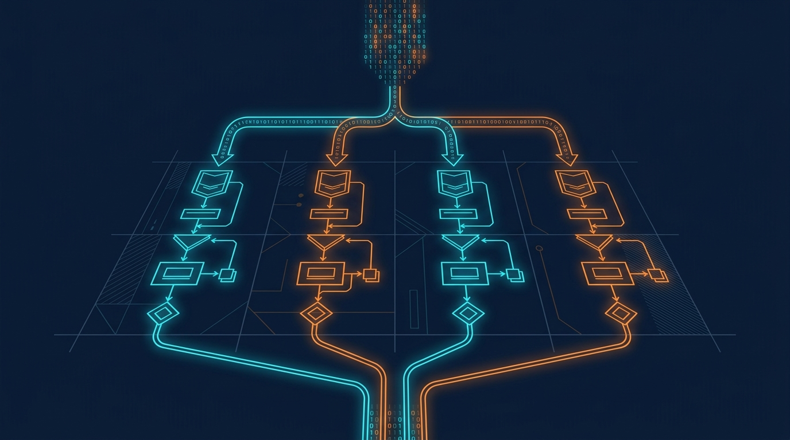

### Termin 06: Multithreading & Parallele Simulation
*(Vorlesungskapitel: 06 Multithreading)*

Komplexe mechatronische Simulationen erfordern massive Rechenleistung. In dieser Einheit nutzen wir Multithreading und die Task Parallel Library (TPL Parallel.For) in C#. Wir lernen, wie man Schleifen thread-sicher partitioniert, Race Conditions und False Sharing auf Cache-Line-Ebene vermeidet und Benchmarks mit Stopwatch methodisch sauber durchführt. Anhand des Amdahlschen Gesetzes untersuchen wir die theoretischen und realen Skalierungsgrenzen paralleler Algorithmen auf modernen Mehrkernprozessoren.

**Ablauf & Übungsaufgaben:**
* 🎤 **Showcase T05:** Zwei ausgewählte Teams präsentieren ihre 3D-Roboter und Greifarme am Beamer.
* **Stufe 1 (Basisaufgabe):** Paralleler Partikelfeld-Schritt mit Parallel.For, Messung der Rechenzeit und Nachweis der Ergebnisidentität zur seriellen Schleife.
* 🏭 **Stufe 2 – Track A (Industrie):** *Parallele Monte-Carlo-Toleranzanalyse* – Statistische Maßkettenrechnung für Bauteilpassungen mit automatischem Amdahl-Fit.
* 🎮 **Stufe 2 – Track B (Game):** *„100.000 Boids / Zombie-Horde“* – Hochparalleler Schwarm-Benchmark mit Flocking-Verhalten und Kernskalierungs-Analyse.
