<!-- _paginate: false -->
<!-- _header: "" -->
<!-- _footer: "" -->
<!-- _class: title -->


# Kapitel 7: Statische Modelle

Dieses Kapitel umfasst die folgenden Abschnitte:

- 7.1: Statische Modelle & das ideale Fachwerk
- 7.2: Das elastische Fachwerk & FEM-Mathematik
- 7.3: C#-Implementierung & `Math.NET Numerics`

---

<!-- _class: showcase -->

### Live-Showcase & Code-Defense: Termin 06

Präsentation der Hausübung aus Termin 06 (**Stufe 1: Basisaufgabe** + **Stufe 2: Track A oder B**, [Aufgabenblatt 06](../../06_Multithreading_und_TPL/Uebung/Aufgabenblatt.md)):

<div class="columns">
<div class="two">

#### Stufe 2 – Track A: Monte-Carlo-Toleranzanalyse
- Getriebe-Passungsspiel mit Maßketten
- $10\,000\,000$ Bauteile mit `Parallel.For`
- Thread-sichere Aggregation (`Interlocked`)
- Amdahl-Speedup-Fit in `ScottPlot 5`
- *Code-Defense:* Skalierung & UI-Entkopplung

</div>
<div class="two">

#### Stufe 2 – Track B: Boids & Zombie-Horde
- Schwarm-Simulation à la Craig Reynolds
- $50\,000+$ Boids bei flüssigen 60 FPS
- Asynchroner Task-Loop mit `CancellationToken`
- Räumliches Grid für Nachbarschaftssuche
- *Code-Defense:* Race Conditions & Not-Aus

</div>
</div>

> **Code-Defense (20 %):** Live-Vorführung am Beamer inkl. Stresstest des kooperativen Not-Aus-Abbruchs (`CancellationToken`) unter Volllast.

---

<!-- _class: recap -->

### Kontext & Einordnung: Von paralleler Infrastruktur zur gekoppelten Strukturmechanik

<div class="columns">
<div class="three">

Mit **Termin 06** steht unser Unterbau – heute starten wir in die **4 Simulationsmodellarten (T07–T10)**:

- **Brücke zu T03 (2D-Canvas):** Der Editor zeichnete bereits Knoten $(x, y)$, Stäbe und Lasten $\vec{F}$ – noch ohne Physik!
- **Heute (Statik):** Steifigkeitsmatrix $\mathbf{K}$ aufstellen und $\mathbf{K}\mathbf{u} = \mathbf{f}$ via **Cholesky** (`Math.NET`) lösen.
- **Checks:** Gleichgewicht ($\sum \vec{F} = \vec{0}$) und Euler-Knicklast.

</div>
<div class="two">

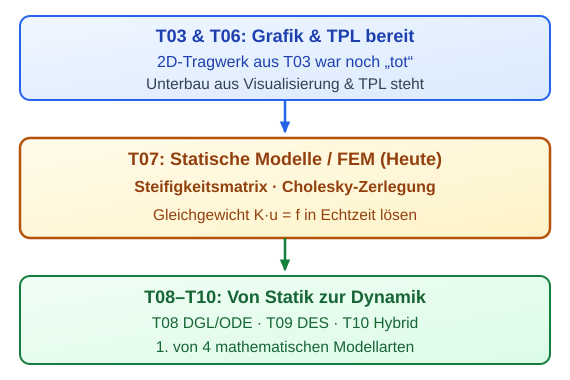

</div>
</div>

> **Roter Faden:** Statik liefert das zeitunabhängige Gleichgewicht ($\sum\vec{F} = \vec{0}$), bevor ab **Termin 08** die Dynamik startet – die FEM-Engine aus Termin 07 erweckt das 2D-Tragwerksmodell aus Termin 03 mit realen Verformungen und Kräften zum Leben.

---

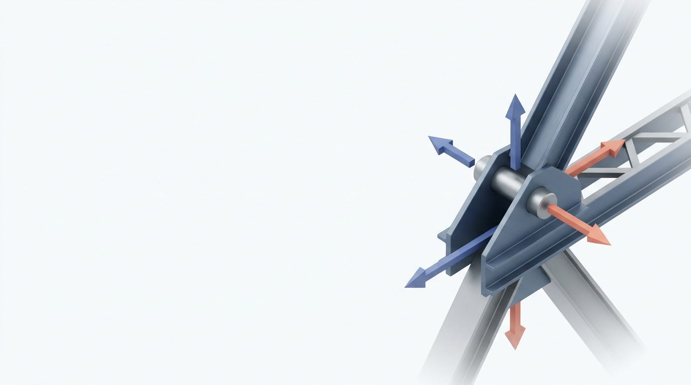

## 7.1: Statische Modelle & das ideale Fachwerk

Dieser Abschnitt umfasst die folgenden Inhalte:

- Statisches Gleichgewicht & Anwendungsbeispiel Fachwerk
- Knotenpunktverfahren & lineares Gleichungssystem (LGS)
- Statische Bestimmtheit vs. kinematischer Mechanismus
- Warum Cholesky für die Strukturmechanik ideal ist

---

### Anwendungsbeispiel: Was leistet ein statisches Modell?

<div class="columns">
<div class="two">

Ein **statisches Modell** beschreibt ein System im **zeitunabhängigen Ruhezustand** ($\dot{\mathbf{x}} = \mathbf{0}$):

$$\sum_{i=1}^n \vec{F}_i = \vec{0} \ [\mathrm{N}], \qquad \sum_{j=1}^m \vec{M}_j = \vec{0} \ [\mathrm{N\cdot m}]$$

- **Interne Kräfte:** Zug- oder Druckkraft in jedem Stab.
- **Auflagerreaktionen:** Kräfte am Fundament.
- **Verformung:** Knotenverschiebungen $\mathbf{u}$ *(erst im elastischen Modell!)*.

</div>
<div class="two">

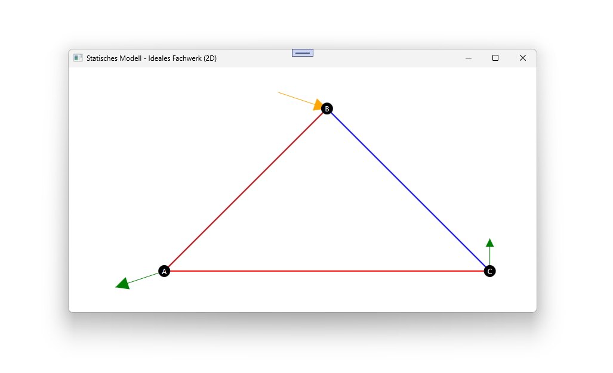

</div>
</div>

> **Ziel heute:** Wir verknüpfen diese Gleichgewichtsbedingungen mit `TrussFemSolver.sln` und Ihrem 2D-Canvas aus Termin 03.

---

### Das Fachwerk als klassisches Modell

<div class="columns">
<div class="two">

Ein **ideales 2D-Fachwerk** besteht aus geraden, gewichtslosen Stäben mit reibungsfreien Gelenken (Knoten) und reinen Knotenlasten $\vec{F}$:

- **Knoten `1..5`:** Position $\vec{p}_i$ mit je 2 Freiheitsgraden (DOF).
- **Stäbe `S1..S7`:** Übertragen nur axiale **Normalkräfte** (Zug oder Druck).
- **Lager:** Festlager (Reaktionen $A_x, A_y$) und Loselager (Reaktion $C_y$) verhindern Starrkörper-Bewegungen ($2k = s + l$).

</div>
<div class="three">

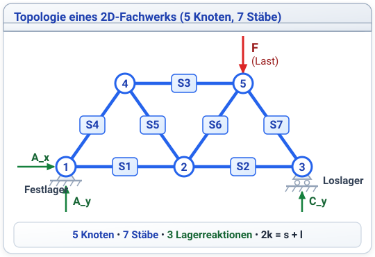

</div>
</div>

---

### Knotengleichgewicht & lineares Gleichungssystem (LGS)

<div class="columns top">
<div class="one">

**Gleichgewicht am Einzelknoten $i$**
- Für einen Stab zwischen $\vec{p}_i$ und $\vec{p}_k$ lautet der Einheitsvektor:
  $$\vec{e}_{ik} = \frac{\vec{p}_k - \vec{p}_i}{|\vec{p}_k - \vec{p}_i|} = \begin{pmatrix} e_{x,ik} \\ e_{y,ik} \end{pmatrix}$$
- Die vektorielle Summe aller Stabkräfte $S_{ik}\vec{e}_{ik}$ und der äußeren Last $\vec{F}_{\text{ext}, i}$ verschwindet:
  $$\sum_{k} S_{ik} \cdot \vec{e}_{ik} + \vec{F}_{\text{ext}, i} = \vec{0}$$

</div>
<div class="one">

**Globales System $\mathbf{A} \cdot \mathbf{x} = \mathbf{b}$**
- Für $k$ Knoten entstehen $2k$ lineare Gleichungen (jeweils $x$- und $y$-Komponente).
- **Geometriematrix $\mathbf{A}$:** Enthält die Richtungskosinusse $e_{x,ik}, e_{y,ik}$ und Lager-Einsätze.
- **Lösungsvektor $\mathbf{x}$:** Unbekannte Stabkräfte $S_1, \dots, S_s$ und Lagerreaktionen ($A_x, A_y, C_y$).
- **Lastvektor $\mathbf{b}$:** Negative äußere Knotenlasten $-\vec{F}_{\text{ext},i}$.

</div>
</div>

> **Eigenschaft:** Da jeder Stab nur 2 Knoten verbindet, sind die meisten Einträge in $\mathbf{A}$ gleich Null (*dünn besetzt*).

---

### Lösbarkeit: Statische Bestimmtheit vs. Mechanismus

<div class="columns">
<div class="two">

- **Reguläres System ($\det(\mathbf{A}) \neq 0$, $2k = s + l$):**
  - Gleichungen ($2k$) = Unbekannte ($s$ Stäbe + $l$ Lager).
  - Ein Dreiecksverband ist starr und eindeutig lösbar.
- **Singuläres System ($\det(\mathbf{A}) = 0$):**
  - Fehlende Diagonalen oder Lager erzeugen einen **kinematischen Mechanismus** unter Last $F_x$!

</div>
<div class="two">

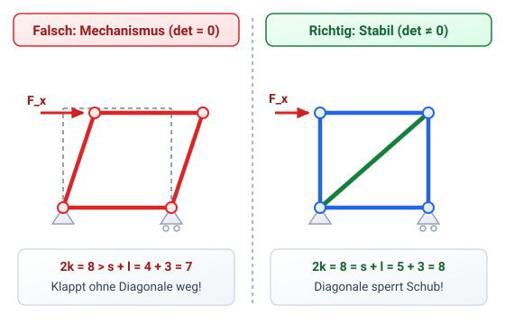

</div>
</div>

> **Merke:** Eine singuläre Matrix im Solver ist kein reines Mathematik-Problem, sondern meldet eine **einsturzgefährdete Konstruktion**!

---

### LGS-Löser im Überblick: Warum Cholesky?

Beim idealen Fachwerk ist $\mathbf{A}$ unsymmetrisch (`A.Solve(b)` via Lower-Upper-Zerlegung, LU). In der **elastischen Finite-Elemente-Methode (FEM)** ist die reduzierte Systemmatrix dagegen **symmetrisch positiv-definit (SPD)**:

| Verfahren | Matrix-Anforderung | Aufwand ($n = 3\,000$) | `Math.NET`-Aufruf |
| :--- | :--- | :--- | :--- |
| **LU-Zerlegung** | beliebig regulär | $\mathcal{O}(\frac{2}{3}n^3) \approx 18\cdot 10^9$ Ops | `A.LU().Solve(b)` |
| **Cholesky ($\mathbf{L}\mathbf{L}^\top$)** | **SPD** (symm. & pos.-def.) | $\mathcal{O}(\frac{1}{3}n^3) \approx 9\cdot 10^9$ Ops | `aSpd.Cholesky().Solve(b)` |
| **Matrix-Inversion** | regulär *(Anti-Pattern!)* | $\mathcal{O}(2n^3)$ + Rundungsfehler | `A.Inverse()` *(verboten!)* |

```csharp
// Cholesky nutzt Symmetrie aus: 2x schneller und halber Speicher gegenüber LU!
Vector<double> x = aSpd.Cholesky().Solve(b); // Blockreduktion K_ff folgt in 7.2
```

> **Vertiefung:** Details zu Gauß-Elimination, LU-Zerlegung und iterativen Jacobi-Verfahren (inkl. Codebeispielen für mehrfache Lastfälle) finden Sie in [Anhang A](./Folien_Anhang_A_Grundlagen_LGS.md).

---

<!-- _class: activity -->

### Aufgabe: Statische Bestimmtheit & Mechanismus

<div class="columns top">
<div class="one">

Ein 2D-Rechteckrahmen besteht aus $k = 4$ Knoten und $s = 4$ Randstäben, gelagert auf einem Festlager (2 Reaktionen) und einem Loselager (1 Reaktion, $l = 3$).

1. Wie viele Gleichgewichtsgleichungen ($2k$) stehen wie vielen Unbekannten ($s + l$) gegenüber?
2. Was passiert physikalisch ohne Diagonalstab?
3. Was meldet $\det(\mathbf{A})$ in diesem Fall?
4. Wie ändert sich die Stabilität mit 1 bzw. 2 Diagonalen?

</div>
<div class="one">

| Variante | $k$ | $s$ | $l$ | $2k$ | $s + l$ |
| :--- | :---: | :---: | :---: | :---: | :---: |
| **Ohne Diagonale** | 4 | 4 | 3 | `?` | `?` |
| **Mit 1 Diagonale** | 4 | 5 | 3 | 8 | 8 |
| **Mit 2 Diagonalen** | 4 | 6 | 3 | 8 | 9 *(überbest.)* |

- Prüfen Sie das Abzählkriterium $2k = s + l$ für alle drei Varianten und bestimmen Sie die fehlenden Werte `?`!
- Welche der drei Varianten ist statisch bestimmt, welche unterbestimmt?

</div>
</div>

> **Hinweis:** Überlegen Sie, welche Bewegung im Fall *ohne Diagonale* noch frei bleibt – genau diesen Mechanismus testen Sie in Aufgabe 1.3 von HÜ 07 durch Entfernen eines Lager-DOFs!

---

<!-- _class: solution -->

### Auflösung: Statische Bestimmtheit & Mechanismus

<div class="columns top">
<div class="two">

1. **Abzählkriterium:** $2k = 8$ Gleichungen vs. $s + l = 7$ Unbekannte $\implies$ **1 Freiheitsgrad unterbestimmt**.
2. **Physik:** Ohne Diagonale fehlt die Schubsteifigkeit – der Rahmen klappt wie ein Parallelogramm seitlich weg (**Mechanismus**).
3. **Abhilfe:** Ein zusätzlicher Diagonalstab ($s = 5$) stellt die volle statische Bestimmtheit her.

</div>
<div class="two">

4. **Mathematik:** Die Systemmatrix $\mathbf{A}$ bzw. $\mathbf{K}_{ff}$ hat keinen vollen Rang ($\det = 0$, singulär).
5. **Solver-Verhalten:** `Cholesky()` wirft beim Faktorisieren sofort eine `ArgumentException` (*„Matrix must be positive definite“*).
6. **Prüfung:** Genau diese Instabilität testen Sie in Aufgabe 1.3 von HÜ 07 (`dotnet test`) – erst eine Diagonale behebt den Fehler.

</div>
</div>

> **Merksatz:** Das Abzählkriterium $2k = s + l$ ist notwendig, aber erst die **Regularität** ($\det \neq 0$) garantiert ein stabiles Tragwerk im Gleichgewicht! Auch in der 2D-FEM gilt: Ohne mindestens 3 nicht-parallele Lager-Freiheitsgrade bleibt die Matrix singulär und nicht Cholesky-tauglich – genau deshalb prüft die Vorlage die Lösbarkeit bei jedem Run!

---

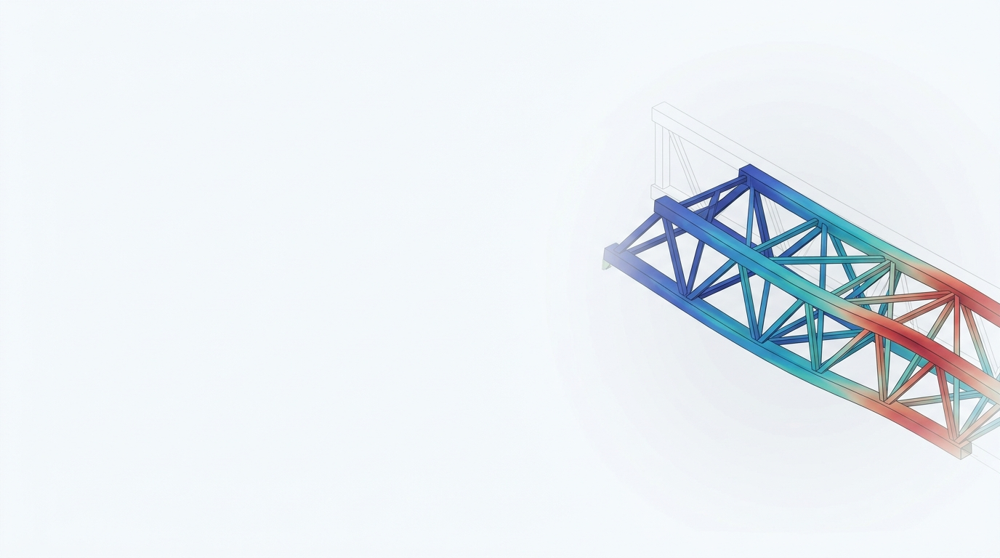

## 7.2: Das elastische Fachwerk & FEM-Mathematik

Dieser Abschnitt umfasst die folgenden Inhalte:

- Hooke'sches Gesetz & Linearisierung der Längenänderung
- Herleitung der $4 \times 4$-Elementsteifigkeitsmatrix $\mathbf{K}_e$
- Assemblierung & exakte Blockpartitionierung ($\mathbf{K}_{ff}, \mathbf{K}_{pf}$)
- Stabnormalkräfte, Auflagerreaktionen & Euler-Knicklast

---

### Anwendungsbeispiel: Elastische Verformung unter Last

<div class="columns">
<div class="two">

Das ideale Fachwerk liefert nur Kräfte – **keine Verschiebungen** $\mathbf{u}$ und **keine Lösung für statisch überbestimmte** Systeme!

- **Neue Annahme:** Jeder Stab verhält sich wie eine lineare Feder nach dem **Hooke'schen Gesetz**.
- **Neue Unbekannte:** Gesucht sind zuerst die **Knotenverschiebungen** $\mathbf{u}$, daraus folgen Dehnung und Stabkraft.
- **Visualisierung:** Überhöhte Verformung plus Zug-/Druck-Farbcode im WPF-`Canvas`.

</div>
<div class="two">

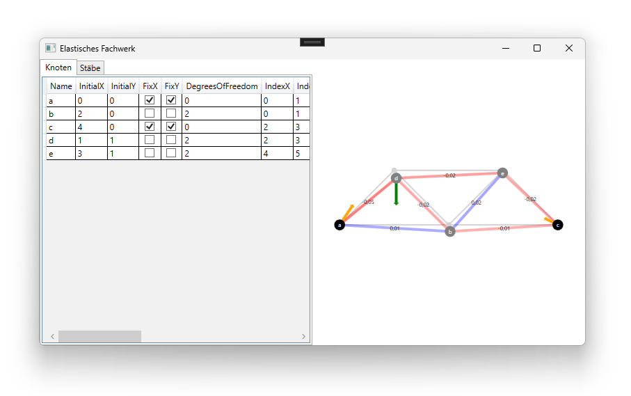

</div>
</div>

> **Praxis-Nutzen:** Erst das elastische FEM-Modell beantwortet, ob ein Kranausleger unter Nennlast zu stark durchhängt oder bei Überbestimmtheit Kräfte umlagert.

---

### Hooke'sches Gesetz & exakte Längenänderung

<div class="columns">
<div class="three">

Mit **Elastizitätsmodul $E$**, **Querschnittsfläche $A$** (**Dehnsteifigkeit (EA)**) und **Ausgangslänge $L$** gilt für die Normalkraft $S$:

$$S = \frac{EA}{L} \cdot \Delta L$$

Aus dem verschobenen Stabvektor $\vec{L}' = \vec{L} + \Delta\vec{u}$ (mit $\Delta\vec{u} = \vec{u}_j - \vec{u}_i$) folgt die exakte, nichtlineare Längenänderung:

$$\Delta L = |\vec{L} + \Delta\vec{u}| - L = \sqrt{L^2 + 2(\vec{L}\cdot\Delta\vec{u}) + |\Delta\vec{u}|^2} - L$$

- **Problem:** Die Wurzel macht das Gleichungssystem nichtlinear.
- **Lösung:** Lineare Näherung für kleine Verformungen ($|\Delta\vec{u}| \ll L$).

</div>
<div class="one">

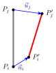

</div>
</div>

> **Schlüsselidee:** Für kleine Dehnungen ersetzen wir die gekrümmte Kreisbewegung durch eine lineare Projektion auf die Ausgangsachse.

---

### Linearisierung für kleine Verschiebungen ($|\Delta\vec{u}| \ll L$)

<div class="columns">
<div class="two">

Bei Stahltragwerken gilt typischerweise $|\Delta\vec{u}| \approx 1\,\text{mm} \ll L \approx 2\,\text{m}$:

1. Der quadratische Term $\frac{|\Delta\vec{u}|^2}{L^2} \approx 2{,}5\cdot 10^{-7}$ ist vernachlässigbar.
2. Mit der Taylor-Näherung $\sqrt{1 + x} \approx 1 + \frac{x}{2}$ folgt:
   $$L' \approx L + \vec{e}\cdot\Delta\vec{u}$$
3. **Projektion auf die Stabachse:**
   $$\Delta L \approx \vec{e} \cdot (\vec{u}_j - \vec{u}_i)$$

- **Vorteil:** Das Gleichungssystem bleibt streng linear ($\mathbf{K}\mathbf{u} = \mathbf{f}$).
- **Zahlenbeispiel:** Bei $\Delta u = 1\,\text{mm}$ und $L = 2\,\text{m}$ beträgt der relative Fehler nur $0{,}05\,\%$.
- **Grenze:** Für extrem weiche Seilnetze wäre ein nichtlinearer Solver nötig.

</div>
<div class="one">

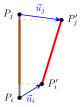

</div>
</div>

---

<!-- _class: activity -->

### Aufgabe: Längenänderung & Zug/Druck bestimmen

Ein horizontaler Stahlstab ($\vec{e} = (1, 0)^\top$, $L = 2\,\text{m}$, $E = 210\,\text{GPa}$, $A = 10^{-4}\,\text{m}^2$) verbindet Knoten $i$ und $j$:

| Größe | Knoten $i$ | Knoten $j$ |
| :--- | :--- | :--- |
| **Verschiebung $\vec{u}$** | $\vec{u}_i = (0;\; 0)^\top\,\text{mm}$ | $\vec{u}_j = (-1{,}0;\; -2{,}0)^\top\,\text{mm}$ |
| **Material & Steifigkeit** | $E \cdot A = 2{,}1 \cdot 10^7\,\text{N}$ | $\frac{EA}{L} = 1{,}05 \cdot 10^7\,\text{N/m}$ |
| **Richtung & Länge** | $\vec{e} = (1, 0)^\top$ | $L = 2{,}0\,\text{m}$ |

1. Wie groß ist die linearisierte Längenänderung $\Delta L = \vec{e}\cdot(\vec{u}_j - \vec{u}_i)$?
2. Welche Normalkraft $S = \frac{EA}{L}\Delta L$ wirkt im Stab?
3. Handelt es sich um einen **Zug-** oder einen **Druckstab**?

> **Tipp:** Prüfen Sie zuerst das Skalarprodukt $\vec{e}\cdot(\vec{u}_j - \vec{u}_i)$ komponentenweise – achten Sie genau auf das Vorzeichen und rechnen Sie $\Delta L$ vor dem Einsetzen in Metern um ($\text{mm} \to \text{m}$)!

---

<!-- _class: solution -->

### Auflösung: Längenänderung & Zug/Druck bestimmen

1. **Längenänderung $\Delta L$:** Nur die axiale Komponente entlang $\vec{e} = (1, 0)^\top$ zählt – die Querkomponente $-2\,\text{mm}$ fällt durch das Skalarprodukt vollständig weg:
   $$\Delta L = 1 \cdot (-1{,}0\,\text{mm}) + 0 \cdot (-2{,}0\,\text{mm}) = -1{,}0\,\text{mm} = -10^{-3}\,\text{m}$$
2. **Normalkraft $S$:** Mit der Stabsteifigkeit $\frac{EA}{L} = \frac{210\cdot 10^9 \cdot 10^{-4}}{2} = 1{,}05 \cdot 10^7\,\text{N/m}$ ergibt sich:
   $$S = 1{,}05 \cdot 10^7\,\frac{\text{N}}{\text{m}} \cdot (-10^{-3}\,\text{m}) = -10\,500\,\text{N} = -10{,}5\,\text{kN}$$
3. **Beanspruchung:** Da $S < 0$ (axiale Verkürzung $\Delta L < 0$), liegt ein **Druckstab** vor – im WPF-`Canvas` wird er deshalb rot eingefärbt.

> **Merksatz:** Eine reine Querauslenkung trägt in erster Näherung nichts zur Dehnung bei – entscheidend ist allein die Projektion $\vec{e}\cdot\Delta\vec{u}$. Im nächsten Schritt verknüpfen wir beide Knotenverschiebungen zu einer symmetrischen $4\times 4$-Matrix $\mathbf{K}_e$.

---

### Vom Hooke'schen Gesetz zum Kräftepaar am Stab

<div class="columns">
<div class="two">

Wir fassen $\vec{u}_i, \vec{u}_j$ zu $\mathbf{u}_e = (\vec{u}_i, \vec{u}_j)^\top$ zusammen:

1. **Dehnung in Vektorform:**
   $$\Delta L = \begin{pmatrix} -\vec{e}^\top & +\vec{e}^\top \end{pmatrix} \mathbf{u}_e$$
2. **Kräftepaar (`actio = reactio`):** Bei Zug ($S > 0$) zieht der Stab an $i$ nach $-\vec{e}$ ($\mathbf{f}_i = -S\vec{e}$) und an $j$ nach $+\vec{e}$ ($\mathbf{f}_j = +S\vec{e}$):
   $$\mathbf{f}_e = \begin{pmatrix} \mathbf{f}_i \\ \mathbf{f}_j \end{pmatrix} = \begin{pmatrix} -\vec{e} \\ +\vec{e} \end{pmatrix} S$$

</div>
<div class="three">

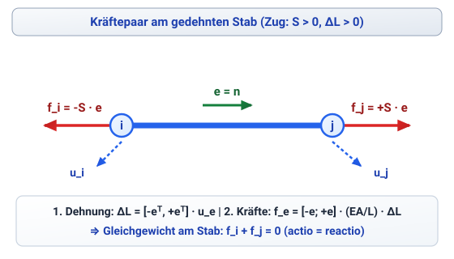

</div>
</div>

> **Merke:** Die beiden Vorzeichen ($-\vec{e}$ an $i$, $+\vec{e}$ an $j$) garantieren das Kräftegleichgewicht am Stab ($\mathbf{f}_i + \mathbf{f}_j = \mathbf{0}$).

---

### Die $4 \times 4$-Elementsteifigkeitsmatrix $\mathbf{K}_e$

<div class="columns">
<div class="two">

Setzt man $S = \frac{EA}{L}\Delta L$ in $\mathbf{f}_e$ ein und nutzt $\vec{n} \equiv \vec{e} = (\cos\alpha, \sin\alpha)^\top$, entsteht direkt das dyadische Produkt:

$$\mathbf{f}_e = \frac{EA}{L}\begin{pmatrix} -\vec{n} \\ \vec{n} \end{pmatrix}\begin{pmatrix} -\vec{n}^\top & \vec{n}^\top \end{pmatrix}\mathbf{u}_e = \mathbf{K}_e \mathbf{u}_e$$

- $\mathbf{K}_e$ ist **symmetrisch** ($\mathbf{K}_e = \mathbf{K}_e^\top$) und unabhängig von den globalen Knotennummern.

</div>
<div class="three">

$$\mathbf{K}_e = \frac{EA}{L} \begin{pmatrix} n_x^2 & n_x n_y & -n_x^2 & -n_x n_y \\ n_x n_y & n_y^2 & -n_x n_y & -n_y^2 \\ -n_x^2 & -n_x n_y & n_x^2 & n_x n_y \\ -n_x n_y & -n_y^2 & n_x n_y & n_y^2 \end{pmatrix}$$

```csharp
// In TrussElement.cs: symmetrische 4x4 Matrix K_e
var (n_x, n_y) = Direction;
double k = YoungsModulus * Area / Length;
// Block [0..1, 0..1]: k * [n_x^2, n_x*n_y; ...]
```

</div>
</div>

> **Hinweis:** Die alternative Herleitung über Koordinatentransformation ($\mathbf{T}^\top \mathbf{k}_e^{\text{loc}}\mathbf{T}$) und den Bezug zur lokalen 1D-Feder finden Sie in [Anhang A](./Folien_Anhang_A_Grundlagen_LGS.md) (Kapitel A.3) – das Ergebnis für $\mathbf{K}_e$ ist mathematisch identisch und gilt für beliebige Stabwinkel $\alpha$!

---

### Assemblierung zur globalen Steifigkeitsmatrix $\mathbf{K}$

<div class="columns">
<div class="two">

Am gemeinsamen Knoten addieren sich die inneren Stabkräfte zum Lastvektor ($\sum \mathbf{f}_{e,i} = \mathbf{f}_i$):

- Knoten $i$ hat globale DOFs `[2*i, 2*i + 1]`.
- Alle $4\times 4$-Matrizen ($\mathbf{K}_1, \mathbf{K}_2$) werden in $\mathbf{K}$ **aufaddiert (`+=`)**.
- **Warum ist $\mathbf{K}$ singulär?** Ohne Lager kann sich das Fachwerk als starrer Körper frei bewegen ($\det(\mathbf{K}) = 0$).

</div>
<div class="three">

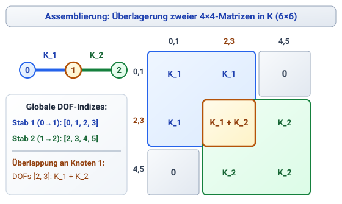

</div>
</div>

> **Merke:** Die Überlagerung (`+=`) am gemeinsamen Knoten entspricht direkt der Summe aller angreifenden Stabkräfte.

---

### Einbau der Randbedingungen: Blockpartitionierung

Systemaufteilung ($n_f$ frei, $n_p$ gesperrt; $\mathbf{u}_p=\mathbf{0}$) für $\mathbf{u}_f$ mit $\mathbf{K}_{ff}, \mathbf{K}_{fp}, \mathbf{K}_{pf}, \mathbf{K}_{pp}$: $\mathbf{K}_{ff}\mathbf{u}_f = \mathbf{f}_f$ ($\mathbf{L}\mathbf{y}=\mathbf{f}_f$), $\mathbf{f}_p = \mathbf{K}_{pf}\mathbf{u}_f$ ($u_{y3}=-1{,}823\,\text{mm}$, $F_{y1}=F_{y2}=+5{,}00\,\text{kN}$):

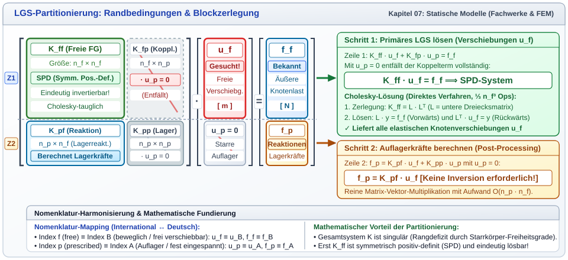

---

### Post-Processing: Stabkräfte, Gleichgewicht & Euler-Knickung

<div class="columns top">
<div class="one">

**1. Stabnormalkraft $N_e \equiv S$ & Spannung $\sigma_e$**
$$N_e = \frac{EA}{L}\,\vec{n}\cdot(\vec{u}_j - \vec{u}_i), \qquad \sigma_e = \frac{N_e}{A}$$
- Die Stabkraft $S$ heißt in der FEM **Normalkraft $N_e$**: $N_e > 0$ Zug (blau), $N_e < 0$ Druck (rot); Vergleich von `stress` ($\sigma_e$) mit der Streckgrenze.

**2. Globale Gleichgewichtsinvariante**
$$\sum \vec{F}_{\text{ext}} + \sum \vec{F}_{\text{Lager}} = \vec{0} \quad (\text{Fehler } < 10^{-8}\,\mathrm{N})$$

</div>
<div class="one">

**3. Euler-Knicklast (Druckstäbe $N_e < 0$)**
$$N_{\text{knick}} = \frac{\pi^2 E I}{L^2} \quad \implies \quad \text{Versagen falls } |N_e| \ge N_{\text{knick}}$$

```csharp
// Stabilitäts-Check pro Druckstab (Track A & B)
bool buckled = n_e < 0 && Math.Abs(n_e) >= nKnick;
double stress = sigma_e;
```

- **3D-Erweiterung:** Identisches Prinzip mit $6\times 6$-Matrizen in [Anhang B](./Folien_Anhang_B_3D_Fachwerke.md).

</div>
</div>

> **Ingenieur-Pflicht:** Prüfen Sie nach jeder FEM-Lösung zuerst `IsEquilibriumSatisfied` ($\sum \vec{F} = \vec{0}$), bevor Sie Ergebnisse visualisieren!

---

<!-- _class: activity -->

### Aufgabe: Blockpartitionierung am 3-Knoten-Träger

In **Hausübung 07 (Stufe 1)** besitzt ein 3-Knoten-Dreiecksträger ($N = 3 \implies 6$ DOFs `[0..5]`) folgende Lagerung:

| Knoten | X-Freiheitsgrad | Y-Freiheitsgrad | Lager-Typ |
| :---: | :---: | :---: | :--- |
| **Knoten 0** | `DOF 0` (fest) | `DOF 1` (fest) | Festlager |
| **Knoten 1** | `DOF 2` (frei) | `DOF 3` (fest) | Loselager (in X verschieblich) |
| **Knoten 2** | `DOF 4` (frei) | `DOF 5` (frei) | Freier Lastknoten ($F_y = -10\,\text{kN}$) |

1. Welche Indizes liegen in `prescribed` ($p$) und welche in `free` ($f$)?
2. Welche Dimensionen haben $\mathbf{K}_{ff}$ und $\mathbf{K}_{pf}$?
3. Was passiert mit $\mathbf{K}_{ff}$, wenn `DOF 0` (Festlager in X) gelöst wird?

> **Hinweis:** Zählen Sie die gesperrten und freien Freiheitsgrade direkt aus der Tabelle ab.

---

<!-- _class: solution -->

### Auflösung: Blockpartitionierung am 3-Knoten-Träger

<div class="columns top">
<div class="one">

**1. Index-Aufteilung**
- `prescribed` ($p$): `[0, 1, 3]` (3 gesperrte DOFs).
- `free` ($f$): `[2, 4, 5]` (3 freie DOFs).

**2. Matrixdimensionen**
- $\mathbf{K}_{ff} \in \mathbb{R}^{3\times 3}$ (quadratisch, SPD).
- $\mathbf{K}_{pf} \in \mathbb{R}^{3\times 3}$ (gesperrte $\times$ freie DOFs).
- Ergeben sich direkt aus `free.Length` und `prescribed.Length`.

</div>
<div class="one">

**3. Gelöstes X-Lager (`DOF 0`)**
- Das Fachwerk kann sich horizontal frei verschieben (Starrkörper-Translation).
- $\mathbf{K}_{ff} \in \mathbb{R}^{4\times 4}$ wird **singulär** ($\det = 0$) $\implies$ `Cholesky()` wirft eine Exception!

```csharp
// Festlager fehlt -> Eigenwert 0 in K_ff!
kff.Cholesky().Solve(ff); // ArgumentException
// Genau dies prüfen Sie in Aufgabe 1.3!
```

</div>
</div>

> **Merksatz:** Mindestens 3 nicht-parallele Lager-DOFs sperren alle 3 Starrkörper-Bewegungen in 2D (Translation X/Y und Rotation).

---


## 7.3: C#-Implementierung & `Math.NET Numerics`

Dieser Abschnitt umfasst die folgenden Inhalte:

- Klassenarchitektur in `TrussFemSolver.sln`
- `TrussElement`: $\mathbf{K}_e$ und Schnittkraftberechnung
- `GlobalStiffnessMatrix`: Assemblierung & Partitionierung
- `CholeskySolver`: Lösung & Fehlerbehandlung bei Singularität

---

### Klassenarchitektur der FEM-Engine (`TrussFemSolver.sln`)

<div class="columns">
<div class="two">

Die Vorlage entkoppelt Physik (`Fem/`) vom WPF-`Canvas`:

- **`Node`:** `(X, Y)` sowie `DofX`, `DofY`.
- **`TrussElement`:** `Node1`, `Node2`, $E$, $A$.
- **`GlobalStiffnessMatrix` & `CholeskySolver`:** Assemblierung, Partitionierung und Lösung.

</div>
<div class="three">


</div>
</div>

> **Architektur-Regel:** Keine UI-Referenzen in `Fem/` – die View konsumiert ausschließlich das Ergebnis-Objekt `FemSolution` (Verschiebungen, Reaktionen, Elementkräfte und Gleichgewichtsstatus) zur reinen Darstellung auf dem WPF-`Canvas`, wodurch die Numerik deterministisch und allokationsfrei testbar bleibt (`dotnet test` in Aufgabe 1.4).

---

### Normalkraftberechnung in C# (`TrussElement.cs`)

<div class="columns">
<div class="two">

Aus `(c, s) = Direction` und `ux1`, `uy1`, `ux2`, `uy2` in `globalDisplacements` folgt:

- Projektion `deltaL` entlang `(c, s)` liefert die Dehnung `strain`.
- `YoungsModulus * Area * strain` ergibt Zug ($>0$) bzw. Druck ($<0$).
- Identisch zur analytischen Formel $\frac{EA}{L}\Delta L$.

</div>
<div class="three">

```csharp
public double ComputeNormalForce(Vector<double> globalDisplacements)
{
    var (c, s) = Direction;
    double ux1 = globalDisplacements[Node1.DofX];
    double uy1 = globalDisplacements[Node1.DofY];
    double ux2 = globalDisplacements[Node2.DofX];
    double uy2 = globalDisplacements[Node2.DofY];

    double deltaL = c * (ux2 - ux1) + s * (uy2 - uy1);
    double strain = deltaL / Length;
    return YoungsModulus * Area * strain;
}
```

</div>
</div>

> **Golden Reference:** Im 3-Knoten-Träger der Stufe 1 liefert diese Methode für das Zugband exakt `+5,000 kN` und für die Dachstäbe `-7,071 kN` (Fehler $< 10^{-11}\,\mathrm{N}$, geprüft via `dotnet test` in Aufgabe 1.4 – erst bei korrektem Vorzeichen stimmen die Farbwerte im Canvas!).

---

### Index-Partitionierung in C# (`GlobalStiffnessMatrix.cs`)

`Partition()` extrahiert die freien (`free`) und gesperrten (`prescribed`) Freiheitsgrade aus `kGlobal` und gibt `(free, prescribed, kff, kpf, ff)` zurück:

```csharp
var prescribed = FixedDofs.OrderBy(d => d).ToArray();
var free = Enumerable.Range(0, TotalDofs).Except(FixedDofs).OrderBy(d => d).ToArray();
var kGlobal = AssembleGlobalMatrix();

var kff = new DenseMatrix(free.Length, free.Length);
for (int i = 0; i < free.Length; i++)
    for (int j = 0; j < free.Length; j++)
        kff[i, j] = kGlobal[free[i], free[j]];

var kpf = new DenseMatrix(prescribed.Length, free.Length);
for (int i = 0; i < prescribed.Length; i++)
    for (int j = 0; j < free.Length; j++)
        kpf[i, j] = kGlobal[prescribed[i], free[j]];

return (free, prescribed, kff, kpf, ff);
```

---

### Cholesky-Lösung & Singularitäts-Schutz (`CholeskySolver.cs`)

<div class="columns">
<div class="two">

In `MathNet.Numerics` löst `kff.Cholesky().Solve(ff)` das System $\mathbf{K}_{ff}\mathbf{u}_f = \mathbf{f}_f$ ohne Matrix-Inversion:

- **Was passiert ohne `try/catch`?** Bricht im Track B ein Stab und entsteht ein Mechanismus, stürzt die Anwendung mit einer unbehandelten `ArgumentException` ab!
- **Saubere Reaktion:** Exception abfangen, als Einsturz melden und Gleichgewicht (`sumX`, `sumY`) als Invariante prüfen.

</div>
<div class="three">

```csharp
Vector<double> uf;
try {
    uf = kff.Cholesky().Solve(ff);
} catch (Exception ex) {
    throw new InvalidOperationException(
        "Cholesky fehlgeschlagen: Tragwerk kinematisch instabil!", ex);
}

// Auflagerreaktionen: f_p = K_pf * u_f
Vector<double> fp = kpf.Multiply(uf);

// Globales Gleichgewicht prüfen: sum(F_ext + F_reac) = 0
double sumX = 0.0, sumY = 0.0;
for (int dof = 0; dof < model.TotalDofs; dof++) {
    double f = model.ExternalForces[dof] +
        (solution.ReactionForces.TryGetValue(dof, out var r) ? r : 0.0);
    if (dof % 2 == 0) sumX += f; else sumY += f;
}
```

</div>
</div>

---

<!-- _class: activity -->

### Frage: Bug-Hunt im Cholesky-Löser

Ein Team implementiert den Einsturz-Check für **Track B** wie folgt, erhält aber *immer* eine Cholesky-Exception – selbst bei einer stabilen Brücke:

```csharp
// Fehlerhafte Implementierung im Bridge Constructor (Track B)
var kGlobal = model.AssembleGlobalMatrix();
// Fehlt: FixedDofs + Partition() -> kGlobal ist immer singulär!
var uf = kGlobal.Cholesky().Solve(model.ExternalForces);
```

1. Warum schlägt `kGlobal.Cholesky()` selbst bei einem korrekt gelagerten Fachwerk fehl?
2. Welche zwei Schritte fehlen vor dem Aufruf von `.Cholesky()`?
3. Warum darf `kGlobal.Inverse()` auch bei einer regulären Matrix nicht verwendet werden?

> **Hinweis:** Überlegen Sie, welche Eigenwerte `kGlobal` vor dem Einbau von `FixedDofs` besitzt, warum ein ungelagerter Körper sich frei im Raum verschieben kann und welche Methode in `GlobalStiffnessMatrix.cs` genau dafür fehlt.

---

<!-- _class: solution -->

### Auflösung: Bug-Hunt im Cholesky-Löser

<div class="columns top">
<div class="one">

**1. Ursache der Exception**
- `kGlobal` enthält noch alle gesperrten Lager-DOFs unpartitioniert ($\det(\mathbf{K}) = 0$ durch 3 Starrkörper-Moden).

**2. Fehlende Schritte**
- `FixedDofs` setzen, per `Partition()` die Listen `free` / `presc` sowie `kff`, `kpf` und `ff` extrahieren, dann `uf` und `fp` berechnen.

</div>
<div class="one">

**3. Korrekter Fix & Verbot von `.Inverse()`**
- `.Inverse()` ist $3\times$–$6\times$ langsamer als Cholesky und numerisch schlechter konditioniert:

```csharp
// 1. Partitionieren (frei vs. gesperrt)
var (free, presc, kff, kpf, ff) = model.Partition();
// 2. Verschiebungen u_f via Cholesky lösen
var uf = kff.Cholesky().Solve(ff);
// 3. Auflagerreaktionen f_p & Gleichgewicht
var fp = kpf.Multiply(uf);
```

</div>
</div>

> **Merksatz:** Niemals `kGlobal.Cholesky()` aufrufen – immer zuerst über `FixedDofs` in `kff` partitionieren und erst dann faktorisieren; bei Singularität gezielt eine `InvalidOperationException` auslösen, um den Einsturz sauber anzuzeigen!

---

<!-- _class: summary -->

# Zusammenfassung Kapitel 7

- **Statische Modelle** beschreiben das zeitunabhängige Kräfte- und Momentengleichgewicht ($\sum \vec{F} = \vec{0}$, $\sum \vec{M} = \vec{0}$).
- **Ideales Fachwerk ($\mathbf{A}\mathbf{x} = \mathbf{b}$):** Berechnet reine Stabkräfte bei starren Stäben; $\det(\mathbf{A}) = 0$ signalisiert einen kinematischen Mechanismus.
- **Elastisches Fachwerk (FEM):** Die Linearisierung $\Delta L \approx \vec{n}\cdot(\vec{u}_j - \vec{u}_i)$ und das Hooke'sche Gesetz liefern die symmetrische $4\times 4$-Elementsteifigkeitsmatrix $\mathbf{K}_e$.
- **Blockpartitionierung & Cholesky:** Durch Aufteilung in freie ($f$) und gesperrte ($p$) DOFs entsteht das SPD-System $\mathbf{K}_{ff}\mathbf{u}_f = \mathbf{f}_f$, das via $\mathbf{K}_{ff} = \mathbf{L}\mathbf{L}^\top$ doppelt so schnell wie LU gelöst wird.
- **Ingenieur-Checks:** Auflagerreaktionen $\mathbf{f}_p = \mathbf{K}_{pf}\mathbf{u}_f$, globales Gleichgewicht ($\sum \vec{F} = \vec{0}$) und Euler-Knicklast $N_{\text{knick}} = \frac{\pi^2 E I}{L^2}$.

---

<!-- _class: appendix -->

### Vertiefende Anhänge (Selbststudium)

Ergänzende Herleitungen und die räumliche Verallgemeinerung stehen in zwei optionalen Begleitfolien bereit:

| Anhang | Thema | Kerninhalte für das Selbststudium |
| :--- | :--- | :--- |
| **[Anhang A](./Folien_Anhang_A_Grundlagen_LGS.md)** | **Historie, LGS-Löser & Trafo** | Pioniere (Whipple, Culmann, Maxwell), Gauß-Elimination, LU-Zerlegung, Jacobi-Iteration & $\mathbf{K}_e = \mathbf{T}^\top \mathbf{k}_e^{\text{loc}} \mathbf{T}$. |
| **[Anhang B](./Folien_Anhang_B_3D_Fachwerke.md)** | **Erweiterung auf 3D-Fachwerke** | 3 Freiheitsgrade pro Knoten ($3k \times 3k$-System), räumliches Knotengleichgewicht & $6 \times 6$-Elementsteifigkeitsmatrix. |

- Alle Formeln und C#-Muster der Anhänge bauen nahtlos auf der 2D-Notation dieses Hauptdecks auf.
- Die PDF-Exporte der Anhänge stehen automatisch parallel zum Hauptfoliensatz in Moodle bereit.

> **Hinweis:** Der prüfungsrelevante Stoff für **Hausübung 07** und **Moodle-Test 3** ist vollständig im Hauptdeck enthalten; die Anhänge dienen der freiwilligen Vertiefung.

---

<!-- _class: outlook -->

### Ausblick: Vom Gleichgewicht zur Bewegung (Termin 08)

<div class="columns top">
<div class="one">

**Wo Statik endet (Heute – T07)**
- Zeitunabhängiges Gleichgewicht: $\sum \vec{F} = \vec{0}$.
- Einmalige Lösung von $\mathbf{K}_{ff}\mathbf{u}_f = \mathbf{f}_f$ via Cholesky liefert den Endzustand.
- Keine Massenträgheit, keine Dämpfung, keine Zeitachse $t$.
- Jeder Belastungsfall ist eine statische Momentaufnahme.

</div>
<div class="one">

**Nächster Schritt: Dynamik (Termin 08)**
- Bewegungsgleichung mit Trägheit & Dämpfung: $m\ddot{\mathbf{x}} + d\dot{\mathbf{x}} + k\mathbf{x} = \mathbf{f}(t)$.
- **Kontinuierliche ODEs**, modulare S-Functions, **Runge-Kutta 4 (RK4)** und PID-Regelkreise:

```csharp
// T08: Zeitintegration statt einmaligem LGS
state = rk4.Step(state, t, dt, sFunction);
// Zeitschrittverfahren für dynamische Systeme
```

</div>
</div>

> **Wichtiger Termin-Hinweis:** Zu Beginn von **Termin 08** findet **Moodle-Test 3** (Stoff: Kapitel 05–07) statt – nutzen Sie zur Vorbereitung die unbegrenzten Moodle-Übungstests (`Test_01`–`Test_03`) im Kursbereich und prüfen Sie Ihre Vorlesungs-Notizen!

---

<!-- _class: homework -->

### Hausübung Termin 07: Statik, FEM & Cholesky

**Stufe 1 (`1.1`–`1.4` auf `TrussFemSolver.sln`):** Auflager-/Kraftpfeile, 5-Knoten-Auslegerkran, Singularitäts-Test & Unit-Tests ([Aufgabenblatt 07](../Uebung/Aufgabenblatt.md)) $\to$ **Stufe 2 (Track A ODER Track B, 10 Pkt.):**

<div class="columns">
<div class="two">

#### Stufe 2 – Track A: Portalkran-FEM (Industrie)
- **Verheiratung mit T03:** 2D-WPF-Canvas
- Reale Hallenkran-Geometrie ($24\,\text{m}$)
- Wanderlast $F_{\text{Last}} = 50\,\text{kN}$ (Laufkatze)
- Math.NET Cholesky-Lösung für $\mathbf{u}$
- Zug-/Druck-Farbgradient & Euler-Knicknachweis

</div>
<div class="two">

#### Stufe 2 – Track B: Bridge Constructor (Game)
- **Verheiratung mit T03:** Interaktive Brücke
- Lastkraftwagen (LKW)-Überfahrt mit Achslast
- Cholesky-Statik in jedem Zeitschritt
- Knicknachweis & Stabbruch ($|N_e| > N_{\max}$)
- Einsturz-Detektion bei singulärer $\mathbf{K}_{ff}$

</div>
</div>

> **Selbsttest:** Verifizieren Sie Ihre Stufe-1-Implementierung gegen die *Golden Reference Numbers* ($u_{y3} = -1{,}823\,\text{mm}$, $F_{y1} = F_{y2} = +5{,}00\,\text{kN}$) und bringen Sie alle Tests mit `dotnet test` auf Grün. Abgabe als Git-Commit bis zum nächsten Termin!
