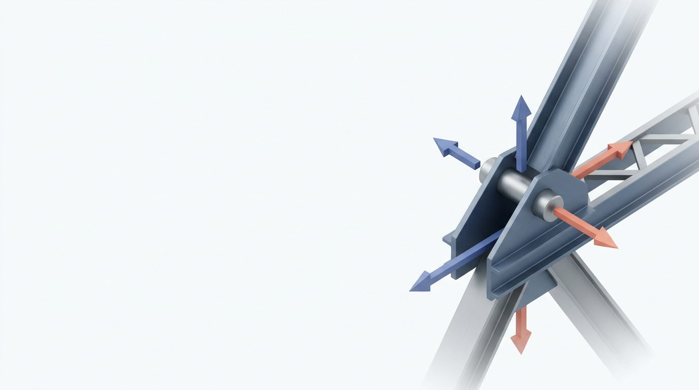
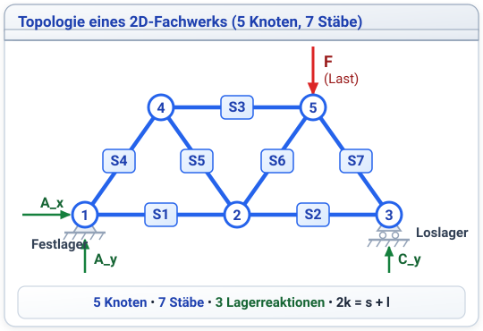
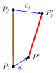

<!-- _paginate: false -->
<!-- _header: "" -->
<!-- _footer: "" -->
<!-- _class: title -->


# Kapitel 7 (Anhang A): Historie, LGS-Löser & Koordinatentransformation

Vertiefende Grundlagen für das Selbststudium zur Statik und linearen Gleichungslösung:

- A.1: Historische Entwicklung der Fachwerktheorie
- A.2: Direkte und iterative LGS-Lösungsverfahren im Detail
- A.3: Elementsteifigkeitsmatrix via Koordinatentransformation

---



## A.1: Historische Entwicklung der Fachwerktheorie

Dieser Abschnitt umfasst die folgenden Inhalte:

- Von antiken Holztragwerken zu Eisenbahnbrücken des 19. Jahrhunderts
- Pioniere der analytischen und grafischen Statik

---

### Historische Entwicklung der Fachwerkstatik

<div class="columns">
<div class="three">

- **Antike:** Römer nutzen erste Dreiecksverbände für Brücken und Lehrgerüste.
- **Mittelalter & Renaissance:** Empirische Dachstühle in Kirchen und Kathedralen.
- **18. Jahrhundert:** Leonhard Euler begründet die Balken- und Knicktheorie (*Euler-Knicklast*).
- **19. Jahrhundert:** Das Eisenbahnzeitalter erzwingt leichte, weitgespannte Brücken und eine exakte mathematische Theorie für Stabkräfte unter Last $F$ und Lagerreaktionen ($A_x, A_y, C_y$).

</div>
<div class="two">



</div>
</div>

---

### Pioniere der Fachwerktheorie

<div class="columns top">
<div class="one">

**Squire Whipple (1847)**
- *A Work on Bridge Building*
- Erste korrekte analytische Methode zur Berechnung von Stabkräften (Knotenpunkt- und Ritter'sches Schnittverfahren).

</div>
<div class="one">

**Karl Culmann & Luigi Cremona (ca. 1860)**
- Begründer der **grafischen Statik**.
- Der **Cremonaplan** erlaubt die zeichnerische Bestimmung aller Stabkräfte ohne Rechenmaschine.

</div>
<div class="one">

**James Clerk Maxwell (1864)**
- Führt reziproke Kräftepläne ein und legt den Grundstein für Energieprinzipien der Elastostatik.

</div>
</div>

---


## A.2: Direkte und iterative LGS-Lösungsverfahren

Dieser Abschnitt umfasst die folgenden Inhalte:

- Gauß-Elimination (Vorwärtselimination & Rückwärtseinsetzen)
- Lower-Upper-Zerlegung (LU) für wiederholte Lastfälle
- Iterative Löser am Beispiel des Jacobi-Verfahrens

---

### Direkter Löser: Gauß-Elimination

Die Gauß-Elimination formt ein allgemeines lineares Gleichungssystem $\mathbf{A}\mathbf{x} = \mathbf{b}$ in eine obere Dreiecksform um:

1. **Vorwärtselimination:** Erzeuge Nullen unterhalb der Hauptdiagonalen ($\mathbf{A} \to \mathbf{U}$, $\mathbf{b} \to \mathbf{c}$):
   - Für jede Pivot-Spalte $j = 1, \dots, n-1$ werden Vielfache der $j$-ten Zeile von allen Zeilen $i > j$ subtrahiert.
   - Aufwand für $n$ Unbekannte: $\mathcal{O}(\frac{2}{3}n^3)$ Gleitkommaoperationen.
2. **Rückwärtseinsetzen:** Löse $\mathbf{U}\mathbf{x} = \mathbf{c}$ zeilenweise von unten ($i = n$) nach oben ($i = 1$):
   $$x_i = \frac{1}{U_{ii}} \left( c_i - \sum_{j=i+1}^n U_{ij}\,x_j \right)$$

---

### Direkter Löser: LU-Zerlegung

<div class="columns">
<div class="two">

Die **LU-Zerlegung** (Lower-Upper) faktorisiert $\mathbf{A} = \mathbf{L}\mathbf{U}$ in eine untere ($\mathbf{L}$) und eine obere ($\mathbf{U}$) Dreiecksmatrix:

1. **Einmalige Zerlegung:** $\mathbf{A} = \mathbf{L}\mathbf{U}$ mit $\mathcal{O}(\frac{2}{3}n^3)$.
2. **Vorwärtseinsetzen:** Löse $\mathbf{L}\mathbf{y} = \mathbf{b}$ in $\mathcal{O}(n^2)$.
3. **Rückwärtseinsetzen:** Löse $\mathbf{U}\mathbf{x} = \mathbf{y}$ in $\mathcal{O}(n^2)$.

</div>
<div class="two">

```csharp
// Math.NET: LU-Zerlegung einmalig berechnen
var lu = A.LU();

// Mehrere Lastfälle b1, b2 in O(n^2) lösen
var x1 = lu.Solve(b1);
var x2 = lu.Solve(b2);
```

- **Vorteil:** Bei veränderlichen Lasten (z. B. `b1`, `b2` einer Wanderlast) bleibt $\mathbf{A}$ konstant – die Lösungen `x1` und `x2` folgen in $\mathcal{O}(n^2)$.

</div>
</div>

---

### Iterative Löser: Das Jacobi-Verfahren

Für sehr große, dünn besetzte Systeme ($n > 10^5$) sind direkte Zerlegungen speicherintensiv. Iterative Verfahren nähern $\mathbf{x}$ schrittweise an:

1. **Additive Aufspaltung:** Zerlege $\mathbf{A} = \mathbf{D} + \mathbf{R}$ in Diagonalmatrix $\mathbf{D}$ und Restmatrix $\mathbf{R}$.
2. **Fixpunkt-Iteration:** Starte mit Schätzwert $\mathbf{x}^{(0)}$ (z. B. $\mathbf{0}$) und iteriere:
   $$\mathbf{x}^{(k+1)} = \mathbf{D}^{-1}\left(\mathbf{b} - \mathbf{R}\mathbf{x}^{(k)}\right)$$
3. **Abbruchkriterium:** Stoppe, sobald das Residuum $\|\mathbf{b} - \mathbf{A}\mathbf{x}^{(k)}\| < \varepsilon$ unterschritten ist.

---


## A.3: Koordinatentransformation in der FEM

Dieser Abschnitt umfasst die folgenden Inhalte:

- Lokale 1D-Stabsteifigkeit vs. globales 2D-Koordinatensystem
- Herleitung von $\mathbf{K}_e = \mathbf{T}^\top \mathbf{k}_e^{\text{loc}} \mathbf{T}$

---

### Alternative FEM-Sicht: Koordinatentransformation

<div class="columns">
<div class="three">

In der allgemeinen Finite-Elemente-Methode (FEM) wird $\mathbf{K}_e$ über eine **Transformationsmatrix $\mathbf{T}$** aus dem lokalen 1D-Stab abgeleitet:

1. **Lokales 1D-System ($\xi$-Achse) mit Dehnsteifigkeit (EA):**
   $$\mathbf{f}^{\text{loc}} = \mathbf{k}_e^{\text{loc}} \mathbf{u}^{\text{loc}}, \quad \mathbf{k}_e^{\text{loc}} = \frac{EA}{L} \begin{pmatrix} 1 & -1 \\ -1 & 1 \end{pmatrix}$$
2. **Kinematische Projektion:** $\mathbf{u}^{\text{loc}} = \mathbf{T}\mathbf{u}_e$ mit $\mathbf{T} = \begin{pmatrix} n_x & n_y & 0 & 0 \\ 0 & 0 & n_x & n_y \end{pmatrix}$.
3. **Kontragredienz ($\mathbf{f}_e = \mathbf{T}^\top \mathbf{f}^{\text{loc}}$):**
   $$\mathbf{K}_e = \mathbf{T}^\top \mathbf{k}_e^{\text{loc}} \mathbf{T} = \frac{EA}{L} \begin{pmatrix} \vec{n}\vec{n}^\top & -\vec{n}\vec{n}^\top \\ -\vec{n}\vec{n}^\top & \vec{n}\vec{n}^\top \end{pmatrix}$$

</div>
<div class="two">



</div>
</div>
