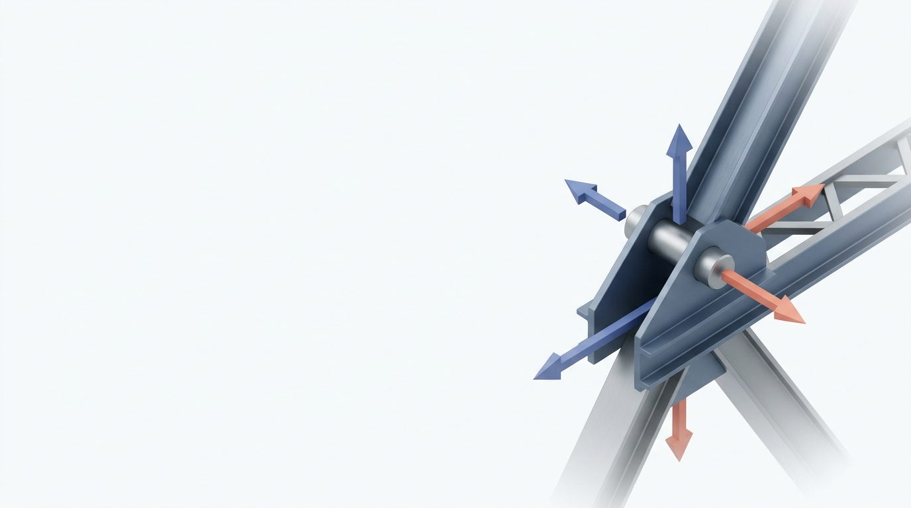
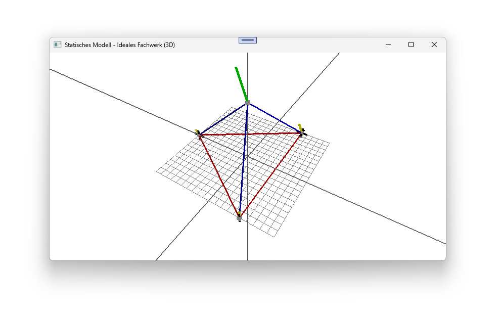
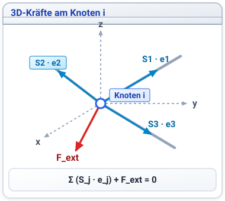
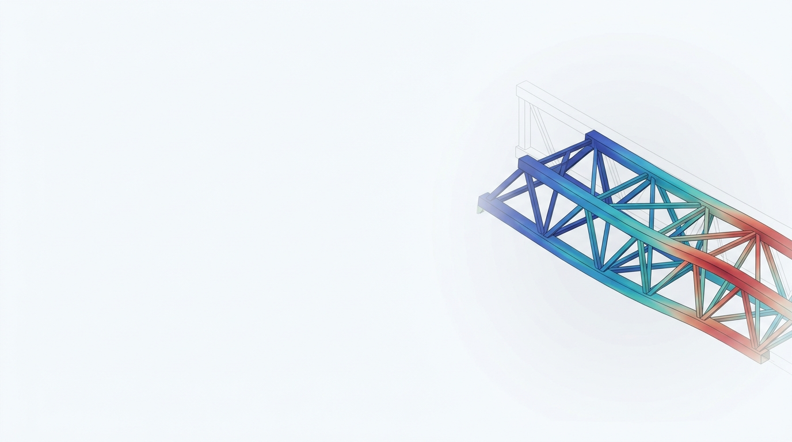
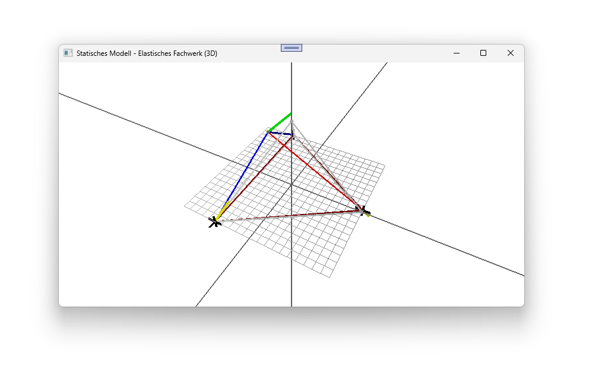

<!-- _paginate: false -->
<!-- _header: "" -->
<!-- _footer: "" -->
<!-- _class: title -->

# Kapitel 7 (Anhang B): Erweiterung auf 3D-Fachwerke

Optionale Vertiefung für das Selbststudium – Übertragung der 2D-Statik auf räumliche Tragwerke:

- B.1: Vom 2D- zum 3D-Fachwerk (Freiheitsgrade & Gleichgewicht)
- B.2: Elastische 3D-FEM-Steifigkeitsmatrix ($6 \times 6$)

---

## B.1: Vom 2D- zum 3D-Fachwerk

Dieser Abschnitt umfasst die folgenden Inhalte:

- Erweiterung von 2 auf 3 Freiheitsgrade pro Knoten
- Räumliches Kräftegleichgewicht am 3D-Knoten

---

### Vom 2D- zum 3D-Fachwerk

Die physikalischen Prinzipien (Kräftegleichgewicht, Hooke'sches Gesetz) bleiben identisch; die Vektoren erhalten lediglich eine $z$-Komponente:

**2D-Fachwerk**
- **2 Freiheitsgrade (DOF)** pro Knoten: $u_x, u_y$.
- **2 Gleichgewichtsbedingungen:** $\sum F_x = 0$, $\sum F_y = 0$.
- Statische Bestimmtheit (mit $k$ Knoten, $s$ Stäben, $l$ Lagern): $2k = s + l$.

**3D-Fachwerk**
- **3 Freiheitsgrade (DOF)** pro Knoten: $u_x, u_y, u_z$.
- **3 Gleichgewichtsbedingungen:** $\sum F_x = 0$, $\sum F_y = 0$, $\sum F_z = 0$.
- Statische Bestimmtheit: $3k = s + l$.

---

### Ideales Fachwerk in 3D

- **Knotenpunktverfahren in $\mathbb{R}^3$:** Für jeden der $k$ Knoten entstehen drei Gleichgewichts-Gleichungen.
- **Globales LGS:** $\mathbf{A}\mathbf{s} = \mathbf{b}$ besitzt $3k$ Zeilen und enthält in $\mathbf{A}$ die 3D-Richtungskosinusse $\vec{n}_j = (n_{j,x}, n_{j,y}, n_{j,z})^\top$ der Stäbe.
- **Visualisierung:** Übertragung in das 3D-OpenGL-Frontend aus Termin 05 (`SharpGL`).

---

### Kräftegleichgewicht am 3D-Knoten

Für einen Knoten $i$, an dem drei Stäbe mit Stabkräften $S_j$ ($S_1, S_2, S_3$) und Einheitsvektoren $\vec{e}_j$ ($\vec{e}_1, \vec{e}_2, \vec{e}_3$) angreifen, gilt $\sum S_j \vec{e}_j + \vec{F}_{\text{ext}} = \vec{0}$:

$$
\begin{pmatrix}
e_{1,x} & e_{2,x} & e_{3,x} \\
e_{1,y} & e_{2,y} & e_{3,y} \\
e_{1,z} & e_{2,z} & e_{3,z}
\end{pmatrix}
\begin{pmatrix} S_1 \\ S_2 \\ S_3 \end{pmatrix}
=
-\begin{pmatrix} F_{\text{ext},x} \\ F_{\text{ext},y} \\ F_{\text{ext},z} \end{pmatrix}
$$

---

## B.2: Elastisches 3D-Fachwerk (6x6-Matrix)

Dieser Abschnitt umfasst die folgenden Inhalte:

- Dimensionsunabhängige Längenänderung in $\mathbb{R}^3$
- Aufbau der $6 \times 6$-Elementsteifigkeitsmatrix $\mathbf{K}_e$

---

### Elastisches Fachwerk in 3D

- **Dimensionsunabhängige Linearisierung:** Die Näherung $\Delta L \approx \vec{n} \cdot (\vec{u}_j - \vec{u}_i)$ gilt in $\mathbb{R}^3$ ohne Änderung.
- **Knotenverschiebungsvektor:** $\mathbf{u}_e = (u_{ix}, u_{iy}, u_{iz}, u_{jx}, u_{jy}, u_{jz})^\top \in \mathbb{R}^6$.
- **Globale Systemgröße:** Für $k$ Knoten besitzt die Steifigkeitsmatrix $\mathbf{K}$ die Dimension $3k \times 3k$.

---

### Die 6x6-Elementsteifigkeitsmatrix in 3D

Durch das äußere Produkt $\vec{n}\vec{n}^\top \in \mathbb{R}^{3\times 3}$ mit $\vec{n} = (n_x, n_y, n_z)^\top$ und der Dehnsteifigkeit (EA) entsteht direkt die $6\times 6$-Matrix $\mathbf{K}_e$:

$$
\mathbf{K}_e = \frac{EA}{L}
\begin{pmatrix}
\vec{n}\vec{n}^\top & -\vec{n}\vec{n}^\top \\
-\vec{n}\vec{n}^\top & \vec{n}\vec{n}^\top
\end{pmatrix}
= \frac{EA}{L}
\begin{pmatrix}
 n_x^2 & n_x n_y & n_x n_z & -n_x^2 & -n_x n_y & -n_x n_z \\
 n_y n_x & n_y^2 & n_y n_z & -n_y n_x & -n_y^2 & -n_y n_z \\
 n_z n_x & n_z n_y & n_z^2 & -n_z n_x & -n_z n_y & -n_z^2 \\
-n_x^2 & -n_x n_y & -n_x n_z & n_x^2 & n_x n_y & n_x n_z \\
-n_y n_x & -n_y^2 & -n_y n_z & n_y n_x & n_y^2 & n_y n_z \\
-n_z n_x & -n_z n_y & -n_z^2 & n_z n_x & n_z n_y & n_z^2
\end{pmatrix}
$$

- Assemblierung, Blockpartitionierung ($\mathbf{K}_{ff}\mathbf{u}_f = \mathbf{f}_f$) und Cholesky-Zerlegung bleiben **exakt identisch zum 2D-Fall**.
