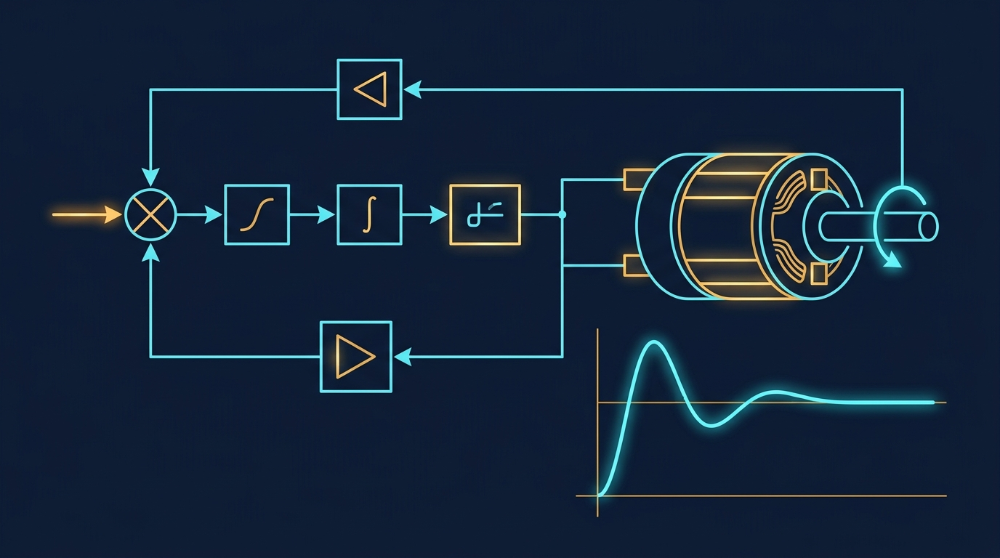

### Termin 08: Kontinuierliche Dynamik, S-Functions & RK4
*(Vorlesungskapitel: 08 Dynamische Modelle Kontinuierlich)*

Wir betrachten die kontinuierliche Dynamik im Zeitbereich. Wir adaptieren das industrielle MATLAB Simulink S-Function-Paradigma in C# (saubere Entkopplung von Ableitungsberechnung ComputeDerivatives und Ausgabe ComputeOutputs) und implementieren den 4-stufigen Runge-Kutta-Integrator (RK4). Am elektromechanischen Ersatzschaltbild eines DC-Servomotors koppeln wir Differentialgleichungen für Ankerstrom und Drehbewegung und rüsten den PID-Lageregler mit einem Anti-Windup Clamping gegen Aktorsättigung aus.

**Ablauf & Übungsaufgaben:**
* 🎤 **Showcase T07:** Zwei ausgewählte Teams präsentieren ihre FEM-Fachwerklöser und Cholesky-Berechnungen am Beamer.
* 📝 **Moodle-Quiz 3 (15 min):** Drittes summatives Quiz zu 3D-Computergrafik und Szenengraphen, Multithreading mit TPL/Amdahl sowie statischen FEM-Fachwerken und Cholesky-Zerlegung (Kapitel 05 bis 07).
* **Stufe 1 (Basisaufgabe):** Aufbau des S-Function-Kerns mit RK4-Solver und Nachweis der Energieerhaltung am ungedämpften Federpendel.
* 🏭 **Stufe 2 – Track A (Industrie):** *DC-Servomotor-Regelung* – Störlastsprung, Aktorsättigung und Nachweis der Überschwingungsreduktion durch Anti-Windup Clamping.
* 🎮 **Stufe 2 – Track B (Game):** *„SpaceX Falcon Hop / Booster Landing“* – Raketen-Vertikallandung mit Schubvektorregelung, variabler Treibstoffmasse und RK4.
