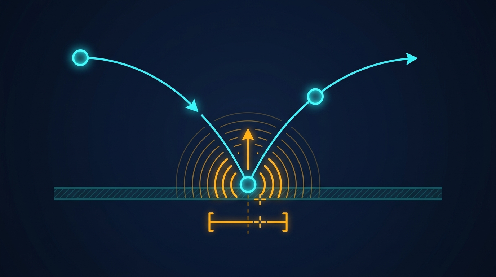

### Termin 10: Hybride Dynamik, Zero-Crossing & Finale Hausübung
*(Vorlesungskapitel: 10 Dynamische Modelle Hybrid)*

In unserer zehnten Einheit verschmelzen kontinuierliche Dynamik und diskrete Ereignisse zu hybriden Systemen! Wir implementieren eine präzise Zero-Crossing-Detektion mit Bisektions-Einkreisung auf Mikrometer-Genauigkeit, um unelastische Stöße ohne Geisterdurchdringung („Tunneling“) zu berechnen. Mittels Sticking-Threshold beherrschen wir den Zeno-Kollaps und koppeln kontinuierliche Physik sauber mit diskreten Schaltzuständen für die Virtuelle Inbetriebnahme.

**Ablauf & Aufgaben:**
* 🎤 **Showcase T09:** Zwei ausgewählte Teams präsentieren ihre diskreten Ereignissimulationen und Warteschlangensysteme am Beamer.
* 📝 **Moodle-Quiz 4 (15 min):** Viertes summatives Quiz zu kontinuierlicher Dynamik, S-Functions, RK4 und Anti-Windup sowie Diskreter Ereignissimulation, Inversionsmethode und Littles Gesetz (Kapitel 08 und 09).
* **Stufe 1 (Basisaufgabe):** Bisektions-Nullstellensuche für Kontaktstöße mit Heun-Substepping.
* 🏭 **Stufe 2 – Track A (Industrie):** *Virtuelle Inbetriebnahme (VIBN)* – Pneumatikzylinder mit digitalen Endschaltern, SPS-Kopplung und Taktzeitmessung.
* 🎮 **Stufe 2 – Track B (Game):** *„Arcade Pinball Wizard“* – Flipperautomat mit Bumper-Bisektion, Schwerkraft-Ruhelage und Punktezähler.
* 📦 **Abgabe der 10. und finalen Hausübung:** Die Abgabe der Hausübung zu Termin 10 erfolgt eine Woche nach dem letzten Präsenztermin über Ihr Team-Git-Repository und schließt die 10 wöchentlichen Hausübungen ab. Herzlichen Glückwunsch zum erfolgreichen Semesterabschluss!
