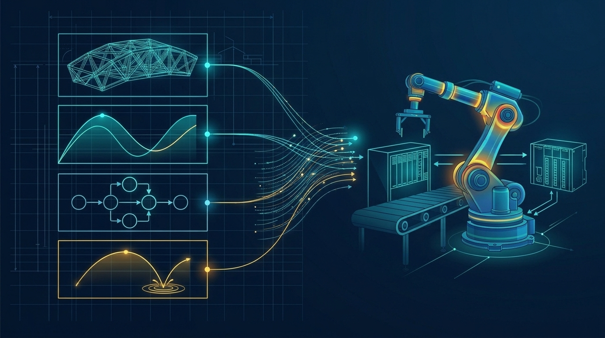

### Semesterabschluss & Ausblick (Epilog: Modell-Synthese, FMI/FMU & Virtuelle Inbetriebnahme)
*(Vorlesungskapitel: 11 Epilog)*

Zum Abschluss der Lehrveranstaltung führen wir alle vier Modellierungsparadigmen des Semesters – statische Tragwerke, kontinuierliche Differentialgleichungen, ereignisdiskrete Prozesse und hybride Automaten – mit den vier Echtzeit-Visualisierungsverfahren zu einem ganzheitlichen Architektur-Baukasten zusammen. Darüber hinaus blicken wir auf industrielle Kopplungsstandards wie das Functional Mock-up Interface (FMI / FMU) für domänenübergreifende Co-Simulationen sowie die Virtuelle Inbetriebnahme (Software-in-the-Loop und Hardware-in-the-Loop) realer SPS-Steuerungen am Digitalen Zwilling.

**Schwerpunkte & Semesterabschluss:**
* 🧭 **Modell- und Visualisierungstaxonomie:** Leitfaden zur treffsicheren Methoden- und Solver-Auswahl in realen Industrie- und Forschungsprojekten.
* 🔗 **Co-Simulation & Industriestandards:** Zusammenspiel spezialisierter Teilmodelle über FMI/FMU (Model Exchange und Co-Simulation) sowie Echtzeit-Anlagenkopplung über OPC UA.
* 📦 **Abschluss des Code-Portfolios:** Mit der Abgabe der 10. Hausübung (eine Woche nach Termin 10) ist Ihr semesterbegleitendes Übungsportfolio vollständig abgeschlossen – es findet keine zusätzliche Endklausur statt.
* 💬 **Lehrveranstaltungsevaluierung & Ausblick:** Vielen Dank für Ihr aktives Mitwirken, Ihre kreativen Track-A- und Track-B-Lösungen im Live-Showcase und Ihr konstruktives Feedback! Bei Interesse an Bachelorarbeiten rund um Simulation, Digitale Zwillinge und Industriesysteme am Campus Wels sprechen Sie mich jederzeit gerne an.
