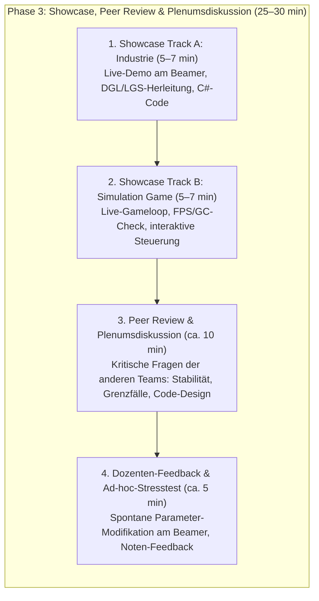
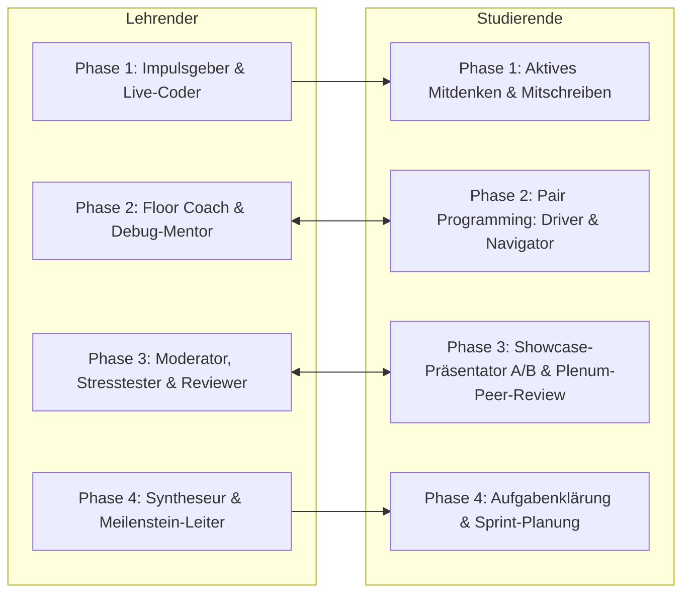
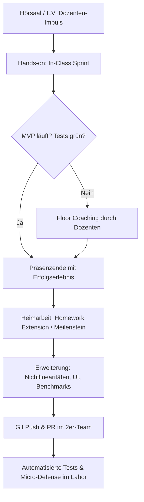
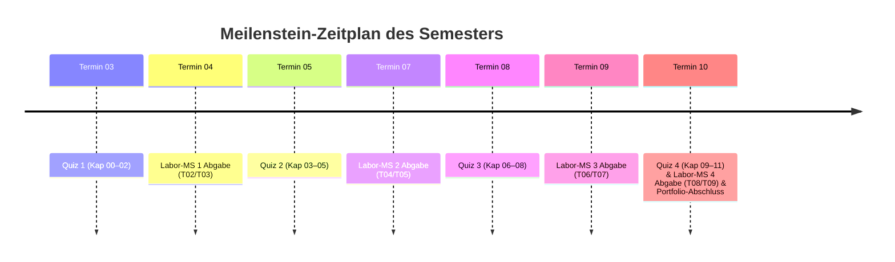

# Didaktisches Gesamtkonzept & Semester-Syllabus
## Lehrveranstaltung: Systemsimulation / Digitaler Zwilling

**Dokument-ID:** `Konzept/01_Lehrveranstaltungsstruktur_und_Syllabus.md`  
**Studiengang:** Bachelor Automatisierungstechnik (5. / 6. Fachsemester)  
**Institution:** Fachhochschule Oberösterreich, Campus Wels  
**Verantwortlicher:** Dr. Georg Hackenberg, Professor für Informatik und Industriesysteme  
**Lehrveranstaltungstyp:** Integrierte Lehrveranstaltung (ILV)  
**Umfang:** 2 SWS / 3 ECTS (Workload: 75 Stunden, davon 25 h Präsenz und 50 h Selbststudium / Heimarbeit)  
**Struktur:** 10 Präsenztermine à 150 Minuten (2,5 Zeitstunden)  
**Materialbasis:** 12 Vorlesungskapitel des Repositories (`Folien/00_Prolog` bis `Folien/11_Epilog`)  
**Status:** Freigegebenes Referenzkonzept für die Lehre (Harmonisiert mit Aufgabenkatalog und 2-Säulen-Assessment)  

---

## Inhaltsverzeichnis

1. [Ausgangslage, Zielgruppe & Rahmenbedingungen](#1-ausgangslage-zielgruppe--rahmenbedingungen)
   - 1.1 Institutioneller Kontext & Zielgruppenprofil (Campus Wels)
   - 1.2 Charakteristik des Formats ILV (Integrierte Lehrveranstaltung)
   - 1.3 Workload-Kalkulation nach ECTS-Richtlinien
2. [Didaktische Leitphilosophie & Methoden](#2-didaktische-leitphilosophie--methoden)
   - 2.1 Constructive Alignment nach Biggs
   - 2.2 Active Learning & Just-in-Time Teaching
   - 2.3 Scaffolding: Vom In-Class-Sprint zur autonomen Homework Extension
   - 2.4 Modernes Software-Engineering: Pair Programming & Vibe Coding mit KI-Unterstützung
   - 2.5 Gezielte Online-Recherche & Information Retrieval im Ingenieurstudium
   - 2.6 Themen-Duo & Wahlmodell: „Pick your Track – Industrie vs. Gaming“
   - 2.7 Das Prinzip der strikten chronologischen Kausalität
3. [Mapping der 12 Kapitel auf 10 Präsenztermine](#3-mapping-der-12-kapitel-auf-10-präsenztermine)
   - 3.1 Semester-Übersichtsmatrix (Kausalität, Werkzeuge, Wahlmodell & Assessments)
   - 3.2 Detaillierte Steckbriefe der Termine T01 bis T10
4. [Ablaufstruktur eines 150-Minuten-Präsenztermins](#4-ablaufstruktur-eines-150-minuten-präsenztermins)
   - 4.1 Die 4-Phasen-Taktung
   - 4.2 Phase 3 im Detail: Showcase, Peer Review & Plenumsdiskussion
   - 4.3 Rollenprofile von Lehrendem und Studierenden
   - 4.4 Umgang mit Heterogenität: Differenzierung & Fast-Track Challenges
5. [Didaktische Verzahnung von Präsenzzeit und Heimarbeit](#5-didaktische-verzahnung-von-präsenzzeit-und-heimarbeit)
   - 5.1 Nahtloser Übergang: In-Class Sprint ➔ Homework Extension
   - 5.2 Kollaborationsmodell: 2er-Teams, Pair Programming & Git-Workflow
   - 5.3 Leitfaden für "Vibe Coding" & KI-Engineering (Copilots als Junior-Entwickler)
6. [Meilenstein-Plan & 2-Säulen-Assessment-Architektur (Variante 1)](#6-meilenstein-plan--2-säulen-assessment-architektur-variante-1)
   - 6.1 Das 10-teilige C#-Simulations-Portfolio als Leistungsnachweis
   - 6.2 Die 2-Säulen-Assessment-Architektur (40 % Theorie / 60 % Praxis & Diskurs)
   - 6.3 Notenschlüssel & Mindestanforderungen nach FH OÖ Standard
7. [Checkliste für Dozierende zur Semestervorbereitung](#7-checkliste-für-dozierende-zur-semestervorbereitung)

---

## 1. Ausgangslage, Zielgruppe & Rahmenbedingungen

### 1.1 Institutioneller Kontext & Zielgruppenprofil (Campus Wels)

Der Bachelorstudiengang **Automatisierungstechnik** an der FH Oberösterreich (Campus Wels) bildet Ingenieurinnen und Ingenieure an der Schnittstelle von Maschinenbau, Elektrotechnik, Regelungstechnik und angewandter Informatik aus. Die Studierenden belegen die Lehrveranstaltung *Systemsimulation / Digitaler Zwilling* typischerweise im **5. Fachsemester**.

#### Vorwissen der Studierenden:
- **Mathematisch-Naturwissenschaftlich (Fundiert):** Höhere Mathematik (Analysis, Lineare Algebra, Differentialgleichungen) sowie Technische Mechanik (Statik, Elastostatik, Kinetik, Dynamik).
- **Automatisierungs- & Regelungstechnik (Sehr gut):** Zustandsraumdarstellung, Übertragungsfunktionen, PID-Regler, Frequenzgangverfahren (Bode, Nyquist), SPS-Programmierung nach IEC 61131-3 (ST, KOP, FUP).
- **Informatik & Programmierung (Solide Grundlagen, heterogene Praxis):** Beherrschung von Grundlagen in C/C++ oder C# (Klassen, Kontrollstrukturen, elementare Algorithmen). Typischerweise bestehen jedoch Lücken in hardwarenaher Speicherverwaltung (`unsafe`, Zeigerarithmetik, Speicherausrichtung), modernen UI-Architekturen (WPF, MVVM, Grafik-Pipelines), fortgeschrittener Nebenläufigkeit (Task Parallel Library, Thread-Synchronisation) und 3D-Computergrafik.

#### Berufsfeldbezug:
Angehende Automatisierer nutzen Simulationen nicht als theoretischen Selbstzweck, sondern als operatives Werkzeug für:
- die **Virtuelle Inbetriebnahme (VIBN)** von Maschinen und Sondierungsanlagen vor dem physischen Aufbau,
- den Entwurf und die parametergenaue Vorinbetriebnahme von **Regelkreisen (Closed-Loop)** unter Berücksichtigung von Nichtlinearitäten und Aktor-Sättigungen,
- das modellbasierte **Condition Monitoring** und Predictive Maintenance im laufenden Leitstand.

### 1.2 Charakteristik des Formats ILV (Integrierte Lehrveranstaltung)

Das an österreichischen Fachhochschulen etablierte Format der **Integrierten Lehrveranstaltung (ILV)** hebt die klassische Trennung zwischen Vorlesung (Frontaltheorie) und Übung (Labor am Nachmittag) auf.
- **Einheitlicher Raum:** Der Unterricht findet in multimedial ausgestatteten Seminarräumen oder PC-Pools statt; die Studierenden arbeiten auf eigenen Entwicklungs-Laptops (Bring Your Own Device) oder Pool-PCs.
- **Fließende Übergänge:** Theorie-Impulse, strukturierte Code-Walkthroughs und betreute hands-on Programmierphasen wechseln dynamisch innerhalb desselben Blocks ab.
- **Prüfungsimmanenter Charakter:** Es gibt keine isolierte Abschluss-Schriftklausur; die Gesamtnote speist sich aus kontinuierlichen Teilleistungen (4 Moodle-MCQ-Tests, 10-teiliges C#-Simulations-Portfolio, Showcase-Präsentationen und qualifiziertes Peer-Review im Plenum).

### 1.3 Workload-Kalkulation nach ECTS-Richtlinien

Die Lehrveranstaltung ist mit **3 ECTS-Punkten** (entsprechend einem Gesamt-Workload von **75 Arbeitsstunden** à 60 Minuten) dotiert:

| Kategorie | Aktivität | Zeitaufwand (h) | Anteil (%) |
| :--- | :--- | :---: | :---: |
| **Präsenzlehre (ILV)** | 10 Termine à 150 Minuten (Theorie, In-Class Sprint, Showcase, Peer Review & Laborbetreuung) | **25,0 h** | 33,3 % |
| **Vor- & Nachbereitung** | Vorbereitung der Termine, Studium von Skriptum, Notizen & Online-Dokus | **10,0 h** | 13,3 % |
| **Wöchentliche Übungen & C#-Code-Portfolio** | 10 Aufgabenblätter (Stufe B Homework Extensions im gewählten Track A oder B) | **32,0 h** | 42,7 % |
| **Moodle-Assessments** | 4 summative Moodle-Tests (Vorbereitung & Durchführung) | **8,0 h** | 10,7 % |
| **Gesamtsumme** | **1 ECTS = 25 Echtstunden** | **75,0 h** | **100,0 %** |

> [!IMPORTANT]
> **Verbindliche Verankerung von Showcase & Plenumsdiskussion im Workload:**  
> Sowohl das **Präsentieren der eigenen Lösung auf der Beamer-Bühne (Showcase im Rotationsprinzip)** als auch das **qualifizierte, fundierte Fragenstellen im Peer Review während der Plenumsdiskussion** sind verbindliche, prüfungsrelevante Bestandteile der Lehrveranstaltung. Sie sind direkt im Notenschema (Säule 2) verankert; eine rein passive Hörsaal-Anwesenheit genügt den Leistungsanforderungen nicht.

---

## 2. Didaktische Leitphilosophie & Methoden

### 2.1 Constructive Alignment nach Biggs

Das Curriculum folgt dem Prinzip des **Constructive Alignment** (John Biggs):
1. **Intended Learning Outcomes (ILOs):** Die Studierenden können physikalisch-technische Systeme als mathematische Modelle formulieren, numerische Algorithmen (LGS, ODE, DES, Hybride Solver) in modernem C# (.NET 8) ohne vorgefertigte Blackbox-Simulatoren implementieren, echtzeitfähige 2D/3D-Dashboards realisieren und Simulationslösungen im Fachdiskurs kritisch analysieren und verteidigen.
2. **Teaching/Learning Activities (TLAs):** Interaktiver Theorieimpuls ➔ Strukturierte Code- und Architektur-Analyse ➔ In-Class Hands-on Entwicklung im 2er-Team (Sprint) ➔ **Showcase, Peer Review & Plenumsdiskussion (Track A vs. Track B)** ➔ Micro-Defense & Homework Extension.
3. **Assessment Tasks (ATs):** Moodle-MCQ-Tests prüfen das theoretische und numerische Fundament; Labor-Meilensteine inklusive **Showcase-Präsentation und qualifiziertem Peer-Review-Fragenstellen** fordern und bewerten sauberen Code sowie Diskursfähigkeit; das 10-teilige C#-Simulations-Portfolio verlangt die ganzheitliche Synthese, Code-Qualität und automatisierte Validierung.

### 2.2 Active Learning & Just-in-Time Teaching

Frontalunterricht über 150 Minuten führt bei technisch komplexen Themen nachweislich zu Ermüdung und kognitiver Überlastung. Deshalb setzt der Kurs auf **Active Learning**:
- Maximale Länge eines theoretischen Inputs: **45 Minuten**.
- Kein theoretischer Block ohne anschließenden **Code-Walkthrough**, bei dem typische Fallstricke (Compilerfehler, Zeigerarithmetik, numerische Instabilitäten, Race Conditions) anhand prägnanter Code-Beispiele auf den Folien im Detail analysiert werden.
- Unmittelbarer Übergang in die **Laborphase** ("Learn by Doing"), solange das Konzept im Kurzzeitgedächtnis präsent ist.

### 2.3 Scaffolding: Vom In-Class-Sprint zur autonomen Homework Extension

Studierende beginnen eine Programmieraufgabe niemals auf einem "leeren weißen Blatt":
- **In-Class Sprint (Präsenz, 60 min):** Die Teams erhalten eine strukturierte C#-Vorlage (z. B. leeres Konsolenprojekt mit definierten Methodensignaturen oder WPF-Fenster mit NuGet-Bindegliedern). Innerhalb von 60 Minuten führen sie die Kernlogik zu einem lauffähigen **Minimal Viable Product (MVP)**.
- **Homework Extension (Heimarbeit):** Aufbauend auf dem im Hörsaal verifizierten MVP erweitern die Studierenden zu Hause das Modell (z. B. Hinzufügen von Nichtlinearitäten, Reibung, Performance-Tuning oder erweiterte Visualisierung).

### 2.4 Modernes Software-Engineering: Pair Programming & Vibe Coding mit KI-Unterstützung

Im modernen industriellen Alltag programmieren Entwickler nicht isoliert und nutzen zunehmend KI-Assistenten (GitHub Copilot, Cursor, LLMs). Der Kurs integriert diese Praxis explizit:
- **Pair Programming im 2er-Team:** Rollenaufteilung in *Driver* (tippt Code, bedient die IDE) und *Navigator* (überwacht Architektur, prüft Randbedingungen, liest Formeln nach). Rollentausch alle 30 Minuten.
- **Kritisches "Vibe Coding" mit KI:** Der Einsatz von KI-Tools ist ausdrücklich gestattet und wird gefördert – jedoch unter der **strengen Ingenieurs-Doktrin**: *Verstehe und verifiziere jede Zeile Code*. KI-generierter Code muss durch automatisierte MSTest-Unit-Tests und physikalische Plausibilitätsprüfungen abgesichert werden. Wer Code abgibt, haftet in der mündlichen Verteidigung ("Micro-Defense") dafür!

### 2.5 Gezielte Online-Recherche & Information Retrieval im Ingenieurstudium

Das selbstständige Lösen mechatronischer Programmieraufgaben erfordert professionelle Recherchekompetenz. Studierende müssen lernen, nicht beliebig Forenbeiträge zu kopieren, sondern belastbare Primärquellen zu konsultieren:

1. **Nutzung offizieller Dokumentationen & API-Referenzen:**
   - **Microsoft Learn (.NET / C# / WPF):** Für hardwarenahe Speicherverwaltung (`fixed`, `unsafe`, `Span<T>`), WPF-Rendering-Architektur (`DrawingVisual`, `WriteableBitmap`) und Nebenläufigkeit (`Parallel.For`, `CancellationTokenSource`).
   - **ScottPlot 5 Dokumentation & Cookbook (`scottplot.net/cookbook/5.0`):** Gezielte Suche nach Streaming-Mustern (`SignalSource`, `CircularBuffer`). *Achtung vor veralteten v4-Syntaxbeispielen im Web!*
   - **SharpGL & Khronos OpenGL 3.3 Reference:** Schnelles Nachschlagen von OpenGL-State-Befehlen (`glMatrixMode`, `glEnable(GL_DEPTH_TEST)`).
   - **Math.NET Numerics Documentation (`numerics.mathdotnet.com`):** API für Cholesky-Zerlegung (`Cholesky()`), Matrix-Assemblierung und Konditionszahlen.

2. **Gezielte Keyword-Strategie & Boolesche Suche:**
   - Professionelle Suchanfragen nutzen englische Fachbegriffe: Statt *"wie rechne ich runge kutta in c#"* sucht der Ingenieur gezielt nach:
     `"Runge-Kutta 4 C# implementation ODE"`, `"Von Neumann stability diffusion 2D C#"`, `"bisection zero crossing root finding simulation"`, `"Welford one-pass variance streaming algorithm"`.
   - Ausschluss von irrelevantem Ballast durch Boolesche Operatoren: z. B. `"ScottPlot 5" "WpfPlot" -winforms -v4`.

3. **GitHub Code Search & Repository-Exploration:**
   - Auffinden erprobter Implementierungsmuster via GitHub Search mit Syntax-Filtern:
     `path:*.cs "WriteableBitmap" "BackBuffer" language:C#` oder `repo:ScottPlot/ScottPlot "Signal"`
   - Open-Source-Referenzen studieren, um Garbage-Collection-Vermeidung und performantes Caching zu verstehen.

4. **Kritische Plausibilisierung gefundener Snippets („Don't Paste Without Proof“):**
   - **GC-Prüfung:** Werden in Simulationsschleifen heimlich `new`-Allokationen versteckt?
   - **Thread-Sicherheit:** Wird unerlaubt aus Worker-Threads auf UI-Elemente zugegriffen?
   - **Einheiten-Konsistenz:** Rechnet der gefundene Code in Radiant oder Grad, in SI-Einheiten oder empirischen US-Units?

### 2.6 Themen-Duo & Wahlmodell: „Pick your Track – Industrie vs. Gaming“

Ein wesentliches didaktisches Prinzip dieser Lehrveranstaltung ist das **duale Aufgaben- und Motivationskonzept**:
- **Track A: Ernsthafter Industriealltag (Ingenieurtechnische Säule):** Simulation realer industrieller Anlagen (Halbleiter-Kühlkörper, Hallenkräne, DC-Antriebsprüfstände, Taktstraßen-Logistik, Virtuelle Inbetriebnahme). Sie vermittelt Normgerechtheit, SI-Einheiten, Fertigungstoleranzen und industrielle Relevanz für angehende Automatisierungsingenieure.
- **Track B: Simulationsspiele & Arcade-Physik (Spielerische Säule):** Gameloops, Arcade-Physik, Partikelsysteme und interaktive Spielmechaniken (Artillery-Wurfspiele, Sand-/Lava-Pixelwelten, 2D-Brückenbau à la Poly Bridge, Raketen-Balancer, Flipper-Kollisionen). Sie bietet sofortiges visuelles Feedback, macht Spaß, belohnt spielerisches Experimentieren und fördert die Intuition für dynamische Zusammenhänge.

> [!IMPORTANT]
> **Das verbindliche Wahlmodell („Pick your Track: Industrie vs. Gaming“):**  
> Die Studierenden müssen **NICHT** beide Aufgaben bearbeiten!  
> - Jedes 2er-Team wählt pro Termin bzw. Meilenstein **GENAU EINE** der beiden Aufgaben: **Track A (Industrie)** ODER **Track B (Game)**.  
> - **Identischer Workload & identische Lernergebnisse:** Beide Tracks basieren auf exakt denselben mathematischen Grundlagen, numerischen Algorithmen und C#-Softwarearchitekturen (z. B. FDM-Diffusionsmatrix bei Kühlkörper vs. Lavafeld; Math.NET-Cholesky-LGS bei Portalkran vs. einstürzender Brücke; RK4 bei DC-Motor vs. Raketenlandung).  
> - Beide Tracks führen zu denselben Intended Learning Outcomes (ILOs) und werden nach exakt derselben Bewertungsrubrik beurteilt.  
> - Teams dürfen ihren Track je nach persönlicher Motivation pro Termin neu wählen oder das Semester über in einer Schiene bleiben.

#### Didaktischer Brückenschlag im Showcase:
Obwohl die Teams pro Termin nur einen der beiden Tracks aktiv implementieren, verhindert das Konzept eine fachliche Silobildung: In der **Showcase- und Diskussionsphase (Phase 3)** präsentiert an jedem Termin ein Team aus Track A und ein Team aus Track B seine Lösung live am Beamer. Dadurch profitiert das gesamte Plenum von beiden Perspektiven: Industrie-Teams erkennen, wie Gameloops und interaktive Physik dieselben Differentialgleichungen nutzen, während Gaming-Teams den industriellen Bezug (Toleranzen, Normen, Reglergrenzen) verinnerlichen.

### 2.7 Das Prinzip der strikten chronologischen Kausalität

Um Frustration und Wissenslücken zu verhindern, unterliegt das gesamte Curriculum einer **strengen chronologischen Kausalitätskette**:
- **Kein Vorgreifen:** Jede Vorlesungseinheit, jeder In-Class Sprint und jede Homework Extension darf **ausschließlich** jene Bibliotheken, Sprachkonstrukte und numerischen Verfahren voraussetzen, die bis zu diesem Zeitpunkt formal in den Vorlesungsfolien eingeführt wurden.
- **Konkrete Grenzziehungen:**
  - *Vor Termin 04:* **Kein ScottPlot!** Diagramme werden davor entweder auf der Konsole tabellarisch ausgegeben oder elementar in Canvas/Pixel gezeichnet.
  - *Vor Termin 05:* **Kein SharpGL / 3D!** Bis dahin bewegen wir uns ausschließlich im 2D-Raum.
  - *Vor Termin 06:* **Kein `Parallel.For` oder Multithreading!** Alle Berechnungen laufen bis dahin strikt deterministisch auf einem Thread.
  - *Vor Termin 07:* **Keine Steifigkeitsmatrizen, kein Math.NET Cholesky, KEINE FEM-Statik-Berechnung!**  
    In **Termin 03 (Kapitel 03)** ist die Modellierung **rein geometrisch und visuell** (WPF Canvas, affine Welt-zu-Screen-Transformation, Bounding Box, DIN-Bemaßung, Vektorpfeile für fest vorgegebene Kräfte, interaktives Dragging von Geometriepunkten per Maus). In Termin 03 wird **keine Fachwerk-Statik berechnet**, **kein Gleichungssystem gelöst** und **kein Cholesky verwendet** – alle Kraftwerte sind fest vorgegeben!  
    Erst in **Termin 07 (Kapitel 07)** wird die echte **FEM-Statik-Engine** (Math.NET Numerics, Steifigkeitsmatrix $\mathbf{K}$, Cholesky-Zerlegung) gebaut und erweckt das geometrische Modell aus Termin 03 zum Leben (Knotenverschiebung $\mathbf{u} = \mathbf{K}^{-1} \mathbf{f}$, elastische Stabverformung, Überlastungsanzeige und Stabbruch).
  - *Vor Termin 08:* **Keine S-Functions und keine ODE-Solver höherer Ordnung (RK4)!** Bis dahin wird der explizite Euler-Schritt 1. Ordnung bzw. das Heun-Verfahren (RK2) verwendet.
  - *Vor Termin 09:* **Keine diskreten Ereigniswarteschlangen (DES) und kein Box-Muller-Zufall!**
  - *Vor Termin 10:* **Keine Bisektion-Zero-Crossing-Detektion und keine FMI/FMU Co-Simulation!**

---

## 3. Mapping der 12 Kapitel auf 10 Präsenztermine

Die 12 Kapitel des Repositories (`00_Prolog` bis `11_Epilog`) gliedern sich in zwei Kernachsen: **Visualisierungs- & Systemwerkzeuge (Kapitel 2–6)** sowie **Physikalische Modellklassen & Simulation (Kapitel 7–10)**, eingefasst durch Grundlagen (00/01) und Gesamtsynthese (11).

Zur Abbildung auf 10 Präsenztermine à 150 Minuten werden Prolog und Einführung (T01) sowie Hybride Dynamik und VIBN-Epilog (T10) zusammengeführt.

### 3.1 Semester-Übersichtsmatrix (Kausalität, Werkzeuge, Wahlmodell & Assessments)

> [!NOTE]
> **Wahlmodell („Pick your Track: Industrie vs. Gaming“):**  
> Die Studierenden müssen **NICHT** beide Aufgaben bearbeiten! Jedes 2er-Team wählt pro Termin **GENAU EINE** der beiden Aufgaben (**Track A: Industrie ODER Track B: Game**). Beide Tracks führen zu denselben intendierten Lernergebnissen (ILOs), nutzen identische mathematisch-numerische Werkzeuge und erfordern denselben Arbeitsaufwand.

| Termin | Thema & Fokus | Kapitel im Repo | Vorkenntnisse (Kausaler Stand) | Eingeführte Werkzeuge & Pakete | Track A: Industrie-Szenario *(Wahl: A ODER B)* | Track B: Arcade- / Gaming-Pendant *(Wahl: A ODER B)* | Assessments & Meilensteine |
| :---: | :--- | :---: | :--- | :--- | :--- | :--- | :--- |
| **T01** | **Einführung & Modellbegriff** | `00_Prolog`<br>`01_Einführung` | C#-Grundlagen, Schulmathematik | .NET 8 SDK, Console, MSTest, Git, Euler & Heun (RK2) | Hydraulikzylinder-Dämpfung (Not-Stopp mit Blendenreibung) | **Artillery Strike / Retro Tanks:** 2D-Ballistik mit Luftwiderstand & Wind | Setup-Check, Teambildung |
| **T02** | **2D-Pixelgrafik & FDM-Feld** | `02_Visualisierung_2D_Pixel` | C#-Arrays, Konsole, Euler 1. Ord. | WPF `Image`, `WriteableBitmap`, `unsafe` Pointer, Stride | CPU-/PCB-Kühlkörper-Hotspot (Wärmeableitung mit Robin-Rand) | **Falling Sand & Doom Fire:** Interaktive Lava-/Sand-Pixelwelt | **Labor-MS 1 Ausgabe** (2D-Simulation) |
| **T03** | **2D-Vektorgrafik & Transformation**<br>*(Rein geometrisch & visuell)* | `03_Visualisierung_2D_Vektor` | WPF-Basics, `WriteableBitmap`, Vektorgeometrie | WPF `Canvas`, `DrawingVisual`, Uniform Scaling, BoundingBox | 2D-CAD-Fachwerkträger-Viewer mit DIN-Bemaßung, festen Kraftpfeilen & Knoten-Dragging *(keine Statik!)* | **2D Space Radar & Vector Navigation** (bzw. *Poly Bridge CAD*): Vektor-Radar / Geometrie-Editor *(Statik erst in T07!)* | **Moodle-Test 1** (Kap 00–02)<br>Vorbereitung Labor-MS 1 |
| **T04** | **Echtzeit-Telemetrie & Graphen** | `04_Visualisierung_2D_Diagramme` | WPF Canvas, Pixel, Vektoren | **ScottPlot 5**, `CircularBuffer`, MVVM Toolkit, **MSAGL** | Industrie-4.0-Leitstand: 1-kHz-Vibrationsmonitoring & Welford-Statistik | **Retro Arcade Racing Telemetry:** Live-G-Kräfte, RPM-Plot & MSAGL-Streckengraph | **Labor-MS 1 Abgabe** (T02/T03) |
| **T05** | **3D-OpenGL & Szenengraphen** | `05_Visualisierung_3D_OpenGL` | WPF MVVM, ScottPlot 5, Canvas | **SharpGL.WPF**, OrbitCamera, Transformations-Hierarchie | 4-Achs-SCARA-Roboterarm (Vorwärtskinematik & 3D-Szenengraph) | **3D Arcade Claw Crane:** Jahrmarkt-Greifautomat mit Box-Kollision | **Moodle-Test 2** (Kap 03–05)<br>**Labor-MS 2 Ausgabe** |
| **T06** | **Multithreading & TPL** | `06_Multithreading` | 3D-OpenGL, ScottPlot 5, WPF | **Task Parallel Library (TPL)**, `Parallel.For`, `IProgress<T>` | Parallele Monte-Carlo-Toleranzanalyse mit Amdahl-Fit | **100.000 Boids / Zombie-Horde:** Hochparalleler Schwarm-Benchmark | **TPL High-Performance Sprint** |
| **T07** | **Statische Systeme & Cholesky**<br>*(Erweckt T03 zum Leben)* | `07_Statische_Modelle` | TPL Multithreading, 2D/3D-Grafik | **Math.NET Numerics**, FEM-Steifigkeitsmatrix $\mathbf{K}$, Cholesky | FEM-Verformung schwerer Portalkran-Fachwerke *(erweckt T03-Geometrie mit echter Cholesky-Statik)* | **Bridge Constructor Physics Engine:** Einsturz & Stabbruch durch echte Math.NET-Cholesky-LGS-Lösung | **Labor-MS 2 Abgabe** (T04/T05)<br>**Labor-MS 3 Ausgabe** |
| **T08** | **Kontinuierliche Dynamik & ODEs** | `08_Dynamische_Modelle_Kontinuierlich` | Math.NET, TPL, ScottPlot 5 | **S-Functions**, **RK4**, Anti-Windup Clamping | Geregelter DC-Servomotor mit Strombegrenzung & Anti-Windup | **SpaceX Falcon Hop / Booster Landing:** Raketen-Vertikallandung mit Schubvektorregelung | **Moodle-Test 3** (Kap 06–08) |
| **T09** | **Diskrete Systeme & Monte-Carlo** | `09_Dynamische_Modelle_Diskret` | RK4 Solver, S-Functions, TPL | `PriorityQueue`, Inversionsmethode, **Little's Gesetz** | Automobil-Lackierstraße ($M/M/c/K$-Warteschlange & Pufferoptimierung) | **Theme Park Rush / Rollercoaster Queue:** Freizeitpark mit Fastpass-Prioritäten | **Labor-MS 3 Abgabe** (T06/T07)<br>**Labor-MS 4 Ausgabe** |
| **T10** | **Hybride Dynamik, VIBN & Synthese** | `10_Dynamische_Modelle_Hybrid`<br>`11_Epilog` | Vollständiger Kurs-Stack | **Zero-Crossing Bisektion**, Sticking-Schwelle, FMI/FMU, VIBN | VIBN eines Pneumatikzylinders mit Endanschlägen & SPS-Kopplung | **Arcade Pinball Wizard:** Flipper-Physik mit Bumper-Bisektion ohne Tunneling | **Moodle-Test 4** (Kap 09–11)<br>**Labor-MS 4 Abgabe** (T08/T09)<br>**Semester-Portfolio-Abschluss** |

---

### 3.2 Detaillierte Steckbriefe der Termine T01 bis T10

---

#### Termin T01: Einführung, Modellbegriff & Digitaler Zwilling
- **Kapitel:** [00_Prolog](../Folien/00_Prolog/Folien.md) & [01_Einführung](../Folien/01_Einführung/Folien.md)
- **Kausale Vorkenntnisse (Tabu-Grenze):**
  - *Erlaubt:* C#-Grundlagen (Datentypen, Klassen, Schleifen, Methoden), `System.Math`, analytische Formeln, elementares Differenzenverfahren (expliziter Euler 1. Ordnung) sowie Prädiktor-Korrektor (Heun / RK2).
  - *Strikte Tabus:* **Kein WPF, kein ScottPlot, kein Multithreading, kein RK4!**
- **Verwendete Werkzeuge & Pakete:**
  - .NET 8 SDK, Visual Studio 2022 / VS Code, C#-Konsolenapplikation, MSTest-Projekt, Git. *Keine externen NuGet-Grafikpakete.*
- **Lernziele (Bloom):**
  - *Verstehen:* Taxonomie technischer Modelle (statisch vs. dynamisch, kontinuierlich vs. diskret) und Grieves-Zwillingskonzept.
  - *Anwenden:* Einen expliziten Euler-Zeitschritt ($x_{k+1} = x_k + \Delta t \cdot v_k$) sowie das Heun-Verfahren (RK2) mit linearer Auftreff-Interpolation in C# implementieren.
  - *Evaluieren:* Den numerischen Diskretisierungsfehler gegenüber der geschlossenen analytischen Lösung im Unit Test quantifizieren.
- **Themen-Duo – Wahlmodell „Pick your Track“ (Track A ODER Track B):**
  > *Hinweis zum Wahlmodell:* Jedes 2er-Team wählt **GENAU EINE** der beiden Aufgaben (Track A: Industrie **ODER** Track B: Game). Studierende müssen **NICHT** beide Aufgaben bearbeiten! Beide Tracks führen zu denselben Lernergebnissen und erfordern denselben Arbeitsaufwand.
  - *Track A (Industrie):* **„Hydraulikzylinder-Dämpfung“:** Not-Stopp eines Schwerlast-Hydraulikzylinders mit nichtlinearer Blendenreibung, Parameterstudie und Vergleich zwischen explizitem Euler und Heun-Verfahren (RK2).
  - *Track B (Gaming / Arcade):* **„Artillery Strike / Retro Tanks“:** 2D-Ballistik unter Gravitation, quadratischem Newton-Luftwiderstand und Windböen mit exakter linearer Bodenkollisions-Interpolation.
- **Theorie-Impuls & Code-Analyse (45 min):**
  - Das Modell nach George Box; Digital Model vs. Digital Shadow vs. Digital Twin.
  - Mathematische Herleitung: Vom Differenzenquotienten $\frac{dx}{dt} \approx \frac{x_{k+1}-x_k}{\Delta t}$ zum expliziten Euler-Schritt und Heun-Verfahren (RK2).
  - Code-Walkthrough: Aufsetzen der Solution [`KinematikEuler.sln`](../Uebungen/Termin_01_Kinematik_und_Euler/Vorlage/KinematikEuler.sln), Trennung von Modell (`ProjectileModel`), Integrator (`EulerIntegrator`) und automatisierten MSTests (`KinematikTests`).
- **Hands-on Laborphase: In-Class Sprint (60 min):**
  - **Sprint-Aufgabe:** Implementierung des expliziten Euler- und Heun-Schritts für den schiefen Wurf mit linearer Auftreff-Interpolation und Bestehen der 3 automatisierten Unit-Tests (`dotnet test`).
- **Showcase, Peer Review & Plenumsdiskussion (25–30 min):**
  - *Showcase Track A (5–7 min):* 1x Team stellt die Hydraulikzylinder-Dämpfung (Euler vs. Heun) live am Beamer vor.
  - *Showcase Track B (5–7 min):* 1x Team führt das Artillery-Kanonenspiel im Terminal vor (Euler/Heun-Flugbahn unter Newton-Luftreibung).
  - *Peer Review & Plenumsdiskussion (ca. 10 min):* Gezielte Fachfragen aus dem Plenum: Warum überschätzt der explizite Euler beim Wurf die Wurfhöhe und landet um $\Delta t / 2$ zu spät?
  - *Dozenten-Feedback & Stresstest (ca. 5 min):* Spontane Verzehnfachung der Zeitschrittweite $\Delta t$ am Beamer ➔ Demonstration numerischer Überschwinger.
- **Online-Recherche-Tipp:**
  - *Suchstrategie:* Microsoft Learn C# CLI-Tools: `"dotnet new sln"`, `"dotnet test"`.
  - *Doku-Link:* [Microsoft Learn: .NET CLI-Übersicht](https://learn.microsoft.com/de-de/dotnet/core/tools/)
- **Synthese & Ausblick (15 min):**
  - Teambildung (feste 2er-Teams). Vorschau auf T02: Speicherlinearisierung von 2D-Pixelgrafik.

---

#### Termin T02: 2D-Pixelgrafik & Feldsimulation (Finite Differenzen)
- **Kapitel:** [02_Visualisierung_2D_Pixel](../Folien/02_Visualisierung_2D_Pixel/Folien.md)
- **Kausale Vorkenntnisse (Tabu-Grenze):**
  - *Erlaubt:* 2D-Arrays, Euler-Verfahren, Konsolen-Workflows aus T01.
  - *Neu eingeführt:* WPF `Image`, `WriteableBitmap`, `unsafe` Pointer, Stride, FDM 5-Punkt-Stern, Dirichlet-/Neumann-/Robin-Randbedingungen.
  - *Strikte Tabus:* **Kein `Parallel.For` (Multithreading erst in T06!), kein ScottPlot, kein 3D!**
- **Verwendete Werkzeuge & Pakete:**
  - .NET 8 Desktop SDK (WPF), `System.Windows.Media.Imaging.WriteableBitmap`. *Reines .NET BCL ohne Fremdbibliotheken.*
- **Lernziele (Bloom):**
  - *Verstehen:* Speicherlinearisierung (Row-Major, Stride-Padding) und `Bgr32`-Farbkanäle erklären.
  - *Anwenden:* Allokationsfreies Direct-Pixel-Writing via `WriteableBitmap.Lock()`, `BackBuffer` und Zeigerarithmetik (`unsafe uint*` / `byte*`) umsetzen.
  - *Erschaffen:* Eine 2D-Wärmeleitungssimulation (parabolische PDE) via FDM-5-Punkt-Stern unter Beachtung der Von-Neumann-Stabilitätsgrenze ($s \le 0{,}25$) programmieren.
- **Themen-Duo – Wahlmodell „Pick your Track“ (Track A ODER Track B):**
  > *Hinweis zum Wahlmodell:* Jedes 2er-Team wählt **GENAU EINE** der beiden Aufgaben (Track A: Industrie **ODER** Track B: Game). Es müssen **NICHT** beide bearbeitet werden!
  - *Track A (Industrie):* **„CPU-Kühlkörper-Optimierung“:** Thermischer Hotspot auf einem Mehrzonengitter (Silizium-Chip und Kupfer-Heatspreader) mit konvektiven Robin-Randbedingungen.
  - *Track B (Gaming / Arcade):* **„Falling Sand & Doom Fire / Lava“:** Interaktive zelluläre Pixel-Physik im Rohspeicher mit aufsteigender Glut und Maus-Zeichenfunktion.
- **Theorie-Impuls & Code-Analyse (45 min):**
  - Warum der WPF-Visual-Tree bei $100.000$ Elementen kollabiert.
  - Zeigerarithmetik in C#: `IntPtr`, `uint*`, Bit-Shifting `(r << 16) | (g << 8) | b`.
  - Mathematische Herleitung: Laplace-Operator $\Delta T = \frac{\partial^2 T}{\partial x^2} + \frac{\partial^2 T}{\partial y^2}$, 5-Punkt-Stern-Diskretisierung, Randbedingungen (Dirichlet, Neumann, Robin) und Stabilitätsbedingung $s = \frac{\alpha \cdot \Delta t}{\Delta x^2} \le 0{,}25$.
  - Code-Walkthrough: Look-Up-Table (LUT) Farbtabellen-Generator (Kaltes Blau $\to$ Grün $\to$ Heißes Rot).
- **Hands-on Laborphase: In-Class Sprint (60 min):**
  - **Sprint-Aufgabe:** Vervollständigung der Vorlage [`PixelHeatFDM.sln`](../Uebungen/Termin_02_Pixelgrafik_und_FDM/Vorlage/PixelHeatFDM.sln): 5-Punkt-Laplace-Stern mit Double-Buffering, Falschfarbentransformation und Neumann-Isolatorwänden.
- **Showcase, Peer Review & Plenumsdiskussion (25–30 min):**
  - *Showcase Track A (5–7 min):* 1x Team zeigt 2D-Temperaturfeldsimulation des CPU-Kühlkörpers mit `WriteableBitmap` und Farbverlauf.
  - *Showcase Track B (5–7 min):* 1x Team führt Falling-Sand- / Doom-Fire-Pixelwelt vor (Pointerarithmetik, allokationsfreie BackBuffer-Updates).
  - *Peer Review & Plenumsdiskussion (ca. 10 min):* Plenumsfragen zu Speicherlinearisierung, Stride-Padding und Von-Neumann-Stabilitätsgrenze ($s = \frac{\alpha \cdot \Delta t}{\Delta x^2} \le 0{,}25$).
  - *Dozenten-Feedback & Stresstest (ca. 5 min):* Erhöhung von $\Delta t$ auf $s = 0{,}28$ direkt im Code ➔ Demonstration der numerischen Gitterexplosion im Plenum.
- **Online-Recherche-Tipp:**
  - *Suchbegriffe:* `"WriteableBitmap Lock BackBuffer unsafe C#" site:learn.microsoft.com`, `"Von Neumann stability heat equation 2D"`.
  - *Doku-Link:* [Microsoft Learn: WriteableBitmap-Klasse](https://learn.microsoft.com/de-de/dotnet/api/system.windows.media.imaging.writeablebitmap)
- **Synthese & Ausblick (15 min):**
  - **Ausgabe Labor-Meilenstein 1 (Teil A, Wahl Track A oder Track B):** FDM-Kühlkörper-Simulation mit Robin-Randbedingungen ODER zelluläre Sand-/Lavasimulation.

---

#### Termin T03: 2D-Vektorgrafik & Koordinatentransformation (Rein geometrisch & visuell)
- **Kapitel:** [03_Visualisierung_2D_Vektor](../Folien/03_Visualisierung_2D_Vektor/Folien.md)
- **Kausale Vorkenntnisse (Tabu-Grenze):**
  - *Erlaubt:* Pixelgrafik aus T02, Elementargeometrie (Vektoren, Punkte, Strecken).
  - *Neu eingeführt:* WPF `Canvas`, affine Transformation (Welt $\to$ Screen), `DrawingVisual`, Uniform Scaling, BoundingBox, interaktives Dragging von Geometriepunkten per Maus.
  - *Strikte Tabus:* **REIN GEOMETRISCH & VISUELL! Keine Fachwerk-Statik, kein Gleichungssystem (LGS), kein Math.NET Cholesky (erst in T07!), kein ScottPlot, kein 3D!** Alle Kräfte und Lasten sind rein statische, fest vorgegebene Vektorwerte zur Visualisierung.
- **Verwendete Werkzeuge & Pakete:**
  - WPF Vektorgrafik (`Canvas`, `Line`, `Path`, `Polygon`, `DrawingVisual`, Maus-Events).
- **Lernziele (Bloom):**
  - *Verstehen:* Den mathematischen Zusammenhang zwischen Weltkoordinaten (kartesisches System, $+Y$ oben) und Bildschirmkoordinaten (Pixelraster, $+Y$ unten) bei verzerrungsfreier Skalierung (Bounding Box, Uniform Scaling) erklären.
  - *Anwenden:* Affine 2D-Koordinatentransformation in C#/WPF implementieren und Mausinteraktionen (Dragging von Knotenpunkten, Zoom & Pan) geometrisch umrechnen.
  - *Erschaffen:* Rein geometrische Vektordarstellungen (Stäbe als Linien, Knoten als Kreise, Kraftpfeile mit gedrehten Spitzen aus fest vorgegebenen Werten sowie DIN-gerechte Bemaßungslinien) im WPF `Canvas` rendern.
- **Themen-Duo – Wahlmodell „Pick your Track“ (Track A ODER Track B):**
  > *Hinweis zum Wahlmodell:* Jedes 2er-Team wählt **GENAU EINE** der beiden Aufgaben (Track A: Industrie **ODER** Track B: Game). Studierende müssen **NICHT** beide Aufgaben bearbeiten! Beide Tracks vermitteln dieselben geometrisch-visuellen Grundlagen bei identischem Arbeitsaufwand.
  - *Track A (Industrie):* **„2D-CAD-Fachwerkträger-Viewer“:** Rein geometrische und maßstäbliche Visualisierung eines Trägerfachwerks auf dem WPF Canvas. Interaktives Verschieben von Trag- und Lastknoten per Maus-Dragging, dynamische DIN-Bemaßung (DIN 406) der Trägerabstände und Darstellung fest vorgegebener Lastvektoren (Pfeilgeometrie) – *völlig ohne Statikberechnung*.
  - *Track B (Gaming / Arcade):* **„2D Space Radar & Vector Navigation“** (bzw. *Poly Bridge CAD / Blueprint Sketcher*): Interaktives Vektor-Radar mit Raumschiff-Polygon, Geschwindigkeits-/Schubvektorpfeilen, Kurs-Prädiktor und stufenlosem Mausrad-Zoom *(bzw. 2D-Brücken-Geometrie-Editor; echte Statikberechnung und Bruchtest folgen kausal erst in Termin 07!)*.
- **Theorie-Impuls & Code-Analyse (45 min):**
  - Mathematische Formulierung: Bounding-Box, Uniform-Scaling $s = \min(s_x, s_y)$, Translation und Zentrierungs-Offset.
  - Pfeilspitzen-Geometrie aus Richtungsvektor $\vec{u}$ und Rotationsformeln im Screen Space.
  - Interaktives Maus-Dragging: Hit-Testing, Erfassen von Knotenpunkten und inverse Screen-zu-Welt-Transformation.
  - Code-Walkthrough: Implementierung der Klasse `Transform2D` und `VectorArrow` in [`CanvasTrussViewer.sln`](../Uebungen/Termin_03_Vektorgrafik_Canvas/Vorlage/CanvasTrussViewer.sln).
- **Hands-on Laborphase: In-Class Sprint (60 min):**
  - **Sprint-Aufgabe:** Konstruktion des interaktiven Canvas-Viewers mit verzerrungsfreier Skalierung (`Transform2D`), gedrehten Vektorpfeilen (`VectorArrow`) und Hit-Testing.
- **Showcase, Peer Review & Plenumsdiskussion (25–30 min):**
  - *Moodle-Test 1 (15 min):* Grundlagen Systemsimulation, Taxonomie, Pixel-Stride, FDM-Stabilität, 5-Punkt-Stern (Kapitel 00–02).
  - *Showcase & Plenums-Review (15 min):*
    - *Showcase Track A & Track B (je 3–4 min):* Präsentation des 2D-CAD-Fachwerkträger-Viewers bzw. 2D Space Radars auf dem WPF `Canvas` (Uniform Scaling, Vektorpfeile, Dragging).
    - *Peer Review & Dozenten-Stresstest (ca. 7 min):* Fachfragen zur Welt-zu-Screen-Transformation und extremem Seitenverhältnis (32:9 Ultrawide) – bleiben Geometrie und Pfeilspitzen formstabil?
- **Online-Recherche-Tipp:**
  - *Suchbegriffe:* `"WPF Canvas Zoom Pan MatrixTransform"`, `"DrawingVisual DrawGeometry vs Shape performance"`, `"WPF Canvas drag and drop shapes mouse coordinates"`.
  - *Doku-Link:* [Microsoft Learn: Übersicht über Zeichnungen mit DrawingVisual](https://learn.microsoft.com/de-de/dotnet/desktop/wpf/graphics-multimedia/using-drawingvisual-objects)
- **Synthese & Ausblick (15 min):**
  - **Vervollständigung Labor-Meilenstein 1 (fällig in T04):** Zusammenführung der 2D-Pixel- und 2D-Vektorvisualisierung.
  - *Kausaler Ausblick auf T07:* Erst in Termin 07 wird das rein geometrische Vektormodell durch die Math.NET-Cholesky-FEM-Engine mit echter Statik (elastische Dehnung, reale Knotenkräfte, Bruchtest) zum Leben erweckt.

---

#### Termin T04: Echtzeit-Telemetrie & Signalflussgraphen
- **Kapitel:** [04_Visualisierung_2D_Diagramme](../Folien/04_Visualisierung_2D_Diagramme/Folien.md)
- **Kausale Vorkenntnisse (Tabu-Grenze):**
  - *Erlaubt:* Pixel- und Vektorgrafik (T02/T03), C#-Grundlagen.
  - *Neu eingeführt:* **ScottPlot 5**, `RingBuffer<double>`, **Welford-Streaming-Statistik**, **MSAGL** Graph-Topologie.
  - *Strikte Tabus:* **Kein 3D/OpenGL (erst in T05!), kein Multithreading (erst in T06!), noch keine ODE-Solver höherer Ordnung (RK4)!**
- **Verwendete Werkzeuge & Pakete:**
  - NuGet: `ScottPlot.WPF` (v5.x), `AutomaticGraphLayout.WpfGraphControl`.
- **Lernziele (Bloom):**
  - *Verstehen:* Datenstrukturen für kontinuierliches Daten-Streaming (Ringpuffer) zur Vermeidung von GC-Lags sowie den numerisch stabilen Welford-Algorithmus erklären.
  - *Anwenden:* `ScottPlot 5` zur latenzfreien Darstellung von Signalverläufen und $\pm 3\sigma$-Toleranzbändern einbinden.
  - *Evaluieren:* Signalfluss- und Strecken-Topologien mittels Microsoft Automatic Graph Layout (`MSAGL`) anordnen.
- **Themen-Duo – Wahlmodell „Pick your Track“ (Track A ODER Track B):**
  > *Hinweis zum Wahlmodell:* Jedes 2er-Team wählt **GENAU EINE** der beiden Aufgaben (Track A: Industrie **ODER** Track B: Game). Studierende müssen **NICHT** beide Aufgaben bearbeiten! Beide Tracks führen zu denselben Lernergebnissen bei identischem Workload.
  - *Track A (Industrie):* **„Industrie-4.0-Leitstand & 1-kHz-Vibrationsmonitoring“:** Mehrkanal-Überwachung mit Welford-3-Sigma-Hüllkurve, allokationsfreiem ScottPlot 5 Signal-Plot und MSAGL-Anlagentopologie.
  - *Track B (Gaming / Arcade):* **„Retro Arcade Racing Telemetry“:** Live-Diagramme für Geschwindigkeit, G-Kräfte-Phasenplot, Rundenzeit-Statistik nach Welford und MSAGL-Rennstreckengraph in Echtzeit (50–60 FPS).
- **Theorie-Impuls & Code-Analyse (45 min):**
  - Garbage Collection als Feind industrieller Echtzeit-Dashboards: Vermeidungsstrategien.
  - Ringpuffer-Mathematik und numerisch stabile Online-Varianz nach B. P. Welford.
  - ScottPlot 5 Signal-Plot-Architektur: Allokationsfreies Rendern vorallokierter Arrays.
  - Code-Walkthrough: Aufbau des Dashboards in [`ScottPlotTelemetry.sln`](../Uebungen/Termin_04_Telemetrie_und_ScottPlot/Vorlage/ScottPlotTelemetry.sln).
- **Hands-on Laborphase: In-Class Sprint (60 min):**
  - **Sprint-Aufgabe:** Implementierung von `RingBuffer.CopyChronologicalTo`, Welford-Rekursion (`WelfordStats.Push`) und Live-Toleranzbändern im ScottPlot 5 Dashboard.
- **Showcase, Peer Review & Plenumsdiskussion (25–30 min):**
  - *Showcase Track A (5–7 min):* 1x Team zeigt den Industrie-4.0-Leitstand (Vibrationsmonitoring, Welford-Bänder, MSAGL-Topologie).
  - *Showcase Track B (5–7 min):* 1x Team präsentiert das Retro Arcade Racing Telemetry Dashboard.
  - *Peer Review & Plenumsdiskussion (ca. 10 min):* Diskussion von GC-Allokationsfreiheit, Welford-Stabilität gegen Auslöschung und MSAGL-Graphentopologie.
  - *Dozenten-Feedback & Stresstest (ca. 5 min):* Prüfung auf 0 Byte Heap-Allokationen im Render-Timer.
- **Online-Recherche-Tipp:**
  - *Suchbegriffe:* `"ScottPlot 5 WPF quickstart" site:scottplot.net`, `"Welford online variance algorithm C#"`.
  - *Doku-Link:* [ScottPlot 5 Cookbook & Documentation](https://scottplot.net/cookbook/5.0/)
- **Synthese & Ausblick (15 min):**
  - **Abgabe Labor-Meilenstein 1 (Micro-Defense im Rechnerraum, im gewählten Track A oder B).** Vorschau auf T05: Einstieg in die 3D-Computergrafik mit SharpGL.

---

#### Termin T05: 3D-Visualisierung & Kinematische Szenengraphen
- **Kapitel:** [05_Visualisierung_3D_OpenGL](../Folien/05_Visualisierung_3D_OpenGL/Folien.md)
- **Kausale Vorkenntnisse (Tabu-Grenze):**
  - *Erlaubt:* ScottPlot 5, Vektortransformationen 2D.
  - *Neu eingeführt:* **SharpGL.WPF**, 3D-Grafikpipeline, Kugelkoordinaten-OrbitCamera, Szenengraph (`SceneNode`), Vorwärtskinematik.
  - *Strikte Tabus:* **Kein Multithreading (`Parallel.For` erst in T06!), noch keine FEM-Matrizen!**
- **Verwendete Werkzeuge & Pakete:**
  - NuGet: `SharpGL.WPF`, `SharpGL.SceneGraph`.
- **Lernziele (Bloom):**
  - *Verstehen:* Die 3D-Grafikpipeline (Model-View-Projection), Tiefenpufferung (`glEnable(GL_DEPTH_TEST)`) und Kugelkoordinaten.
  - *Anwenden:* Einen hierarchischen Szenengraphen mit relativen Transformationsmatrizen (`glPushMatrix`, `glPopMatrix`) implementieren.
  - *Erschaffen:* Die Vorwärtskinematik eines mechatronischen Roboterarms (SCARA) bzw. Greifautomaten im 3D-Raum visualisieren.
- **Themen-Duo – Wahlmodell „Pick your Track“ (Track A ODER Track B):**
  > *Hinweis zum Wahlmodell:* Jedes 2er-Team wählt **GENAU EINE** der beiden Aufgaben (Track A: Industrie **ODER** Track B: Game). Es müssen **NICHT** beide bearbeitet werden!
  - *Track A (Industrie):* **„4-Achs-SCARA-Roboterarm (3D Digital Twin)“:** Digitaler Zwilling eines SCARA-Industrieroboters mit Gelenkwinkeln, vertikalem Pinolen-Hub, hierarchischem Szenengraph und analytischer TCP-Positionskontrolle (Tool Center Point).
  - *Track B (Gaming / Arcade):* **„3D Arcade Claw Crane (Jahrmarkt-Greifautomat)“:** Interaktives Steuern eines 3D-Seilgreifers mit Tastatur, hierarchischem Ausleger, Orbit-Kamera und Greif-Kollisionsabfrage.
- **Theorie-Impuls & Code-Analyse (45 min):**
  - Warum 3D für den Digitalen Zwilling? Räumliche Kollisionsprüfung und Ergonomie.
  - Kardanfehlerfreie Kameraführung über Azimut $\theta$, Elevation $\phi$ und Distanz $r$.
  - Der Szenengraph als Composite-Muster: Eltern-Kind-Relationen mechatronischer Baugruppen.
  - Code-Walkthrough: Aufbau einer mehrgliedrigen Roboterachse in [`OpenGLSceneGraph.sln`](../Uebungen/Termin_05_3D_OpenGL_Szenengraph/Vorlage/OpenGLSceneGraph.sln).
- **Hands-on Laborphase: In-Class Sprint (60 min):**
  - **Sprint-Aufgabe:** Implementierung von `OrbitCamera.ApplyViewTransform`, `SceneNode.Render` (`PushMatrix`/`PopMatrix`) und Kaskadierung des 2-Segment-Roboterarms.
- **Showcase, Peer Review & Plenumsdiskussion (25–30 min):**
  - *Moodle-Test 2 (15 min):* 2D-Vektorgrafik (Canvas, Welt-Screen-Transformation, Bemaßung), ScottPlot 5 Datenstreaming, Welford, 3D-Szenengraph (Kapitel 03–05).
  - *Showcase & Plenums-Review (15 min):*
    - *Showcase Track A & Track B (je 3–4 min):* Live-Demo des 4-Achs-SCARA-Roboterarms bzw. der 3D Arcade Claw Machine im SharpGL-Viewport.
    - *Peer Review & Dozenten-Stresstest (ca. 7 min):* Prüfung von Matrix-Stacks (`glPushMatrix` / `glPopMatrix`), Gimbal-Lock-Schutz und Vorwärtskinematik.
- **Online-Recherche-Tipp:**
  - *Suchbegriffe:* `"SharpGL WPF tutorial"`, `"OpenGL modelview projection matrix hierarchy"`, `"spherical coordinates orbit camera C#"`.
  - *Doku-Link:* [Khronos OpenGL Reference Manual](https://registry.khronos.org/OpenGL-Refpages/gl2.1/)
- **Synthese & Ausblick (15 min):**
  - **Halbzeit-Review & Portfolio-Zwischenstand:** Reflexion über die bisherigen 5 Module (T01–T05) und Ausblick auf Multithreading & physikalische Solver.
  - **Ausgabe Labor-Meilenstein 2 (fällig in T07):** Echtzeit-Telemetrie & 3D-Kinematik (T04/T05).

---

#### Termin T06: Multithreading & Parallele Simulation
- **Kapitel:** [06_Multithreading](../Folien/06_Multithreading/Folien.md)
- **Kausale Vorkenntnisse (Tabu-Grenze):**
  - *Erlaubt:* 3D-OpenGL, ScottPlot 5, WPF MVVM.
  - *Neu eingeführt:* **Task Parallel Library (TPL)**, `Parallel.For`, `Task.Run`, Thread-Synchronisation (`lock`, `Interlocked`), Thread-lokale Zufallsgeneratoren, Amdahlsches Gesetz.
  - *Strikte Tabus:* **Keine Steifigkeitsmatrizen / Math.NET Cholesky (erst in T07!), noch keine S-Functions / RK4!**
- **Verwendete Werkzeuge & Pakete:**
  - .NET BCL: `System.Threading`, `System.Threading.Tasks`, `System.Diagnostics.Stopwatch`.
- **Lernziele (Bloom):**
  - *Analysieren:* Race Conditions, Deadlocks und False Sharing in Multi-Core-Simulatoren diagnostizieren.
  - *Anwenden:* Datenparallele Schleifen mit `Parallel.For` sowie `Interlocked.Increment` und thread-sicheren Zufalls-Seeds realisieren.
  - *Evaluieren:* Den Speedup $S(p)$ über der Kernanzahl messen und mittels Amdahls Gesetz den seriellen Programmanteil bestimmen.
- **Themen-Duo – Wahlmodell „Pick your Track“ (Track A ODER Track B):**
  > *Hinweis zum Wahlmodell:* Jedes 2er-Team wählt **GENAU EINE** der beiden Aufgaben (Track A: Industrie **ODER** Track B: Game). Studierende müssen **NICHT** beide Aufgaben bearbeiten!
  - *Track A (Industrie):* **„Parallele Monte-Carlo-Toleranzanalyse“:** Statistische Maßkettenrechnung für $10^7$ Bauteilpassungen auf allen CPU-Kernen mit Box-Muller-Normalverteilung und automatischem Amdahl-Fit.
  - *Track B (Gaming / Arcade):* **„100.000 Boids / Zombie-Horde“:** Hochparalleler Schwarm-Benchmark mit Nachbarschafts-Interaktion, Double-Buffering (`stateRead` $\to$ `stateWrite`) und Kernskalierungs-Analyse.
- **Theorie-Impuls & Code-Analyse (45 min):**
  - Das Amdahlsche Gesetz und die Grenzen der Skalierung.
  - Atomare Operationen vs. Sperrmechanismen: `Interlocked.Increment` vs. `lock(obj)`.
  - Das WPF-Dispatcher-Problem und Cache-Lokalität (False Sharing).
  - Code-Walkthrough: Benchmark-Gerüst in [`TplParticleSprint.sln`](../Uebungen/Termin_06_Multithreading_und_TPL/Vorlage/TplParticleSprint.sln).
- **Hands-on Laborphase: In-Class Sprint (60 min):**
  - **Sprint-Aufgabe:** Parallelisierung des Partikelschritts mit `Parallel.For` und `MaxDegreeOfParallelism`, Verifikation der bitweisen Ergebnisidentität zur seriellen Schleife und Speedup-Messung.
- **Showcase, Peer Review & Plenumsdiskussion (25–30 min):**
  - *Showcase Track A (5–7 min):* 1x Team stellt die parallele Monte-Carlo-Toleranzanalyse mit Amdahl-Fit vor.
  - *Showcase Track B (5–7 min):* 1x Team zeigt den 100.000-Boids- / Zombie-Horde-Schwarm-Benchmark.
  - *Peer Review & Plenumsdiskussion (ca. 10 min):* Plenumsanalyse von Race Conditions, Thread-Sicherheit bei Zufallszahlen und False Sharing.
  - *Dozenten-Feedback & Stresstest (ca. 5 min):* Vergleich von `lock` vs. `Interlocked` vs. Read/Write-Double-Buffering unter Volllast.
- **Online-Recherche-Tipp:**
  - *Suchbegriffe:* `"Parallel.For local variables C#" site:learn.microsoft.com`, `"Amdahl's law speedup parallel efficiency"`.
  - *Doku-Link:* [Microsoft Learn: Datenparallelität (Task Parallel Library)](https://learn.microsoft.com/de-de/dotnet/standard/parallel-programming/data-parallelism-task-parallel-library)
- **Synthese & Ausblick (15 min):**
  - **Halbzeit-Check des C#-Simulations-Portfolios:** Überprüfung der ersten 6 Portfolio-Module auf Einhaltung der Goldenen Regel und vollständige MSTest-Abdeckung.
  - Scharnierfunktion: Abschluss der Software-Werkzeuge (Kapitel 02–06), Übergang zur physikalischen Modellierung (Kapitel 07–10).

---

#### Termin T07: Statische Systeme: Fachwerke & Cholesky-LGS (Erweckt T03 zum Leben)
- **Kapitel:** [07_Statische_Modelle](../Folien/07_Statische_Modelle/Folien.md)
- **Kausale Vorkenntnisse (Tabu-Grenze):**
  - *Erlaubt:* Vektorgrafik (T03), 3D-OpenGL (T05), Multithreading (T06).
  - *Neu eingeführt:* **Math.NET Numerics**, Elementsteifigkeitsmatrix $\mathbf{K}_e$, Index-Partitionierung ($\mathbf{K}_{ff}, \mathbf{K}_{pf}$), globale Steifigkeitsmatrix $\mathbf{K}$, Cholesky-Zerlegung, Euler-Knicklast.
  - *Strikte Tabus:* **Noch keine ODE-Solver höherer Ordnung (RK4) oder S-Functions (erst in T08!)!**
- **Verwendete Werkzeuge & Pakete:**
  - NuGet: `MathNet.Numerics`.
- **Lernziele (Bloom):**
  - *Verstehen:* Das Schnittprinzip an Gelenkknoten, statische Bestimmtheit und das FEM-Modell des elastischen Stabelements ($k_e = \frac{E A}{L}$).
  - *Anwenden:* Elementmatrizen im globalen System assemblieren und nach freien ($f$) und gelagerten ($p$) Freiheitsgraden partitionieren.
  - *Erschaffen:* Die echte FEM-Statik-Engine programmieren: Lösung des Gleichungssystems $\mathbf{K}_{ff} \cdot \mathbf{u}_f = \mathbf{f}_f$ via Cholesky-Faktorisierung und Erweckung des rein geometrischen T03-Modells zum physikalisch verformbaren System.
- **Themen-Duo – Wahlmodell „Pick your Track“ (Track A ODER Track B):**
  > *Hinweis zum Wahlmodell:* Jedes 2er-Team wählt **GENAU EINE** der beiden Aufgaben (Track A: Industrie **ODER** Track B: Game). Studierende müssen **NICHT** beide bearbeiten! Beide Tracks erwecken das in T03 rein geometrisch gezeichnete Modell mit der echten Math.NET-Cholesky-Engine zum Leben.
  - *Track A (Industrie):* **„Portalkran-Verformung unter Wanderlast“:** Das in T03 rein geometrisch dargestellte Fachwerk erwacht zum Leben: Assemblierung der Steifigkeitsmatrix $\mathbf{K}$, Cholesky-Lösung für Knotenverschiebungen $\mathbf{u}$, Euler-Knickprüfung sowie farbige Visualisierung elastischer Verformungen (Zug blau, Druck rot).
  - *Track B (Gaming / Arcade):* **„Bridge Constructor Physics Engine“:** Kontinuierliche Cholesky-Berechnung bei LKW-Überfahrt über die Brücke; bei Überschreiten der Grenzlast ($|N_i| > N_{\text{max}}$) reißt der überlastete Stab, das System wird re-assembliert und kollabiert bei kinematischer Instabilität!
- **Theorie-Impuls & Code-Analyse (45 min):**
  - Vom Kräftegleichgewicht $\sum \vec{F} = \vec{0}$ zum linearen Gleichungssystem $\mathbf{K} \mathbf{u} = \mathbf{f}$.
  - Exakte Index-Partitionierung ($\mathbf{K}_{ff}, \mathbf{K}_{pf}$) zur Einarbeitung der Lagerbedingungen und Berechnung der Auflagerreaktionen $\mathbf{f}_p = \mathbf{K}_{pf} \mathbf{u}_f$.
  - Numerik: Wann ist $\mathbf{K}_{ff}$ symmetrisch positiv definit (SPD)? Warum Cholesky doppelt so schnell ist wie LU-Zerlegung.
  - Code-Walkthrough: `TrussSolver` in [`FemTrussCholesky.sln`](../Uebungen/Termin_07_Statik_FEM_Cholesky/Vorlage/FemTrussCholesky.sln).
- **Hands-on Laborphase: In-Class Sprint (60 min):**
  - **Sprint-Aufgabe:** Assemblierung der $4\times 4$-Elementmatrizen, Blockpartitionierung und Cholesky-Lösung für den 3-Knoten-Kragträger mit automatisierter Gleichgewichtsprüfung (`dotnet test`).
- **Showcase, Peer Review & Plenumsdiskussion (25–30 min):**
  - *Showcase Track A (5–7 min):* 1x Team zeigt die Portalkran-Verformung unter Wanderlast (überhöhte Verschiebung, Spannungs-Farbcode, Auflagerkräfte).
  - *Showcase Track B (5–7 min):* 1x Team demonstriert die Bridge Constructor Physics Engine mit Stabbruch und Einsturz.
  - *Peer Review & Plenumsdiskussion (ca. 10 min):* Diskussion singulärer Matrizen (statische Unterbestimmtheit / Mechanismus), Euler-Knicklast und Nachweis von $\sum \vec{F} = \vec{0}$.
  - *Dozenten-Feedback & Stresstest (ca. 5 min):* Entfernen eines Stabs im Fachwerk ➔ Live-Prüfung der Cholesky-Exception-Behandlung bei kinematischer Instabilität.
- **Online-Recherche-Tipp:**
  - *Suchbegriffe:* `"Math.NET Numerics Cholesky solve linear system C#"`, `"Direct stiffness method truss assembly C#"`.
  - *Doku-Link:* [Math.NET Numerics Linear Algebra Documentation](https://numerics.mathdotnet.com/LinearEquations)
- **Synthese & Ausblick (15 min):**
  - **Abgabe Labor-Meilenstein 2 (Micro-Defense, im gewählten Track A oder B).**
  - **Ausgabe Labor-Meilenstein 3 (fällig in T09):** High-Performance Multithreading & Statische FEM-Systeme (T06/T07).

---

#### Termin T08: Kontinuierliche Dynamik: ODEs & S-Functions
- **Kapitel:** [08_Dynamische_Modelle_Kontinuierlich](../Folien/08_Dynamische_Modelle_Kontinuierlich/Folien.md)
- **Kausale Vorkenntnisse (Tabu-Grenze):**
  - *Erlaubt:* Math.NET Numerics, Multithreading, ScottPlot 5, Euler & Heun (RK2).
  - *Neu eingeführt:* **S-Function-Architektur (`ISFunction`)**, **Runge-Kutta 4. Ordnung (RK4)**, Closed-Loop PID-Regelung mit **Anti-Windup Clamping**.
  - *Strikte Tabus:* **Noch keine diskreten Warteschlangen (erst in T09!), noch kein Zero-Crossing (erst in T10!)!**
- **Verwendete Werkzeuge & Pakete:**
  - S-Function-Architektur (`ISFunction`), `Rk4Solver`, ScottPlot 5 Telemetrie.
- **Lernziele (Bloom):**
  - *Verstehen:* Zustandsraumdarstellung ($\dot{\mathbf{x}} = \mathbf{f}(t, \mathbf{x}, \mathbf{u})$) und Butcher-Tableaus (Konsistenz- und Konvergenzordnung von Euler, Heun, RK4).
  - *Analysieren:* Schrittweitenstabilität und Integrator-Windup bei Stellgrößenbegrenzung.
  - *Erschaffen:* Ein mechatronisches Closed-Loop-System (DC-Servomotor bzw. Raketen-Landeregler mit Anti-Windup) in modularer S-Function-Struktur simulieren.
- **Themen-Duo – Wahlmodell „Pick your Track“ (Track A ODER Track B):**
  > *Hinweis zum Wahlmodell:* Jedes 2er-Team wählt **GENAU EINE** der beiden Aufgaben (Track A: Industrie **ODER** Track B: Game). Es müssen **NICHT** beide bearbeitet werden! Beide Tracks fordern dieselbe ODE-Zustandsraummodellierung und RK4-Integration.
  - *Track A (Industrie):* **„DC-Servomotor-Regelung mit Anti-Windup“:** Kaskadierte Regelung eines permanenterregten Gleichstrommotors unter Lastmomentsprung und 24-V-Ankerspannungssättigung.
  - *Track B (Gaming / Arcade):* **„SpaceX Falcon Hop / Booster Landing“:** Vertikal- und Lageregelung einer landenden Raketenstufe mit variabler Treibstoffmasse, Schubbegrenzung und Anti-Windup Clamping.
- **Theorie-Impuls & Code-Analyse (45 min):**
  - Konsistenzordnung im Detail: Lokaler Diskretisierungsfehler $\mathcal{O}(h^{p+1})$ vs. globaler Fehler $\mathcal{O}(h^p)$.
  - Mechatronisches Modell des DC-Motors: Elektrische DGL $\frac{di}{dt} = \frac{1}{L}(u - R i - k_e \omega)$, mechanische DGL $\frac{d\omega}{dt} = \frac{1}{J}(k_m i - d \omega - M_L)$.
  - Die Simulink-analoge S-Function-Schnittstelle (`ComputeDerivatives`, `ComputeOutputs`) in [`ContinuousOdeRk4.sln`](../Uebungen/Termin_08_Kontinuierliche_Dynamik_RK4/Vorlage/ContinuousOdeRk4.sln).
  - Anti-Windup durch Clamping: Einfrieren des I-Anteils bei Aktor-Sättigung ($\dot{x}_I = 0$).
- **Hands-on Laborphase: In-Class Sprint (60 min):**
  - **Sprint-Aufgabe:** Implementierung des 4-stufigen `Rk4Solver.Step` und Nachweis der Energieerhaltung am ungedämpften Feder-Masse-Schwinger über 100 Perioden (`dotnet test`).
- **Showcase, Peer Review & Plenumsdiskussion (25–30 min):**
  - *Moodle-Test 3 (15 min):* Multithreading (TPL, Amdahl, False Sharing), FEM-Fachwerke, Cholesky, Kontinuierliche Solver (Euler, Heun, RK4, Anti-Windup) (Kapitel 06–08).
  - *Showcase & Plenums-Review (15 min):*
    - *Showcase Track A & Track B (je 3–4 min):* Live-Demo des geregelten DC-Servomotors bzw. des SpaceX Falcon Booster Landers mit RK4 und Anti-Windup.
    - *Peer Review & Dozenten-Stresstest (ca. 7 min):* Deaktivierung des Anti-Windup Clamping unter Lastsprung ➔ Live-Demonstration des Windup-Überschwingens.
- **Online-Recherche-Tipp:**
  - *Suchbegriffe:* `"Runge Kutta 4 implementation C# butcher tableau"`, `"Anti windup clamping PID controller simulation"`.
  - *Doku-Link:* [MATLAB Simulink S-Function Concept Overview](https://de.mathworks.com/help/simulink/sfg/what-is-an-s-function.html)
- **Synthese & Ausblick (15 min):**
  - **Vorbereitung Labor-Meilenstein 4:** Ausblick auf ereignisdiskrete Systeme (DES) in T09.

---

#### Termin T09: Diskrete Systeme, Stochastik & Monte-Carlo
- **Kapitel:** [09_Dynamische_Modelle_Diskret](../Folien/09_Dynamische_Modelle_Diskret/Folien.md)
- **Kausale Vorkenntnisse (Tabu-Grenze):**
  - *Erlaubt:* S-Functions, RK4-Solver, TPL Multithreading (T06), ScottPlot 5.
  - *Neu eingeführt:* **Ereignisdiskrete Simulation (DES)**, Next-Event-Time-Advance, `PriorityQueue<TEvent, double>`, stochastische Verteilungen (Inversionsmethode), **Little's Gesetz ($\bar{L} = \lambda_{\text{eff}} \bar{W}$)**.
  - *Strikte Tabus:* **Noch keine hybride Zero-Crossing-Detektion oder FMI-Kopplung (erst in T10!)!**
- **Verwendete Werkzeuge & Pakete:**
  - .NET BCL: `System.Collections.Generic.PriorityQueue<TElement, TPriority>`, `System.Random`, ScottPlot 5.
- **Lernziele (Bloom):**
  - *Verstehen:* Den Unterschied zwischen kontinuierlicher Zeitschrittintegration ($\Delta t$) und sprunghaftem Next-Event-Fortschritt erklären.
  - *Anwenden:* Stochastische Zufallsvariablen für Zwischenankunfts- und Bedienzeiten mittels Inversionsmethode ($\Delta t = -\frac{1}{\lambda}\ln(1-U)$) generieren.
  - *Erschaffen:* Eine ereignisdiskrete Warteschlangensimulation ($M/M/1$ bzw. $M/M/c/K$) mit zeitgewichteter Flächenintegration implementieren und gegen Little's Gesetz verifizieren.
- **Themen-Duo – Wahlmodell „Pick your Track“ (Track A ODER Track B):**
  > *Hinweis zum Wahlmodell:* Jedes 2er-Team wählt **GENAU EINE** der beiden Aufgaben (Track A: Industrie **ODER** Track B: Game). Es müssen **NICHT** beide bearbeitet werden! Beide Tracks basieren auf ereignisdiskreten Warteschlangen und stochastischen Monte-Carlo-Analysen.
  - *Track A (Industrie):* **„Automobil-Lackierstraße ($M/M/c/K$)“:** Mehrkanal-Warteschlangensimulation mit begrenzter Pufferkapazität $K$, Blockierwahrscheinlichkeit $P_{\text{Block}}$ und Nachweis von Little's Gesetz ($\bar{L} = \lambda_{\text{eff}} \bar{W}$).
  - *Track B (Gaming / Arcade):* **„Theme Park Rush / Rollercoaster Queue“:** Freizeitpark-Warteschlangensimulator mit VIP-Fastpass-Prioritäten (Non-Preemptive Priority Queue) und Monte-Carlo-Replikation.
- **Theorie-Impuls & Code-Analyse (45 min):**
  - Kontinuierlich vs. Diskret: Zeitschrittsteuerung vs. ereignisbasierter Fortschritt ($t \leftarrow t_{\text{next}}$).
  - Erzeugung nicht-uniformer Zufallszahlen: Inversionsmethode $X = -\frac{1}{\lambda} \ln(1 - U)$ und Box-Muller-Transformation.
  - Zeitgewichtete Zustandserfassung $\int N(t)\,\mathrm{d}t$ und Little's Gesetz ($\bar{L} = \lambda_{\text{eff}} \bar{W}$).
  - Code-Walkthrough: `Mm1QueueSimulation` in [`DesQueueSim.sln`](../Uebungen/Termin_09_Diskrete_Ereignisse_DES/Vorlage/DesQueueSim.sln).
- **Hands-on Laborphase: In-Class Sprint (60 min):**
  - **Sprint-Aufgabe:** Implementierung der Inversionsmethode, des zeitgewichteten Flächenintegrals `areaUnderL` und der Ereignisschleife in `Mm1QueueSimulation` (`dotnet test`).
- **Showcase, Peer Review & Plenumsdiskussion (25–30 min):**
  - *Showcase Track A (5–7 min):* 1x Team zeigt die $M/M/c/K$-Simulation der Automobil-Lackierstraße (Pufferoptimierung, Little's Gesetz).
  - *Showcase Track B (5–7 min):* 1x Team führt den Theme Park Rush Simulator mit Fastpass-Prioritäten vor.
  - *Peer Review & Plenumsdiskussion (ca. 10 min):* Plenum prüft die Berechnung von $\lambda_{\text{eff}} = \lambda(1 - P_{\text{Block}})$ und die zeitgewichtete Mittelwertbildung.
  - *Dozenten-Feedback & Stresstest (ca. 5 min):* Erhöhung der Ankunftsrate $\lambda \to c\mu$ ➔ Demonstration der Warteschlangen-Explosion.
  - *Parallel:* **Abgabe Labor-Meilenstein 3 (Micro-Defense, im gewählten Track A oder B).**
- **Online-Recherche-Tipp:**
  - *Suchbegriffe:* `"PriorityQueue C# .NET 8"`, `"Little's law queueing simulation verification"`, `"inversion method exponential distribution C#"`.
  - *Doku-Link:* [Microsoft Learn: PriorityQueue-Klasse](https://learn.microsoft.com/de-de/dotnet/api/system.collections.generic.priorityqueue-2)
- **Synthese & Ausblick (15 min):**
  - **Ausgabe Labor-Meilenstein 4 (fällig in T10):** Kontinuierliche Regelkreise & Ereignisdiskrete Systeme (T08/T09).

---

#### Termin T10: Hybride Dynamik, VIBN & Synthese
- **Kapitel:** [10_Dynamische_Modelle_Hybrid](../Folien/10_Dynamische_Modelle_Hybrid/Folien.md) & [11_Epilog](../Folien/11_Epilog/Folien.md)
- **Kausale Vorkenntnisse (Tabu-Grenze):**
  - Vollständiger Werkzeug- und Methoden-Stack des gesamten Semesters (Kapitel 01 bis 10).
- **Verwendete Werkzeuge & Pakete:**
  - Gesamtes Repertoire: C#, WPF, ScottPlot 5, SharpGL, Math.NET, TPL, FMI-Konzept.
- **Lernziele (Bloom):**
  - *Verstehen:* State Events, Zero-Crossing-Detektion via Vorzeichenwechsel-Bisektion und den Zeno-Effekt mit Sticking-Threshold.
  - *Synthetisieren:* Den ganzheitlichen Bogen vom mathematischen Modell über den Code zum Digitalen Zwilling schlagen (FMI/FMU, Co-Simulation, Virtuelle Inbetriebnahme).
  - *Dokumentieren & Reflektieren:* Das eigene 10-teilige C#-Simulations-Portfolio finalisieren, testen und im Plenum zur Diskussion stellen.
- **Themen-Duo – Wahlmodell „Pick your Track“ (Track A ODER Track B):**
  > *Hinweis zum Wahlmodell:* Jedes 2er-Team wählt **GENAU EINE** der beiden Aufgaben (Track A: Industrie **ODER** Track B: Game). Studierende müssen **NICHT** beide Aufgaben bearbeiten!
  - *Track A (Industrie):* **„Virtuelle Inbetriebnahme (VIBN) eines Pneumatikzylinders“:** Taktgesteuerter Pneumatikzylinder mit mechanischen Endanschlägen (Bisektions-Stoß), digitalen Endlagensensoren und SPS-Zustandsautomat.
  - *Track B (Gaming / Arcade):* **„Arcade Pinball Wizard / Flipper-Physik“:** Perfekte hybride Ball-Kollisionen an Bumpern und Wänden: Bisektion verhindert das Durchtunneln von Hindernissen („Bullet through Paper“); Schwerkraft-Ruhelage dank Sticking-Threshold.
- **Theorie-Impuls: Hybride Systeme & VIBN-Synthese (45 min):**
  - Das Wesen hybrider Dynamik: Stetige Trajektorie trifft auf unstetige Zustandsübergänge (Stöße, Reibschwellen, Ventile).
  - Zero-Crossing-Algorithmus: Detektion des Vorzeichenwechsels einer Indikatorfunktion $g(\mathbf{x}) = 0$ und iterative Intervallhalbierung (Bisektion) in [`HybridZeroCrossing.sln`](../Uebungen/Termin_10_Hybride_Dynamik_Synthese/Vorlage/HybridZeroCrossing.sln).
  - Der Zeno-Kollaps beim unelastischen Bouncing Ball und dessen Beherrschung via Velocity-Threshold ($|v| < v_{\text{stick}} \implies \text{Ruhelage}$).
  - Synthese des Digitalen Zwillings: Co-Simulation mit dem Functional Mock-up Interface (FMI) und Kopplung mit SPS-Steuerungen (OPC UA / TwinCAT / TIA Portal) für die Virtuelle Inbetriebnahme.
- **Moodle-Quiz 4 (20 min):**
  - Diskrete Simulation (DES, Inversionsmethode, Little's Gesetz), Hybride Systeme (Zero-Crossing, Sticking, VIBN) und Synthese (Kapitel 09–11).
- **In-Class Laborphase T10: Hands-on Bisektions-Sprint (60 min):**
  - Praktische Implementierung der Bisektionsschleife (`BisectionRootFinder.FindRoot`) und des hybriden Zeitschritts (`BouncingContactModel.StepHybrid`) (`dotnet test`).
  - Abgabe Meilenstein 4 (Track A oder Track B).
- **Synthese, Semesterabschluss & Portfolio-Finalisierung (25 min):**
  - Kriterien für die finale Portfolio-Abnahme (MSTest-Suite, Golden Rule Check, Git-Konsistenz).
  - Feedback-Runde zur Lehrveranstaltung und Ausblick auf weiterführende Simulations- und Automatisierungsprojekte.

---

## 4. Ablaufstruktur eines 150-Minuten-Präsenztermins

Das 150-Minuten-Format (2,5 Zeitstunden) ist didaktisch straff getaktet, um kognitive Ermüdung zu verhindern und ein optimales Verhältnis zwischen Wissensaufnahme, aktiver Konstruktion, Peer-Review-Diskurs und Reflexion zu gewährleisten.

### 4.1 Die 4-Phasen-Taktung

```mermaid
gantt
    title Ablaufstruktur eines 150-Minuten-Präsenztermins (ILV)
    dateFormat X
    axisFormat %s min
    section Phase 1 (45m)
    Theorie-Impuls & Code-Analyse : 0, 45
    section Phase 2 (60m)
    Hands-on Laborphase (In-Class Sprint) : 45, 105
    section Phase 3 (30m)
    Showcase, Peer Review & Plenumsdiskussion : 105, 135
    section Phase 4 (15m)
    Synthese, Ausblick & HW-Briefing : 135, 150
```



| Phase | Zeitfenster | Dauer | Didaktische Funktion | Aktivitäten & Methoden |
| :---: | :---: | :---: | :--- | :--- |
| **Phase 1** | 00:00 – 00:45 | **45 min** | **Theorie-Impuls & Code-Analyse** | - Interaktive Folienpräsentation (Problemstellung, mathematische Modellierung, physikalische Gesetze)<br>- Strukturierte Code- und Architektur-Analyse der Simulationsvorlagen<br>- Diskussion typischer numerischer und softwaretechnischer Fallstricke |
| *Pause* | *integriert* | *5 min* | *Kurzes Durchatmen / Rechner vorbereiten* | *Puffer für Raumlüftung und Vorbereitung der IDE* |
| **Phase 2** | 00:45 – 01:45 | **60 min** | **Hands-on Laborphase (In-Class Sprint)** | - Studierende arbeiten in festen 2er-Teams am Laptop (im gewählten Track: Track A Industrie ODER Track B Game)<br>- Ausfüllen der vorbereiteten Lücken-Schnittstellen (Scaffolding)<br>- Erreichen des "Minimal Viable Product" (lauffähige Mini-Simulation / Gameloop)<br>- Dozent fungiert als aktiver "Floor Coach" |
| **Phase 3** | 01:45 – 02:15 | **25–30 min** | **Showcase, Peer Review & Plenumsdiskussion** | - **Live-Showcase Track A:** 1x Team Industrie stellt Lösung live am Beamer vor (5–7 min)<br>- **Live-Showcase Track B:** 1x Team Simulation Game stellt Lösung live vor (5–7 min)<br>- **Peer Review & Plenumsdiskussion:** Gezielte Fachfragen aus dem Plenum (ca. 10 min)<br>- **Dozenten-Feedback & Stresstest:** Live-Ad-hoc-Parameterstresstest (ca. 5 min)<br>- *An Test-Terminen (T03, T05, T08, T10):* 15 min Moodle-MCQ-Test + gestraffter 15-min-Showcase |
| **Phase 4** | 02:15 – 02:30 | **15 min** | **Synthese & Homework Briefing** | - Zusammenfassung der Kernbotschaft & Online-Recherche-Tipps<br>- Briefing der weiterführenden Homework Extension<br>- Beantwortung offener organisatorischer Fragen |

### 4.2 Phase 3 im Detail: Showcase, Peer Review & Plenumsdiskussion

Phase 3 bildet das didaktische Herzstück der aktiven Reflexion und des Peer-Learnings. Nach Abschluss des 60-minütigen In-Class Sprints versammelt sich das gesamte Plenum zur strukturierten Präsentations- und Diskussionsrunde.



#### 4.2.1 Die vier Schritte der Showcase-Session

1. **Schritt 1: Live-Showcase Track A – Industrie (ca. 5–7 min):**
   - Ein vorab eingeteiltes 2er-Team aus Track A projiziert seinen lauffähigen C#/WPF-Code an die Hörsaalwand.
   - Das Team demonstriert das erreichte Minimal Viable Product (MVP), erläutert die mathematische Formulierung (z. B. FDM-Diffusionsmatrix, Cholesky-Kräftegleichgewicht, RK4-Zustandsraum) und zeigt die saubere architektonische Trennung zwischen Physik und UI.
2. **Schritt 2: Live-Showcase Track B – Arcade / Simulation Game (ca. 5–7 min):**
   - Ein eingeteiltes 2er-Team aus Track B stellt das spielerische Gegenstück vor.
   - Fokus: Flüssiger Gameloop (60 FPS), allokationsfreie Datenstrukturen zur Vermeidung von Garbage-Collection-Rucklern, responsive Benutzerinteraktion und physikalisch plausibles Verhalten (z. B. Partikelkollisionen, Anti-Tunneling).
3. **Schritt 3: Peer Review & Plenumsdiskussion (ca. 10 min):**
   - Das Auditorium (die anderen Teams) hört keineswegs passiv zu, sondern agiert als **kritisches Peer-Review-Gremium**.
   - Die Studierenden stellen gezielte, anspruchsvolle Fachfragen zu:
     - **Kritische Analyse & Randfälle:** *„Wie verhält sich euer Solver, wenn die Masse gegen Null strebt oder die Dämpfung negativ wird?“*
     - **Stabilitätsgrenzen & Numerik:** *„Wo liegt bei eurem Gitterabstand die Von-Neumann- bzw. CFL-Stabilitätsgrenze? Was passiert, wenn ihr den Zeitschritt $h$ verdoppelt?“*
     - **Code-Verständnis & Software-Architektur:** *„Warum habt ihr an dieser Stelle `WriteableBitmap` statt eines `Canvas` gewählt? Entstehen in der inneren Schleife versteckte Heap-Allokationen?“*
4. **Schritt 4: Dozenten-Feedback & Ad-hoc-Stresstest (ca. 5 min):**
   - Der Dozent fasst Stärken und Optimierungspotenziale der beiden Lösungen zusammen.
   - Zur Verifikation fordert der Lehrende einen **Live-Ad-hoc-Stresstest**: Eine spontane Parameteränderung direkt im Quellcode am Beamer (z. B. Schrittweite $h \times 5$, asymmetrische Last, Deaktivierung von Anti-Windup), um die Grenzen des Modells transparent zu demonstrieren.

#### 4.2.2 Das verbindliche Rotationsprinzip
- Über das Semester hinweg kommt **jedes 2er-Team mindestens einmal als Showcase-Präsentator auf die Bühne**.
- Ein transparenter Rotationsplan (auf Moodle bereitgestellt) legt zu Semesterbeginn fest, welches Team an welchem Termin für Track A bzw. Track B vorträgt.
- Bei 10 Terminen und ca. 12–16 Teams im Jahrgang wird garantiert, dass jedes Team einmal im Rampenlicht steht und seinen Code öffentlich verteidigt.

#### 4.2.3 Verbindliche Verankerung im Syllabus & Notenschema
- **Doppelte Verpflichtung:**
  1. **Präsentationsleistung:** Das souveräne Präsentieren der eigenen Lösung auf der Beamer-Bühne im zugewiesenen Termin ist eine **verbindliche Prüfungsvorleistung**.
  2. **Plenumsbeteiligung & Peer Review:** Das Einbringen von fundierten, qualifizierten Fachfragen aus dem Plenum ist kein optionales Extra, sondern **fester Bestandteil der Beurteilung von Säule 2 (Übungsmeilensteine & Micro-Defenses)**.
- Teams, die passiv im Hörsaal verweilen, ohne fundierte Fragen zu stellen oder ihre Showcase-Pflicht zu erfüllen, können in Säule 2 keine positive Beurteilung erreichen.

### 4.3 Rollenprofile von Lehrendem und Studierenden



- **In Phase 1:** Der Dozierende liefert nicht nur Folien ab, sondern entwickelt Schlüsselcode interaktiv im Editor. Studierende stellen Zwischenfragen und skizzieren Lösungswege mit.
- **In Phase 2:** Der Lehrende wechselt von der Dozentenbühne an die Tische. Er prüft aktiv Code-Architekturen, hinterfragt numerische Parameter und unterstützt beim Troubleshooting.
- **In Phase 3:** Die eingeteilten Teams präsentieren auf der Bühne (Showcase); das Plenum führt das strukturierte Peer Review mit fundierten Fachfragen; der Lehrende moderiert und führt den Ad-hoc-Stresstest durch.
- **In Phase 4:** Der Dozierende resümiert die Lernergebnisse und brieft die Homework Extension; die Studierenden planen ihre Arbeitsteilung im 2er-Team.

### 4.4 Umgang mit Heterogenität: Differenzierung & Fast-Track Challenges

Da Programmier- und Mathematikfähigkeiten in ILVs variieren, wird das Material zweistufig differenziert:
1. **Scaffolding für solide Basis:**
   - Bereitstellung von Starter-Repositories auf GitHub/GitLab mit vollständigen Unit-Tests.
   - Studierende müssen nur definierte Kernmethoden implementieren; wenn die Tests grün werden, ist der In-Class-Erfolg garantiert.
2. **Fast-Track Challenges für High-Performer:**
   - Teams, die den Sprint vor Ablauf der 60 Minuten beenden, erhalten vertiefende Bonus-Herausforderungen:
     - *Performance:* Vektorisierung mit SIMD (`System.Numerics.Vector<T>`) oder TPL-Parallelisierung (ab T06).
     - *Physik:* Ergänzung von Luftwiderstand $F_w \propto v^2$ oder nichtlinearer Hysterese.
     - *Visualisierung:* Einbau interaktiver Drehmoment-Stellschieber oder dynamischer Farbskalen.

---

## 5. Didaktische Verzahnung von Präsenzzeit und Heimarbeit

### 5.1 Nahtloser Übergang: In-Class Sprint ➔ Homework Extension

Ein zentraler Erfolgsfaktor der Didaktik ist die **Entkopplung von Hürde und Tiefe**:
- In der **Präsenzzeit** wird die initiale Hürde genommen (Syntaxfehler, Bibliotheksinstallation, Grundgleichungen). Kein Studierender verlässt den Hörsaal mit einem nicht kompilierenden Code.
- In der **Heimarbeit** vertiefen die Teams das bereits funktionierende Modell eigenständig.

> [!IMPORTANT]
> **Wahlfreiheit ohne Doppelbelastung:**  
> Die Studierenden müssen **NICHT** beide Aufgaben bearbeiten! Jedes 2er-Team entscheidet sich pro Thema für **GENAU EINEN** der beiden Tracks (**Track A: Industrie ODER Track B: Game**). Beide Pfade vermitteln dieselben Software- und Numerikkompetenzen bei identischem Workload (3,75 h pro Meilenstein-Extension).



### 5.2 Kollaborationsmodell: 2er-Teams, Pair Programming & Git-Workflow

Die Studierenden arbeiten das gesamte Semester über in festen **2er-Teams**. Dies fördert Peer Learning und spiegelt reale industrielle Entwicklerteams wider.

#### Pair-Programming-Protokoll im Hörsaal:
- **Der Driver:** Sitzt an der Tastatur, schreibt den Code, steuert den Debugger.
- **Der Navigator:** Hat das Skriptum und die Aufgabenstellung geöffnet, prüft die mathematischen Formeln, achtet auf saubere Bezeichner und Randfallprüfungen.
- **Rollenwechsel:** Nach exakt 30 Minuten (akustisches Signal durch Dozierenden) tauschen Driver und Navigator die Rollen.

#### Git-Branching & Review-Workflow:
Jedes Team erhält ein privates Repository (z. B. via GitHub Classroom):
- `main`-Branch: Nur lauffähiger, getesteter Code.
- `feature/...`-Branches: Entwicklung der jeweiligen Wochenaufgaben.
- **Pull Requests (PR):** Vor dem Merge in `main` muss der Teampartner den PR formal prüfen und freigeben (Code Review).

### 5.3 Leitfaden für "Vibe Coding" & KI-Engineering (Copilots als Junior-Entwickler)

Die Integration moderner generativer KI (GitHub Copilot, JetBrains AI Assistant, Claude, ChatGPT) wird nicht verboten, sondern als **Schlüsselkompetenz zukunftsorientierter Ingenieure** kultiviert:

1. **KI als Junior-Entwickler begreifen:** Der KI-Assistent ist ein fleißiger, aber unvorsichtiger Programmier-Assistent. Er kennt Syntax und Bibliotheken, halluziniert jedoch bei physikalischer Exaktheit, Schrittweitenstabilität und Randbedingungen.
2. **Architektur-Souveränität liegt beim Menschen:** Die Definition von Schnittstellen, Einheiten, Koordinatensystemen und Solver-Parametern obliegt allein dem Ingenieur.
3. **Kein Code ohne Verifikation:** Jede von KI generierte Berechnungsroutine muss durch mindestens einen deterministischen Unit Test (analytischer Grenzfall oder Energiebilanz) validiert werden.
4. **Haftung in der mündlichen Verteidigung:** Wer Code einreicht, den er in der mündlichen Micro-Defense nicht mathematisch herleiten oder zeilenweise erklären kann, wird mit Nicht Genügend (Note 5) bewertet.

---

## 6. Meilenstein-Plan & 2-Säulen-Assessment-Architektur (Variante 1)

### 6.1 Das 10-teilige C#-Simulations-Portfolio als Leistungsnachweis

Anstelle eines künstlich aufgesetzten Einzel-Abschlussprojekts bildet das **kontinuierlich aufgebaute C#-Simulations-Portfolio** aus den 10 Terminen den zentralen praktischen Leistungsnachweis der Lehrveranstaltung. In 2er-Teams erarbeiten die Studierenden Woche für Woche eine vollwertige, lauffähige Simulationskomponente im gewählten Track (Track A Industrie ODER Track B Game):



- **Kontinuierlicher Kompetenzaufbau:** Jedes Modul demonstriert eine Schlüsselkompetenz moderner Simulationssysteme (FDM, Canvas, ScottPlot 5, SharpGL, TPL Multithreading, Math.NET Cholesky, S-Functions RK4, DES Warteschlangen, Zero-Crossing Bisektion).
- **Entlastung am Semesterende:** Durch die kontinuierliche Abnahme entfällt jeder Abschluss- und Prüfungsstress. Die Endnote steht unmittelbar mit Ende von Termin 10 fest.

---

### 6.2 Die 2-Säulen-Assessment-Architektur (Harmonisierung mit Benotungskonzept)

Das Benotungsschema ist zu 100 % mit dem Dokument `Konzept/03_Benotung_Moodle_Tests_und_Vibe_Coding_Assessment.md` harmonisiert:

```
┌────────────────────────────────────────────────────────────────────────────────────────┐
│                                GESAMTNOTE (100 %)                                      │
├────────────────────────────────────────────┬───────────────────────────────────────────┤
│    SÄULE 1: 40 %                           │    SÄULE 2: 60 %                          │
│    Moodle Multiple-Choice-Tests            │    Kontinuierlicher Übungsbetrieb         │
│    (Theorie, Stabilität & Code-Mutationen) │    • 30 % C#-Code-Portfolio (10 Module)   │
│    • 4 Tests à 10 % (Q1, Q2, Q3, Q4)       │    • 15 % Showcase-Demos (Rotationsbasis) │
│                                            │    • 15 % Peer-Review & Plenumsfragen     │
└────────────────────────────────────────────┴───────────────────────────────────────────┘
```

#### Säule 1: Moodle Multiple-Choice-Tests (40 %)
- **Test 1 (nach Termin 03):** Grundlagen, Modellarten, Stride, 2D-FDM-Stabilität, Fünfpunktstern ($s \le 0{,}25$) (Kapitel 00–02) [10 %].
- **Test 2 (nach Termin 05):** 2D-Vektorgrafik (Canvas, Welt-Screen-Transformation), ScottPlot 5 Datenstreaming, 3D-Szenengraph (Kapitel 03–05) [10 %].
- **Test 3 (nach Termin 08):** Multithreading (TPL, Amdahl), FEM-Fachwerke, Cholesky, Kontinuierliche Solver (Heun, RK4, Anti-Windup) (Kapitel 06–08) [10 %].
- **Test 4 (nach Termin 10):** Diskrete Systeme (DES, Little's Gesetz), Hybride Dynamik (Zero-Crossing, Sticking, VIBN) und Synthese (Kapitel 09–11) [10 %].
- *Charakteristik:* 4 kurze Tests mit je 4–5 fundierten Fragen; visuelle Fehlerdiagnosen, algorithmische Berechnungsfragen, subtile Bug-Identifikation in C#-Snippets.

#### Säule 2: Kontinuierlicher Übungsbetrieb & Diskurskultur (60 %)

Säule 2 verbindet praktisches Software-Engineering mit einer universitären Diskussions- und Reviewkultur:
- **30 % C#-Code-Portfolio (Säule 2a):** Bewertung des gesamten Git-Repositories mit den 10 wöchentlichen Übungen (im gewählten Track A oder B). Kriterien: Saubere Entkopplung nach der Goldenen Regel, Vermeidung von GC-Allokationen im Zeitschritt, Thread-Sicherheit und automatisierte MSTest-Unit-Tests.
- **15 % Showcase-Präsentation & Lösungsgüte (Säule 2b):** Live-Vorführung ausgewählter Meilensteinlösungen am Beamer im Rahmen des verbindlichen **Rotationsprinzips** (über das Semester kommt jedes 2er-Team mindestens einmal mit 5–7 min Showcase auf die Beamer-Bühne), spontane Code-Inspection und Bestehen des Live-Parameter-Stresstests des Dozenten.
- **15 % Fachliche Plenumsbeteiligung & Peer-Review (Säule 2c):** Kontinuierliches, qualifiziertes und konstruktiv-kritisches Fragenstellen aus dem Plenum bei den Showcases anderer Teams (kritische Analyse, Stabilitätsgrenzen, Randfallbetrachtung, GC-Allokationsfreiheit und Code-Design).
- **Verbindlichkeitsklausel:** Sowohl die eigene **Showcase-Präsentation** als auch das **qualifizierte Fragenstellen im Peer Review** sind verbindliche Prüfungsteile der Lehrveranstaltung. Eine rein passive Hörsaal-Anwesenheit ohne qualifizierte Wortmeldungen reicht für eine positive Beurteilung dieser Säule nicht aus.

> [!NOTE]
> **Wahlmodell („Pick your Track: Industrie vs. Gaming“):**  
> Die Studierenden müssen **NICHT** beide Aufgaben bearbeiten! Jedes 2er-Team wählt für jede Woche **GENAU EINE** der beiden Aufgaben (**Track A: Industrie ODER Track B: Game**). Beide Tracks führen zu denselben Lernergebnissen (ILOs), erfordern dieselbe Software-Architektur und besitzen denselben Workload.

- Vier gebündelte Labor-Meilensteine zur Zwischenabnahme (je 3,75 % für den Showcase):
  - **Meilenstein 1 (nach T02/T03, fällig T04):** 2D-Visualisierung & Simulation (FDM-Kühlkörper vs. Falling Sand/Lava).
  - **Meilenstein 2 (nach T04/T05, fällig T07):** Echtzeit-Dashboard & 3D-Kinematik (SCARA-Arm vs. 3D Arcade Claw Crane).
  - **Meilenstein 3 (nach T06/T07, fällig T09):** High-Performance & Statik (Portalkran Cholesky vs. Bridge Constructor Cholesky & Boids).
  - **Meilenstein 4 (nach T08/T09, fällig T10):** Dynamische Systeme & Stochastik (DC-Motor Anti-Windup vs. Falcon Lander & Factory Tycoon).

---

### 6.3 Benotungsrichtlinie & Bewertungsrubrik

$$\text{Gesamtprozent } P = 0{,}40 \cdot P_{\text{Moodle}} + 0{,}30 \cdot P_{\text{Portfolio}} + 0{,}15 \cdot P_{\text{Showcase}} + 0{,}15 \cdot P_{\text{Plenum}}$$

#### Bestehenskriterien (Hürden):
- Gesamtnote $\ge 50\,\%$
- Mindestens $50\,\%$ in Säule 1 (Theoretisches Fundament: mind. 20 von 40 Punkten)
- Mindestens $50\,\%$ in Säule 2 (Praktischer Übungsbetrieb: mind. 30 von 60 Punkten)

#### Notenschlüssel (Standard FH Oberösterreich):
- **Sehr Gut (1):** $\ge 90\,\%$
- **Gut (2):** $\ge 80\,\%$
- **Befriedigend (3):** $\ge 70\,\%$
- **Genügend (4):** $\ge 60\,\%$
- **Nicht Genügend (5):** $< 60\,\%$

#### Bewertungsrubrik für das 10-teilige C#-Simulations-Portfolio (Säule 2a, 30 %):

| Kriterium | Exzellent (90–100 %) | Gut (80–89 %) | Befriedigend/Genügend (60–79 %) | Nicht Genügend (< 60 %) |
| :--- | :--- | :--- | :--- | :--- |
| **Physikalische Modellierung (25 %)** | Exakte Differentialgleichungen, saubere SI-Einheiten, korrekte Behandlung von Nichtlinearitäten und Reibung. | Physikalisch plausibel, kleinere vereinfachende Annahmen sauber dokumentiert. | Gröbere physikalische Ungenauigkeiten, Dämpfung unvollständig. | Gravierende physikalische Fehler; ungedämpfte Schwingung explodiert unbegründet. |
| **Numerik & Solver (25 %)** | Geeigneter Solver (RK4/Heun), Schrittweitenüberwachung, Konvergenznachweis via Unit Tests. | Fester Zeitschritt, Solver sauber implementiert, grundlegende Unit-Tests vorhanden. | Nur einfacher Euler mit sichtbaren Amplitudenfehlern; kaum Tests. | Numerisch instabil; Zeitschritt überschreitet Stabilitätsgrenze; keine Tests. |
| **Softwarearchitektur (25 %)** | Vollständige Trennung von Solver, Core und WPF-UI; TPL-Asynchronität; null GC-Spikes im Loop; MVVM sauber. | MVVM umgesetzt; Solver läuft im Hintergrund; saubere Klassenhierarchie. | UI friert bei hoher Solver-Last kurz ein; teilweise Logik im Code-Behind. | Spaghetticode im Code-Behind des Fensters; Solver läuft blockierend auf dem GUI-Thread. |
| **Visualisierung & Ergonomie (25 %)** | Butterweiches Dashboard (60 FPS); synchrone 2D/3D-Anzeige und ScottPlot-Telemetrie; interaktive Stellgrößen. | Saubere Darstellung, flüssige Bedienung, informative Kurvenverläufe. | Visualisierung ruckelt oder Skalierung ist unübersichtlich; rudimentäre Bedienelemente. | Kaum Visualisierung vorhanden; nur rohe Textausgabe oder schwarzes Fenster. |

---

## 7. Checkliste für Dozierende zur Semestervorbereitung

Zur organisatorischen und technischen Vorbereitung vor dem ersten Präsenztermin:

- [ ] **GitHub Classroom / GitLab Organisation einrichten:**
  - Repository-Templates für *In-Class Sprints*, *Labor-Meilensteine* und das *C#-Simulations-Portfolio* mit vorkonfigurierten `.NET 8`-Solution-Dateien bereitstellen.
  - Automatisierte CI-Pipeline (`dotnet test --configuration Release`) zur schnellen Überprüfung von Grenzfall-Tests aktivieren.
- [ ] **Moodle-Kursraum konfigurieren:**
  - Anlegen der 4 summativen Moodle-MCQ-Tests mit Fragenpools (inklusive Zufallsparametern und Bild-Diagnosen).
  - Freischaltung der MARP-Vorlesungsfolien (PDF und Markdown) jeweils termingerecht vor der Einheit.
  - Bereitstellung der Abgabe-Ordner für die 4 Labor-Meilensteine mit klaren Bewertungsrastern.
- [ ] **Hardware- & Software-Voraussetzungen im Hörsaal / Rechnerraum prüfen:**
  - Visual Studio 2022 Community / Professional (inkl. Workload `.NET Desktop-Entwicklung`).
  - Grafikkarten-Treiber auf Beamer-Auflösung und OpenGL 3.3+ Kompatibilität für SharpGL testen.
  - Schneller Internetzugang im Hörsaal für NuGet-Restore und Git-Sync.
- [ ] **Bibliotheks- und Versions-Locking:**
  - NuGet-Pakete auf verbindliche Versionen festschreiben:
    - `ScottPlot.WPF` $\to$ Version 5.0.x *(striktes Verbot von v4-Syntax!)*
    - `SharpGL.WPF` $\to$ Version 3.1.x
    - `MathNet.Numerics` $\to$ Version 5.0.x
    - `CommunityToolkit.Mvvm` $\to$ Version 8.2.x
    - `AutomaticGraphLayout.WpfGraphControl` $\to$ Version 1.1.x
- [ ] **Didaktische Materialien vorbereiten:**
  - Code-Diskussionsleitfaden („Pitfalls to highlight“) für typische Fallstricke (z. B. fehlendes `WriteableBitmap.Unlock()`, Deadlocks in TPL, Integrator-Windup).
  - Gameloop-Assets für die Arcade-Pendants (z. B. Partikeltexturen, Sound-Effekte optional).

---

*Erstellt für das Department Mechatronik / Automatisierungstechnik der Fachhochschule Oberösterreich, Campus Wels.*  
*Gültig ab Studienjahr 2026/2027.*
