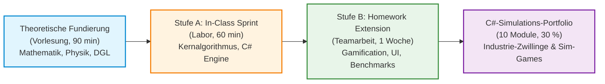
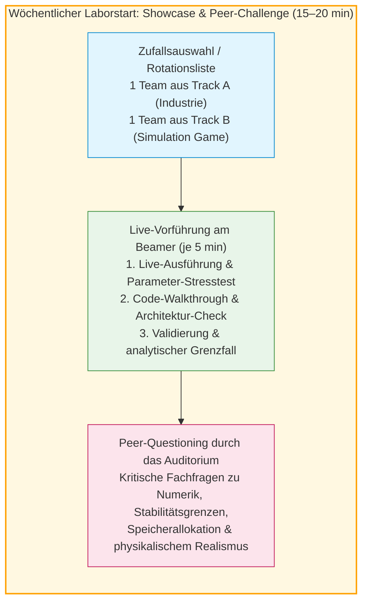

# Modulkonzept: Übungskatalog & C#-Simulations-Portfolio (Track A Industrie & Track B Game)
## Fachhochschule Oberösterreich – Campus Wels | Studiengang Automatisierungstechnik
### Lehrveranstaltung: Systemsimulation / Digitaler Zwilling

**Dokument-ID:** `Konzept/02_Uebungskatalog_und_Abschlussprojekt.md`  
**Geltungsbereich:** Vorlesungsbegleitende Laborübungen (Einheiten 01 bis 10) und 10-teiliges C#-Simulations-Portfolio  
**Referenzdokumente:** `GEMINI.md`, `Planung/Plan_01_Notationsstandard_und_Harmonisierung.md`, `Planung/03_Plan_Softwarearchitektur_und_Code.md`  
**Zielgruppe:** Studierende im 5. Semester B.Sc. Automatisierungstechnik, Dozenten und Laborleiter  
**Technologie-Stack:** C# 12 / .NET 8 & .NET 10, WPF, ScottPlot 5, SharpGL, Math.NET Numerics, MSAGL, Task Parallel Library (TPL)

---

## Inhaltsverzeichnis

1. [Didaktisches Gesamtkonzept & Labororganisation](#1-didaktisches-gesamtkonzept--labororganisation)
   - 1.1 Verzahnung von Vorlesung, Hands-on-Labor und Vibe-Coding / KI-gestütztem Arbeiten
   - 1.2 Das 2-Stufen-Übungsmodell mit Wahlkonzept („Pick your Track: Industrie vs. Gaming“)
   - 1.3 Wöchentliches „Showcase & Peer-Challenge“-Format (Live-Vorführung & Peer-Questioning)
   - 1.4 Matrix der chronologischen Technologie-Freigabe (Strikte Konsistenz!)
   - 1.5 Architektur- und Software-Qualitätsstandards („Goldene Regel“)
   - 1.6 Test-Driven Simulation & CI-Workflows
2. [Kapitelweiser Aufgabenkatalog (Einheit 01 bis 10)](#2-kapitelweiser-aufgabenkatalog-einheit-01-bis-10)
   - [Einheit 01: „Hydraulikzylinder-Dämpfung vs. Artillery Strike / Retro Tanks“ (Kinematik, Euler & Heun)](#einheit-01-hydraulikzylinder-dämpfung-vs-artillery-strike--retro-tanks-kinematik-euler--heun)
   - [Einheit 02: „CPU-Kühlkörper-Optimierung vs. Falling Sand & Doom Fire“ (WriteableBitmap FDM)](#einheit-02-cpu-kühlkörper-optimierung-vs-falling-sand--doom-fire-writeablebitmap-fdm)
   - [Einheit 03: „2D-CAD Fachwerkträger-Viewer vs. Space Radar / Blueprint Sketcher“ (WPF Canvas Vektoren)](#einheit-03-2d-cad-fachwerkträger-viewer-vs-space-radar--blueprint-sketcher-wpf-canvas-vektoren)
   - [Einheit 04: „1-kHz-Vibrationsmonitoring vs. Retro Arcade Racing Telemetry“ (ScottPlot 5 Streaming)](#einheit-04-1-khz-vibrationsmonitoring-vs-retro-arcade-racing-telemetry-scottplot-5-streaming)
   - [Einheit 05: „4-Achs-SCARA-Roboterarm vs. 3D Arcade Claw Crane“ (SharpGL 3D-Szenengraph)](#einheit-05-4-achs-scara-roboterarm-vs-3d-arcade-claw-crane-sharpgl-3d-szenengraph)
   - [Einheit 06: „Parallele Monte-Carlo-Toleranzanalyse vs. 100.000 Boids / Zombie-Horde“ (TPL Parallel.For)](#einheit-06-parallele-monte-carlo-toleranzanalyse-vs-100000-boids--zombie-horde-tpl-parallelfor)
   - [Einheit 07: „Portalkran-Verformung vs. Bridge Constructor Physics Engine“ (Math.NET Cholesky-LGS & FEM)](#einheit-07-portalkran-verformung-vs-bridge-constructor-physics-engine-mathnet-cholesky-lgs--fem)
   - [Einheit 08: „DC-Servomotor-Regelung vs. SpaceX Falcon Hop“ (S-Function, RK4 & PID Anti-Windup)](#einheit-08-dc-servomotor-regelung-vs-spacex-falcon-hop-s-function-rk4--pid-anti-windup)
   - [Einheit 09: „Automobil-Lackierstraße vs. Theme Park Rush / Express-Pass“ (Diskrete Ereignissimulation DES)](#einheit-09-automobil-lackierstraße-vs-theme-park-rush--express-pass-diskrete-ereignissimulation-des)
   - [Einheit 10: „VIBN Pneumatikzylinder vs. Arcade Pinball Wizard“ (Hybride Systeme & Zero-Crossing)](#einheit-10-vibn-pneumatikzylinder-vs-arcade-pinball-wizard-hybride-systeme--zero-crossing)
3. [Das 10-teilige C#-Simulations-Portfolio (Säule 2a, 30 %)](#3-das-10-teilige-c-simulations-portfolio-säule-2a-30-)
   - 3.1 Zielsetzung & didaktischer Anspruch
   - 3.2 Software-Architekturrahmen („Goldene Regel der Simulationsarchitektur“)
   - 3.3 Die 4 gebündelten Labor-Meilensteine
   - 3.4 Bewertungsrubrik für das C#-Code-Portfolio
4. [Abnahme-, KI- und Prüfungsrichtlinien](#4-abnahme--ki--und-prüfungsrichtlinien)

---

## 1. Didaktisches Gesamtkonzept & Labororganisation

### 1.1 Verzahnung von Vorlesung, Hands-on-Labor und Vibe-Coding / KI-gestütztem Arbeiten

Die Lehrveranstaltung *Systemsimulation / Digitaler Zwilling* am Campus Wels der FH Oberösterreich qualifiziert angehende Automatisierungsingenieurinnen und -ingenieure für die Entwicklung digitaler Repräsentanten industrieller Systeme. Sie zeichnet sich durch eine synchrone Trias aus:
1. **Theoretische Fundierung (Vorlesung, 90 min):** Herleitung der mathematisch-physikalischen DGLn, Diskretisierungsverfahren, Stabilitätskriterien und Algorithmen.
2. **Hands-on In-Class Sprint (Labor, 60 min):** Unmittelbare praktische Umsetzung des Kernalgorithmus in C# unter Betreuung. Der Fokus liegt rein auf Mathematik, Logik und schneller Verifikation.
3. **Vertiefende Homework Extension (2er-Team, 1 Woche):** Modellkomplexitätssteigerung, Gamification-Elemente, reale Nichtlinearitäten, Parametervariationen, numerische Fehleranalysen und professionelle Visualisierung.



> [!TIP]
> **Vibe Coding & KI-Engineering-Kultur:**  
> Der Einsatz moderner KI-Assistenten (GitHub Copilot, Claude, ChatGPT) ist ausdrücklich erwünscht – **unter einer zentralen Voraussetzung:** Ingenieurmäßige Urteilskraft! Jedes Kapitel enthält explizite Prompting-Tipps und Dokumentationslinks, um KI-Halluzinationen abzuwehren, Versionskonflikte (z. B. veraltetes ScottPlot 4 vs. modernes ScottPlot 5) zu verhindern und saubere Schnittstellen zu erzwingen.

---

### 1.2 Das 2-Stufen-Übungsmodell mit Wahlkonzept („Pick your Track: Industrie vs. Gaming“)

Jede der Einheiten 01 bis 10 folgt einer strikten Zweistufigkeit:

- **Stufe A (In-Class Sprint – 60 min, Einzelarbeit oder Tandem):**
  - **Fokus:** Direkte Umsetzung des mathematischen Kerns ohne grafischen Ballast.
  - **Umfang:** Minimales C#-Konsolenprogramm oder vorgefertigte Starter-Vorlage.
  - **Erfolgsmetrik:** Ein lauffähiger Algorithmus nach spätestens 50 Minuten; 10 Minuten gemeinsame Auswertung & Fehlerdiskussion im Plenum.
- **Stufe B (Homework Extension – 1 Woche, festes 2er-Team):**
  - **Fokus:** Vertiefung, Parametervariation, Nichtlinearitäten und professionelle Visualisierung.
  - **Das Wahlmodell („Pick your Track: Industrie vs. Simulation Game“):**  
    > [!IMPORTANT]
    > **Keine Doppelbelastung – Genau EINE Aufgabe pro Woche!**  
    > Bei jeder wöchentlichen Hausübung (Termine T01 bis T10) wählen die 2er-Teams **GENAU EINE** der beiden angebotenen Aufgaben:
    > - **Track A (Industrie & Mechatronik):** Industrienahe Ingenieuraufgaben, digitale Zwillinge realer Produktionssysteme, mechatronische Prüfstände, Tragwerksstatik und Regelungstechnik.
    > - **Track B (Simulation Game & Gaming-Physik):** Gamification-Konzepte, Arcade- und Retro-Game-Physik, Sci-Fi-Navigation, interaktive Blueprint-Editoren und Spielemechaniken.
    > 
    > Beide Tracks basieren auf **exakt denselben mathematisch-physikalischen Vorlesungsinhalten** und erfordern denselben Programmier- und Modellierungsaufwand (ca. 4–5 Stunden pro Teamwoche). Es muss **nur ein Track pro Woche** bearbeitet und abgegeben werden – eine Doppelbelastung ist weder vorgesehen noch erforderlich! Beide Tracks führen zur maximalen Punktzahl (10 Punkte). Die Teams dürfen wöchentlich frei zwischen Track A und Track B wechseln oder sich semesterbegleitend auf einen Schwerpunkt festlegen.
  - **Dokumentation:** Markdown-Bericht (`README.md` im Übungsordner) inklusive Konvergenzdiagrammen, Messreihen und Parameteranalysen.
  - **Codequalität:** Strikte Einhaltung der OOP- und MVVM-Paradigmen, Entkopplung von Physik und UI, Clean Code nach C#-Styleguide.

---

### 1.3 Wöchentliches „Showcase & Peer-Challenge“-Format (Live-Vorführung & Peer-Questioning)

Um die fachliche Diskussionskultur, die Kritikfähigkeit und den ingenieurmäßigen Code-Review-Prozess im Laboralltag zu verankern, startet jede Laborübung (ab Einheit 02) mit dem **„Showcase & Peer-Challenge“-Format** (Gesamtdauer: ca. 15–20 Minuten):



#### 1. Zufallsauswahl & Rotationsprinzip
- Zu Beginn jedes Folgetermins werden per Zufall oder transparenter Rotationsliste **genau zwei Teams** an das Dozentenpult aufgerufen:
  - **Ein Team aus Track A (Industrie & Mechatronik)**
  - **Ein Team aus Track B (Simulation Game & Gaming-Physik)**
- Im Verlauf des Semesters kommt jedes Team mindestens einmal für eine Live-Vorführung am Beamer an die Reihe.

#### 2. Live-Präsentation am Beamer (5 Minuten pro Team)
Das aufgerufene 2er-Team führt seine Homework Extension live in der Entwicklungsumgebung (Visual Studio / JetBrains Rider) vor:
1. **Live-Ausführung & Stresstest:** Starten der Anwendung, Demonstration des Kernverhaltens und gezieltes Ausreizen der Parameter (z. B. extreme Schrittweiten, Lastsprünge, Windstöße oder Gitterfeinheiten).
2. **Architektur- & Solver-Check:** Kurzer Blick in den Quellcode: Saubere Entkopplung von Physik-Engine und UI nach der *Goldenen Regel*, Vermeidung von GC-Allokationen im Render-/Simulations-Loop, saubere Kapselung der DGLn/Zustände.
3. **Validierung & Grenzen:** Erläuterung der Konvergenz und des quantitativen Abgleichs mit dem analytischen Grenzfall.

#### 3. Peer-Questioning & Fach-Challenge durch das Plenum
Alle anderen Studierenden im Raum sind ausdrücklich **keine passiven Zuschauer**, sondern agieren als technische Gutachter und Auditoren:
- **Aufforderung zum Peer-Questioning:** Das Auditorium ist gefordert, kritische, fachlich fundierte Fragen einzubringen und Schwachstellen aufzudecken:
  - *Numerische Stabilität & Solver-Wahl:* „Was passiert, wenn die Schrittweite verdoppelt wird? Explodiert das System oder konvergiert es stabil?“
  - *Physikalischer Realismus vs. Fake-Animation:* „Löst die Anwendung tatsächlich das DGL-System oder wird eine vorberechnete Kurve/Spline abgefahren?“
  - *Code-Architektur & Performance:* „Werden im Render-Loop Objekte auf dem Managed Heap allokiert? Wie ist die Thread-Sicherheit bei Datenübergaben gelöst?“
  - *Grenzfall-Konsistenz:* „Entspricht das numerische Ergebnis im stationären Grenzfall exakt der theoretischen Formel?“
- **Didaktischer Mehrwert:** Konstruktive, fachlich anspruchsvolle Fragen aus dem Plenum fließen positiv in die mündliche Mitarbeit ein. Für die vortragenden Teams ist dieses Format die ideale Vorbereitung auf die Meilenstein-Abnahmen und die souveräne Verteidigung des C#-Simulations-Portfolios.

---

### 1.4 Matrix der chronologischen Technologie-Freigabe (Strikte Konsistenz!)

> [!CAUTION]
> **Verbindliche Didaktik-Regel: KEIN Vorgreifen auf spätere Vorlesungsinhalte!**  
> In den Aufgabenstellungen (T01 bis T10) darf absolut nichts vorausgesetzt oder verlangt werden, was erst in späteren Kapiteln gelehrt wird. Die folgende Tabelle ist für alle Aufgaben und Lösungen bindend:

| Einheit / Kapitel | Erlaubter Technologie- & Bibliotheks-Stack | Strengstens verboten in dieser Einheit (Vorgreif-Sperre!) |
| :--- | :--- | :--- |
| **T01 (Kap 00+01)** | C# 12 / .NET 8/10 Console, `System.Numerics` (Vector2/4), Expliziter Euler / Heun (RK2), ASCII-Plots, CSV-Export, PPM-Bitmap-Array | **KEIN** WPF, **KEIN** ScottPlot, **KEIN** Multithreading, **KEIN** SharpGL, **KEINE** FEM |
| **T02 (Kap 02)** | WPF `WriteableBitmap`, 2D-Pixelpuffer (`byte[]`, `int[]`), FDM-Wärmeleitung / zelluläre Gitter, Color-Mapping, `DispatcherTimer` | **KEIN** WPF Canvas (Vektoren), **KEIN** ScottPlot, **KEIN** Multithreading (`Parallel.For`), **KEIN** SharpGL |
| **T03 (Kap 03)** | WPF `Canvas`, 2D-Vektorgrafiken (`Line`, `Path`, `Polygon`), Affine Welt-Bildschirm-Transformation, Drag-&-Drop, DIN-Bemaßung | **KEIN** ScottPlot, **KEIN** SharpGL 3D, **KEIN** Multithreading, **KEIN** Math.NET Cholesky, **KEINE** Steifigkeitsmatrizen / Stabkräfteberechnung (erst ab T07!) |
| **T04 (Kap 04)** | `ScottPlot 5` (`WpfPlot`, `DataStreamer`), MSAGL-Graphen, Ringpuffer (`CircularBuffer<T>`), Welford-Streaming-Statistik | **KEIN** SharpGL 3D, **KEIN** Multithreading / TPL, **KEIN** Math.NET Cholesky, **KEINE** S-Functions |
| **T05 (Kap 05)** | `SharpGL`, 3D-Szenengraph, Orbit-Kamera (Kugelkoordinaten), Matrix-Stack (`glPushMatrix`), Phong-Beleuchtung, Normalenvektoren | **KEIN** TPL Multithreading, **KEIN** Math.NET LGS, **KEINE** S-Functions, **KEINE** Event-Queues |
| **T06 (Kap 06)** | Task Parallel Library (TPL), `Parallel.For`, `ParallelOptions`, `Interlocked`, `CancellationToken`, Amdahl & Gustafson Fit, Cache-Optimierung | **KEIN** Math.NET Cholesky, **KEINE** S-Functions, **KEINE** Event-Queues |
| **T07 (Kap 07)** | `MathNet.Numerics`, Lineare Gleichungssysteme, Blockpartitionierung, Cholesky-Zerlegung, 2D/3D-Stabtragwerke (FEM), Lagerreaktionen | **KEINE** dynamischen ODE-Solver (RK4), **KEINE** S-Functions, **KEINE** Event-Queues |
| **T08 (Kap 08)** | Kontinuierliche Dynamik, S-Function-Architektur (`Derivatives`, `Outputs`, `Update`), RK4-Solver, PID-Regler, Anti-Windup Clamping | **KEINE** Diskrete Ereignissimulation (DES), **KEINE** Zero-Crossing Wurzelsuche |
| **T09 (Kap 09)** | Diskrete Ereignissimulation (DES), `PriorityQueue<TEvent, double>`, Kendall-Notation ($M/M/c/K$), Inversion / Box-Muller, Little's Gesetz | **KEINE** Hybriden Continuous-Discrete Umschaltungen (Zero-Crossing) |
| **T10 (Kap 10+11)**| Hybride Automaten, Zero-Crossing Wurzelsuche (Bisektion / Dekker), Zeno-Vermeidung, Stick-Slip Reibung, FMI/FMU Grundlagen | *Gesamter Semester-Stack steht uneingeschränkt zur Verfügung!* |

---

### 1.5 Architektur- und Software-Qualitätsstandards

Alle studentischen Lösungen müssen der im Skriptum definierten **Goldenen Regel der Simulationsarchitektur** ([Kapitel 11](../Folien/11_Epilog/Folien.md)) genügen:

> [!IMPORTANT]
> **Die Goldene Regel der Simulationsarchitektur:**
> 1. Die **Physik- und Simulationsmodelle** (Zustandsvektor $\mathbf{x}$, Ableitungen $\mathbf{f}(t, \mathbf{x}, \mathbf{u})$, Steifigkeitsmatrizen $\mathbf{K}$, Event-Queues) haben **keine Abhängigkeit** zu GUI-, Grafik- oder Logging-Frameworks (WPF, SharpGL, ScottPlot). Sie sind als reine `.NET`-Klassenbibliotheken zu implementieren.
> 2. Die **Visualisierung** (View) abonniert ausschließlich unveränderliche Zustandsabbilder (Snapshots, DTOs) oder konsumiert Daten über thread-sichere Ringpuffer (`CircularBuffer<T>`) und das WPF-Data-Binding (MVVM).
> 3. Rechenintensive Simulationen dürfen **niemals** auf dem UI-Thread ausgeführt werden. Der Solver läuft asynchron in Hintergrund-Tasks (`Task.Run`) und synchronisiert über `IProgress<T>` oder aggregierte Frame-Timer.

---

### 1.6 Test-Driven Simulation & CI-Workflows

Für alle numerischen Modelle sind begleitende Unit-Tests mit `xUnit` oder `MSTest` Pflicht (Referenzprojekt: [`Quellen/WS25/SimulationTests`](../Quellen/WS25/SimulationTests)):
- **Energieerhaltungstests:** Für ungedämpfte Systeme (freies Pendel, elastischer Ball) muss die Gesamtenergie $E_{\text{tot}} = E_{\text{kin}} + E_{\text{pot}}$ im Zeitverlauf bis auf Integrationsfehlerordnung $\mathcal{O}(\Delta t^p)$ konstant bleiben.
- **Analytische Grenzfallprüfung:** Vergleich numerischer Ergebnisse mit geschlossenen analytischen Lösungen bei trivialen Randbedingungen (z. B. Schiefer Wurf im Vakuum, stationäre Endtemperatur des Stabes).
- **Invarianzprüfungen:** Statische Fachwerke müssen Translations- und Rotationsinvarianten erfüllen (Summe aller Kräfte und Momente exakt $\vec{0}$).

---

## 2. Kapitelweiser Aufgabenkatalog (Einheit 01 bis 10)

---

### Einheit 01: „Hydraulikzylinder-Dämpfung vs. Artillery Strike / Retro Tanks“ (Kinematik, Euler & Heun)

#### Fachlicher Bezug & Lernziele
- **Vorlesung:** [Kapitel 01: Einführung](../Folien/01_Einführung/Folien.md) – Modellbegriff, Zustandsraum, Zeitdiskretisierung, explizites Euler-Verfahren, Prädiktor-Korrektor (Heun / RK2), lineare Auftreff-Interpolation.
- **Übungsblatt & Vorlage:** [`Uebungen/Termin_01_Kinematik_und_Euler/Aufgabenblatt.md`](../Uebungen/Termin_01_Kinematik_und_Euler/Aufgabenblatt.md), [`Vorlage/KinematikEuler.sln`](../Uebungen/Termin_01_Kinematik_und_Euler/Vorlage/KinematikEuler.sln).
- **Quellen-Referenz:** [`Quellen/WS24/DynamischBallwurf1D`](../Quellen/WS24/DynamischBallwurf1D).
- **Technologie-Status:** **Reine C#-Konsolenapplikation!** Noch *KEIN* WPF Canvas, noch *KEIN* ScottPlot! Visualisierung via Konsole (ASCII-Art / Tabellen) oder CSV-Export.
- **Lernziele:**
  1. Ableitung von Zustandsraummodellen 1. Ordnung (Ballistik unter Luftwiderstand bzw. hydraulische Endlagendämpfung).
  2. Implementierung des expliziten Euler- und Heun-Verfahrens (RK2) mit sauberer Zustandskapselung (`KinematicState`).
  3. Lineare Ereignis-Interpolation des Bodenaufschlags und automatisierte Verifikation gegen geschlossene analytische Lösungen (`dotnet test`).

#### Mathematisches Modell
Zustandsvektor: $\mathbf{x} = \begin{bmatrix} x & y & v_x & v_y \end{bmatrix}^\top \in \mathbb{R}^4$.  
Windvektor: $\mathbf{w} = \begin{bmatrix} w_x & w_y \end{bmatrix}^\top$. Relativgeschwindigkeit: $\mathbf{v}_{\text{rel}} = \mathbf{v} - \mathbf{w}$, Betrag $v_{\text{rel}} = \|\mathbf{v}_{\text{rel}}\|$.  
DGL-System 1. Ordnung:
$$\dot{x} = v_x, \quad \dot{y} = v_y$$
$$\dot{v}_x = -\frac{k_d}{m} v_{\text{rel}} (v_x - w_x), \quad \dot{v}_y = -g - \frac{k_d}{m} v_{\text{rel}} (v_y - w_y) \quad \text{mit } k_d = \frac{1}{2}\rho c_{\text{w}} A$$

---

#### Stufe A: In-Class Sprint (60 min) – „Freier Fall & Schiefer Wurf im Vakuum (Analytischer Abgleich)“
- **Aufgabenstellung (siehe [`Aufgabenblatt.md`](../Uebungen/Termin_01_Kinematik_und_Euler/Aufgabenblatt.md)):**
  1. Öffnen Sie die vorbereitete Solution [`KinematikEuler.sln`](../Uebungen/Termin_01_Kinematik_und_Euler/Vorlage/KinematikEuler.sln).
  2. Vervollständigen Sie `EulerIntegrator.Step` und `EulerIntegrator.StepHeun` für das `KinematicState`-Struct.
  3. Implementieren Sie die Simulationsschleife bis zum Bodenkontakt ($y < 0$) mit linearer Interpolation des exakten Auftreffpunkts $\alpha = \frac{y_k}{y_k - y_{k+1}}$.
  4. Prüfen Sie Ihre Implementierung mit `dotnet test` (3 automatisierte MSTests für Vakuum-Konvergenz, Energiebilanz und Luftwiderstand).
- **Erwartetes Ergebnis:** Alle 3 Unit-Tests grün; bei $\Delta t = 0{,}01\,\text{s}$ zeigt sich der systematische Euler-Überschuss von $+5{,}310\,\text{m}$ im Vakuum, während Heun (RK2) den analytischen Wert ($1019{,}368\,\text{m}$) exakt trifft.

---

#### Stufe B: Homework Extension (2er-Team, 1 Woche) – Wahlmodell („Pick your Track“)

> [!IMPORTANT]
> **Pick your Track (Wahlmodell – GENAU EINE Aufgabe):**  
> Jedes 2er-Team wählt für die Homework Extension **GENAU EINE** der beiden folgenden Aufgaben: **Track A (Industrie)** ODER **Track B (Simulation Game)**. Eine Bearbeitung beider Tracks ist weder gefordert noch nötig (keine Doppelbelastung!). Beide Tracks basieren auf derselben Physik und DGL-Integration und führen zur maximalen Punktzahl (10 Punkte).

- **Track A (Industrie): Hydraulikzylinder-Dämpfung (Not-Stopp einer Schwerlastachse)**
  - **Industrie-Szenario:** Abbremsen einer schweren Maschinenspindel ($m = 250\,\text{kg}, v_0 = 4{,}0\,\text{m/s}$) durch einen hydraulischen Endlagendämpfer mit linearer Rückstellfeder ($c = 15\,000\,\text{N/m}$), viskoser Dämpfung ($d_{\text{lin}} = 800\,\text{Ns/m}$) und nichtlinearer quadratischer Drosselblendenreibung ($d_{\text{quad}} = 2\,200\,\text{Ns}^2/\text{m}^2$).
  - **DGL-System:** $\dot{x} = v, \quad \dot{v} = \frac{1}{m}\left(-c x - d_{\text{lin}} v - d_{\text{quad}} v |v|\right)$.
  - **Solver-Vergleich (Euler vs. Heun / RK2):** Vergleichen Sie expliziten Euler und Heun für $\Delta t \in \{0{,}05\,\text{s}; 0{,}01\,\text{s}; 0{,}001\,\text{s}; 0{,}0001\,\text{s}\}$.
  - **Umkehrpunkt-Interpolation & Auslegung:** Bestimmen Sie den exakten maximalen Bremsweg $x_{\text{max}}$ beim Nulldurchgang $v(t_{\text{stop}}) = 0$ und optimieren Sie $d_{\text{quad}}$ für $x_{\text{max}} \le 0{,}18\,\text{m}$ bei $|a_{\text{max}}| \le 60\,\text{m/s}^2$.

- **Track B (Simulation Game): „Artillery Strike / Retro Tanks“ (2D-Ballistik mit Luftwiderstand & Wind)**
  - **Game-Szenario:** Rundenbasiertes Artillerie-Duell (*Scorched Earth* / *Worms*) über eine Distanz von $D = 800\,\text{m}$.
  - **Flugphysik:** Numerische Flugbahnintegration mit quadratischem Luftwiderstand ($k_d = \frac{1}{2}\rho c_w A$), Windböen $\mathbf{w}$ und Heun-Integrator (RK2).
  - **Bodenkollision:** Exakte lineare Interpolation des Einschlagorts $x_{\text{impact}}$ bei $y = 0$.
  - **Visualisierung & Konvergenz:** ASCII-Art-Trajektorie ($80 \times 25$ Zeichen) im Terminal, CSV-Export und Vergleich Euler vs. Heun.

- **Bewertungskriterien (10 Punkte – einheitlich für Track A und Track B):**
  - [3 P.] Korrekte Implementierung von Euler und Heun mit nichtlinearer Reibungs-/Windphysik.
  - [3 P.] Exakte lineare Ereignis-Interpolation (Umkehrpunkt bzw. Bodenaufschlag).
  - [2 P.] Systematische Parameterstudie / Trefferanalyse.
  - [2 P.] Dokumentation: Tabelle mit Konvergenzvergleich (Euler vs. Heun) und ASCII/CSV-Trajektorien.

---

#### 🔍 Peer-Review & Leitfragen für das Plenum
Beim wöchentlichen „Showcase & Peer-Challenge“ prüft das Auditorium die vorgeführten Lösungen beider Tracks kritisch auf folgende typische Schwachstellen und Fallstricke:
- **Fake-Physik vs. echte DGL:** Wird der Luftwiderstand bzw. die Blendenreibung in jedem Zeitschritt aus dem aktuellen Zustand berechnet, oder handelt es sich um eine vereinfachte analytische Parabel?
- **Schrittweiten-Fehler bei Euler:** Warum überschätzt der explizite Euler beim schiefen Wurf die Höhe und landet um $\Delta t / 2$ zu spät? Wie verbessert das Heun-Verfahren (RK2) die Ordnung von $\mathcal{O}(\Delta t)$ auf $\mathcal{O}(\Delta t^2)$?
- **Kollisions-Interpolation:** Taucht das Projektil bei größeren Zeitschritten sichtbar in den Boden ein, oder wird der Aufschlagspunkt über $\alpha = \frac{y_k}{y_k - y_{k+1}}$ exakt interpoliert?
- **Vorzeichenkonsistenz:** Wirkt die quadratische Reibung $-d_{\text{quad}} v |v|$ bzw. der Relativwind $\mathbf{v}_{\text{rel}} = \mathbf{v} - \mathbf{w}$ in beide Bewegungsrichtungen physikalisch bremsend?

---

#### 💡 Online-Recherche & Vibe-Coding-Guide (Einheit 01)
- **Empfohlene Suchbegriffe:** `Euler vs Heun method C# implementation`, `projectile motion quadratic drag relative wind`, `hydraulic cushion orifice damping ODE`.
- **Offizielle Dokumentation:** [Microsoft Learn: Value types & structs](https://learn.microsoft.com/de-de/dotnet/csharp/language-reference/builtin-types/struct), [Wikipedia: Heun's method](https://en.wikipedia.org/wiki/Heun%27s_method).
- **Vibe-Coding Prompting-Tipp:**
  > *„Schreibe mir eine reine C#-Klasse ohne jede externe UI-Bibliothek (kein WPF, kein ScottPlot). Implementiere das explizite Euler- und das Heun-Verfahren (RK2) auf Basis des Structs `KinematicState(double X, double Y, double Vx, double Vy)`. Trenne den mathematischen Zustand strikt von der Ein-/Ausgabe.“*

---

### Einheit 02: „CPU-Kühlkörper-Optimierung vs. Falling Sand & Doom Fire“ (WriteableBitmap FDM)

#### Fachlicher Bezug & Lernziele
- **Vorlesung:** [Kapitel 02: Visualisierung 2D Pixel](../Folien/02_Visualisierung_2D_Pixel/Folien.md) – Pixelraster, Farbräume, `WriteableBitmap`, 2D-Finite-Differenzen-Methode (FDM) für Wärmeleitung, Dirichlet-, Neumann- und Robin-Randbedingungen.
- **Übungsblatt & Vorlage:** [`Uebungen/Termin_02_Pixelgrafik_und_FDM/Aufgabenblatt.md`](../Uebungen/Termin_02_Pixelgrafik_und_FDM/Aufgabenblatt.md), [`Vorlage/PixelHeatFDM.sln`](../Uebungen/Termin_02_Pixelgrafik_und_FDM/Vorlage/PixelHeatFDM.sln).
- **Technologie-Status:** WPF mit `Image`-Control und `WriteableBitmap`. Noch *KEIN* Canvas (keine Vektorobjekte), noch *KEIN* ScottPlot, noch *KEIN* Multithreading (`Parallel.For` ist erst in Kap 06 erlaubt!).
- **Lernziele:**
  1. Diskretisierung der 2D-Wärmeleitungsgleichung mit dem 5-Punkt-Differenzenstern auf einem $N \times M$ Gitter.
  2. Beachtung des Von-Neumann-Stabilitätskriteriums: $s = \frac{\alpha \Delta t}{\Delta x^2} \le 0{,}25$.
  3. Höchst performantes Pixel-Rendering via `WriteableBitmap.Lock()`, direkten Pointer-Zugriff (`unsafe byte*` / `uint*`) und Double-Buffering.

#### Mathematisches Modell
2D-Wärmeleitungsgleichung mit ortsabhängiger Temperaturleitfähigkeit $\alpha(x,y) = \frac{\lambda(x,y)}{\rho(x,y) c_{\text{p}}(x,y)}$:
$$\frac{\partial T}{\partial t} = \alpha(x,y) \left( \frac{\partial^2 T}{\partial x^2} + \frac{\partial^2 T}{\partial y^2} \right)$$
Expliziter FDM-Zeitschritt:
$$T_{x,y}^{k+1} = T_{x,y}^k + \frac{\alpha_{x,y} \Delta t}{\Delta x^2} \left( T_{x+1,y}^k + T_{x-1,y}^k + T_{x,y+1}^k + T_{x,y-1}^k - 4 T_{x,y}^k \right)$$

---

#### Stufe A: In-Class Sprint (60 min) – „Heatmap-Renderer & 5-Punkt-Stern in WriteableBitmap“
- **Aufgabenstellung (siehe [`Aufgabenblatt.md`](../Uebungen/Termin_02_Pixelgrafik_und_FDM/Aufgabenblatt.md)):**
  1. Öffnen Sie die Vorlage [`PixelHeatFDM.sln`](../Uebungen/Termin_02_Pixelgrafik_und_FDM/Vorlage/PixelHeatFDM.sln) ($200 \times 200$ Gitter).
  2. Implementieren Sie in `HeatGrid.Step` den 5-Punkt-Laplace-Stern mit Double-Buffering (`_tCurrent` $\leftrightarrow$ `_tNext`) und lokalen Neumann-Spiegelungen an Isolator-Hindernissen ($\alpha = 0$).
  3. Implementieren Sie in `ThermalColorMap.TemperatureToBgra32` die Falschfarbentransformation ($20\,^\circ\text{C} \to \text{Blau}$, $100\,^\circ\text{C} \to \text{Rot}$) und das direkte Speicherschreiben in `MainWindow.RenderGridToBitmap`.
- **Erwartetes Ergebnis:** Eine butterweich aufkeimende, farbige Wärmewolke im WPF-Fenster, die interaktiv gezeichnete Isolatorwände umströmt.

---

#### Stufe B: Homework Extension (2er-Team, 1 Woche) – Wahlmodell („Pick your Track“)

> [!IMPORTANT]
> **Pick your Track (Wahlmodell – GENAU EINE Aufgabe):**  
> Jedes 2er-Team wählt für die Homework Extension **GENAU EINE** der beiden folgenden Aufgaben: **Track A (Industrie)** ODER **Track B (Simulation Game)**. Eine Bearbeitung beider Tracks ist weder gefordert noch nötig (keine Doppelbelastung!). Beide Tracks basieren auf 2D-Gitter-Simulationen mit `WriteableBitmap` und führen zur maximalen Punktzahl (10 Punkte).

- **Track A (Industrie): CPU-Kühlkörper-Optimierung (Mehrzonen-FDM & Robin-Rand)**
  - **Industrie-Szenario:** Modellierung eines Mehrzonen-Halbleiterkühlkörpers ($200 \times 200$ Zellen): Silizium-Die (unten), Kupfer-Heatspreader (Mitte) und Aluminium-Kühlrippen mit Luftkanälen (oben).
  - **Konvektive Kühlung (Robin-Randbedingung):** Implementieren Sie am oberen Kühlkörperrand den konvektiven Wärmeübergang an die Kühlluft ($T_{\text{top}} = \frac{\lambda T_{\text{innen}} + h \Delta x T_\infty}{\lambda + h \Delta x}$) mit umschaltbarem Lüfterbetrieb ($h_{\text{passiv}}$ vs. $h_{\text{aktiv}}$).
  - **Stabilitätsanalyse:** Demonstrieren Sie experimentell die Schachbrett-Gitterexplosion bei Überschreitung von $s > 0{,}25$.

- **Track B (Simulation Game): „Falling Sand & Doom Fire / Lava“ (Zelluläre Pixel-Physik)**
  - **Game-Szenario:** Interaktive zelluläre 2D-Physik-Sandbox ($200 \times 200$ Pixel) im Stil von *Noita* / *Doom Fire* gekoppelt mit dem FDM-Temperaturfeld.
  - **Partikel- & Thermodynamik:** Herabrieselnder Sand (Gravitations- und Böschungsregeln), Wasser (Verdampfung bei $T \ge 100\,^\circ\text{C}$ mit Abkühlung) und Lava/Feuer ($T = 100\,^\circ\text{C}$) mit aufsteigender Konvektionsglut (Upwind-Drift + stochastisches Flackern).

- **Bewertungskriterien (10 Punkte – einheitlich für Track A und Track B):**
  - [3 P.] Korrekte FDM-/Zellular-Implementierung mit Materialgrenzen und Randbedingungen.
  - [3 P.] Effiziente `WriteableBitmap`-Pixelmanipulation ohne Speicherlecks ($\ge 50\,\text{FPS}$).
  - [2 P.] Experimenteller Nachweis der numerischen Instabilität bei $s > 0{,}25$.
  - [2 P.] Dokumentation: Analyse der Maximaltemperaturen und anschauliche Screenshots.

---

#### 🔍 Peer-Review & Leitfragen für das Plenum
Beim wöchentlichen „Showcase & Peer-Challenge“ prüft das Auditorium die vorgeführten Lösungen beider Tracks kritisch auf folgende typische Schwachstellen und Fallstricke:
- **Gitterexplosion & Von-Neumann-Stabilität:** Was passiert, wenn die Schrittweite $\Delta t$ live am Beamer über das theoretische Limit $s = 0{,}25$ angehoben wird? Zeigt das Gitter das charakteristische oszillierende Schachbrettmuster, oder wurde die Instabilität künstlich durch ein `Math.Clamp` im Solver maskiert?
- **Render-Performance & UI-Thread:** Werden die Pixel tatsächlich im unmanaged Speicher über `WriteableBitmap.Lock()` und direkten Zeigerzugriff aktualisiert?
- **Double-Buffering des FDM-Gitters:** Werden für $T^{k}$ und $T^{k+1}$ zwei getrennte Puffer verwendet, die per Referenz-Swap getauscht werden, oder wird das Gitter in-place überschrieben?
- **Physikalische Randbedingungen:** Werden an Isolatorwänden echte Neumann-Spiegelungen ($\frac{\partial T}{\partial n}=0$) und am Kühlrand konvektive Robin-Randbedingungen verwendet?

---

#### 💡 Online-Recherche & Vibe-Coding-Guide (Einheit 02)
- **Empfohlene Suchbegriffe:** `WriteableBitmap Lock BackBuffer performance C#`, `2D heat equation finite difference explicit stability`, `Von Neumann stability heat equation grid`.
- **Offizielle Dokumentation:** [Microsoft Learn: WriteableBitmap-Klasse](https://learn.microsoft.com/de-de/dotnet/api/system.windows.media.imaging.writeablebitmap).
- **Vibe-Coding Prompting-Tipp:**
  > *„Erstelle mir eine C#-Methode zur schnellen Pixelaktualisierung einer WPF `WriteableBitmap`. Nutze `unsafe` Zeigerarithmetik auf `bitmap.BackBuffer`. Verwende KEIN SetPixel und KEINE Canvas-Shapes, da dies zu langsam ist. Beachte: Single-Threaded, kein Parallel.For.“*

---

### Einheit 03: „2D-CAD Fachwerkträger-Viewer vs. Space Radar / Blueprint Sketcher“ (WPF Canvas Vektoren)

#### Fachlicher Bezug & Lernziele
- **Vorlesung:** [Kapitel 03: Visualisierung 2D Vektor](../Folien/03_Visualisierung_2D_Vektor/Folien.md) – WPF `Canvas`, Vektor-Primitive (`Line`, `Path`, `Polygon`), Affine Welt-Bildschirm-Transformation, BoundingBox, DIN-Bemaßung, Pan & Zoom, Drag-and-Drop Interaktion.
- **Übungsblatt & Vorlage:** [`Uebungen/Termin_03_Vektorgrafik_Canvas/Aufgabenblatt.md`](../Uebungen/Termin_03_Vektorgrafik_Canvas/Aufgabenblatt.md), [`Vorlage/CanvasTrussViewer.sln`](../Uebungen/Termin_03_Vektorgrafik_Canvas/Vorlage/CanvasTrussViewer.sln).
- **Quellen-Referenz:** [`Quellen/WS25/FachwerkIdeal2D`](../Quellen/WS25/FachwerkIdeal2D).
- **Technologie-Status:** WPF `Canvas` mit geometrischen 2D-Vektoren. Noch *KEIN* ScottPlot, noch *KEIN* SharpGL 3D, noch *KEIN* Multithreading!
- **Didaktische Kausalitäts-Sperre (Sehr wichtig!):** Der Vorlesungsstoff bis zu dieser Einheit behandelt rein die 2D-Vektorgrafik und geometrische Transformationen. Es dürfen in dieser Einheit **KEINE Steifigkeitsmatrizen**, **KEINE Cholesky-Zerlegung** und **KEINE Stabkräfteberechnungen** verlangt oder implementiert werden! (Die numerische Berechnung der Stabkräfte und Verformungen via Finite-Elemente-LGS erfolgt erst in Einheit 07).
- **Lernziele:**
  1. Beherrschung der 2D-Welt-zu-Bildschirm-Koordinatentransformation (Skalierung, Y-Achseninversion, automatisches Zentrieren mit BoundingBox und konfigurierbarem Randabstand/Margin).
  2. Beherrschung des WPF `Canvas` zur dynamischen Erzeugung und Modifikation von Vektorprimitiven (`Line`, `Ellipse`, `Path`, `Polygon`).
  3. Mathematisch exakte Vektorpfeile: Berechnung der Pfeilspitzengeometrie (Flügeldreiecke) aus Richtungsvektor und Einheitsnormalen via Drehmatrix.
  4. Technische Bemaßungsketten nach DIN 406 (Maßhilfslinien, Maßlinien mit echten Maßpfeilspitzen, zentrierter Maßtext).
  5. Flüssige interaktive Benutzerführung (Mouse Drag-and-Drop zur Echtzeit-Verschiebung von Geometrieknoten).

#### Mathematisches Transformationsmodell
Weltkoordinaten $(x_{\text{world}}, y_{\text{world}})$ in Metern $\to$ Canvas-Bildschirmkoordinaten $(x_{\text{screen}}, y_{\text{screen}})$ in Pixeln:
$$s = \min\left( \frac{w_{\text{canvas}} - 2 \cdot \text{margin}_x}{x_{\max} - x_{\min}}, \, \frac{h_{\text{canvas}} - 2 \cdot \text{margin}_y}{y_{\max} - y_{\min}} \right)$$
$$x_{\text{screen}} = \text{margin}_x + (x_{\text{world}} - x_{\text{min}}) \cdot s + x_{\text{offset}}$$
$$y_{\text{screen}} = h_{\text{canvas}} - \left[ \text{margin}_y + (y_{\text{world}} - y_{\text{min}}) \cdot s + y_{\text{offset}} \right]$$
Pfeilspitzen-Geometrie für einen Kraft- oder Geschwindigkeitsvektor $\vec{F} = [F_x, F_y]^\top$ mit Winkel $\phi = \operatorname{atan2}(F_y, F_x)$ und Spitzenlänge $L_{\text{tip}}$, Öffnungswinkel $\beta$:
$$\vec{p}_{\text{tip}} = \vec{p}_{\text{end}}, \quad \vec{p}_{\text{left}} = \vec{p}_{\text{tip}} - L_{\text{tip}} \begin{bmatrix} \cos(\phi - \beta) \\ \sin(\phi - \beta) \end{bmatrix}, \quad \vec{p}_{\text{right}} = \vec{p}_{\text{tip}} - L_{\text{tip}} \begin{bmatrix} \cos(\phi + \beta) \\ \sin(\phi + \beta) \end{bmatrix}$$

---

#### Stufe A: In-Class Sprint (60 min) – „2D-Trägergeometrie & Vektorpfeile auf WPF Canvas“
- **Aufgabenstellung:**
  1. Öffnen Sie ein leeres WPF-Projekt mit `<Canvas x:Name="TrussCanvas"/>`.
  2. Implementieren Sie eine Klasse `CoordinateTransformer`, die Weltkoordinaten (Meter) seitenverhältnistreu ($s_x = s_y = s$) mit BoundingBox und Margin auf Canvas-Pixel abbildet (inklusive Umkehrung der vertikalen Bildschirmachse).
  3. Definieren Sie ein Trägerdreieck mit 3 Knoten (Knoten 1: $(0,0)$, Knoten 2: $(4,0)$, Knoten 3: $(2,2)$ Meter) und verbinden Sie die Knoten über 3 Stäbe (`Line`).
  4. Zeichnen Sie Knoten als gefüllte Kreise (`Ellipse`) mit Text-Beschriftungen (`TextBlock` oder `FormattedText`).
  5. Zeichnen Sie an Knoten 3 einen vertikalen Lastpfeil $\vec{F} = (0, -10)\,\text{kN}$:
     - Schaftlinie vom Knoten zum Kraftendpunkt.
     - Pfeilspitze als geschlossenes gefülltes `Polygon`-Dreieck mit korrekter Ausrichtung.
  6. Reagieren Sie auf das `SizeChanged`-Event des Canvas: Bei Änderung der Fenstergröße muss sich das Trägerdreieck zentriert und ohne Verzerrung automatisch anpassen.
- **Erwartetes Ergebnis:** Ein mathematisch sauber zentriertes, seitenverhältnistreues Vektorträger-Dreieck mit korrekt ausgerichteter Lastpfeilspitze im WPF-Fenster.

---

#### Stufe B: Homework Extension (2er-Team, 1 Woche) – Wahlmodell („Pick your Track“)

> [!IMPORTANT]
> **Pick your Track (Wahlmodell – GENAU EINE Aufgabe):**  
> Jedes 2er-Team wählt für die Homework Extension **GENAU EINE** der beiden folgenden Aufgaben: **Track A (Industrie)** ODER **Track B (Simulation Game)**. Eine Bearbeitung beider Tracks ist weder gefordert noch nötig (keine Doppelbelastung!). Beide Tracks konzentrieren sich rein auf interaktive 2D-Vektorgrafik und führen zur maximalen Punktzahl (10 Punkte).

- **Track A (Industrie): Interaktiver „2D-CAD-Fachwerkträger-Viewer“**
  - **Tragwerks-Import & Topologie:**
    - Einlesen eines industriellen Tragwerks aus einer C#-Datenstruktur oder JSON-Datei: Liste von Knoten $(X_i, Y_i)$ in Metern und Stäben (Indexpaare $(i, j)$).
    - Mindestens 8 Knoten und 13 Stäbe (z. B. Pratt-, Warren- oder K-Fachwerkträger einer Werkhalle oder Brücke).
  - **Welt-Screen-Transformation mit BoundingBox & Auto-Fit:**
    - Automatische Berechnung der minimalen BoundingBox $[x_{\min}, x_{\max}] \times [y_{\min}, y_{\max}]$.
    - Dynamische Skalierung mit 10 % umlaufendem Margin unter strikter Wahrung des Seitenverhältnisses (Aspect Ratio Preservation).
  - **Normgerechte DIN-Bemaßungsketten (DIN 406):**
    - Horizontale Maßkette unterhalb des Untergurts mit Maßhilfslinien, Maßlinie, Maßpfeilen und Maßzahlen (z. B. `4.00 m`).
    - Vertikale Maßkette für die Gesamthöhe des Trägers.
  - **Vektorpfeile mit korrekter Pfeilspitzengeometrie:**
    - Zeichnen vorgegebener äußerer Lasten $\vec{F}_{\text{ext}}$ und Auflagerkräfte $\vec{F}_{\text{Lager}}$ an den Knoten.
    - Die Pfeilspitzen werden über Rotationsmatrizen dynamisch an der Pfeilrichtung ausgerichtet (geschlossene `Polygon`-Spitze mit konfigurierbarem Winkel $\beta = 15^\circ$ und Länge $12\,\text{px}$).
    - Anzeige von Auflagersymbolen (Dreieck für Festlager, Dreieck mit Rollenlinie für Loselager).
  - **Interaktives Knotenverschieben per Drag-and-Drop:**
    - Greifen eines beliebigen Trägerknotens mit der linken Maustaste und Verschieben über das Canvas.
    - Alle angebundenen Stäbe, Lastpfeile und Maßketten folgen dem Knoten in Echtzeit (`MouseMove`).
    - Tooltip oder Statusleiste zeigt während des Ziehens die aktuellen Weltkoordinaten $(X, Y)$ auf $1\,\text{mm}$ genau an.
  - *(Hinweis: Diese interaktive Visualisierung dient als direktes GUI-Frontend für Einheit 07, wo sie mit der Cholesky-Statik-Engine verheiratet wird!)*

- **Track B (Simulation Game): 2D Space Radar & Vector Navigation ODER Bridge Blueprint Sketcher**
  *(Wählen Sie innerhalb von Track B eine der beiden Game-/CAD-Varianten):*
  - **Option B.1: „2D Space Radar & Vector Navigation“ (Sci-Fi Vektor-Radar):**
    - Aufbau eines interaktiven Vektor-Radarschirms im Retro-Vektor-Stil (*Asteroids*, *Elite*).
    - Spieler-Raumschiff als skaliertes Vektor-Polygon im Zentrum.
    - Dynamische Geschwindigkeits- ($\vec{v}$) und Beschleunigungspfeile ($\vec{a}$) mit mathematisch sauberer Pfeilspitzengeometrie, die sich an Fluglage und Schub anpassen.
    - Hindernisse und Raumstationen als geschlossene Polygone mit lokalen Koordinaten.
    - Kurs-Prädiktor: Vorausschau-Trajektorie (gestrichelte Linie / Punkte), die die interpolierte Flugbahn für die nächsten 5 Sekunden anzeigt.
    - Interaktive Navigation: Mausrad-Zoom um den Cursor, Pan mit gedrückter mittlerer Maustaste.
  - **Option B.2: „Bridge Blueprint Sketcher“ (Interaktives Brückenbau-Zeichenbrett):**
    - Reines interaktives CAD-Zeichenbrett für ein Brückenbauspiel (ohne Statikberechnung):
    - Klick auf das Canvas platziert neue Trägerknoten (mit zuschaltbarem Grid-Snapping auf ein $0{,}5\,\text{m}$-Raster).
    - Ziehen einer Verbindungslinie zwischen zwei Knoten erzeugt einen neuen Stab (`Line`).
    - Kontextmenü zur Definition von Festlagern, Loselagern und Lastangriffspunkten.
    - Drag-and-Drop zum nachträglichen Justieren gesetzter Knoten mit Live-Aktualisierung der Stablängen.
    - Taste `Entf` löscht selektierte Stäbe oder Knoten.
    - Export der erstellten Brückentopologie (Knoten, Stäbe, Lager) als JSON-Datei – diese Topologiedatei bildet in Einheit 07 die Eingangsbasis für den Cholesky-Statiklöser!

- **Bewertungskriterien (10 Punkte – einheitlich für Track A und Track B):**
  - [3 P.] Exakte Welt-Bildschirm-Transformation mit Seitenverhältnistreue (Aspect Ratio) und Auto-Fit-BoundingBox.
  - [3 P.] Geometrisch exakte Vektorpfeile (korrekte Pfeilspitzengeometrie über Rotationsformeln) und Bemaßungsketten bzw. Vektor-Primitive.
  - [2 P.] Flüssiges interaktives Drag-and-Drop / Zeichnen auf dem Canvas mit Echtzeit-Aktualisierung.
  - [2 P.] Dokumentation: Saubere mathematische Beschreibung der affinen Transformation und Screenshots der interaktiven Anwendung.

---

#### 🔍 Peer-Review & Leitfragen für das Plenum
Beim wöchentlichen „Showcase & Peer-Challenge“ prüft das Auditorium die vorgeführten Lösungen beider Tracks kritisch auf folgende typische Schwachstellen und Fallstricke:
- **Verzerrung des Seitenverhältnisses (Aspect Ratio Distortion):** Was passiert, wenn das Anwendungsfenster stark in die Breite oder Höhe gezogen wird? Verzerren sich Trägerdreiecke, Kreise oder Raumschiffe unphysikalisch, oder skaliert der `CoordinateTransformer` mit einem einheitlichen isotropen Maßstab $s = \min(s_x, s_y)$ unter automatischer Randzentrierung?
- **Y-Achseninversion der Grafikausgabe:** Zeigen Vektoren mit positiver vertikaler Komponente nach oben (mathematisches Welt-Koordinatensystem), oder wurde die hardwareseitige WPF-Achsenrichtung (Y positiv nach unten) fälschlicherweise nicht invertiert?
- **Skalierungsinvarianz der Pfeilspitzen:** Behalten die Pfeilspitzen bei jeder Zoomstufe und Ausrichtung ihre konstante Pixelgröße und ihren definierten Öffnungswinkel $\beta$, oder wachsen/schrumpfen die Spitzen mit der Vektorlänge?
- **Vorgreif-Sperre & Architektur-Integrität:** Wurden die Vorgreif-Regeln strikt eingehalten (kein ScottPlot, keine voreilige FEM-Statikberechnung vor T07)? Bleibt das Drag-and-Drop der Knoten auch bei schnellen Mausbewegungen ohne Render-Artefakte und Memory Leaks flüssig?

---

#### 💡 Online-Recherche & Vibe-Coding-Guide (Einheit 03)
- **Empfohlene Suchbegriffe:** `WPF Canvas world to screen matrix transformation`, `WPF Polygon arrowhead calculation vector`, `WPF Canvas Drag and Drop shape manipulation`.
- **Offizielle Dokumentation:** [Microsoft Learn: Shapes and Basic Drawing in WPF](https://learn.microsoft.com/de-de/dotnet/desktop/wpf/graphics-multimedia/shapes-and-basic-drawing-in-wpf-overview).
- **Vibe-Coding Prompting-Tipp:**
  > *„Erstelle ein WPF-UserControl in C#, das Weltkoordinaten $(x, y)$ in Meter auf einen Canvas mappt. Y muss nach oben positiv sein. Implementiere BoundingBox-Autofit mit Margin und Seitenverhältnistreue. Berechne für Pfeilspitzen ein geschlossenes Dreiecks-Polygon aus Richtungsvektor und Einheitsnormalen. Verwende KEINE Statiklöser und KEIN ScottPlot, sondern native WPF Shapes (Line, Ellipse, Polygon).“*

---

### Einheit 04: „1-kHz-Vibrationsmonitoring vs. Retro Arcade Racing Telemetry“ (ScottPlot 5 Streaming)

#### Fachlicher Bezug & Lernziele
- **Vorlesung:** [Kapitel 04: Visualisierung 2D Diagramme](../Folien/04_Visualisierung_2D_Diagramme/Folien.md) – High-Performance Streaming mit ScottPlot 5, Ringpuffer, Welford-Algorithmus für rollierende Online-Statistik, MSAGL-Graphen.
- **Übungsblatt & Vorlage:** [`Uebungen/Termin_04_Telemetrie_und_ScottPlot/Aufgabenblatt.md`](../Uebungen/Termin_04_Telemetrie_und_ScottPlot/Aufgabenblatt.md), [`Vorlage/ScottPlotTelemetry.sln`](../Uebungen/Termin_04_Telemetrie_und_ScottPlot/Vorlage/ScottPlotTelemetry.sln).
- **Quellen-Referenz:** [`Quellen/WS25/SimulationMvvmPattern`](../Quellen/WS25/SimulationMvvmPattern).
- **Technologie-Status:** WPF mit `ScottPlot.WPF` (Version 5.x) und `AutomaticGraphLayout.WpfGraphControl`. Noch *KEIN* SharpGL 3D, noch *KEIN* Multithreading-Solver!
- **Lernziele:**
  1. Beherrschung der modernen ScottPlot-5-API (`WpfPlot`, `Plot.Add.Signal`, `Plot.Add.Bars`).
  2. Vermeidung von Garbage-Collection-Spikes durch vorallokierte Ringpuffer (`RingBuffer<double>`).
  3. Numerisch stabile Online-Berechnung von gleitendem Mittelwert $\mu_k$ und Varianz $\sigma_k^2$ nach Welford ohne Historien-Speicherung.

---

#### Stufe A: In-Class Sprint (60 min) – „High-Speed Signal-Streamer & Welford-Statistik mit ScottPlot 5“
- **Aufgabenstellung (siehe [`Aufgabenblatt.md`](../Uebungen/Termin_04_Telemetrie_und_ScottPlot/Aufgabenblatt.md)):**
  1. Öffnen Sie die Vorlage [`ScottPlotTelemetry.sln`](../Uebungen/Termin_04_Telemetrie_und_ScottPlot/Vorlage/ScottPlotTelemetry.sln).
  2. Implementieren Sie `RingBuffer.CopyChronologicalTo` ohne Heap-Allokationen.
  3. Implementieren Sie die Welford-Rekursion in `WelfordStats.Push(double x)`.
  4. Zeichnen Sie in `MainWindow.OnRenderTimerTick` die $\pm 3\sigma$-Toleranzbänder und aktualisieren Sie den Plot flüssig mit 50 Hz.
- **Erwartetes Ergebnis:** Ein absolut ruckelfreies, flüssig durchlaufendes Diagramm mit dynamischer $\pm 3\sigma$-Hüllkurve bei $50\text{--}60\,\text{FPS}$.

---

#### Stufe B: Homework Extension (2er-Team, 1 Woche) – Wahlmodell („Pick your Track“)

> [!IMPORTANT]
> **Pick your Track (Wahlmodell – GENAU EINE Aufgabe):**  
> Jedes 2er-Team wählt für die Homework Extension **GENAU EINE** der beiden folgenden Aufgaben: **Track A (Industrie)** ODER **Track B (Simulation Game)**. Eine Bearbeitung beider Tracks ist weder gefordert noch nötig (keine Doppelbelastung!). Beide Tracks basieren auf ScottPlot 5 und Welford-Statistik und führen zur maximalen Punktzahl (10 Punkte).

- **Track A (Industrie): 1-kHz-Vibrationsmonitoring & Industrie-4.0-Leitstand**
  - **Leitstand-Cockpit:** Aufbau eines Condition-Monitoring-Dashboards für eine Spindel-Lagereinheit mit mehreren synchronisierten Kanälen (Lagerbeschleunigung $a_{\text{RMS}}$, Spindeltemperatur $T_{\text{Lager}}$, Motorstrom $I_{\text{Motor}}$) in ScottPlot 5.
  - **Welford-Streaming & Anomalie-Erkennung:** Numerisch stabile Rekursion nach B. P. Welford für gleitenden Mittelwert und Varianz:
    $$\mu_k = \mu_{k-1} + \frac{x_k - \mu_{k-1}}{k}, \quad M_{2,k} = M_{2,k-1} + (x_k - \mu_{k-1})(x_k - \mu_k), \quad \sigma_k = \sqrt{\frac{M_{2,k}}{k-1}}$$
    Automatischer Alarm-Logeintrag und Farbumschlag bei Überschreiten der $+3\sigma$-Grenze nach Störinjektion.
  - **Anlagentopologie mit MSAGL:** Graphische Anzeige der Messstellentopologie (`Netzteil` $\to$ `Umrichter` $\to$ `Spindelmotor` $\to$ `Festlager`) via Microsoft MSAGL (`AutomaticGraphLayout.WpfGraphControl`) mit roter Knoten-Hervorhebung im Alarmfall.

- **Track B (Simulation Game): „Retro Arcade Racing Telemetry“ (Live-G-Kräfte & MSAGL-Streckengraph)**
  - **Arcade-Cockpit:** Aufbau eines Echtzeit-Telemetrie-Dashboards für ein Arcade-Rennspiel mit ScottPlot 5:
    - *Panel 1 (Geschwindigkeit & RPM):* Live-Signal $v(t)$ und Motordrehzahl mit $\pm 3\sigma$-Toleranzband.
    - *Panel 2 (G-Kräfte-Kreis / „G-G-Diagramm“):* Quer- und Längsbeschleunigung ($a_x, a_y$) als G-Force-Phasenplot mit Traktionskreis ($1{,}2\,g$).
  - **Welford-Streaming-Klasse:** Online-Statistik für Rundenzeiten und Beschleunigungsspitzen im Render-Loop.
  - **Streckenprofil mit MSAGL:** Topologischer Graph der Rennstrecke (`Start/Ziel` $\to$ `Haarnadelkurve` $\to$ `Schikane` $\to$ `Steilwand` / `Boxengasse`) via Microsoft MSAGL mit Live-Hervorhebung des aktuellen Fahrzeugsektors.

- **Bewertungskriterien (10 Punkte – einheitlich für Track A und Track B):**
  - [3 P.] Saubere ScottPlot-5-Architektur ohne Speicherallokation im Render-Loop.
  - [3 P.] Exakte Realisierung der Welford-Statistik mit mathematischer Verifikation.
  - [2 P.] Ansprechendes Dashboard-Design mit Anomalie-/Traktionsüberwachung.
  - [2 P.] Einbindung des System-/Streckengraphen via MSAGL.

---

#### 🔍 Peer-Review & Leitfragen für das Plenum
Beim wöchentlichen „Showcase & Peer-Challenge“ prüft das Auditorium die vorgeführten Lösungen beider Tracks kritisch auf folgende typische Schwachstellen und Fallstricke:
- **GC-Druck & Speicherallokationen im Render-Loop:** Allokiert der Timer-Tick bei jedem Frame neue `double[]`-Arrays oder LINQ-Abfragen auf dem Heap, oder wird strikt in vorallokierte Ringpuffer geschrieben?
- **Welford-Rekursion vs. naive Summation:** Werden Mittelwert und Varianz tatsächlich online nach der Welford-Formel ohne Vergangenheits-Array aktualisiert, oder wird naiv mit `Sum()` und $\sum x^2$ gerechnet (Gefahr von Auslöschung)?
- **ScottPlot-API-Konsistenz (Version 5 vs. Version 4):** Werden moderne ScottPlot-5-Methoden (`Plot.Add.Signal`, `Plot.Add.Bars`, `Plot.Axes`) eingesetzt, oder schleichen sich veraltete ScottPlot-4-Aufrufe ein?
- **MSAGL-Zustandsankopplung:** Reagiert der MSAGL-Graph dynamisch auf Alarme bzw. Sektorwechsel?

---

#### 💡 Online-Recherche & Vibe-Coding-Guide (Einheit 04)
- **Empfohlene Suchbegriffe:** `ScottPlot 5 Signal WPF live streaming`, `Welford algorithm running mean variance C#`, `MSAGL WpfGraphControl node color C#`.
- **Offizielle Dokumentation:** [ScottPlot 5 Documentation & Cookbooks](https://scottplot.net/cookbook/5.0/), [Automatic Graph Layout (MSAGL) GitHub](https://github.com/microsoft/automatic-graph-layout).
- **Vibe-Coding Prompting-Tipp:**
  > *„Ich verwende ScottPlot Version 5 in WPF. Verwende NICHT die veraltete ScottPlot-4-Syntax (wie AddSignal, Plot.AxisAuto). Zeige mir, wie man ein vorallokiertes `double[]`-Array mit `Plot.Add.Signal()` aktualisiert und das Rendering speicherallokationsfrei (0 Byte GC Allocations pro Frame) hält.“*

---

### Einheit 05: „4-Achs-SCARA-Roboterarm vs. 3D Arcade Claw Crane“ (SharpGL 3D-Szenengraph)

#### Fachlicher Bezug & Lernziele
- **Vorlesung:** [Kapitel 05: Visualisierung 3D OpenGL](../Folien/05_Visualisierung_3D_OpenGL/Folien.md) – OpenGL Pipeline, SharpGL, Szenengraph-Hierarchie, Transformationsmatrizen (`glPushMatrix`/`glPopMatrix`), Orbit-Kamera.
- **Übungsblatt & Vorlage:** [`Uebungen/Termin_05_3D_OpenGL_Szenengraph/Aufgabenblatt.md`](../Uebungen/Termin_05_3D_OpenGL_Szenengraph/Aufgabenblatt.md), [`Vorlage/OpenGLSceneGraph.sln`](../Uebungen/Termin_05_3D_OpenGL_Szenengraph/Vorlage/OpenGLSceneGraph.sln).
- **Quellen-Referenz:** [`Quellen/WS25/VorlageSzenengraph3D`](../Quellen/WS25/VorlageSzenengraph3D), [`Quellen/WS25/VorlageVisualisierung3D`](../Quellen/WS25/VorlageVisualisierung3D).
- **Technologie-Status:** SharpGL (`OpenGLControl`) mit 3D-Szenengraph (`SceneNode`). Noch *KEIN* Multithreading! Noch *KEINE* Math.NET LGS!
- **Lernziele:**
  1. Mathematische Beherrschung der 3D-Sicht- und Modelltransformationen (`LookAt`, Translation, Rotation).
  2. Implementierung einer kardanfehlerfreien Orbit-Kamera in Kugelkoordinaten ($r, \theta, \phi$).
  3. Aufbau eines hierarchischen Szenengraphen (`SceneNode`) zur Verwaltung mechatronischer Gelenkketten und Vorwärtskinematik.

---

#### Stufe A: In-Class Sprint (60 min) – „Orbit-Kamera & 2-Segment-Roboterarm in SharpGL“
- **Aufgabenstellung (siehe [`Aufgabenblatt.md`](../Uebungen/Termin_05_3D_OpenGL_Szenengraph/Aufgabenblatt.md)):**
  1. Öffnen Sie die Vorlage [`OpenGLSceneGraph.sln`](../Uebungen/Termin_05_3D_OpenGL_Szenengraph/Vorlage/OpenGLSceneGraph.sln).
  2. Implementieren Sie die Kugelkoordinaten-Kamera in `OrbitCamera.ApplyViewTransform` (Elevation $\phi$ auf $[-89^\circ, +89^\circ]$ geklemmt).
  3. Vervollständigen Sie die rekursive Matrix-Stack-Traversierung in `SceneNode.Render(OpenGL gl)` (`PushMatrix` $\to$ `Translate` $\to$ `Rotate` $\to$ `Scale` $\to$ `Children` $\to$ `PopMatrix`).
  4. Bauen Sie in `MainWindow.BuildRobotSceneGraph` den hierarchischen 2-Segment-Arm auf (`_baseNode` $\to$ `_arm1Node` $\to$ `_arm2Node`).
- **Erwartetes Ergebnis:** Flüssige interaktive 3D-Kamerafahrt und hierarchisch gekoppelte Gelenkrotation über die UI-Slider.

---

#### Stufe B: Homework Extension (2er-Team, 1 Woche) – Wahlmodell („Pick your Track“)

> [!IMPORTANT]
> **Pick your Track (Wahlmodell – GENAU EINE Aufgabe):**  
> Jedes 2er-Team wählt für die Homework Extension **GENAU EINE** der beiden folgenden Aufgaben: **Track A (Industrie)** ODER **Track B (Simulation Game)**. Eine Bearbeitung beider Tracks ist weder gefordert noch nötig (keine Doppelbelastung!). Beide Tracks basieren auf dem SharpGL-3D-Szenengraph und führen zur maximalen Punktzahl (10 Punkte).

- **Track A (Industrie): 4-Achs-SCARA-Roboterarm (Analytische Vorwärtskinematik & TCP-Kontrolle)**
  - **Industrie-Szenario:** Digitaler 3D-Zwilling eines 4-Achs-SCARA-Bestückungsroboters ($L_1 = 2{,}0\,\text{m}, L_2 = 1{,}5\,\text{m}$).
  - **Hierarchischer Szenengraph & Kinematik:**
    - Basis-Schultergelenk ($\theta_1$ um $Y$), Ellbogengelenk ($\theta_2$ um $Y$ am Ende von Arm 1), vertikale Hubpinole ($d_3 \in [0{,}2\,\text{m}; 1{,}2\,\text{m}]$) und Handgelenk-Rotation ($\theta_4$) mit 2-Backen-Parallelgreifer.
  - **Analytische Vorwärtskinematik & TCP-Marker:** Berechnen Sie die Weltkoordinaten des Tool Center Points:
    $$x_{\text{TCP}} = L_1 \cos(\theta_1) + L_2 \cos(\theta_1 + \theta_2), \quad z_{\text{TCP}} = -L_1 \sin(\theta_1) - L_2 \sin(\theta_1 + \theta_2), \quad y_{\text{TCP}} = h_{\text{Basis}} - d_3$$
    Zeichnen Sie einen Kontrollmarker exakt an $(x_{\text{TCP}}, y_{\text{TCP}}, z_{\text{TCP}})$ zum visuellen Deckungsbeweis mit der OpenGL-Hierarchie.

- **Track B (Simulation Game): „3D Arcade Claw Crane“ (Jahrmarkt-Greifarm mit Kisten-Aufnahme)**
  - **Game-Szenario:** Interaktiver Jahrmarkt-Greifautomat im 3D-Raum.
  - **Hierarchischer Szenengraph:** Portalbrücke ($X$-Fahrt) $\to$ Laufkatze ($Z$-Fahrt) $\to$ Seilwinde ($Y$-Hub) $\to$ 3-Finger-Greifklaue.
  - **Interaktive Steuerung & Greifmechanik:** Tastatursteuerung (`W`/`A`/`S`/`D`, `Space` für Absenk-/Greifzyklus), bunte Gewinn-Boxen auf dem Boden und euklidische Distanz-Kollisionsprüfung: Ein ergriffener Preis wird im Szenengraphen dynamisch vom Wurzelknoten an den Klauenknoten umgehängt (Re-Parenting) und über dem Auswurfschacht abgeworfen.

- **Bewertungskriterien (10 Punkte – einheitlich für Track A und Track B):**
  - [3 P.] Korrekter hierarchischer Szenengraph mit mindestens 4 Freiheitsgraden (`PushMatrix`/`PopMatrix`).
  - [3 P.] Stabile Orbit-Kamera mit Gimbal-Lock-Schutz und flüssiger Interaktion.
  - [2 P.] Korrekte Flächennormalen (`gl.Normal`) und plastische Beleuchtung.
  - [2 P.] Analytischer TCP-Kontrollabgleich (Track A) bzw. Re-Parenting-Greifmechanik (Track B).

---

#### 🔍 Peer-Review & Leitfragen für das Plenum
Beim wöchentlichen „Showcase & Peer-Challenge“ prüft das Auditorium die vorgeführten Lösungen beider Tracks kritisch auf folgende typische Schwachstellen und Fallstricke:
- **Hierarchischer Szenengraph & Matrix-Stack:** Bewegen sich die Subkomponenten rein über lokale Transformationen via `gl.PushMatrix()` und `gl.PopMatrix()` mit, und warum darf `Sx = L1` nicht auf den Transformationsknoten selbst gesetzt werden (Verzerrung der Kind-Achsen)?
- **Kardanfehler & Gimbal Lock der Kamera:** Ist die Elevation $\phi$ sauber auf $[-89^\circ, +89^\circ]$ begrenzt?
- **Flächennormalen & Beleuchtung:** Wirken die 3D-Körper plastisch schattiert (`gl.Normal`), oder sind Seitenflächen gleichförmig flach?
- **TCP-Deckungsgleichheit bzw. Re-Parenting:** Liegt der analytisch berechnete TCP-Marker bei beliebigen Winkeln $\theta_1, \theta_2$ exakt im Greiferzentrum?

---

#### 💡 Online-Recherche & Vibe-Coding-Guide (Einheit 05)
- **Empfohlene Suchbegriffe:** `SharpGL WPF OpenGLControl camera LookAt`, `OpenGL spherical coordinates orbit camera`, `OpenGL hierarchical matrix stack glPushMatrix`.
- **Offizielle Dokumentation:** [SharpGL GitHub Repository](https://github.com/dwmkerr/sharpgl), [OpenGL 2.1 Reference Pages](https://registry.khronos.org/OpenGL-Refpages/gl2.1/).
- **Vibe-Coding Prompting-Tipp:**
  > *„Erstelle eine C#-Klasse für eine OpenGL Orbit-Kamera mit SharpGL. Berechne die Kameraposition aus Kugelkoordinaten $(r, \theta, \phi)$ und rufe `gl.LookAt()` auf. Beachte: Elevation $\phi$ muss gegen Gimbal Lock geschützt sein (auf $\pm 89^\circ$ clamped).“*

---

### Einheit 06: „Parallele Monte-Carlo-Toleranzanalyse vs. 100.000 Boids / Zombie-Horde“ (TPL Parallel.For)

#### Fachlicher Bezug & Lernziele
- **Vorlesung:** [Kapitel 06: Multithreading](../Folien/06_Multithreading/Folien.md) – Task Parallel Library (TPL), `Parallel.For`, Thread-Sicherheit (`Interlocked`, Double-Buffering), Amdahlsches Gesetz, False Sharing.
- **Übungsblatt & Vorlage:** [`Uebungen/Termin_06_Multithreading_und_TPL/Aufgabenblatt.md`](../Uebungen/Termin_06_Multithreading_und_TPL/Aufgabenblatt.md), [`Vorlage/TplParticleSprint.sln`](../Uebungen/Termin_06_Multithreading_und_TPL/Vorlage/TplParticleSprint.sln).
- **Technologie-Status:** TPL, Multithreading, Benchmarking mit `Stopwatch`. Noch *KEIN* Math.NET Cholesky! Noch *KEINE* kontinuierlichen S-Functions!
- **Lernziele:**
  1. Praktische Beherrschung von `Parallel.For` und Vermeidung von Race Conditions (Read/Write-Double-Buffering, `Interlocked`).
  2. Messung und mathematischer Fit des Speedups nach Amdahl:
     $$S(p) = \frac{1}{(1 - f_{\text{par}}) + \frac{f_{\text{par}}}{p}}$$
  3. Thread-sichere Zufallszahlengenerierung und Vermeidung von False Sharing auf Cache-Line-Ebene.

---

#### Stufe A: In-Class Sprint (60 min) – „Paralleler Partikelfeld-Schritt & Determinismus-Check“
- **Aufgabenstellung (siehe [`Aufgabenblatt.md`](../Uebungen/Termin_06_Multithreading_und_TPL/Aufgabenblatt.md)):**
  1. Öffnen Sie die Vorlage [`TplParticleSprint.sln`](../Uebungen/Termin_06_Multithreading_und_TPL/Vorlage/TplParticleSprint.sln) ($N = 200\,000$ Partikel).
  2. Implementieren Sie `ParticleFieldSimulator.StepParallel` mittels `Parallel.For` und `ParallelOptions { MaxDegreeOfParallelism = maxDegreeOfParallelism }`.
  3. Prüfen Sie mit `dotnet test`, dass der parallele Lauf über alle Kerne bitweise (bzw. auf $10^{-12}$) exakt dasselbe Ergebnis liefert wie der serielle Referenzlauf (`StepSerial`).
- **Erwartetes Ergebnis:** Alle 3 Unit-Tests grün; deutlicher Multi-Core-Speedup in der Konsolen-Benchmark-Tabelle.

---

#### Stufe B: Homework Extension (2er-Team, 1 Woche) – Wahlmodell („Pick your Track“)

> [!IMPORTANT]
> **Pick your Track (Wahlmodell – GENAU EINE Aufgabe):**  
> Jedes 2er-Team wählt für die Homework Extension **GENAU EINE** der beiden folgenden Aufgaben: **Track A (Industrie)** ODER **Track B (Simulation Game)**. Eine Bearbeitung beider Tracks ist weder gefordert noch nötig (keine Doppelbelastung!). Beide Tracks basieren auf TPL-Parallelisierung und Amdahl-Skalierungsanalyse und führen zur maximalen Punktzahl (10 Punkte).

- **Track A (Industrie): Parallele Monte-Carlo-Toleranzanalyse (Maßkettenrechnung mit Amdahl-Fit)**
  - **Industrie-Szenario:** Statistische Maßkettenanalyse einer 4-teiligen Getriebewellen-Baugruppe über $N = 10\,000\,000$ virtuelle Baugruppen für das axiale Spaltmaß $S = L_{\text{Gehäuse}} - (L_1 + L_2 + L_3)$.
  - **Thread-sichere Stochastik & Zählung:** Box-Muller-Transformation mit eigenen `Random`-Instanzen pro Partition (oder `Random.Shared`) und atomarer Ausschusszählung ($S < 0{,}05\,\text{mm}$ oder $S > 0{,}45\,\text{mm}$) via `Interlocked.Increment` bzw. lokalem Thread-Akkumulator.
  - **Skalierungsreihe & Amdahl-Fit:** Messung von $T(p)$ für $p \in \{1, 2, 4, 8, \dots\}$ Kerne und Bestimmung des effektiven seriellen Programmanteils $1 - f_{\text{par}} = \frac{1/S(p) - 1/p}{1 - 1/p}$.

- **Track B (Simulation Game): „100.000 Boids / Zombie-Horde“ (Hochparalleler Schwarm-Benchmark)**
  - **Game-Szenario:** Hochparallele 2D-Schwarmsimulation ($N = 20\,000\text{--}100\,000$ Agenten) mit Nachbarschafts-Interaktion (Separation & Zielverfolgung).
  - **Strikte Read/Write-Trennung:** Alle Threads lesen ausschließlich aus `stateRead[j]` und schreiben ihr Ergebnis konfliktfrei in `stateWrite[i]`.
  - **Skalierungsreihe & False-Sharing-Experiment:** Messung von Speedup $S(p)$, Effizienz $E(p)$ und Vergleich gegen ein schlecht ausgerichtetes Zähler-Array (`long[p]` vs. `long[p * 16]`).

- **Bewertungskriterien (10 Punkte – einheitlich für Track A und Track B):**
  - [3 P.] Korrekte und thread-sichere Parallelisierung ohne Race Conditions (`dotnet test`).
  - [3 P.] Saubere Messreihen mit JIT-Warmup, Speedup $S(p)$ und Amdahl-Parameterfit.
  - [2 P.] Experimenteller Nachweis zu `lock` vs. `Interlocked` bzw. False Sharing.
  - [2 P.] Dokumentation: Aussagekräftige Benchmark-Tabellen und Hardware-Reflexion.

---

#### 🔍 Peer-Review & Leitfragen für das Plenum
Beim wöchentlichen „Showcase & Peer-Challenge“ prüft das Auditorium die vorgeführten Lösungen beider Tracks kritisch auf folgende typische Schwachstellen und Fallstricke:
- **Race Conditions & Nicht-Determinismus:** Liefert die parallele Simulation bei festem Seed reproduzierbare Ergebnisse, oder entstehen durch ungeschützte Zugriffe Datenrennen?
- **Thread-Sicherheit von `System.Random`:** Warum liefert `new Random()` ohne Seed in parallelen Tasks identische Zahlenfolgen oder korrupte Zustände (0-Werte)?
- **False Sharing auf Cache-Lines:** Warum bricht die Performance ein, wenn 16 Threads gleichzeitig in benachbarte Elemente eines `int[16]`-Arrays schreiben (64-Byte Cache-Line Ping-Pong)?
- **Amdahl-Fit & JIT-Warmup:** Wurde vor der Zeitmessung ein Warmup-Durchlauf ausgeführt, um die JIT-Kompilierungszeit auszuschließen?

---

#### 💡 Online-Recherche & Vibe-Coding-Guide (Einheit 06)
- **Empfohlene Suchbegriffe:** `C# Parallel.For MaxDegreeOfParallelism performance`, `Amdahl's law speedup serial fraction`, `cache line false sharing CPU benchmark C#`.
- **Offizielle Dokumentation:** [Microsoft Learn: Datenparallelität (Task Parallel Library)](https://learn.microsoft.com/de-de/dotnet/standard/parallel-programming/data-parallelism-task-parallel-library).
- **Vibe-Coding Prompting-Tipp:**
  > *„Schreibe mir einen C#-Benchmark mit `System.Diagnostics.Stopwatch`. Verwende `Parallel.For` mit expliziter Vorgabe von `ParallelOptions.MaxDegreeOfParallelism`. Achte darauf, dass keine gemeinsamen Variablen ohne `Interlocked` oder Thread-lokale Akkumulatoren modifiziert werden, um Race Conditions und False Sharing zu vermeiden.“*

---

### Einheit 07: „Portalkran-Verformung vs. Bridge Constructor Physics Engine“ (Math.NET Cholesky-LGS & FEM)

#### Fachlicher Bezug & Lernziele
- **Vorlesung:** [Kapitel 07: Statische Modelle](../Folien/07_Statische_Modelle/Folien.md) – Finite-Elemente-Methode (FEM) für Stabwerke, globale Steifigkeitsmatrix $\mathbf{K}$, Blockpartitionierung, Cholesky-Faktorisierung ($\mathbf{L}\mathbf{L}^\top$), Euler-Knicklast.
- **Übungsblatt & Vorlage:** [`Uebungen/Termin_07_Statik_FEM_Cholesky/Aufgabenblatt.md`](../Uebungen/Termin_07_Statik_FEM_Cholesky/Aufgabenblatt.md), [`Vorlage/FemTrussCholesky.sln`](../Uebungen/Termin_07_Statik_FEM_Cholesky/Vorlage/FemTrussCholesky.sln).
- **Quellen-Referenz:** [`Quellen/WS25/FachwerkElastisch3D`](../Quellen/WS25/FachwerkElastisch3D), [`Quellen/WS24/StatischFachwerkElastisch2D`](../Quellen/WS24/StatischFachwerkElastisch2D).
- **Technologie-Status:** `MathNet.Numerics` (Matrizen, Cholesky-Solver). Noch *KEINE* dynamischen S-Functions!
- **Rückgriff auf Einheit 03 (Verheiratung von Grafik & Statik-Engine):** In Einheit 03 wurde das grafische Vektor-Frontend auf dem WPF Canvas implementiert. In dieser Einheit wird die Geometrie direkt mit der Math.NET Cholesky-Statik-Engine verheiratet!
- **Lernziele:**
  1. Assemblierung der globalen Steifigkeitsmatrix aus $4\times 4$-Elementmatrizen:
     $$\mathbf{K}_e = \frac{E \cdot A}{L} \begin{bmatrix} c^2 & cs & -c^2 & -cs \\ cs & s^2 & -cs & -s^2 \\ -c^2 & -cs & c^2 & cs \\ -cs & -s^2 & cs & s^2 \end{bmatrix}$$
  2. Exakte Blockpartitionierung nach freien ($f$) und vorgeschriebenen ($p$) Freiheitsgraden:
     $$\mathbf{K}_{ff} \mathbf{u}_f = \mathbf{f}_f, \quad \mathbf{f}_p = \mathbf{K}_{pf} \mathbf{u}_f - \mathbf{f}_{p,\text{ext}}$$
  3. Berechnung von Lagerreaktionen, Stab-Normalkräften $N_e$ und Euler-Knickgrenzen $N_{\text{knick}} = \frac{\pi^2 E I}{L^2}$.

---

#### Stufe A: In-Class Sprint (60 min) – „Assemblierung & Cholesky-Löser für den 3-Knoten-Kragträger“
- **Aufgabenstellung (siehe [`Aufgabenblatt.md`](../Uebungen/Termin_07_Statik_FEM_Cholesky/Aufgabenblatt.md)):**
  1. Öffnen Sie die Vorlage [`FemTrussCholesky.sln`](../Uebungen/Termin_07_Statik_FEM_Cholesky/Vorlage/FemTrussCholesky.sln).
  2. Implementieren Sie in `TrussSolver.Solve` die Assemblierung der $4\times 4$-Elementmatrizen in `kGlobal`, die Extraktion von `kff` und `ff`, die Cholesky-Lösung `kff.Cholesky().Solve(ff)` und die Stabkraftberechnung $N_e = \frac{EA}{L}\Delta L$.
  3. Prüfen Sie Ihre Implementierung mit `dotnet test` (3 automatisierte MSTests gegen geschlossene analytische Handrechnung und globales Kräftegleichgewicht $\sum F_x = 0, \sum F_y = 0$).
- **Erwartetes Ergebnis:** Alle 3 Unit-Tests grün; exakte Übereinstimmung mit der analytischen Kragträger-Lösung ($N_0 = +20\,\text{kN}, N_1 = -20\sqrt{2}\,\text{kN}$) und Gleichgewicht bis auf $< 10^{-9}\,\text{N}$.

---

#### Stufe B: Homework Extension (2er-Team, 1 Woche) – Wahlmodell („Pick your Track“)

> [!IMPORTANT]
> **Pick your Track (Wahlmodell – GENAU EINE Aufgabe):**  
> Jedes 2er-Team wählt für die Homework Extension **GENAU EINE** der beiden folgenden Aufgaben: **Track A (Industrie)** ODER **Track B (Simulation Game)**. Eine Bearbeitung beider Tracks ist weder gefordert noch nötig (keine Doppelbelastung!). Beide Tracks basieren auf der FEM-Steifigkeitsmethode und Math.NET Cholesky und führen zur maximalen Punktzahl (10 Punkte).

- **Track A (Industrie): Portalkran-Verformung unter Wanderlast (Spannungs-Farbcode & Knicknachweis)**
  - **Tragwerks-Modellierung:** 2D-Portalkran-Fachwerk ($\ge 7$ Knoten, $\ge 11$ Stäbe) mit verfahrbarer Laufkatzen-Wanderlast $F_{\text{Last}}$ entlang des Untergurts.
  - **Visualisierung & Überhöhung:** Darstellung des unverformten Referenzgitters und der um Faktor $\alpha_{\text{scale}}$ überhöhten elastischen Verformung $\mathbf{p}_i' = \mathbf{p}_i + \alpha_{\text{scale}} \mathbf{u}_i$ mit Farbcodierung (Blau = Zug, Rot = Druck) und Kraftpfeilen (`VectorArrow` aus T03).
  - **Euler-Knicknachweis & Gleichgewicht:** Prüfung aller Druckstäbe gegen $N_{\text{knick}} = \frac{\pi^2 E I}{L_e^2}$ und automatisierter Nachweis von $\sum \vec{F} = \vec{0}$.

- **Track B (Simulation Game): „Bridge Constructor Physics Engine“ (LKW-Überfahrt, Stabbruch & Einsturz)**
  - **Game-Szenario:** Kontinuierliche Cholesky-Neuberechnung während ein schwerer LKW ($m_{\text{LKW}} = 15\,\text{t}$) über die Fahrbahnknoten der Brücke rollt (anteilige Lastaufteilung auf benachbarte Knoten).
  - **Stabbruch & Kaskadenversagen:** Übersteigt $|N_e| > N_{\text{max}}$, reißt der Stab (`IsBroken = true`) und wird aus der Assemblierung entfernt. Wird $\mathbf{K}_{ff}$ singulär/instabil (`ArgumentException` / `InvalidOperationException` bei `Cholesky()`), wird der Brückeneinsturz ausgelöst!

- **Bewertungskriterien (10 Punkte – einheitlich für Track A und Track B):**
  - [3 P.] Korrekte mathematische FEM-Formulierung und Cholesky-Blockpartitionierung via Math.NET (`dotnet test`).
  - [3 P.] Anschauliche Visualisierung (Farbcodierung Zug/Druck, Verformungsüberhöhung, Wanderlast).
  - [2 P.] Spannungs- und Knicklastanalyse (Euler) bzw. Stabbruch- und Einsturzmechanik.
  - [2 P.] Vollständiger Nachweis des globalen Kraftgleichgewichts.

---

#### 🔍 Peer-Review & Leitfragen für das Plenum
Beim wöchentlichen „Showcase & Peer-Challenge“ prüft das Auditorium die vorgeführten Lösungen beider Tracks kritisch auf folgende typische Schwachstellen und Fallstricke:
- **Globales Kraftgleichgewicht & Invarianten:** Ergibt die vektorielle Summe aller Auflagerreaktionskräfte $\mathbf{f}_p$ und eingeleiteten äußeren Lasten $\mathbf{f}_{\text{ext}}$ exakt $\vec{0}$ bis auf Maschinengenauigkeit ($< 10^{-9}\,\text{N}$)?
- **Blockpartitionierung vs. Penalty-Pfusch:** Wurden die Lagerbedingungen mathematisch exakt über Submatrizen ($\mathbf{K}_{ff}, \mathbf{K}_{pf}$) partitioniert und gelöst?
- **Kinematische Instabilität bei Stabbruch:** Fängt die Software eine nicht mehr positiv definite Matrix sauber per `try/catch (ArgumentException)` / `InvalidOperationException` ab, wenn ein Stab reißt und ein Mechanismus entsteht?
- **Konsistente Farbcodierung der Zug-/Druckstäbe:** Entsprechen die Farben tatsächlich den Vorzeichen der Normalkräfte ($N > 0$ Zug = Blau, $N < 0$ Druck = Rot)?

---

#### 💡 Online-Recherche & Vibe-Coding-Guide (Einheit 07)
- **Empfohlene Suchbegriffe:** `Math.NET Numerics Matrix Cholesky solve C#`, `Direct stiffness method 2D truss assembly`, `truss reaction forces block partitioning`.
- **Offizielle Dokumentation:** [Math.NET Numerics Documentation](https://numerics.mathdotnet.com/), [Matrix Decomposition in Math.NET](https://numerics.mathdotnet.com/LinearEquations).
- **Vibe-Coding Prompting-Tipp:**
  > *„Nutze `MathNet.Numerics.LinearAlgebra.Double.DenseMatrix`. Erstelle mir eine C#-Methode, die eine globale Steifigkeitsmatrix anhand zweier Integer-Listen (`freeDofs`, `fixedDofs`) in die Submatrizen $K_{ff}$ und $K_{pf}$ zerlegt und mit `Cholesky().Solve()` die freien Verschiebungen berechnet.“*

---

### Einheit 08: „DC-Servomotor-Regelung vs. SpaceX Falcon Hop“ (S-Function, RK4 & PID Anti-Windup)

#### Fachlicher Bezug & Lernziele
- **Vorlesung:** [Kapitel 08: Dynamische Modelle Kontinuierlich](../Folien/08_Dynamische_Modelle_Kontinuierlich/Folien.md) – Simulink-artige S-Function-Architektur (`ISFunction`), Runge-Kutta-Verfahren 4. Ordnung (RK4), PID-Regelung, Aktorsättigung und Anti-Windup Clamping.
- **Übungsblatt & Vorlage:** [`Uebungen/Termin_08_Kontinuierliche_Dynamik_RK4/Aufgabenblatt.md`](../Uebungen/Termin_08_Kontinuierliche_Dynamik_RK4/Aufgabenblatt.md), [`Vorlage/ContinuousOdeRk4.sln`](../Uebungen/Termin_08_Kontinuierliche_Dynamik_RK4/Vorlage/ContinuousOdeRk4.sln).
- **Quellen-Referenz:** [`Quellen/WS25/SFunctionContinuous`](../Quellen/WS25/SFunctionContinuous).
- **Technologie-Status:** S-Function-Architektur (`ISFunction`), `Rk4Solver`. Noch *KEINE* Diskrete Ereignissimulation (DES)!
- **Lernziele:**
  1. Saubere Kapselung kontinuierlicher Systeme nach dem Vorbild von MATLAB/Simulink (`ComputeDerivatives`, `ComputeOutputs`).
  2. Implementierung des allokationsfreien, 4-stufigen Runge-Kutta-4-Solvers (`Rk4Solver`).
  3. Entwurf und Parametrierung eines PID-Reglers mit Begrenzung und bedingter Integration (Anti-Windup Clamping).

---

#### Stufe A: In-Class Sprint (60 min) – „S-Function-Kern & RK4-Energieerhaltung am Federpendel“
- **Aufgabenstellung (siehe [`Aufgabenblatt.md`](../Uebungen/Termin_08_Kontinuierliche_Dynamik_RK4/Aufgabenblatt.md)):**
  1. Öffnen Sie die Vorlage [`ContinuousOdeRk4.sln`](../Uebungen/Termin_08_Kontinuierliche_Dynamik_RK4/Vorlage/ContinuousOdeRk4.sln).
  2. Implementieren Sie in `Rk4Solver.Step` die 4 Zwischenstufen ($\mathbf{k}_1, \mathbf{k}_2, \mathbf{k}_3, \mathbf{k}_4$) ohne `new double[]`-Allokationen in der Schleife.
  3. Vervollständigen Sie `ComputeDerivatives` in `HarmonicOscillatorBlock` und die Anti-Windup-Clamping-Logik in `DcServoControlBlock`.
  4. Prüfen Sie Ihre Implementierung mit `dotnet test` (3 automatisierte MSTests: Energieerhaltung über 100 Perioden $< 0{,}01\,\%$ vs. Euler-Explosion, sowie Anti-Windup-Überschwingreduktion).
- **Erwartetes Ergebnis:** Alle 3 Unit-Tests grün; RK4 hält die Gesamtenergie über 100 Schwingungsperioden hochpräzise konstant.

---

#### Stufe B: Homework Extension (2er-Team, 1 Woche) – Wahlmodell („Pick your Track“)

> [!IMPORTANT]
> **Pick your Track (Wahlmodell – GENAU EINE Aufgabe):**  
> Jedes 2er-Team wählt für die Homework Extension **GENAU EINE** der beiden folgenden Aufgaben: **Track A (Industrie)** ODER **Track B (Simulation Game)**. Eine Bearbeitung beider Tracks ist weder gefordert noch nötig (keine Doppelbelastung!). Beide Tracks basieren auf kontinuierlicher S-Function-Dynamik, RK4 und PID Anti-Windup und führen zur maximalen Punktzahl (10 Punkte).

- **Track A (Industrie): DC-Servomotor-Regelung mit Lastsprung & Anti-Windup Clamping**
  - **Industrie-Szenario:** Elektromechanischer Gleichstrom-Servomotor ($\mathbf{x} = [i_A, \omega, \theta, x_I]^\top \in \mathbb{R}^4$) mit PI/PID-Drehzahlregler und $\pm 24\,\text{V}$ Ankerspannungsbegrenzung.
  - **Lastsprung-Experiment:** Führungssprung auf $\omega_{\text{ref}} = 150\,\text{rad/s}$ und Zuschaltung eines Lastmoments $M_L = 0{,}8\,\text{Nm}$ ab $t = 0{,}25\,\text{s}$.
  - **Vergleichstudie:** Quantitativer Vergleich der Sprungantwort *mit* vs. *ohne* Anti-Windup Clamping (Überschwingweite in $\%$, Ausregelzeit $T_{2\%}$, maximaler Ankerstrom).

- **Track B (Simulation Game): „SpaceX Falcon Hop / Booster Landing“ (Raketen-Vertikallandung)**
  - **Game-Szenario:** Vertikallandung einer wiederverwendbaren Raketenstufe mit variabler Masse $\dot{m}(t) = -\alpha_{\text{fuel}} F_{\text{thrust}}$ ($\mathbf{x} = [y, v_y, m, x_I]^\top$).
  - **Schubbegrenzung & Anti-Windup:** Reale Triebwerksgrenzen $0 \le F_{\text{thrust}} \le F_{\text{max}}$ mit Conditional Integration (Clamping) während der Sättigungsphase beim Abfangen aus $y_0 = 500\,\text{m}, v_0 = -60\,\text{m/s}$.
  - **Soft-Touchdown:** Nachweis einer sanften Landung ($|v_{\text{touchdown}}| < 1{,}0\,\text{m/s}$) im Vergleich zum Absturz/Wiederaufsteigen ohne Anti-Windup.

- **Bewertungskriterien (10 Punkte – einheitlich für Track A und Track B):**
  - [3 P.] Vollständiges S-Function-Modell (`ISFunction`) des mechatronischen Systems.
  - [3 P.] Allokationsfreier `Rk4Solver` und wirksames PID-Anti-Windup-Clamping (`dotnet test`).
  - [2 P.] Vergleichende Trajektorienanalyse (mit vs. ohne Anti-Windup sowie RK4 vs. Euler).
  - [2 P.] Dokumentation: Verlaufstabellen/Plots und physikalische Fehlerbetrachtung.

---

#### 🔍 Peer-Review & Leitfragen für das Plenum
Beim wöchentlichen „Showcase & Peer-Challenge“ prüft das Auditorium die vorgeführten Lösungen beider Tracks kritisch auf folgende typische Schwachstellen und Fallstricke:
- **Windup-Effekt & Überschwingen bei Aktorsättigung:** Warum darf der Integrator nur dann angehalten werden, wenn der Ausgang in der Sättigung ist *und* der Regelfehler $e$ dasselbe Vorzeichen wie die Überschreitung hat?
- **Echte 4-Stufen-RK4 vs. Euler:** Warum muss der Zeitparameter bei $\mathbf{k}_2$ und $\mathbf{k}_3$ auf $t + 0{,}5\Delta t$ und bei $\mathbf{k}_4$ auf $t + \Delta t$ gesetzt werden?
- **Allokationsfreiheit im Solver:** Wurden die Hilfsarrays `_k1` bis `_k4` und `_xTemp` im Konstruktor von `Rk4Solver` vorallokiert?

---

#### 💡 Online-Recherche & Vibe-Coding-Guide (Einheit 08)
- **Empfohlene Suchbegriffe:** `Runge Kutta 4 implementation C# state vector`, `PID controller anti windup clamping conditional integration`, `Simulink S-Function derivatives outputs pattern`.
- **Offizielle Dokumentation:** [Wikipedia: Runge–Kutta methods](https://en.wikipedia.org/wiki/Runge%E2%80%93Kutta_methods), [PID Controller Anti-Windup Strategies](https://en.wikipedia.org/wiki/Integral_windup).
- **Vibe-Coding Prompting-Tipp:**
  > *„Implementiere das Interface `ISFunction` (`ComputeDerivatives`, `ComputeOutputs`) und einen allokationsfreien `Rk4Solver` in C#. Integriere den Regler-Integralzustand $x_I$ direkt als Teil des Zustandsvektors `x` durch den RK4-Solver und setze `dxdt[3] = 0.0`, sobald Anti-Windup Clamping aktiv ist.“*

---

### Einheit 09: „Automobil-Lackierstraße vs. Theme Park Rush / Express-Pass“ (Diskrete Ereignissimulation DES)

#### Fachlicher Bezug & Lernziele
- **Vorlesung:** [Kapitel 09: Dynamische Modelle Diskret](../Folien/09_Dynamische_Modelle_Diskret/Folien.md) – Diskrete Ereignissimulation (DES), Future Event List (FEL), Inversionsmethode, Little's Gesetz $\bar{L} = \lambda_{\text{eff}} \bar{W}$, $M/M/c/K$ & Prioritätswarteschlangen.
- **Übungsblatt & Vorlage:** [`Uebungen/Termin_09_Diskrete_Ereignisse_DES/Aufgabenblatt.md`](../Uebungen/Termin_09_Diskrete_Ereignisse_DES/Aufgabenblatt.md), [`Vorlage/DesQueueSim.sln`](../Uebungen/Termin_09_Diskrete_Ereignisse_DES/Vorlage/DesQueueSim.sln).
- **Quellen-Referenz:** [`Quellen/WS24/DynamischWarteschlange`](../Quellen/WS24/DynamischWarteschlange).
- **Technologie-Status:** .NET `PriorityQueue<TElement, TPriority>`, stochastische Zufallsgeneratoren. Noch *KEINE* hybriden Zero-Crossings!
- **Lernziele:**
  1. Aufbau einer zeitdiskreten Simulations-Engine mit ereignisgesteuertem Zeitsprung ($t \leftarrow t_{\text{next}}$).
  2. Exakte stochastische Modellierung exponentialverteilter Zwischenankunfts- und Bedienzeiten ($\Delta t = -\frac{1}{\lambda}\ln(1-U)$).
  3. Zeitgewichtete Flächenintegration $\int N(t)\,\mathrm{d}t$ und empirische Verifikation von Little's Gesetz ($\bar{L} = \lambda_{\text{eff}} \bar{W}$).

---

#### Stufe A: In-Class Sprint (60 min) – „Future Event List & M/M/1-Warteschlange“
- **Aufgabenstellung (siehe [`Aufgabenblatt.md`](../Uebungen/Termin_09_Diskrete_Ereignisse_DES/Aufgabenblatt.md)):**
  1. Öffnen Sie die Vorlage [`DesQueueSim.sln`](../Uebungen/Termin_09_Diskrete_Ereignisse_DES/Vorlage/DesQueueSim.sln).
  2. Implementieren Sie die Inversionsmethode in `SampleExponential`, das zeitgewichtete Flächenintegral `areaUnderL += numberInSystem * dt` und die Ereignisbehandlung (`Arrival` / `Departure`) in `Mm1QueueSimulation.Run`.
  3. Prüfen Sie Ihre Implementierung mit `dotnet test` (3 automatisierte MSTests: Mittelwert der Exponentialverteilung, Little's Gesetz auf $< 10^{-9}$ exakt, und Konvergenz gegen $L_{\text{theo}} = \frac{\rho}{1-\rho} = 4{,}0$ bei $\rho = 0{,}8$).
- **Erwartetes Ergebnis:** Alle 3 Unit-Tests grün; exakte Bestätigung von Little's Gesetz.

---

#### Stufe B: Homework Extension (2er-Team, 1 Woche) – Wahlmodell („Pick your Track“)

> [!IMPORTANT]
> **Pick your Track (Wahlmodell – GENAU EINE Aufgabe):**  
> Jedes 2er-Team wählt für die Homework Extension **GENAU EINE** der beiden folgenden Aufgaben: **Track A (Industrie)** ODER **Track B (Simulation Game)**. Eine Bearbeitung beider Tracks ist weder gefordert noch nötig (keine Doppelbelastung!). Beide Tracks basieren auf der diskreten Ereignissimulation (DES) und führen zur maximalen Punktzahl (10 Punkte).

- **Track A (Industrie): Automobil-Lackierstraße ($M/M/c/K$-Mehrkanalsystem & Pufferoptimierung)**
  - **Industrie-Szenario:** Ereignisdiskrete Simulation einer Lackierstraße mit $c \in \{2, 3, 4\}$ parallelen Lackierkabinen ($\lambda = 12\,\text{Karosserien/h}, \mu = 5\,\text{Karosserien/h}$) und begrenztem Staupuffer $K$.
  - **Blockierwahrscheinlichkeit & Little's Gesetz:** Erfassung abgewiesener Karosserien ($P_{\text{Block}}$), Berechnung des effektiven Durchsatzes $\lambda_{\text{eff}} = \lambda (1 - P_{\text{Block}})$ und Nachweis von $\bar{L} = \lambda_{\text{eff}} \bar{W}$.
  - **Auslegungsstudie:** Ermittlung der minimalen Kabinenanzahl $c$ und Pufferkapazität $K$ für $P_{\text{Block}} < 1\,\%$ und $\bar{W}_q < 6\,\text{min}$.

- **Track B (Simulation Game): „Theme Park Rush / Rollercoaster Queue“ (Fastpass-Prioritäten & Monte-Carlo)**
  - **Game-Szenario:** Simulation einer Achterbahn-Station mit $c = 2$ Abfertigungsschleusen und zwei Warteschlangen: **VIP-Fastpass** ($p_{\text{VIP}} = 20\,\%$) und **Normal-Ticket** ($80\,\%$) im Non-Preemptive Priority Queuing.
  - **Getrennte Statistik & Little's Gesetz:** Separate Messung von $\bar{W}_{q,\text{VIP}}$ und $\bar{W}_{q,\text{Normal}}$ sowie Verifikation von Little's Gesetz für beide Teilströme und das Gesamtsystem.
  - **Monte-Carlo-Studie:** Variation des VIP-Anteils von $5\,\%$ bis $50\,\%$ über unabhängige Replikationen.

- **Bewertungskriterien (10 Punkte – einheitlich für Track A und Track B):**
  - [3 P.] Korrekte Implementierung des Multi-Server-DES mit `PriorityQueue` (`dotnet test`).
  - [3 P.] Exakte zeitgewichtete Flächenintegration und Verifikation von Little's Gesetz ($\bar{L} = \lambda_{\text{eff}} \bar{W}$).
  - [2 P.] Systematische Parameter-/Monte-Carlo-Auswertung ($c, K$ bzw. $p_{\text{VIP}}$).
  - [2 P.] Dokumentation: Ergebnistabellen/Plots und ingenieurmäßige Auslegungsempfehlung.

---

#### 🔍 Peer-Review & Leitfragen für das Plenum
Beim wöchentlichen „Showcase & Peer-Challenge“ prüft das Auditorium die vorgeführten Lösungen beider Tracks kritisch auf folgende typische Schwachstellen und Fallstricke:
- **Zeitgewichtetes Integral vs. Event-Durchschnitt:** Warum liefert der ungewichtete Durchschnitt von $N(t)$ an den Event-Zeitpunkten ein falsches $\bar{L}$, und warum ist $\frac{1}{T_{\text{sim}}}\int_0^{T_{\text{sim}}} N(t)\,\mathrm{d}t$ zwingend erforderlich?
- **Effektive Ankunftsrate bei endlichem Puffer $K$:** Warum muss in einem $M/M/c/K$-System mit $\lambda_{\text{eff}} = \lambda(1 - P_{\text{Block}})$ statt mit $\lambda$ gerechnet werden?
- **Ereignisdiskreter Zeitsprung vs. Polling:** Springt die Simulationsuhr direkt auf `simTime = ev.Timestamp`, ohne Rechenzeit in leeren Intervallen zu verschwenden?

---

#### 💡 Online-Recherche & Vibe-Coding-Guide (Einheit 09)
- **Empfohlene Suchbegriffe:** `C# PriorityQueue discrete event simulation FEL`, `inversion method exponential distribution Random`, `Little's law time average area under curve simulation`.
- **Offizielle Dokumentation:** [Microsoft Learn: PriorityQueue<TElement,TPriority> Klasse](https://learn.microsoft.com/de-de/dotnet/api/system.collections.generic.priorityqueue-2).
- **Vibe-Coding Prompting-Tipp:**
  > *„Erstelle ein sauberes C#-Gerüst für eine Discrete Event Simulation (DES) mit `PriorityQueue<SimEvent, double>`. Aktualisiere vor jeder Zustandsänderung das zeitgewichtete Flächenintegral `areaUnderL += numberInSystem * (ev.Timestamp - lastEventTime)`.“*

---

### Einheit 10: „VIBN Pneumatikzylinder vs. Arcade Pinball Wizard“ (Hybride Systeme & Zero-Crossing)

#### Fachlicher Bezug & Lernziele
- **Vorlesung:** [Kapitel 10: Dynamische Modelle Hybrid](../Folien/10_Dynamische_Modelle_Hybrid/Folien.md) & [Kapitel 11: Epilog](../Folien/11_Epilog/Folien.md) – Hybride Automaten, Zero-Crossing-Funktionen $g(\mathbf{x}) = 0$, Bisektions-Nullstellensuche, Zeno-Vermeidung, Virtuelle Inbetriebnahme (VIBN).
- **Übungsblatt & Vorlage:** [`Uebungen/Termin_10_Hybride_Dynamik_Synthese/Aufgabenblatt.md`](../Uebungen/Termin_10_Hybride_Dynamik_Synthese/Aufgabenblatt.md), [`Vorlage/HybridZeroCrossing.sln`](../Uebungen/Termin_10_Hybride_Dynamik_Synthese/Vorlage/HybridZeroCrossing.sln).
- **Quellen-Referenz:** [`Quellen/WS25/SFunctionHybrid`](../Quellen/WS25/SFunctionHybrid).
- **Technologie-Status:** Hybride Simulations-Engine (`IHybridSystem`, `BisectionRootFinder`), FMI/FMU & VIBN-Synthese. Voller Semester-Stack freigegeben!
- **Lernziele:**
  1. Synchronisation von kontinuierlicher DGL-Integration (Heun / RK) und diskreten Schaltzuständen (`HandleZeroCrossing`).
  2. Implementierung einer präzisen Zero-Crossing-Bisektion (`BisectionRootFinder.FindRoot`) zur Vermeidung von Körper-Durchdringungen (Tunneling) und künstlichen Energiefehlern.
  3. Beherrschung des Zeno-Effekts mittels Sticking-Threshold ($|v^+| < v_{\text{stick}}$) und Kopplung mit einem SPS-Zustandsautomaten (VIBN).

---

#### Stufe A: In-Class Sprint (60 min) – „Bouncing Ball: Festschritt vs. Bisektions-Zero-Crossing“
- **Aufgabenstellung (siehe [`Aufgabenblatt.md`](../Uebungen/Termin_10_Hybride_Dynamik_Synthese/Aufgabenblatt.md)):**
  1. Öffnen Sie die Vorlage [`HybridZeroCrossing.sln`](../Uebungen/Termin_10_Hybride_Dynamik_Synthese/Vorlage/HybridZeroCrossing.sln).
  2. Implementieren Sie die Bisektionsschleife in `BisectionRootFinder.FindRoot` (Vorzeichenwechsel $g(\alpha_{\text{low}}) \cdot g(\alpha_{\text{mid}}) \le 0$).
  3. Vervollständigen Sie den hybriden Zeitschritt in `BouncingContactModel.StepHybrid`: Teil-Schritt $\Delta t_1 = \alpha^* \Delta t$ bis zum Kontakt, `HandleZeroCrossing` exakt auf $y = 0$, und Rest-Schritt $\Delta t_2 = (1 - \alpha^*)\Delta t$.
  4. Prüfen Sie Ihre Implementierung mit `dotnet test` (3 automatisierte MSTests: Bisektions-Präzision $< 10^{-10}$, exakte Energieerhaltung bei $e = 1{,}0$ über 10 Stöße vs. $> 15\,\%$ Energieverlust beim naiven Festschritt, sowie Zeno-Sticking-Erkennung).
- **Erwartetes Ergebnis:** Alle 3 Unit-Tests grün; Bisektion eliminiert Penetrationsfehler und künstlichen Energieverlust vollständig.

---

#### Stufe B: Homework Extension (2er-Team, 1 Woche) – Wahlmodell („Pick your Track“)

> [!IMPORTANT]
> **Pick your Track (Wahlmodell – GENAU EINE Aufgabe):**  
> Jedes 2er-Team wählt für die Homework Extension **GENAU EINE** der beiden folgenden Aufgaben: **Track A (Industrie)** ODER **Track B (Simulation Game)**. Eine Bearbeitung beider Tracks ist weder gefordert noch nötig (keine Doppelbelastung!). Beide Tracks basieren auf hybriden Systemen mit Zero-Crossing Wurzelsuche und führen zur maximalen Punktzahl (10 Punkte).

- **Track A (Industrie): Virtuelle Inbetriebnahme (VIBN) – Pneumatikzylinder mit Endanschlägen & SPS-Zyklus**
  - **Industrie-Szenario:** Hybride Modellierung eines doppeltwirkenden Pneumatikzylinders (Hub $L_{\text{stroke}} = 0{,}500\,\text{m}$) mit zwei Zero-Crossing-Indikatorfunktionen ($g_{\text{front}}(x) = L_{\text{stroke}} - x$, $g_{\text{back}}(x) = x$), digitalen Endlagensensoren (`BG_Back`, `BG_Front`) und gekoppeltem SPS-Schrittketten-Automaten (`IDLE` $\to$ `EXTENDING` $\to$ `HOLD_FRONT` $\to$ `RETRACTING`).
  - **Zero-Crossing & Zeno-Sticking:** Exakte Bisektion des Anschlagzeitpunkts $t^*$, Stoßreflexion ($e = 0{,}25$) und Übergang in die Endlagen-Ruhe bei $|v^+| < v_{\text{stick}}$.

- **Track B (Simulation Game): „Arcade Pinball Wizard“ (2D-Flipper-Physik mit Bumper-Bisektion)**
  - **Game-Szenario:** Hybride 2D-Kugeldynamik auf einem um $\alpha_{\text{tilt}} = 6{,}5^\circ$ geneigten Flippertisch mit Seitenwänden und mindestens 3 kreisförmigen aktiven Bumpern ($g_i(x,y) = \sqrt{(x - x_{B,i})^2 + (y - y_{B,i})^2} - (R_{\text{Ball}} + R_{B,i}) = 0$).
  - **Vektorielle Normalenreflexion & High-Speed-Bisektion:** Exakte Lokalisierung des Kontaktzeitpunkts via `BisectionRootFinder.FindRoot`, Zerlegung von $\mathbf{v}^-$ in Normalen- und Tangentialkomponente ($\mathbf{v}^+ = \mathbf{v}_t^- - e_{\text{Bumper}} \mathbf{v}_n^-$ mit $e_{\text{Bumper}} = 1{,}15$), Punktezähler und Sticking-Ruhelage.

- **Bewertungskriterien (10 Punkte – einheitlich für Track A und Track B):**
  - [3 P.] Robuste Zero-Crossing-Bisektionsroutine und exakte Event-Zerlegung ($\Delta t_1 + \Delta t_2 = \Delta t$) (`dotnet test`).
  - [3 P.] Korrekte Stoß-/Reflexionsmechanik und SPS-Kopplung (Track A) bzw. 2D-Normalenreflexion an Bumpern (Track B).
  - [2 P.] Zuverlässige Zeno-Vermeidung (`IsSticking`) mit Übergang in die Ruhelage.
  - [2 P.] Quantitative Gegenüberstellung (Naiver Festschritt vs. Bisektions-Zero-Crossing).

---

#### 🔍 Peer-Review & Leitfragen für das Plenum
Beim wöchentlichen „Showcase & Peer-Challenge“ prüft das Auditorium die vorgeführten Lösungen beider Tracks kritisch auf folgende typische Schwachstellen und Fallstricke:
- **Warum verliert der naive Festschritt beim freien Fall Energie?** Weil der Ball am Schrittende bei $y_{k+1} < 0$ bereits unter dem Boden ist, dort umkehrt und die potenzielle Energie $m g |y_{k+1}|$ beim Hochsetzen auf $y=0$ vernichtet wird!
- **Teil-Schritt-Aufteilung ($\Delta t_1$ und $\Delta t_2$):** Warum muss nach der Stoßumkehr bei $t^* = t_k + \alpha^* \Delta t$ noch die Restzeit $\Delta t_2 = (1 - \alpha^*)\Delta t$ integriert werden?
- **Zeno-Effekt & Chattering-Vermeidung:** Was passiert bei $e < 1$ ohne Sticking-Schwelle $v_{\text{stick}}$, wenn die Flugzeiten zwischen zwei Stößen geometrisch gegen Null konvergieren?

---

#### 💡 Online-Recherche & Vibe-Coding-Guide (Einheit 10)
- **Empfohlene Suchbegriffe:** `hybrid simulation zero crossing bisection root finding`, `Zeno behavior chattering avoidance bouncing ball`, `circle collision normal vector reflection 2D`.
- **Offizielle Dokumentation:** [Modelica Specification (Hybrid Event Handling)](https://modelica.org/specifications/), [FMI Standard Documentation](https://fmi-standard.org/).
- **Vibe-Coding Prompting-Tipp:**
  > *„Nutze `BisectionRootFinder.FindRoot`, um bei einem Vorzeichenwechsel der Indikatorfunktion $g(\mathbf{x})$ den normierten Kontaktzeitpunkt $\alpha^* \in [0, 1]$ zu bestimmen. Integriere exakt $\Delta t_1 = \alpha^* \Delta t$ bis zum Kontakt, rufe `HandleZeroCrossing` auf und integriere anschließend die Restzeit $\Delta t_2 = (1 - \alpha^*)\Delta t$.“*

---

## 3. Das 10-teilige C#-Simulations-Portfolio (Säule 2a, 30 %)

```
┌────────────────────────────────────────────────────────────────────────┐
│               DAS 10-TEILIGE C#-SIMULATIONSPORTFOLIO                   │
│                                                                        │
│   ┌────────────────────┐   ┌────────────────────┐   ┌──────────────┐   │
│   │ 10 Wöchentliche    │   │ Multithreaded      │   │ Responsive   │   │
│   │ Aufgabenblätter    │──>│ Simulations-Engine │──>│ 2D/3D-WPF    │   │
│   │ (Track A oder B)   │   │ (TPL, Ringpuffer)  │   │ Dashboards   │   │
│   └────────────────────┘   └────────────────────┘   └──────────────┘   │
│             │                        │                      │          │
│             ▼                        ▼                      ▼          │
│   Mathematische Validierung, MSTests & Analytischer Grenzfallabgleich  │
└────────────────────────────────────────────────────────────────────────┘
```

### 3.1 Zielsetzung & didaktischer Anspruch

Anstelle eines künstlich aufgesetzten Einzel-Abschlussprojekts bildet das **kontinuierlich aufgebaute C#-Simulations-Portfolio** aus den 10 Terminen den zentralen praktischen Leistungsnachweis der Lehrveranstaltung. In 2er-Teams erarbeiten die Studierenden Woche für Woche eine vollwertige, lauffähige Simulationskomponente im gewählten Track (Track A Industrie ODER Track B Game).

Das Portfolio demonstriert die gesamte mechatronische Simulationskette:
- **T01–T03:** Grundlagen, Numerische Diskretisierung, 2D-Pixel-FDM und 2D-Vektorgrafik
- **T04–T05:** Echtzeit-Telemetrie mit ScottPlot 5 und 3D-Computergrafik mit SharpGL
- **T06–T07:** High-Performance Multithreading mit TPL und Statische FEM-Systeme mit Cholesky
- **T08–T10:** Kontinuierliche DGL-Systeme (S-Functions, RK4), Diskrete Ereignissimulation (DES) und Hybride Systeme mit Zero-Crossing Bisektion

---

### 3.2 Software-Architekturrahmen („Goldene Regel der Simulationsarchitektur“)

Alle Module des Portfolios müssen zwingend der **Goldenen Regel** folgen:

1. **Strikte Entkopplung von Physik und UI:**
   - Die Physik- und Numerik-Engines sind reine .NET-Klassenbibliotheken ohne jede Abhängigkeit von `System.Windows` oder WPF.
   - Der Simulations-Loop läuft in einem dedizierten Worker-Thread (`Task.Run` / `CancellationTokenSource`).
2. **Allokationsfreie Zeitschrittberechnung:**
   - Im Simulations-Loop (`Step()`) dürfen keine Heap-Allokationen (`new`) stattfinden (GC-Freiheit).
   - Zur Datenübergabe an die GUI dienen vorallokierte Ringpuffer oder atomare Snapshots.
3. **Automatisierte Testbarkeit:**
   - Jedes Modul enthält automatisierte MSTest-Unit-Tests zur Absicherung analytischer Grenzfälle und Erhaltungssätze.

---

### 3.3 Die 4 gebündelten Labor-Meilensteine

Die 10 Aufgaben werden über das Semester in 4 logischen Meilensteinen zur Zwischenabnahme und für die Showcases gebündelt:

| Meilenstein | Fälligkeit | Inhalt & Fokus | Prüfungsmodus |
| :--- | :---: | :--- | :--- |
| **Meilenstein 1 (MS1)** | Termin 04 | **2D-Visualisierung & Simulation (T02/T03):** FDM-Wärmeleitung (`WriteableBitmap`) und CAD-Vektoren (`WPF Canvas`). | Showcase-Demo & Code-Inspection |
| **Meilenstein 2 (MS2)** | Termin 07 | **Telemetrie & 3D-Grafik (T04/T05):** ScottPlot 5 Datenstreaming und SharpGL 3D-Szenengraph. | Showcase-Demo & Code-Inspection |
| **Meilenstein 3 (MS3)** | Termin 09 | **High Performance & Statik (T06/T07):** TPL Parallel.For Speedup und Math.NET Cholesky-Fachwerklöser. | Showcase-Demo & Code-Inspection |
| **Meilenstein 4 (MS4)** | Termin 10 | **Dynamische Systeme & Synthese (T08/T09/T10):** S-Functions RK4 Anti-Windup, DES Warteschlangen und Zero-Crossing Bisektion. | Showcase-Demo & Endabnahme |

---

### 3.4 Bewertungsrubrik für das C#-Code-Portfolio (Säule 2a, 30 %)

| Dimension | Max. Pkt. | Hervorragend (100–90 %) | Gut (89–75 %) | Befriedigend / Genügend (74–50 %) | Nicht Genügend (< 50 %) |
| :--- | :---: | :--- | :--- | :--- | :--- |
| **1. Modellbildung & Numerik** | **25 P.** | Physikalisch exakte Gleichungen; saubere Zustandsraum-Formulierung; korrekte Solver-Wahl (Euler, RK4, Cholesky, Bisektion); numerisch stabil. | Physik korrekt; kleinere Ungenauigkeiten bei Randbedingungen; Solver stabil. | Modell stark vereinfacht; unpassender Solver ohne Begründung; gelegentliche numerische Drift. | Gravierende physikalische Modellfehler; divergierende Simulation; keine DGL-Konsistenz. |
| **2. Softwarearchitektur & C#** | **25 P.** | Konsequente Einhaltung der „Goldenen Regel“; sauberes MVVM; kein UI-Lag; TPL Worker-Thread; allokationsfreie Schleifen. | Architektur sauber entkoppelt; MVVM weitgehend eingehalten; Multithreading korrekt, minimale Redundanzen. | Vermischung von Modell und UI in Teilbereichen; gelegentliches Blockieren des UI-Threads; mangelhafte Kapselung. | Spaghetticode; Simulationsberechnung direkt in XAML-Event-Handlern; Abstürze. |
| **3. Visualisierung & UI/UX** | **25 P.** | Flüssige Framerate ($\ge 30\,\text{FPS}$); präzise Koordinatentransformation (Welt $\leftrightarrow$ Screen); responsive Steuerung; klare Skalen und Einheiten. | Gute Visualisierung; funktionale Benutzeroberfläche; flüssige Diagramme; solide Steuerung. | Einfache Visualisierung ohne geometrische Details; gelegentliche Ruckler; unübersichtliche UI. | Mangelhafte Darstellung; fehlerhafte Koordinatentransformation; unbrauchbare Benutzeroberfläche. |
| **4. Validierung & Tests** | **25 P.** | Systematische MSTest-Unit-Tests; exakter Abgleich gegen analytische Grenzfälle ($e_{\text{rel}} < 1\,\%$); Nachweis von Erhaltungssätzen. | Solide Validierung; Grenzfall nachgerechnet; grundlegende Unit-Tests vorhanden. | Nur visueller Plausibilitätsabgleich; unvollständige Tests; keine Fehlerquantifizierung. | Keine Validierung; keine Unit-Tests; grobe Widersprüche zu Naturgesetzen ignoriert. |

#### Notenschlüssel (FH Oberösterreich)
- **Sehr Gut (1):** $90\text{--}100$ Punkte
- **Gut (2):** $80\text{--}89$ Punkte
- **Befriedigend (3):** $65\text{--}79$ Punkte
- **Genügend (4):** $50\text{--}64$ Punkte
- **Nicht Genügend (5):** $< 50$ Punkte

---

## 4. Abnahme-, KI- und Prüfungsrichtlinien

1. **Vibe Coding & Deklaration von KI-Assistenten:**
   - Der Einsatz moderner KI-Werkzeuge (GitHub Copilot, Claude, ChatGPT, Gemini) ist ausdrücklich gestattet und wird als berufsrelevante Zukunftskompetenz gewertet.
   - **Transparenzpflicht:** Im Repository (`README.md`) muss ein eigener Abschnitt *„Declaration of Generative AI Usage“* enthalten sein. Dort sind die verwendeten Tools, exemplarische Prompts und kritisch reflektierte Korrekturen von KI-Halluzinationen darzulegen.
2. **Plagiatsprüfung & Eigenleistung:**
   - Jede Quellcodezeile des Portfolios muss von beiden Gruppenmitgliedern im Detail mathematisch und softwaretechnisch erklärt werden können. In den Labor-Showcases und Tischabnahmen werden gezielte Code-Inspektionen und Live-Parameter-Stresstests durchgeführt.
3. **Reproduzierbarkeit & Build:**
   - Die Lösung muss sich im Visual Studio 2022 / JetBrains Rider per Klick auf „Build Solution“ fehler- und warnungsfrei für .NET 8 / .NET 10 kompilieren lassen.
   - Alle externen Bibliotheken müssen ausschließlich als offizielle NuGet-Pakete eingebunden sein (`ScottPlot.WPF`, `SharpGL.WPF`, `MathNet.Numerics`, `AutomaticGraphLayout.WpfGraphControl`).
4. **Versionskontrolle:**
   - Die Entwicklung muss über ein GitHub-/GitLab-Repository erfolgen. Die Commit-Historie beider Partner wird zur Feststellung gleichmäßiger Teamarbeit herangezogen.
