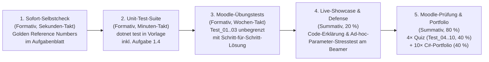

# Lernfortschrittskontrolle, 2-Säulen-Benotung & Vibe-Coding-Assessment
## Lehrveranstaltung: Systemsimulation / Digitaler Zwilling

**Dokument-ID:** `Konzept/03_Beurteilung_und_Pruefungen.md`  
**Studiengang:** Bachelor Automatisierungstechnik (5. Fachsemester), FH Oberösterreich, Campus Wels  
**Begleitdokumente (Single Source of Truth):**
- [`Konzept/01_Didaktik_und_Lernziele.md`](./01_Didaktik_und_Lernziele.md) – Lehrkonzept, Lernziele, Motivation & 150-Min.-Taktung
- [`Konzept/02_Semestermatrix_und_Abhaengigkeiten.md`](./02_Semestermatrix_und_Abhaengigkeiten.md) – Semester-Übersichtsmatrix, Kapitel-Abhängigkeitsmatrix & Goldene Architektur-Regel
- [`Kapitel/00_Prolog/Konzept.md`](../Kapitel/00_Prolog/Konzept.md) bis [`Kapitel/11_Epilog/Konzept.md`](../Kapitel/11_Epilog/Konzept.md) – Autarke Kapitel-Steckbriefe (Vorlesung + Hausübung + Schnittstellen direkt im jeweiligen Kapitelordner)

---

## 1. Überwachung des Lernfortschritts: Die 5-stufige Feedback- & Kontroll-Kaskade

Da moderne KI-Assistenten (GitHub Copilot, Cursor, Claude, ChatGPT) syntaktischen Standard-Code in Sekunden generieren, verlagert die Lehrveranstaltung die Lernfortschrittskontrolle vom bloßen „Abtippen“ auf **fünf ineinandergreifende formative und summative Kontrollstufen**:

1. **Stufe 1 – 5-Sekunden-Selbstkontrolle beim Programmieren (Formativ):**
   - Jede Berechnungsaufgabe in den Aufgabenblättern enthält **Golden Reference Numbers** (konkrete Test-Eingabewerte und das exakt erwartete numerische Kontrollergebnis), damit Studierende Vorzeichen-, Einheiten- oder Formelfehler sofort beim Coden bemerken.
2. **Stufe 2 – Automatisierte Unit-Test-Verifikation zu Hause (Formativ):**
   - Jede Projektvorlage (`Vorlage/Tests/`) enthält deterministische MSTest-Prüfungen (`dotnet test`) gegen analytische Grenzfälle und Erhaltungssätze. In `Aufgabe 1.4` aktivieren bzw. vervollständigen die Studierenden eigene Assertions zur Absicherung ihrer Stufe-1-Lösung.
3. **Stufe 3 – Formative Moodle-Vorbereitungstests (`Test_01` bis `Test_03`):**
   - Vor jedem der 4 Quiz-Termine stehen in Moodle **3 vollwertige Vorbereitungstests** (`Quiz/Test_01_Vorbereitung.md`–`Test_03_Vorbereitung.md`) zum unbegrenzten Üben bereit – inklusive spezifischem Fehler-Feedback für jede Option und vollständiger Musterherleitung.
4. **Stufe 4 – Live-Showcase, Code-Defense & Ad-hoc-Parameter-Stresstest im Hörsaal (Summativ, 20 %):**
   - Zu Beginn jedes Termins (ab T02) präsentieren im Rotationsprinzip je **1 Team aus Track A** und **1 Team aus Track B** ihre Lösung live am Beamer, erklären ausgewählte Codezeilen (*„Warum genau diese Zeile?“*) und absolvieren einen **Live-Parameter-Stresstest** durch den Dozenten.
5. **Stufe 5 – Summative Moodle-Prüfungstests (40 %) & C#-Code-Portfolio (40 %):**
   - **4 Moodle-Prüfungen** (gezogen aus `Quiz/Test_04_Pruefung.md`–`Test_10_Pruefung.md` mit invertierter Fragerichtung) + Bewertung der **10 wöchentlichen C#-Portfolio-Abgaben** nach der 10-Punkte-Rubrik.

---

## 2. Das 2-Säulen-Benotungsmodell (40 – 40 – 20) & Notenschlüssel

### 2.1 Master-Board der Leistungsbeurteilung

$$\text{Gesamtprozent } P = 0{,}40 \cdot P_{\text{Quiz}} + 0{,}40 \cdot P_{\text{Portfolio}} + 0{,}20 \cdot P_{\text{Showcase}}$$

| Säule & Anteil | Teilkomponente | Gewicht | Termine / Taktung | Prüfungsformat | Mindestanforderung (Hürde) |
| :--- | :--- | :---: | :--- | :--- | :--- |
| **Säule 1 (40 %)** Theorie & Numerik | **4 Moodle-Tests** (je 10 %) | **40 %** | • **Q1:** T03 (Kap. 00–02) • **Q2:** T05 (Kap. 03–04) • **Q3:** T08 (Kap. 05–07) • **Q4:** T10 (Kap. 08–09) | Präsenz-Quiz zu Terminbeginn (15 Min., 8 Fragen = 10 Pkt., 100 % Auto-Grading) | Mind. **50 %** in Säule 1 ($\ge 20$ von 40 Pkt.) |
| **Säule 2 (60 %)** Praxis, Hausübungen & Diskurs | **Säule 2a: 10 wöchentliche Hausübungen** | **40 %** | Wöchentlich T01–T10 (10 Abgaben à 4 %; T10 ist die finale Hausübung, kein separates Abschlussprojekt) | Git-Abgabe (`Stufe 1` + `Stufe 2: Track A | Track B`) & `dotnet test` | Mind. **50 %** in Säule 2a ($\ge 20$ von 40 Pkt.) |
| | **Säule 2b: Live-Showcase & Code-Defense** | **20 %** | Rotierend zu Beginn von T02–T10 (je 1× Track A, 1× Track B) | Live-Demo am Beamer (6 %), Code-Defense (7 %) & Parameter-Stresstest (7 %) | Mind. **50 %** in Säule 2b ($\ge 10$ von 20 Pkt.) |
| **GESAMT** | **Trianguliertes Assessment** | **100 %** | **Semesterbegleitend (keine Endklausur)** | **40 % Quiz + 40 % Portfolio + 20 % Showcase** | **Gesamtnote $\ge 50\,\%$ + alle 3 Teilhürden $\ge 50\,\%$** |

### 2.2 Verbindlicher Notenschlüssel (Standard FH Oberösterreich)

| Note | Bezeichnung | Prozentbereich | Beschreibung |
| :---: | :--- | :---: | :--- |
| **1** | **Sehr gut** | $90{,}0\,\% \text{ – } 100{,}0\,\%$ | Weit über das Ziel hinausgehende Leistung, souveräne numerische und architektonische Beherrschung. |
| **2** | **Gut** | $80{,}0\,\% \text{ – } 89{,}9\,\%$ | Voll entsprechende Leistung bei überdurchschnittlicher Beherrschung und selbstständiger Problemlösung. |
| **3** | **Befriedigend** | $65{,}0\,\% \text{ – } 79{,}9\,\%$ | Im Wesentlichen entsprechende Leistung mit soliden Kenntnissen und kleineren Mängeln. |
| **4** | **Genügend** | $50{,}0\,\% \text{ – } 64{,}9\,\%$ | Trotz erkennbarer Mängel noch entsprechende Leistung, die alle Mindesthürden ($\ge 50\,\%$) erfüllt. |
| **5** | **Nicht genügend** | $< 50{,}0\,\%$ *(oder Hürde $< 50\,\%$)* | Mindesterfordernisse verfehlt oder K.O.-Kriterium verletzt. |

---

## 3. Säule 1 im Detail: Moodle-Quizzes & 10-Varianten-Architektur (`40 %`)

### 3.1 Strikte Rückwärts-Kausalität & Stoffabgrenzung (`Quiz 01` bis `Quiz 04`)
Da jedes Quiz in den ersten 15 Minuten **vor** dem Theorie-Impuls stattfindet, gilt strikte Rückwärts-Kausalität (siehe auch Kapitel-Abhängigkeitsmatrix in [`Konzept/02_Semestermatrix_und_Abhaengigkeiten.md`](./02_Semestermatrix_und_Abhaengigkeiten.md)):

| Quiz | Zeitpunkt | Geprüfte Kapitel | Kernthemen | Strengstens ausgeschlossen (Tabu!) |
| :---: | :---: | :---: | :--- | :--- |
| **Quiz 01** | Beginn **T03** | **Kap. 00–02** | Modelltaxonomie, Grieves-Zwilling, Expliziter Euler & Heun (RK2), `WriteableBitmap`-Stride (`y * stride + x * 4`), LUT, 2D-FDM-5-Punkt-Stern, Stabilitätsgrenze $s \le 0{,}25$, Randbedingungen. | Vektorgrafik/Canvas (Kap. 03), ScottPlot (Kap. 04), 3D, TPL, FEM/Cholesky, RK4, DES, Bisektion. |
| **Quiz 02** | Beginn **T05** | **Kap. 03–04** | 2D-Welt-Screen-Transformation ($s = \min(s_x,s_y)$, Y-Inversion), DIN-406-Bemaßung, `DrawingVisual`, `ScottPlot 5` Streaming, `CircularBuffer`, Welford-Online-Varianz ($\mu \pm 3\sigma$), `MSAGL`. | **Keine FEM-Gleichungssysteme ($\mathbf{K}\mathbf{u}=\mathbf{f}$) oder Cholesky (erst Kap. 07)!** Kein 3D/OpenGL (Kap. 05+). |
| **Quiz 03** | Beginn **T08** | **Kap. 05–07** | 3D-OpenGL (`OrbitCamera`, Kugelkoordinaten, Gimbal-Lock, $4\times 4$-Matrizen $\mathbf{T}\cdot\mathbf{R}$, `glPushMatrix`), TPL (`Parallel.For`, Amdahl, `Interlocked`, False Sharing), FEM-Steifigkeitsmatrix $\mathbf{K}_{ff}$, Cholesky, Newton-Raphson ($\mathbf{J}$). | Kontinuierliche ODEs höherer Ordnung (RK4), S-Functions & Anti-Windup (Kap. 08), DES (Kap. 09), Bisektion (Kap. 10). |
| **Quiz 04** | Beginn **T10** | **Kap. 08–09** | S-Functions (`ComputeDerivatives`/`Outputs`), Butcher-Tableaus (Euler, Heun, RK4), Steifigkeit, PID Anti-Windup Clamping; DES (`PriorityQueue`, Kendall, Inversionsmethode, Box-Muller, Little's Gesetz $\bar{L} = \lambda_{\text{eff}}\bar{W}$). | Hybride Zero-Crossing-Bisektion, Zeno-Sticking & FMI/VIBN (Kap. 10–11). |

### 3.2 Technische Architektur & Psychometrie der 10 Varianten (`Skripte/moodle_xml_builder.js`)
- **Single Source of Truth:** Jedes Quiz liegt redundanzfrei als 10 modulare Markdown-Dateien (`Test_01_Vorbereitung.md` bis `Test_03_Vorbereitung.md` und `Test_04_Pruefung.md` bis `Test_10_Pruefung.md` samt `README.md`) im jeweiligen Kapitel-Unterordner `Kapitel/XX_*/Quiz/` (`03`, `05`, `08`, `10`) und wird über `npm run export:moodle` (`Skripte/moodle_xml_builder.js`) direkt im selben Ordner zu einer einzigen importfertigen Master-XML (`Kapitel/XX_*/Quiz/Quiz_0X_Termin_YY.xml`, via `.gitignore` als Build-Artefakt ausgeschlossen) kompiliert.
- **Voller Fragetypen-Mix (8 Fragen = 10,0 Pkt., 100 % Auto-Grading):**
  - 2–3 Rechen-/Code-Tracing-Fragen (`numerical` mit 50-%-Teilpunkte-Antworten für typische Einheiten-/Vorzeichenfallen sowie `cloze` für mehrstufige Rechnungen),
  - 1–2 interaktive Code-/Pipeline-Fragen (`gapselect` & `ddwtos`),
  - 1 Konzept-Zuordnungsfrage (`matching` mit 1–2 leeren Überhang-Distraktoren),
  - 2–3 längensymmetrische Diagnose-Fragen (`multichoice` Single-Choice & Multiple-Select, max. $\pm 25\,\%$ Längenabweichung, keine Formeln im Fragetext verraten).
- **Inversion der Fragerichtung gegen Schablonen-Lernen:** Die Prüfungs-Varianten (`Test_04..10`) kehren gegenüber den Vorbereitungs-Varianten (`Test_01..03`) systematisch die gesuchte Zielgröße um (z. B. kritische Gitterweite $\Delta x_{\min}$ bei gegebenem $\Delta t$ statt $\Delta t_{\max}$ bei gegebenem $\Delta x$).

---

## 4. Säule 2 im Detail: Portfolio-Rubrik, Stresstest & AI Honor Code (`60 %`)

### 4.1 Demaskierung: Reine KI-Schein-Animation vs. Echte Numerische Simulation (4-Stufen-Stresstest)
Bei der Portfolio-Abnahme und im Live-Showcase am Beamer prüft der Dozent mit vier Ad-hoc-Tests, ob hinter der Oberfläche eine echte mathematisch-numerische Simulation arbeitet:

| Stresstest am Beamer | Reaktion einer KI-Schein-Animation (**K.O. / 0 Pkt.**) | Reaktion einer echten Physik-Simulation (**Exzellent**) |
| :--- | :--- | :--- |
| **1. Zeitschritt-Test ($\Delta t \to 5 \cdot \Delta t$)** | Läuft in 5-facher Zeitraffer-Geschwindigkeit ab (weil fest pro Frame verschoben wird) oder friert ein. | Realzeit-Geschwindigkeit bleibt erhalten; der numerische Diskretisierungsfehler wächst erwartungsgemäß bis zur Stabilitätsgrenze ($s > 0{,}25$ / Euler-Drift). |
| **2. Massen-/Parameter-Test ($m \to 2 m$)** | Bewegung bleibt unverändert (`m` ist nur eine wirkungslose Dummy-Variable). | Beschleunigung halbiert sich ($a = F/m$); Eigenfrequenz und Bremsweg ändern sich physikalisch konsistent. |
| **3. Erhaltungssatz-Test (Dämpfung $d \to 0$, $e = 1$)** | Energie driftet unkontrolliert weg oder wird durch versteckte `Math.Clamp`-Hacks künstlich gedeckelt. | Gesamtenergie $E_{\text{tot}} = E_{\text{kin}} + E_{\text{pot}}$ bleibt im Rahmen der Solver-Ordnung ($\mathcal{O}(\Delta t^p)$ bzw. mit Bisektion) erhalten. |
| **4. Geometrie- & Singularitäts-Test** | Verzerrte Grafik bei 32:9-Fenster; unbemerkter Geisterdurchgang (*Tunneling*) oder unbehandelter Absturz. | Isotrope Skalierung bleibt formtreu; Cholesky meldet Unterbestimmtheit sauber; Zero-Crossing-Bisektion fängt Stöße exakt auf der Randfläche ab. |

### 4.2 Bewertungsrubrik für Säule 2a: C#-Code-Portfolio (40 % = 10 Übungen à 4 %)
Jede wöchentliche Hausübung wird nach der im jeweiligen `Aufgabenblatt.md` ausgewiesenen **10-Punkte-Rubrik** bewertet, die für Track A und Track B identisch gewichtet ist:
1. **Mathematische Modelltreue & Kernalgorithmus (3 Pkt.):** Korrekte Umsetzung von Stufe 1 (`1.1`–`1.4`) und der gewählten Stufe-2-Gleichungen (keine Schein-Animation).
2. **Softwarearchitektur & Performance (3 Pkt.):** Einhaltung der Goldenen Regel (Entkopplung Physik $\leftrightarrow$ UI), 0 Byte Heap-Allokationen im Zeitschritt/Render-Loop, flüssige Darstellung ($\ge 30\,\text{FPS}$).
3. **Ausbau-Funktionalität & Grenzfallbehandlung (2 Pkt.):** Vollständige Umsetzung der 4 Arbeitspakete (`A.1`–`A.4` bzw. `B.1`–`B.4`) inkl. Schutzmaßnahmen (Clamping, Anti-Windup, Bisektion).
4. **Automatisierte Verifikation & Dokumentation (2 Pkt.):** Grüne Unit-Tests (`dotnet test`) inkl. `Aufgabe 1.4` sowie nachvollziehbare Kurzdokumentation.

### 4.3 Bewertungsrubrik für Säule 2b: Live-Showcase & Code-Defense am Beamer (20 %)
1. **Live-Demonstration & Dynamik (6 %):** Startet sofort, läuft flüssig ($\ge 30\,\text{FPS}$), zeigt korrekte Geometrie/Physik und interaktive Bedienbarkeit.
2. **Code-Auskunftsfähigkeit / „Warum genau diese Zeile?“ (7 %):** Beide Teammitglieder erklären jede ausgewählte Codezeile und die 4 Showcase-Leitfragen des Aufgabenblatts souverän ohne Rückgriff auf *„Das hat die KI geschrieben“*.
3. **Bestehen des Live-Parameter-Stresstests (7 %):** Das Team setzt eine spontane Parameteränderung innerhalb von 2–3 Minuten live im Code um, prognostiziert die Systemreaktion vorab und ordnet das Ergebnis fachlich ein.

### 4.4 FH OÖ AI Honor Code („Verantwortung statt Verbot“) & K.O.-Kriterien
- **Erlaubt & erwünscht:** Nutzung von KI-Assistenten (Copilot, Cursor, Claude, ChatGPT) für UI-Scaffolding, Refactoring, Fehlersuche und als Lern-Tutor.
- **Uneingeschränkte Haftung:** Wer Code abgibt, haftet zu 100 % für dessen Korrektheit und Erklärbarkeit.
- **K.O.-Kriterien (0 Punkte auf den betreffenden Prüfungsteil):**
  1. Abgabe einer reinen **Schein-Animation** ohne zugrundeliegende numerische DGL-/LGS-/Ereignis-Berechnung.
  2. **Totalausfall in der Code-Defense** (Unfähigkeit, den eigenen eingereichten Code zu erklären) oder Verweigerung des Live-Parameter-Stresstests.
