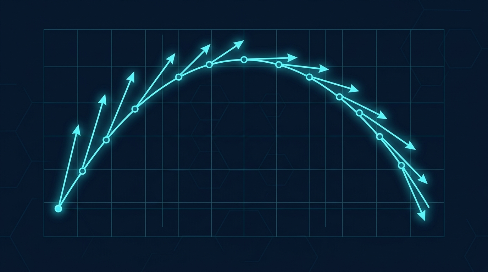

### Termin 01: Modellbegriff, Kinematik & Expliziter Euler
*(Vorlesungskapitel: 00 Prolog & 01 Einführung)*

Zum Auftakt klären wir die Taxonomie technischer Modelle, das Konzept des Digitalen Zwillings nach Michael Grieves sowie die Grundlagen der numerischen Zeitdiskretisierung. Wir überführen kontinuierliche Bewegungsgleichungen zweiter Ordnung unter Erdbeschleunigung in Zustandsraumdarstellungen erster Ordnung und implementieren den expliziten Euler-Integrator in C#.

**Übungsaufgaben für diesen Termin:**
* **Stufe 1 (Basisaufgabe):** C#-Konsolenmodell für den freien Fall und schiefen Wurf im Vakuum sowie analytischer Abgleich mit der geschlossenen Freifall-Lösung.
* 🏭 **Stufe 2 – Track A (Industrie):** *Hydraulikzylinder-Dämpfung* – Modellierung nichtlinearer Blendenreibung, Parameterstudie und Vergleich mit dem Heun-Verfahren (Runge-Kutta 2. Ordnung).
* 🎮 **Stufe 2 – Track B (Game):** *„Artillery Strike / Retro Tanks“* – 2D-Ballistik mit quadratischem Luftwiderstand, dynamischen Windböen und exakter Bodenkollisions-Interpolation.
* *(Hinweis: Wählen Sie für Stufe 2 genau einen Track – Track A ODER Track B!)*
