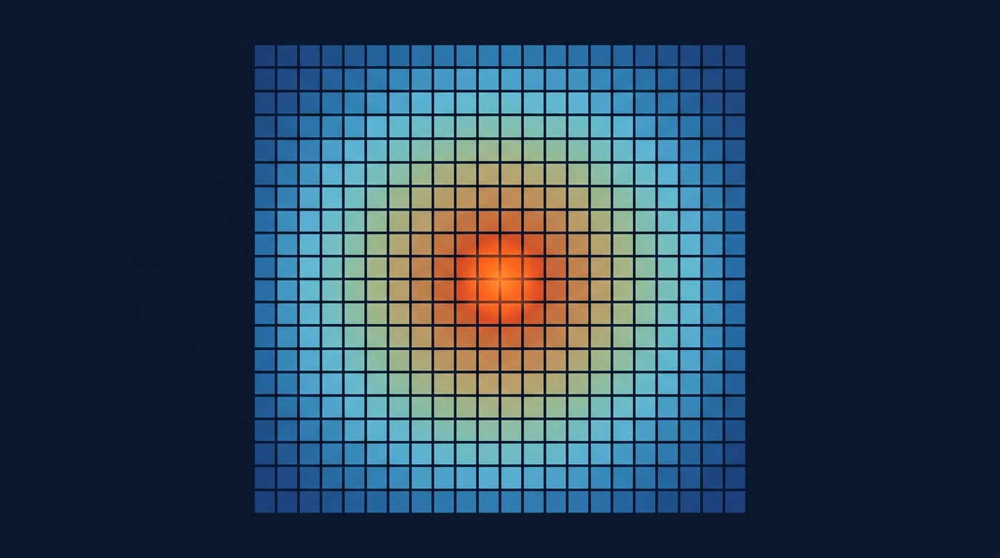

### Termin 02: 2D-Pixelgrafik, Direct Memory & FDM-Feldsimulation
*(Vorlesungskapitel: 02 Visualisierung 2D Pixel)*

Heute steigen wir in die High-Performance-Pixelgrafik unter WPF ein. Wir analysieren die Performance-Grenzen herkömmlicher UI-Controls bei Feldsimulationen und nutzen Direct-Memory-Zugriffe auf den Bildspeicher einer WriteableBitmap (Stride-Berechnung, Zeigerarithmetik, allokationsfreier Pointer-Swap). Darauf aufbauend diskretisieren wir die 2D-Wärmeleitungsgleichung mittels Finite-Differenzen-Methode (FDM 5-Punkt-Stern) und beweisen die fundamentale CFL-Stabilitätsgrenze (Stabilitätsfaktor s kleiner oder gleich 0,25).

**Ablauf & Übungsaufgaben:**
* 🎤 **Showcase T01:** Zwei ausgewählte Teams (1x Track A, 1x Track B) führen ihre Ballistiklösungen der Vorwoche live am Beamer vor (inkl. Code-Defense und Parameter-Stresstest).
* **Stufe 1 (Basisaufgabe):** Interaktive WPF-Heatmap mit Direct-Pointer-Transfer und stabiler 2D-Diffusionsschleife.
* 🏭 **Stufe 2 – Track A (Industrie):** *CPU-Kühlkörper-Optimierung* – Mehrzonengitter aus Silizium und Kupfer mit Konvektionsrand und Hotspot-Thermometrie.
* 🎮 **Stufe 2 – Track B (Game):** *„Falling Sand & Doom Fire / Lava“* – Interaktive zelluläre Pixel-Physik mit aufsteigender Glut und Maus-Zeichenfunktion.
