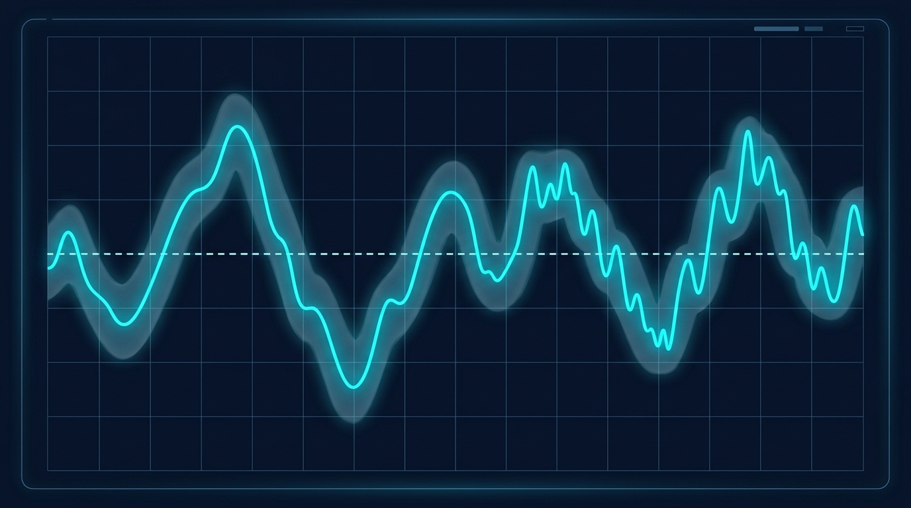

### Termin 04: Echtzeit-Telemetrie, Diagramme & ScottPlot 5
*(Vorlesungskapitel: 04 Visualisierung 2D Diagramme)*

Simulationen erfordern den kontinuierlichen Einblick in Zustandsverläufe. In dieser Einheit integrieren wir die moderne Bibliothek ScottPlot 5 in WPF. Wir lernen allokationsfreie Ringpuffer kennen, um den Garbage Collector bei 50 bis 100 Hz Streaming-Frequenz zu entlasten, und implementieren den numerisch stabilen Online-Algorithmus nach Welford zur Berechnung von laufendem Mittelwert, Varianz und dynamischen 3-Sigma-Toleranzbändern ohne Auslöschungsfehler.

**Ablauf & Übungsaufgaben:**
* 🎤 **Showcase T03:** Zwei ausgewählte Teams präsentieren ihre Canvas-Vektorgrafiken und Fachwerkträger-Viewer am Beamer.
* **Stufe 1 (Basisaufgabe):** Ruckelfreies ScottPlot 5 Dashboard mit Datenstreaming und Welford-Statistik.
* 🏭 **Stufe 2 – Track A (Industrie):** *1-kHz-Vibrationsmonitoring & Leitstand* – Spektrale Grenzwertüberwachung, historische Trends und Anomalie-Erkennung.
* 🎮 **Stufe 2 – Track B (Game):** *„Retro Arcade Racing Telemetry“* – Live-G-Kräfte, Geschwindigkeits-Streaming und Streckenprofil-Graph via MSAGL.
