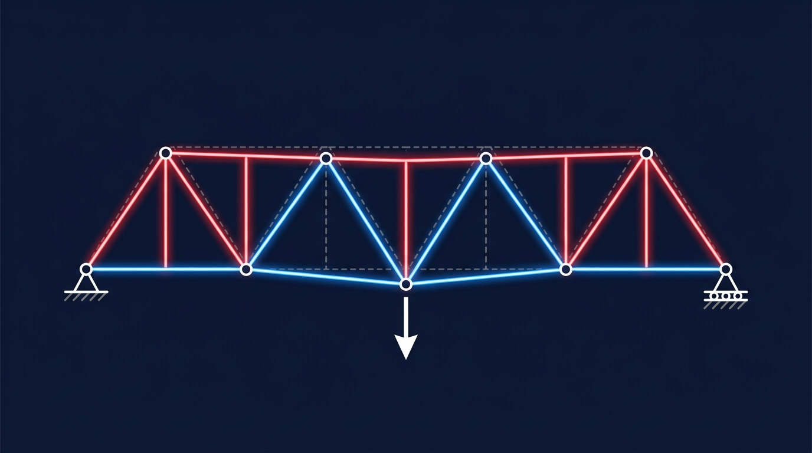

### Termin 07: Statische Systeme, FEM-Fachwerke & Cholesky-Löser
*(Vorlesungskapitel: 07 Statische Modelle)*

Heute erwecken wir die Vektor-Fachwerke aus Termin 03 statisch zum Leben! Wir leiten die finite Elementformulierung für elastische 2D-Fachwerkstäbe her: Aufstellen der Elementsteifigkeitsmatrix, Assemblierung der Gesamtsteifigkeitsmatrix und Blockpartitionierung nach freien und gelagerten Freiheitsgraden. Zur hocheffizienten Lösung des symmetrisch positiv definiten Gleichungssystems binden wir die Cholesky-Zerlegung via Math.NET Numerics ein und visualisieren Verformungen und Stabkräfte mit Farbcodes im Canvas.

**Ablauf & Übungsaufgaben:**
* 🎤 **Showcase T06:** Zwei ausgewählte Teams präsentieren ihre Multithreading-Benchmarks und Speedup-Messungen am Beamer.
* **Stufe 1 (Basisaufgabe):** Aufstellen der Elementmatrix und Cholesky-Lösung für einen 3-Knoten-Kragträger mit Vergleich gegen geschlossene Handrechnung.
* 🏭 **Stufe 2 – Track A (Industrie):** *Portalkran-Verformung unter Wanderlast* – Verschiebung mit Überhöhung, Nachweis des globalen Kräftegleichgewichts und Spannungs-Farbcodierung.
* 🎮 **Stufe 2 – Track B (Game):** *„Bridge Constructor Physics Engine“* – Kontinuierliche Cholesky-Berechnung bei LKW-Überfahrt mit Stabbruch bei Grenzlast und animiertem Einsturz.
