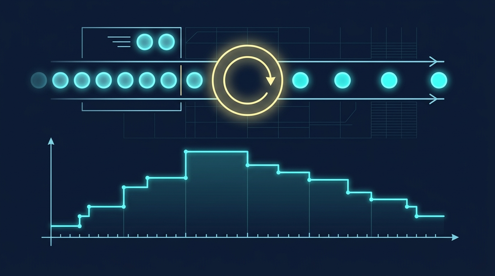

### Termin 09: Diskrete Systeme & Diskrete Ereignissimulation (DES)
*(Vorlesungskapitel: 09 Dynamische Modelle Diskret)*

Nicht alle Systeme ändern sich kontinuierlich – viele industrielle Prozesse werden durch diskrete Ereignisse gesteuert. In dieser Einheit implementieren wir eine Diskrete Ereignissimulation mit einer Future Event List auf Basis der generischen .NET PriorityQueue. Wir nutzen die stochastische Inversionsmethode zur Erzeugung exponentiell verteilter Zwischenankunfts- und Bedienzeiten und verifizieren Littles Gesetz (mittlere Kundenanzahl gleich Ankunftsrate mal Verweilzeit) empirisch an M/M/1- und M/M/c-Warteschlangensystemen.

**Ablauf & Übungsaufgaben:**
* 🎤 **Showcase T08:** Zwei ausgewählte Teams präsentieren ihre S-Function-Modelle und Regelkreise mit Anti-Windup am Beamer.
* **Stufe 1 (Basisaufgabe):** Event-Queue-Schleife mit zeitgewichteter Schlängelänge und Durchlaufzeit.
* 🏭 **Stufe 2 – Track A (Industrie):** *Automobil-Lackierstraße* – Mehrkanal-Wartesystem mit Puffergrößenoptimierung und Abgleich gegen Littles Gesetz.
* 🎮 **Stufe 2 – Track B (Game):** *„Theme Park Rush / Rollercoaster Queue“* – Freizeitpark-Warteschlangen mit Fastpass-Prioritäten und Monte-Carlo-Simulation.
