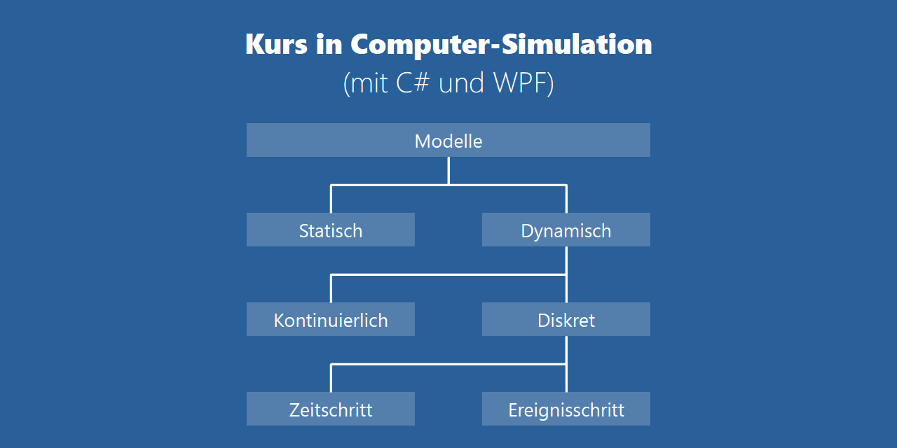
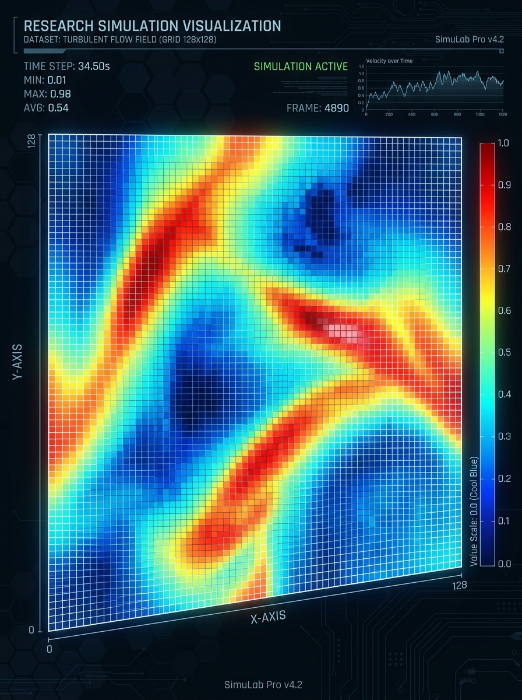

# Systemsimulation / Digitaler Zwilling mit C#

Dies ist das Repository für die Lehrveranstaltung **Systemsimulation / Digitaler Zwilling** (Bachelor *Automatisierungstechnik*, 5. Semester, 3 ECTS = 75 h, 10 Termine à 150 Min.) an der **Fachhochschule Oberösterreich** (Campus Wels), geleitet von **Prof. Dr. Georg Hackenberg**.

Der Kurs vermittelt die mathematische Modellierung, numerische Simulation und Echtzeit-Visualisierung technischer Systeme in **C# / .NET / WPF**:
1. **Block 1 – Echtzeit-Visualisierung (Termine 01–05):** Hardwarenahe 2D-Rastergrafik (`WriteableBitmap`), 2D-Vektorgrafik (`WPF Canvas` & `DrawingVisual`), Echtzeit-Telemetrie (`ScottPlot 5`) & topologische Graphen (`MSAGL`) sowie 3D-Echtzeitrendering mit `SharpGL` (Szenengraphen & Kugelkoordinaten-Orbitkamera).
2. **Scharnier – Parallelisierung (Termin 06):** Multi-Core-Parallelisierung mit der Task Parallel Library (`Parallel.For`), Thread-Entkopplung und allokationsfreie Speicherstrategien.
3. **Block 2 – Physikalische Simulationsmodelle & Synthese (Termine 07–10):** Statische Systeme (2D/3D-Fachwerke via `Math.NET Numerics` & Cholesky-Zerlegung), kontinuierliche dynamische Systeme (ODE-Solver, S-Functions, Anti-Windup), ereignisdiskrete Systeme (DES, Monte-Carlo, Welford-Akkumulator) sowie hybride Systeme (Nullstellensuche via Bisektion, Zeno-Schutz, FMI/FMU & Virtuelle Inbetriebnahme).

---

## Repository-Struktur

- **[`./Konzept/`](./Konzept/)** – Redundanzfreie, modular nummerierte Single-Source-of-Truth-Konzeptdokumente (`01`–`13`):
  1. [`01_Didaktik_und_Lernziele.md`](./Konzept/01_Didaktik_und_Lernziele.md) – Zielgruppenprofil, Lernziele (Bloom-Kaskade), Motivation (*Pick your Track*), *Low Floor, High Ceiling* und 150-Min.-Taktung.
  2. [`02_Semestermatrix_und_Abhaengigkeiten.md`](./Konzept/02_Semestermatrix_und_Abhaengigkeiten.md) – Semester-Übersichtsmatrix, Kapitel-Abhängigkeitsmatrix, 2-Stufen-Hausübungsmodell & Goldene Architektur-Regel.
  3. [`03_Beurteilung_und_Pruefungen.md`](./Konzept/03_Beurteilung_und_Pruefungen.md) – 5-stufige Lernfortschrittskontrolle, Benotungsmodell (40 % Quiz / 40 % Hausübungen / 20 % Showcase) und AI Honor Code.
  4. [`04_Termin_01_Kinematik_und_Euler.md`](./Konzept/04_Termin_01_Kinematik_und_Euler.md) bis [`13_Termin_10_Hybride_Dynamik_Synthese.md`](./Konzept/13_Termin_10_Hybride_Dynamik_Synthese.md) – Die 10 autarken Termin-Steckbriefe (Vorlesung + Hausübung + Schnittstellen pro Termin).
- **[`./Folien/`](./Folien/)** – MARP-Vorlesungsfolien (`00_Prolog` bis `11_Epilog`) inkl. lokaler `Diagramme/*.svg`, `Illustrationen/`, `Screenshots/` und `Tafelbilder/`.
- **[`./Uebungen/`](./Uebungen/)** – Die 10 wöchentlichen Übungsmodule (`Termin_01_*` bis `Termin_10_*`) mit `Aufgabenblatt.md` und kompilierbaren C#-Projektvorlagen (`./Vorlage/` inkl. xUnit-Tests).
- **[`./Moodle/`](./Moodle/)** – Selbständige Moodle-Abschnittsordner ([`00_Kurs_Kopfbereich/`](./Moodle/00_Kurs_Kopfbereich/Text.md) bis [`10_Termin_10_Hybride_Dynamik_Synthese/`](./Moodle/10_Termin_10_Hybride_Dynamik_Synthese/Text.md), jeweils mit formelfreiem `Text.md` und `Banner.jpg`) sowie 10-Varianten-Moodle-XML-Quizzes (`Quiz_01_*` bis `Quiz_04_*`).
- **[`./Export/`](./Export/)** – Druckreife PDFs der Vorlesungsfolien (`./Export/Folien/`) und Übungsblätter (`./Export/Uebungen/`).
- **[`./Skripte/`](./Skripte/)** – Automatisierte Node.js-Prüf-, SVG-Generierungs-, Moodle-XML- und PDF-Exportskripte.
- **[`./Quellen/`](./Quellen/) & [`./Werkzeuge/`](./Werkzeuge/)** – Reiner C#-Referenzcode (`Quellen.sln`, dessen Architektur- und Modellklassen auf den Vorlesungsfolien erklärt werden) sowie der HiDPI-Plotgenerator (`Werkzeuge/GrafikGenerator/`).

---

## Kursinhalte & Termine im Überblick

| Kapitel / Termin | Vorlesungsfolien | Übungsmodul (`Uebungen/`) |
| :--- | :--- | :--- |
|  | **[Prolog](./Folien/00_Prolog/Folien.md)**<br>Organisatorisches, Lernziele, *Pick your Track* und Überblick über die Semesterstruktur. | – *(Teil von Termin 01)* |
|  | **[Kapitel 1: Einführung & Digitaler Zwilling](./Folien/01_Einführung/Folien.md)**<br>Modelltaxonomie, analytische vs. numerische Lösung, Euler-/Heun-Integration und Digitaler Zwilling. | **[Termin 01: Kinematik & Euler](./Uebungen/Termin_01_Kinematik_und_Euler/Aufgabenblatt.md)** |
|  | **[Kapitel 2: 2D-Visualisierung (Pixel)](./Folien/02_Visualisierung_2D_Pixel/Folien.md)**<br>Direkte Rastergrafik mit `WriteableBitmap`, Stride-Speicherlayout, Farbtabellen (LUTs) und 2D-FDM-Wärmeleitung. | **[Termin 02: Pixelgrafik & FDM](./Uebungen/Termin_02_Pixelgrafik_und_FDM/Aufgabenblatt.md)** |
|  | **[Kapitel 3: 2D-Visualisierung (Vektor)](./Folien/03_Visualisierung_2D_Vektor/Folien.md)**<br>Geometrische Vektorgrafik mit `WPF Canvas`, Welt-zu-Bildschirm-Transformationen und `DrawingVisual`-Pipeline. | **[Termin 03: Vektorgrafik & Canvas](./Uebungen/Termin_03_Vektorgrafik_und_Canvas/Aufgabenblatt.md)** |
|  | **[Kapitel 4: Diagramme & Graphen](./Folien/04_Visualisierung_2D_Diagramme/Folien.md)**<br>Echtzeit-Telemetrie mit `ScottPlot 5` (Ringpuffer), MVVM-Entkopplung und topologische Graphen mit `MSAGL`. | **[Termin 04: ScottPlot & MSAGL](./Uebungen/Termin_04_ScottPlot_und_MSAGL/Aufgabenblatt.md)** |
|  | **[Kapitel 5: 3D-Visualisierung (OpenGL)](./Folien/05_Visualisierung_3D_OpenGL/Folien.md)**<br>3D-Rendering mit `SharpGL`, hierarchische Szenengraphen, parametrische Körper und Orbit-Kamera. | **[Termin 05: 3D OpenGL & Szenengraph](./Uebungen/Termin_05_3D_OpenGL_Szenengraph/Aufgabenblatt.md)** |
|  | **[Kapitel 6: Multithreading & Performance](./Folien/06_Multithreading/Folien.md)**<br>Multi-Core-Parallelisierung mit `Parallel.For`, Race-Condition-Schutz, Double-Buffering und Thread-Entkopplung. | **[Termin 06: Multithreading & TPL](./Uebungen/Termin_06_Multithreading_und_TPL/Aufgabenblatt.md)** |
|  | **[Kapitel 7: Statische Modelle](./Folien/07_Statische_Modelle/Folien.md)**<br>Ideale und elastische 2D/3D-Fachwerke, Steifigkeitsmatrizen $\mathbf{K}\vec{u}=\vec{f}$ und Cholesky-Zerlegung (`Math.NET`). | **[Termin 07: Statik, FEM & Cholesky](./Uebungen/Termin_07_Statik_FEM_Cholesky/Aufgabenblatt.md)** |
|  | **[Kapitel 8: Kontinuierliche Dynamische Modelle](./Folien/08_Dynamische_Modelle_Kontinuierlich/Folien.md)**<br>Zustandsraum & DGLs, Euler/Heun/RK4, Steifheit, algebraische Schleifen, S-Functions und Anti-Windup-Regelung. | **[Termin 08: DGL & S-Functions](./Uebungen/Termin_08_DGL_und_SFunctions/Aufgabenblatt.md)** |
|  | **[Kapitel 9: Diskrete Dynamische Modelle](./Folien/09_Dynamische_Modelle_Diskret/Folien.md)**<br>Ereignisdiskrete Simulation (DES, `PriorityQueue`), Stochastik, paralleles Monte-Carlo und Welford-Akkumulator. | **[Termin 09: Diskrete Systeme & DES](./Uebungen/Termin_09_Diskrete_Systeme_DES/Aufgabenblatt.md)** |
|  | **[Kapitel 10: Hybride Dynamische Modelle](./Folien/10_Dynamische_Modelle_Hybrid/Folien.md)**<br>Kopplung kontinuierlicher DGLs mit State Events, Vorzeichenwechsel-Bisektion, Zeno-Effekt und hybride S-Functions. | **[Termin 10: Hybride Dynamik & Synthese](./Uebungen/Termin_10_Hybride_Dynamik_Synthese/Aufgabenblatt.md)** |
|  | **[Kapitel 11: Epilog & Synthese](./Folien/11_Epilog/Folien.md)**<br>Vergleichende Modell-Taxonomie, Multi-Fidelity-Simulation, Co-Simulation (FMI/FMU) und Virtuelle Inbetriebnahme (VIBN). | – *(Teil von Termin 10)* |

---

## Qualitätssicherung, Build & PDF-Export

```powershell
# 1. Vollständige Validierung aller Foliensätze (DOM-Layout, Abschnittsschema, SVGs, Variablen-Konsistenz)
npm run lint

# 2. Gezielte Prüfung eines einzelnen Kapitels (z.B. Kapitel 05)
npm run lint:slides:05
npm run lint:sections:05
npm run lint:svg:05
npm run lint:variables:05

# 3. Druckreife PDFs erzeugen (Vorlesungsfolien & Übungsblätter -> Export/)
npm run export:pdf

# 4. HiDPI-Plots für die Vorlesungsfolien neu generieren
npm run generate:plots

# 5. Referenz-Solution in Quellen/ kompilieren und testen
dotnet test Quellen/Quellen.sln -c Release
```
